**Volume 04. Mobile Manipulation Software and Operations**


# Chapter 01. ROS2 Architecture

##  

## 01 ROS2 Overview

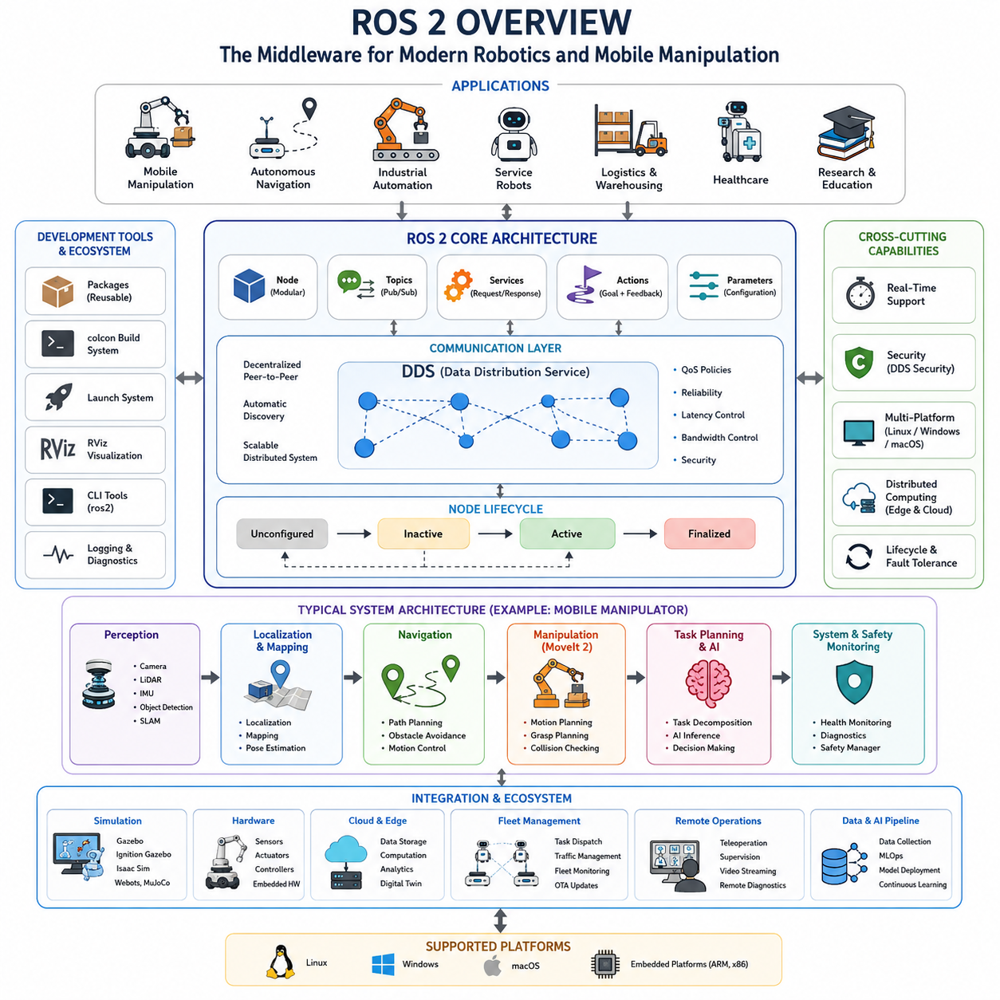{width="7.268055555555556in" height="7.268055555555556in"}

Robot Operating System 2 (ROS 2) has become the de facto software framework for modern robotics systems and serves as the foundational middleware layer for autonomous mobile robots, robotic manipulators, mobile manipulators, service robots, industrial robots, autonomous vehicles, and emerging embodied AI systems. As robotics platforms have evolved from isolated machines into highly distributed cyber-physical systems, the need for a scalable, modular, real-time capable, and industry-ready software architecture has become increasingly important. ROS 2 was developed to address these requirements and represents a major evolution beyond the original ROS framework. Within modern mobile manipulation systems, ROS 2 acts as the central nervous system that connects perception, planning, control, communication, simulation, cloud integration, and fleet management into a unified software ecosystem.

The original ROS architecture was introduced to accelerate robotics research by providing reusable software components, standardized communication mechanisms, and a large open-source ecosystem. While ROS revolutionized robotics development, its architecture was primarily designed for laboratory environments and research applications. As robots began moving into factories, warehouses, hospitals, logistics centers, public spaces, and outdoor environments, new requirements emerged. Industrial deployments demanded higher reliability, deterministic communication, enhanced security, fault tolerance, lifecycle management, distributed computing, and support for heterogeneous hardware platforms. ROS 2 was created to satisfy these industrial requirements while preserving the flexibility and openness that made ROS successful.

At its core, ROS 2 is not an operating system in the traditional sense. Instead, it is a robotics middleware framework that runs on top of operating systems such as Linux, Windows, and macOS. ROS 2 provides communication services, software libraries, development tools, runtime management capabilities, and standardized interfaces that simplify the creation of complex robotic applications. Developers can focus on robot functionality rather than building communication infrastructures from scratch.

One of the most important concepts in ROS 2 is modularity. Modern robotic systems consist of many independent subsystems that must work together in real time. A mobile manipulator, for example, may include perception modules, localization modules, mapping systems, navigation algorithms, motion planners, manipulator controllers, safety systems, user interfaces, fleet management software, and cloud connectivity services. ROS 2 allows each subsystem to be developed as an independent software component called a node. These nodes communicate through standardized interfaces while remaining loosely coupled. This architectural approach improves maintainability, scalability, testability, and reusability.

The ROS 2 communication architecture is built on top of the Data Distribution Service (DDS), an industry-standard middleware technology widely used in aerospace, defense, autonomous vehicles, industrial automation, and mission-critical systems. DDS replaces the centralized ROS Master used in ROS 1 and enables a fully decentralized communication model. In this architecture, nodes automatically discover each other across networks without relying on a central server. This decentralized design improves reliability and removes single points of failure that could compromise system operation.

The adoption of DDS provides numerous benefits. It enables peer-to-peer communication, supports distributed computing, improves network scalability, and introduces configurable Quality of Service (QoS) policies. These QoS settings allow developers to control reliability, durability, latency, bandwidth utilization, and message delivery guarantees. Such flexibility is critical because different robotic data streams have different communication requirements. High-frequency LiDAR data may prioritize low latency, while mission-critical safety messages may require guaranteed delivery.

ROS 2 communication is organized around several core concepts including topics, services, actions, and parameters. Topics provide asynchronous publish-subscribe communication and are typically used for streaming sensor data, robot states, localization information, camera images, point clouds, and telemetry information. Services support synchronous request-response interactions and are commonly used for configuration tasks, status queries, and command execution. Actions extend the service model by supporting long-running operations with feedback and cancellation capabilities. Parameters provide standardized mechanisms for configuring software components at runtime.

The node architecture of ROS 2 forms the foundation of all robotic applications. Each node performs a specific function and communicates with other nodes through defined interfaces. For example, a mobile manipulator may include a camera node responsible for image acquisition, an object detection node responsible for identifying objects, a localization node responsible for determining robot position, a navigation node responsible for path planning, and a manipulator control node responsible for executing grasping motions. By separating functionality into independent nodes, developers can replace, upgrade, or test individual subsystems without affecting the rest of the system.

ROS 2 also introduces lifecycle management capabilities that are particularly important in industrial robotics. Lifecycle nodes allow software components to transition through well-defined states such as unconfigured, inactive, active, and finalized. This approach enables controlled startup sequences, safe shutdown procedures, fault recovery mechanisms, and deterministic system initialization. In large robotic deployments involving dozens or hundreds of robots, lifecycle management significantly improves operational reliability.

Another critical feature of ROS 2 is its support for real-time systems. Many robotic applications require deterministic timing behavior. Examples include motor control, collision avoidance, force control, and safety monitoring. ROS 2 has been designed with real-time operation in mind and supports integration with real-time operating systems and real-time Linux kernels. Memory allocation strategies, executor architectures, communication mechanisms, and scheduling techniques can be optimized to achieve predictable execution behavior.

The ROS 2 software ecosystem is built around reusable packages. A package contains source code, configuration files, launch scripts, documentation, and dependencies required for a particular functionality. Thousands of open-source ROS 2 packages are available through the global robotics community. These packages cover areas such as navigation, localization, perception, machine learning, manipulation, simulation, diagnostics, fleet management, and system monitoring. Developers can leverage these packages to accelerate development and reduce engineering effort.

Package management in ROS 2 relies on workspaces and build systems. A workspace acts as a development environment containing multiple packages that can be compiled and deployed together. The colcon build system is widely used for building ROS 2 applications and managing dependencies. This approach supports modular development workflows and enables large engineering teams to collaborate efficiently on complex robotics projects.

Launch systems play an important role in ROS 2 deployments. A launch file defines how nodes should be started, configured, connected, and monitored. Rather than manually starting dozens of processes, developers can use launch files to initialize complete robotic systems with a single command. Launch configurations support parameterization, conditional execution, namespace management, and distributed deployments across multiple computers.

ROS 2 also provides extensive support for robotic simulation. Simulation environments allow developers to validate algorithms before deploying them on physical robots. Simulators such as Gazebo, Ignition Gazebo, Isaac Sim, Webots, and MuJoCo can be integrated directly with ROS 2. Virtual sensors, physics engines, environmental models, and digital twins enable comprehensive testing under controlled conditions. Simulation reduces development costs, improves safety, accelerates iteration cycles, and enables large-scale testing scenarios that would be difficult to perform in the real world.

For mobile manipulation systems, ROS 2 serves as the integration platform connecting navigation and manipulation capabilities. A mobile manipulator combines autonomous mobility with robotic arm functionality. The navigation subsystem determines where the robot should move, while the manipulation subsystem determines how objects should be grasped and manipulated. ROS 2 provides the communication framework that allows these subsystems to share information and coordinate actions. As a result, the robot can autonomously navigate to a target location, identify an object, plan a grasping strategy, execute manipulation motions, and complete tasks without human intervention.

The perception pipeline in ROS 2 typically involves multiple sensors and processing stages. Cameras, depth sensors, LiDARs, IMUs, radar systems, force sensors, and GNSS receivers continuously generate data. ROS 2 nodes process this data to perform object detection, semantic segmentation, pose estimation, localization, mapping, obstacle detection, and environmental understanding. The outputs of these perception modules are then used by planning and control systems to generate robot actions.

ROS 2 has become increasingly important in AI-enabled robotics. Modern robots rely heavily on deep learning models, foundation models, vision-language models, and embodied AI architectures. ROS 2 provides standardized interfaces that allow AI inference engines to interact with robotic subsystems. Machine learning models can receive sensor data, generate predictions, and transmit results through ROS 2 communication channels. This integration enables intelligent behaviors such as object recognition, scene understanding, language-guided navigation, task planning, and adaptive decision-making.

Cloud and edge computing integration is another area where ROS 2 demonstrates significant advantages. Many modern robotic deployments operate within distributed computing architectures. Computationally intensive tasks such as model training, fleet analytics, digital twin simulation, and large-scale optimization may be executed in cloud environments, while latency-sensitive tasks remain on edge devices. ROS 2 supports this hybrid architecture by enabling communication between robots, edge servers, cloud platforms, and operational control centers.

Security has become a critical requirement as robots become connected to enterprise networks and public infrastructure. ROS 2 addresses this challenge through DDS Security mechanisms that provide authentication, encryption, access control, and secure communication channels. These capabilities are particularly important in healthcare, logistics, industrial automation, defense, and critical infrastructure applications where cybersecurity risks must be carefully managed.

Fleet management systems also rely heavily on ROS 2. Large robotic deployments may involve dozens, hundreds, or even thousands of robots operating simultaneously. ROS 2 enables communication among robots, fleet orchestration systems, operational dashboards, and cloud services. Mission assignments, traffic management, resource allocation, health monitoring, software updates, and performance analytics can all be coordinated through ROS 2-based infrastructures.

One of the key reasons for the widespread adoption of ROS 2 is its strong ecosystem and community support. Universities, research institutions, robotics startups, industrial automation companies, autonomous vehicle developers, healthcare robotics firms, logistics providers, and technology giants actively contribute to ROS 2 development. This collaborative ecosystem accelerates innovation and ensures continuous improvement of the platform.

The future of ROS 2 extends beyond traditional robotics. As embodied AI systems become more capable, robots will increasingly require advanced reasoning, natural language understanding, multimodal perception, autonomous decision-making, and adaptive learning capabilities. ROS 2 provides the foundational software architecture that allows these advanced AI systems to interact with the physical world. It acts as the bridge between digital intelligence and physical execution.

Within the broader context of mobile manipulation software architecture, ROS 2 serves as the foundational layer upon which navigation systems, manipulation frameworks, behavior trees, task planners, digital twins, fleet management platforms, MLOps pipelines, remote operations centers, and safety validation systems are built. The subsequent chapters of this volume explore these components in greater detail, beginning with ROS 2 architecture and progressing through advanced software frameworks required for industrial-scale mobile manipulation deployments. ROS 2 is therefore not merely a middleware platform; it is the software backbone that enables the next generation of intelligent autonomous robotic systems and forms the technological foundation for future embodied AI ecosystems.

ROS 2(Robot Operating System 2)는 현대 로봇 시스템을 위한 사실상의 표준 소프트웨어 프레임워크로 자리 잡았으며, 자율주행 이동로봇(AMR), 산업용 로봇, 서비스 로봇, 모바일 매니퓰레이터, 자율주행차, 그리고 최근의 Embodied AI 시스템에 이르기까지 다양한 로봇 플랫폼의 핵심 미들웨어 역할을 수행하고 있다. 로봇이 단순한 기계 장치에서 복잡한 사이버-물리 시스템(Cyber-Physical System)으로 발전함에 따라 확장성, 실시간성, 안정성, 보안성, 그리고 분산처리 능력을 갖춘 소프트웨어 아키텍처가 필요하게 되었고, ROS 2는 이러한 요구를 충족하기 위해 개발되었다. 특히 모바일 매니퓰레이터 환경에서는 인지, 계획, 제어, 시뮬레이션, 클라우드 연동, 원격 운영, 플릿 관리 등을 하나의 통합된 소프트웨어 생태계로 연결하는 핵심 플랫폼 역할을 수행한다.

기존 ROS는 연구용 로봇 개발을 가속화하기 위해 등장하였다. 공통 인터페이스와 재사용 가능한 소프트웨어 모듈을 제공함으로써 전 세계 연구자들이 빠르게 로봇을 개발할 수 있도록 지원하였다. 그러나 ROS는 주로 연구실 환경을 대상으로 설계되었기 때문에 산업 현장에서 요구되는 실시간성, 보안성, 장애 복구 기능, 분산 시스템 지원, 라이프사이클 관리 기능 등이 부족했다. 이에 따라 ROS 2는 산업용 요구사항을 반영하여 완전히 새로운 구조로 설계되었으며, 연구용 플랫폼에서 산업용 플랫폼으로 진화한 로봇 소프트웨어 프레임워크라고 볼 수 있다.

ROS 2는 이름에 운영체제(Operating System)가 포함되어 있지만 실제 운영체제가 아니다. Linux, Windows, macOS와 같은 운영체제 위에서 동작하는 로봇용 미들웨어 프레임워크이다. ROS 2는 노드 간 통신, 데이터 교환, 시스템 구성, 디버깅, 모니터링, 패키지 관리, 실행 관리 기능 등을 제공하며, 개발자는 이러한 공통 기능을 직접 구현할 필요 없이 로봇의 핵심 기능 개발에 집중할 수 있다.

ROS 2의 가장 중요한 특징 중 하나는 모듈화(Modularity)이다. 현대 로봇은 다양한 기능이 동시에 동작하는 복합 시스템이다. 예를 들어 모바일 매니퓰레이터는 카메라, LiDAR, 위치추정, 경로계획, 장애물 회피, 로봇팔 제어, 작업 계획, 원격 관제, AI 추론 등의 기능을 포함한다. ROS 2는 이러한 기능을 각각 독립적인 노드(Node)로 구성하고, 노드 간 표준화된 통신을 통해 협력하도록 설계되었다. 따라서 특정 기능을 교체하거나 업그레이드하더라도 전체 시스템에 미치는 영향을 최소화할 수 있다.

ROS 2의 통신 구조는 DDS(Data Distribution Service)라는 산업용 미들웨어 기술 위에 구축되어 있다. ROS 1에서는 ROS Master라는 중앙 서버가 필요했지만, ROS 2는 DDS를 사용하여 완전한 분산 구조를 구현하였다. 각 노드는 네트워크 상에서 자동으로 서로를 발견하며, 중앙 서버 없이 직접 통신할 수 있다. 이러한 구조는 단일 장애점(Single Point of Failure)을 제거하고 시스템 신뢰성을 크게 향상시킨다.

DDS의 도입은 ROS 2의 산업적 활용성을 크게 높였다. DDS는 항공우주, 국방, 산업자동화, 자율주행차와 같은 미션 크리티컬 시스템에서 이미 검증된 기술이다. ROS 2는 DDS를 통해 높은 확장성, 분산 처리 능력, 실시간 통신 성능을 확보하였다. 또한 QoS(Quality of Service) 정책을 활용하여 데이터 전송 품질을 세밀하게 제어할 수 있다. 예를 들어 LiDAR 데이터는 낮은 지연시간이 중요하고, 안전 관련 메시지는 반드시 전달되는 신뢰성이 중요하다. ROS 2는 이러한 다양한 요구사항을 각각 최적화할 수 있도록 지원한다.

ROS 2의 통신은 Topic, Service, Action, Parameter라는 네 가지 핵심 개념을 중심으로 구성된다. Topic은 센서 데이터나 상태 정보와 같이 지속적으로 발생하는 데이터를 전송하기 위한 Publish-Subscribe 방식의 통신이다. Service는 요청(Request)과 응답(Response) 구조를 사용하는 동기식 통신 방식이다. Action은 장시간 수행되는 작업을 위한 통신 구조로, 진행 상황 피드백과 작업 취소 기능을 제공한다. Parameter는 런타임 환경에서 노드의 설정값을 관리하기 위한 메커니즘이다.

ROS 2의 노드(Node)는 전체 시스템을 구성하는 가장 기본적인 단위이다. 각 노드는 특정 기능만을 담당한다. 예를 들어 카메라 노드는 이미지 획득을 담당하고, 객체 인식 노드는 물체를 탐지하며, 위치추정 노드는 로봇의 위치를 계산한다. 경로 계획 노드는 이동 경로를 생성하고, 매니퓰레이터 제어 노드는 로봇팔을 제어한다. 이러한 분리 구조는 유지보수성과 확장성을 크게 향상시킨다.

ROS 2는 라이프사이클 노드(Lifecycle Node)를 지원한다는 점에서도 중요한 발전을 이루었다. 노드는 초기화, 비활성화, 활성화, 종료와 같은 명확한 상태를 가진다. 이를 통해 시스템 시작 절차를 안전하게 제어할 수 있으며, 오류 발생 시 특정 노드만 재시작하는 것도 가능하다. 수십 대에서 수백 대 규모의 로봇을 운영하는 산업 환경에서는 이러한 라이프사이클 관리 기능이 매우 중요하다.

실시간 제어(Real-Time Control)는 ROS 2의 또 다른 핵심 특징이다. 모터 제어, 충돌 회피, 힘 제어, 안전 감시와 같은 기능은 일정한 시간 안에 반드시 수행되어야 한다. ROS 2는 실시간 운영체제(RTOS) 및 Real-Time Linux와의 통합을 지원하며, 메모리 관리와 스케줄링 구조를 최적화하여 예측 가능한 실행 성능을 제공할 수 있다.

ROS 2 생태계는 패키지(Package)를 중심으로 구성된다. 패키지는 소스코드, 설정 파일, 실행 스크립트, 문서, 의존성 정보를 포함하는 배포 단위이다. 전 세계 개발자들이 제공하는 수천 개의 오픈소스 패키지를 활용하여 개발 기간을 크게 단축할 수 있다. 내비게이션, SLAM, 객체 인식, 딥러닝, 조작(Manipulation), 시뮬레이션, 플릿 관리 등 거의 모든 분야에 대한 패키지가 존재한다.

개발 과정에서는 워크스페이스(Workspace)와 Colcon 빌드 시스템이 사용된다. 워크스페이스는 여러 패키지를 하나의 개발 환경으로 구성하는 공간이며, Colcon은 패키지 의존성을 관리하고 전체 프로젝트를 빌드하는 역할을 수행한다. 이를 통해 대규모 개발팀도 효율적으로 협업할 수 있다.

ROS 2는 Launch 시스템을 제공하여 복잡한 로봇 시스템을 쉽게 실행할 수 있도록 지원한다. 실제 로봇에는 수십 개 이상의 노드가 동시에 실행되는 경우가 많다. Launch 파일을 사용하면 단일 명령으로 전체 시스템을 시작할 수 있으며, 파라미터 설정, 조건부 실행, 네임스페이스 관리, 분산 실행 등의 기능도 제공한다.

시뮬레이션은 ROS 2 생태계에서 매우 중요한 역할을 수행한다. Gazebo, Ignition Gazebo, NVIDIA Isaac Sim, Webots, MuJoCo와 같은 시뮬레이터는 ROS 2와 직접 연동된다. 개발자는 실제 로봇을 사용하지 않고도 가상 환경에서 알고리즘을 검증할 수 있다. 센서 모델, 물리 엔진, 디지털 트윈 환경을 활용하여 실제 환경과 유사한 테스트를 수행할 수 있으며, 이를 통해 개발 비용과 위험을 크게 줄일 수 있다.

모바일 매니퓰레이터 시스템에서 ROS 2는 이동(Mobility)과 조작(Manipulation)을 연결하는 핵심 역할을 한다. 이동 로봇은 원하는 위치까지 자율적으로 이동하고, 로봇팔은 해당 위치에서 물체를 집거나 조작한다. ROS 2는 두 시스템이 실시간으로 정보를 공유하고 협력할 수 있도록 지원한다. 결과적으로 로봇은 특정 위치로 이동한 후 물체를 인식하고, 최적의 파지 경로를 계산하여 작업을 수행할 수 있다.

ROS 2 기반의 인지 시스템은 카메라, LiDAR, IMU, GNSS, 레이더, 힘 센서 등 다양한 센서로부터 데이터를 수집한다. 이후 객체 인식, 의미론적 분할, 자세 추정, 위치 추정, 지도 생성, 장애물 검출 등의 알고리즘을 통해 환경을 이해한다. 이러한 정보는 경로 계획기와 제어기에 전달되어 실제 행동으로 이어진다.

최근 AI 기반 로봇 기술의 발전과 함께 ROS 2의 중요성은 더욱 커지고 있다. 딥러닝, 비전-언어 모델(VLM), 파운데이션 모델, 로봇 에이전트, Embodied AI 시스템은 모두 ROS 2와 연동되어 동작한다. AI 모델은 ROS 2를 통해 센서 데이터를 입력받고 추론 결과를 다른 노드로 전달한다. 이를 통해 자연어 명령 이해, 객체 인식, 작업 계획, 상황 판단과 같은 고차원 지능 기능을 구현할 수 있다.

클라우드와 엣지 컴퓨팅 환경에서도 ROS 2는 중요한 역할을 수행한다. 로봇은 현장에서 실시간 처리를 수행하는 동시에 클라우드와 연결되어 데이터 분석, 디지털 트윈 운영, AI 모델 학습, 플릿 최적화 등의 작업을 수행할 수 있다. ROS 2는 이러한 분산 컴퓨팅 환경을 자연스럽게 연결하는 통신 플랫폼 역할을 한다.

보안(Security)은 산업용 로봇에서 필수적인 요소이다. ROS 2는 DDS Security 기능을 통해 인증(Authentication), 암호화(Encryption), 접근 제어(Access Control), 보안 통신 기능을 제공한다. 이는 병원, 공장, 물류센터, 공공 인프라와 같은 환경에서 매우 중요한 요구사항이다.

대규모 플릿 운영 환경에서도 ROS 2는 핵심 인프라 역할을 수행한다. 수십 대에서 수천 대의 로봇이 동시에 운영되는 환경에서 ROS 2는 작업 할당, 교통 제어, 배터리 관리, 상태 모니터링, 원격 진단, 소프트웨어 업데이트 등을 지원한다. 이러한 기능은 미래의 스마트 물류센터, 스마트 병원, 스마트 시티 운영의 기반 기술이 될 것이다.

ROS 2가 빠르게 확산된 이유는 강력한 글로벌 생태계 때문이다. 전 세계 대학, 연구기관, 로봇 기업, 산업자동화 기업, 자율주행 기업, AI 기업들이 ROS 2 개발에 참여하고 있으며, 지속적으로 새로운 기능과 패키지가 추가되고 있다.

향후 Embodied AI 시대가 본격적으로 도래하면 로봇은 단순한 자동화 장비를 넘어 스스로 이해하고 판단하며 행동하는 지능형 에이전트로 발전하게 된다. ROS 2는 이러한 미래 로봇 시스템에서 디지털 지능과 물리 세계를 연결하는 핵심 플랫폼이 될 것이다.

모바일 매니퓰레이션 소프트웨어 아키텍처 관점에서 ROS 2는 모든 상위 시스템의 기반 계층을 형성한다. 내비게이션, MoveIt 2, 행동 트리(Behavior Tree), 작업 계획(Task Planning), 디지털 트윈, 플릿 관리, MLOps, 원격 운영, 안전 검증 시스템 등은 모두 ROS 2 위에서 구축된다. 따라서 ROS 2는 단순한 미들웨어가 아니라 차세대 자율 로봇과 Embodied AI 생태계를 가능하게 하는 핵심 소프트웨어 플랫폼이라고 할 수 있다.

##  

## 02 ROS2 Node Architecture

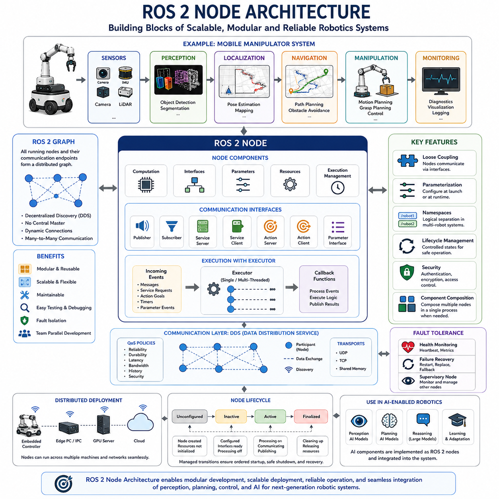{width="7.268055555555556in" height="7.268055555555556in"}

The node architecture of ROS 2 forms the fundamental building block of every modern robotic software system. Regardless of whether the robot is a mobile robot, industrial manipulator, autonomous vehicle, drone, humanoid robot, service robot, or mobile manipulator, the entire software ecosystem is ultimately composed of interconnected nodes that collaborate to achieve complex autonomous behavior. Understanding ROS 2 node architecture is therefore essential for designing scalable, maintainable, reliable, and industrial-grade robotic systems.

A ROS 2 node can be viewed as an independent software process that performs a specific function within a larger robotic application. Rather than developing a robot as a single monolithic application, ROS 2 encourages developers to decompose the system into smaller functional modules. Each module operates independently while communicating through standardized interfaces. This architectural philosophy follows the principles of distributed computing, modular software engineering, and service-oriented design.

In traditional robotics software systems, many functionalities are tightly coupled within a single executable application. As systems grow in complexity, this approach often leads to maintenance challenges, limited scalability, and difficulties in debugging. ROS 2 addresses these limitations by treating each functionality as a separate node. A perception node may process camera images, a localization node may estimate robot position, a navigation node may generate paths, and a manipulation node may control a robotic arm. Each node focuses on a specific responsibility while interacting with other nodes through ROS 2 communication mechanisms.

The concept of node decomposition provides several significant advantages. Individual modules can be developed by separate engineering teams, tested independently, deployed selectively, upgraded incrementally, and reused across multiple robotic platforms. This modular approach becomes particularly important in large-scale industrial robotics projects where software complexity can easily exceed millions of lines of code.

A node in ROS 2 contains computational logic, communication interfaces, runtime resources, parameters, and execution management structures. It serves as both a processing entity and a communication endpoint. Every node has a unique name within the ROS graph and participates in the distributed communication network through publishers, subscribers, service servers, service clients, action servers, action clients, and parameter interfaces.

The ROS graph represents the overall communication topology of the robotic system. As nodes are launched, they automatically register themselves within the ROS graph through DDS discovery mechanisms. Unlike ROS 1, which required a centralized ROS Master, ROS 2 employs decentralized discovery. Nodes automatically discover available communication endpoints and establish connections dynamically without requiring centralized coordination.

A typical autonomous mobile robot may contain dozens of nodes running simultaneously. Sensor drivers acquire information from cameras, LiDARs, IMUs, GNSS receivers, radar systems, and force sensors. Perception nodes analyze incoming sensor streams to detect objects, classify environments, identify obstacles, and estimate object poses. Localization nodes determine robot position relative to a map. Planning nodes compute navigation paths. Control nodes generate actuator commands. Diagnostic nodes monitor system health. Visualization nodes provide operator interfaces. Together, these nodes form a distributed software ecosystem operating as a unified robotic system.

One of the defining characteristics of ROS 2 node architecture is loose coupling. Nodes do not require direct knowledge of each other\'s internal implementation details. Instead, communication occurs through standardized message interfaces. This abstraction significantly improves maintainability because changes inside one node do not necessarily affect other nodes as long as communication interfaces remain consistent.

The communication capabilities of a node are typically implemented through publishers and subscribers. A publisher generates data and transmits messages to a topic. Subscribers receive messages from topics and process incoming information. Multiple publishers and subscribers may communicate through the same topic, enabling many-to-many communication patterns. This architecture supports highly scalable distributed robotic systems.

For example, a camera node may publish image data to an image topic at thirty frames per second. Multiple subscribers can simultaneously consume this data. An object detection node may identify objects, a visual localization node may estimate position, and a recording node may store images for future analysis. None of these subscribers need direct connections to the camera driver itself. They simply subscribe to the published topic.

Nodes also support service interfaces for request-response interactions. Service communication is commonly used when immediate feedback is required. For example, a node responsible for map management may provide services for loading maps, saving maps, resetting maps, or querying map status. Another node can send a service request and receive a response once processing is completed.

Actions provide another important communication mechanism. Many robotic operations require extended execution times and continuous progress feedback. Navigation, object manipulation, inspection missions, and delivery tasks may take several seconds or minutes to complete. Action interfaces allow nodes to initiate long-running tasks while receiving status updates and retaining the ability to cancel execution if necessary.

A key aspect of ROS 2 node architecture is parameter management. Parameters allow developers and operators to configure node behavior without modifying source code. Navigation speed limits, sensor thresholds, safety margins, control gains, camera settings, and AI inference parameters can all be exposed through parameter interfaces. Parameters may be loaded during startup, modified dynamically during operation, or distributed through configuration files.

Namespaces play a critical role in organizing nodes within large robotic deployments. A namespace provides logical separation between groups of nodes and communication resources. In multi-robot environments, namespaces prevent conflicts by isolating identical software stacks. For example, two autonomous mobile robots may both execute localization nodes named "localization," but each robot operates within its own namespace, ensuring independent operation.

The node architecture of ROS 2 supports distributed deployment across multiple computing devices. Modern robotic systems rarely rely on a single computer. Instead, workloads are distributed across edge processors, embedded controllers, GPU servers, industrial PCs, and cloud platforms. ROS 2 nodes can operate across these computing resources while maintaining seamless communication.

A mobile manipulator illustrates this distributed architecture particularly well. Low-level motor controllers may execute on embedded microcontrollers. Navigation software may run on an industrial computer. Perception algorithms may execute on a GPU-equipped edge server. AI reasoning modules may utilize cloud infrastructure. Despite being physically distributed, all nodes remain connected through the ROS 2 communication framework.

Executors are an essential component of ROS 2 node architecture. An executor is responsible for managing callback execution within a node. Whenever a message arrives, a service request is received, a timer expires, or an action update occurs, the executor schedules and executes the corresponding callback functions. Executors therefore act as runtime managers that coordinate the execution flow inside ROS 2 nodes.

ROS 2 supports both single-threaded and multi-threaded executors. Single-threaded executors process callbacks sequentially and are simpler to implement and debug. Multi-threaded executors allow concurrent processing of multiple callbacks, improving performance in computationally intensive applications. Selecting the appropriate executor architecture depends on application requirements, computational workloads, and real-time constraints.

Callback groups provide additional control over execution behavior. Developers can define mutually exclusive groups that prevent concurrent execution or reentrant groups that allow simultaneous processing. These mechanisms help manage resource sharing, synchronization requirements, and thread safety concerns in complex robotic applications.

Memory management is another important consideration in node design. Industrial robotic systems often require deterministic performance. Dynamic memory allocation during operation can introduce unpredictable latency and compromise real-time behavior. ROS 2 therefore provides mechanisms that support preallocated memory, zero-copy communication, and real-time-safe execution strategies.

Node lifecycle management represents one of the major architectural enhancements introduced in ROS 2. Traditional software components typically transition directly from startup to execution. ROS 2 lifecycle nodes introduce a structured state machine that governs node behavior throughout its operational lifetime. Common states include Unconfigured, Inactive, Active, and Finalized.

During the Unconfigured state, a node exists but has not yet initialized resources. Configuration procedures load parameters, allocate resources, establish communication interfaces, and prepare runtime components. Once configured, the node transitions to the Inactive state, where communication resources exist but active processing has not yet begun. Activation transitions the node into operational mode, allowing it to publish, subscribe, and perform computation. Finalization gracefully releases resources during shutdown.

Lifecycle management is particularly valuable in industrial environments where controlled startup and shutdown procedures are required. Large robotic systems may contain hundreds of nodes that must initialize in a specific sequence. Sensor nodes may need to become operational before localization begins. Localization must stabilize before navigation activates. Navigation must activate before mission execution starts. Lifecycle management enables this coordinated startup process.

Fault tolerance is another area where node architecture becomes critically important. Real-world robotic deployments inevitably encounter failures. Sensors disconnect, networks become unstable, hardware malfunctions occur, and software crashes happen. ROS 2 node architecture supports fault isolation by separating functionality into independent components. A failure in one node does not necessarily cause the entire system to fail.

Supervisory nodes are often employed to monitor the health of operational nodes. Diagnostic information, heartbeat messages, resource utilization metrics, communication statistics, and performance indicators can be continuously monitored. If abnormal behavior is detected, recovery procedures may restart failed nodes, switch to backup systems, or trigger safe shutdown operations.

Component composition further enhances ROS 2 node architecture. While nodes are conceptually independent processes, multiple nodes can be combined within a single executable process when necessary. This approach reduces communication overhead, improves memory efficiency, and decreases latency. Component composition is particularly useful for high-performance perception pipelines and embedded robotic systems with limited computational resources.

ROS 2 node architecture also supports security mechanisms. Nodes can authenticate communication endpoints, encrypt transmitted data, enforce access control policies, and restrict unauthorized interactions. As robots become increasingly connected to enterprise networks and critical infrastructure systems, secure node communication becomes an essential operational requirement.

The emergence of AI-enabled robotics has further increased the importance of robust node architectures. Modern robotic systems frequently integrate deep learning models, vision-language models, foundation models, and embodied AI agents. These AI components are typically implemented as dedicated nodes within the ROS 2 ecosystem. Perception nodes may execute object detection networks, planning nodes may incorporate reinforcement learning policies, and reasoning nodes may employ large language models to support high-level decision-making.

Within mobile manipulation systems, node architecture provides the framework for coordinating navigation, perception, manipulation, task planning, and execution monitoring. A mobile manipulator performing warehouse picking operations may utilize dozens of interacting nodes. Sensor nodes capture environmental information, localization nodes estimate position, navigation nodes generate routes, object detection nodes identify inventory, grasp planning nodes determine manipulation strategies, motion planning nodes generate trajectories, control nodes execute movements, and monitoring nodes ensure operational safety. The successful coordination of these functions depends entirely on the underlying ROS 2 node architecture.

As robotics systems continue evolving toward autonomous fleets, humanoid robots, cloud-connected platforms, and embodied AI agents, the importance of scalable node architectures will continue to grow. ROS 2 nodes provide the abstraction layer that enables complex robotic systems to be decomposed into manageable, reusable, and interoperable software components. This architectural foundation supports rapid innovation while maintaining the reliability and flexibility required for real-world deployment.

For mobile manipulators and next-generation autonomous robots, ROS 2 node architecture serves as the software backbone upon which all higher-level capabilities are constructed. Perception, localization, navigation, manipulation, fleet management, simulation, digital twins, AI inference, remote operations, and cloud integration all rely on well-designed node structures. Understanding ROS 2 node architecture is therefore not simply a software engineering exercise but a prerequisite for building intelligent, scalable, and industrial-grade robotic systems capable of operating safely and efficiently in complex real-world environments.

ROS 2의 노드(Node) 아키텍처는 모든 현대 로봇 소프트웨어 시스템을 구성하는 가장 기본적인 단위이다. 자율주행 이동로봇(AMR), 산업용 로봇, 서비스 로봇, 자율주행차, 드론, 휴머노이드 로봇, 모바일 매니퓰레이터 등 어떤 형태의 로봇이든 결국은 여러 개의 노드가 서로 협력하여 하나의 지능형 시스템을 구성한다. 따라서 ROS 2 노드 아키텍처를 이해하는 것은 확장 가능하고 유지보수가 용이하며 산업 현장에 적용 가능한 로봇 시스템을 설계하기 위한 필수적인 과정이다.

ROS 2에서 노드는 특정 기능을 수행하는 독립적인 소프트웨어 프로세스라고 볼 수 있다. 과거의 로봇 소프트웨어는 하나의 거대한 프로그램 안에 모든 기능을 포함하는 경우가 많았지만, ROS 2는 시스템을 작은 기능 단위로 분리하여 구성하도록 설계되었다. 각각의 노드는 독립적으로 실행되며, 표준화된 통신 인터페이스를 통해 다른 노드와 정보를 교환한다. 이러한 구조는 분산 컴퓨팅, 모듈형 소프트웨어 설계, 서비스 지향 아키텍처의 개념을 로봇 시스템에 적용한 것이다.

전통적인 로봇 시스템에서는 센서 처리, 위치 추정, 경로 계획, 제어 기능 등이 하나의 프로그램 안에 밀접하게 연결되어 있었다. 시스템 규모가 커질수록 유지보수와 확장이 어려워지고, 특정 기능을 수정할 경우 전체 시스템에 영향을 주는 문제가 발생하였다. ROS 2는 이러한 문제를 해결하기 위해 각 기능을 독립적인 노드로 분리하였다. 예를 들어 카메라 이미지를 처리하는 인식 노드, 로봇 위치를 계산하는 위치추정 노드, 이동 경로를 생성하는 내비게이션 노드, 로봇팔을 제어하는 조작 노드 등을 별도로 운영할 수 있다.

이러한 노드 기반 구조는 다양한 장점을 제공한다. 각 기능을 서로 다른 개발팀이 독립적으로 개발할 수 있으며, 개별적으로 테스트하거나 업그레이드할 수 있다. 또한 동일한 노드를 여러 로봇 프로젝트에서 재사용할 수 있어 개발 생산성이 크게 향상된다. 특히 수백만 줄 규모의 코드가 사용되는 대규모 산업용 로봇 프로젝트에서는 이러한 모듈화 구조가 필수적이다.

ROS 2 노드는 단순한 프로그램이 아니라 계산 로직, 통신 인터페이스, 실행 환경, 파라미터 관리 기능, 자원 관리 기능 등을 포함하는 하나의 독립적인 실행 단위이다. 각 노드는 ROS 그래프(ROS Graph)에 참여하며 Publisher, Subscriber, Service Server, Service Client, Action Server, Action Client, Parameter Interface 등을 통해 다른 노드와 상호작용한다.

ROS 그래프는 전체 로봇 시스템의 통신 구조를 나타낸다. 노드가 실행되면 DDS 기반의 자동 발견(Discovery) 기능을 통해 네트워크 상의 다른 노드들을 자동으로 인식한다. ROS 1에서는 ROS Master라는 중앙 서버가 필요했지만, ROS 2는 분산형 구조를 채택하여 중앙 관리 서버 없이도 노드 간 연결이 가능하다. 이는 시스템의 신뢰성과 확장성을 크게 향상시킨다.

실제 자율주행 로봇에는 수십 개 이상의 노드가 동시에 실행된다. 센서 드라이버 노드는 카메라, LiDAR, IMU, GNSS, 레이더 등의 데이터를 수집한다. 인식 노드는 이러한 데이터를 분석하여 객체를 탐지하고 환경을 이해한다. 위치추정 노드는 현재 위치를 계산하고, 내비게이션 노드는 목적지까지의 경로를 생성한다. 제어 노드는 모터 명령을 생성하며, 진단 노드는 시스템 상태를 감시한다. 이처럼 각각의 노드가 역할을 분담함으로써 복잡한 로봇 시스템이 효율적으로 운영된다.

ROS 2 노드 아키텍처의 가장 큰 특징 중 하나는 느슨한 결합(Loose Coupling) 구조이다. 노드는 서로의 내부 구현을 알 필요가 없다. 단지 정의된 메시지 인터페이스를 통해 데이터를 주고받는다. 따라서 특정 노드의 내부 구현이 변경되더라도 외부 인터페이스가 유지된다면 다른 노드에는 영향을 주지 않는다. 이러한 특성은 시스템 유지보수와 기능 확장에 매우 유리하다.

노드 간 통신은 주로 Publisher와 Subscriber를 통해 이루어진다. Publisher는 데이터를 생성하여 Topic으로 송신하고, Subscriber는 해당 Topic을 구독하여 데이터를 수신한다. 하나의 Topic에 여러 Publisher와 Subscriber가 동시에 연결될 수 있기 때문에 대규모 분산 시스템을 쉽게 구성할 수 있다.

예를 들어 카메라 노드가 초당 30프레임의 이미지를 Image Topic으로 전송하면 객체 인식 노드, 시각 위치추정 노드, 데이터 기록 노드가 동시에 해당 데이터를 수신할 수 있다. 이들 노드는 서로를 직접 알 필요 없이 Topic만 공유하면 된다. 이러한 구조는 높은 확장성과 유연성을 제공한다.

노드는 Service 인터페이스도 제공할 수 있다. Service는 요청(Request)과 응답(Response) 방식의 통신 구조로 동작한다. 예를 들어 지도 관리 노드는 지도 저장, 지도 불러오기, 지도 초기화, 상태 조회 등의 기능을 Service 형태로 제공할 수 있다. 다른 노드는 요청을 보내고 결과를 응답으로 받을 수 있다.

Action 인터페이스는 장시간 수행되는 작업을 위해 설계되었다. 로봇이 특정 위치까지 이동하거나 물체를 집는 작업은 수 초에서 수 분이 소요될 수 있다. Action은 작업 진행 상태를 지속적으로 제공하며, 필요 시 작업을 취소할 수 있도록 지원한다. 따라서 자율주행, 조작 작업, 순찰 임무 등에서 널리 사용된다.

파라미터(Parameter)는 노드 동작을 설정하기 위한 중요한 기능이다. 내비게이션 속도 제한, 안전 거리, 카메라 설정, 센서 임계값, 제어 게인, AI 추론 옵션 등은 파라미터를 통해 설정할 수 있다. 이를 활용하면 소스코드를 수정하지 않고도 노드의 동작을 쉽게 변경할 수 있다.

네임스페이스(Namespace)는 대규모 시스템에서 노드를 체계적으로 관리하기 위한 기능이다. 특히 다중 로봇 환경에서는 동일한 이름의 노드가 여러 개 존재할 수 있다. 네임스페이스를 사용하면 각 로봇의 노드를 논리적으로 분리하여 충돌을 방지할 수 있다. 예를 들어 여러 대의 AMR이 각각 동일한 Localization 노드를 사용하더라도 서로 독립적으로 운영될 수 있다.

ROS 2 노드는 여러 컴퓨터에 분산 배치될 수 있다. 현대 로봇 시스템은 하나의 컴퓨터만 사용하는 경우가 드물다. 임베디드 제어기, 산업용 PC, GPU 서버, 클라우드 서버 등이 함께 사용된다. ROS 2는 이러한 분산 환경에서도 노드 간 통신을 자연스럽게 지원한다.

모바일 매니퓰레이터는 이러한 분산 구조의 대표적인 예이다. 저수준 모터 제어는 마이크로컨트롤러에서 수행되고, 내비게이션은 산업용 PC에서 실행되며, 객체 인식은 GPU 서버에서 처리될 수 있다. 또한 고수준 AI 추론은 클라우드에서 수행될 수 있다. ROS 2는 이 모든 노드를 하나의 통합 시스템처럼 연결한다.

ROS 2 노드 내부에는 Executor라는 실행 관리자가 존재한다. Executor는 메시지 수신, 서비스 요청, 타이머 이벤트, 액션 상태 변화 등이 발생했을 때 적절한 Callback 함수를 실행한다. 따라서 Executor는 노드 내부에서 실행 흐름을 관리하는 핵심 구성요소라고 할 수 있다.

ROS 2는 Single-Threaded Executor와 Multi-Threaded Executor를 지원한다. 단일 스레드 방식은 구현이 단순하고 디버깅이 쉽지만, 성능에 한계가 있다. 다중 스레드 방식은 여러 Callback을 동시에 처리할 수 있어 성능을 향상시킬 수 있다. 실제 적용 시에는 시스템 요구사항과 실시간성 요구 수준에 따라 적절한 방식을 선택해야 한다.

Callback Group 기능은 실행 제어를 더욱 세밀하게 관리할 수 있도록 지원한다. 특정 Callback은 동시에 실행되지 않도록 설정할 수 있고, 반대로 병렬 실행을 허용할 수도 있다. 이를 통해 자원 공유 문제나 동기화 문제를 효과적으로 관리할 수 있다.

메모리 관리 또한 ROS 2 노드 설계에서 중요한 요소이다. 산업용 로봇은 예측 가능한 실행 시간을 요구하기 때문에 실행 중 동적 메모리 할당을 최소화해야 한다. ROS 2는 사전 메모리 할당, Zero-Copy 통신, 실시간 안전 메모리 관리 전략 등을 지원하여 결정론적 성능을 확보할 수 있도록 설계되었다.

ROS 2가 제공하는 가장 중요한 기능 중 하나는 Lifecycle Node이다. Lifecycle Node는 노드의 생애주기를 명확하게 정의한다. 일반적으로 Unconfigured, Inactive, Active, Finalized 상태를 가진다.

Unconfigured 상태에서는 노드가 생성되었지만 아직 초기화되지 않은 상태이다. 이후 설정 정보를 로드하고 필요한 자원을 확보하면 Inactive 상태로 전환된다. Inactive 상태에서는 통신 준비는 완료되었지만 실제 작업은 수행하지 않는다. Active 상태로 전환되면 실제 데이터 처리와 통신이 시작된다. 마지막으로 Finalized 상태에서는 자원을 정리하고 종료된다.

이러한 라이프사이클 구조는 대규모 산업용 시스템에서 매우 중요하다. 예를 들어 센서 노드가 먼저 실행되고, 이후 위치추정 노드가 시작되며, 마지막으로 내비게이션 노드가 활성화되어야 할 수 있다. Lifecycle Node는 이러한 순차적 초기화를 안전하게 수행하도록 지원한다.

장애 허용성(Fault Tolerance) 역시 ROS 2 노드 아키텍처의 중요한 특징이다. 실제 환경에서는 센서 오류, 네트워크 장애, 하드웨어 고장, 소프트웨어 충돌 등이 발생할 수 있다. ROS 2는 기능을 독립적인 노드로 분리함으로써 하나의 노드가 실패하더라도 전체 시스템이 중단되지 않도록 설계할 수 있다.

이를 위해 Supervisory Node가 사용되기도 한다. 감독 노드는 Heartbeat, CPU 사용률, 메모리 사용량, 통신 상태, 성능 지표 등을 지속적으로 모니터링한다. 문제가 발견되면 실패한 노드를 재시작하거나 백업 시스템으로 전환하는 등의 복구 작업을 수행할 수 있다.

ROS 2는 Component Composition 기능도 제공한다. 일반적으로 노드는 독립 프로세스로 실행되지만, 필요에 따라 여러 노드를 하나의 프로세스 내부에 포함시킬 수도 있다. 이는 프로세스 간 통신 오버헤드를 줄이고 메모리 사용량을 감소시키며 처리 지연을 최소화하는 데 도움이 된다.

보안 측면에서도 ROS 2 노드는 강력한 기능을 제공한다. 노드 간 인증, 데이터 암호화, 접근 제어 정책, 보안 통신 채널 등을 구성할 수 있다. 로봇이 기업 네트워크와 공공 인프라에 연결되는 시대에는 이러한 보안 기능이 필수적이다.

최근 AI 기반 로봇의 발전과 함께 ROS 2 노드의 역할은 더욱 중요해지고 있다. 객체 인식 딥러닝 모델, 비전-언어 모델(VLM), 파운데이션 모델, Embodied AI 에이전트 등은 대부분 독립적인 ROS 2 노드 형태로 구현된다. 이들은 센서 데이터를 입력받아 추론 결과를 생성하고, 다른 노드와 정보를 교환하며 로봇의 지능을 구성한다.

모바일 매니퓰레이터에서는 ROS 2 노드 아키텍처가 이동, 인식, 조작, 작업 계획, 상태 모니터링을 통합하는 기반이 된다. 예를 들어 물류창고에서 피킹 작업을 수행하는 모바일 매니퓰레이터는 카메라 노드, 객체 인식 노드, 위치추정 노드, 내비게이션 노드, 그립 계획 노드, 모션 계획 노드, 제어 노드, 안전 감시 노드 등이 유기적으로 협력하여 작업을 수행한다.

앞으로 자율주행 로봇, 다중 로봇 플릿, 휴머노이드, Embodied AI 시스템이 발전할수록 ROS 2 노드 아키텍처의 중요성은 더욱 커질 것이다. 노드는 복잡한 로봇 시스템을 관리 가능한 단위로 분해하고, 이를 다시 통합하여 하나의 지능형 시스템으로 동작하게 만드는 핵심 소프트웨어 구조이다.

결국 ROS 2 노드 아키텍처는 단순한 프로그래밍 기법이 아니라 차세대 지능형 로봇을 구현하기 위한 핵심 설계 철학이라고 할 수 있다. 모바일 매니퓰레이터, 자율주행 로봇, 디지털 트윈, 플릿 관리 시스템, 원격 운영 플랫폼, AI 기반 로봇 서비스 등 모든 상위 기능은 잘 설계된 ROS 2 노드 구조 위에서 구축된다. 따라서 ROS 2 노드 아키텍처에 대한 이해는 산업용 로봇과 미래형 Embodied AI 시스템 개발을 위한 가장 중요한 기초 지식 중 하나이다.

##  

## 03 Topics Services Actions

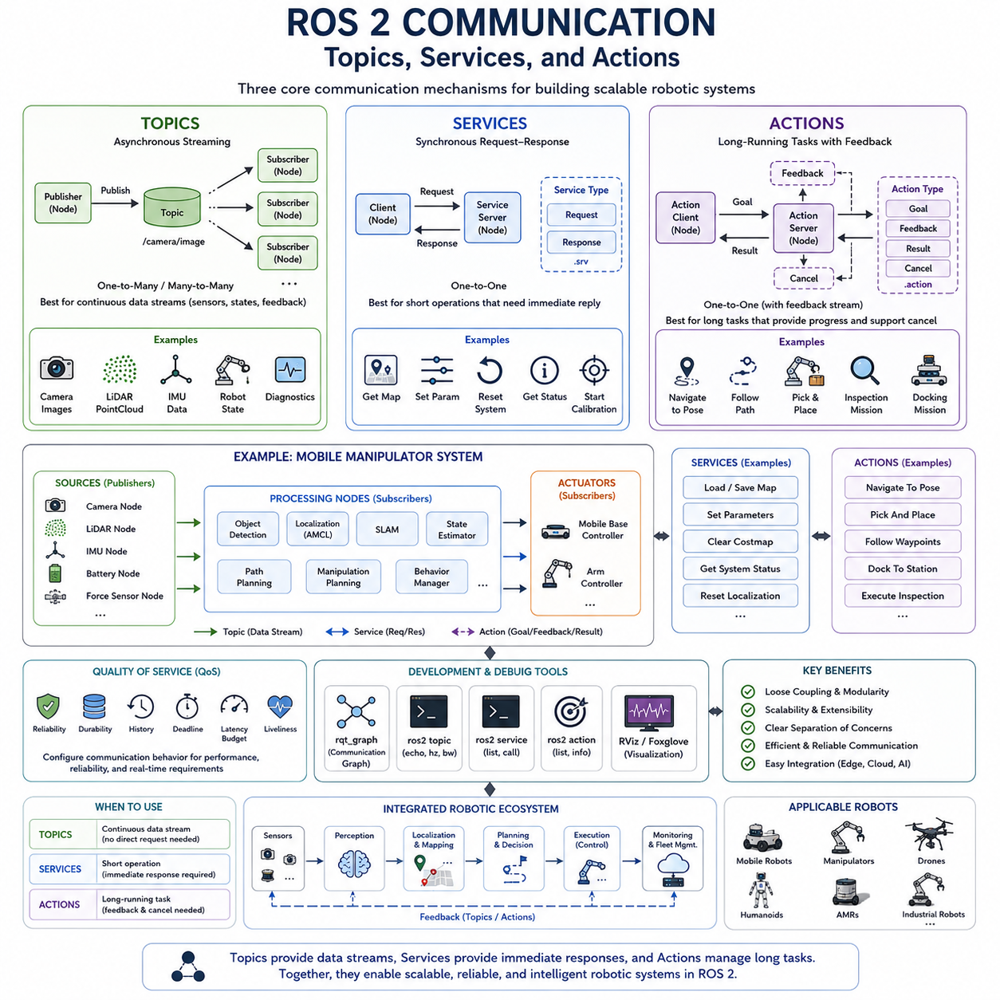{width="7.268055555555556in" height="7.268055555555556in"}

Communication is the foundation of every ROS 2 system. Regardless of whether a robot is performing autonomous navigation, object manipulation, industrial automation, warehouse logistics, service operations, or embodied AI tasks, software components must continuously exchange information. Sensors generate data, perception modules process observations, planning systems create decisions, controllers execute commands, and monitoring systems supervise operations. ROS 2 enables this collaboration through a communication architecture centered on Topics, Services, and Actions.

Topics, Services, and Actions are the three primary communication mechanisms in ROS 2. Together they provide a flexible framework capable of supporting nearly every interaction pattern required by modern robotic systems. Each mechanism is designed for a specific category of communication and serves a different operational purpose. Understanding when and how to use these mechanisms is essential for building scalable, maintainable, and high-performance robotic applications.

At a conceptual level, Topics are used for continuous asynchronous data streams, Services are used for immediate request-response interactions, and Actions are used for long-running tasks that require progress monitoring and cancellation capabilities. These communication paradigms form the backbone of ROS 2 software architecture and appear throughout every subsystem of a robot.

A modern mobile manipulator illustrates the importance of these communication mechanisms. Cameras continuously publish image streams. LiDAR sensors publish point cloud data. Localization systems publish robot poses. Navigation systems receive environmental information and generate movement commands. Manipulation systems receive target object information and execute grasping actions. Fleet management platforms exchange mission assignments and operational status information. Every interaction within this ecosystem relies on Topics, Services, Actions, or combinations of all three.

Topics represent the most widely used communication mechanism in ROS 2. They implement a publish-subscribe model that enables asynchronous communication among nodes. A publisher sends messages to a named topic, and one or more subscribers receive those messages. Publishers and subscribers remain loosely coupled because neither side needs direct knowledge of the other. As long as both utilize the same topic name and message type, communication occurs automatically.

This decoupled architecture provides exceptional flexibility. A camera node may publish image data while multiple perception nodes subscribe simultaneously. An object detection node may identify objects from the images. A localization node may use visual information for position estimation. A recording node may store images for future analysis. Each subscriber independently consumes the same data stream without requiring modifications to the publisher.

Topics are particularly suitable for sensor data because sensors generate information continuously. Cameras may publish thirty or sixty images per second. LiDAR sensors may generate tens or hundreds of thousands of measurements per second. IMUs may produce inertial measurements at several hundred Hertz. Such data streams are naturally modeled using Topics because information is generated continuously and subscribers can process data independently.

The asynchronous nature of Topics enables highly scalable system architectures. New subscribers can be added without modifying existing publishers. New publishers can be introduced to provide alternative data sources. Multiple nodes can cooperate through shared information streams without direct dependencies. This characteristic significantly improves maintainability and extensibility.

ROS 2 Topics support many-to-many communication patterns. A single publisher may communicate with multiple subscribers, multiple publishers may contribute to a common topic, or multiple publishers and subscribers may coexist simultaneously. DDS-based discovery mechanisms automatically establish communication relationships whenever compatible endpoints become available.

Message definitions play a critical role in Topic communication. Every Topic transmits a specific message type. Standard ROS 2 message definitions include geometric information, sensor data, navigation information, images, point clouds, robot states, diagnostic information, and control commands. Developers may also define custom message types tailored to specific application requirements.

Quality of Service policies significantly influence Topic behavior. Reliability settings determine whether message delivery is guaranteed or best-effort. Durability settings define whether historical messages should be preserved for future subscribers. History settings control message buffering. Deadline settings establish timing expectations. These capabilities allow developers to optimize communication behavior for different operational requirements.

For example, high-frequency camera streams may prioritize low latency and use best-effort delivery. Safety-critical emergency stop signals may require reliable transmission with strict delivery guarantees. Mission status information may utilize durability settings to ensure late subscribers receive the latest state information immediately after connecting.

Topic communication is ideal when information flows continuously and independently of individual requests. Sensor streams, robot states, localization estimates, battery status, diagnostic information, and environmental observations are commonly implemented using Topics. In these scenarios, publishers continuously generate data regardless of whether subscribers actively request information.

While Topics excel at streaming information, some robotic interactions require explicit requests and immediate responses. Services address this requirement by implementing a synchronous request-response communication model. A Service Server provides a specific capability, while a Service Client requests execution of that capability. Once processing is complete, the server returns a response.

Services closely resemble function calls in traditional software development. A client initiates a request, waits for processing to complete, and receives a response containing the result. This communication pattern is particularly suitable for operations that are relatively short in duration and require immediate feedback.

A map management node provides a useful example. Operators may request map loading, map saving, map deletion, or map status information. Each request represents a discrete operation with a clearly defined response. Service communication allows these interactions to occur efficiently and predictably.

Configuration management frequently relies on Services. Nodes may expose services for resetting internal states, updating configuration parameters, initiating calibration procedures, clearing navigation costmaps, restarting perception pipelines, or querying diagnostic information. These interactions typically require confirmation that the requested operation completed successfully.

Services provide deterministic communication behavior because each request produces exactly one response. This characteristic simplifies application logic and makes Services particularly suitable for administrative, configuration, and management operations. Unlike Topics, Services do not continuously stream information. Instead, communication occurs only when explicitly requested.

Although Services are powerful, they are not appropriate for all robotic tasks. Many robotic operations require substantial execution time and continuous progress monitoring. Autonomous navigation, warehouse picking, inspection missions, and manipulation tasks may require several seconds or minutes to complete. Using Services for such operations would be inefficient because clients would remain blocked while waiting for completion.

Actions were introduced to address this challenge. Actions extend the request-response model by supporting long-running operations with feedback and cancellation capabilities. An Action Client submits a goal to an Action Server. The server executes the requested operation while periodically providing progress updates. The client can monitor execution status, receive intermediate results, and cancel the operation if necessary.

Actions are among the most important communication mechanisms in autonomous robotics because many robotic behaviors naturally involve extended execution periods. Navigation provides one of the most common examples. A robot may receive a command to travel to a destination located hundreds of meters away. The journey may require obstacle avoidance, dynamic replanning, environmental adaptation, and several minutes of execution time.

Using an Action interface, the navigation system receives the destination as a goal. During execution, it continuously reports progress information such as remaining distance, estimated arrival time, navigation status, and recovery behaviors. If circumstances change, the mission can be canceled or modified without waiting for completion.

Manipulation systems similarly benefit from Actions. A grasping task may involve perception, object recognition, pose estimation, motion planning, collision checking, trajectory execution, force monitoring, and object verification. These operations collectively require significant execution time and benefit from continuous feedback.

The Action architecture internally combines concepts from Topics and Services. Goal requests, result responses, status updates, feedback streams, and cancellation requests are coordinated through multiple communication channels. ROS 2 abstracts this complexity, allowing developers to utilize Actions through a straightforward programming interface.

Feedback capabilities distinguish Actions from Services. During navigation, an Action Server may continuously report current position, progress percentage, estimated completion time, obstacle encounters, and recovery attempts. Operators and supervisory systems gain visibility into execution progress without interrupting ongoing operations.

Cancellation support provides another critical advantage. Industrial environments are dynamic and unpredictable. Missions may need to be interrupted due to safety concerns, operational priorities, environmental changes, or emergency situations. Actions allow ongoing tasks to be terminated gracefully while preserving system integrity.

Modern robotic systems rarely rely on only one communication mechanism. Instead, Topics, Services, and Actions are combined to create sophisticated software architectures. Consider a warehouse mobile manipulator performing inventory picking operations. Cameras publish image streams through Topics. Perception systems publish detected object information through Topics. Configuration and diagnostics utilize Services. Pick-and-place operations execute through Actions. Fleet management software assigns missions using Actions while monitoring robot status through Topics.

The integration of Topics, Services, and Actions creates layered communication architectures. Low-level sensor data typically flows through Topics. Configuration and management operations often utilize Services. High-level task execution generally relies on Actions. This separation improves system organization and ensures each communication mechanism is used according to its strengths.

ROS 2 tools provide extensive support for observing and debugging communication behavior. Developers can inspect active Topics, monitor message traffic, query Service availability, invoke Service requests, observe Action execution, and analyze communication performance. These capabilities simplify development, testing, and operational troubleshooting.

Scalability is another significant advantage of the ROS 2 communication architecture. As robotic systems grow from individual robots to large fleets, communication complexity increases dramatically. Topics enable efficient information distribution across multiple consumers. Services provide structured management interfaces. Actions coordinate complex task execution. Together they support distributed robotic ecosystems containing hundreds or thousands of interacting software components.

The rise of AI-enabled robotics further increases the importance of these communication mechanisms. Deep learning models, vision-language models, robot foundation models, and embodied AI agents must exchange information with traditional robotic subsystems. Sensor data enters AI inference nodes through Topics. Model configuration may occur through Services. High-level reasoning tasks may execute through Actions. ROS 2 communication primitives provide the interoperability necessary for integrating advanced AI capabilities into robotic systems.

In cloud robotics architectures, Topics, Services, and Actions also facilitate communication between robots, edge computing resources, digital twins, fleet management systems, and cloud-based AI platforms. Sensor streams may be forwarded through Topics, configuration updates delivered through Services, and mission execution coordinated through Actions. This unified communication model simplifies system integration across diverse computing environments.

Mobile manipulation systems represent one of the most demanding applications of ROS 2 communication architecture because they combine mobility, perception, manipulation, planning, and AI reasoning within a single platform. A successful mobile manipulator may execute hundreds of Topic exchanges per second, process numerous Service requests, and coordinate multiple concurrent Actions. Efficient utilization of these communication mechanisms directly influences system responsiveness, reliability, and scalability.

As robotics continues evolving toward autonomous fleets, humanoid robots, embodied AI agents, and large-scale intelligent infrastructure systems, Topics, Services, and Actions will remain fundamental building blocks of robot communication. They provide a clear separation between continuous data streaming, immediate request-response interactions, and long-running task execution. This architectural clarity allows developers to construct increasingly sophisticated robotic systems while maintaining modularity, flexibility, and operational reliability.

For ROS 2 developers, mastering Topics, Services, and Actions is one of the most important steps toward understanding the broader ROS ecosystem. Nearly every subsystem within navigation, perception, manipulation, simulation, fleet management, digital twins, AI integration, and remote operations relies upon these communication mechanisms. Together they form the communication foundation that enables modern robotic systems to operate as coordinated, intelligent, and distributed software ecosystems.

통신(Communication)은 모든 ROS 2 시스템의 핵심 기반이다. 로봇이 자율주행을 수행하든, 물체를 집고 옮기든, 물류 작업을 수행하든, 산업 자동화 설비에서 동작하든, 모든 소프트웨어 구성요소는 끊임없이 정보를 교환해야 한다. 센서는 데이터를 생성하고, 인식 시스템은 환경을 분석하며, 계획 시스템은 의사결정을 수행하고, 제어 시스템은 명령을 실행한다. ROS 2는 이러한 협력을 가능하게 하기 위해 Topics, Services, Actions라는 세 가지 핵심 통신 메커니즘을 제공한다.

Topics, Services, Actions는 ROS 2 통신 구조의 핵심 요소이며, 현대 로봇이 필요로 하는 거의 모든 통신 패턴을 지원한다. 각각의 메커니즘은 특정 목적에 맞게 설계되어 있으며, 올바른 사용법을 이해하는 것은 확장 가능하고 유지보수가 용이한 로봇 시스템을 구축하기 위한 필수 조건이다.

개념적으로 보면 Topics는 지속적인 비동기 데이터 전송에 사용되고, Services는 즉각적인 요청-응답(Request-Response) 방식의 통신에 사용되며, Actions는 진행 상태 확인과 취소 기능이 필요한 장시간 작업에 사용된다. 이 세 가지 통신 방식은 ROS 2 소프트웨어 아키텍처의 핵심을 구성하며, 로봇의 거의 모든 기능에서 활용된다.

모바일 매니퓰레이터를 예로 들면, 카메라는 지속적으로 이미지 데이터를 전송하고, LiDAR는 포인트 클라우드 데이터를 생성하며, 위치추정 시스템은 로봇의 위치를 계산한다. 내비게이션 시스템은 이동 경로를 생성하고, 조작 시스템은 물체를 집기 위한 동작을 수행한다. 또한 플릿 관리 시스템은 임무를 할당하고 상태 정보를 수집한다. 이러한 모든 상호작용은 Topics, Services, Actions 또는 이들의 조합을 통해 이루어진다.

Topics는 ROS 2에서 가장 많이 사용되는 통신 방식이다. Topic은 Publish-Subscribe 모델을 기반으로 하며 비동기 방식으로 동작한다. Publisher는 특정 Topic에 메시지를 전송하고, Subscriber는 해당 Topic을 구독하여 메시지를 수신한다. Publisher와 Subscriber는 서로를 직접 알 필요가 없으며, 동일한 Topic 이름과 메시지 형식을 사용하기만 하면 자동으로 통신이 이루어진다.

이러한 느슨한 결합 구조는 매우 높은 유연성을 제공한다. 예를 들어 카메라 노드가 이미지를 전송하면 객체 인식 노드, 시각 위치추정 노드, 데이터 기록 노드 등이 동시에 같은 데이터를 사용할 수 있다. Publisher는 Subscriber의 존재를 알 필요가 없으며, Subscriber 역시 Publisher의 내부 구현을 알 필요가 없다.

Topics는 센서 데이터 전송에 매우 적합하다. 카메라는 초당 수십 프레임의 이미지를 생성하고, LiDAR는 초당 수만 개 이상의 거리 데이터를 생성하며, IMU는 수백 Hz 이상의 관성 데이터를 생성한다. 이러한 연속적인 데이터 흐름은 Topic 방식과 매우 잘 맞는다.

Topic의 비동기 구조는 뛰어난 확장성을 제공한다. 새로운 Subscriber를 추가하더라도 Publisher를 수정할 필요가 없으며, 새로운 Publisher를 추가하여 다른 데이터 소스를 제공할 수도 있다. 결과적으로 시스템을 유연하게 확장할 수 있다.

ROS 2 Topic은 다대다(Many-to-Many) 통신을 지원한다. 하나의 Publisher가 여러 Subscriber에 데이터를 전송할 수 있고, 여러 Publisher가 동일한 Topic에 데이터를 제공할 수도 있다. DDS 기반의 자동 발견 기능은 이러한 연결을 자동으로 구성한다.

Topic 통신에서는 메시지(Message) 정의가 매우 중요하다. 모든 Topic은 특정 메시지 형식을 사용한다. ROS 2는 위치 정보, 센서 데이터, 이미지, 포인트 클라우드, 로봇 상태, 진단 정보, 제어 명령 등 다양한 표준 메시지를 제공한다. 필요에 따라 사용자 정의 메시지를 생성할 수도 있다.

QoS(Quality of Service) 정책은 Topic의 동작 방식을 결정한다. 신뢰성(Reliability)은 메시지 전달 보장을 결정하고, 내구성(Durability)은 과거 메시지 보존 여부를 결정한다. History는 버퍼링 방식을 정의하며, Deadline은 시간 제약을 정의한다. 이러한 기능을 통해 데이터 특성에 맞는 최적의 통신 방식을 설정할 수 있다.

예를 들어 카메라 영상은 지연시간이 짧은 것이 중요하므로 Best-Effort 방식이 적합할 수 있다. 반면 비상정지(E-Stop) 신호는 반드시 전달되어야 하므로 Reliable 방식이 필요하다. 또한 임무 상태 정보는 늦게 연결된 Subscriber도 최신 상태를 받을 수 있도록 Durability 기능을 사용할 수 있다.

Topic은 지속적으로 생성되는 데이터를 전달하는 데 적합하다. 센서 데이터, 로봇 상태, 위치 정보, 배터리 상태, 진단 정보, 환경 인식 정보 등이 대표적인 예이다. Publisher는 Subscriber의 요청 여부와 상관없이 데이터를 지속적으로 생성하고 전송한다.

반면 일부 기능은 명확한 요청과 즉각적인 응답이 필요하다. 이러한 경우 Service가 사용된다. Service는 요청(Request)과 응답(Response) 구조를 가지며 동기식 통신을 제공한다. Service Server는 특정 기능을 제공하고, Service Client는 해당 기능을 요청한다. 작업이 완료되면 결과가 응답으로 반환된다.

Service는 일반적인 소프트웨어의 함수 호출(Function Call)과 유사하다. 클라이언트가 요청을 보내면 서버가 처리한 후 결과를 반환한다. 따라서 비교적 짧은 시간 안에 완료되는 작업에 적합하다.

예를 들어 지도 관리 노드는 지도 저장, 지도 불러오기, 지도 삭제, 지도 상태 조회 등의 기능을 Service로 제공할 수 있다. 사용자는 요청을 보내고 결과를 즉시 받을 수 있다.

설정(Configuration) 관리도 Service를 자주 활용한다. 노드 재설정, 캘리브레이션 수행, Costmap 초기화, 시스템 상태 조회, 진단 정보 요청 등이 대표적인 사례이다. 이러한 작업은 성공 여부를 즉시 확인해야 하기 때문에 Service 방식이 적합하다.

Service는 요청 하나에 응답 하나가 대응되는 구조이기 때문에 예측 가능한 동작을 제공한다. 따라서 관리 기능, 유지보수 기능, 설정 기능 등에 널리 사용된다.

그러나 모든 작업이 Service에 적합한 것은 아니다. 로봇의 많은 작업은 수 초 또는 수 분 이상 지속될 수 있다. 자율주행, 순찰, 물류 운반, 물체 집기 작업 등은 오랜 시간이 필요하다. 이러한 작업을 Service로 구현하면 요청을 보낸 쪽이 완료될 때까지 계속 대기해야 하므로 비효율적이다.

이 문제를 해결하기 위해 Action이 도입되었다. Action은 장시간 수행되는 작업을 위한 통신 구조로, 진행 상태(Feedback)와 취소(Cancel) 기능을 제공한다. Action Client는 목표(Goal)를 Action Server에 전달하고, Action Server는 해당 작업을 수행하면서 진행 상황을 지속적으로 보고한다.

Action은 자율주행 로봇에서 매우 중요한 역할을 수행한다. 예를 들어 로봇이 수백 미터 떨어진 목적지까지 이동해야 한다고 가정해 보자. 이동 중에는 장애물 회피, 경로 재계획, 환경 변화 대응 등이 발생할 수 있으며, 작업이 완료되기까지 수 분이 걸릴 수도 있다.

Action을 사용하면 내비게이션 시스템은 목적지를 Goal로 전달받고, 현재 진행 상태를 지속적으로 보고한다. 남은 거리, 예상 도착 시간, 현재 상태 등이 Feedback 형태로 전달된다. 만약 상황이 변경되면 작업을 취소하거나 새로운 목표를 부여할 수도 있다.

조작(Manipulation) 작업 역시 Action에 적합하다. 물체를 집는 과정은 객체 인식, 자세 추정, 경로 계획, 충돌 검사, 궤적 생성, 실제 동작 수행 등의 여러 단계로 구성되며 상당한 시간이 소요된다. 따라서 지속적인 상태 보고가 필요하다.

Action은 내부적으로 Topic과 Service의 개념을 결합하여 구현된다. Goal 전송, 상태 보고, Feedback 전달, 결과 반환, 취소 요청 등이 여러 통신 채널을 통해 이루어진다. 하지만 ROS 2는 이를 단순한 인터페이스로 제공하여 개발자가 복잡한 내부 구조를 신경 쓰지 않아도 되도록 설계하였다.

Feedback 기능은 Action의 가장 큰 특징이다. 내비게이션 Action은 현재 위치, 진행률, 예상 완료 시간, 장애물 회피 상태 등을 지속적으로 보고할 수 있다. 이를 통해 운영자는 작업 진행 상황을 실시간으로 확인할 수 있다.

취소 기능 역시 매우 중요하다. 실제 산업 환경에서는 작업 우선순위가 변경되거나 안전 문제가 발생할 수 있다. 이 경우 Action을 사용하면 현재 수행 중인 작업을 안전하게 중단할 수 있다.

실제 로봇 시스템은 Topic, Service, Action을 동시에 사용한다. 예를 들어 물류창고에서 동작하는 모바일 매니퓰레이터는 카메라 이미지와 LiDAR 데이터를 Topic으로 수신한다. 시스템 설정과 진단 기능은 Service를 사용한다. 물체 집기와 이동 임무는 Action으로 수행된다. 플릿 관리 시스템은 Action으로 임무를 할당하고 Topic으로 상태를 모니터링한다.

이처럼 ROS 2 통신 구조는 계층적으로 구성된다. 저수준 센서 데이터는 Topic을 사용하고, 설정 및 관리 기능은 Service를 사용하며, 고수준 작업 수행은 Action을 사용한다. 이러한 역할 분리는 시스템 구조를 명확하게 만들고 유지보수를 쉽게 한다.

ROS 2는 Topic, Service, Action을 관찰하고 디버깅하기 위한 다양한 도구를 제공한다. 개발자는 활성화된 Topic을 확인하고, 메시지 흐름을 분석하며, Service를 호출하고, Action 상태를 모니터링할 수 있다. 이러한 기능은 개발과 운영 과정에서 매우 유용하다.

ROS 2 통신 구조는 뛰어난 확장성을 제공한다. 단일 로봇뿐만 아니라 수백 대, 수천 대 규모의 플릿 시스템에서도 동일한 개념을 사용할 수 있다. Topic은 대량 데이터 분배를 담당하고, Service는 관리 기능을 제공하며, Action은 복잡한 작업을 제어한다.

AI 기반 로봇 시대에도 이러한 통신 구조는 핵심 역할을 수행한다. 딥러닝 모델, 비전-언어 모델(VLM), 로봇 파운데이션 모델, Embodied AI 에이전트는 모두 ROS 2 통신 구조를 통해 기존 로봇 시스템과 연동된다. 센서 데이터는 Topic으로 AI 모델에 전달되고, 모델 설정은 Service로 관리되며, 고수준 추론 작업은 Action으로 실행될 수 있다.

클라우드 로보틱스 환경에서도 Topics, Services, Actions는 중요한 역할을 수행한다. 로봇, 엣지 서버, 디지털 트윈, 플릿 관리 시스템, 클라우드 AI 플랫폼 간의 정보 교환은 대부분 이 세 가지 통신 메커니즘을 기반으로 이루어진다.

특히 모바일 매니퓰레이터는 이동, 인식, 조작, 계획, AI 추론을 모두 포함하기 때문에 ROS 2 통신 구조를 가장 복합적으로 활용하는 시스템 중 하나이다. 하나의 모바일 매니퓰레이터는 초당 수백 번의 Topic 통신을 수행하고, 다양한 Service 요청을 처리하며, 여러 개의 Action을 동시에 실행할 수 있다.

앞으로 자율주행 플릿, 휴머노이드 로봇, Embodied AI, 스마트 인프라가 발전하더라도 Topics, Services, Actions는 ROS 2 통신 구조의 핵심 요소로 남을 것이다. 이들은 지속적인 데이터 전송, 즉각적인 요청-응답, 장시간 작업 실행이라는 서로 다른 요구사항을 명확하게 분리함으로써 복잡한 로봇 시스템을 효율적으로 구축할 수 있도록 지원한다.

ROS 2 개발자에게 Topics, Services, Actions를 이해하는 것은 ROS 생태계를 이해하기 위한 가장 중요한 첫걸음이다. 내비게이션, 인식, 조작, 시뮬레이션, 플릿 관리, 디지털 트윈, AI 통합, 원격 운영 등 거의 모든 로봇 기능이 이 세 가지 통신 메커니즘 위에서 동작한다. 결국 Topics, Services, Actions는 현대 로봇이 하나의 지능형 분산 시스템으로 동작할 수 있도록 만드는 ROS 2 통신 아키텍처의 핵심 기반이라고 할 수 있다.

##  

## 04 DDS and QoS

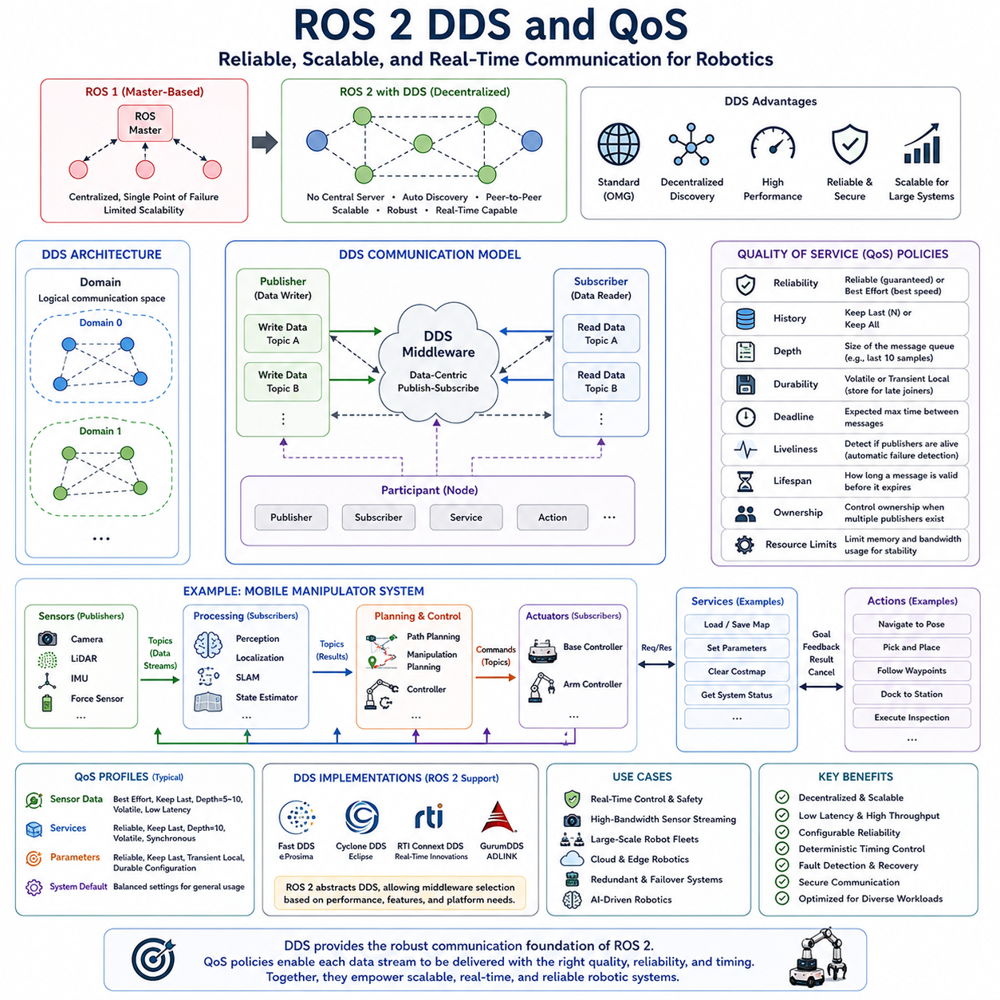{width="7.268055555555556in" height="7.268055555555556in"}

Data Distribution Service (DDS) and Quality of Service (QoS) are among the most important technologies underlying ROS 2. While developers often interact with nodes, topics, services, and actions during daily development, the actual communication infrastructure that enables reliable and scalable data exchange is largely provided by DDS. Understanding DDS and QoS is therefore essential for designing high-performance robotic systems, especially in industrial environments where reliability, real-time behavior, scalability, and fault tolerance are critical requirements.

ROS 1 relied on a centralized architecture based on ROS Master. All nodes had to register with the Master before communication could occur. While this approach simplified development and worked well for research applications, it introduced several limitations. The Master represented a single point of failure, network scalability was limited, and communication behavior could not be finely controlled. As robotics systems became larger and moved into industrial deployments, these limitations became increasingly problematic.

ROS 2 was designed to overcome these challenges by adopting DDS as its communication middleware. DDS is an international standard published by the Object Management Group (OMG) and has been widely used in mission-critical industries such as aerospace, defense, autonomous vehicles, industrial automation, telecommunications, and healthcare systems. By building ROS 2 on DDS, developers gain access to a mature communication infrastructure that has already been proven in demanding operational environments.

At its core, DDS is a data-centric publish-subscribe middleware. Unlike traditional message brokers that focus on sending messages between endpoints, DDS focuses on distributing data throughout a distributed system. The primary objective is not merely message delivery but ensuring that the right data reaches the right consumers with the required quality, reliability, and timing characteristics.

One of the most significant advantages of DDS is its decentralized architecture. In DDS, there is no central communication server that manages all interactions. Instead, each participant discovers other participants automatically through a distributed discovery mechanism. This design eliminates single points of failure and improves overall system robustness.

When a ROS 2 node starts, it becomes a DDS participant. The participant announces its existence to the network and discovers other participants automatically. Publishers and subscribers can then establish communication relationships without requiring manual configuration or centralized coordination. This automatic discovery process greatly simplifies deployment and operation of distributed robotic systems.

The DDS communication model is built around several key concepts including domains, participants, publishers, subscribers, topics, data writers, and data readers. A domain acts as a logical communication space. Participants operate within domains and exchange information only with other participants in the same domain. Publishers contain data writers that transmit information, while subscribers contain data readers that receive information.

The concept of domains is particularly useful in multi-robot environments. For example, multiple robotic fleets operating in the same physical area can use different DDS domains to isolate their communications. This prevents unwanted interactions and reduces network traffic.

DDS also provides highly efficient peer-to-peer communication. Data can flow directly between publishers and subscribers without requiring intermediate routing servers. This reduces communication latency and improves overall performance. For robotics applications involving high-bandwidth sensor streams such as cameras, LiDARs, radar systems, and depth sensors, efficient communication is essential.

A modern mobile manipulator may generate enormous volumes of data. Multiple cameras may produce high-resolution video streams. LiDAR systems may generate hundreds of thousands of points per second. Manipulator controllers may exchange high-frequency state information. Fleet management systems may continuously monitor operational metrics. DDS enables these diverse data streams to coexist efficiently within a unified communication framework.

One of the reasons DDS became attractive for ROS 2 is its support for configurable Quality of Service policies. Traditional communication systems often provide fixed communication behavior. DDS allows developers to specify communication characteristics according to application requirements. This flexibility is essential because different robotic data streams have fundamentally different priorities.

A camera image stream may prioritize low latency and tolerate occasional packet loss. An emergency stop command must prioritize reliability and guaranteed delivery. Robot localization data may require freshness, while configuration information may require durability. DDS allows each communication channel to be optimized independently.

Quality of Service refers to a collection of communication policies that define how data should be transmitted, stored, delivered, and managed. These policies allow developers to control reliability, latency, durability, bandwidth utilization, timing guarantees, and fault tolerance.

Reliability is one of the most important QoS policies. DDS supports both Reliable and Best Effort communication modes. Reliable communication guarantees message delivery through acknowledgment and retransmission mechanisms. Best Effort communication prioritizes speed and low latency but does not guarantee delivery.

Reliable communication is commonly used for safety-critical information, mission commands, control messages, and operational state information. If a message is lost, DDS automatically retransmits it. This ensures that important information eventually reaches its destination.

Best Effort communication is commonly used for high-frequency sensor streams. For example, if a camera publishes sixty frames per second, occasional frame loss may be acceptable because a new frame will arrive almost immediately. Attempting to retransmit every lost frame could increase latency and reduce overall system responsiveness.

History is another important QoS policy. History determines how many previous messages should be stored by the middleware. DDS provides mechanisms such as Keep Last and Keep All. Keep Last stores only a specified number of recent messages, while Keep All attempts to preserve the entire message history within resource constraints.

History policies become particularly important when subscribers cannot process incoming data as quickly as publishers generate it. Buffering strategies help manage temporary communication imbalances and prevent data loss.

Depth works together with History and defines the size of the message queue. For example, a Depth value of ten means that up to ten recent messages may be stored for future delivery. Appropriate Depth configuration helps balance memory consumption against communication robustness.

Durability is another powerful DDS capability. Durability determines whether previously published messages should remain available for future subscribers. In Volatile mode, only active subscribers receive messages. If a subscriber connects later, previously transmitted data is unavailable.

Transient Local durability changes this behavior by allowing publishers to retain recent messages. When a new subscriber joins, it can immediately receive the latest available information. This capability is extremely useful for configuration data, map information, mission status, and system state information.

Consider a fleet management dashboard that connects to a robot after the robot has already begun operating. Without durability, the dashboard may need to wait until new status messages are generated. With Transient Local durability, the latest system state can be delivered immediately.

Deadline is a timing-related QoS policy. It defines the maximum expected interval between messages. If messages are not received within the specified deadline, DDS can notify applications that communication timing expectations have been violated.

Deadline monitoring is valuable for safety-critical systems. For example, a localization system may be expected to provide position updates every fifty milliseconds. If updates stop arriving, supervisory systems can detect the failure and initiate recovery procedures.

Liveliness monitoring provides another mechanism for detecting failures. DDS uses liveliness policies to determine whether publishers remain active and operational. If a publisher fails or becomes disconnected, subscribers can be notified automatically.

In industrial robotic deployments, liveliness monitoring plays an important role in health monitoring and fault detection. Supervisory systems can quickly identify failed components and trigger safe operating modes.

Lifespan defines how long messages remain valid after publication. Certain types of information become obsolete rapidly. Sensor measurements, localization estimates, obstacle detections, and control commands may lose relevance within milliseconds or seconds. Lifespan policies ensure outdated information is automatically discarded.

Without lifespan controls, stale information could potentially influence decision-making processes. In autonomous navigation systems, acting upon outdated obstacle information could create safety risks. Lifespan policies help maintain data freshness throughout the communication network.

Ownership policies determine how multiple publishers interact when transmitting data to the same topic. DDS can assign priorities and ownership rules that control which publisher has authority over shared information. This capability becomes valuable in redundant architectures where backup systems may assume responsibility during failures.

Resource limits allow developers to control memory consumption and communication resource utilization. Large robotic deployments may involve thousands of topics and high-bandwidth sensor streams. Resource management policies help ensure predictable system behavior under heavy workloads.

QoS compatibility is an important concept in ROS 2 communication. Publishers and subscribers can only communicate if their QoS settings are compatible. For example, a subscriber requesting Reliable communication may not connect successfully to a publisher configured for Best Effort delivery. Developers must therefore carefully consider QoS configurations when designing distributed systems.

ROS 2 provides several predefined QoS profiles to simplify configuration. Sensor Data profiles optimize communication for high-frequency sensor streams. Services profiles support reliable request-response interactions. Parameter profiles ensure robust configuration management. System Default profiles utilize middleware-specific defaults.

Sensor Data QoS profiles are commonly used with cameras, LiDARs, IMUs, radar systems, and depth sensors. These profiles typically prioritize low latency and efficient bandwidth utilization over guaranteed delivery. This approach maximizes responsiveness while minimizing communication overhead.

Service communication generally requires reliability because requests and responses must be delivered successfully. Consequently, Service QoS configurations prioritize guaranteed delivery and communication consistency.

In mobile manipulation systems, QoS configuration significantly influences overall performance. Vision systems may require low-latency image delivery. Manipulator controllers may require deterministic state updates. Navigation systems may require reliable localization information. Fleet management platforms may require durable mission status information. DDS allows each communication path to be optimized according to its operational requirements.

DDS implementations vary among vendors. Popular DDS implementations used within ROS 2 include Fast DDS, Cyclone DDS, RTI Connext DDS, and GurumDDS. Each implementation offers different performance characteristics, resource utilization profiles, feature sets, and deployment considerations. ROS 2 abstracts much of this complexity while still allowing advanced users to customize middleware behavior.

Security is another important DDS capability. DDS Security extends the communication framework with authentication, encryption, access control, and secure discovery mechanisms. As robots become connected to enterprise networks, cloud infrastructures, and public environments, secure communication becomes increasingly important.

Large-scale robotic fleets particularly benefit from DDS architecture. Hundreds of robots can communicate simultaneously without requiring centralized message brokers. Distributed discovery, peer-to-peer communication, QoS control, fault detection, and scalability enable efficient operation across large deployments.

Cloud robotics and edge computing architectures also leverage DDS effectively. Robots may communicate with edge servers, digital twins, fleet management systems, and cloud-based AI platforms. QoS policies allow developers to optimize communication pathways according to bandwidth limitations, latency requirements, and reliability constraints.

The emergence of AI-driven robotics further increases the importance of DDS and QoS. Deep learning systems, vision-language models, robot foundation models, and embodied AI agents often exchange large amounts of data with traditional robotic subsystems. Efficient middleware infrastructure becomes essential for maintaining overall system responsiveness and reliability.

Within mobile manipulators, DDS and QoS serve as the invisible foundation beneath all higher-level capabilities. Navigation, perception, manipulation, localization, fleet management, simulation, digital twins, remote operations, and AI integration all depend on robust communication infrastructures. The ability to customize communication behavior for each subsystem allows robotic systems to achieve both flexibility and performance.

As robotic systems continue evolving toward larger fleets, smarter autonomy, cloud integration, and embodied intelligence, DDS will remain one of the most important enabling technologies in ROS 2. Its decentralized architecture, scalability, reliability, real-time capabilities, and configurable QoS policies provide the communication foundation necessary for the next generation of intelligent robotic systems.

Understanding DDS and QoS is therefore not merely a matter of communication configuration. It is a fundamental requirement for designing industrial-grade robotics platforms capable of operating safely, reliably, and efficiently in complex real-world environments. For developers building mobile manipulators, autonomous robots, industrial automation systems, or future embodied AI platforms, mastery of DDS and QoS represents a critical step toward creating scalable and production-ready robotic software architectures.

DDS(Data Distribution Service)와 QoS(Quality of Service)는 ROS 2의 가장 핵심적인 기반 기술 중 하나이다. 개발자는 일반적으로 노드(Node), 토픽(Topic), 서비스(Service), 액션(Action)을 직접 다루지만, 실제로 이러한 통신이 안정적이고 효율적으로 이루어질 수 있도록 지원하는 근본적인 인프라는 DDS가 담당한다. 따라서 DDS와 QoS를 이해하는 것은 고성능 로봇 시스템, 특히 신뢰성, 실시간성, 확장성, 장애 허용성이 중요한 산업용 로봇 시스템을 설계하기 위한 필수 요소이다.

ROS 1은 ROS Master를 중심으로 하는 중앙집중형 구조를 사용하였다. 모든 노드는 Master에 등록된 후에야 통신을 시작할 수 있었다. 이 방식은 연구 환경에서는 충분히 효과적이었지만, 중앙 서버가 장애를 일으킬 경우 전체 시스템이 영향을 받는 단일 장애점(Single Point of Failure) 문제가 존재하였다. 또한 네트워크 확장성과 통신 품질 제어 측면에서도 한계가 있었다.

ROS 2는 이러한 문제를 해결하기 위해 DDS를 통신 미들웨어로 채택하였다. DDS는 OMG(Object Management Group)가 정의한 국제 표준 기술로서 항공우주, 국방, 산업자동화, 자율주행차, 통신, 의료 시스템과 같은 미션 크리티컬 환경에서 이미 널리 사용되고 있다. ROS 2는 DDS를 기반으로 함으로써 검증된 산업용 통신 인프라를 그대로 활용할 수 있게 되었다.

DDS는 기본적으로 데이터 중심(Data-Centric)의 Publish-Subscribe 미들웨어이다. 일반적인 메시지 브로커가 단순히 메시지 전달에 초점을 맞춘다면, DDS는 데이터를 시스템 전체에 효율적으로 배포하는 데 중점을 둔다. 중요한 것은 단순히 메시지를 보내는 것이 아니라 적절한 데이터가 적절한 품질과 적절한 시점에 필요한 대상에게 전달되는 것이다.

DDS의 가장 큰 장점 중 하나는 완전한 분산형 구조이다. DDS에는 중앙 서버가 존재하지 않는다. 대신 모든 참가자(Participant)가 서로를 자동으로 발견하고 직접 통신한다. 이러한 구조는 단일 장애점을 제거하며 시스템 신뢰성을 크게 향상시킨다.

ROS 2 노드가 실행되면 DDS Participant로 등록된다. Participant는 자신의 존재를 네트워크에 알리고 다른 Participant를 자동으로 탐색한다. 이후 Publisher와 Subscriber는 별도의 설정 없이도 자동으로 연결된다. 이러한 자동 발견 기능은 대규모 분산 로봇 시스템의 구축과 운영을 매우 단순하게 만든다.

DDS의 통신 모델은 Domain, Participant, Publisher, Subscriber, Topic, Data Writer, Data Reader 등의 개념으로 구성된다. Domain은 논리적인 통신 공간이며, 동일한 Domain에 속한 Participant끼리만 통신할 수 있다. Publisher는 Data Writer를 통해 데이터를 송신하고, Subscriber는 Data Reader를 통해 데이터를 수신한다.

Domain 개념은 다중 로봇 환경에서 특히 유용하다. 예를 들어 동일한 물류창고에서 여러 플릿(Fleet)이 동시에 운영되는 경우 각각 다른 DDS Domain을 사용하면 서로의 통신이 섞이지 않도록 분리할 수 있다. 이를 통해 불필요한 트래픽을 줄이고 시스템을 독립적으로 운영할 수 있다.

DDS는 효율적인 Peer-to-Peer 통신을 제공한다. 데이터는 중간 서버를 거치지 않고 Publisher와 Subscriber 사이에서 직접 전송된다. 이는 통신 지연을 최소화하고 전체 시스템 성능을 향상시킨다. 특히 카메라, LiDAR, 레이더, Depth Camera와 같이 대용량 데이터를 생성하는 센서 시스템에서는 매우 중요한 장점이다.

현대의 모바일 매니퓰레이터는 엄청난 양의 데이터를 생성한다. 여러 대의 카메라는 고해상도 영상을 전송하고, LiDAR는 초당 수십만 개의 포인트를 생성하며, 로봇팔 제어기는 고주기 상태 정보를 교환한다. 또한 플릿 관리 시스템은 지속적으로 운영 데이터를 수집한다. DDS는 이러한 다양한 데이터 스트림을 효율적으로 처리할 수 있도록 설계되어 있다.

DDS가 ROS 2에서 채택된 가장 중요한 이유 중 하나는 QoS(Quality of Service) 정책을 제공하기 때문이다. 기존 통신 시스템은 대부분 고정된 통신 특성을 제공하지만 DDS는 애플리케이션 요구사항에 맞게 통신 품질을 세밀하게 조정할 수 있다.

예를 들어 카메라 영상은 낮은 지연시간이 중요하며 일부 프레임 손실은 허용될 수 있다. 반면 비상정지(Emergency Stop) 명령은 반드시 전달되어야 한다. 위치추정 정보는 최신성이 중요하고, 설정 정보는 내구성(Durability)이 중요할 수 있다. DDS는 이러한 요구사항을 각각 독립적으로 최적화할 수 있다.

QoS는 데이터가 어떻게 전송되고 저장되며 전달될 것인지를 정의하는 정책 집합이다. 이를 통해 신뢰성, 지연시간, 내구성, 대역폭 사용량, 타이밍 요구사항, 장애 허용성 등을 제어할 수 있다.

QoS 정책 중 가장 중요한 것은 Reliability(신뢰성)이다. DDS는 Reliable과 Best Effort 두 가지 방식을 제공한다. Reliable 모드는 메시지가 반드시 전달되도록 보장한다. 데이터가 손실되면 자동으로 재전송을 수행한다. 반면 Best Effort 모드는 빠른 전송을 우선시하며 데이터 손실을 허용한다.

Reliable 통신은 안전 관련 메시지, 제어 명령, 임무 수행 정보, 운영 상태 데이터 등에 사용된다. 메시지가 손실되더라도 재전송을 통해 최종적으로 전달되므로 높은 신뢰성을 제공한다.

Best Effort는 카메라나 LiDAR와 같은 고주기 센서 데이터에 적합하다. 예를 들어 초당 60프레임을 전송하는 카메라에서 한 프레임이 손실되더라도 곧 다음 프레임이 도착한다. 이 경우 모든 프레임을 재전송하려고 하면 오히려 지연시간이 증가할 수 있다.

History 정책은 과거 메시지를 얼마나 보관할 것인지를 정의한다. DDS는 Keep Last와 Keep All 방식을 제공한다. Keep Last는 최근 N개의 메시지만 저장하며, Keep All은 가능한 범위 내에서 모든 메시지를 저장한다.

History는 Subscriber가 Publisher보다 느리게 데이터를 처리할 때 중요한 역할을 한다. 적절한 버퍼링을 통해 일시적인 처리 지연으로 인한 데이터 손실을 방지할 수 있다.

Depth는 History와 함께 동작하며 저장할 메시지 개수를 정의한다. 예를 들어 Depth가 10이라면 최근 10개의 메시지가 큐에 저장된다. 적절한 Depth 설정은 메모리 사용량과 통신 안정성 사이의 균형을 맞추는 데 중요하다.

Durability는 DDS의 강력한 기능 중 하나이다. Durability는 과거에 전송된 메시지를 나중에 연결되는 Subscriber가 받을 수 있는지를 결정한다.

Volatile 모드에서는 현재 연결된 Subscriber만 메시지를 수신할 수 있다. 반면 Transient Local 모드에서는 Publisher가 최신 메시지를 보관하고 있다가 새로 연결된 Subscriber에게 즉시 전달할 수 있다.

예를 들어 플릿 관리 대시보드가 로봇 운행 도중에 접속한다고 가정해 보자. Volatile 모드에서는 새로운 상태 메시지가 생성될 때까지 기다려야 한다. 하지만 Transient Local을 사용하면 현재 상태 정보를 즉시 받을 수 있다. 따라서 시스템 상태, 지도 정보, 임무 상태와 같은 데이터에 매우 유용하다.

Deadline은 시간 제약과 관련된 QoS 정책이다. 특정 메시지가 얼마나 자주 도착해야 하는지를 정의한다. 설정된 시간 내에 메시지가 도착하지 않으면 DDS는 이를 감지하여 애플리케이션에 알릴 수 있다.

예를 들어 위치추정 시스템이 50ms마다 위치 정보를 전송해야 한다고 가정하자. 만약 업데이트가 중단되면 감독 시스템은 이를 감지하고 복구 절차를 수행할 수 있다.

Liveliness는 Publisher가 살아있는지 확인하는 QoS 정책이다. Publisher가 장애를 일으키거나 네트워크에서 사라질 경우 Subscriber는 이를 자동으로 감지할 수 있다.

산업용 로봇 시스템에서는 Liveliness를 활용하여 시스템 상태를 지속적으로 모니터링한다. 문제가 발생하면 안전 모드로 전환하거나 복구 작업을 수행할 수 있다.

Lifespan은 메시지의 유효 기간을 정의한다. 일부 데이터는 매우 빠르게 가치가 사라진다. 센서 데이터, 장애물 정보, 위치 정보, 제어 명령 등은 몇 밀리초 후에는 의미가 없어질 수 있다. Lifespan 정책은 오래된 데이터를 자동으로 폐기하여 잘못된 의사결정을 방지한다.

Ownership 정책은 동일한 Topic에 여러 Publisher가 존재할 때 어떤 Publisher가 우선권을 가지는지를 결정한다. 이는 이중화(Redundancy) 시스템에서 매우 유용하다. 주 시스템이 장애를 일으키면 백업 시스템이 자동으로 권한을 가져와 서비스를 계속 제공할 수 있다.

Resource Limits는 메모리 사용량과 네트워크 자원 사용량을 제한하는 기능이다. 수천 개의 Topic과 대용량 데이터 스트림이 존재하는 환경에서도 시스템이 안정적으로 동작하도록 지원한다.

QoS 설정에서 중요한 개념 중 하나는 QoS Compatibility이다. Publisher와 Subscriber는 QoS 정책이 서로 호환되어야 통신할 수 있다. 예를 들어 Subscriber가 Reliable을 요구하는데 Publisher가 Best Effort로 설정되어 있다면 연결되지 않을 수 있다. 따라서 시스템 설계 시 QoS 정책을 신중하게 결정해야 한다.

ROS 2는 사용 편의를 위해 여러 가지 기본 QoS 프로파일을 제공한다. Sensor Data 프로파일은 카메라와 LiDAR 같은 고속 센서 데이터에 최적화되어 있다. Services 프로파일은 신뢰성 있는 요청-응답 통신을 지원한다. Parameter 프로파일은 설정 정보 관리에 적합하다.

모바일 매니퓰레이터에서는 QoS 설정이 전체 성능에 직접적인 영향을 미친다. 비전 시스템은 낮은 지연시간이 중요하고, 로봇팔 제어기는 안정적인 상태 업데이트가 필요하며, 내비게이션은 신뢰성 높은 위치 정보를 요구한다. 또한 플릿 관리 시스템은 상태 정보의 내구성을 중요하게 생각한다. DDS는 각 통신 경로를 개별적으로 최적화할 수 있도록 지원한다.

ROS 2에서 사용 가능한 DDS 구현체는 여러 종류가 있다. 대표적으로 Fast DDS, Cyclone DDS, RTI Connext DDS, GurumDDS 등이 있다. 각각은 성능, 메모리 사용량, 기능 지원 범위에서 차이를 가진다. ROS 2는 이러한 차이를 추상화하여 개발자가 쉽게 사용할 수 있도록 지원한다.

DDS는 보안(Security) 기능도 제공한다. DDS Security는 인증(Authentication), 암호화(Encryption), 접근 제어(Access Control), 보안 Discovery 기능을 제공한다. 로봇이 기업 네트워크나 클라우드 환경에 연결되는 시대에는 이러한 보안 기능이 매우 중요하다.

대규모 플릿 운영 환경에서도 DDS는 큰 장점을 제공한다. 수백 대의 로봇이 동시에 운영되더라도 중앙 서버 없이 직접 통신할 수 있다. 자동 발견, Peer-to-Peer 구조, QoS 제어, 장애 감지 기능은 대규모 로봇 운영을 가능하게 한다.

클라우드 로보틱스와 엣지 컴퓨팅 환경에서도 DDS는 중요한 역할을 수행한다. 로봇, 엣지 서버, 디지털 트윈, 플릿 관리 시스템, 클라우드 AI 플랫폼 간의 통신을 효율적으로 지원하며, QoS를 통해 대역폭과 지연시간 요구사항에 맞게 최적화할 수 있다.

최근 AI 기반 로봇의 발전과 함께 DDS와 QoS의 중요성은 더욱 커지고 있다. 딥러닝 모델, 비전-언어 모델(VLM), 로봇 파운데이션 모델, Embodied AI 에이전트는 대량의 데이터를 교환해야 하므로 효율적인 통신 인프라가 필수적이다.

모바일 매니퓰레이터 관점에서 DDS와 QoS는 눈에 보이지 않는 기반 기술이다. 내비게이션, 인식, 조작, 위치추정, 플릿 관리, 디지털 트윈, 원격 운영, AI 통합 등 모든 기능은 DDS 기반 통신 위에서 동작한다. 각 시스템의 특성에 맞는 QoS 정책을 적용함으로써 높은 성능과 유연성을 동시에 달성할 수 있다.

앞으로 로봇 시스템은 더욱 대규모화되고, 더욱 지능화되며, 클라우드와 긴밀하게 연결될 것이다. DDS는 이러한 미래 로봇 시스템의 핵심 통신 인프라로 계속 활용될 가능성이 높다. 분산 구조, 높은 확장성, 실시간성, 신뢰성, 유연한 QoS 정책은 차세대 지능형 로봇 플랫폼의 필수 요소이기 때문이다.

따라서 DDS와 QoS를 이해한다는 것은 단순히 통신 설정을 배우는 것이 아니라 산업용 수준의 로봇 플랫폼을 설계하기 위한 핵심 역량을 확보하는 것을 의미한다. 모바일 매니퓰레이터, 자율주행 로봇, 산업 자동화 시스템, 미래의 Embodied AI 플랫폼을 개발하는 엔지니어에게 DDS와 QoS는 반드시 숙지해야 할 가장 중요한 ROS 2 핵심 기술 중 하나이다.

##  

## 05 Lifecycle Nodes

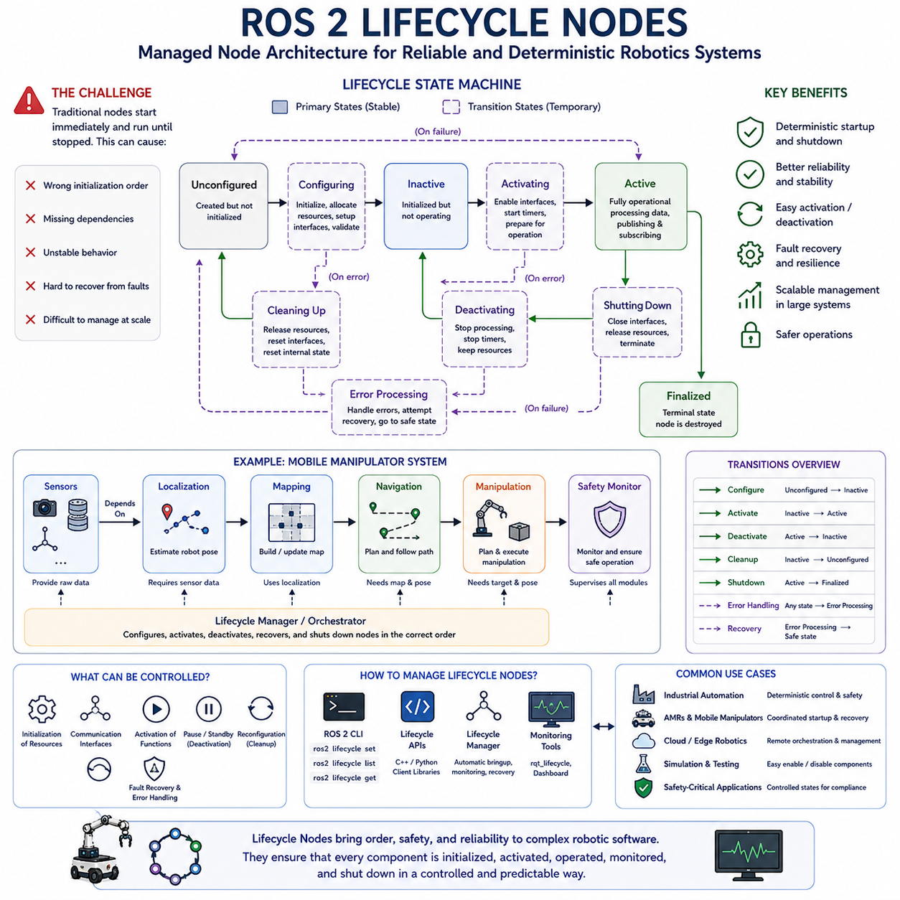{width="7.268055555555556in" height="7.268055555555556in"}

As robotic systems become increasingly complex, the challenge of managing software startup, operation, fault recovery, and shutdown grows significantly. A modern mobile manipulator, autonomous mobile robot, industrial robot, or embodied AI platform may consist of dozens or even hundreds of software components operating simultaneously across multiple computing devices. These components often have dependencies on one another and must be initialized, activated, monitored, and terminated in a controlled manner. ROS 2 Lifecycle Nodes were introduced to address this challenge by providing a structured state-management framework that enables deterministic control over the lifecycle of software components.

In traditional ROS node architectures, nodes generally begin executing immediately after launch and continue operating until termination. While this approach is simple, it becomes problematic in large-scale robotic systems. Sensors may not be ready when localization starts. Localization may not be operational when navigation begins. Navigation may attempt to execute before maps are loaded. Perception systems may publish incomplete data while AI modules are already consuming information. These timing issues can result in unstable behavior, inconsistent initialization, difficult debugging, and reduced operational reliability.

Lifecycle Nodes solve these problems by introducing a managed node architecture. Rather than simply existing in either a running or stopped state, Lifecycle Nodes progress through a well-defined sequence of operational states. These states allow developers and system operators to control precisely when a node allocates resources, initializes interfaces, begins communication, performs computation, enters standby mode, recovers from faults, and terminates operation.

The Lifecycle Node concept is inspired by industrial automation systems, aerospace control systems, telecommunications platforms, and other mission-critical software environments where predictable system behavior is essential. By separating initialization, activation, operation, and shutdown into distinct phases, Lifecycle Nodes improve robustness, maintainability, fault tolerance, and operational safety.

At the core of the Lifecycle Node architecture is a state machine. This state machine defines both primary states and transition states. Primary states represent stable operational conditions, while transition states represent temporary activities that occur when moving between primary states. Together, these states govern the complete operational lifecycle of a node.

The primary states include Unconfigured, Inactive, Active, and Finalized. In addition, several transitional states such as Configuring, Activating, Deactivating, Cleaning Up, Shutting Down, and Error Processing are used internally during state changes.

When a Lifecycle Node is first created, it enters the Unconfigured state. In this state, the node exists within the ROS graph but has not yet allocated significant resources or initialized its internal components. Communication interfaces are not fully operational, and the node is not actively performing its intended functionality. The Unconfigured state can be viewed as a preparation stage where the node is present but not yet ready for operation.

Remaining in the Unconfigured state provides several advantages. System managers can inspect node availability, verify configurations, establish deployment plans, and ensure that required dependencies are available before initialization begins. In large robotic systems, this helps prevent premature activation of components that depend on unavailable resources.

The next step involves the Configuring transition. During this phase, the node performs initialization procedures. Configuration files are loaded, parameters are validated, communication interfaces are prepared, hardware connections are established, memory resources are allocated, and internal data structures are initialized. The node verifies that all required resources are available and prepares itself for operation.

If configuration succeeds, the node transitions into the Inactive state. The Inactive state represents a fully initialized but non-operational condition. All resources are available, communication interfaces exist, and internal structures are ready, but the node is not actively processing data or executing its primary functions. Publishers may be created but remain silent, subscribers may exist but do not actively participate in processing workflows, and control algorithms remain dormant.

The Inactive state serves as an important staging area. Large robotic systems often require coordination among multiple components before operations begin. For example, a mobile manipulator may need cameras, LiDAR sensors, localization systems, navigation modules, manipulation controllers, and safety monitors to be initialized successfully before mission execution starts. By placing nodes into the Inactive state, the system can verify readiness before activation.

Activation occurs through the Activating transition. During this phase, the node performs any operations required to enter full operational mode. Timers are enabled, publishers begin transmitting data, subscribers process incoming information, control loops start executing, and operational behaviors become active. Successful completion of this transition moves the node into the Active state.

The Active state represents normal operational behavior. The node performs its intended functions, participates fully in communication networks, processes incoming data, generates outputs, executes algorithms, and contributes to overall system behavior. In most robotic systems, the majority of operational time is spent in the Active state.

For example, a localization node operating in the Active state continuously receives sensor measurements, updates robot pose estimates, publishes localization results, and responds to requests from navigation systems. Similarly, a perception node continuously processes camera images, detects objects, and publishes recognition results.

One of the most valuable aspects of Lifecycle Nodes is the ability to return from Active to Inactive without destroying the node. Through the Deactivating transition, operational activities are suspended while preserving initialized resources. This allows nodes to enter standby mode without requiring complete reinitialization.

Deactivation is useful in many operational scenarios. A robot may temporarily suspend navigation while waiting for operator approval. Perception systems may pause during maintenance procedures. Manipulation modules may enter standby mode while mobility systems remain active. The ability to selectively deactivate components improves flexibility and operational control.

Cleanup operations are handled through the Cleaning Up transition. During cleanup, resources allocated during configuration are released. Memory structures are deallocated, communication interfaces are removed, hardware connections are closed, and internal states are reset. Following successful cleanup, the node returns to the Unconfigured state.

Cleanup provides an important mechanism for reconfiguration. If operational requirements change, a node can be cleaned up, reconfigured with new parameters, and activated again without requiring complete process termination and recreation.

Shutdown procedures are handled through the Shutting Down transition. During shutdown, the node gracefully releases resources and terminates operation. Communication endpoints are closed, pending operations are completed or canceled, hardware interfaces are disconnected, and system resources are returned to the operating environment.

Successful shutdown results in the Finalized state. Finalized represents the terminal condition of the node lifecycle. Once finalized, the node no longer participates in operational activities and cannot be reactivated without recreation.

Error handling is another critical aspect of Lifecycle Nodes. Real-world robotic systems inevitably encounter failures. Hardware devices disconnect, sensors malfunction, communication links fail, configuration files become corrupted, and unexpected software conditions arise. Lifecycle Nodes incorporate dedicated Error Processing transitions that provide structured mechanisms for fault handling and recovery.

When errors occur during configuration, activation, or operation, nodes may enter error processing states where corrective actions can be performed. Recovery procedures may involve resetting internal states, reinitializing hardware interfaces, restoring communication channels, reloading configurations, or transitioning to safe operating modes.

This structured error management significantly improves system resilience. Rather than terminating unexpectedly, nodes can attempt recovery while maintaining predictable behavior. Supervisory systems can monitor lifecycle transitions and initiate appropriate corrective actions when failures occur.

Lifecycle management becomes particularly important in industrial robotics environments. Consider an automated warehouse containing hundreds of autonomous robots. Before operations begin, each robot must initialize sensors, localization systems, navigation modules, safety systems, fleet communication interfaces, and task execution engines. Improper startup sequencing could lead to localization failures, navigation errors, or unsafe behaviors.

Using Lifecycle Nodes, a centralized orchestration system can coordinate startup procedures. Sensors are configured first. Localization modules activate after sensor verification. Navigation systems activate after localization stabilization. Mission execution begins only after all prerequisites are satisfied. This deterministic startup sequence improves reliability and operational safety.

Mobile manipulators provide another compelling example. A manipulation task requires multiple subsystems to function correctly. Cameras must provide images. Object detection systems must identify targets. Motion planning modules must generate trajectories. Manipulator controllers must execute commands. Safety monitors must supervise operation. Lifecycle management ensures that each subsystem becomes operational in the correct sequence.

Lifecycle Nodes also simplify simulation and testing workflows. During development, engineers often need to activate or deactivate specific components while evaluating system behavior. Lifecycle management allows selective control without requiring repeated node restarts. This improves debugging efficiency and accelerates development cycles.

Integration with orchestration frameworks represents another major advantage. Fleet management systems, deployment tools, digital twins, cloud orchestration platforms, and operational dashboards can monitor and control lifecycle states remotely. Operators gain visibility into system readiness and can coordinate large-scale deployments more effectively.

The concept of managed lifecycles aligns closely with modern DevOps, MLOps, and cloud-native operational practices. Contemporary software systems increasingly emphasize observability, controlled deployment, health monitoring, fault recovery, and lifecycle management. ROS 2 Lifecycle Nodes bring these principles into robotics software architecture.

Safety systems benefit significantly from lifecycle management. In safety-critical applications, uncontrolled startup or shutdown behavior can create hazards. Lifecycle Nodes provide deterministic transitions that enable validation, verification, and risk mitigation procedures to occur before operational activation.

Autonomous vehicles, industrial automation platforms, healthcare robots, logistics systems, and inspection robots frequently rely on controlled operational states to ensure compliance with safety requirements. Lifecycle management provides the structured operational framework necessary for these environments.

Cloud-connected robotic systems also benefit from Lifecycle Nodes. Edge devices, robot controllers, AI inference engines, fleet management services, and digital twin platforms may all participate in coordinated lifecycle operations. Cloud orchestration platforms can remotely activate, deactivate, reconfigure, or recover robotic subsystems as operational requirements evolve.

The emergence of embodied AI systems further increases the importance of lifecycle management. Future robots will integrate perception, reasoning, planning, learning, manipulation, mobility, and human interaction capabilities into highly complex software ecosystems. Managing these capabilities requires sophisticated operational control mechanisms that extend beyond simple process execution.

Lifecycle Nodes provide a foundation for this future. By enabling structured initialization, controlled activation, deterministic operation, fault recovery, and graceful shutdown, they establish a framework for managing increasingly intelligent robotic systems.

Within mobile manipulation software architectures, Lifecycle Nodes serve as an essential reliability mechanism. Perception modules, localization systems, navigation stacks, MoveIt 2 planners, manipulation controllers, AI inference engines, remote operation interfaces, and fleet management components can all leverage lifecycle management to improve operational robustness.

As robotic systems continue growing in complexity, scalability, autonomy, and intelligence, unmanaged software architectures become increasingly difficult to maintain. Lifecycle Nodes address this challenge by transforming nodes from simple executable processes into managed operational entities with clearly defined states and transitions. This approach improves reliability, fault tolerance, maintainability, safety, and system orchestration.

For modern ROS 2 deployments, Lifecycle Nodes represent one of the most important architectural advancements beyond traditional ROS paradigms. They provide the operational discipline required for industrial-grade robotics and establish a foundation for the next generation of autonomous, scalable, and intelligent robotic systems. Their role will become even more significant as robots evolve from isolated machines into large-scale distributed cyber-physical ecosystems capable of operating continuously in complex real-world environments.

로봇 시스템이 점점 복잡해지면서 소프트웨어의 시작(Start-up), 운영(Operation), 장애 복구(Fault Recovery), 종료(Shutdown)를 체계적으로 관리하는 것이 매우 중요한 과제가 되었다. 현대의 모바일 매니퓰레이터, 자율주행 이동로봇, 산업용 로봇, Embodied AI 플랫폼은 수십 개에서 수백 개의 소프트웨어 구성요소로 이루어져 있으며, 이들은 여러 컴퓨팅 장치에 분산되어 동시에 동작한다. 이러한 구성요소들은 서로 의존성을 가지고 있기 때문에 적절한 순서로 초기화되고 활성화되며, 지속적으로 모니터링되고 필요 시 안전하게 종료되어야 한다. ROS 2의 Lifecycle Node는 이러한 문제를 해결하기 위해 도입된 관리형 노드(Managed Node) 구조로서, 노드의 상태를 체계적으로 관리할 수 있는 프레임워크를 제공한다.

기존 ROS 노드는 실행되면 즉시 동작을 시작하고 종료될 때까지 계속 실행된다. 이러한 구조는 단순하지만 대규모 로봇 시스템에서는 여러 문제를 발생시킨다. 예를 들어 센서가 아직 준비되지 않았는데 위치추정(Localization)이 시작될 수 있고, 위치추정이 안정화되지 않았는데 내비게이션이 동작할 수 있다. 지도(Map)가 로드되지 않았는데 경로 계획이 시작되거나, 인식 시스템이 정상 동작하기 전에 AI 모듈이 데이터를 사용하려고 할 수도 있다. 이러한 문제는 시스템 불안정성, 예측 불가능한 동작, 디버깅 어려움, 운영 신뢰성 저하로 이어진다.

Lifecycle Node는 노드의 동작 상태를 명확하게 정의함으로써 이러한 문제를 해결한다. 일반 노드가 단순히 실행 중(Running) 또는 종료(Stopped) 상태만 가진다면, Lifecycle Node는 자원 할당, 초기화, 활성화, 운영, 대기, 장애 복구, 종료 등의 과정을 세분화하여 관리한다.

Lifecycle Node의 개념은 산업 자동화 시스템, 항공우주 제어 시스템, 통신 플랫폼과 같은 미션 크리티컬 환경에서 사용되는 상태 관리 기법에서 영향을 받았다. 초기화, 활성화, 운영, 종료를 명확히 분리함으로써 시스템의 안정성, 유지보수성, 장애 허용성, 안전성을 크게 향상시킬 수 있다.

Lifecycle Node의 핵심은 상태 머신(State Machine)이다. 상태 머신은 노드가 거쳐야 하는 주요 상태와 상태 전이(Transition)를 정의한다. 주요 상태는 안정적인 운영 상태를 의미하며, 전이 상태는 상태가 변경되는 동안 수행되는 임시 작업을 의미한다.

Lifecycle Node의 주요 상태는 Unconfigured, Inactive, Active, Finalized로 구성된다. 또한 Configuring, Activating, Deactivating, Cleaning Up, Shutting Down, Error Processing과 같은 전이 상태가 존재한다.

Lifecycle Node가 생성되면 가장 먼저 Unconfigured 상태에 진입한다. 이 상태에서는 노드가 ROS 그래프에는 존재하지만 아직 중요한 자원을 할당하지 않았으며 내부 기능도 초기화되지 않은 상태이다. 통신 인터페이스도 완전히 활성화되지 않았고 실제 기능 수행도 이루어지지 않는다. 즉, 노드가 존재하기는 하지만 아직 운영 준비가 완료되지 않은 상태라고 볼 수 있다.

Unconfigured 상태는 매우 중요한 의미를 가진다. 시스템 관리자는 노드의 존재를 확인하고 설정을 검토하며 의존성 관계를 검증할 수 있다. 대규모 시스템에서는 필요한 리소스가 모두 준비되었는지 확인한 후에만 초기화를 진행할 수 있기 때문에 안정성이 향상된다.

다음 단계는 Configuring 상태이다. 이 과정에서 노드는 초기화 작업을 수행한다. 설정 파일을 읽고 파라미터를 검증하며, 통신 인터페이스를 생성하고, 하드웨어 연결을 확인하고, 메모리를 할당하며, 내부 데이터 구조를 초기화한다. 또한 필요한 자원이 모두 준비되었는지 확인한다.

초기화가 성공하면 노드는 Inactive 상태로 전환된다. Inactive 상태는 모든 자원이 준비되어 있지만 아직 실제 동작은 수행하지 않는 상태이다. Publisher와 Subscriber는 생성되어 있지만 실제 데이터 처리나 전송은 수행하지 않는다. 제어 알고리즘도 아직 실행되지 않는다.

Inactive 상태는 운영 준비 단계라고 볼 수 있다. 예를 들어 모바일 매니퓰레이터가 정상적으로 동작하려면 카메라, LiDAR, 위치추정 시스템, 내비게이션 모듈, 로봇팔 제어기, 안전 모니터링 시스템 등이 모두 준비되어 있어야 한다. Inactive 상태에서는 이러한 준비 상태를 검증할 수 있다.

이후 Activating 상태를 통해 Active 상태로 전환된다. 이 과정에서 타이머가 활성화되고 Publisher가 데이터를 송신하기 시작하며, Subscriber가 데이터를 처리하고, 제어 루프가 실행된다. 즉, 실제 운영 모드로 진입하기 위한 마지막 단계이다.

Active 상태는 Lifecycle Node의 정상 운영 상태이다. 노드는 자신의 기능을 수행하고 데이터를 처리하며 결과를 생성한다. 대부분의 운영 시간은 Active 상태에서 소비된다.

예를 들어 위치추정 노드는 Active 상태에서 센서 데이터를 수신하고 로봇의 위치를 계산하며 결과를 지속적으로 Publish한다. 인식 노드는 카메라 이미지를 분석하여 객체를 검출하고 결과를 전송한다. 내비게이션 노드는 경로를 생성하고 이동 명령을 계산한다.

Lifecycle Node의 중요한 특징 중 하나는 Active 상태에서 다시 Inactive 상태로 전환할 수 있다는 점이다. Deactivating 상태를 거치면 운영 기능은 중단되지만 이미 초기화된 자원은 그대로 유지된다. 따라서 전체 재초기화 없이 대기 모드로 전환할 수 있다.

이 기능은 실제 운영 환경에서 매우 유용하다. 예를 들어 로봇이 운영자의 승인을 기다리는 동안 내비게이션을 일시 정지할 수 있고, 유지보수 중에는 인식 시스템을 비활성화할 수 있다. 또한 조작 모듈만 대기 상태로 전환하고 이동 기능은 유지하는 것도 가능하다.

Cleaning Up 상태는 초기화 과정에서 확보한 자원을 해제하는 역할을 한다. 메모리를 반환하고 통신 인터페이스를 제거하며 하드웨어 연결을 종료하고 내부 상태를 초기 상태로 복원한다. 정리가 완료되면 노드는 다시 Unconfigured 상태로 돌아간다.

Cleanup 기능은 재설정(Reconfiguration)에 매우 유용하다. 새로운 설정이 필요할 경우 노드를 완전히 종료하지 않고도 Cleanup 후 다시 Configuring을 수행하여 새로운 환경으로 재초기화할 수 있다.

Shutting Down 상태는 노드를 안전하게 종료하기 위한 과정이다. 통신을 종료하고 실행 중인 작업을 정리하며 하드웨어 연결을 해제하고 자원을 반환한다.

정상적으로 종료되면 Finalized 상태에 도달한다. Finalized 상태는 Lifecycle Node의 최종 상태이며, 더 이상 운영에 참여하지 않는다. 다시 사용하려면 노드를 새로 생성해야 한다.

Lifecycle Node의 또 다른 중요한 특징은 Error Processing 기능이다. 실제 로봇 시스템에서는 센서 오류, 하드웨어 장애, 네트워크 문제, 설정 파일 오류, 소프트웨어 버그 등이 언제든지 발생할 수 있다. Lifecycle Node는 이러한 문제를 체계적으로 처리하기 위한 오류 처리 상태를 제공한다.

오류가 발생하면 노드는 Error Processing 상태로 전환된다. 이 상태에서 내부 상태를 초기화하거나 하드웨어를 재연결하고, 통신을 복구하거나 설정을 다시 로드하는 등의 복구 작업을 수행할 수 있다.

이러한 구조는 시스템의 복원력을 크게 향상시킨다. 일반 노드가 오류 발생 시 단순히 종료될 수 있는 반면, Lifecycle Node는 예측 가능한 방식으로 복구를 시도할 수 있다. 또한 상위 감독 시스템은 상태 전이를 모니터링하면서 적절한 대응을 수행할 수 있다.

Lifecycle Node는 산업용 로봇 환경에서 특히 중요하다. 예를 들어 수백 대의 AMR이 운영되는 물류창고에서는 각 로봇이 센서, 위치추정, 내비게이션, 안전 시스템, 플릿 관리 인터페이스 등을 순차적으로 초기화해야 한다. 초기화 순서가 잘못되면 위치추정 실패나 내비게이션 오류가 발생할 수 있다.

Lifecycle Node를 사용하면 중앙 관리 시스템이 초기화 순서를 통제할 수 있다. 센서를 먼저 활성화하고, 이후 위치추정 시스템을 시작하며, 위치가 안정화된 후 내비게이션을 활성화하고, 마지막으로 임무 수행을 시작할 수 있다.

모바일 매니퓰레이터에서도 Lifecycle 관리의 중요성은 더욱 크다. 물체를 집기 위해서는 카메라가 정상 동작해야 하고, 객체 인식 시스템이 목표를 검출해야 하며, 모션 플래너가 궤적을 생성하고, 로봇팔 제어기가 명령을 수행해야 한다. Lifecycle Node는 이러한 구성요소가 올바른 순서로 활성화되도록 보장한다.

시뮬레이션과 테스트 환경에서도 Lifecycle Node는 매우 유용하다. 개발자는 특정 모듈만 활성화하거나 비활성화하면서 시스템을 검증할 수 있다. 이는 디버깅 효율을 향상시키고 개발 속도를 높여준다.

Lifecycle Node는 플릿 관리 시스템, 디지털 트윈 플랫폼, 클라우드 오케스트레이션 시스템, 운영 대시보드 등과도 쉽게 통합될 수 있다. 운영자는 각 노드의 상태를 원격으로 확인하고 제어할 수 있으며, 대규모 로봇 시스템을 보다 체계적으로 관리할 수 있다.

이러한 개념은 현대의 DevOps, MLOps, Cloud-Native 운영 방식과도 매우 유사하다. 최근의 소프트웨어 시스템은 가시성(Observability), 배포 관리, 상태 모니터링, 장애 복구, 라이프사이클 관리를 중요하게 생각한다. ROS 2 Lifecycle Node는 이러한 개념을 로봇 소프트웨어에 적용한 것이다.

안전성 측면에서도 Lifecycle Node는 매우 중요하다. 안전이 중요한 환경에서는 제어되지 않은 시작이나 종료가 위험한 상황을 초래할 수 있다. Lifecycle Node는 활성화 이전에 검증과 확인 절차를 수행할 수 있도록 지원하여 위험을 줄인다.

자율주행차, 산업 자동화 설비, 의료 로봇, 물류 로봇, 점검 로봇 등은 모두 예측 가능한 운영 상태를 요구한다. Lifecycle Node는 이러한 시스템을 위한 체계적인 운영 프레임워크를 제공한다.

클라우드 기반 로봇 시스템에서도 Lifecycle Node는 중요한 역할을 수행한다. 엣지 컴퓨터, 로봇 제어기, AI 추론 엔진, 플릿 관리 시스템, 디지털 트윈 플랫폼 등이 모두 라이프사이클 관리 체계에 포함될 수 있다. 운영자는 원격으로 특정 기능을 활성화하거나 비활성화하고, 설정을 변경하거나 장애를 복구할 수 있다.

최근 Embodied AI 기술이 발전하면서 Lifecycle 관리의 중요성은 더욱 커지고 있다. 미래의 로봇은 인식, 추론, 계획, 학습, 이동, 조작, 인간과의 상호작용을 동시에 수행하게 된다. 이러한 복잡한 시스템을 안정적으로 운영하기 위해서는 체계적인 상태 관리가 필수적이다.

Lifecycle Node는 이러한 미래 로봇 시스템을 위한 기반 기술이다. 초기화, 활성화, 운영, 복구, 종료를 체계적으로 관리함으로써 복잡한 AI 기반 로봇 시스템을 안정적으로 운영할 수 있도록 지원한다.

모바일 매니퓰레이션 아키텍처에서 Lifecycle Node는 핵심적인 신뢰성 확보 기술이라고 할 수 있다. 인식 시스템, 위치추정, 내비게이션, MoveIt 2, 로봇팔 제어기, AI 추론 엔진, 원격 운영 시스템, 플릿 관리 시스템 모두 Lifecycle 관리 기능을 활용하여 안정성을 높일 수 있다.

로봇 시스템이 더욱 복잡해지고, 대규모화되고, 지능화될수록 단순한 실행 기반 아키텍처는 한계를 드러내게 된다. Lifecycle Node는 노드를 단순한 실행 프로세스가 아니라 관리 가능한 운영 객체로 변화시킨다. 이를 통해 신뢰성, 유지보수성, 장애 허용성, 안전성, 운영 효율성을 크게 향상시킬 수 있다.

결론적으로 Lifecycle Node는 ROS 2가 기존 ROS 아키텍처에서 발전한 가장 중요한 기능 중 하나이다. 이는 산업용 수준의 로봇 운영을 가능하게 하며, 미래의 자율주행 로봇, 모바일 매니퓰레이터, 플릿 시스템, Embodied AI 플랫폼을 구축하기 위한 필수적인 소프트웨어 기반 기술이라고 할 수 있다.

##  

## 06 TF2 and Transforms

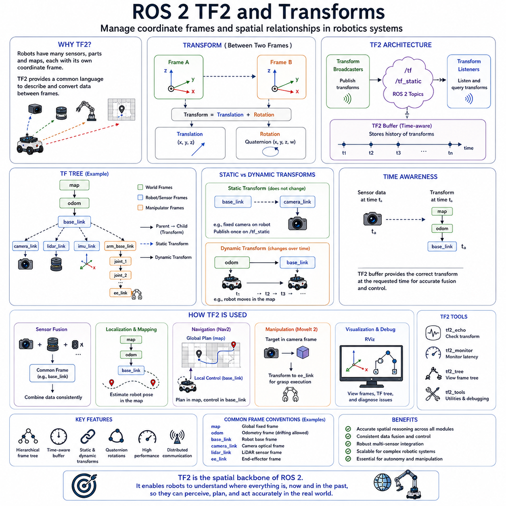{width="7.268055555555556in" height="7.268055555555556in"}

One of the most fundamental challenges in robotics is understanding where things are located relative to one another. A robot must continuously determine the positions and orientations of its sensors, actuators, tools, objects, obstacles, and target destinations within a shared spatial context. Cameras observe the world from one viewpoint, LiDAR sensors measure distances from another position, robotic arms operate within their own coordinate systems, and navigation systems calculate motion relative to maps and robot bases. Without a unified mechanism for managing these spatial relationships, robotic systems would be unable to integrate sensor information, perform accurate localization, plan movements, or interact effectively with their environments.

ROS 2 addresses this challenge through TF2, a specialized transformation framework that manages coordinate frames and spatial relationships throughout a robotic system. TF2 provides the infrastructure necessary for representing, storing, broadcasting, querying, and transforming coordinate information between different reference frames. It serves as one of the most important foundational technologies in modern robotics because nearly every subsystem depends on accurate spatial information.

The concept of coordinate frames lies at the heart of TF2. A coordinate frame represents a reference system used to describe positions and orientations in space. Every sensor, actuator, robot component, and environmental reference point may have its own coordinate frame. A camera frame describes positions relative to the camera. A LiDAR frame describes measurements relative to the LiDAR sensor. A robot base frame describes locations relative to the robot chassis. A map frame describes global locations within the operating environment.

Each coordinate frame consists of an origin and an orientation. The origin defines a reference position, while the orientation defines how the coordinate axes are aligned. Together, these properties establish a complete spatial reference system. When a sensor reports the position of an object, that position is always expressed relative to a particular coordinate frame.

Consider a mobile manipulator operating inside a warehouse. A camera mounted on the robot detects a box located two meters in front of the camera. The robot arm must grasp the box. However, the arm controller operates relative to the manipulator base frame rather than the camera frame. Navigation systems operate relative to the robot base frame. Localization systems operate relative to the map frame. To perform successful manipulation, the detected object position must be transformed through multiple coordinate frames before reaching the arm controller. TF2 manages this entire process automatically.

The need for coordinate transformations arises because robotic systems consist of many interconnected subsystems. Each subsystem naturally operates within its own local reference frame. Sensors measure information relative to their mounting locations. Controllers compute motions relative to actuator frames. Navigation systems reason about movement relative to maps. Human operators may specify targets relative to global coordinates. TF2 provides the common language that allows these subsystems to communicate spatial information consistently.

A transformation describes the mathematical relationship between two coordinate frames. Specifically, it defines both translation and rotation. Translation specifies how far one frame is displaced from another, while rotation specifies how their orientations differ. Together, these properties allow positions and orientations to be converted accurately between frames.

TF2 represents transformations using translation vectors and quaternion-based rotations. Quaternions are widely used in robotics because they provide stable and efficient representations of three-dimensional orientation. Unlike Euler angles, quaternions avoid singularities such as gimbal lock and support smooth interpolation between orientations. This makes them particularly suitable for dynamic robotic applications involving continuous motion.

The architecture of TF2 is built around a transformation tree. Every coordinate frame exists as a node within a hierarchical tree structure, and transformations define the relationships between parent and child frames. This structure ensures that any frame can be related to any other frame through a sequence of transformations.

A typical mobile robot may contain a hierarchy consisting of map, odom, base_link, camera_link, lidar_link, imu_link, and manipulator frames. The map frame represents the global environment. The odom frame represents local odometry information. The base_link frame represents the robot chassis. Sensor frames represent individual sensing devices. Manipulator frames represent joints and end effectors. Together, these frames form a complete spatial representation of the robot and its environment.

One of the key design principles of TF2 is that each frame has only one parent. This constraint prevents ambiguity and ensures that unique transformation paths exist throughout the transformation tree. As a result, spatial relationships remain mathematically consistent and computationally efficient.

TF2 differentiates between static and dynamic transformations. Static transformations represent relationships that never change. For example, the position of a camera mounted rigidly on a robot chassis remains fixed relative to the robot base. Similarly, the mounting position of a LiDAR sensor or IMU generally remains constant throughout operation.

Static transformations are typically published once and reused indefinitely. Because they remain unchanged, TF2 can store them efficiently and distribute them throughout the system with minimal communication overhead.

Dynamic transformations represent relationships that change over time. The robot base frame moves relative to the map frame as the robot navigates through the environment. Manipulator joints move relative to one another during motion. Mobile sensor platforms continuously change their positions. Dynamic transformations must therefore be updated continuously to reflect current system states.

TF2 maintains a time-aware transformation buffer that stores transformation histories. This capability is critically important because robotic systems operate asynchronously. Sensor measurements may arrive at different times, communication delays may occur, and computations may require historical data. By preserving transformation histories, TF2 enables spatial queries at specific points in time.

Time synchronization represents one of the most important advantages of TF2. Consider a camera image captured at one instant and a localization estimate computed slightly later. Without temporal awareness, coordinate transformations might be applied incorrectly, leading to spatial inaccuracies. TF2 allows transformations to be retrieved according to the exact timestamps associated with sensor measurements.

This capability is particularly important in high-speed robotics applications. Autonomous vehicles, drones, industrial manipulators, and warehouse robots often operate in dynamic environments where even small timing errors can produce significant spatial inaccuracies. TF2 ensures that coordinate transformations remain consistent across time.

The TF2 communication architecture relies primarily on specialized ROS topics. Transformations are broadcast continuously by nodes responsible for generating spatial information. Other nodes subscribe to transformation updates and maintain local transformation buffers. This distributed approach allows spatial information to be shared efficiently across the entire robotic system.

Transform broadcasters are responsible for publishing transformation data. A localization node may broadcast the transformation between map and odom frames. An odometry node may publish transformations between odom and base_link. A robot state publisher may broadcast joint transformations for manipulator kinematics. Each component contributes information to the overall transformation tree.

Transform listeners consume transformation data and perform coordinate conversions. A perception system may transform detected object positions from a camera frame into the robot base frame. A navigation system may convert target positions from map coordinates into local motion commands. Manipulation systems may transform grasp targets into end-effector reference frames.

One of the most common uses of TF2 is sensor fusion. Modern robotic systems frequently combine information from multiple sensing modalities including cameras, LiDARs, IMUs, GNSS receivers, depth sensors, radar systems, and force sensors. Each sensor reports data relative to its own coordinate frame.

To integrate these observations effectively, all measurements must be transformed into a common reference frame. TF2 provides the infrastructure necessary for performing these transformations accurately and efficiently. As a result, sensor fusion algorithms can operate on spatially consistent information.

Localization systems depend heavily on TF2. Simultaneous Localization and Mapping (SLAM) algorithms estimate robot position relative to environmental maps. Localization modules continuously update transformations between map, odom, and robot base frames. Navigation systems then use these transformations to determine where the robot is located and how it should move toward desired destinations.

Navigation frameworks such as Nav2 rely extensively on TF2. Path planning algorithms generate trajectories in map coordinates. Controllers execute movements relative to the robot base frame. Obstacle information may originate from LiDAR or camera frames. TF2 enables all these spatial representations to coexist within a unified coordinate framework.

Manipulation systems represent another major application area. Robotic arms consist of multiple joints connected through kinematic chains. Each joint introduces a transformation relative to adjacent links. End-effector positions depend on the cumulative effect of all joint transformations.

MoveIt 2 and other manipulation frameworks use TF2 extensively to calculate forward kinematics, inverse kinematics, collision checking, trajectory planning, and grasp execution. Without accurate transformation management, precise manipulation would be impossible.

Mobile manipulators demonstrate the full power of TF2 integration. These systems combine autonomous mobility with robotic manipulation. The navigation subsystem must understand robot position within the environment. The perception subsystem must detect objects relative to sensors. The manipulation subsystem must execute grasps relative to the robot arm.

TF2 connects these subsystems by maintaining a consistent transformation graph across all coordinate frames. An object detected by a camera can be transformed into map coordinates for task planning and subsequently converted into manipulator coordinates for grasp execution. This seamless integration enables sophisticated autonomous behaviors.

Robot State Publisher is an important ROS 2 component associated with TF2. It reads robot descriptions from URDF models and automatically publishes transformations corresponding to robot kinematic structures. This automation simplifies transformation management and ensures consistency between robot models and operational systems.

The URDF model defines links and joints that describe robot geometry. Robot State Publisher converts these descriptions into dynamic TF2 transformations based on current joint states. Consequently, the complete robot structure becomes available throughout the transformation tree.

Visualization tools provide valuable insight into transformation relationships. RViz can display coordinate frames, transformation trees, sensor data, robot models, and environmental information. Developers can inspect frame relationships visually and identify transformation errors during system development and debugging.

TF2 also includes diagnostic and debugging utilities. Developers can inspect transformation trees, monitor frame relationships, identify missing transformations, measure communication latency, and verify temporal consistency. These tools are invaluable when developing complex robotic systems.

Performance considerations are important in large-scale robotic deployments. A modern mobile manipulator may contain dozens of coordinate frames and thousands of transformation updates per second. Autonomous fleets may manage hundreds of robots simultaneously. TF2 is designed to scale efficiently while maintaining low-latency access to transformation information.

Cloud robotics and digital twin systems further increase the importance of transformation management. Virtual environments must remain synchronized with physical robots. Remote operators require accurate spatial representations. AI systems need consistent world models. TF2 provides the spatial infrastructure necessary for maintaining these relationships.

The emergence of embodied AI introduces additional demands on transformation systems. Future robots will combine perception, reasoning, planning, manipulation, and mobility within unified cognitive architectures. These capabilities depend fundamentally on accurate spatial understanding. Large language models, vision-language models, and robot foundation models ultimately require consistent representations of physical space in order to interact effectively with the real world.

TF2 provides this foundational spatial framework. By managing coordinate frames, maintaining transformation histories, supporting temporal consistency, and enabling efficient coordinate conversions, TF2 serves as the geometric backbone of ROS 2 robotics systems.

Within mobile manipulation architectures, TF2 underpins perception, localization, navigation, mapping, manipulation, sensor fusion, digital twins, simulation, remote operations, and AI integration. Virtually every subsystem depends on coordinate transformations at some level. Understanding TF2 is therefore essential for anyone developing advanced robotic systems.

As robots become more autonomous, more intelligent, and more integrated into complex operational environments, the importance of transformation management will continue to grow. TF2 represents one of the most critical infrastructural technologies in ROS 2 because it provides the spatial consistency necessary for intelligent behavior. Without TF2, robotic systems would lack the common coordinate framework required to perceive, understand, and interact with the physical world. For this reason, TF2 remains a foundational pillar of modern robotics software architecture and an indispensable component of next-generation autonomous and embodied AI systems.

로봇 공학에서 가장 근본적인 문제 중 하나는 다양한 객체와 장치가 서로 어떤 위치 관계를 가지고 있는지를 정확하게 이해하는 것이다. 로봇은 센서, 액추에이터, 도구, 장애물, 목표 지점, 지도 정보 등을 하나의 통합된 공간 개념 안에서 이해해야 한다. 카메라는 자신의 위치를 기준으로 세상을 관찰하고, LiDAR는 또 다른 위치에서 거리 정보를 측정하며, 로봇팔은 자체 좌표계 내에서 동작한다. 또한 내비게이션 시스템은 지도 좌표를 기준으로 이동을 계획한다. 이러한 다양한 공간 정보를 하나의 공통 기준으로 통합하지 못한다면 로봇은 센서 데이터를 결합할 수도 없고, 정확한 위치를 추정하거나 물체를 조작하는 것도 불가능해진다.

ROS 2는 이러한 문제를 해결하기 위해 TF2(Transform Framework 2)라는 좌표 변환 프레임워크를 제공한다. TF2는 로봇 시스템 내의 다양한 좌표계(Coordinate Frame)와 이들 간의 공간적 관계를 관리하는 핵심 인프라이다. 좌표계의 생성, 저장, 전송, 조회, 변환 기능을 제공하며, 현대 로봇 시스템에서 가장 중요한 기반 기술 중 하나로 간주된다.

TF2의 핵심 개념은 좌표계(Frame)이다. 좌표계는 공간에서 위치와 방향을 표현하기 위한 기준점이다. 카메라는 Camera Frame을 가지고 있고, LiDAR는 LiDAR Frame을 가지며, 로봇 본체는 Base Frame을 가진다. 또한 지도는 Map Frame을 가지고 있으며, 로봇팔의 각 링크와 관절도 각각의 Frame을 가진다.

각 좌표계는 원점(Origin)과 방향(Orientation)으로 구성된다. 원점은 기준 위치를 정의하고, 방향은 좌표축의 정렬 상태를 정의한다. 따라서 어떤 물체의 위치가 주어졌다고 하더라도 반드시 "어떤 좌표계 기준인가?"를 함께 알아야만 의미를 가진다.

예를 들어 물류창고에서 동작하는 모바일 매니퓰레이터를 생각해 보자. 카메라가 전방 2m 지점에서 박스를 발견했다고 가정하자. 카메라는 자신의 좌표계를 기준으로 박스 위치를 측정한다. 그러나 로봇팔은 카메라 좌표계가 아니라 Manipulator Base Frame 기준으로 동작한다. 또한 내비게이션 시스템은 Robot Base Frame 기준으로 움직이며, 위치추정 시스템은 Map Frame 기준으로 로봇 위치를 계산한다. 따라서 카메라가 측정한 박스 위치를 로봇팔이 이해할 수 있도록 여러 좌표계 사이를 변환해야 한다. TF2는 이러한 과정을 자동으로 수행한다.

좌표 변환이 필요한 이유는 로봇 시스템이 여러 독립적인 구성요소로 이루어져 있기 때문이다. 센서는 자신의 장착 위치를 기준으로 데이터를 생성하고, 제어기는 자신의 제어 좌표계를 기준으로 동작하며, 내비게이션은 지도 좌표계를 사용한다. TF2는 이러한 서로 다른 공간 표현 방식을 연결하는 공통 언어 역할을 한다.

변환(Transform)은 두 좌표계 사이의 수학적 관계를 의미한다. 변환은 크게 위치 이동(Translation)과 회전(Rotation)으로 구성된다. 위치 이동은 두 좌표계 사이의 거리 차이를 나타내고, 회전은 두 좌표계 사이의 방향 차이를 나타낸다. 이 두 정보를 이용하여 하나의 좌표계에서 표현된 위치를 다른 좌표계로 변환할 수 있다.

TF2는 회전 정보를 표현하기 위해 Quaternion(쿼터니언)을 사용한다. 쿼터니언은 3차원 회전을 안정적으로 표현할 수 있는 수학적 방법이다. Euler Angle과 달리 짐벌락(Gimbal Lock) 문제가 발생하지 않으며, 연속적인 회전 계산에도 안정적이다. 따라서 로봇 분야에서는 사실상 표준적인 회전 표현 방식으로 사용된다.

TF2는 모든 좌표계를 트리(Tree) 구조로 관리한다. 각 좌표계는 노드(Node) 역할을 하며, 부모(Parent)와 자식(Child) 관계를 가진다. 이러한 구조를 TF Tree라고 부른다.

일반적인 이동 로봇에서는 map, odom, base_link, camera_link, lidar_link, imu_link 등의 좌표계가 존재한다. map은 전역 지도 좌표계이고, odom은 로봇의 상대 위치 정보를 나타내며, base_link는 로봇 본체를 의미한다. 카메라와 LiDAR, IMU는 각각 자신의 센서 좌표계를 가진다.

TF2 설계 원칙 중 하나는 모든 Frame이 하나의 부모(Frame Parent)만을 가진다는 것이다. 이를 통해 좌표 변환 경로가 항상 유일하게 결정되며, 공간 정보의 일관성이 유지된다.

TF2는 Static Transform과 Dynamic Transform을 구분한다.

Static Transform은 변하지 않는 좌표 관계를 의미한다. 예를 들어 카메라가 로봇 본체에 고정되어 있다면 Camera Frame과 Base Frame의 관계는 항상 동일하다. LiDAR와 IMU 역시 일반적으로 고정 장착되므로 Static Transform으로 표현된다.

Static Transform은 한 번만 Publish하면 되며 이후 계속 재사용할 수 있다. 따라서 네트워크 부하가 매우 적고 효율적이다.

반면 Dynamic Transform은 시간에 따라 변하는 좌표 관계이다. 로봇이 이동하면 Base Frame은 Map Frame에 대해 계속 위치가 변한다. 또한 로봇팔의 관절이 움직이면 각 링크 사이의 관계도 지속적으로 변한다. 이러한 관계는 Dynamic Transform으로 관리된다.

TF2는 시간(Time)을 고려한 버퍼(Buffer)를 유지한다. 이는 매우 중요한 기능이다. 로봇 시스템은 비동기적으로 동작하기 때문에 센서 데이터와 위치 정보가 서로 다른 시점에 생성된다. TF2는 과거의 변환 정보를 저장하여 특정 시점의 좌표 변환을 수행할 수 있도록 지원한다.

시간 동기화(Time Synchronization)는 TF2의 가장 중요한 장점 중 하나이다. 예를 들어 카메라 이미지가 특정 시점에 촬영되었고, 위치 정보는 약간 늦게 계산되었다고 가정하자. 단순히 현재 위치 정보를 사용하면 오차가 발생할 수 있다. TF2는 이미지가 촬영된 정확한 시점의 좌표 변환 정보를 조회하여 정확한 공간 계산을 수행할 수 있다.

이 기능은 자율주행차, 드론, 고속 이동 로봇과 같이 빠르게 움직이는 시스템에서 특히 중요하다. 수십 밀리초의 차이도 위치 오차를 크게 증가시킬 수 있기 때문이다.

TF2는 ROS 2의 전용 Topic을 통해 동작한다. 좌표 변환 정보를 생성하는 노드는 Transform Broadcaster 역할을 수행하며, 이를 사용하는 노드는 Transform Listener 역할을 수행한다.

Transform Broadcaster는 좌표 변환 정보를 Publish한다. 예를 들어 Localization Node는 map과 odom 사이의 관계를 Publish한다. Odometry Node는 odom과 base_link 사이의 관계를 Publish한다. Robot State Publisher는 로봇팔의 각 관절 변환 정보를 Publish한다.

Transform Listener는 이러한 정보를 수신하고 좌표 변환을 수행한다. 예를 들어 객체 인식 시스템은 Camera Frame에서 검출된 물체 위치를 Base Frame이나 Map Frame으로 변환할 수 있다.

TF2의 가장 중요한 활용 분야 중 하나는 센서 융합(Sensor Fusion)이다. 현대 로봇은 카메라, LiDAR, IMU, GNSS, 레이더, Depth Sensor 등 다양한 센서를 동시에 사용한다. 각 센서는 서로 다른 좌표계를 기준으로 데이터를 생성한다.

센서 데이터를 통합하기 위해서는 모든 데이터를 동일한 기준 좌표계로 변환해야 한다. TF2는 이러한 좌표 변환을 정확하고 효율적으로 수행하여 센서 융합 알고리즘이 일관된 공간 정보를 사용할 수 있도록 지원한다.

위치추정(Localization) 시스템 역시 TF2에 크게 의존한다. SLAM 시스템은 지도(Map)와 로봇 위치를 동시에 추정한다. 이 과정에서 map, odom, base_link 좌표계 사이의 관계를 지속적으로 계산하고 업데이트한다.

ROS 2의 Nav2 내비게이션 프레임워크도 TF2를 핵심 구성요소로 사용한다. 경로 계획은 Map Frame 기준으로 수행되며, 실제 제어는 Base Frame 기준으로 이루어진다. 또한 장애물 정보는 LiDAR Frame이나 Camera Frame에서 생성된다. TF2는 이러한 서로 다른 좌표계를 통합하여 내비게이션이 가능하도록 한다.

로봇팔 조작(Manipulation) 분야에서도 TF2는 필수적이다. 로봇팔은 여러 개의 관절(Joint)과 링크(Link)로 구성된 운동학 체인(Kinematic Chain)을 가진다. 각 관절은 부모 링크와 자식 링크 사이의 변환을 정의한다.

MoveIt 2와 같은 조작 프레임워크는 TF2를 이용하여 순기구학(Forward Kinematics), 역기구학(Inverse Kinematics), 충돌 검사(Collision Checking), 궤적 계획(Trajectory Planning), 파지(Grasping) 등을 수행한다.

모바일 매니퓰레이터는 TF2의 중요성을 가장 잘 보여주는 예이다. 이동 기능은 로봇이 환경 내에서 어디에 있는지를 알아야 하고, 인식 기능은 물체를 센서 기준으로 탐지해야 하며, 로봇팔은 이를 자신의 작업 좌표계로 변환해야 한다.

TF2는 이러한 모든 좌표계를 하나의 통합된 변환 그래프로 연결한다. 따라서 카메라가 발견한 물체를 지도 좌표계로 변환하여 작업 계획을 수행하고, 다시 로봇팔 좌표계로 변환하여 집을 수 있게 된다.

Robot State Publisher는 TF2와 함께 사용되는 대표적인 ROS 2 컴포넌트이다. Robot State Publisher는 URDF 모델을 읽고 로봇의 링크와 관절 정보를 자동으로 TF2 변환 정보로 변환한다.

URDF는 로봇의 구조를 정의하는 파일 형식이다. Robot State Publisher는 현재 관절 상태를 바탕으로 전체 로봇 구조의 TF Tree를 자동으로 생성한다. 이를 통해 로봇 모델과 실제 운영 시스템 간의 일관성을 유지할 수 있다.

RViz는 TF2 정보를 시각화하는 대표적인 도구이다. 개발자는 RViz에서 좌표계, TF Tree, 센서 데이터, 로봇 모델 등을 시각적으로 확인할 수 있다. 이를 통해 좌표계 설정 오류를 쉽게 발견할 수 있다.

TF2는 다양한 진단 및 디버깅 도구도 제공한다. 개발자는 Frame 관계를 확인하고, 누락된 Transform을 찾으며, 통신 지연을 측정하고, 시간 동기화 상태를 검증할 수 있다.

성능 측면에서도 TF2는 매우 효율적으로 설계되어 있다. 현대의 모바일 매니퓰레이터는 수십 개 이상의 Frame과 초당 수천 개 이상의 Transform 업데이트를 처리해야 한다. TF2는 이러한 대규모 환경에서도 낮은 지연시간과 높은 성능을 유지하도록 최적화되어 있다.

클라우드 로보틱스와 디지털 트윈 환경에서도 TF2의 중요성은 더욱 커지고 있다. 가상 공간의 디지털 트윈은 실제 로봇과 동일한 공간 정보를 유지해야 하며, 원격 운영자는 정확한 위치 정보를 필요로 한다. TF2는 이러한 공간 동기화의 기반 기술 역할을 한다.

최근 Embodied AI의 등장으로 TF2의 중요성은 더욱 높아지고 있다. 미래의 로봇은 인식, 추론, 계획, 이동, 조작을 하나의 통합 지능 시스템으로 수행하게 된다. 이러한 지능이 실제 세계를 이해하기 위해서는 정확한 공간 정보가 필수적이다.

대규모 언어 모델(LLM), 비전-언어 모델(VLM), 로봇 파운데이션 모델 역시 결국은 물리 세계와 상호작용하기 위해 정확한 좌표 체계를 필요로 한다. TF2는 이러한 공간 정보를 제공하는 핵심 기반 기술이다.

결론적으로 TF2는 ROS 2 로봇 시스템의 공간적 골격(Geometric Backbone)이라고 할 수 있다. 좌표계를 관리하고, 변환 정보를 저장하며, 시간 일관성을 유지하고, 다양한 좌표계 사이의 변환을 수행함으로써 로봇이 물리 세계를 이해할 수 있도록 지원한다.

모바일 매니퓰레이션 관점에서 TF2는 인식, 위치추정, 내비게이션, 매핑, 센서 융합, 로봇팔 조작, 디지털 트윈, 시뮬레이션, 원격 운영, AI 통합 등 거의 모든 기능의 기반이 된다. 따라서 TF2를 이해하는 것은 고급 로봇 시스템을 개발하기 위한 필수적인 지식이라고 할 수 있다.

앞으로 로봇이 더욱 지능화되고 자율화될수록 좌표 변환과 공간 관리의 중요성은 더욱 커질 것이다. TF2는 로봇이 세상을 인식하고 이해하며 상호작용하기 위한 공통 공간 언어를 제공하는 ROS 2의 핵심 인프라이며, 차세대 자율주행 로봇과 Embodied AI 시스템을 가능하게 하는 가장 중요한 기반 기술 중 하나이다.

##  

## 07 URDF and Xacro

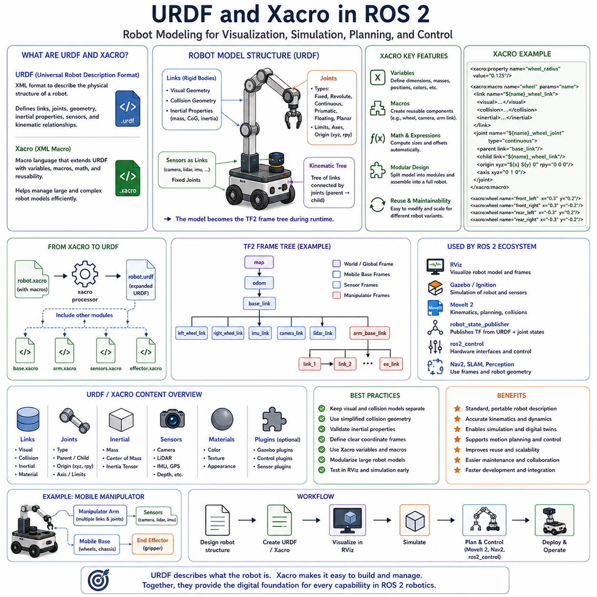{width="7.268055555555556in" height="7.268055555555556in"}

Universal Robot Description Format (URDF) and XML Macro (Xacro) are among the most important modeling technologies within the ROS 2 ecosystem. Every modern robotic system requires a digital representation of its physical structure before software can perform visualization, simulation, motion planning, collision checking, kinematic analysis, sensor integration, or autonomous operation. URDF provides the standard method for describing robot geometry, kinematics, dynamics, sensors, and physical relationships, while Xacro extends URDF with reusable and parameterized modeling capabilities. Together, they form the foundation of robot modeling throughout ROS 2-based systems. Their importance is particularly evident in mobile manipulators, autonomous mobile robots, industrial robotic arms, service robots, humanoids, and embodied AI platforms, where accurate digital representations are essential for both development and deployment.

Before a robot can navigate, manipulate objects, perceive its environment, or interact with humans, software must understand the robot's physical structure. The robot controller must know where each joint is located, how links are connected, where sensors are mounted, what dimensions each component possesses, and how the entire mechanical structure moves. This information forms the robot model. Without a robot model, advanced software frameworks such as TF2, MoveIt 2, Nav2, Gazebo, Isaac Sim, RViz, and digital twin systems cannot function correctly.

Historically, robot models were often implemented through custom software code or proprietary formats. Such approaches created interoperability challenges and made software reuse difficult. ROS introduced URDF as a standardized robot description language capable of representing robotic structures in a vendor-independent manner. Since then, URDF has become one of the most widely adopted robot modeling standards in research, industry, and commercial robotics.

URDF is an XML-based format used to describe the physical structure of a robot. The model consists primarily of links and joints. A link represents a rigid body such as a chassis, arm segment, wheel, sensor housing, gripper body, or tool attachment. A joint represents a movable or fixed connection between two links. By connecting links through joints, a complete kinematic structure can be defined.

The fundamental philosophy behind URDF is that a robot can be represented as a tree of rigid bodies connected through joints. Each link has geometric properties, visual properties, collision properties, and optionally inertial properties. Each joint defines the spatial relationship and movement constraints between parent and child links.

A mobile manipulator provides an excellent example of this structure. The robot chassis forms the base link. Wheels connect to the chassis through wheel joints. The robotic arm attaches to the chassis through a mounting joint. Each arm segment is represented by a link connected through revolute joints. The end-effector is attached at the final link. Sensors such as cameras, LiDARs, IMUs, and depth sensors are represented as additional links connected through fixed joints.

Links serve as the building blocks of the robot model. Each link represents a rigid object whose geometry remains unchanged during operation. A link may define visual geometry used for rendering in visualization tools. It may also define collision geometry used for collision detection and motion planning. Additionally, inertial properties can be specified to support dynamic simulation.

Visual geometry determines how the robot appears in visualization environments such as RViz and simulation platforms. Collision geometry provides simplified representations used by planning algorithms and physics engines. These collision models are often less detailed than visual models to improve computational efficiency.

Inertial properties describe mass distribution within each link. Parameters such as mass, center of gravity, and inertia tensors are specified. These values are essential for dynamic simulation, force analysis, control design, and physics-based modeling. Without accurate inertial information, simulation results may deviate significantly from real-world behavior.

Joints define how links are connected and how they move relative to one another. Several joint types are supported within URDF. Fixed joints represent rigid connections that do not move. Revolute joints represent rotational motion within specified limits. Continuous joints allow unlimited rotation. Prismatic joints support linear translation. Floating joints provide six degrees of freedom, while planar joints support motion within a two-dimensional plane.

The choice of joint type depends upon the mechanical design of the robot. Wheel rotations are commonly represented by continuous joints. Robotic arm joints typically use revolute joints with angular limits. Linear actuators may use prismatic joints. Sensor mounting brackets frequently use fixed joints.

Joint definitions include transformation information describing the relationship between parent and child links. These transformations define position and orientation offsets that establish the robot's kinematic structure. Together, all joint transformations form the basis of forward and inverse kinematic calculations.

The robot model generated by URDF serves as the foundation for TF2 transformation trees. Each joint corresponds to a transformation between coordinate frames. As joint positions change during operation, TF2 continuously updates the associated coordinate transformations. Consequently, the robot's spatial structure remains synchronized throughout the ROS 2 ecosystem.

One of the most important applications of URDF is visualization. RViz uses robot descriptions to display robot models in three-dimensional environments. Developers can inspect robot geometry, verify coordinate frame alignment, visualize sensor placement, and validate kinematic structures. Visualization often represents the first step in verifying that a robot model has been constructed correctly.

Simulation environments also depend heavily on URDF. Platforms such as Gazebo, Ignition Gazebo, Isaac Sim, and Webots import robot descriptions to generate virtual representations of physical robots. Sensors, actuators, joints, and physical structures are instantiated automatically from the model. This capability enables simulation-driven development and digital twin creation.

Motion planning systems such as MoveIt 2 require accurate robot descriptions to perform kinematic analysis, collision checking, trajectory generation, and manipulation planning. The planning framework uses URDF information to understand joint limits, link relationships, workspace constraints, and collision geometries.

Mobile manipulators particularly benefit from detailed robot modeling because they combine autonomous mobility with robotic manipulation. The mobile base, robotic arm, sensor systems, and end effectors must all be represented accurately within a unified model. Motion planners rely upon this information to coordinate navigation and manipulation activities safely and efficiently.

Although URDF provides a powerful modeling framework, large robot descriptions can become difficult to maintain. Industrial robots, humanoids, and mobile manipulators often contain dozens or hundreds of links and joints. Repetitive structures, parameter variations, and hardware configurations can lead to extremely large XML files that are difficult to manage manually.

Xacro was introduced to address these challenges. Xacro, which stands for XML Macro, extends URDF by providing parameterization, macros, variables, mathematical expressions, reusable components, and modular design capabilities. Rather than writing repetitive XML code directly, developers can define reusable templates that generate URDF automatically.

The primary objective of Xacro is reducing duplication and improving maintainability. A wheel assembly may appear four times within a mobile robot. Instead of manually defining each wheel, developers can create a wheel macro and instantiate it multiple times with different parameters. Similarly, robotic arm segments, sensor mounts, and actuator modules can be reused throughout the model.

Variables represent one of the most powerful Xacro features. Developers can define dimensions, masses, colors, sensor positions, wheel diameters, link lengths, and other parameters as variables. Changing a variable automatically updates every component that depends upon it. This capability dramatically simplifies design iteration.

For example, a mobile robot platform may exist in multiple size configurations. A developer can define chassis dimensions as variables and generate different robot models simply by changing parameter values. The same Xacro structure can produce compact indoor robots, medium warehouse robots, or large outdoor autonomous vehicles.

Mathematical expressions further enhance modeling flexibility. Geometric relationships can be calculated automatically rather than entered manually. Wheel spacing, sensor placement, arm offsets, and structural dimensions can be derived from higher-level design parameters. This reduces errors and improves consistency throughout the model.

Macros enable reusable robot components. A camera mounting assembly may include a camera body, housing, mounting bracket, coordinate frame, collision geometry, and sensor plugin definitions. By encapsulating this structure within a macro, developers can reuse it across multiple robot designs without duplication.

Large robotic systems often benefit from modular Xacro architectures. Rather than storing the entire robot model within a single file, developers can divide the model into multiple reusable modules. Separate files may describe the mobile base, manipulator arm, sensor suite, battery system, end effector, and simulation plugins. These modules can then be assembled into complete robot descriptions.

This modular approach aligns closely with modern software engineering practices. Individual teams can develop separate robot subsystems independently while maintaining compatibility through shared interfaces. The resulting architecture improves maintainability and scalability.

Sensor integration represents another major application of URDF and Xacro. Cameras, LiDARs, IMUs, GNSS receivers, radar systems, depth sensors, microphones, and force-torque sensors can all be represented within the robot model. Sensor coordinate frames become part of the TF2 transformation tree, enabling consistent spatial relationships throughout the system.

Simulation environments frequently extend URDF using plugins and additional configuration elements. Sensor simulation parameters, controller interfaces, physics properties, and middleware integrations may be specified through simulation-specific extensions. Xacro simplifies management of these complex configurations through parameterization and modularization.

Robot State Publisher plays a critical role in connecting URDF models with runtime operations. It reads robot descriptions and publishes coordinate transformations corresponding to the robot's kinematic structure. Joint state updates generated by controllers continuously update the transformation tree, ensuring consistency between physical motion and software representations.

Digital twin systems rely heavily on accurate robot descriptions. A digital twin must replicate the geometry, kinematics, sensors, and operational characteristics of the physical robot. URDF and Xacro provide the foundation upon which virtual replicas are constructed. These virtual models support simulation, testing, monitoring, optimization, and predictive maintenance.

The emergence of embodied AI further increases the importance of robot modeling. Future AI systems must reason about physical structures, sensor placements, manipulation capabilities, workspace constraints, and environmental interactions. Accurate robot models provide the geometric and kinematic context necessary for intelligent decision-making.

Humanoid robots illustrate the complexity of modern robot descriptions. Hundreds of coordinate frames, numerous sensors, articulated limbs, dexterous hands, and sophisticated locomotion systems must be represented accurately. Xacro enables these highly complex models to remain maintainable and adaptable throughout development.

Mobile manipulators developed for logistics, healthcare, manufacturing, inspection, and service robotics similarly require extensive modeling efforts. The mobile platform, manipulator arm, perception systems, safety sensors, communication hardware, and tool attachments must all be integrated within a unified robot description. URDF and Xacro provide the structure necessary to manage this complexity effectively.

Best practices for URDF and Xacro development emphasize modularity, parameterization, consistency, and maintainability. Visual geometry should remain separate from collision geometry. Inertial properties should be validated carefully. Sensor frames should be defined explicitly. Reusable components should be encapsulated within macros. Large systems should be organized into logical subsystems rather than monolithic files.

As ROS 2 continues evolving toward larger robotic fleets, cloud-connected systems, digital twins, and embodied AI platforms, the importance of standardized robot descriptions will continue to increase. URDF provides the common language for describing robot structures, while Xacro provides the engineering tools necessary to manage complexity.

Together, URDF and Xacro form the foundation of robot modeling throughout the ROS 2 ecosystem. They connect mechanical design, kinematic analysis, simulation, visualization, motion planning, sensor integration, digital twins, and AI-driven robotics into a unified framework. For developers building mobile manipulators, autonomous robots, industrial automation systems, or future embodied AI platforms, mastery of URDF and Xacro represents an essential step toward creating scalable, maintainable, and production-ready robotic systems.

URDF(Universal Robot Description Format)와 Xacro(XML Macro)는 ROS 2 생태계에서 가장 중요한 로봇 모델링 기술 중 하나이다. 현대의 모든 로봇 시스템은 시각화, 시뮬레이션, 모션 플래닝, 충돌 검사, 운동학 계산, 센서 통합, 자율주행 기능을 수행하기 전에 먼저 자신의 물리적 구조를 디지털 형태로 표현해야 한다. URDF는 로봇의 기구 구조, 운동학, 동역학, 센서, 물리적 연결 관계를 표준화된 방식으로 표현하는 언어이며, Xacro는 이를 확장하여 재사용성과 유지보수성을 높이는 매크로 기반 모델링 도구이다. 이 두 기술은 ROS 2 기반 로봇 개발의 핵심 기반을 형성하며, 특히 모바일 매니퓰레이터, 자율주행 이동로봇, 산업용 로봇, 휴머노이드, Embodied AI 플랫폼에서 매우 중요한 역할을 수행한다.

로봇이 이동하고, 물체를 조작하고, 환경을 인식하기 위해서는 먼저 소프트웨어가 로봇의 물리적 구조를 이해해야 한다. 제어기는 관절이 어디에 위치하는지 알아야 하고, 센서는 어느 위치에 장착되어 있는지 알아야 하며, 내비게이션 시스템은 로봇의 크기와 형태를 이해해야 한다. 이러한 정보의 집합이 바로 로봇 모델(Robot Model)이다.

과거에는 제조사별 고유 포맷이나 전용 소프트웨어를 사용하여 로봇 모델을 정의하는 경우가 많았다. 하지만 이러한 방식은 상호운용성이 부족하고 소프트웨어 재사용이 어렵다는 문제가 있었다. ROS는 이러한 문제를 해결하기 위해 URDF라는 표준 로봇 기술 언어를 도입하였고, 현재는 사실상 ROS 기반 로봇 모델링의 표준으로 자리 잡고 있다.

URDF는 XML 기반의 로봇 구조 기술 언어이다. URDF 모델은 기본적으로 Link와 Joint로 구성된다. Link는 로봇의 강체(Rigid Body)를 의미하며, 차체, 로봇팔 링크, 휠, 센서 하우징, 그리퍼, 배터리 팩 등이 모두 Link로 표현된다. Joint는 두 Link를 연결하는 연결부를 의미하며, 회전이나 직선 이동과 같은 운동 특성을 정의한다.

URDF의 기본 철학은 로봇을 여러 개의 강체(Link)와 이를 연결하는 관절(Joint)의 트리 구조로 표현하는 것이다. 각각의 Link는 형상 정보, 시각화 정보, 충돌 정보, 관성 정보를 가질 수 있으며, Joint는 부모 Link와 자식 Link 사이의 관계를 정의한다.

모바일 매니퓰레이터를 예로 들면, 차체는 Base Link가 되고, 각 바퀴는 Wheel Link가 된다. 로봇팔은 여러 개의 Arm Link로 구성되며 Revolute Joint를 통해 연결된다. 마지막에는 End Effector 또는 Gripper가 장착된다. 또한 카메라, LiDAR, IMU, GNSS 등의 센서도 별도의 Link로 모델링된다.

Link는 로봇 모델의 가장 기본적인 구성 요소이다. Link는 변형되지 않는 강체를 의미하며, 각각 시각적 표현과 충돌 검사용 형상 정보를 가진다. 또한 물리 시뮬레이션을 위해 질량(Mass), 무게중심(Center of Gravity), 관성 모멘트(Inertia Tensor)와 같은 동역학 정보를 포함할 수 있다.

Visual Geometry는 RViz와 같은 시각화 도구에서 로봇을 표시하기 위해 사용된다. Collision Geometry는 충돌 검사와 경로 계획에 사용되며, 일반적으로 Visual Geometry보다 단순한 형태로 구성된다. 이는 계산량을 줄이기 위한 것이다.

Inertial 정보는 시뮬레이션과 동역학 계산에서 매우 중요하다. 질량 분포와 무게중심 정보가 정확해야 실제와 유사한 물리 시뮬레이션이 가능하다. 만약 관성 정보가 부정확하다면 시뮬레이션 결과가 실제 로봇과 크게 달라질 수 있다.

Joint는 Link 사이의 연결 관계를 정의한다. URDF는 여러 종류의 Joint를 제공한다. Fixed Joint는 움직임이 없는 고정 연결을 의미한다. Revolute Joint는 제한된 범위 내에서 회전하는 관절이다. Continuous Joint는 무한 회전이 가능하다. Prismatic Joint는 직선 이동을 지원한다. Floating Joint는 6자유도 운동을 허용하며, Planar Joint는 평면 내 이동을 지원한다.

모바일 로봇의 바퀴는 일반적으로 Continuous Joint로 표현된다. 산업용 로봇팔의 관절은 대부분 Revolute Joint를 사용한다. 전동 액추에이터 기반 리니어 슬라이드는 Prismatic Joint로 표현할 수 있다. 센서 장착 구조는 Fixed Joint를 사용하는 경우가 많다.

Joint에는 부모 Link와 자식 Link 사이의 위치와 방향 관계를 정의하는 Transform 정보가 포함된다. 이러한 정보가 모여 전체 로봇의 운동학 구조를 형성하게 된다.

URDF 모델은 TF2 좌표 변환 시스템의 기반이 된다. 각 Joint는 하나의 좌표 변환 관계를 정의하며, 관절이 움직이면 해당 좌표계도 함께 변경된다. TF2는 이러한 정보를 활용하여 로봇 전체의 공간 구조를 관리한다.

URDF의 가장 대표적인 활용 분야는 시각화이다. RViz는 URDF를 읽어 로봇의 3차원 모델을 생성한다. 개발자는 로봇의 외형, 센서 위치, 좌표계 구조를 시각적으로 확인할 수 있다. 이는 로봇 모델이 올바르게 구성되었는지 검증하는 첫 번째 단계가 된다.

시뮬레이션 환경 역시 URDF에 크게 의존한다. Gazebo, Ignition Gazebo, Isaac Sim, Webots 등의 플랫폼은 URDF 모델을 읽어 가상 환경 속 로봇을 생성한다. 센서, 액추에이터, 관절, 링크 구조가 자동으로 구성되며, 이를 통해 디지털 트윈과 시뮬레이션 기반 개발이 가능해진다.

MoveIt 2와 같은 모션 플래닝 프레임워크도 URDF를 사용한다. MoveIt 2는 로봇의 관절 구조, 링크 관계, 작업 공간, 충돌 모델을 이해해야 경로 계획과 조작 작업을 수행할 수 있다. 이러한 모든 정보는 URDF에서 제공된다.

모바일 매니퓰레이터는 특히 정교한 모델링이 필요하다. 이동 플랫폼, 로봇팔, 센서 시스템, 엔드이펙터를 하나의 통합 모델로 표현해야 하기 때문이다. 정확한 모델이 있어야만 이동과 조작을 동시에 계획할 수 있다.

하지만 로봇이 복잡해질수록 URDF 파일은 매우 커지고 관리하기 어려워진다. 산업용 로봇, 휴머노이드, 모바일 매니퓰레이터는 수십 개 이상의 Link와 Joint를 포함하며, 반복되는 구조가 많다. 이 문제를 해결하기 위해 Xacro가 등장하였다.

Xacro는 XML Macro의 약자로, URDF를 보다 효율적으로 작성할 수 있도록 지원하는 확장 기술이다. 변수, 매크로, 수식, 재사용 가능한 컴포넌트 기능을 제공하여 대규모 로봇 모델을 쉽게 관리할 수 있게 해준다.

Xacro의 가장 큰 목적은 중복 제거와 유지보수성 향상이다. 예를 들어 모바일 로봇에는 동일한 형태의 바퀴가 네 개 존재한다. 순수 URDF에서는 동일한 내용을 네 번 작성해야 하지만, Xacro에서는 Wheel Macro를 한 번 정의하고 여러 번 호출할 수 있다.

변수(Variable)는 Xacro의 강력한 기능 중 하나이다. 차체 길이, 폭, 높이, 바퀴 직경, 센서 위치, 링크 길이, 질량 등의 값을 변수로 정의할 수 있다. 이후 변수 값만 변경하면 전체 모델이 자동으로 수정된다.

예를 들어 동일한 플랫폼을 기반으로 소형, 중형, 대형 AMR을 개발한다고 가정하자. 차체 크기를 변수로 정의하면 하나의 Xacro 파일만으로 다양한 모델을 생성할 수 있다.

수학 연산도 지원된다. 센서 위치, 바퀴 간격, 암 길이 등을 계산식으로 정의할 수 있다. 이를 통해 설계 변경 시 발생하는 오류를 줄이고 모델의 일관성을 유지할 수 있다.

매크로(Macro)는 반복되는 구조를 재사용할 수 있도록 지원한다. 카메라 모듈에는 카메라 본체, 브래킷, 좌표계, 충돌 모델 등이 포함된다. 이를 하나의 매크로로 정의하면 여러 프로젝트에서 재사용할 수 있다.

대규모 로봇 시스템에서는 모듈화(Modularization)가 매우 중요하다. 전체 로봇 모델을 하나의 파일에 작성하는 대신 Mobile Base, Manipulator, Sensor Suite, Battery System, End Effector 등을 별도 파일로 분리할 수 있다. 이후 상위 Xacro 파일에서 이들을 조합하여 하나의 완전한 로봇 모델을 생성한다.

이러한 방식은 현대 소프트웨어 공학의 모듈화 설계 철학과 유사하다. 각 개발팀이 독립적으로 특정 모듈을 개발하고 유지보수할 수 있으며, 전체 시스템의 복잡도를 줄일 수 있다.

센서 통합 역시 URDF와 Xacro의 중요한 활용 분야이다. 카메라, LiDAR, IMU, GNSS, 레이더, Depth Camera, Force-Torque Sensor 등을 모두 로봇 모델에 포함시킬 수 있다. 센서 좌표계는 TF2 시스템과 연동되어 전체 좌표 변환 구조의 일부가 된다.

시뮬레이션 환경에서는 URDF를 확장하여 센서 플러그인, 물리 엔진 설정, 컨트롤러 인터페이스 등을 추가할 수 있다. Xacro는 이러한 복잡한 설정도 효율적으로 관리할 수 있도록 지원한다.

Robot State Publisher는 URDF와 TF2를 연결하는 핵심 ROS 2 컴포넌트이다. Robot State Publisher는 URDF 모델을 읽고 관절 상태를 기반으로 TF2 좌표 변환 정보를 자동으로 생성한다.

디지털 트윈 시스템 역시 정확한 URDF 모델에 의존한다. 디지털 트윈은 실제 로봇의 형상, 운동학, 센서 배치, 물리 특성을 가상 공간에 동일하게 재현해야 한다. URDF와 Xacro는 이러한 디지털 복제의 기반이 된다.

최근 Embodied AI 기술의 발전으로 로봇 모델링의 중요성은 더욱 커지고 있다. 미래의 AI는 단순히 데이터를 처리하는 것이 아니라 자신의 신체 구조와 물리적 제약을 이해해야 한다. 센서 위치, 관절 구조, 작업 공간, 충돌 영역 등을 이해하기 위해서는 정확한 로봇 모델이 필요하다.

휴머노이드 로봇은 수백 개의 좌표계와 수십 개의 관절을 포함한다. 이러한 복잡한 시스템을 관리하기 위해서는 Xacro 기반의 모듈화된 모델링이 필수적이다.

물류, 의료, 제조, 서비스 로봇에 사용되는 모바일 매니퓰레이터 역시 이동 플랫폼, 로봇팔, 센서, 안전장치, 통신 장치 등을 하나의 통합 모델로 표현해야 한다. URDF와 Xacro는 이러한 복잡성을 체계적으로 관리할 수 있도록 지원한다.

효율적인 URDF/Xacro 설계를 위해서는 몇 가지 원칙이 중요하다. 시각 모델과 충돌 모델은 분리하고, 관성 정보는 정확하게 검증해야 한다. 센서 좌표계는 명확하게 정의해야 하며, 반복 구조는 매크로로 구성하는 것이 바람직하다. 또한 대규모 프로젝트에서는 기능별 모듈화를 적용하는 것이 유지보수에 유리하다.

ROS 2가 대규모 로봇 플릿, 클라우드 로보틱스, 디지털 트윈, Embodied AI 시대로 발전할수록 표준화된 로봇 모델링 기술의 중요성은 더욱 커질 것이다. URDF는 로봇 구조를 표현하는 공통 언어를 제공하고, Xacro는 복잡한 시스템을 효율적으로 관리할 수 있는 엔지니어링 도구를 제공한다.

결국 URDF와 Xacro는 ROS 2 생태계에서 로봇 모델링의 핵심 기반 기술이다. 이들은 기계 설계, 운동학 분석, 시뮬레이션, 시각화, 모션 플래닝, 센서 통합, 디지털 트윈, AI 기반 로봇 시스템을 하나의 통합된 프레임워크로 연결한다. 모바일 매니퓰레이터, 자율주행 로봇, 산업용 자동화 시스템, 미래의 Embodied AI 플랫폼을 개발하는 엔지니어에게 URDF와 Xacro는 반드시 숙지해야 할 필수 기술이라고 할 수 있다.

##  

## 08 ROS2 Control

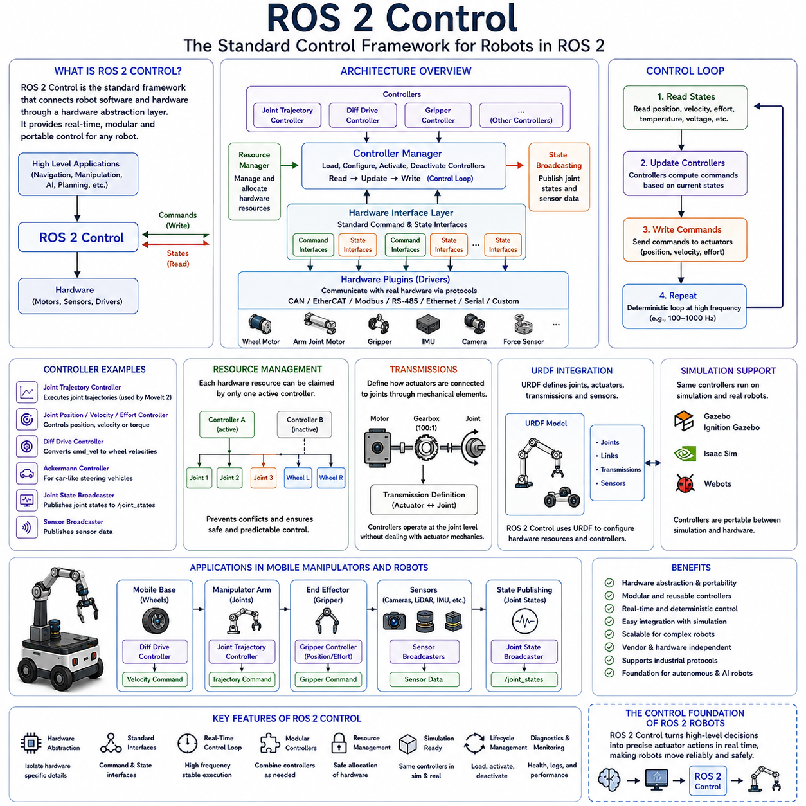{width="7.268055555555556in" height="7.268055555555556in"}

ROS 2 Control is the standard hardware abstraction and robot control framework within the ROS 2 ecosystem. It provides a unified architecture for connecting software controllers to physical hardware while maintaining portability, scalability, modularity, and real-time performance. As robotic systems continue to evolve from simple laboratory platforms into complex industrial, logistics, medical, agricultural, and autonomous systems, the need for a standardized control infrastructure becomes increasingly important. ROS 2 Control was designed to address this requirement by establishing a common framework through which robot hardware, actuators, sensors, controllers, simulators, and higher-level applications can interact consistently.

At its core, ROS 2 Control acts as a bridge between robot software and robot hardware. High-level applications such as navigation, manipulation, perception, fleet management, and autonomous decision-making generate commands that must ultimately be translated into low-level actuator signals. At the same time, hardware devices continuously produce feedback information that must be propagated back into the software system. ROS 2 Control manages this bidirectional information flow while maintaining clear separation between hardware-specific implementations and application-level functionality.

Traditional robot control architectures often relied on custom drivers tightly coupled to specific hardware platforms. Each robot manufacturer developed proprietary interfaces, and software components frequently depended on vendor-specific implementations. This approach created significant integration challenges, increased development costs, and reduced software reusability. ROS 2 Control addresses these limitations by introducing standardized interfaces that allow controllers and hardware devices to interact through common abstractions.

One of the fundamental principles behind ROS 2 Control is hardware abstraction. Rather than requiring controllers to understand the details of motor drivers, encoders, servo amplifiers, or industrial fieldbus protocols, the framework exposes standardized interfaces representing robot resources. Controllers interact with abstract command and state interfaces, while hardware plugins handle device-specific communication behind the scenes.

This separation provides substantial benefits. A motion controller developed for one robot platform can often be reused on another platform with minimal modification. Hardware can be upgraded or replaced without redesigning higher-level software. Simulation and physical deployment can share the same controller architecture. These capabilities significantly improve maintainability and portability.

The architecture of ROS 2 Control consists primarily of hardware interfaces, controllers, controller managers, resource managers, and transmission systems. Together, these components form a layered control framework capable of supporting a wide range of robotic applications.

Hardware interfaces represent the lowest level of the architecture. They provide standardized mechanisms through which physical devices expose command and state information. Command interfaces allow software to send control inputs to actuators, while state interfaces provide feedback measurements such as position, velocity, effort, temperature, voltage, current, or sensor readings.

For example, a wheel motor may expose position, velocity, and effort state interfaces while accepting velocity commands. A robotic arm joint may expose angular position and torque information while accepting position or torque commands. Sensors may provide measurement interfaces without accepting commands. ROS 2 Control treats all these resources consistently through standardized abstractions.

Hardware interfaces are typically implemented as plugins. Each plugin communicates with specific hardware devices through protocols such as CAN, EtherCAT, Modbus, RS-485, Ethernet/IP, serial communication, proprietary APIs, or custom embedded firmware. By isolating protocol-specific logic within hardware plugins, the rest of the system remains hardware-independent.

The Controller Manager serves as the central orchestration component within ROS 2 Control. It loads, configures, activates, deactivates, and unloads controllers dynamically. The Controller Manager also coordinates periodic update cycles that synchronize hardware communication with controller execution.

During each control cycle, the Controller Manager reads state information from hardware interfaces, updates active controllers, and writes command outputs back to hardware devices. This deterministic loop forms the foundation of robot control operations. The timing characteristics of this loop directly influence system performance, responsiveness, and stability.

Real-time behavior is a critical consideration in robotics. Mobile robots, industrial manipulators, humanoids, autonomous vehicles, and precision automation systems often require deterministic control loops operating at frequencies ranging from tens to thousands of Hertz. ROS 2 Control is designed to support real-time execution by minimizing latency, reducing dynamic memory allocation, and promoting predictable execution behavior.

Controllers represent the functional intelligence of the control framework. A controller receives state information, performs computations, and generates command outputs. Different controllers serve different purposes depending on application requirements.

Position controllers regulate actuator positions. Velocity controllers regulate motion speeds. Effort controllers manage torque or force outputs. Trajectory controllers execute predefined motion trajectories. Differential drive controllers manage mobile robot locomotion. Ackermann controllers support autonomous vehicles. Joint state broadcasters publish robot state information. Sensor broadcasters distribute sensor measurements.

Each controller operates independently while interacting through standardized interfaces. This modular design allows developers to combine controllers according to specific application requirements. A mobile manipulator may simultaneously operate wheel controllers, arm controllers, gripper controllers, sensor broadcasters, and state publishers within a unified control architecture.

The Joint Trajectory Controller is among the most widely used ROS 2 Control components. It receives desired joint trajectories and generates commands that guide actuators along those trajectories. MoveIt 2 frequently utilizes this controller when executing robotic manipulation tasks. The controller continuously monitors current joint states and computes appropriate control outputs to achieve desired motion objectives.

Mobile robot applications frequently utilize the Differential Drive Controller. This controller translates high-level velocity commands into wheel velocities appropriate for differential drive platforms. Navigation systems generate desired linear and angular velocities, while the controller computes individual wheel commands required to achieve those motions.

Similarly, Ackermann Steering Controllers support car-like autonomous vehicles. These controllers convert vehicle motion commands into steering angles and wheel velocities while respecting vehicle kinematic constraints.

Resource management is another important aspect of ROS 2 Control. Multiple controllers may compete for access to shared hardware resources. For example, two controllers cannot simultaneously command the same actuator without creating conflicts. ROS 2 Control manages resource allocation and ensures that hardware resources remain under the control of only one active controller at a time.

This capability becomes especially important in complex robotic systems. Mobile manipulators, humanoids, and industrial automation platforms often contain numerous actuators, sensors, and controllers operating simultaneously. Resource management ensures safe and predictable system behavior.

The concept of transmissions plays an important role in connecting actuator outputs to joint motions. In many robotic systems, actuators are not directly attached to joints. Gearboxes, belts, pulleys, lead screws, harmonic drives, and other mechanical transmission elements modify motion and force characteristics. Transmission definitions describe these relationships and allow controllers to operate at the joint level rather than dealing directly with actuator mechanics.

URDF and ROS 2 Control are closely integrated. Robot descriptions define joints, actuators, transmissions, sensors, and hardware interfaces. These definitions provide the information necessary for controller configuration and resource allocation. As a result, robot models and control architectures remain synchronized throughout the development lifecycle.

Simulation support represents one of the most powerful advantages of ROS 2 Control. Modern robotic development increasingly relies on simulation-driven workflows. Gazebo, Ignition Gazebo, Isaac Sim, Webots, and digital twin platforms can integrate directly with ROS 2 Control. Controllers operate identically whether connected to simulated hardware or physical hardware.

This capability dramatically accelerates development. Engineers can design, test, tune, and validate controllers within simulation environments before deploying them to real robots. Once validated, the same controller configurations can often be transferred directly to physical systems.

Mobile manipulators provide an excellent example of the value of ROS 2 Control. These systems combine autonomous mobility, robotic manipulation, perception, and AI-based decision-making. The mobile base may utilize wheel controllers, the robotic arm may employ trajectory controllers, the gripper may use position controllers, and sensors may publish state information through broadcaster interfaces. ROS 2 Control unifies these diverse components within a common framework.

Industrial robotics applications place particularly demanding requirements on control systems. High precision, deterministic timing, safety compliance, fault tolerance, and continuous operation are essential. ROS 2 Control supports these requirements through standardized interfaces, real-time design principles, and integration with industrial communication technologies.

Safety is another critical consideration. Emergency stop systems, safety-rated controllers, fault monitoring, operational limits, and hardware interlocks frequently interact with robot control architectures. ROS 2 Control enables integration of safety mechanisms while maintaining separation between safety logic and application-level functionality.

Cloud robotics and fleet management systems increasingly interact with robot control layers. Fleet managers assign tasks, navigation systems generate trajectories, digital twins monitor operations, and AI planners make decisions. Eventually, these high-level instructions must be translated into actuator commands. ROS 2 Control provides the infrastructure through which this translation occurs reliably and consistently.

The rise of embodied AI further increases the importance of standardized control architectures. Future robots will combine perception, reasoning, planning, learning, navigation, manipulation, and human interaction capabilities within unified systems. While AI models may generate high-level decisions, physical execution still depends upon robust control frameworks. ROS 2 Control serves as the final execution layer that converts intelligent decisions into real-world actions.

Consider a warehouse mobile manipulator performing autonomous picking operations. Vision systems identify target objects. AI models determine grasp strategies. Navigation systems generate paths. MoveIt 2 computes manipulation trajectories. ROS 2 Control then translates these trajectories into coordinated motor commands controlling wheels, joints, and grippers. Every physical movement ultimately passes through the control framework.

Controller lifecycle management is also supported within ROS 2 Control. Controllers can be loaded, configured, activated, deactivated, and unloaded dynamically. This capability aligns closely with ROS 2 Lifecycle Nodes and enables sophisticated operational management strategies. Different controllers may be activated according to mission requirements, operational modes, or fault recovery procedures.

Diagnostic and monitoring capabilities are equally important. Controllers continuously generate state information that can be analyzed for performance evaluation, predictive maintenance, anomaly detection, and system health monitoring. Modern robotic systems increasingly depend upon operational visibility, and ROS 2 Control provides the infrastructure necessary for exposing relevant information.

As robotic systems continue expanding into logistics, healthcare, manufacturing, agriculture, defense, inspection, infrastructure management, and embodied AI applications, the need for standardized control frameworks will continue growing. ROS 2 Control addresses this need by providing a unified architecture capable of supporting diverse hardware platforms, simulation environments, controller types, and application domains.

The framework enables separation of concerns between hardware engineers, control engineers, robotics developers, simulation specialists, and AI researchers. Each group can focus on its respective domain while relying upon standardized interfaces for integration. This architectural approach significantly improves scalability and long-term maintainability.

Within modern ROS 2 deployments, ROS 2 Control has become the de facto standard for robot control infrastructure. It forms the foundation upon which locomotion, manipulation, autonomous navigation, sensor integration, digital twins, industrial automation, and embodied intelligence systems are built. Understanding ROS 2 Control is therefore essential for anyone seeking to develop production-grade robotic platforms capable of operating reliably in real-world environments.

As robots become more intelligent, more autonomous, and more interconnected, ROS 2 Control will remain a critical component of the robotics software stack. Its hardware abstraction model, controller architecture, real-time capabilities, simulation integration, and modular design provide the control foundation necessary for the next generation of autonomous robotic systems. For developers building mobile manipulators, autonomous vehicles, industrial robots, or future embodied AI platforms, mastery of ROS 2 Control represents a crucial step toward creating scalable, reliable, and deployable robotic solutions.

ROS 2 Control은 ROS 2 생태계에서 사용되는 표준 하드웨어 추상화(Hardware Abstraction) 및 로봇 제어 프레임워크이다. 이 프레임워크는 소프트웨어 컨트롤러와 실제 하드웨어를 연결하는 통합 아키텍처를 제공하며, 이식성(Portability), 확장성(Scalability), 모듈성(Modularity), 실시간성(Real-Time Performance)을 동시에 지원한다. 로봇이 연구용 플랫폼에서 산업용, 물류용, 의료용, 농업용, 자율주행 시스템으로 발전하면서 하드웨어와 소프트웨어를 표준화된 방식으로 연결하는 제어 인프라의 중요성이 더욱 커지고 있다. ROS 2 Control은 이러한 요구를 충족하기 위해 개발된 핵심 기술이다.

ROS 2 Control의 본질은 로봇 소프트웨어와 실제 하드웨어를 연결하는 다리 역할을 하는 것이다. 내비게이션, 조작, 인식, 플릿 관리, AI 의사결정과 같은 상위 소프트웨어는 결국 모터와 액추에이터를 움직이는 명령으로 변환되어야 한다. 반대로 하드웨어는 지속적으로 상태 정보를 생성하며 이를 상위 시스템에 전달해야 한다. ROS 2 Control은 이러한 양방향 데이터 흐름을 효율적으로 관리한다.

전통적인 로봇 제어 시스템은 특정 제조사의 하드웨어에 종속된 경우가 많았다. 모터 드라이버, 엔코더, 서보 앰프, 산업용 통신 프로토콜마다 서로 다른 인터페이스를 사용했기 때문에 소프트웨어 재사용이 어려웠다. ROS 2 Control은 표준 인터페이스를 제공함으로써 이러한 문제를 해결하였다.

ROS 2 Control의 가장 중요한 철학은 하드웨어 추상화이다. 컨트롤러는 모터 드라이버나 EtherCAT 장치의 내부 구조를 알 필요가 없다. 대신 Position, Velocity, Effort와 같은 표준 인터페이스만 사용한다. 실제 하드웨어와의 통신은 하드웨어 플러그인이 담당한다.

이러한 구조는 매우 큰 장점을 제공한다. 특정 로봇을 위해 개발한 컨트롤러를 다른 로봇에도 쉽게 적용할 수 있으며, 하드웨어를 교체하더라도 상위 소프트웨어를 수정할 필요가 거의 없다. 또한 시뮬레이션과 실제 하드웨어가 동일한 컨트롤러를 사용할 수 있기 때문에 개발 효율성이 크게 향상된다.

ROS 2 Control의 아키텍처는 Hardware Interface, Controller, Controller Manager, Resource Manager, Transmission System 등의 요소로 구성된다. 이들은 함께 동작하여 통합 제어 환경을 제공한다.

Hardware Interface는 가장 하위 계층에 위치한다. 하드웨어 장치가 소프트웨어에 자신의 상태를 제공하고 명령을 받을 수 있도록 표준화된 인터페이스를 제공한다. State Interface는 위치, 속도, 전류, 온도 등의 상태 정보를 제공하며, Command Interface는 위치 명령, 속도 명령, 토크 명령 등을 수신한다.

예를 들어 바퀴 모터는 Position, Velocity, Effort 상태 정보를 제공할 수 있으며 Velocity Command를 받을 수 있다. 로봇팔 관절은 관절 각도와 토크 정보를 제공하면서 Position Command 또는 Torque Command를 수신할 수 있다. ROS 2 Control은 이러한 다양한 하드웨어를 동일한 방식으로 다룰 수 있도록 한다.

Hardware Interface는 일반적으로 플러그인 형태로 구현된다. CAN, EtherCAT, Modbus, RS-485, Ethernet/IP, Serial Communication 등 다양한 통신 프로토콜을 사용할 수 있으며, 실제 장치와의 통신은 플러그인 내부에서 처리된다.

Controller Manager는 ROS 2 Control의 핵심 관리 컴포넌트이다. Controller Manager는 컨트롤러를 로드하고 설정하며 활성화 및 비활성화를 수행한다. 또한 주기적인 제어 루프를 실행하면서 하드웨어와 컨트롤러 간의 데이터 교환을 관리한다.

제어 주기마다 Controller Manager는 하드웨어 상태를 읽고(Read), 컨트롤러를 업데이트하며(Update), 새로운 명령을 하드웨어에 기록한다(Write). 이러한 Read-Update-Write 구조는 ROS 2 Control의 핵심 동작 방식이다.

실시간성은 로봇 제어에서 매우 중요한 요소이다. 산업용 로봇, 모바일 매니퓰레이터, 휴머노이드, 자율주행차는 수십 Hz에서 수천 Hz 수준의 제어 주기를 요구한다. ROS 2 Control은 메모리 할당을 최소화하고 지연시간을 줄이며 예측 가능한 실행 시간을 제공하도록 설계되었다.

Controller는 실제 제어 알고리즘이 구현되는 부분이다. 컨트롤러는 상태 정보를 입력받아 계산을 수행하고 제어 명령을 생성한다.

Position Controller는 목표 위치를 추종한다. Velocity Controller는 목표 속도를 유지한다. Effort Controller는 토크나 힘을 제어한다. Trajectory Controller는 궤적을 따라 움직인다. Differential Drive Controller는 차동구동 로봇을 제어한다. Ackermann Controller는 자동차형 차량을 제어한다. Joint State Broadcaster는 관절 상태를 Publish한다.

각 컨트롤러는 독립적으로 동작하며 표준 인터페이스를 통해 하드웨어와 연결된다. 따라서 모바일 매니퓰레이터는 바퀴 제어기, 로봇팔 제어기, 그리퍼 제어기, 센서 브로드캐스터 등을 동시에 운영할 수 있다.

Joint Trajectory Controller는 가장 널리 사용되는 컨트롤러 중 하나이다. MoveIt 2는 로봇팔 조작을 수행할 때 주로 이 컨트롤러를 사용한다. MoveIt 2가 생성한 궤적을 받아 실제 모터 명령으로 변환하는 역할을 수행한다.

모바일 로봇에서는 Differential Drive Controller가 매우 중요하다. 내비게이션 시스템은 선속도(Linear Velocity)와 각속도(Angular Velocity)를 생성하고, Differential Drive Controller는 이를 좌우 바퀴 속도로 변환한다.

자동차형 자율주행 플랫폼에서는 Ackermann Controller가 사용된다. 이 컨트롤러는 차량의 조향각과 바퀴 속도를 계산하여 차량이 원하는 경로를 따라 움직일 수 있도록 한다.

Resource Management는 ROS 2 Control의 또 다른 중요한 기능이다. 여러 컨트롤러가 동일한 하드웨어 자원을 동시에 제어하려고 하면 충돌이 발생할 수 있다. ROS 2 Control은 이러한 충돌을 방지하기 위해 자원 할당을 관리한다.

예를 들어 하나의 관절을 두 개의 컨트롤러가 동시에 제어하는 것은 허용되지 않는다. Resource Manager는 특정 자원이 오직 하나의 활성 컨트롤러에만 할당되도록 보장한다.

Transmission은 액추에이터와 실제 관절 사이의 기계적 관계를 정의한다. 대부분의 로봇은 모터가 직접 관절을 구동하지 않는다. 감속기, 벨트, 풀리, 볼스크류, 하모닉 드라이브 등이 사용된다. Transmission은 이러한 기계적 관계를 정의하여 컨트롤러가 관절 수준에서 제어할 수 있도록 한다.

URDF와 ROS 2 Control은 밀접하게 연동된다. URDF는 관절, 액추에이터, 센서, Transmission 정보를 정의하며, ROS 2 Control은 이를 기반으로 하드웨어 자원을 구성한다. 따라서 로봇 모델과 제어 시스템이 항상 일관성을 유지할 수 있다.

시뮬레이션 지원은 ROS 2 Control의 가장 큰 장점 중 하나이다. Gazebo, Ignition Gazebo, Isaac Sim, Webots 등의 시뮬레이터는 ROS 2 Control과 직접 통합될 수 있다. 동일한 컨트롤러를 실제 하드웨어와 시뮬레이터에서 모두 사용할 수 있다.

이 기능은 개발 효율을 크게 향상시킨다. 개발자는 먼저 시뮬레이션에서 컨트롤러를 검증한 후 실제 로봇에 적용할 수 있다. 컨트롤러를 다시 작성할 필요가 없기 때문에 개발 기간과 비용이 크게 절감된다.

모바일 매니퓰레이터는 ROS 2 Control의 장점을 가장 잘 보여주는 예이다. 이동 플랫폼은 바퀴 제어기를 사용하고, 로봇팔은 Trajectory Controller를 사용하며, 그리퍼는 Position Controller를 사용한다. 센서 데이터는 Broadcaster를 통해 Publish된다. ROS 2 Control은 이러한 모든 구성요소를 하나의 통합된 프레임워크 안에서 관리한다.

산업용 로봇은 높은 정밀도와 실시간성을 요구한다. 또한 안전성, 장애 허용성, 24시간 운영 능력이 필요하다. ROS 2 Control은 표준 인터페이스와 실시간 설계를 통해 이러한 요구사항을 충족할 수 있도록 지원한다.

안전성 역시 중요한 요소이다. 비상정지(E-Stop), 안전 컨트롤러, 장애 감지, 소프트 리미트, 하드웨어 인터락 등은 모두 제어 계층과 밀접하게 연관된다. ROS 2 Control은 이러한 안전 기능과 통합될 수 있도록 설계되었다.

최근에는 플릿 관리 시스템, 클라우드 로보틱스, 디지털 트윈도 제어 계층과 긴밀하게 연결되고 있다. 플릿 관리 시스템이 임무를 생성하고, 내비게이션 시스템이 경로를 계획하며, AI가 의사결정을 수행하더라도 결국에는 실제 모터를 움직여야 한다. ROS 2 Control은 이러한 최종 실행 계층을 담당한다.

Embodied AI 시대에도 ROS 2 Control의 중요성은 더욱 커질 것이다. 미래의 로봇은 인식, 추론, 학습, 계획, 이동, 조작을 하나의 통합된 시스템으로 수행하게 된다. 하지만 아무리 뛰어난 AI도 결국 물리적인 행동으로 연결되어야 한다. ROS 2 Control은 AI의 결정을 실제 행동으로 변환하는 마지막 단계의 핵심 기술이다.

예를 들어 물류창고의 모바일 매니퓰레이터를 생각해 보자. 비전 시스템이 물체를 인식하고, AI가 집을 물체를 선택하며, 내비게이션이 이동 경로를 계획하고, MoveIt 2가 로봇팔 궤적을 생성한다. 하지만 실제 바퀴와 모터를 움직이는 단계는 ROS 2 Control이 담당한다.

ROS 2 Control은 컨트롤러의 라이프사이클 관리도 지원한다. 컨트롤러는 동적으로 로드, 설정, 활성화, 비활성화, 제거될 수 있다. 이는 ROS 2 Lifecycle Node와 매우 유사한 개념이며, 운영 환경에 따라 필요한 컨트롤러만 활성화할 수 있도록 한다.

진단 및 모니터링 기능도 매우 중요하다. 컨트롤러는 지속적으로 상태 정보를 생성하며, 이를 통해 성능 분석, 예지보전(Predictive Maintenance), 이상 탐지, 시스템 상태 모니터링이 가능하다.

로봇이 물류, 의료, 제조, 농업, 국방, 점검, 인프라 관리, Embodied AI 영역으로 확대될수록 표준화된 제어 프레임워크의 중요성은 더욱 커질 것이다. ROS 2 Control은 다양한 하드웨어와 소프트웨어를 연결하는 통합 제어 아키텍처를 제공함으로써 이러한 요구를 충족한다.

또한 ROS 2 Control은 하드웨어 엔지니어, 제어 엔지니어, 소프트웨어 개발자, 시뮬레이션 전문가, AI 연구자가 서로 독립적으로 개발하면서도 표준 인터페이스를 통해 협업할 수 있도록 지원한다. 이러한 구조는 대규모 로봇 시스템의 유지보수성과 확장성을 크게 향상시킨다.

현재 ROS 2 환경에서 ROS 2 Control은 사실상의 표준 제어 프레임워크로 자리 잡고 있다. 이동 제어, 로봇팔 제어, 자율주행, 디지털 트윈, 산업 자동화, Embodied AI 시스템은 모두 ROS 2 Control 위에서 동작할 수 있다.

결론적으로 ROS 2 Control은 ROS 2 로봇 소프트웨어 스택의 핵심 제어 계층이다. 하드웨어 추상화, 컨트롤러 아키텍처, 실시간 처리, 시뮬레이션 통합, 모듈형 설계를 통해 차세대 자율주행 로봇과 모바일 매니퓰레이터, 산업용 로봇, Embodied AI 플랫폼을 구현할 수 있는 기반을 제공한다. 따라서 ROS 2 기반 로봇 시스템을 개발하는 엔지니어에게 ROS 2 Control은 반드시 숙지해야 할 핵심 기술 중 하나라고 할 수 있다.

##  

## 09 Component Composition

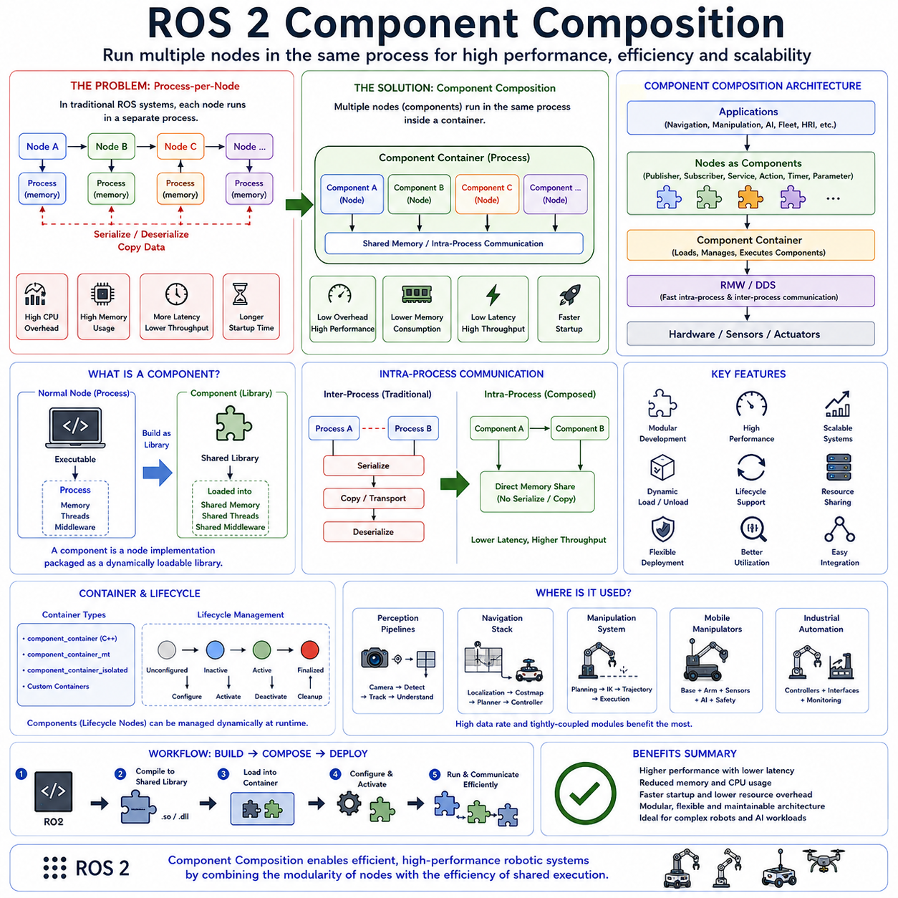{width="7.268055555555556in" height="7.268055555555556in"}

Component Composition is one of the most important architectural capabilities introduced in ROS 2 to improve performance, scalability, maintainability, and resource efficiency. As robotic systems become increasingly complex, a single robot may execute dozens or even hundreds of software nodes simultaneously. These nodes handle perception, localization, navigation, manipulation, planning, communication, diagnostics, fleet management, artificial intelligence, and human-robot interaction. In traditional ROS architectures, each node operates as an independent process. While this design offers simplicity and isolation, it also introduces communication overhead, increased memory consumption, longer startup times, and reduced computational efficiency. ROS 2 Component Composition was developed to overcome these limitations by enabling multiple nodes to execute within a shared process while preserving modular software design principles.

To understand the significance of Component Composition, it is useful to first examine the traditional ROS node model. In ROS 1 and conventional ROS 2 deployments, each node typically runs as a separate operating system process. Every node maintains its own memory space, thread management, communication stack, and runtime resources. When nodes exchange data, information must pass through middleware layers, serialization mechanisms, inter-process communication channels, and operating system scheduling structures.

This architecture provides excellent fault isolation. If one node crashes, other nodes may continue operating. Development and debugging are also straightforward because each node behaves as an independent executable application. However, as robotic systems scale in complexity, the disadvantages become increasingly significant.

Modern autonomous robots generate enormous amounts of data. High-resolution cameras produce image streams at tens or hundreds of megabytes per second. LiDAR sensors generate dense point clouds. AI inference engines process neural network outputs. Localization systems continuously update robot pose estimates. Navigation systems exchange maps, trajectories, and obstacle information. When these data streams move between separate processes, significant computational resources are consumed by message serialization, copying, memory allocation, and operating system context switching.

Consider a perception pipeline consisting of camera acquisition, image preprocessing, object detection, object tracking, and scene understanding modules. In a traditional process-based architecture, each stage may run as a separate node. Every image frame must be serialized, transmitted, deserialized, copied into memory, processed, and then transmitted again to the next stage. The computational overhead accumulates rapidly.

Component Composition addresses this issue by allowing multiple nodes to execute within the same process. Rather than launching independent executables, nodes are compiled as reusable software components that can be dynamically loaded into a shared runtime environment. Since components operate within the same process space, they can exchange information more efficiently while maintaining logical separation.

The core concept behind Component Composition is the component. A component is essentially a ROS 2 node packaged as a dynamically loadable library rather than a standalone executable. Each component retains all the functionality of a normal node, including publishers, subscribers, services, actions, parameters, timers, and lifecycle management capabilities. The primary difference lies in how the node is deployed and executed.

Instead of starting an executable file, a component is loaded into a container process. Multiple components may coexist within the same container. Once loaded, they operate similarly to ordinary ROS nodes while sharing process-level resources.

The container serves as the execution environment for components. ROS 2 provides several container implementations capable of dynamically loading, unloading, and managing component libraries at runtime. The container is responsible for instantiating components, allocating resources, managing execution contexts, and coordinating interactions between loaded modules.

One of the most important advantages of Component Composition is reduced communication overhead. When nodes reside in separate processes, communication generally requires serialization and deserialization. Messages are converted into middleware formats, transmitted through communication layers, and reconstructed at the receiving side.

Within a composed system, many of these operations can be eliminated. Components can exchange data through direct memory references or optimized intra-process communication mechanisms. This significantly reduces CPU utilization, memory copying, and communication latency.

Intra-process communication is a key enabling technology within Component Composition. ROS 2 provides specialized mechanisms allowing messages to be passed between components without leaving the process boundary. Instead of creating multiple copies of large data structures, components can share references to the same data object.

This capability is particularly important for high-bandwidth sensor data. Camera images, LiDAR point clouds, depth maps, semantic segmentation outputs, and neural network tensors may contain millions of data elements. Eliminating unnecessary memory copies can dramatically improve performance.

Memory efficiency represents another major advantage. Traditional node architectures allocate separate memory resources for each process. Every process maintains its own middleware context, memory pools, thread structures, and communication resources. In large systems, this duplication can become substantial.

Component Composition reduces memory consumption by sharing common infrastructure within a single process. Middleware resources, communication contexts, thread pools, and runtime libraries can often be reused across multiple components. This leads to lower overall memory requirements and improved scalability.

Startup performance also improves significantly. Launching a large robotic application may involve dozens of processes. Process creation, library loading, middleware initialization, and communication discovery all contribute to startup latency. Component-based systems can often initialize more rapidly because components are loaded into existing containers rather than creating entirely new processes.

Modularity remains a central design objective despite shared execution environments. Component Composition does not require developers to abandon modular software engineering practices. Each component remains logically independent and can be developed, tested, documented, versioned, and maintained separately.

This balance between modularity and efficiency is one of the strongest advantages of ROS 2 Component Composition. Developers retain the flexibility of component-based design while benefiting from the performance characteristics of integrated execution.

The ROS 2 component architecture relies heavily on dynamic loading technologies. Components are typically compiled as shared libraries. During runtime, containers load these libraries dynamically and instantiate component objects. This process allows systems to be reconfigured without recompilation.

Dynamic loading enables considerable flexibility. Components can be added, removed, replaced, upgraded, or reconfigured according to operational requirements. Different deployment configurations may utilize the same component libraries in various combinations.

This flexibility is particularly valuable in large robotic systems. Mobile manipulators, warehouse robots, industrial automation systems, autonomous vehicles, and humanoid robots frequently require different operational modes. Component-based architectures allow functionality to be tailored to specific mission requirements.

Lifecycle management integrates naturally with Component Composition. Lifecycle Nodes may be deployed as components and managed within shared containers. This combination provides both operational control and deployment efficiency. Components can be loaded dynamically while retaining structured lifecycle transitions such as configuration, activation, deactivation, cleanup, and shutdown.

The benefits become especially apparent in perception systems. A modern robotic perception pipeline may include image acquisition, camera calibration, image rectification, neural network inference, object tracking, semantic understanding, and sensor fusion. These modules often process large data streams continuously.

By deploying such pipelines as composed components, data can flow efficiently through shared memory structures while preserving modular organization. The resulting system achieves lower latency, reduced CPU usage, and improved throughput.

Autonomous navigation systems also benefit significantly. Localization modules, map servers, costmap generators, path planners, behavior trees, obstacle detectors, and motion controllers frequently exchange large quantities of information. Component Composition reduces communication overhead throughout the navigation stack.

Manipulation systems provide another compelling example. MoveIt 2, robot state publishers, planning scene monitors, collision checkers, inverse kinematics solvers, trajectory generators, and execution managers often interact continuously. Running these modules within composed containers improves responsiveness and resource utilization.

Mobile manipulators combine all these requirements simultaneously. A typical mobile manipulator may include perception pipelines, localization systems, navigation frameworks, manipulation planners, AI inference engines, fleet communication modules, and safety monitoring systems. Component Composition allows these subsystems to be organized efficiently while maintaining modularity.

Real-time robotics applications often require deterministic performance. Communication overhead introduces latency variability that can negatively impact control systems. Component-based architectures reduce such variability by minimizing middleware traversal and memory copying operations.

Industrial automation systems frequently deploy ROS 2 Control alongside Component Composition. Controllers, state publishers, sensor interfaces, diagnostic modules, and monitoring tools can operate within shared execution environments. This architecture supports high-performance control while preserving modular software design.

Cloud robotics and edge computing environments also benefit from Component Composition. Resource-constrained edge devices often have limited CPU and memory capacity. Reducing communication overhead and memory duplication improves system efficiency and allows more functionality to execute on the same hardware.

Artificial intelligence workloads increasingly drive robotic architectures. Computer vision models, large language models, vision-language models, robot foundation models, and embodied AI systems generate substantial computational demands. Efficient software infrastructure becomes essential for maximizing available hardware resources.

Component Composition helps ensure that computational resources are devoted to AI processing rather than unnecessary communication overhead. This advantage becomes increasingly important as robotic intelligence systems grow more sophisticated.

The relationship between Component Composition and executors is also significant. Executors manage callback execution within ROS 2 applications. Composed systems may utilize single-threaded executors, multi-threaded executors, static executors, or custom execution strategies depending on application requirements.

Careful executor selection influences performance, concurrency, responsiveness, and determinism. Advanced deployments often combine Component Composition with customized execution architectures to optimize resource utilization.

Debugging and fault isolation require additional consideration within composed systems. Since multiple components share a process, failures may affect multiple modules simultaneously. Developers must therefore balance performance gains against isolation requirements. In some cases, critical safety functions may remain in separate processes while high-bandwidth processing pipelines utilize composition.

This hybrid deployment strategy is common in production systems. Performance-sensitive modules operate within composed containers, while safety-critical or fault-sensitive modules maintain process-level isolation. ROS 2 supports both approaches simultaneously, allowing architects to choose the most appropriate deployment model for each subsystem.

Security considerations also influence deployment decisions. Shared execution environments require careful management of access control, resource usage, and software integrity. Component-based architectures should be integrated with broader system security strategies to ensure reliable operation.

The emergence of digital twins further increases the importance of efficient software composition. Digital twins replicate robot state, sensor information, operational status, and environmental interactions. Large amounts of information must be exchanged continuously between simulation environments and physical systems. Component Composition helps reduce communication overhead within these complex architectures.

Embodied AI represents perhaps the strongest motivation for advanced software composition techniques. Future robotic systems will integrate perception, reasoning, planning, learning, manipulation, mobility, communication, and human interaction into unified cognitive architectures. Efficient execution becomes essential as software complexity continues increasing.

Component Composition provides one of the key architectural mechanisms enabling this future. By reducing overhead while preserving modularity, it allows increasingly sophisticated robotic systems to scale efficiently.

Within ROS 2, Component Composition has become a foundational technology for high-performance robotic applications. It bridges the gap between traditional process-oriented architectures and modern component-based software engineering practices. The result is a framework capable of supporting demanding workloads while maintaining flexibility, maintainability, and scalability.

For developers building mobile manipulators, autonomous vehicles, industrial robots, warehouse automation systems, digital twins, and future embodied AI platforms, understanding Component Composition is essential. It is not merely an optimization technique but a fundamental architectural approach that enables modern ROS 2 systems to achieve the performance, efficiency, and scalability required for real-world deployment. As robotic applications continue growing in complexity and intelligence, Component Composition will remain a critical pillar of advanced ROS 2 software architecture.

Component Composition은 ROS 2에서 도입된 가장 중요한 소프트웨어 아키텍처 기술 중 하나로, 성능 향상, 확장성 확보, 유지보수성 개선, 자원 효율성 증대를 목적으로 개발되었다. 현대의 로봇 시스템은 점점 복잡해지고 있으며 하나의 로봇 안에서도 수십 개에서 수백 개의 노드가 동시에 실행된다. 이들 노드는 인식, 위치추정, 내비게이션, 조작, 계획, 통신, 진단, 플릿 관리, 인공지능, 인간-로봇 상호작용 등 다양한 기능을 담당한다. 기존 ROS 구조에서는 각 노드가 독립적인 프로세스로 실행되었지만, 이러한 방식은 통신 오버헤드, 메모리 사용량 증가, 시작 시간 증가, 계산 효율 저하와 같은 문제를 발생시킨다. ROS 2의 Component Composition은 이러한 문제를 해결하기 위해 여러 노드를 하나의 프로세스 안에서 실행할 수 있도록 지원한다.

전통적인 ROS 노드 모델에서는 각 노드가 별도의 운영체제 프로세스로 실행된다. 각각의 노드는 자신만의 메모리 공간, 스레드, 통신 스택, 실행 환경을 가진다. 노드 간 데이터 교환이 발생하면 메시지는 직렬화(Serialization), 전송, 역직렬화(Deserialization), 메모리 복사 과정을 거쳐야 한다.

이러한 구조는 장애 격리(Fault Isolation) 측면에서는 장점이 있다. 하나의 노드가 비정상 종료되더라도 다른 노드에는 영향을 주지 않을 수 있기 때문이다. 또한 디버깅도 비교적 쉽다. 하지만 시스템 규모가 커질수록 이러한 구조는 성능 저하의 원인이 된다.

현대의 자율주행 로봇은 매우 많은 양의 데이터를 생성한다. 고해상도 카메라는 초당 수십에서 수백 MB의 이미지를 생성하며, LiDAR는 대용량 포인트 클라우드를 생성한다. AI 추론 엔진은 딥러닝 결과를 출력하고, 위치추정 시스템은 지속적으로 로봇 위치를 갱신한다. 이러한 데이터가 여러 프로세스 사이를 이동할 때마다 CPU 자원과 메모리가 상당히 소비된다.

예를 들어 영상 처리 파이프라인이 있다고 가정하자. 카메라 입력, 이미지 전처리, 객체 검출, 객체 추적, 장면 이해가 각각 별도의 노드로 실행된다면 이미지 데이터는 단계마다 직렬화되고 복사되며 다시 전송된다. 이미지 한 장이 여러 번 복사되기 때문에 CPU와 메모리 사용량이 급격히 증가한다.

Component Composition은 이러한 문제를 해결하기 위해 여러 노드를 하나의 프로세스 안에서 실행할 수 있도록 한다. 노드는 독립 실행 프로그램이 아니라 동적으로 로드 가능한 컴포넌트(Component) 형태로 작성된다. 여러 컴포넌트가 하나의 프로세스 안에서 함께 실행되므로 데이터 교환이 훨씬 효율적으로 이루어진다.

컴포넌트는 본질적으로 ROS 2 노드를 공유 라이브러리(Shared Library) 형태로 패키징한 것이다. Publisher, Subscriber, Service, Action, Parameter, Timer 등 일반 노드가 가진 모든 기능을 동일하게 제공한다. 차이점은 실행 방식에 있다.

일반 노드는 독립적인 실행 파일로 시작되지만, 컴포넌트는 Container라는 실행 환경 안으로 동적으로 로드된다. 여러 컴포넌트가 동일한 Container 안에서 함께 동작할 수 있다.

Container는 컴포넌트의 실행 환경 역할을 한다. ROS 2는 다양한 Container를 제공하며, Container는 컴포넌트를 로드하고 초기화하며 실행을 관리한다. 또한 컴포넌트 간의 자원 공유와 실행 컨텍스트를 관리한다.

Component Composition의 가장 큰 장점은 통신 오버헤드 감소이다. 서로 다른 프로세스 간 통신에서는 메시지 직렬화와 역직렬화가 반드시 필요하다. 그러나 동일 프로세스 내부에서는 이러한 과정의 상당 부분을 제거할 수 있다.

ROS 2는 이를 위해 Intra-Process Communication 기능을 제공한다. 동일 프로세스 내에 존재하는 컴포넌트들은 데이터를 직접 메모리 참조 방식으로 전달할 수 있다. 즉, 데이터를 여러 번 복사하지 않고 동일한 객체를 공유할 수 있다.

이 기능은 대용량 센서 데이터 처리에서 매우 중요하다. 카메라 이미지, LiDAR 포인트 클라우드, Depth Map, Semantic Segmentation 결과, 딥러닝 텐서(Tensor)와 같은 데이터는 수백만 개의 요소를 포함할 수 있다. 불필요한 메모리 복사를 제거함으로써 성능을 크게 향상시킬 수 있다.

메모리 효율성 또한 중요한 장점이다. 기존 구조에서는 각 프로세스가 독립적인 미들웨어 컨텍스트, 메모리 풀, 스레드 구조를 유지해야 한다. 따라서 노드 수가 많아질수록 메모리 사용량도 증가한다.

반면 Component Composition에서는 여러 컴포넌트가 동일한 미들웨어 환경과 실행 자원을 공유한다. 통신 스택, 런타임 라이브러리, 스레드 풀 등을 공유할 수 있기 때문에 전체 메모리 사용량이 감소한다.

시작 시간(Start-up Time)도 개선된다. 수십 개의 프로세스를 시작하려면 각각의 프로세스 생성, 라이브러리 로딩, DDS 초기화 과정이 필요하다. 반면 컴포넌트는 이미 실행 중인 Container에 로드되기 때문에 시작 시간이 단축된다.

중요한 점은 성능 향상을 위해 모듈성을 포기하지 않는다는 것이다. 각 컴포넌트는 여전히 독립적으로 개발, 테스트, 문서화, 유지보수할 수 있다. 단지 실행 환경만 공유할 뿐이다.

이러한 점은 Component Composition의 가장 큰 강점 중 하나이다. 개발자는 모듈 기반 설계의 장점을 유지하면서도 통합 실행 환경의 성능 이점을 얻을 수 있다.

ROS 2의 Component Architecture는 동적 로딩(Dynamic Loading)을 기반으로 한다. 컴포넌트는 공유 라이브러리로 컴파일되며, 실행 중에 Container가 이를 로드하여 객체를 생성한다.

이 방식은 매우 높은 유연성을 제공한다. 새로운 컴포넌트를 추가하거나 제거할 수 있고, 기능을 업그레이드하거나 교체할 수도 있다. 동일한 컴포넌트 라이브러리를 다양한 조합으로 배치하여 서로 다른 로봇 시스템을 구성할 수 있다.

대규모 로봇 시스템에서는 이러한 유연성이 특히 중요하다. 모바일 매니퓰레이터, 물류 로봇, 산업용 자동화 시스템, 자율주행차, 휴머노이드 로봇은 상황에 따라 다른 기능 구성을 요구할 수 있기 때문이다.

Lifecycle Node와의 통합도 자연스럽게 이루어진다. Lifecycle Node를 컴포넌트 형태로 실행하면 상태 관리와 성능 최적화를 동시에 달성할 수 있다. 컴포넌트는 동적으로 로드되면서도 Configure, Activate, Deactivate, Cleanup, Shutdown과 같은 라이프사이클 상태를 유지할 수 있다.

영상 인식 시스템은 Component Composition의 장점을 가장 잘 보여주는 사례 중 하나이다. 카메라 입력, 이미지 보정, 객체 검출, 객체 추적, 장면 분석, 센서 융합과 같은 모듈을 하나의 프로세스 안에서 실행하면 데이터 복사 횟수가 크게 줄어들어 지연시간과 CPU 사용량이 감소한다.

자율주행 시스템 역시 많은 이점을 얻는다. 위치추정(Localization), 지도 서버(Map Server), Costmap 생성기, 경로 계획기(Path Planner), Behavior Tree, 장애물 탐지기, 모션 컨트롤러는 지속적으로 데이터를 교환한다. Component Composition은 이러한 통신 비용을 크게 줄여준다.

조작(Manipulation) 시스템도 마찬가지이다. MoveIt 2, Robot State Publisher, Collision Checker, Inverse Kinematics Solver, Trajectory Generator 등이 동일 프로세스 내에서 실행될 경우 더욱 빠르고 효율적으로 동작할 수 있다.

모바일 매니퓰레이터는 인식, 내비게이션, 조작, AI, 플릿 관리 기능을 모두 포함하기 때문에 Component Composition의 효과를 극대화할 수 있는 대표적인 사례이다.

실시간 로봇 시스템에서도 Component Composition은 매우 유용하다. 프로세스 간 통신은 지연시간 변동(Jitter)을 증가시킬 수 있다. 반면 동일 프로세스 내 통신은 더욱 예측 가능한 성능을 제공하므로 실시간 제어 시스템에 유리하다.

산업 자동화 시스템에서는 ROS 2 Control과 함께 사용되는 경우가 많다. 컨트롤러, 상태 브로드캐스터, 센서 인터페이스, 진단 시스템 등을 하나의 실행 환경에 통합함으로써 성능과 유지보수성을 동시에 확보할 수 있다.

클라우드 로보틱스와 엣지 컴퓨팅 환경에서도 Component Composition의 중요성은 커지고 있다. 엣지 장치는 CPU와 메모리가 제한적이기 때문에 통신 오버헤드 감소와 메모리 절약 효과가 매우 중요하다.

최근 AI 기반 로봇이 확산되면서 효율적인 소프트웨어 아키텍처의 중요성은 더욱 증가하고 있다. 컴퓨터 비전 모델, 대규모 언어 모델(LLM), 비전-언어 모델(VLM), 로봇 파운데이션 모델, Embodied AI 시스템은 막대한 계산 자원을 요구한다.

Component Composition은 이러한 계산 자원을 데이터 복사가 아닌 실제 AI 추론에 사용할 수 있도록 해준다. 따라서 AI 기반 로봇 시스템에서 매우 중요한 기술로 평가받는다.

Executor와의 관계도 중요하다. Executor는 ROS 2에서 콜백 실행을 관리하는 구성요소이다. Component Composition 환경에서는 Single-Threaded Executor, Multi-Threaded Executor, Static Executor 등을 선택할 수 있다.

적절한 Executor 선택은 성능, 응답성, 동시성 처리 능력에 큰 영향을 미친다. 고급 시스템에서는 Component Composition과 Executor 최적화를 함께 수행하여 자원 활용도를 극대화한다.

다만 Component Composition은 몇 가지 고려사항도 있다. 여러 컴포넌트가 하나의 프로세스를 공유하기 때문에 하나의 컴포넌트 오류가 다른 컴포넌트에 영향을 줄 수 있다. 따라서 성능 향상과 장애 격리 사이의 균형을 고려해야 한다.

실제 산업 현장에서는 하이브리드 아키텍처를 많이 사용한다. 고성능 데이터 처리 파이프라인은 Component Composition으로 구성하고, 안전 관련 기능이나 핵심 제어 기능은 별도의 프로세스로 분리하여 실행한다.

디지털 트윈 환경에서도 Component Composition은 중요한 역할을 한다. 디지털 트윈은 로봇 상태, 센서 정보, 환경 정보, 운영 데이터를 지속적으로 교환해야 한다. Component Composition은 이러한 복잡한 데이터 흐름을 효율적으로 처리할 수 있게 해준다.

Embodied AI 시대에는 더욱 강력한 소프트웨어 통합이 필요하다. 미래의 로봇은 인식, 추론, 계획, 학습, 이동, 조작, 인간과의 상호작용을 하나의 지능 시스템 안에서 수행하게 된다. 이러한 복잡한 구조를 효율적으로 운영하기 위해서는 Component Composition과 같은 고성능 소프트웨어 아키텍처가 필수적이다.

결론적으로 Component Composition은 ROS 2의 고성능 애플리케이션을 위한 핵심 기술이다. 전통적인 프로세스 기반 아키텍처와 현대적인 컴포넌트 기반 소프트웨어 공학 사이의 간극을 연결하며, 높은 성능과 유지보수성, 확장성을 동시에 제공한다.

모바일 매니퓰레이터, 자율주행 로봇, 산업용 로봇, 물류 자동화 시스템, 디지털 트윈, 미래의 Embodied AI 플랫폼을 개발하는 엔지니어라면 Component Composition을 반드시 이해해야 한다. 이는 단순한 성능 최적화 기술이 아니라 현대 ROS 2 시스템을 설계하는 핵심 아키텍처 개념이며, 앞으로 더욱 복잡하고 지능적인 로봇 시스템을 구현하기 위한 필수 기반 기술이라고 할 수 있다.

##  

## 10 Multi Robot ROS2

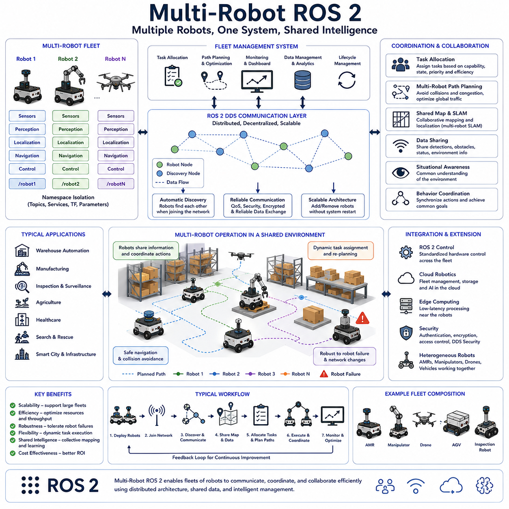{width="7.268055555555556in" height="7.268055555555556in"}

Multi-Robot ROS 2 refers to the architecture, communication framework, coordination mechanisms, and software infrastructure that enable multiple robots to operate simultaneously within a shared environment while collaborating toward common objectives. As robotics systems evolve beyond individual autonomous machines into fleets of intelligent agents, multi-robot systems are becoming increasingly important in logistics, manufacturing, warehousing, healthcare, agriculture, security, infrastructure inspection, smart cities, military operations, and future embodied AI ecosystems. ROS 2 was designed with distributed computing and scalability in mind, making it particularly well suited for multi-robot deployments where dozens, hundreds, or even thousands of robots must communicate and cooperate efficiently.

Traditional robotic systems often focused on a single autonomous robot operating independently. Such systems typically perform perception, planning, navigation, manipulation, and control using onboard resources while interacting minimally with external agents. While this approach remains useful for many applications, modern operational environments increasingly demand coordinated behavior among multiple robots. A single warehouse robot may transport one pallet, but a fleet of robots can optimize entire warehouse operations. A single inspection robot may survey one area, while multiple robots can inspect an entire industrial facility simultaneously. Multi-robot systems therefore offer significant advantages in scalability, efficiency, robustness, coverage, redundancy, and task parallelization.

The transition from single-robot systems to multi-robot systems introduces substantial complexity. Robots must exchange information, coordinate activities, avoid conflicts, share resources, distribute tasks, synchronize actions, and maintain situational awareness across the fleet. Communication architecture becomes a critical component because the effectiveness of the entire system depends upon reliable information exchange.

ROS 2 provides several architectural advantages that make it suitable for multi-robot deployments. Unlike ROS 1, which relied heavily on a centralized ROS Master, ROS 2 utilizes DDS-based distributed communication. Each robot can participate in a decentralized network without requiring a single coordination server for basic communication. This eliminates single points of failure and improves scalability.

DDS discovery mechanisms allow robots to automatically detect and communicate with one another when operating within the same communication domain. This capability greatly simplifies deployment. New robots can join operational environments dynamically without requiring extensive reconfiguration. Similarly, robots can leave the system due to maintenance, battery replacement, or operational constraints without disrupting overall communication infrastructure.

One of the most fundamental concepts in multi-robot ROS 2 systems is namespace management. Every robot contains publishers, subscribers, services, actions, parameters, and coordinate frames. If multiple robots share identical names for these resources, communication conflicts occur. ROS 2 namespaces provide logical separation between robots.

For example, a fleet containing three robots may use namespaces such as /robot1, /robot2, and /robot3. Topics such as /cmd_vel, /scan, /odom, and /camera/image become isolated within each namespace. As a result, navigation commands intended for one robot do not affect other robots. This namespace-based isolation forms the foundation of multi-robot software organization.

Coordinate frame management is equally important. TF2 transformation trees must remain unique for each robot. Every robot typically maintains its own base_link, odom, sensor frames, and manipulation frames. Namespacing TF frames prevents conflicts and ensures that localization, navigation, and manipulation systems operate correctly within multi-robot environments.

The concept of robot identity extends beyond namespaces. Each robot typically possesses unique identifiers, network addresses, operational capabilities, hardware configurations, and mission assignments. Fleet management systems maintain these identities and utilize them when assigning tasks, monitoring status, and coordinating activities.

Communication architectures in multi-robot systems generally fall into several categories. Fully centralized architectures rely upon a central fleet manager that coordinates all robots. Fully decentralized architectures allow robots to communicate directly and make collective decisions. Hybrid architectures combine centralized supervision with decentralized execution. ROS 2 supports all of these approaches.

Centralized fleet management systems are common in logistics and warehouse environments. A fleet manager receives operational requests, assigns tasks, optimizes routes, monitors robot status, and coordinates resource allocation. Individual robots execute assigned tasks while periodically reporting status updates. This architecture simplifies global optimization and operational oversight.

Decentralized architectures are often used in exploration, search-and-rescue, military, and scientific applications. Robots exchange information directly and collectively determine how to accomplish objectives. Such architectures improve fault tolerance because operations can continue even if individual robots fail.

Hybrid architectures frequently represent the most practical solution. Strategic decisions are handled centrally while tactical execution remains distributed. Fleet managers assign objectives, while robots independently navigate, avoid obstacles, and adapt to local environmental conditions.

Task allocation represents one of the most important challenges in multi-robot systems. When multiple robots are available, the system must determine which robot should perform each task. Effective task allocation significantly influences overall efficiency.

Various task allocation strategies exist. Simple systems may assign tasks based on proximity. More sophisticated approaches consider robot capabilities, battery levels, workload distribution, traffic conditions, mission priorities, maintenance schedules, and predicted completion times. Advanced systems may utilize optimization algorithms, auction-based methods, market-based coordination, or AI-driven scheduling mechanisms.

Warehouse automation provides an excellent example. Multiple AMRs may receive transport requests simultaneously. The fleet management system evaluates robot locations, battery states, current workloads, and route availability before assigning tasks. Efficient allocation reduces travel distance, increases throughput, and minimizes operational costs.

Path planning becomes more complex when multiple robots share the same environment. A single robot only needs to avoid static and dynamic obstacles. Multi-robot systems must also avoid collisions with other robots while maintaining operational efficiency.

Multi-agent path planning algorithms address this challenge by considering the future trajectories of multiple robots simultaneously. Conflict resolution mechanisms prevent deadlocks, congestion, and inefficient traffic patterns. ROS 2-based fleet systems often integrate centralized traffic management with local collision avoidance capabilities.

Shared maps play a crucial role in many multi-robot deployments. Multiple robots operating within the same environment often utilize common maps for localization and navigation. These maps may be generated offline, updated dynamically, or constructed collaboratively through multi-robot SLAM.

Collaborative mapping represents one of the most powerful applications of multi-robot robotics. Multiple robots explore different regions simultaneously while sharing sensor observations and map updates. The resulting map can be generated more quickly and accurately than would be possible using a single robot.

Multi-robot SLAM systems leverage ROS 2 communication infrastructure to exchange localization estimates, map fragments, loop closure information, and environmental observations. DDS-based communication enables efficient sharing of these large datasets across distributed robotic platforms.

Data sharing extends beyond mapping applications. Robots may exchange object detections, obstacle information, environmental conditions, mission status, inventory data, inspection results, and AI-generated knowledge. Shared situational awareness enables coordinated decision-making and improves operational effectiveness.

Fleet monitoring is another critical component of multi-robot systems. Operators require visibility into robot locations, battery levels, mission status, communication health, sensor status, controller performance, and operational efficiency. ROS 2 supports real-time monitoring through topics, services, diagnostics, and visualization tools.

Visualization platforms often display fleet-wide operational status within centralized dashboards. Operators can observe robot positions, active tasks, traffic conditions, system alerts, and resource utilization. Such situational awareness becomes increasingly important as fleet size grows.

ROS 2 Lifecycle Nodes contribute significantly to multi-robot management. Fleet operators can configure, activate, deactivate, update, and recover robot subsystems remotely. Lifecycle management improves reliability and simplifies maintenance across large deployments.

ROS 2 Control also plays a role in multi-robot systems. Although each robot maintains its own control architecture, fleet-level management may coordinate controller configurations, software updates, operational modes, and diagnostics. Standardized control interfaces simplify deployment across heterogeneous robot fleets.

Heterogeneous fleets represent an increasingly important trend. Multi-robot systems may include different robot types operating together. Mobile robots, manipulators, drones, inspection platforms, autonomous vehicles, and service robots may all participate within the same operational ecosystem.

ROS 2\'s standardized communication framework supports interoperability among heterogeneous platforms. Robots can exchange information regardless of their internal hardware configurations, provided they utilize compatible communication interfaces and message definitions.

Cloud robotics further expands multi-robot capabilities. Fleet management systems, AI inference engines, digital twins, data analytics platforms, and operational databases may reside in cloud infrastructure rather than onboard robots. ROS 2 enables communication between robots, edge servers, and cloud services.

Edge computing frequently complements cloud robotics architectures. High-bandwidth sensor processing, AI inference, fleet coordination, and data aggregation may be performed on local edge servers. Robots exchange information with edge infrastructure while maintaining autonomy for time-critical operations.

Security becomes increasingly important as robot fleets grow larger and more connected. Authentication, encryption, access control, secure discovery, and communication integrity must be maintained throughout the system. ROS 2 DDS Security provides mechanisms for protecting communication channels and preventing unauthorized access.

Reliability and fault tolerance are major advantages of multi-robot systems. If a single robot fails, remaining robots can often continue operations. Tasks can be reassigned dynamically, ensuring continuity of service. This redundancy improves overall system resilience and operational availability.

Scalability is another defining characteristic. ROS 2\'s distributed communication model allows systems to expand incrementally. Additional robots can be introduced without fundamentally redesigning communication infrastructure. This capability is particularly important in warehouse automation, manufacturing, and smart city deployments.

Simulation plays a critical role in multi-robot development. Gazebo, Ignition Gazebo, Isaac Sim, Webots, and digital twin environments enable large-scale testing before physical deployment. Developers can evaluate coordination algorithms, traffic management systems, fleet optimization strategies, and communication architectures within virtual environments.

Digital twins provide comprehensive representations of entire robot fleets. Real-time synchronization between physical robots and virtual models enables predictive maintenance, operational optimization, anomaly detection, training, and what-if analysis. Multi-robot digital twins increasingly serve as operational command centers for large robotic deployments.

Artificial intelligence is becoming deeply integrated into multi-robot systems. Machine learning algorithms optimize task allocation, traffic management, predictive maintenance, energy management, and fleet scheduling. Large language models and vision-language models may support human-robot interaction and operational planning.

Embodied AI introduces even greater opportunities. Future multi-robot systems may consist of fleets of intelligent agents capable of reasoning collaboratively, sharing experiences, learning collectively, and coordinating complex missions autonomously. Rather than functioning as independent robots, fleets may operate as distributed cognitive systems.

Consider a future logistics center containing hundreds of autonomous mobile manipulators. Robots share maps, exchange object information, coordinate inventory movements, optimize workflows, and learn from collective operational experience. ROS 2 provides much of the communication infrastructure required to support such systems.

Industrial environments similarly benefit from coordinated robotic ecosystems. Inspection robots, maintenance robots, material handling robots, drones, and autonomous vehicles may collaborate across factories, ports, airports, rail networks, and energy facilities. Shared communication frameworks enable efficient integration and coordination.

Healthcare applications may involve fleets of delivery robots, telepresence systems, service robots, cleaning robots, and patient assistance platforms operating within hospitals. Multi-robot coordination improves resource utilization and operational efficiency while reducing human workload.

Agricultural robotics represents another promising domain. Multiple autonomous tractors, drones, harvesters, inspection robots, and monitoring platforms may collaborate across large farms. Shared mapping, coordinated task execution, and collective decision-making increase productivity while reducing operational costs.

The future of robotics increasingly points toward large-scale, distributed robotic ecosystems rather than isolated autonomous machines. Multi-robot ROS 2 architectures provide the communication, coordination, scalability, and interoperability foundations necessary to support this evolution. Through distributed DDS communication, namespace isolation, task coordination, fleet management, cloud integration, and AI-driven optimization, ROS 2 enables the creation of sophisticated multi-robot systems capable of operating efficiently in complex real-world environments.

For developers building warehouse automation systems, autonomous vehicle fleets, inspection platforms, industrial automation solutions, mobile manipulator fleets, or future embodied AI ecosystems, understanding Multi-Robot ROS 2 is essential. It represents not only a communication architecture but also a fundamental shift toward distributed robotic intelligence, where multiple autonomous systems cooperate to achieve objectives beyond the capabilities of any individual robot.

멀티 로봇 ROS 2(Multi-Robot ROS 2)는 여러 대의 로봇이 동일한 환경에서 동시에 운영되면서 공동의 목표를 달성하기 위해 협력할 수 있도록 지원하는 아키텍처, 통신 프레임워크, 협업 메커니즘 및 소프트웨어 인프라를 의미한다. 로봇 기술이 단일 자율 시스템 중심에서 다수의 지능형 로봇이 협력하는 방향으로 발전하면서 멀티 로봇 시스템은 물류, 제조, 창고 자동화, 의료, 농업, 보안, 시설 점검, 스마트시티, 국방, 미래의 Embodied AI 생태계에서 매우 중요한 역할을 담당하게 되었다. ROS 2는 처음부터 분산 컴퓨팅과 확장성을 고려하여 설계되었기 때문에 수십 대, 수백 대, 나아가 수천 대의 로봇이 동시에 협력해야 하는 환경에 매우 적합하다.

전통적인 로봇 시스템은 하나의 자율 로봇이 독립적으로 임무를 수행하는 구조가 일반적이었다. 단일 로봇은 자체 센서와 컴퓨팅 자원을 활용하여 인식, 계획, 이동, 조작, 제어를 수행한다. 하지만 현대 산업 환경에서는 여러 대의 로봇이 협력하는 방식이 더욱 효율적이다. 하나의 물류 로봇은 한 번에 하나의 작업만 수행할 수 있지만, 수십 대의 로봇이 협력하면 창고 전체의 물류 흐름을 최적화할 수 있다. 하나의 점검 로봇이 시설 일부를 검사하는 데 그친다면, 여러 대의 로봇은 동시에 시설 전체를 검사할 수 있다. 따라서 멀티 로봇 시스템은 생산성, 확장성, 신뢰성, 작업 병렬화 측면에서 매우 큰 장점을 제공한다.

하지만 여러 대의 로봇이 협력하기 위해서는 복잡한 문제를 해결해야 한다. 로봇들은 서로 정보를 교환해야 하며, 작업을 분배하고, 충돌을 방지하고, 자원을 공유하고, 행동을 동기화해야 한다. 따라서 통신 아키텍처가 시스템 전체 성능을 결정하는 핵심 요소가 된다.

ROS 2는 DDS 기반의 분산 통신 구조를 사용한다. ROS 1이 ROS Master라는 중앙 서버에 크게 의존했던 것과 달리 ROS 2는 중앙 서버 없이도 로봇 간 통신이 가능하다. 이 구조는 단일 장애점(Single Point of Failure)을 제거하고 시스템 확장성을 크게 향상시킨다.

DDS Discovery 기능을 통해 새로운 로봇은 네트워크에 연결되는 즉시 다른 로봇을 자동으로 발견할 수 있다. 따라서 로봇을 추가하거나 제거할 때 복잡한 재설정이 필요하지 않다. 배터리 교체, 유지보수, 임무 변경 등으로 인해 로봇이 시스템에서 일시적으로 빠지더라도 전체 네트워크는 계속 운영될 수 있다.

멀티 로봇 환경에서 가장 중요한 개념 중 하나는 Namespace 관리이다. 각 로봇은 Publisher, Subscriber, Service, Action, Parameter, TF Frame 등을 가지고 있다. 만약 여러 로봇이 동일한 이름을 사용한다면 충돌이 발생한다.

예를 들어 세 대의 로봇이 존재한다면 각각 /robot1, /robot2, /robot3과 같은 Namespace를 사용할 수 있다. 이 경우 /cmd_vel, /scan, /odom, /camera/image 등의 토픽은 자동으로 분리된다. 따라서 특정 로봇에게 보내는 이동 명령이 다른 로봇에 전달되는 문제를 방지할 수 있다.

좌표계(TF2) 관리 역시 매우 중요하다. 각 로봇은 자신의 base_link, odom, map, camera_link, lidar_link 등을 가진다. 여러 로봇이 동일한 Frame 이름을 사용할 경우 TF 충돌이 발생할 수 있다. 따라서 TF 역시 Namespace를 적용하여 관리해야 한다.

멀티 로봇 시스템에서는 단순한 Namespace 외에도 각 로봇의 고유 식별자(Identity)가 중요하다. 각 로봇은 서로 다른 IP 주소, 하드웨어 구성, 작업 능력, 배터리 상태를 가진다. 플릿 관리 시스템은 이러한 정보를 기반으로 임무를 분배하고 운영 상태를 관리한다.

멀티 로봇 통신 구조는 크게 중앙집중형(Centralized), 분산형(Decentralized), 혼합형(Hybrid)으로 나눌 수 있다.

중앙집중형 구조에서는 Fleet Manager가 모든 로봇을 관리한다. 작업 할당, 경로 최적화, 상태 모니터링, 충돌 방지 등이 중앙 서버에서 수행된다. 물류창고나 제조 공장에서 가장 많이 사용되는 방식이다.

분산형 구조에서는 로봇들이 서로 직접 통신하며 협력한다. 탐사 로봇, 군사용 로봇, 재난 대응 로봇 등에서 주로 사용된다. 중앙 서버가 없어도 시스템이 운영될 수 있기 때문에 장애 허용성이 높다.

실제 산업 현장에서는 혼합형 구조가 가장 많이 사용된다. 중앙 서버가 전체 임무를 계획하지만, 개별 로봇은 지역적인 의사결정을 스스로 수행한다. 이를 통해 효율성과 유연성을 동시에 확보할 수 있다.

작업 할당(Task Allocation)은 멀티 로봇 시스템의 핵심 문제 중 하나이다. 여러 대의 로봇이 존재할 때 어떤 로봇이 어떤 작업을 수행할 것인지를 결정해야 한다.

가장 단순한 방식은 가장 가까운 로봇에게 작업을 할당하는 것이다. 하지만 실제 환경에서는 배터리 상태, 현재 작업량, 이동 거리, 로봇 성능, 유지보수 상태 등을 모두 고려해야 한다. 고급 시스템에서는 최적화 알고리즘, 경매 기반(Auction-Based) 방식, 시장 기반(Market-Based) 방식, AI 기반 스케줄링을 활용하기도 한다.

예를 들어 물류창고에서는 여러 AMR이 동시에 운송 요청을 받을 수 있다. 플릿 관리 시스템은 각 로봇의 위치, 배터리 상태, 작업 부하를 분석하여 가장 효율적인 로봇에게 작업을 할당한다.

경로 계획(Path Planning)도 훨씬 복잡해진다. 단일 로봇은 장애물만 피하면 되지만, 멀티 로봇 환경에서는 다른 로봇과의 충돌도 고려해야 한다.

다중 에이전트 경로 계획(Multi-Agent Path Planning)은 여러 로봇의 미래 경로를 동시에 계산한다. 이를 통해 교착 상태(Deadlock), 병목 현상(Congestion), 비효율적인 교통 흐름을 방지할 수 있다. 많은 ROS 2 기반 플릿 시스템은 중앙 교통 관리와 로컬 충돌 회피를 결합하여 사용한다.

공유 지도(Shared Map)도 중요한 요소이다. 여러 로봇이 동일한 공간에서 운영될 경우 공통 지도를 사용할 수 있다. 지도는 사전에 구축될 수도 있고, 운영 중에 업데이트될 수도 있다.

멀티 로봇 SLAM은 가장 대표적인 협업 기술 중 하나이다. 여러 로봇이 서로 다른 영역을 동시에 탐색하면서 지도 정보를 공유한다. 결과적으로 단일 로봇보다 훨씬 빠르게 넓은 공간을 매핑할 수 있다.

멀티 로봇 SLAM 시스템은 ROS 2 통신 인프라를 활용하여 지도 조각(Map Fragment), 위치 정보(Localization), 루프 클로저(Loop Closure) 정보를 교환한다. DDS 기반 통신은 이러한 대용량 데이터를 효율적으로 공유할 수 있도록 지원한다.

데이터 공유는 지도 생성뿐 아니라 객체 인식, 장애물 정보, 환경 상태, 재고 정보, 점검 결과 등 다양한 분야에서 활용된다. 이를 통해 로봇들은 공통 상황 인식(Common Situational Awareness)을 형성할 수 있다.

플릿 모니터링(Fleet Monitoring)은 멀티 로봇 운영의 필수 요소이다. 운영자는 로봇 위치, 배터리 상태, 임무 상태, 센서 상태, 통신 상태, 시스템 성능을 실시간으로 확인해야 한다.

ROS 2는 Topic, Service, Diagnostic 정보를 활용하여 플릿 전체 상태를 모니터링할 수 있다. 대시보드는 로봇 위치, 활성 작업, 경고 메시지, 자원 사용량 등을 시각화하여 제공한다.

ROS 2 Lifecycle Node는 멀티 로봇 운영에서 매우 유용하다. 운영자는 원격으로 로봇을 Configure, Activate, Deactivate, Recover할 수 있으며, 이를 통해 대규모 시스템 유지보수가 쉬워진다.

ROS 2 Control 역시 중요한 역할을 수행한다. 각 로봇은 독립적인 제어 시스템을 가지지만, 플릿 수준에서는 제어기 설정, 소프트웨어 업데이트, 진단 정보를 통합 관리할 수 있다.

최근에는 이기종 플릿(Heterogeneous Fleet)의 중요성이 커지고 있다. 하나의 플릿 안에 AMR, 모바일 매니퓰레이터, 드론, 점검 로봇, 자율주행 차량 등이 함께 운영될 수 있다.

ROS 2는 표준화된 통신 프레임워크를 제공하기 때문에 서로 다른 종류의 로봇도 동일한 환경에서 협력할 수 있다. 하드웨어가 다르더라도 동일한 메시지 구조와 인터페이스를 사용하면 상호 운용이 가능하다.

클라우드 로보틱스는 멀티 로봇 시스템의 활용 범위를 더욱 확대한다. 플릿 관리 서버, AI 추론 엔진, 디지털 트윈, 데이터 분석 플랫폼이 클라우드에 위치할 수 있다. ROS 2는 로봇, 엣지 서버, 클라우드 간의 통신을 지원한다.

엣지 컴퓨팅도 중요한 역할을 수행한다. 대규모 AI 추론, 지도 통합, 데이터 집계, 플릿 최적화는 엣지 서버에서 수행될 수 있다. 로봇은 필요한 정보만 교환하면서 실시간성을 유지할 수 있다.

보안(Security)은 대규모 플릿에서 매우 중요한 요소이다. 인증(Authentication), 암호화(Encryption), 접근 제어(Access Control), 보안 Discovery 기능이 필요하다. ROS 2 DDS Security는 이러한 기능을 제공하여 무단 접근을 방지한다.

멀티 로봇 시스템의 가장 큰 장점 중 하나는 장애 허용성(Fault Tolerance)이다. 한 대의 로봇이 고장 나더라도 다른 로봇이 작업을 이어받을 수 있다. 따라서 서비스 연속성이 향상된다.

확장성(Scalability) 또한 중요한 특징이다. ROS 2의 분산 구조는 새로운 로봇을 쉽게 추가할 수 있도록 지원한다. 창고 자동화나 스마트시티와 같은 대규모 환경에서는 이러한 특성이 매우 중요하다.

시뮬레이션은 멀티 로봇 개발의 필수 요소이다. Gazebo, Ignition Gazebo, Isaac Sim, Webots, 디지털 트윈 환경을 활용하여 수십 대 또는 수백 대의 로봇을 가상 환경에서 테스트할 수 있다.

디지털 트윈은 실제 플릿의 가상 복제본 역할을 수행한다. 실시간 상태 동기화를 통해 예지보전, 운영 최적화, 이상 탐지, 시나리오 분석이 가능하다.

인공지능 역시 멀티 로봇 시스템에서 점점 중요한 역할을 하고 있다. 머신러닝은 작업 할당, 교통 관리, 에너지 최적화, 유지보수 예측, 스케줄링 최적화 등에 활용된다.

Embodied AI는 멀티 로봇 시스템을 한 단계 더 발전시킨다. 미래에는 로봇들이 단순히 정보를 교환하는 수준을 넘어 경험을 공유하고, 공동으로 학습하며, 집단 지능(Collective Intelligence)을 형성할 가능성이 있다.

예를 들어 미래의 물류센터에서는 수백 대의 모바일 매니퓰레이터가 지도, 재고 정보, 작업 경험을 공유하며 협력적으로 운영될 수 있다. 각각의 로봇은 독립적인 존재가 아니라 하나의 거대한 분산 지능 시스템의 일부처럼 동작하게 된다.

산업 환경에서도 점검 로봇, 운송 로봇, 드론, 유지보수 로봇, 자율주행 차량이 하나의 통합 생태계를 구성할 수 있다. 공장, 항만, 철도, 발전소와 같은 대규모 시설에서 이러한 협업은 운영 효율성을 크게 향상시킨다.

의료 환경에서는 물품 운반 로봇, 텔레프레즌스 로봇, 서비스 로봇, 소독 로봇이 병원 전체에서 협력할 수 있다. 농업 분야에서는 자율 트랙터, 드론, 수확 로봇, 점검 로봇이 협력하여 농장을 관리할 수 있다.

결론적으로 로봇 산업의 미래는 단일 로봇이 아닌 대규모 분산 로봇 생태계로 발전하고 있다. Multi-Robot ROS 2는 이러한 미래를 실현하기 위한 핵심 기반 기술이다. DDS 기반 분산 통신, Namespace 관리, 작업 할당, 플릿 관리, 클라우드 연동, AI 기반 최적화를 통해 ROS 2는 복잡한 실제 환경에서 수많은 로봇이 협력할 수 있는 토대를 제공한다.

물류 자동화, 자율주행 차량 플릿, 점검 로봇 시스템, 산업 자동화, 모바일 매니퓰레이터 플릿, 미래의 Embodied AI 생태계를 개발하는 엔지니어에게 Multi-Robot ROS 2는 반드시 이해해야 할 핵심 기술이다. 이는 단순한 통신 기술이 아니라 여러 대의 지능형 로봇이 하나의 집단 지능 시스템으로 협력하기 위한 핵심 아키텍처라고 할 수 있다.

##  

## 11 Debugging and Monitoring

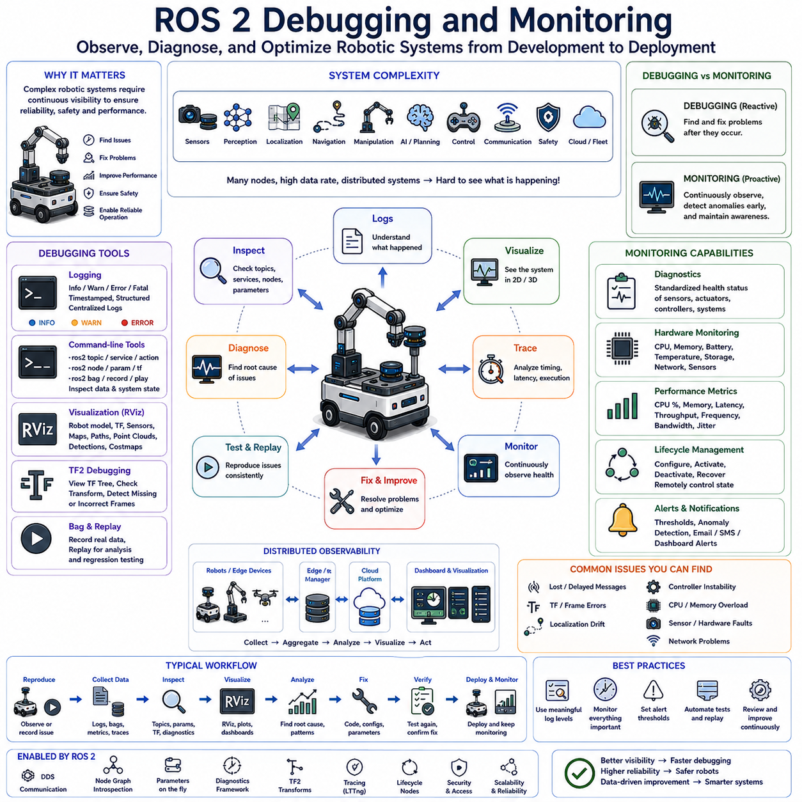{width="7.268055555555556in" height="7.268055555555556in"}

Debugging and Monitoring are among the most critical activities in robotics system development and operation. Regardless of how sophisticated a robot's perception, navigation, manipulation, artificial intelligence, or control algorithms may be, the overall system cannot be considered reliable unless engineers can observe its behavior, diagnose failures, identify performance bottlenecks, and verify operational correctness. In modern ROS 2-based robotic systems, debugging and monitoring are not merely development tasks performed during implementation. They are continuous processes that extend throughout the entire lifecycle of a robotic platform, from simulation and laboratory testing to field deployment, fleet management, cloud robotics, and long-term autonomous operation.

As robotic systems become increasingly complex, the challenge of understanding system behavior grows significantly. A modern autonomous robot may include hundreds of software nodes, dozens of sensors, multiple AI inference pipelines, localization systems, navigation frameworks, manipulation planners, communication modules, cloud interfaces, safety systems, and fleet management integrations. These components operate simultaneously and exchange large volumes of data in real time. Failures can originate from hardware faults, communication delays, software bugs, timing issues, configuration errors, resource exhaustion, environmental disturbances, or unexpected interactions between subsystems. Effective debugging and monitoring therefore become essential for ensuring reliability, safety, and operational success.

The fundamental purpose of debugging is to identify and resolve problems within a robotic system. Monitoring, by contrast, focuses on continuously observing system behavior to detect anomalies, evaluate performance, and maintain operational awareness. Although closely related, debugging is generally reactive, occurring after a problem is discovered, whereas monitoring is proactive, seeking to identify issues before they lead to failures.

ROS 2 provides a comprehensive ecosystem of tools, frameworks, and architectural features that support debugging and monitoring across all layers of robotic software systems. These capabilities include logging systems, diagnostics frameworks, command-line tools, visualization environments, topic inspection utilities, performance monitoring tools, lifecycle management mechanisms, tracing infrastructures, and distributed observability solutions.

One of the most fundamental debugging mechanisms in ROS 2 is logging. Every software component can generate informational messages, warnings, errors, and diagnostic information during execution. Logging allows developers and operators to observe internal system behavior without directly inspecting source code or interrupting robot operations.

ROS 2 provides a structured logging framework that supports multiple severity levels. Informational messages describe normal operations. Warning messages indicate potential concerns that may require attention. Error messages identify failures that affect functionality. Fatal messages indicate critical failures that prevent continued operation. This hierarchy enables developers to filter and prioritize information according to operational needs.

Logging becomes particularly valuable in distributed robotic systems. Since components may execute across multiple computers, robots, edge servers, and cloud platforms, centralized visibility into system behavior is essential. Consistent logging practices enable engineers to reconstruct operational timelines, identify failure sequences, and analyze root causes.

Timestamped logs provide important contextual information. Because robotic systems operate asynchronously, understanding when events occurred is often as important as understanding what occurred. Accurate timestamps allow engineers to correlate sensor measurements, control actions, network events, and software state transitions.

Structured logging further improves diagnostic capabilities. Rather than producing arbitrary text messages, structured logs include metadata such as component names, process identifiers, robot identifiers, severity levels, timestamps, operational modes, and contextual parameters. This additional information facilitates automated analysis and large-scale monitoring.

ROS 2 command-line tools play an essential role in debugging. Developers frequently use these tools to inspect topics, services, actions, nodes, parameters, and communication structures. Command-line inspection provides rapid visibility into system state without requiring specialized software or graphical interfaces.

Topic inspection tools allow engineers to verify whether messages are being published correctly. Developers can examine message contents, publication frequencies, communication rates, and data structures. These capabilities are invaluable when diagnosing communication failures, sensor integration issues, or middleware-related problems.

Service and action inspection tools provide similar visibility into request-response interactions and long-running operations. Engineers can verify service availability, action execution status, goal progression, and result generation. This information helps identify coordination problems within complex robotic workflows.

Node inspection capabilities allow developers to observe active components, communication relationships, subscriptions, publications, services, and parameters. Understanding the current node graph often provides critical insights into system behavior and integration issues.

Parameter inspection is equally important. Configuration errors represent one of the most common sources of robotic system failures. Parameters influence controller gains, sensor calibration values, navigation settings, communication behavior, AI model configurations, safety thresholds, and operational policies. ROS 2 tools allow developers to examine and modify parameters dynamically, simplifying troubleshooting and system tuning.

Visualization represents another powerful debugging mechanism. Humans generally understand complex relationships more effectively through visual representations than through textual data alone. ROS 2 visualization tools therefore play a central role in debugging robotic systems.

RViz is perhaps the most widely used visualization environment within ROS 2. It enables developers to observe robot models, coordinate frames, sensor data, localization estimates, maps, trajectories, point clouds, object detections, planning results, and navigation behavior within a unified three-dimensional environment.

Localization debugging often depends heavily on visualization. Engineers can compare estimated robot positions against environmental maps, observe coordinate frame relationships, verify sensor alignment, and identify drift or inconsistency within localization systems. Such issues may be difficult to detect through numerical data alone but become immediately apparent when visualized.

Navigation debugging similarly benefits from graphical inspection. Planned paths, obstacle maps, robot footprints, sensor observations, costmaps, and controller outputs can be visualized simultaneously. This integrated perspective allows developers to understand why a robot selected a particular route, avoided specific obstacles, or failed to reach a destination.

Manipulation systems also rely extensively on visualization. Developers can inspect robot kinematics, collision models, grasp targets, planning scenes, inverse kinematics solutions, and trajectory execution. Visualization often reveals configuration errors or geometric inconsistencies that would otherwise remain difficult to diagnose.

TF2 debugging represents a specialized but critically important area. Coordinate frame errors are among the most common challenges in robotics development. Incorrect transformations can lead to localization failures, navigation errors, manipulation inaccuracies, and perception inconsistencies.

ROS 2 provides dedicated TF2 inspection tools that allow developers to visualize transformation trees, examine frame relationships, identify missing transformations, detect timing inconsistencies, and verify coordinate alignment. Since nearly every robotic subsystem depends on spatial information, TF2 debugging is frequently a central component of system integration efforts.

Diagnostics frameworks provide structured monitoring capabilities beyond simple logging. The ROS diagnostics ecosystem enables components to publish standardized health information regarding sensors, actuators, communication systems, controllers, batteries, processors, storage devices, and software modules.

Diagnostic information typically includes operational status, performance metrics, warning conditions, and fault indicators. Monitoring systems can aggregate this information to provide comprehensive views of overall robot health.

Hardware monitoring represents a particularly important application. Robotic systems depend upon numerous physical devices whose behavior may degrade over time. Battery voltage, motor temperatures, processor utilization, memory consumption, storage capacity, network quality, sensor status, and communication reliability all influence operational effectiveness.

Continuous monitoring of these metrics enables predictive maintenance strategies. Rather than waiting for failures to occur, operators can identify deteriorating conditions and schedule maintenance proactively. This approach improves reliability, reduces downtime, and lowers operational costs.

Performance monitoring extends beyond hardware health. Software performance metrics such as CPU utilization, memory allocation, message latency, communication bandwidth, callback execution time, controller update frequency, and AI inference duration provide critical insights into system efficiency.

Latency analysis is especially important in robotics. Delays in perception, localization, planning, communication, or control can significantly impact system behavior. Monitoring latency throughout processing pipelines helps engineers identify bottlenecks and optimize performance.

ROS 2 tracing capabilities provide detailed visibility into software execution. Tracing records low-level events occurring throughout the system, including callback execution, middleware communication, memory allocation, scheduling behavior, and resource utilization. Unlike conventional logging, tracing captures fine-grained operational details with minimal runtime overhead.

Tracing enables developers to analyze timing relationships, identify scheduling delays, measure execution durations, and understand complex interactions between components. This capability becomes particularly valuable when debugging intermittent failures or performance anomalies that are difficult to reproduce consistently.

Real-time robotic systems benefit significantly from tracing. Control loops operating at high frequencies require deterministic timing behavior. Tracing allows engineers to verify whether timing requirements are satisfied and identify sources of jitter or latency.

Lifecycle Nodes contribute substantially to monitoring and operational management. Lifecycle states provide explicit visibility into component status. Operators can determine whether nodes are configured, active, inactive, shutting down, or recovering from errors. This information simplifies system supervision and fault diagnosis.

Lifecycle transitions also facilitate controlled recovery procedures. When failures occur, affected components can be reconfigured, restarted, or reactivated without requiring complete system shutdown. Monitoring lifecycle state transitions therefore becomes an important aspect of operational reliability.

Distributed robotic systems introduce additional monitoring challenges. Multi-robot fleets, cloud robotics platforms, edge computing infrastructures, and digital twin environments may involve hundreds or thousands of interacting components distributed across multiple locations.

Centralized observability platforms address these challenges by aggregating logs, diagnostics, metrics, traces, and operational events into unified monitoring dashboards. Operators gain visibility into system-wide behavior while retaining access to detailed information regarding individual components.

Fleet management systems often incorporate extensive monitoring capabilities. Operators can observe robot locations, battery levels, mission progress, communication quality, sensor health, controller status, software versions, and maintenance requirements across entire fleets. Such visibility becomes essential as robotic deployments scale.

Cloud robotics further expands monitoring possibilities. Historical operational data can be stored and analyzed centrally. Machine learning algorithms may identify patterns indicating impending failures, performance degradation, or abnormal behavior. Predictive analytics transforms monitoring from a reactive activity into a proactive operational capability.

Artificial intelligence workloads introduce new monitoring requirements. AI models require visibility into inference latency, model accuracy, confidence levels, resource utilization, dataset quality, and operational effectiveness. Monitoring these metrics helps ensure that intelligent behaviors remain reliable in changing environments.

Embodied AI systems further increase complexity. Future robots may integrate perception, reasoning, planning, learning, navigation, manipulation, communication, and human interaction within unified cognitive architectures. Observability becomes essential for understanding how these interconnected systems behave under real-world conditions.

Simulation environments provide important debugging opportunities before physical deployment. Platforms such as Gazebo, Isaac Sim, Webots, and digital twins allow developers to observe robot behavior, reproduce failures, evaluate performance, and validate monitoring strategies within controlled environments.

Digital twins offer particularly powerful monitoring capabilities. By maintaining synchronized virtual representations of physical robots, digital twins provide comprehensive operational visibility. Engineers can analyze system behavior, replay historical events, perform root-cause investigations, and evaluate hypothetical scenarios without disrupting ongoing operations.

Security monitoring is becoming increasingly important as robotic systems become network-connected. Authentication failures, unauthorized access attempts, abnormal communication patterns, configuration changes, and cybersecurity events must be detected and analyzed promptly. ROS 2 security infrastructures can integrate with broader monitoring ecosystems to support secure operations.

The future of robotic debugging and monitoring increasingly resembles modern cloud-native observability practices. Concepts such as logging, metrics, traces, dashboards, anomaly detection, predictive analytics, health monitoring, and distributed observability are becoming standard requirements for advanced robotic systems.

As robots evolve into large-scale autonomous ecosystems, debugging and monitoring will no longer be optional support activities. They will become core operational capabilities necessary for ensuring safety, reliability, maintainability, and scalability. Successful robotic deployments depend not only on intelligent algorithms but also on the ability to understand, observe, diagnose, and improve system behavior continuously.

For ROS 2 developers, debugging and monitoring represent foundational engineering disciplines. Whether building mobile manipulators, autonomous vehicles, industrial robots, warehouse automation systems, digital twins, cloud robotics platforms, or future embodied AI ecosystems, mastery of debugging and monitoring techniques is essential. These capabilities provide the visibility necessary to transform complex robotic software from experimental prototypes into reliable production systems capable of operating safely and effectively in real-world environments.

디버깅(Debugging)과 모니터링(Monitoring)은 로봇 시스템 개발과 운영에서 가장 중요한 활동 중 하나이다. 아무리 뛰어난 인식, 내비게이션, 조작, 인공지능, 제어 알고리즘을 보유하고 있더라도 시스템의 동작 상태를 관찰하고, 문제를 진단하며, 성능 병목을 찾고, 운영 상태를 검증할 수 없다면 실제 현장에서 신뢰성 있는 로봇 시스템이라고 할 수 없다. ROS 2 기반의 현대 로봇 시스템에서 디버깅과 모니터링은 단순한 개발 단계의 작업이 아니라 시뮬레이션, 실험실 테스트, 현장 운영, 플릿 관리, 클라우드 로보틱스, 장기 자율 운영까지 포함하는 전 생애주기 활동이다.

로봇 시스템이 복잡해질수록 내부 동작을 이해하는 것은 더욱 어려워진다. 현대의 자율주행 로봇은 수백 개의 노드, 다양한 센서, AI 추론 파이프라인, 위치추정 시스템, 내비게이션 프레임워크, 조작 계획기, 통신 모듈, 클라우드 인터페이스, 안전 시스템 등을 동시에 운영한다. 이러한 구성요소들은 실시간으로 데이터를 교환하며 상호작용한다. 문제는 하드웨어 고장, 네트워크 지연, 소프트웨어 버그, 타이밍 문제, 설정 오류, 자원 부족, 환경 변화, 예기치 않은 모듈 간 상호작용 등 다양한 원인으로 발생할 수 있다. 따라서 효과적인 디버깅과 모니터링은 시스템 신뢰성과 안전성을 확보하기 위한 필수 요소가 된다.

디버깅의 목적은 시스템 내부의 문제를 찾아 해결하는 것이다. 반면 모니터링은 시스템 상태를 지속적으로 관찰하여 이상 현상을 조기에 발견하고 성능을 평가하며 운영 상황을 파악하는 것을 의미한다. 디버깅은 주로 문제가 발생한 이후 수행되는 반응형 활동이고, 모니터링은 문제를 사전에 감지하기 위한 예방적 활동이라고 볼 수 있다.

ROS 2는 이러한 목적을 위해 다양한 도구와 프레임워크를 제공한다. 로그 시스템, 진단 프레임워크, 명령행 도구, 시각화 환경, 토픽 분석 도구, 성능 모니터링 기능, 라이프사이클 관리, 트레이싱(Tracing) 시스템, 분산 관측성(Observability) 기능 등이 이에 포함된다.

가장 기본적인 디버깅 수단은 로깅(Logging)이다. 모든 노드는 실행 중에 정보 메시지, 경고 메시지, 오류 메시지, 진단 정보를 출력할 수 있다. 로그를 통해 개발자와 운영자는 프로그램 내부 상태를 확인할 수 있으며, 소스 코드를 직접 분석하지 않고도 문제의 원인을 파악할 수 있다.

ROS 2는 여러 수준의 로그 레벨을 제공한다. Information은 정상 동작 상태를 나타내고, Warning은 잠재적인 문제를 의미하며, Error는 기능에 영향을 주는 오류를 나타낸다. Fatal은 시스템이 더 이상 정상적으로 운영될 수 없는 치명적인 오류를 의미한다. 이러한 계층 구조를 통해 개발자는 필요한 정보만 선택적으로 확인할 수 있다.

분산 로봇 시스템에서는 로그의 중요성이 더욱 커진다. 여러 대의 로봇, 엣지 서버, 클라우드 서버가 동시에 동작하는 환경에서는 중앙에서 로그를 수집하고 분석해야 전체 시스템의 상태를 이해할 수 있다.

로그에는 일반적으로 타임스탬프(Timestamp)가 포함된다. 로봇 시스템은 비동기적으로 동작하기 때문에 언제 어떤 이벤트가 발생했는지를 정확히 아는 것이 매우 중요하다. 타임스탬프를 통해 센서 데이터, 제어 명령, 통신 이벤트, 상태 변화 간의 관계를 분석할 수 있다.

구조화된 로그(Structured Logging)는 단순한 텍스트 로그보다 더욱 강력한 기능을 제공한다. 구조화된 로그는 노드 이름, 프로세스 ID, 로봇 ID, 로그 레벨, 시간 정보, 운영 모드 등 다양한 메타데이터를 포함한다. 이를 통해 대규모 시스템에서도 자동화된 분석이 가능해진다.

ROS 2의 명령행(Command-Line) 도구는 디버깅 과정에서 매우 중요한 역할을 한다. 개발자는 이를 이용하여 Topic, Service, Action, Node, Parameter, TF 정보 등을 직접 확인할 수 있다.

토픽 분석 도구를 사용하면 메시지가 정상적으로 Publish되고 있는지 확인할 수 있다. 메시지 내용, 발행 주기, 통신 속도, 데이터 구조 등을 검사할 수 있기 때문에 센서 통합 문제나 통신 오류를 쉽게 발견할 수 있다.

서비스(Service)와 액션(Action) 분석 도구는 요청과 응답 관계를 확인하는 데 사용된다. 서비스가 정상적으로 제공되는지, 액션이 정상적으로 수행되고 있는지, 목표가 성공적으로 완료되었는지 등을 확인할 수 있다.

노드 분석 기능을 통해서는 현재 활성화된 노드, Publisher, Subscriber, Service 관계를 확인할 수 있다. 이는 통합 과정에서 발생하는 연결 문제를 해결하는 데 매우 유용하다.

파라미터(Parameter) 검사는 특히 중요하다. 실제 로봇 시스템에서 발생하는 많은 문제는 설정 오류에 의해 발생한다. 센서 보정값, PID 게인, 내비게이션 파라미터, 안전 한계값, AI 모델 설정 등이 잘못되면 시스템 성능이 크게 저하될 수 있다. ROS 2는 실행 중에도 파라미터를 확인하고 수정할 수 있도록 지원한다.

시각화(Visualization)는 가장 강력한 디버깅 방법 중 하나이다. 사람은 텍스트보다 시각 정보를 훨씬 쉽게 이해할 수 있기 때문이다.

RViz는 ROS 2에서 가장 널리 사용되는 시각화 도구이다. RViz를 통해 로봇 모델, 좌표계, 센서 데이터, 지도, 경로 계획 결과, 위치추정 결과, 포인트 클라우드, 객체 인식 결과 등을 한 화면에서 확인할 수 있다.

위치추정(Localization) 시스템 디버깅에서는 RViz가 매우 유용하다. 로봇 위치와 지도의 관계를 시각적으로 확인할 수 있으며, 센서 정렬 문제나 위치 오차를 쉽게 발견할 수 있다.

내비게이션 디버깅에서도 RViz는 필수적이다. 경로 계획 결과, Costmap, 장애물 정보, 로봇 Footprint를 동시에 표시할 수 있기 때문에 로봇이 왜 특정 경로를 선택했는지 쉽게 이해할 수 있다.

조작(Manipulation) 시스템 역시 RViz를 활용한다. 로봇팔의 운동학 구조, 충돌 모델, 파지 위치, 궤적 계획 결과 등을 시각화할 수 있다.

TF2 디버깅은 별도의 중요한 영역이다. 좌표계 오류는 로봇 개발에서 가장 흔하게 발생하는 문제 중 하나이다. 잘못된 좌표 변환은 위치추정 실패, 내비게이션 오류, 로봇팔 오동작, 센서 융합 오류로 이어질 수 있다.

ROS 2는 TF Tree를 시각화하고 좌표계 관계를 분석할 수 있는 다양한 도구를 제공한다. 개발자는 누락된 Transform, 잘못된 좌표 관계, 시간 동기화 문제 등을 확인할 수 있다.

진단(Diagnostics) 프레임워크는 단순 로그보다 더 체계적인 모니터링 기능을 제공한다. 센서, 액추에이터, 배터리, 통신 시스템, 컨트롤러, CPU, 메모리, 저장장치 등의 상태를 표준화된 방식으로 보고할 수 있다.

진단 정보에는 상태(Status), 성능 지표(Metrics), 경고 조건(Warning Conditions), 장애 정보(Fault Indicators)가 포함된다. 운영자는 이를 통해 전체 시스템 상태를 한눈에 파악할 수 있다.

하드웨어 모니터링은 특히 중요하다. 배터리 전압, 모터 온도, CPU 사용률, 메모리 사용량, 저장 공간, 네트워크 품질, 센서 상태는 모두 로봇의 안정성에 직접적인 영향을 미친다.

이러한 데이터를 지속적으로 수집하면 예지보전(Predictive Maintenance)이 가능해진다. 문제가 발생한 후 수리하는 것이 아니라, 문제가 발생하기 전에 미리 대응할 수 있게 된다.

성능 모니터링은 소프트웨어 측면에서도 중요하다. CPU 사용률, 메모리 사용량, 메시지 지연시간, 네트워크 대역폭, 콜백 실행 시간, 제어 주기, AI 추론 시간 등을 측정할 수 있다.

특히 지연시간(Latency)은 로봇 시스템에서 매우 중요한 지표이다. 인식, 위치추정, 경로 계획, 통신, 제어 단계에서 발생하는 지연은 전체 시스템 성능에 큰 영향을 준다.

ROS 2는 Tracing 기능을 제공하여 매우 세밀한 수준의 성능 분석을 지원한다. Tracing은 콜백 실행, DDS 통신, 메모리 할당, 스케줄링 이벤트 등을 기록한다.

일반 로그가 사람이 읽기 위한 정보라면 Tracing은 시스템 동작을 정밀하게 분석하기 위한 데이터라고 볼 수 있다. 이를 통해 실행 시간 측정, 병목 분석, 타이밍 문제 분석이 가능하다.

실시간 제어 시스템에서는 Tracing이 특히 중요하다. 제어 주기가 일정하게 유지되는지, 지터(Jitter)가 발생하는지, 어떤 모듈이 지연을 유발하는지 분석할 수 있다.

Lifecycle Node 역시 모니터링에 중요한 역할을 한다. Lifecycle 상태를 통해 노드가 Configure 상태인지, Active 상태인지, Error 상태인지 확인할 수 있다.

Lifecycle 정보는 원격 운영과 장애 복구에 매우 유용하다. 특정 노드에 문제가 발생하면 전체 시스템을 재시작하지 않고 해당 노드만 재구성하거나 재활성화할 수 있다.

멀티 로봇 시스템에서는 모니터링의 중요성이 더욱 커진다. 수십 대 이상의 로봇이 동시에 운영되는 환경에서는 개별 로봇 상태뿐 아니라 플릿 전체 상태를 파악해야 한다.

이를 위해 중앙 관측성 플랫폼(Observability Platform)이 사용된다. 로그, 진단 정보, 성능 지표, 이벤트를 중앙에서 수집하고 분석하여 통합 대시보드를 제공한다.

플릿 관리 시스템은 로봇 위치, 배터리 상태, 임무 진행 상황, 통신 상태, 센서 상태, 소프트웨어 버전 등을 실시간으로 표시한다.

클라우드 로보틱스 환경에서는 장기적인 데이터 분석도 가능하다. 과거 운영 데이터를 기반으로 이상 패턴을 분석하고, 미래의 장애 가능성을 예측할 수 있다.

AI 시스템 역시 별도의 모니터링이 필요하다. 추론 시간, 모델 정확도, 신뢰도(Confidence), GPU 사용률, 데이터 품질 등을 지속적으로 감시해야 한다.

Embodied AI 시대에는 모니터링의 중요성이 더욱 증가할 것이다. 미래의 로봇은 인식, 추론, 학습, 이동, 조작, 인간과의 상호작용을 동시에 수행하게 된다. 이러한 복잡한 시스템을 이해하기 위해서는 고급 관측성 기술이 필수적이다.

시뮬레이션 환경도 디버깅에 매우 유용하다. Gazebo, Isaac Sim, Webots, 디지털 트윈 환경을 활용하면 실제 로봇을 위험에 노출시키지 않고 문제를 재현하고 분석할 수 있다.

디지털 트윈은 실제 로봇의 가상 복제본을 유지함으로써 강력한 모니터링 기능을 제공한다. 운영 이력 재생, 장애 원인 분석, 가상 실험, 시나리오 검증 등을 수행할 수 있다.

보안(Security) 모니터링 역시 중요성이 증가하고 있다. 인증 실패, 비정상 접근, 통신 이상, 설정 변경, 사이버 공격 시도 등을 감지하고 대응해야 한다.

결론적으로 미래의 로봇 시스템은 클라우드 네이티브(Cloud-Native) 시스템과 유사한 관측성(Observability) 체계를 요구하게 될 것이다. 로그, 메트릭(Metrics), 트레이스(Traces), 대시보드(Dashboard), 이상 탐지(Anomaly Detection), 예측 분석(Predictive Analytics)이 모두 필수 요소가 된다.

로봇이 대규모 자율 시스템으로 발전할수록 디버깅과 모니터링은 단순한 개발 도구가 아니라 핵심 운영 기술이 된다. 성공적인 로봇 시스템은 뛰어난 알고리즘뿐 아니라 시스템 상태를 관찰하고, 문제를 이해하며, 원인을 분석하고, 지속적으로 개선할 수 있는 능력에 의해 결정된다.

따라서 모바일 매니퓰레이터, 자율주행 로봇, 산업용 로봇, 물류 자동화 시스템, 디지털 트윈, 클라우드 로보틱스, 미래의 Embodied AI 플랫폼을 개발하는 엔지니어라면 디버깅과 모니터링 기술을 반드시 숙지해야 한다. 이는 복잡한 로봇 소프트웨어를 연구용 프로토타입 수준에서 실제 산업 현장에서 운영 가능한 신뢰성 높은 시스템으로 발전시키기 위한 필수 역량이라고 할 수 있다.
