**Volume 04. Mobile Manipulation Software and Operations**

# Chapter 01. ROS2 Architecture

## 01 ROS2 Overview

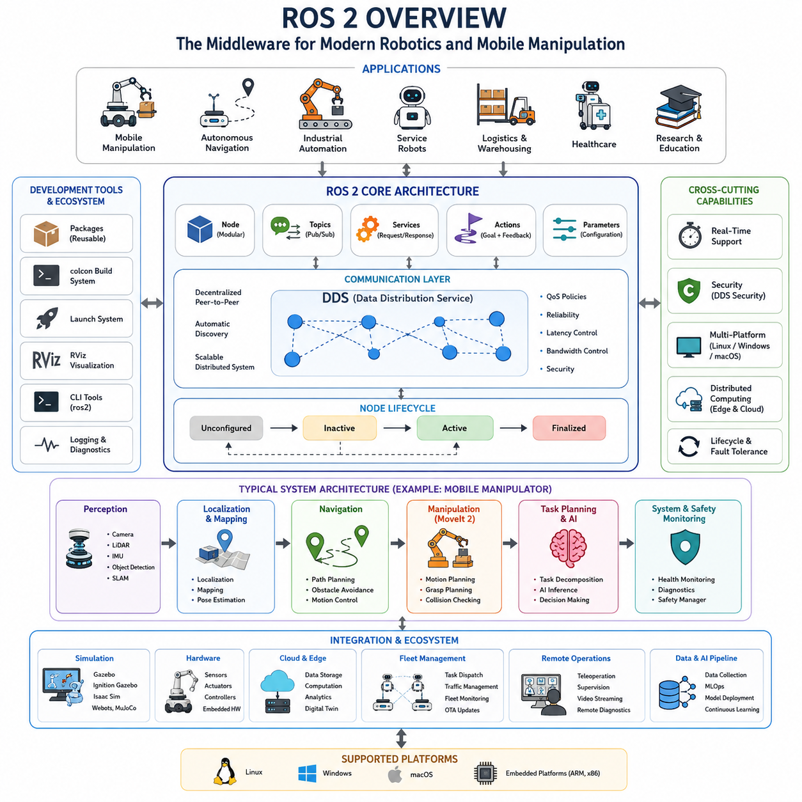{width="7.268055555555556in" height="7.268055555555556in"}

Robot Operating System 2 (ROS 2) has become the de facto software framework for modern robotics systems and serves as the foundational middleware layer for autonomous mobile robots, robotic manipulators, mobile manipulators, service robots, industrial robots, autonomous vehicles, and emerging embodied AI systems. As robotics platforms have evolved from isolated machines into highly distributed cyber-physical systems, the need for a scalable, modular, real-time capable, and industry-ready software architecture has become increasingly important. ROS 2 was developed to address these requirements and represents a major evolution beyond the original ROS framework. Within modern mobile manipulation systems, ROS 2 acts as the central nervous system that connects perception, planning, control, communication, simulation, cloud integration, and fleet management into a unified software ecosystem.

The original ROS architecture was introduced to accelerate robotics research by providing reusable software components, standardized communication mechanisms, and a large open-source ecosystem. While ROS revolutionized robotics development, its architecture was primarily designed for laboratory environments and research applications. As robots began moving into factories, warehouses, hospitals, logistics centers, public spaces, and outdoor environments, new requirements emerged. Industrial deployments demanded higher reliability, deterministic communication, enhanced security, fault tolerance, lifecycle management, distributed computing, and support for heterogeneous hardware platforms. ROS 2 was created to satisfy these industrial requirements while preserving the flexibility and openness that made ROS successful.

At its core, ROS 2 is not an operating system in the traditional sense. Instead, it is a robotics middleware framework that runs on top of operating systems such as Linux, Windows, and macOS. ROS 2 provides communication services, software libraries, development tools, runtime management capabilities, and standardized interfaces that simplify the creation of complex robotic applications. Developers can focus on robot functionality rather than building communication infrastructures from scratch.

One of the most important concepts in ROS 2 is modularity. Modern robotic systems consist of many independent subsystems that must work together in real time. A mobile manipulator, for example, may include perception modules, localization modules, mapping systems, navigation algorithms, motion planners, manipulator controllers, safety systems, user interfaces, fleet management software, and cloud connectivity services. ROS 2 allows each subsystem to be developed as an independent software component called a node. These nodes communicate through standardized interfaces while remaining loosely coupled. This architectural approach improves maintainability, scalability, testability, and reusability.

The ROS 2 communication architecture is built on top of the Data Distribution Service (DDS), an industry-standard middleware technology widely used in aerospace, defense, autonomous vehicles, industrial automation, and mission-critical systems. DDS replaces the centralized ROS Master used in ROS 1 and enables a fully decentralized communication model. In this architecture, nodes automatically discover each other across networks without relying on a central server. This decentralized design improves reliability and removes single points of failure that could compromise system operation.

The adoption of DDS provides numerous benefits. It enables peer-to-peer communication, supports distributed computing, improves network scalability, and introduces configurable Quality of Service (QoS) policies. These QoS settings allow developers to control reliability, durability, latency, bandwidth utilization, and message delivery guarantees. Such flexibility is critical because different robotic data streams have different communication requirements. High-frequency LiDAR data may prioritize low latency, while mission-critical safety messages may require guaranteed delivery.

ROS 2 communication is organized around several core concepts including topics, services, actions, and parameters. Topics provide asynchronous publish-subscribe communication and are typically used for streaming sensor data, robot states, localization information, camera images, point clouds, and telemetry information. Services support synchronous request-response interactions and are commonly used for configuration tasks, status queries, and command execution. Actions extend the service model by supporting long-running operations with feedback and cancellation capabilities. Parameters provide standardized mechanisms for configuring software components at runtime.

The node architecture of ROS 2 forms the foundation of all robotic applications. Each node performs a specific function and communicates with other nodes through defined interfaces. For example, a mobile manipulator may include a camera node responsible for image acquisition, an object detection node responsible for identifying objects, a localization node responsible for determining robot position, a navigation node responsible for path planning, and a manipulator control node responsible for executing grasping motions. By separating functionality into independent nodes, developers can replace, upgrade, or test individual subsystems without affecting the rest of the system.

ROS 2 also introduces lifecycle management capabilities that are particularly important in industrial robotics. Lifecycle nodes allow software components to transition through well-defined states such as unconfigured, inactive, active, and finalized. This approach enables controlled startup sequences, safe shutdown procedures, fault recovery mechanisms, and deterministic system initialization. In large robotic deployments involving dozens or hundreds of robots, lifecycle management significantly improves operational reliability.

Another critical feature of ROS 2 is its support for real-time systems. Many robotic applications require deterministic timing behavior. Examples include motor control, collision avoidance, force control, and safety monitoring. ROS 2 has been designed with real-time operation in mind and supports integration with real-time operating systems and real-time Linux kernels. Memory allocation strategies, executor architectures, communication mechanisms, and scheduling techniques can be optimized to achieve predictable execution behavior.

The ROS 2 software ecosystem is built around reusable packages. A package contains source code, configuration files, launch scripts, documentation, and dependencies required for a particular functionality. Thousands of open-source ROS 2 packages are available through the global robotics community. These packages cover areas such as navigation, localization, perception, machine learning, manipulation, simulation, diagnostics, fleet management, and system monitoring. Developers can leverage these packages to accelerate development and reduce engineering effort.

Package management in ROS 2 relies on workspaces and build systems. A workspace acts as a development environment containing multiple packages that can be compiled and deployed together. The colcon build system is widely used for building ROS 2 applications and managing dependencies. This approach supports modular development workflows and enables large engineering teams to collaborate efficiently on complex robotics projects.

Launch systems play an important role in ROS 2 deployments. A launch file defines how nodes should be started, configured, connected, and monitored. Rather than manually starting dozens of processes, developers can use launch files to initialize complete robotic systems with a single command. Launch configurations support parameterization, conditional execution, namespace management, and distributed deployments across multiple computers.

ROS 2 also provides extensive support for robotic simulation. Simulation environments allow developers to validate algorithms before deploying them on physical robots. Simulators such as Gazebo, Ignition Gazebo, Isaac Sim, Webots, and MuJoCo can be integrated directly with ROS 2. Virtual sensors, physics engines, environmental models, and digital twins enable comprehensive testing under controlled conditions. Simulation reduces development costs, improves safety, accelerates iteration cycles, and enables large-scale testing scenarios that would be difficult to perform in the real world.

For mobile manipulation systems, ROS 2 serves as the integration platform connecting navigation and manipulation capabilities. A mobile manipulator combines autonomous mobility with robotic arm functionality. The navigation subsystem determines where the robot should move, while the manipulation subsystem determines how objects should be grasped and manipulated. ROS 2 provides the communication framework that allows these subsystems to share information and coordinate actions. As a result, the robot can autonomously navigate to a target location, identify an object, plan a grasping strategy, execute manipulation motions, and complete tasks without human intervention.

The perception pipeline in ROS 2 typically involves multiple sensors and processing stages. Cameras, depth sensors, LiDARs, IMUs, radar systems, force sensors, and GNSS receivers continuously generate data. ROS 2 nodes process this data to perform object detection, semantic segmentation, pose estimation, localization, mapping, obstacle detection, and environmental understanding. The outputs of these perception modules are then used by planning and control systems to generate robot actions.

ROS 2 has become increasingly important in AI-enabled robotics. Modern robots rely heavily on deep learning models, foundation models, vision-language models, and embodied AI architectures. ROS 2 provides standardized interfaces that allow AI inference engines to interact with robotic subsystems. Machine learning models can receive sensor data, generate predictions, and transmit results through ROS 2 communication channels. This integration enables intelligent behaviors such as object recognition, scene understanding, language-guided navigation, task planning, and adaptive decision-making.

Cloud and edge computing integration is another area where ROS 2 demonstrates significant advantages. Many modern robotic deployments operate within distributed computing architectures. Computationally intensive tasks such as model training, fleet analytics, digital twin simulation, and large-scale optimization may be executed in cloud environments, while latency-sensitive tasks remain on edge devices. ROS 2 supports this hybrid architecture by enabling communication between robots, edge servers, cloud platforms, and operational control centers.

Security has become a critical requirement as robots become connected to enterprise networks and public infrastructure. ROS 2 addresses this challenge through DDS Security mechanisms that provide authentication, encryption, access control, and secure communication channels. These capabilities are particularly important in healthcare, logistics, industrial automation, defense, and critical infrastructure applications where cybersecurity risks must be carefully managed.

Fleet management systems also rely heavily on ROS 2. Large robotic deployments may involve dozens, hundreds, or even thousands of robots operating simultaneously. ROS 2 enables communication among robots, fleet orchestration systems, operational dashboards, and cloud services. Mission assignments, traffic management, resource allocation, health monitoring, software updates, and performance analytics can all be coordinated through ROS 2-based infrastructures.

One of the key reasons for the widespread adoption of ROS 2 is its strong ecosystem and community support. Universities, research institutions, robotics startups, industrial automation companies, autonomous vehicle developers, healthcare robotics firms, logistics providers, and technology giants actively contribute to ROS 2 development. This collaborative ecosystem accelerates innovation and ensures continuous improvement of the platform.

The future of ROS 2 extends beyond traditional robotics. As embodied AI systems become more capable, robots will increasingly require advanced reasoning, natural language understanding, multimodal perception, autonomous decision-making, and adaptive learning capabilities. ROS 2 provides the foundational software architecture that allows these advanced AI systems to interact with the physical world. It acts as the bridge between digital intelligence and physical execution.

Within the broader context of mobile manipulation software architecture, ROS 2 serves as the foundational layer upon which navigation systems, manipulation frameworks, behavior trees, task planners, digital twins, fleet management platforms, MLOps pipelines, remote operations centers, and safety validation systems are built. The subsequent chapters of this volume explore these components in greater detail, beginning with ROS 2 architecture and progressing through advanced software frameworks required for industrial-scale mobile manipulation deployments. ROS 2 is therefore not merely a middleware platform; it is the software backbone that enables the next generation of intelligent autonomous robotic systems and forms the technological foundation for future embodied AI ecosystems.

## 02 ROS2 Node Architecture

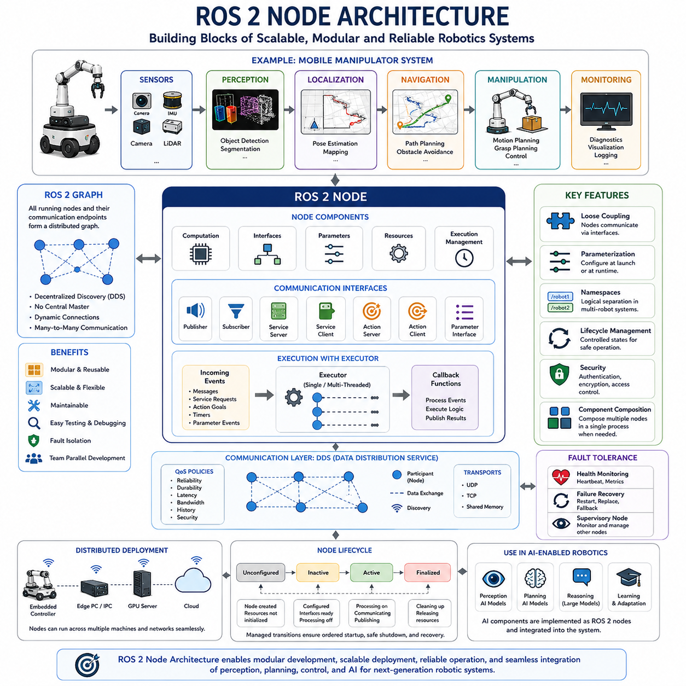{width="7.268055555555556in" height="7.268055555555556in"}

The node architecture of ROS 2 forms the fundamental building block of every modern robotic software system. Regardless of whether the robot is a mobile robot, industrial manipulator, autonomous vehicle, drone, humanoid robot, service robot, or mobile manipulator, the entire software ecosystem is ultimately composed of interconnected nodes that collaborate to achieve complex autonomous behavior. Understanding ROS 2 node architecture is therefore essential for designing scalable, maintainable, reliable, and industrial-grade robotic systems.

A ROS 2 node can be viewed as an independent software process that performs a specific function within a larger robotic application. Rather than developing a robot as a single monolithic application, ROS 2 encourages developers to decompose the system into smaller functional modules. Each module operates independently while communicating through standardized interfaces. This architectural philosophy follows the principles of distributed computing, modular software engineering, and service-oriented design.

In traditional robotics software systems, many functionalities are tightly coupled within a single executable application. As systems grow in complexity, this approach often leads to maintenance challenges, limited scalability, and difficulties in debugging. ROS 2 addresses these limitations by treating each functionality as a separate node. A perception node may process camera images, a localization node may estimate robot position, a navigation node may generate paths, and a manipulation node may control a robotic arm. Each node focuses on a specific responsibility while interacting with other nodes through ROS 2 communication mechanisms.

The concept of node decomposition provides several significant advantages. Individual modules can be developed by separate engineering teams, tested independently, deployed selectively, upgraded incrementally, and reused across multiple robotic platforms. This modular approach becomes particularly important in large-scale industrial robotics projects where software complexity can easily exceed millions of lines of code.

A node in ROS 2 contains computational logic, communication interfaces, runtime resources, parameters, and execution management structures. It serves as both a processing entity and a communication endpoint. Every node has a unique name within the ROS graph and participates in the distributed communication network through publishers, subscribers, service servers, service clients, action servers, action clients, and parameter interfaces.

The ROS graph represents the overall communication topology of the robotic system. As nodes are launched, they automatically register themselves within the ROS graph through DDS discovery mechanisms. Unlike ROS 1, which required a centralized ROS Master, ROS 2 employs decentralized discovery. Nodes automatically discover available communication endpoints and establish connections dynamically without requiring centralized coordination.

A typical autonomous mobile robot may contain dozens of nodes running simultaneously. Sensor drivers acquire information from cameras, LiDARs, IMUs, GNSS receivers, radar systems, and force sensors. Perception nodes analyze incoming sensor streams to detect objects, classify environments, identify obstacles, and estimate object poses. Localization nodes determine robot position relative to a map. Planning nodes compute navigation paths. Control nodes generate actuator commands. Diagnostic nodes monitor system health. Visualization nodes provide operator interfaces. Together, these nodes form a distributed software ecosystem operating as a unified robotic system.

One of the defining characteristics of ROS 2 node architecture is loose coupling. Nodes do not require direct knowledge of each other\'s internal implementation details. Instead, communication occurs through standardized message interfaces. This abstraction significantly improves maintainability because changes inside one node do not necessarily affect other nodes as long as communication interfaces remain consistent.

The communication capabilities of a node are typically implemented through publishers and subscribers. A publisher generates data and transmits messages to a topic. Subscribers receive messages from topics and process incoming information. Multiple publishers and subscribers may communicate through the same topic, enabling many-to-many communication patterns. This architecture supports highly scalable distributed robotic systems.

For example, a camera node may publish image data to an image topic at thirty frames per second. Multiple subscribers can simultaneously consume this data. An object detection node may identify objects, a visual localization node may estimate position, and a recording node may store images for future analysis. None of these subscribers need direct connections to the camera driver itself. They simply subscribe to the published topic.

Nodes also support service interfaces for request-response interactions. Service communication is commonly used when immediate feedback is required. For example, a node responsible for map management may provide services for loading maps, saving maps, resetting maps, or querying map status. Another node can send a service request and receive a response once processing is completed.

Actions provide another important communication mechanism. Many robotic operations require extended execution times and continuous progress feedback. Navigation, object manipulation, inspection missions, and delivery tasks may take several seconds or minutes to complete. Action interfaces allow nodes to initiate long-running tasks while receiving status updates and retaining the ability to cancel execution if necessary.

A key aspect of ROS 2 node architecture is parameter management. Parameters allow developers and operators to configure node behavior without modifying source code. Navigation speed limits, sensor thresholds, safety margins, control gains, camera settings, and AI inference parameters can all be exposed through parameter interfaces. Parameters may be loaded during startup, modified dynamically during operation, or distributed through configuration files.

Namespaces play a critical role in organizing nodes within large robotic deployments. A namespace provides logical separation between groups of nodes and communication resources. In multi-robot environments, namespaces prevent conflicts by isolating identical software stacks. For example, two autonomous mobile robots may both execute localization nodes named "localization," but each robot operates within its own namespace, ensuring independent operation.

The node architecture of ROS 2 supports distributed deployment across multiple computing devices. Modern robotic systems rarely rely on a single computer. Instead, workloads are distributed across edge processors, embedded controllers, GPU servers, industrial PCs, and cloud platforms. ROS 2 nodes can operate across these computing resources while maintaining seamless communication.

A mobile manipulator illustrates this distributed architecture particularly well. Low-level motor controllers may execute on embedded microcontrollers. Navigation software may run on an industrial computer. Perception algorithms may execute on a GPU-equipped edge server. AI reasoning modules may utilize cloud infrastructure. Despite being physically distributed, all nodes remain connected through the ROS 2 communication framework.

Executors are an essential component of ROS 2 node architecture. An executor is responsible for managing callback execution within a node. Whenever a message arrives, a service request is received, a timer expires, or an action update occurs, the executor schedules and executes the corresponding callback functions. Executors therefore act as runtime managers that coordinate the execution flow inside ROS 2 nodes.

ROS 2 supports both single-threaded and multi-threaded executors. Single-threaded executors process callbacks sequentially and are simpler to implement and debug. Multi-threaded executors allow concurrent processing of multiple callbacks, improving performance in computationally intensive applications. Selecting the appropriate executor architecture depends on application requirements, computational workloads, and real-time constraints.

Callback groups provide additional control over execution behavior. Developers can define mutually exclusive groups that prevent concurrent execution or reentrant groups that allow simultaneous processing. These mechanisms help manage resource sharing, synchronization requirements, and thread safety concerns in complex robotic applications.

Memory management is another important consideration in node design. Industrial robotic systems often require deterministic performance. Dynamic memory allocation during operation can introduce unpredictable latency and compromise real-time behavior. ROS 2 therefore provides mechanisms that support preallocated memory, zero-copy communication, and real-time-safe execution strategies.

Node lifecycle management represents one of the major architectural enhancements introduced in ROS 2. Traditional software components typically transition directly from startup to execution. ROS 2 lifecycle nodes introduce a structured state machine that governs node behavior throughout its operational lifetime. Common states include Unconfigured, Inactive, Active, and Finalized.

During the Unconfigured state, a node exists but has not yet initialized resources. Configuration procedures load parameters, allocate resources, establish communication interfaces, and prepare runtime components. Once configured, the node transitions to the Inactive state, where communication resources exist but active processing has not yet begun. Activation transitions the node into operational mode, allowing it to publish, subscribe, and perform computation. Finalization gracefully releases resources during shutdown.

Lifecycle management is particularly valuable in industrial environments where controlled startup and shutdown procedures are required. Large robotic systems may contain hundreds of nodes that must initialize in a specific sequence. Sensor nodes may need to become operational before localization begins. Localization must stabilize before navigation activates. Navigation must activate before mission execution starts. Lifecycle management enables this coordinated startup process.

Fault tolerance is another area where node architecture becomes critically important. Real-world robotic deployments inevitably encounter failures. Sensors disconnect, networks become unstable, hardware malfunctions occur, and software crashes happen. ROS 2 node architecture supports fault isolation by separating functionality into independent components. A failure in one node does not necessarily cause the entire system to fail.

Supervisory nodes are often employed to monitor the health of operational nodes. Diagnostic information, heartbeat messages, resource utilization metrics, communication statistics, and performance indicators can be continuously monitored. If abnormal behavior is detected, recovery procedures may restart failed nodes, switch to backup systems, or trigger safe shutdown operations.

Component composition further enhances ROS 2 node architecture. While nodes are conceptually independent processes, multiple nodes can be combined within a single executable process when necessary. This approach reduces communication overhead, improves memory efficiency, and decreases latency. Component composition is particularly useful for high-performance perception pipelines and embedded robotic systems with limited computational resources.

ROS 2 node architecture also supports security mechanisms. Nodes can authenticate communication endpoints, encrypt transmitted data, enforce access control policies, and restrict unauthorized interactions. As robots become increasingly connected to enterprise networks and critical infrastructure systems, secure node communication becomes an essential operational requirement.

The emergence of AI-enabled robotics has further increased the importance of robust node architectures. Modern robotic systems frequently integrate deep learning models, vision-language models, foundation models, and embodied AI agents. These AI components are typically implemented as dedicated nodes within the ROS 2 ecosystem. Perception nodes may execute object detection networks, planning nodes may incorporate reinforcement learning policies, and reasoning nodes may employ large language models to support high-level decision-making.

Within mobile manipulation systems, node architecture provides the framework for coordinating navigation, perception, manipulation, task planning, and execution monitoring. A mobile manipulator performing warehouse picking operations may utilize dozens of interacting nodes. Sensor nodes capture environmental information, localization nodes estimate position, navigation nodes generate routes, object detection nodes identify inventory, grasp planning nodes determine manipulation strategies, motion planning nodes generate trajectories, control nodes execute movements, and monitoring nodes ensure operational safety. The successful coordination of these functions depends entirely on the underlying ROS 2 node architecture.

As robotics systems continue evolving toward autonomous fleets, humanoid robots, cloud-connected platforms, and embodied AI agents, the importance of scalable node architectures will continue to grow. ROS 2 nodes provide the abstraction layer that enables complex robotic systems to be decomposed into manageable, reusable, and interoperable software components. This architectural foundation supports rapid innovation while maintaining the reliability and flexibility required for real-world deployment.

For mobile manipulators and next-generation autonomous robots, ROS 2 node architecture serves as the software backbone upon which all higher-level capabilities are constructed. Perception, localization, navigation, manipulation, fleet management, simulation, digital twins, AI inference, remote operations, and cloud integration all rely on well-designed node structures. Understanding ROS 2 node architecture is therefore not simply a software engineering exercise but a prerequisite for building intelligent, scalable, and industrial-grade robotic systems capable of operating safely and efficiently in complex real-world environments.

## 03 Topics Services Actions

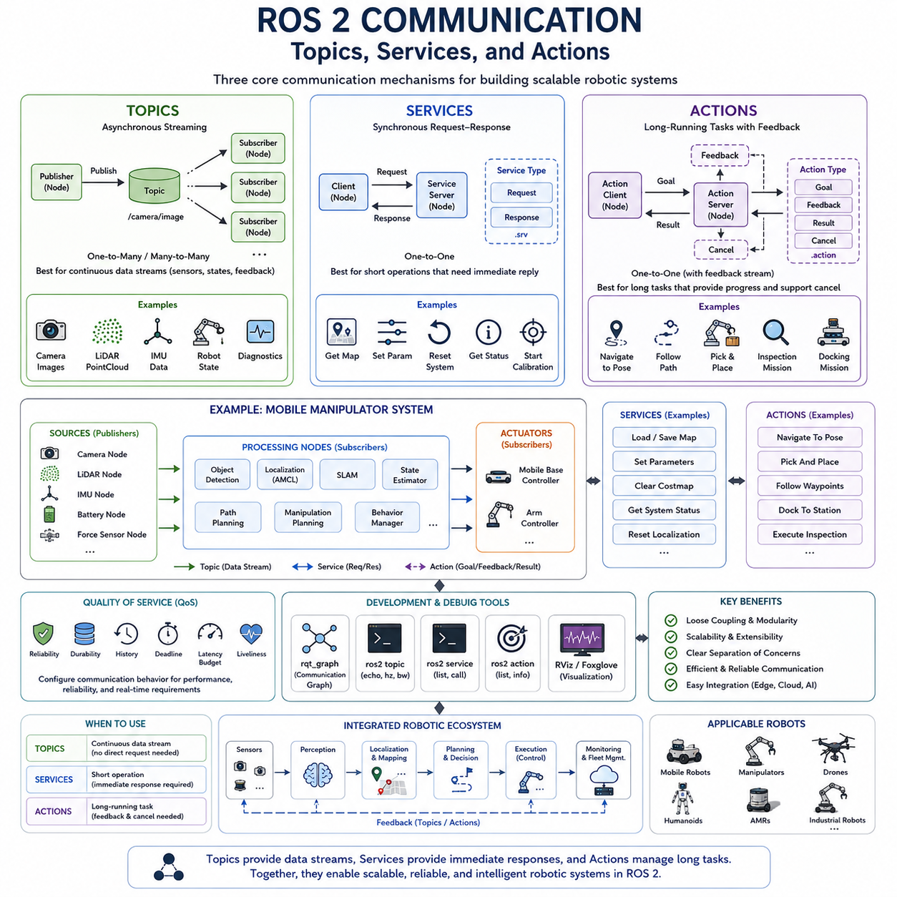{width="7.268055555555556in" height="7.268055555555556in"}

Communication is the foundation of every ROS 2 system. Regardless of whether a robot is performing autonomous navigation, object manipulation, industrial automation, warehouse logistics, service operations, or embodied AI tasks, software components must continuously exchange information. Sensors generate data, perception modules process observations, planning systems create decisions, controllers execute commands, and monitoring systems supervise operations. ROS 2 enables this collaboration through a communication architecture centered on Topics, Services, and Actions.

Topics, Services, and Actions are the three primary communication mechanisms in ROS 2. Together they provide a flexible framework capable of supporting nearly every interaction pattern required by modern robotic systems. Each mechanism is designed for a specific category of communication and serves a different operational purpose. Understanding when and how to use these mechanisms is essential for building scalable, maintainable, and high-performance robotic applications.

At a conceptual level, Topics are used for continuous asynchronous data streams, Services are used for immediate request-response interactions, and Actions are used for long-running tasks that require progress monitoring and cancellation capabilities. These communication paradigms form the backbone of ROS 2 software architecture and appear throughout every subsystem of a robot.

A modern mobile manipulator illustrates the importance of these communication mechanisms. Cameras continuously publish image streams. LiDAR sensors publish point cloud data. Localization systems publish robot poses. Navigation systems receive environmental information and generate movement commands. Manipulation systems receive target object information and execute grasping actions. Fleet management platforms exchange mission assignments and operational status information. Every interaction within this ecosystem relies on Topics, Services, Actions, or combinations of all three.

Topics represent the most widely used communication mechanism in ROS 2. They implement a publish-subscribe model that enables asynchronous communication among nodes. A publisher sends messages to a named topic, and one or more subscribers receive those messages. Publishers and subscribers remain loosely coupled because neither side needs direct knowledge of the other. As long as both utilize the same topic name and message type, communication occurs automatically.

This decoupled architecture provides exceptional flexibility. A camera node may publish image data while multiple perception nodes subscribe simultaneously. An object detection node may identify objects from the images. A localization node may use visual information for position estimation. A recording node may store images for future analysis. Each subscriber independently consumes the same data stream without requiring modifications to the publisher.

Topics are particularly suitable for sensor data because sensors generate information continuously. Cameras may publish thirty or sixty images per second. LiDAR sensors may generate tens or hundreds of thousands of measurements per second. IMUs may produce inertial measurements at several hundred Hertz. Such data streams are naturally modeled using Topics because information is generated continuously and subscribers can process data independently.

The asynchronous nature of Topics enables highly scalable system architectures. New subscribers can be added without modifying existing publishers. New publishers can be introduced to provide alternative data sources. Multiple nodes can cooperate through shared information streams without direct dependencies. This characteristic significantly improves maintainability and extensibility.

ROS 2 Topics support many-to-many communication patterns. A single publisher may communicate with multiple subscribers, multiple publishers may contribute to a common topic, or multiple publishers and subscribers may coexist simultaneously. DDS-based discovery mechanisms automatically establish communication relationships whenever compatible endpoints become available.

Message definitions play a critical role in Topic communication. Every Topic transmits a specific message type. Standard ROS 2 message definitions include geometric information, sensor data, navigation information, images, point clouds, robot states, diagnostic information, and control commands. Developers may also define custom message types tailored to specific application requirements.

Quality of Service policies significantly influence Topic behavior. Reliability settings determine whether message delivery is guaranteed or best-effort. Durability settings define whether historical messages should be preserved for future subscribers. History settings control message buffering. Deadline settings establish timing expectations. These capabilities allow developers to optimize communication behavior for different operational requirements.

For example, high-frequency camera streams may prioritize low latency and use best-effort delivery. Safety-critical emergency stop signals may require reliable transmission with strict delivery guarantees. Mission status information may utilize durability settings to ensure late subscribers receive the latest state information immediately after connecting.

Topic communication is ideal when information flows continuously and independently of individual requests. Sensor streams, robot states, localization estimates, battery status, diagnostic information, and environmental observations are commonly implemented using Topics. In these scenarios, publishers continuously generate data regardless of whether subscribers actively request information.

While Topics excel at streaming information, some robotic interactions require explicit requests and immediate responses. Services address this requirement by implementing a synchronous request-response communication model. A Service Server provides a specific capability, while a Service Client requests execution of that capability. Once processing is complete, the server returns a response.

Services closely resemble function calls in traditional software development. A client initiates a request, waits for processing to complete, and receives a response containing the result. This communication pattern is particularly suitable for operations that are relatively short in duration and require immediate feedback.

A map management node provides a useful example. Operators may request map loading, map saving, map deletion, or map status information. Each request represents a discrete operation with a clearly defined response. Service communication allows these interactions to occur efficiently and predictably.

Configuration management frequently relies on Services. Nodes may expose services for resetting internal states, updating configuration parameters, initiating calibration procedures, clearing navigation costmaps, restarting perception pipelines, or querying diagnostic information. These interactions typically require confirmation that the requested operation completed successfully.

Services provide deterministic communication behavior because each request produces exactly one response. This characteristic simplifies application logic and makes Services particularly suitable for administrative, configuration, and management operations. Unlike Topics, Services do not continuously stream information. Instead, communication occurs only when explicitly requested.

Although Services are powerful, they are not appropriate for all robotic tasks. Many robotic operations require substantial execution time and continuous progress monitoring. Autonomous navigation, warehouse picking, inspection missions, and manipulation tasks may require several seconds or minutes to complete. Using Services for such operations would be inefficient because clients would remain blocked while waiting for completion.

Actions were introduced to address this challenge. Actions extend the request-response model by supporting long-running operations with feedback and cancellation capabilities. An Action Client submits a goal to an Action Server. The server executes the requested operation while periodically providing progress updates. The client can monitor execution status, receive intermediate results, and cancel the operation if necessary.

Actions are among the most important communication mechanisms in autonomous robotics because many robotic behaviors naturally involve extended execution periods. Navigation provides one of the most common examples. A robot may receive a command to travel to a destination located hundreds of meters away. The journey may require obstacle avoidance, dynamic replanning, environmental adaptation, and several minutes of execution time.

Using an Action interface, the navigation system receives the destination as a goal. During execution, it continuously reports progress information such as remaining distance, estimated arrival time, navigation status, and recovery behaviors. If circumstances change, the mission can be canceled or modified without waiting for completion.

Manipulation systems similarly benefit from Actions. A grasping task may involve perception, object recognition, pose estimation, motion planning, collision checking, trajectory execution, force monitoring, and object verification. These operations collectively require significant execution time and benefit from continuous feedback.

The Action architecture internally combines concepts from Topics and Services. Goal requests, result responses, status updates, feedback streams, and cancellation requests are coordinated through multiple communication channels. ROS 2 abstracts this complexity, allowing developers to utilize Actions through a straightforward programming interface.

Feedback capabilities distinguish Actions from Services. During navigation, an Action Server may continuously report current position, progress percentage, estimated completion time, obstacle encounters, and recovery attempts. Operators and supervisory systems gain visibility into execution progress without interrupting ongoing operations.

Cancellation support provides another critical advantage. Industrial environments are dynamic and unpredictable. Missions may need to be interrupted due to safety concerns, operational priorities, environmental changes, or emergency situations. Actions allow ongoing tasks to be terminated gracefully while preserving system integrity.

Modern robotic systems rarely rely on only one communication mechanism. Instead, Topics, Services, and Actions are combined to create sophisticated software architectures. Consider a warehouse mobile manipulator performing inventory picking operations. Cameras publish image streams through Topics. Perception systems publish detected object information through Topics. Configuration and diagnostics utilize Services. Pick-and-place operations execute through Actions. Fleet management software assigns missions using Actions while monitoring robot status through Topics.

The integration of Topics, Services, and Actions creates layered communication architectures. Low-level sensor data typically flows through Topics. Configuration and management operations often utilize Services. High-level task execution generally relies on Actions. This separation improves system organization and ensures each communication mechanism is used according to its strengths.

ROS 2 tools provide extensive support for observing and debugging communication behavior. Developers can inspect active Topics, monitor message traffic, query Service availability, invoke Service requests, observe Action execution, and analyze communication performance. These capabilities simplify development, testing, and operational troubleshooting.

Scalability is another significant advantage of the ROS 2 communication architecture. As robotic systems grow from individual robots to large fleets, communication complexity increases dramatically. Topics enable efficient information distribution across multiple consumers. Services provide structured management interfaces. Actions coordinate complex task execution. Together they support distributed robotic ecosystems containing hundreds or thousands of interacting software components.

The rise of AI-enabled robotics further increases the importance of these communication mechanisms. Deep learning models, vision-language models, robot foundation models, and embodied AI agents must exchange information with traditional robotic subsystems. Sensor data enters AI inference nodes through Topics. Model configuration may occur through Services. High-level reasoning tasks may execute through Actions. ROS 2 communication primitives provide the interoperability necessary for integrating advanced AI capabilities into robotic systems.

In cloud robotics architectures, Topics, Services, and Actions also facilitate communication between robots, edge computing resources, digital twins, fleet management systems, and cloud-based AI platforms. Sensor streams may be forwarded through Topics, configuration updates delivered through Services, and mission execution coordinated through Actions. This unified communication model simplifies system integration across diverse computing environments.

Mobile manipulation systems represent one of the most demanding applications of ROS 2 communication architecture because they combine mobility, perception, manipulation, planning, and AI reasoning within a single platform. A successful mobile manipulator may execute hundreds of Topic exchanges per second, process numerous Service requests, and coordinate multiple concurrent Actions. Efficient utilization of these communication mechanisms directly influences system responsiveness, reliability, and scalability.

As robotics continues evolving toward autonomous fleets, humanoid robots, embodied AI agents, and large-scale intelligent infrastructure systems, Topics, Services, and Actions will remain fundamental building blocks of robot communication. They provide a clear separation between continuous data streaming, immediate request-response interactions, and long-running task execution. This architectural clarity allows developers to construct increasingly sophisticated robotic systems while maintaining modularity, flexibility, and operational reliability.

For ROS 2 developers, mastering Topics, Services, and Actions is one of the most important steps toward understanding the broader ROS ecosystem. Nearly every subsystem within navigation, perception, manipulation, simulation, fleet management, digital twins, AI integration, and remote operations relies upon these communication mechanisms. Together they form the communication foundation that enables modern robotic systems to operate as coordinated, intelligent, and distributed software ecosystems.

## 04 DDS and QoS

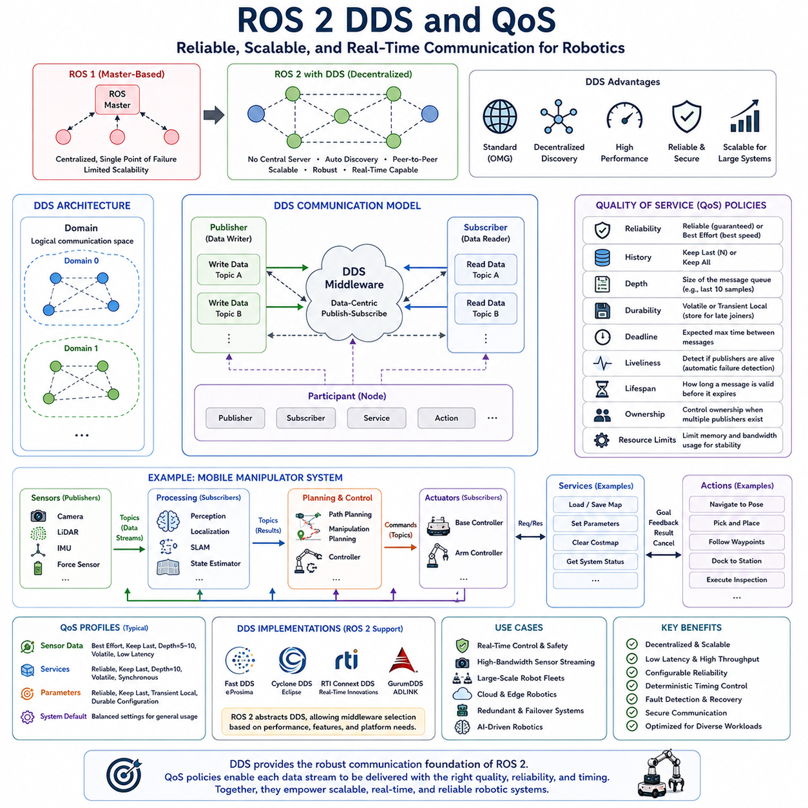{width="7.268055555555556in" height="7.268055555555556in"}

Data Distribution Service (DDS) and Quality of Service (QoS) are among the most important technologies underlying ROS 2. While developers often interact with nodes, topics, services, and actions during daily development, the actual communication infrastructure that enables reliable and scalable data exchange is largely provided by DDS. Understanding DDS and QoS is therefore essential for designing high-performance robotic systems, especially in industrial environments where reliability, real-time behavior, scalability, and fault tolerance are critical requirements.

ROS 1 relied on a centralized architecture based on ROS Master. All nodes had to register with the Master before communication could occur. While this approach simplified development and worked well for research applications, it introduced several limitations. The Master represented a single point of failure, network scalability was limited, and communication behavior could not be finely controlled. As robotics systems became larger and moved into industrial deployments, these limitations became increasingly problematic.

ROS 2 was designed to overcome these challenges by adopting DDS as its communication middleware. DDS is an international standard published by the Object Management Group (OMG) and has been widely used in mission-critical industries such as aerospace, defense, autonomous vehicles, industrial automation, telecommunications, and healthcare systems. By building ROS 2 on DDS, developers gain access to a mature communication infrastructure that has already been proven in demanding operational environments.

At its core, DDS is a data-centric publish-subscribe middleware. Unlike traditional message brokers that focus on sending messages between endpoints, DDS focuses on distributing data throughout a distributed system. The primary objective is not merely message delivery but ensuring that the right data reaches the right consumers with the required quality, reliability, and timing characteristics.

One of the most significant advantages of DDS is its decentralized architecture. In DDS, there is no central communication server that manages all interactions. Instead, each participant discovers other participants automatically through a distributed discovery mechanism. This design eliminates single points of failure and improves overall system robustness.

When a ROS 2 node starts, it becomes a DDS participant. The participant announces its existence to the network and discovers other participants automatically. Publishers and subscribers can then establish communication relationships without requiring manual configuration or centralized coordination. This automatic discovery process greatly simplifies deployment and operation of distributed robotic systems.

The DDS communication model is built around several key concepts including domains, participants, publishers, subscribers, topics, data writers, and data readers. A domain acts as a logical communication space. Participants operate within domains and exchange information only with other participants in the same domain. Publishers contain data writers that transmit information, while subscribers contain data readers that receive information.

The concept of domains is particularly useful in multi-robot environments. For example, multiple robotic fleets operating in the same physical area can use different DDS domains to isolate their communications. This prevents unwanted interactions and reduces network traffic.

DDS also provides highly efficient peer-to-peer communication. Data can flow directly between publishers and subscribers without requiring intermediate routing servers. This reduces communication latency and improves overall performance. For robotics applications involving high-bandwidth sensor streams such as cameras, LiDARs, radar systems, and depth sensors, efficient communication is essential.

A modern mobile manipulator may generate enormous volumes of data. Multiple cameras may produce high-resolution video streams. LiDAR systems may generate hundreds of thousands of points per second. Manipulator controllers may exchange high-frequency state information. Fleet management systems may continuously monitor operational metrics. DDS enables these diverse data streams to coexist efficiently within a unified communication framework.

One of the reasons DDS became attractive for ROS 2 is its support for configurable Quality of Service policies. Traditional communication systems often provide fixed communication behavior. DDS allows developers to specify communication characteristics according to application requirements. This flexibility is essential because different robotic data streams have fundamentally different priorities.

A camera image stream may prioritize low latency and tolerate occasional packet loss. An emergency stop command must prioritize reliability and guaranteed delivery. Robot localization data may require freshness, while configuration information may require durability. DDS allows each communication channel to be optimized independently.

Quality of Service refers to a collection of communication policies that define how data should be transmitted, stored, delivered, and managed. These policies allow developers to control reliability, latency, durability, bandwidth utilization, timing guarantees, and fault tolerance.

Reliability is one of the most important QoS policies. DDS supports both Reliable and Best Effort communication modes. Reliable communication guarantees message delivery through acknowledgment and retransmission mechanisms. Best Effort communication prioritizes speed and low latency but does not guarantee delivery.

Reliable communication is commonly used for safety-critical information, mission commands, control messages, and operational state information. If a message is lost, DDS automatically retransmits it. This ensures that important information eventually reaches its destination.

Best Effort communication is commonly used for high-frequency sensor streams. For example, if a camera publishes sixty frames per second, occasional frame loss may be acceptable because a new frame will arrive almost immediately. Attempting to retransmit every lost frame could increase latency and reduce overall system responsiveness.

History is another important QoS policy. History determines how many previous messages should be stored by the middleware. DDS provides mechanisms such as Keep Last and Keep All. Keep Last stores only a specified number of recent messages, while Keep All attempts to preserve the entire message history within resource constraints.

History policies become particularly important when subscribers cannot process incoming data as quickly as publishers generate it. Buffering strategies help manage temporary communication imbalances and prevent data loss.

Depth works together with History and defines the size of the message queue. For example, a Depth value of ten means that up to ten recent messages may be stored for future delivery. Appropriate Depth configuration helps balance memory consumption against communication robustness.

Durability is another powerful DDS capability. Durability determines whether previously published messages should remain available for future subscribers. In Volatile mode, only active subscribers receive messages. If a subscriber connects later, previously transmitted data is unavailable.

Transient Local durability changes this behavior by allowing publishers to retain recent messages. When a new subscriber joins, it can immediately receive the latest available information. This capability is extremely useful for configuration data, map information, mission status, and system state information.

Consider a fleet management dashboard that connects to a robot after the robot has already begun operating. Without durability, the dashboard may need to wait until new status messages are generated. With Transient Local durability, the latest system state can be delivered immediately.

Deadline is a timing-related QoS policy. It defines the maximum expected interval between messages. If messages are not received within the specified deadline, DDS can notify applications that communication timing expectations have been violated.

Deadline monitoring is valuable for safety-critical systems. For example, a localization system may be expected to provide position updates every fifty milliseconds. If updates stop arriving, supervisory systems can detect the failure and initiate recovery procedures.

Liveliness monitoring provides another mechanism for detecting failures. DDS uses liveliness policies to determine whether publishers remain active and operational. If a publisher fails or becomes disconnected, subscribers can be notified automatically.

In industrial robotic deployments, liveliness monitoring plays an important role in health monitoring and fault detection. Supervisory systems can quickly identify failed components and trigger safe operating modes.

Lifespan defines how long messages remain valid after publication. Certain types of information become obsolete rapidly. Sensor measurements, localization estimates, obstacle detections, and control commands may lose relevance within milliseconds or seconds. Lifespan policies ensure outdated information is automatically discarded.

Without lifespan controls, stale information could potentially influence decision-making processes. In autonomous navigation systems, acting upon outdated obstacle information could create safety risks. Lifespan policies help maintain data freshness throughout the communication network.

Ownership policies determine how multiple publishers interact when transmitting data to the same topic. DDS can assign priorities and ownership rules that control which publisher has authority over shared information. This capability becomes valuable in redundant architectures where backup systems may assume responsibility during failures.

Resource limits allow developers to control memory consumption and communication resource utilization. Large robotic deployments may involve thousands of topics and high-bandwidth sensor streams. Resource management policies help ensure predictable system behavior under heavy workloads.

QoS compatibility is an important concept in ROS 2 communication. Publishers and subscribers can only communicate if their QoS settings are compatible. For example, a subscriber requesting Reliable communication may not connect successfully to a publisher configured for Best Effort delivery. Developers must therefore carefully consider QoS configurations when designing distributed systems.

ROS 2 provides several predefined QoS profiles to simplify configuration. Sensor Data profiles optimize communication for high-frequency sensor streams. Services profiles support reliable request-response interactions. Parameter profiles ensure robust configuration management. System Default profiles utilize middleware-specific defaults.

Sensor Data QoS profiles are commonly used with cameras, LiDARs, IMUs, radar systems, and depth sensors. These profiles typically prioritize low latency and efficient bandwidth utilization over guaranteed delivery. This approach maximizes responsiveness while minimizing communication overhead.

Service communication generally requires reliability because requests and responses must be delivered successfully. Consequently, Service QoS configurations prioritize guaranteed delivery and communication consistency.

In mobile manipulation systems, QoS configuration significantly influences overall performance. Vision systems may require low-latency image delivery. Manipulator controllers may require deterministic state updates. Navigation systems may require reliable localization information. Fleet management platforms may require durable mission status information. DDS allows each communication path to be optimized according to its operational requirements.

DDS implementations vary among vendors. Popular DDS implementations used within ROS 2 include Fast DDS, Cyclone DDS, RTI Connext DDS, and GurumDDS. Each implementation offers different performance characteristics, resource utilization profiles, feature sets, and deployment considerations. ROS 2 abstracts much of this complexity while still allowing advanced users to customize middleware behavior.

Security is another important DDS capability. DDS Security extends the communication framework with authentication, encryption, access control, and secure discovery mechanisms. As robots become connected to enterprise networks, cloud infrastructures, and public environments, secure communication becomes increasingly important.

Large-scale robotic fleets particularly benefit from DDS architecture. Hundreds of robots can communicate simultaneously without requiring centralized message brokers. Distributed discovery, peer-to-peer communication, QoS control, fault detection, and scalability enable efficient operation across large deployments.

Cloud robotics and edge computing architectures also leverage DDS effectively. Robots may communicate with edge servers, digital twins, fleet management systems, and cloud-based AI platforms. QoS policies allow developers to optimize communication pathways according to bandwidth limitations, latency requirements, and reliability constraints.

The emergence of AI-driven robotics further increases the importance of DDS and QoS. Deep learning systems, vision-language models, robot foundation models, and embodied AI agents often exchange large amounts of data with traditional robotic subsystems. Efficient middleware infrastructure becomes essential for maintaining overall system responsiveness and reliability.

Within mobile manipulators, DDS and QoS serve as the invisible foundation beneath all higher-level capabilities. Navigation, perception, manipulation, localization, fleet management, simulation, digital twins, remote operations, and AI integration all depend on robust communication infrastructures. The ability to customize communication behavior for each subsystem allows robotic systems to achieve both flexibility and performance.

As robotic systems continue evolving toward larger fleets, smarter autonomy, cloud integration, and embodied intelligence, DDS will remain one of the most important enabling technologies in ROS 2. Its decentralized architecture, scalability, reliability, real-time capabilities, and configurable QoS policies provide the communication foundation necessary for the next generation of intelligent robotic systems.

Understanding DDS and QoS is therefore not merely a matter of communication configuration. It is a fundamental requirement for designing industrial-grade robotics platforms capable of operating safely, reliably, and efficiently in complex real-world environments. For developers building mobile manipulators, autonomous robots, industrial automation systems, or future embodied AI platforms, mastery of DDS and QoS represents a critical step toward creating scalable and production-ready robotic software architectures.

## 05 Lifecycle Nodes

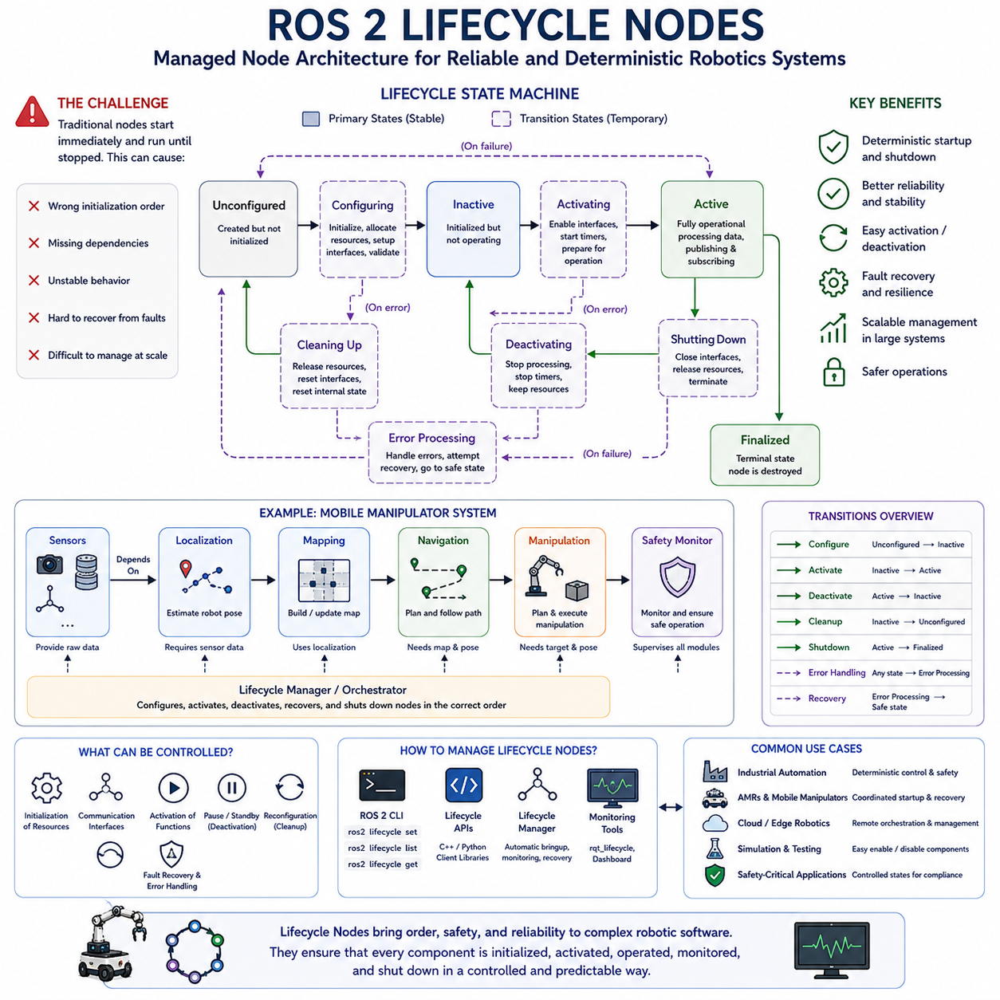{width="7.268055555555556in" height="7.268055555555556in"}

As robotic systems become increasingly complex, the challenge of managing software startup, operation, fault recovery, and shutdown grows significantly. A modern mobile manipulator, autonomous mobile robot, industrial robot, or embodied AI platform may consist of dozens or even hundreds of software components operating simultaneously across multiple computing devices. These components often have dependencies on one another and must be initialized, activated, monitored, and terminated in a controlled manner. ROS 2 Lifecycle Nodes were introduced to address this challenge by providing a structured state-management framework that enables deterministic control over the lifecycle of software components.

In traditional ROS node architectures, nodes generally begin executing immediately after launch and continue operating until termination. While this approach is simple, it becomes problematic in large-scale robotic systems. Sensors may not be ready when localization starts. Localization may not be operational when navigation begins. Navigation may attempt to execute before maps are loaded. Perception systems may publish incomplete data while AI modules are already consuming information. These timing issues can result in unstable behavior, inconsistent initialization, difficult debugging, and reduced operational reliability.

Lifecycle Nodes solve these problems by introducing a managed node architecture. Rather than simply existing in either a running or stopped state, Lifecycle Nodes progress through a well-defined sequence of operational states. These states allow developers and system operators to control precisely when a node allocates resources, initializes interfaces, begins communication, performs computation, enters standby mode, recovers from faults, and terminates operation.

The Lifecycle Node concept is inspired by industrial automation systems, aerospace control systems, telecommunications platforms, and other mission-critical software environments where predictable system behavior is essential. By separating initialization, activation, operation, and shutdown into distinct phases, Lifecycle Nodes improve robustness, maintainability, fault tolerance, and operational safety.

At the core of the Lifecycle Node architecture is a state machine. This state machine defines both primary states and transition states. Primary states represent stable operational conditions, while transition states represent temporary activities that occur when moving between primary states. Together, these states govern the complete operational lifecycle of a node.

The primary states include Unconfigured, Inactive, Active, and Finalized. In addition, several transitional states such as Configuring, Activating, Deactivating, Cleaning Up, Shutting Down, and Error Processing are used internally during state changes.

When a Lifecycle Node is first created, it enters the Unconfigured state. In this state, the node exists within the ROS graph but has not yet allocated significant resources or initialized its internal components. Communication interfaces are not fully operational, and the node is not actively performing its intended functionality. The Unconfigured state can be viewed as a preparation stage where the node is present but not yet ready for operation.

Remaining in the Unconfigured state provides several advantages. System managers can inspect node availability, verify configurations, establish deployment plans, and ensure that required dependencies are available before initialization begins. In large robotic systems, this helps prevent premature activation of components that depend on unavailable resources.

The next step involves the Configuring transition. During this phase, the node performs initialization procedures. Configuration files are loaded, parameters are validated, communication interfaces are prepared, hardware connections are established, memory resources are allocated, and internal data structures are initialized. The node verifies that all required resources are available and prepares itself for operation.

If configuration succeeds, the node transitions into the Inactive state. The Inactive state represents a fully initialized but non-operational condition. All resources are available, communication interfaces exist, and internal structures are ready, but the node is not actively processing data or executing its primary functions. Publishers may be created but remain silent, subscribers may exist but do not actively participate in processing workflows, and control algorithms remain dormant.

The Inactive state serves as an important staging area. Large robotic systems often require coordination among multiple components before operations begin. For example, a mobile manipulator may need cameras, LiDAR sensors, localization systems, navigation modules, manipulation controllers, and safety monitors to be initialized successfully before mission execution starts. By placing nodes into the Inactive state, the system can verify readiness before activation.

Activation occurs through the Activating transition. During this phase, the node performs any operations required to enter full operational mode. Timers are enabled, publishers begin transmitting data, subscribers process incoming information, control loops start executing, and operational behaviors become active. Successful completion of this transition moves the node into the Active state.

The Active state represents normal operational behavior. The node performs its intended functions, participates fully in communication networks, processes incoming data, generates outputs, executes algorithms, and contributes to overall system behavior. In most robotic systems, the majority of operational time is spent in the Active state.

For example, a localization node operating in the Active state continuously receives sensor measurements, updates robot pose estimates, publishes localization results, and responds to requests from navigation systems. Similarly, a perception node continuously processes camera images, detects objects, and publishes recognition results.

One of the most valuable aspects of Lifecycle Nodes is the ability to return from Active to Inactive without destroying the node. Through the Deactivating transition, operational activities are suspended while preserving initialized resources. This allows nodes to enter standby mode without requiring complete reinitialization.

Deactivation is useful in many operational scenarios. A robot may temporarily suspend navigation while waiting for operator approval. Perception systems may pause during maintenance procedures. Manipulation modules may enter standby mode while mobility systems remain active. The ability to selectively deactivate components improves flexibility and operational control.

Cleanup operations are handled through the Cleaning Up transition. During cleanup, resources allocated during configuration are released. Memory structures are deallocated, communication interfaces are removed, hardware connections are closed, and internal states are reset. Following successful cleanup, the node returns to the Unconfigured state.

Cleanup provides an important mechanism for reconfiguration. If operational requirements change, a node can be cleaned up, reconfigured with new parameters, and activated again without requiring complete process termination and recreation.

Shutdown procedures are handled through the Shutting Down transition. During shutdown, the node gracefully releases resources and terminates operation. Communication endpoints are closed, pending operations are completed or canceled, hardware interfaces are disconnected, and system resources are returned to the operating environment.

Successful shutdown results in the Finalized state. Finalized represents the terminal condition of the node lifecycle. Once finalized, the node no longer participates in operational activities and cannot be reactivated without recreation.

Error handling is another critical aspect of Lifecycle Nodes. Real-world robotic systems inevitably encounter failures. Hardware devices disconnect, sensors malfunction, communication links fail, configuration files become corrupted, and unexpected software conditions arise. Lifecycle Nodes incorporate dedicated Error Processing transitions that provide structured mechanisms for fault handling and recovery.

When errors occur during configuration, activation, or operation, nodes may enter error processing states where corrective actions can be performed. Recovery procedures may involve resetting internal states, reinitializing hardware interfaces, restoring communication channels, reloading configurations, or transitioning to safe operating modes.

This structured error management significantly improves system resilience. Rather than terminating unexpectedly, nodes can attempt recovery while maintaining predictable behavior. Supervisory systems can monitor lifecycle transitions and initiate appropriate corrective actions when failures occur.

Lifecycle management becomes particularly important in industrial robotics environments. Consider an automated warehouse containing hundreds of autonomous robots. Before operations begin, each robot must initialize sensors, localization systems, navigation modules, safety systems, fleet communication interfaces, and task execution engines. Improper startup sequencing could lead to localization failures, navigation errors, or unsafe behaviors.

Using Lifecycle Nodes, a centralized orchestration system can coordinate startup procedures. Sensors are configured first. Localization modules activate after sensor verification. Navigation systems activate after localization stabilization. Mission execution begins only after all prerequisites are satisfied. This deterministic startup sequence improves reliability and operational safety.

Mobile manipulators provide another compelling example. A manipulation task requires multiple subsystems to function correctly. Cameras must provide images. Object detection systems must identify targets. Motion planning modules must generate trajectories. Manipulator controllers must execute commands. Safety monitors must supervise operation. Lifecycle management ensures that each subsystem becomes operational in the correct sequence.

Lifecycle Nodes also simplify simulation and testing workflows. During development, engineers often need to activate or deactivate specific components while evaluating system behavior. Lifecycle management allows selective control without requiring repeated node restarts. This improves debugging efficiency and accelerates development cycles.

Integration with orchestration frameworks represents another major advantage. Fleet management systems, deployment tools, digital twins, cloud orchestration platforms, and operational dashboards can monitor and control lifecycle states remotely. Operators gain visibility into system readiness and can coordinate large-scale deployments more effectively.

The concept of managed lifecycles aligns closely with modern DevOps, MLOps, and cloud-native operational practices. Contemporary software systems increasingly emphasize observability, controlled deployment, health monitoring, fault recovery, and lifecycle management. ROS 2 Lifecycle Nodes bring these principles into robotics software architecture.

Safety systems benefit significantly from lifecycle management. In safety-critical applications, uncontrolled startup or shutdown behavior can create hazards. Lifecycle Nodes provide deterministic transitions that enable validation, verification, and risk mitigation procedures to occur before operational activation.

Autonomous vehicles, industrial automation platforms, healthcare robots, logistics systems, and inspection robots frequently rely on controlled operational states to ensure compliance with safety requirements. Lifecycle management provides the structured operational framework necessary for these environments.

Cloud-connected robotic systems also benefit from Lifecycle Nodes. Edge devices, robot controllers, AI inference engines, fleet management services, and digital twin platforms may all participate in coordinated lifecycle operations. Cloud orchestration platforms can remotely activate, deactivate, reconfigure, or recover robotic subsystems as operational requirements evolve.

The emergence of embodied AI systems further increases the importance of lifecycle management. Future robots will integrate perception, reasoning, planning, learning, manipulation, mobility, and human interaction capabilities into highly complex software ecosystems. Managing these capabilities requires sophisticated operational control mechanisms that extend beyond simple process execution.

Lifecycle Nodes provide a foundation for this future. By enabling structured initialization, controlled activation, deterministic operation, fault recovery, and graceful shutdown, they establish a framework for managing increasingly intelligent robotic systems.

Within mobile manipulation software architectures, Lifecycle Nodes serve as an essential reliability mechanism. Perception modules, localization systems, navigation stacks, MoveIt 2 planners, manipulation controllers, AI inference engines, remote operation interfaces, and fleet management components can all leverage lifecycle management to improve operational robustness.

As robotic systems continue growing in complexity, scalability, autonomy, and intelligence, unmanaged software architectures become increasingly difficult to maintain. Lifecycle Nodes address this challenge by transforming nodes from simple executable processes into managed operational entities with clearly defined states and transitions. This approach improves reliability, fault tolerance, maintainability, safety, and system orchestration.

For modern ROS 2 deployments, Lifecycle Nodes represent one of the most important architectural advancements beyond traditional ROS paradigms. They provide the operational discipline required for industrial-grade robotics and establish a foundation for the next generation of autonomous, scalable, and intelligent robotic systems. Their role will become even more significant as robots evolve from isolated machines into large-scale distributed cyber-physical ecosystems capable of operating continuously in complex real-world environments.

## 06 TF2 and Transforms

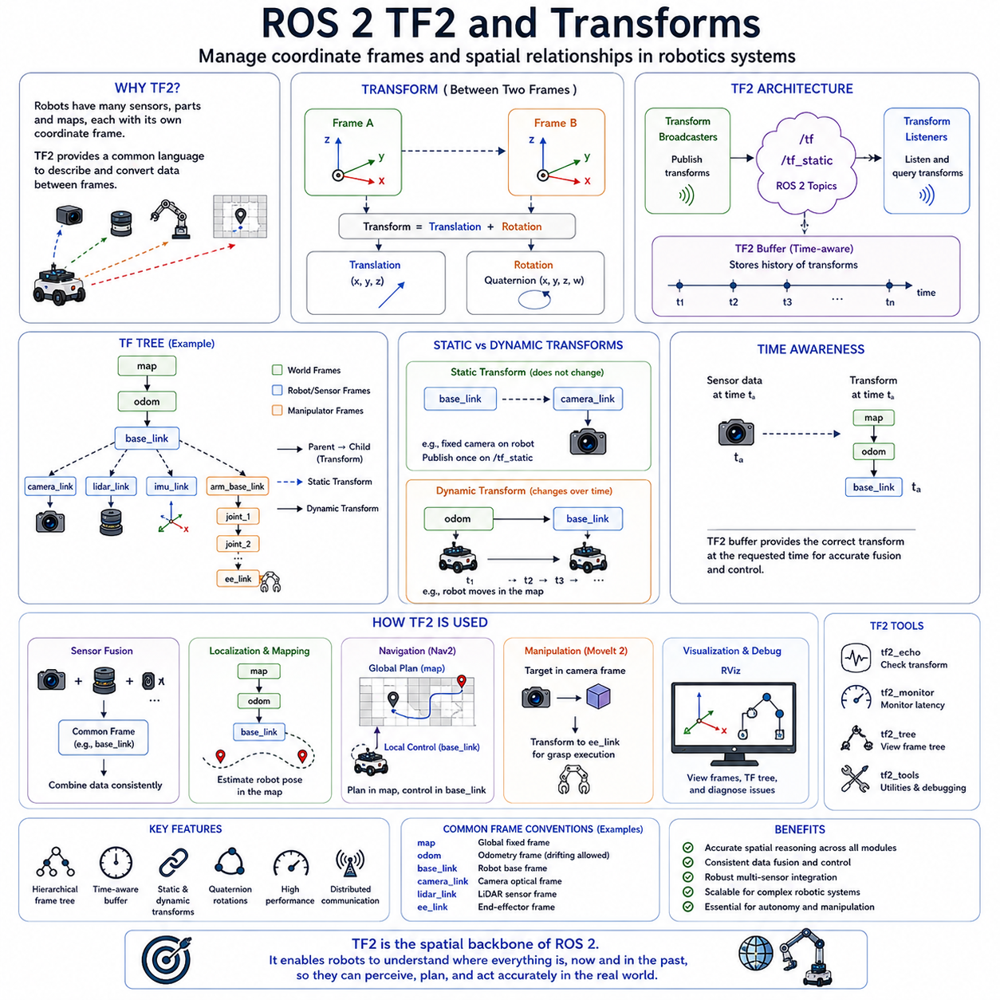{width="7.268055555555556in" height="7.268055555555556in"}

One of the most fundamental challenges in robotics is understanding where things are located relative to one another. A robot must continuously determine the positions and orientations of its sensors, actuators, tools, objects, obstacles, and target destinations within a shared spatial context. Cameras observe the world from one viewpoint, LiDAR sensors measure distances from another position, robotic arms operate within their own coordinate systems, and navigation systems calculate motion relative to maps and robot bases. Without a unified mechanism for managing these spatial relationships, robotic systems would be unable to integrate sensor information, perform accurate localization, plan movements, or interact effectively with their environments.

ROS 2 addresses this challenge through TF2, a specialized transformation framework that manages coordinate frames and spatial relationships throughout a robotic system. TF2 provides the infrastructure necessary for representing, storing, broadcasting, querying, and transforming coordinate information between different reference frames. It serves as one of the most important foundational technologies in modern robotics because nearly every subsystem depends on accurate spatial information.

The concept of coordinate frames lies at the heart of TF2. A coordinate frame represents a reference system used to describe positions and orientations in space. Every sensor, actuator, robot component, and environmental reference point may have its own coordinate frame. A camera frame describes positions relative to the camera. A LiDAR frame describes measurements relative to the LiDAR sensor. A robot base frame describes locations relative to the robot chassis. A map frame describes global locations within the operating environment.

Each coordinate frame consists of an origin and an orientation. The origin defines a reference position, while the orientation defines how the coordinate axes are aligned. Together, these properties establish a complete spatial reference system. When a sensor reports the position of an object, that position is always expressed relative to a particular coordinate frame.

Consider a mobile manipulator operating inside a warehouse. A camera mounted on the robot detects a box located two meters in front of the camera. The robot arm must grasp the box. However, the arm controller operates relative to the manipulator base frame rather than the camera frame. Navigation systems operate relative to the robot base frame. Localization systems operate relative to the map frame. To perform successful manipulation, the detected object position must be transformed through multiple coordinate frames before reaching the arm controller. TF2 manages this entire process automatically.

The need for coordinate transformations arises because robotic systems consist of many interconnected subsystems. Each subsystem naturally operates within its own local reference frame. Sensors measure information relative to their mounting locations. Controllers compute motions relative to actuator frames. Navigation systems reason about movement relative to maps. Human operators may specify targets relative to global coordinates. TF2 provides the common language that allows these subsystems to communicate spatial information consistently.

A transformation describes the mathematical relationship between two coordinate frames. Specifically, it defines both translation and rotation. Translation specifies how far one frame is displaced from another, while rotation specifies how their orientations differ. Together, these properties allow positions and orientations to be converted accurately between frames.

TF2 represents transformations using translation vectors and quaternion-based rotations. Quaternions are widely used in robotics because they provide stable and efficient representations of three-dimensional orientation. Unlike Euler angles, quaternions avoid singularities such as gimbal lock and support smooth interpolation between orientations. This makes them particularly suitable for dynamic robotic applications involving continuous motion.

The architecture of TF2 is built around a transformation tree. Every coordinate frame exists as a node within a hierarchical tree structure, and transformations define the relationships between parent and child frames. This structure ensures that any frame can be related to any other frame through a sequence of transformations.

A typical mobile robot may contain a hierarchy consisting of map, odom, base_link, camera_link, lidar_link, imu_link, and manipulator frames. The map frame represents the global environment. The odom frame represents local odometry information. The base_link frame represents the robot chassis. Sensor frames represent individual sensing devices. Manipulator frames represent joints and end effectors. Together, these frames form a complete spatial representation of the robot and its environment.

One of the key design principles of TF2 is that each frame has only one parent. This constraint prevents ambiguity and ensures that unique transformation paths exist throughout the transformation tree. As a result, spatial relationships remain mathematically consistent and computationally efficient.

TF2 differentiates between static and dynamic transformations. Static transformations represent relationships that never change. For example, the position of a camera mounted rigidly on a robot chassis remains fixed relative to the robot base. Similarly, the mounting position of a LiDAR sensor or IMU generally remains constant throughout operation.

Static transformations are typically published once and reused indefinitely. Because they remain unchanged, TF2 can store them efficiently and distribute them throughout the system with minimal communication overhead.

Dynamic transformations represent relationships that change over time. The robot base frame moves relative to the map frame as the robot navigates through the environment. Manipulator joints move relative to one another during motion. Mobile sensor platforms continuously change their positions. Dynamic transformations must therefore be updated continuously to reflect current system states.

TF2 maintains a time-aware transformation buffer that stores transformation histories. This capability is critically important because robotic systems operate asynchronously. Sensor measurements may arrive at different times, communication delays may occur, and computations may require historical data. By preserving transformation histories, TF2 enables spatial queries at specific points in time.

Time synchronization represents one of the most important advantages of TF2. Consider a camera image captured at one instant and a localization estimate computed slightly later. Without temporal awareness, coordinate transformations might be applied incorrectly, leading to spatial inaccuracies. TF2 allows transformations to be retrieved according to the exact timestamps associated with sensor measurements.

This capability is particularly important in high-speed robotics applications. Autonomous vehicles, drones, industrial manipulators, and warehouse robots often operate in dynamic environments where even small timing errors can produce significant spatial inaccuracies. TF2 ensures that coordinate transformations remain consistent across time.

The TF2 communication architecture relies primarily on specialized ROS topics. Transformations are broadcast continuously by nodes responsible for generating spatial information. Other nodes subscribe to transformation updates and maintain local transformation buffers. This distributed approach allows spatial information to be shared efficiently across the entire robotic system.

Transform broadcasters are responsible for publishing transformation data. A localization node may broadcast the transformation between map and odom frames. An odometry node may publish transformations between odom and base_link. A robot state publisher may broadcast joint transformations for manipulator kinematics. Each component contributes information to the overall transformation tree.

Transform listeners consume transformation data and perform coordinate conversions. A perception system may transform detected object positions from a camera frame into the robot base frame. A navigation system may convert target positions from map coordinates into local motion commands. Manipulation systems may transform grasp targets into end-effector reference frames.

One of the most common uses of TF2 is sensor fusion. Modern robotic systems frequently combine information from multiple sensing modalities including cameras, LiDARs, IMUs, GNSS receivers, depth sensors, radar systems, and force sensors. Each sensor reports data relative to its own coordinate frame.

To integrate these observations effectively, all measurements must be transformed into a common reference frame. TF2 provides the infrastructure necessary for performing these transformations accurately and efficiently. As a result, sensor fusion algorithms can operate on spatially consistent information.

Localization systems depend heavily on TF2. Simultaneous Localization and Mapping (SLAM) algorithms estimate robot position relative to environmental maps. Localization modules continuously update transformations between map, odom, and robot base frames. Navigation systems then use these transformations to determine where the robot is located and how it should move toward desired destinations.

Navigation frameworks such as Nav2 rely extensively on TF2. Path planning algorithms generate trajectories in map coordinates. Controllers execute movements relative to the robot base frame. Obstacle information may originate from LiDAR or camera frames. TF2 enables all these spatial representations to coexist within a unified coordinate framework.

Manipulation systems represent another major application area. Robotic arms consist of multiple joints connected through kinematic chains. Each joint introduces a transformation relative to adjacent links. End-effector positions depend on the cumulative effect of all joint transformations.

MoveIt 2 and other manipulation frameworks use TF2 extensively to calculate forward kinematics, inverse kinematics, collision checking, trajectory planning, and grasp execution. Without accurate transformation management, precise manipulation would be impossible.

Mobile manipulators demonstrate the full power of TF2 integration. These systems combine autonomous mobility with robotic manipulation. The navigation subsystem must understand robot position within the environment. The perception subsystem must detect objects relative to sensors. The manipulation subsystem must execute grasps relative to the robot arm.

TF2 connects these subsystems by maintaining a consistent transformation graph across all coordinate frames. An object detected by a camera can be transformed into map coordinates for task planning and subsequently converted into manipulator coordinates for grasp execution. This seamless integration enables sophisticated autonomous behaviors.

Robot State Publisher is an important ROS 2 component associated with TF2. It reads robot descriptions from URDF models and automatically publishes transformations corresponding to robot kinematic structures. This automation simplifies transformation management and ensures consistency between robot models and operational systems.

The URDF model defines links and joints that describe robot geometry. Robot State Publisher converts these descriptions into dynamic TF2 transformations based on current joint states. Consequently, the complete robot structure becomes available throughout the transformation tree.

Visualization tools provide valuable insight into transformation relationships. RViz can display coordinate frames, transformation trees, sensor data, robot models, and environmental information. Developers can inspect frame relationships visually and identify transformation errors during system development and debugging.

TF2 also includes diagnostic and debugging utilities. Developers can inspect transformation trees, monitor frame relationships, identify missing transformations, measure communication latency, and verify temporal consistency. These tools are invaluable when developing complex robotic systems.

Performance considerations are important in large-scale robotic deployments. A modern mobile manipulator may contain dozens of coordinate frames and thousands of transformation updates per second. Autonomous fleets may manage hundreds of robots simultaneously. TF2 is designed to scale efficiently while maintaining low-latency access to transformation information.

Cloud robotics and digital twin systems further increase the importance of transformation management. Virtual environments must remain synchronized with physical robots. Remote operators require accurate spatial representations. AI systems need consistent world models. TF2 provides the spatial infrastructure necessary for maintaining these relationships.

The emergence of embodied AI introduces additional demands on transformation systems. Future robots will combine perception, reasoning, planning, manipulation, and mobility within unified cognitive architectures. These capabilities depend fundamentally on accurate spatial understanding. Large language models, vision-language models, and robot foundation models ultimately require consistent representations of physical space in order to interact effectively with the real world.

TF2 provides this foundational spatial framework. By managing coordinate frames, maintaining transformation histories, supporting temporal consistency, and enabling efficient coordinate conversions, TF2 serves as the geometric backbone of ROS 2 robotics systems.

Within mobile manipulation architectures, TF2 underpins perception, localization, navigation, mapping, manipulation, sensor fusion, digital twins, simulation, remote operations, and AI integration. Virtually every subsystem depends on coordinate transformations at some level. Understanding TF2 is therefore essential for anyone developing advanced robotic systems.

As robots become more autonomous, more intelligent, and more integrated into complex operational environments, the importance of transformation management will continue to grow. TF2 represents one of the most critical infrastructural technologies in ROS 2 because it provides the spatial consistency necessary for intelligent behavior. Without TF2, robotic systems would lack the common coordinate framework required to perceive, understand, and interact with the physical world. For this reason, TF2 remains a foundational pillar of modern robotics software architecture and an indispensable component of next-generation autonomous and embodied AI systems.

## 07 URDF and Xacro

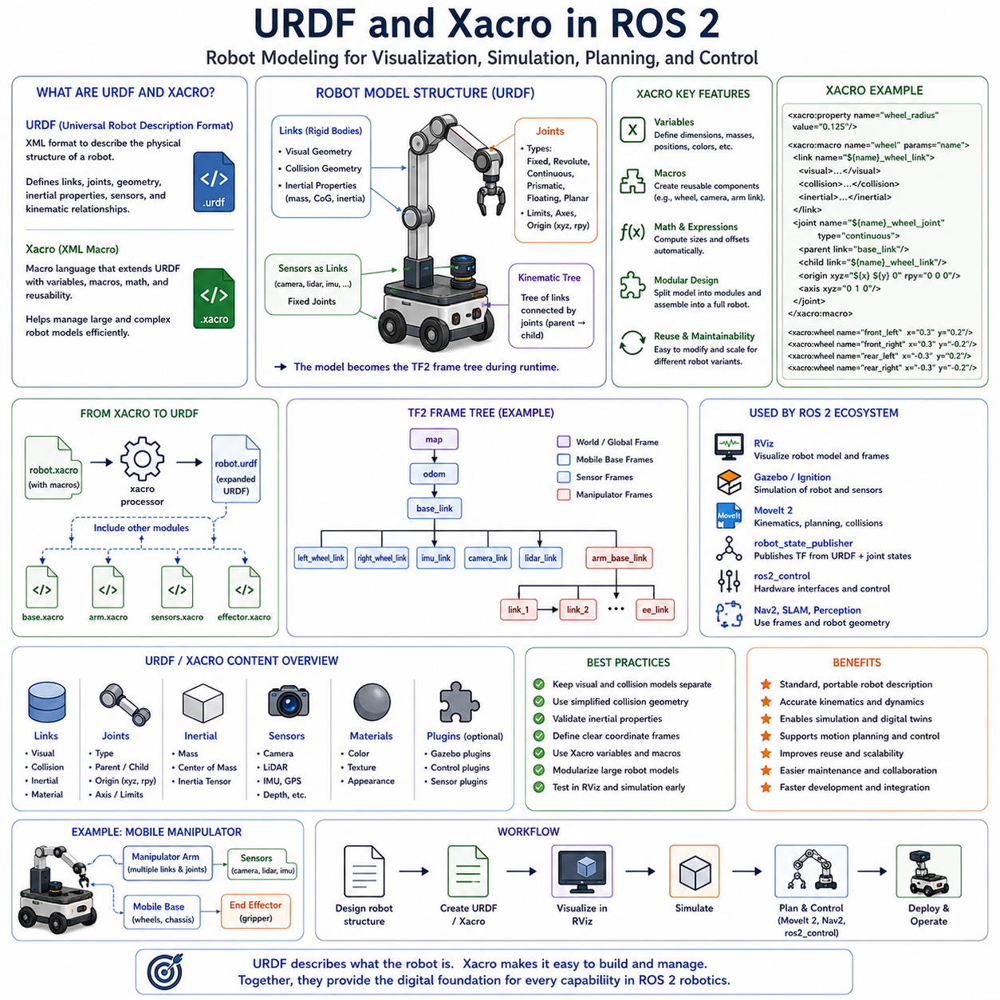{width="7.268055555555556in" height="7.268055555555556in"}

Universal Robot Description Format (URDF) and XML Macro (Xacro) are among the most important modeling technologies within the ROS 2 ecosystem. Every modern robotic system requires a digital representation of its physical structure before software can perform visualization, simulation, motion planning, collision checking, kinematic analysis, sensor integration, or autonomous operation. URDF provides the standard method for describing robot geometry, kinematics, dynamics, sensors, and physical relationships, while Xacro extends URDF with reusable and parameterized modeling capabilities. Together, they form the foundation of robot modeling throughout ROS 2-based systems. Their importance is particularly evident in mobile manipulators, autonomous mobile robots, industrial robotic arms, service robots, humanoids, and embodied AI platforms, where accurate digital representations are essential for both development and deployment.

Before a robot can navigate, manipulate objects, perceive its environment, or interact with humans, software must understand the robot's physical structure. The robot controller must know where each joint is located, how links are connected, where sensors are mounted, what dimensions each component possesses, and how the entire mechanical structure moves. This information forms the robot model. Without a robot model, advanced software frameworks such as TF2, MoveIt 2, Nav2, Gazebo, Isaac Sim, RViz, and digital twin systems cannot function correctly.

Historically, robot models were often implemented through custom software code or proprietary formats. Such approaches created interoperability challenges and made software reuse difficult. ROS introduced URDF as a standardized robot description language capable of representing robotic structures in a vendor-independent manner. Since then, URDF has become one of the most widely adopted robot modeling standards in research, industry, and commercial robotics.

URDF is an XML-based format used to describe the physical structure of a robot. The model consists primarily of links and joints. A link represents a rigid body such as a chassis, arm segment, wheel, sensor housing, gripper body, or tool attachment. A joint represents a movable or fixed connection between two links. By connecting links through joints, a complete kinematic structure can be defined.

The fundamental philosophy behind URDF is that a robot can be represented as a tree of rigid bodies connected through joints. Each link has geometric properties, visual properties, collision properties, and optionally inertial properties. Each joint defines the spatial relationship and movement constraints between parent and child links.

A mobile manipulator provides an excellent example of this structure. The robot chassis forms the base link. Wheels connect to the chassis through wheel joints. The robotic arm attaches to the chassis through a mounting joint. Each arm segment is represented by a link connected through revolute joints. The end-effector is attached at the final link. Sensors such as cameras, LiDARs, IMUs, and depth sensors are represented as additional links connected through fixed joints.

Links serve as the building blocks of the robot model. Each link represents a rigid object whose geometry remains unchanged during operation. A link may define visual geometry used for rendering in visualization tools. It may also define collision geometry used for collision detection and motion planning. Additionally, inertial properties can be specified to support dynamic simulation.

Visual geometry determines how the robot appears in visualization environments such as RViz and simulation platforms. Collision geometry provides simplified representations used by planning algorithms and physics engines. These collision models are often less detailed than visual models to improve computational efficiency.

Inertial properties describe mass distribution within each link. Parameters such as mass, center of gravity, and inertia tensors are specified. These values are essential for dynamic simulation, force analysis, control design, and physics-based modeling. Without accurate inertial information, simulation results may deviate significantly from real-world behavior.

Joints define how links are connected and how they move relative to one another. Several joint types are supported within URDF. Fixed joints represent rigid connections that do not move. Revolute joints represent rotational motion within specified limits. Continuous joints allow unlimited rotation. Prismatic joints support linear translation. Floating joints provide six degrees of freedom, while planar joints support motion within a two-dimensional plane.

The choice of joint type depends upon the mechanical design of the robot. Wheel rotations are commonly represented by continuous joints. Robotic arm joints typically use revolute joints with angular limits. Linear actuators may use prismatic joints. Sensor mounting brackets frequently use fixed joints.

Joint definitions include transformation information describing the relationship between parent and child links. These transformations define position and orientation offsets that establish the robot's kinematic structure. Together, all joint transformations form the basis of forward and inverse kinematic calculations.

The robot model generated by URDF serves as the foundation for TF2 transformation trees. Each joint corresponds to a transformation between coordinate frames. As joint positions change during operation, TF2 continuously updates the associated coordinate transformations. Consequently, the robot's spatial structure remains synchronized throughout the ROS 2 ecosystem.

One of the most important applications of URDF is visualization. RViz uses robot descriptions to display robot models in three-dimensional environments. Developers can inspect robot geometry, verify coordinate frame alignment, visualize sensor placement, and validate kinematic structures. Visualization often represents the first step in verifying that a robot model has been constructed correctly.

Simulation environments also depend heavily on URDF. Platforms such as Gazebo, Ignition Gazebo, Isaac Sim, and Webots import robot descriptions to generate virtual representations of physical robots. Sensors, actuators, joints, and physical structures are instantiated automatically from the model. This capability enables simulation-driven development and digital twin creation.

Motion planning systems such as MoveIt 2 require accurate robot descriptions to perform kinematic analysis, collision checking, trajectory generation, and manipulation planning. The planning framework uses URDF information to understand joint limits, link relationships, workspace constraints, and collision geometries.

Mobile manipulators particularly benefit from detailed robot modeling because they combine autonomous mobility with robotic manipulation. The mobile base, robotic arm, sensor systems, and end effectors must all be represented accurately within a unified model. Motion planners rely upon this information to coordinate navigation and manipulation activities safely and efficiently.

Although URDF provides a powerful modeling framework, large robot descriptions can become difficult to maintain. Industrial robots, humanoids, and mobile manipulators often contain dozens or hundreds of links and joints. Repetitive structures, parameter variations, and hardware configurations can lead to extremely large XML files that are difficult to manage manually.

Xacro was introduced to address these challenges. Xacro, which stands for XML Macro, extends URDF by providing parameterization, macros, variables, mathematical expressions, reusable components, and modular design capabilities. Rather than writing repetitive XML code directly, developers can define reusable templates that generate URDF automatically.

The primary objective of Xacro is reducing duplication and improving maintainability. A wheel assembly may appear four times within a mobile robot. Instead of manually defining each wheel, developers can create a wheel macro and instantiate it multiple times with different parameters. Similarly, robotic arm segments, sensor mounts, and actuator modules can be reused throughout the model.

Variables represent one of the most powerful Xacro features. Developers can define dimensions, masses, colors, sensor positions, wheel diameters, link lengths, and other parameters as variables. Changing a variable automatically updates every component that depends upon it. This capability dramatically simplifies design iteration.

For example, a mobile robot platform may exist in multiple size configurations. A developer can define chassis dimensions as variables and generate different robot models simply by changing parameter values. The same Xacro structure can produce compact indoor robots, medium warehouse robots, or large outdoor autonomous vehicles.

Mathematical expressions further enhance modeling flexibility. Geometric relationships can be calculated automatically rather than entered manually. Wheel spacing, sensor placement, arm offsets, and structural dimensions can be derived from higher-level design parameters. This reduces errors and improves consistency throughout the model.

Macros enable reusable robot components. A camera mounting assembly may include a camera body, housing, mounting bracket, coordinate frame, collision geometry, and sensor plugin definitions. By encapsulating this structure within a macro, developers can reuse it across multiple robot designs without duplication.

Large robotic systems often benefit from modular Xacro architectures. Rather than storing the entire robot model within a single file, developers can divide the model into multiple reusable modules. Separate files may describe the mobile base, manipulator arm, sensor suite, battery system, end effector, and simulation plugins. These modules can then be assembled into complete robot descriptions.

This modular approach aligns closely with modern software engineering practices. Individual teams can develop separate robot subsystems independently while maintaining compatibility through shared interfaces. The resulting architecture improves maintainability and scalability.

Sensor integration represents another major application of URDF and Xacro. Cameras, LiDARs, IMUs, GNSS receivers, radar systems, depth sensors, microphones, and force-torque sensors can all be represented within the robot model. Sensor coordinate frames become part of the TF2 transformation tree, enabling consistent spatial relationships throughout the system.

Simulation environments frequently extend URDF using plugins and additional configuration elements. Sensor simulation parameters, controller interfaces, physics properties, and middleware integrations may be specified through simulation-specific extensions. Xacro simplifies management of these complex configurations through parameterization and modularization.

Robot State Publisher plays a critical role in connecting URDF models with runtime operations. It reads robot descriptions and publishes coordinate transformations corresponding to the robot's kinematic structure. Joint state updates generated by controllers continuously update the transformation tree, ensuring consistency between physical motion and software representations.

Digital twin systems rely heavily on accurate robot descriptions. A digital twin must replicate the geometry, kinematics, sensors, and operational characteristics of the physical robot. URDF and Xacro provide the foundation upon which virtual replicas are constructed. These virtual models support simulation, testing, monitoring, optimization, and predictive maintenance.

The emergence of embodied AI further increases the importance of robot modeling. Future AI systems must reason about physical structures, sensor placements, manipulation capabilities, workspace constraints, and environmental interactions. Accurate robot models provide the geometric and kinematic context necessary for intelligent decision-making.

Humanoid robots illustrate the complexity of modern robot descriptions. Hundreds of coordinate frames, numerous sensors, articulated limbs, dexterous hands, and sophisticated locomotion systems must be represented accurately. Xacro enables these highly complex models to remain maintainable and adaptable throughout development.

Mobile manipulators developed for logistics, healthcare, manufacturing, inspection, and service robotics similarly require extensive modeling efforts. The mobile platform, manipulator arm, perception systems, safety sensors, communication hardware, and tool attachments must all be integrated within a unified robot description. URDF and Xacro provide the structure necessary to manage this complexity effectively.

Best practices for URDF and Xacro development emphasize modularity, parameterization, consistency, and maintainability. Visual geometry should remain separate from collision geometry. Inertial properties should be validated carefully. Sensor frames should be defined explicitly. Reusable components should be encapsulated within macros. Large systems should be organized into logical subsystems rather than monolithic files.

As ROS 2 continues evolving toward larger robotic fleets, cloud-connected systems, digital twins, and embodied AI platforms, the importance of standardized robot descriptions will continue to increase. URDF provides the common language for describing robot structures, while Xacro provides the engineering tools necessary to manage complexity.

Together, URDF and Xacro form the foundation of robot modeling throughout the ROS 2 ecosystem. They connect mechanical design, kinematic analysis, simulation, visualization, motion planning, sensor integration, digital twins, and AI-driven robotics into a unified framework. For developers building mobile manipulators, autonomous robots, industrial automation systems, or future embodied AI platforms, mastery of URDF and Xacro represents an essential step toward creating scalable, maintainable, and production-ready robotic systems.

## 08 ROS2 Control

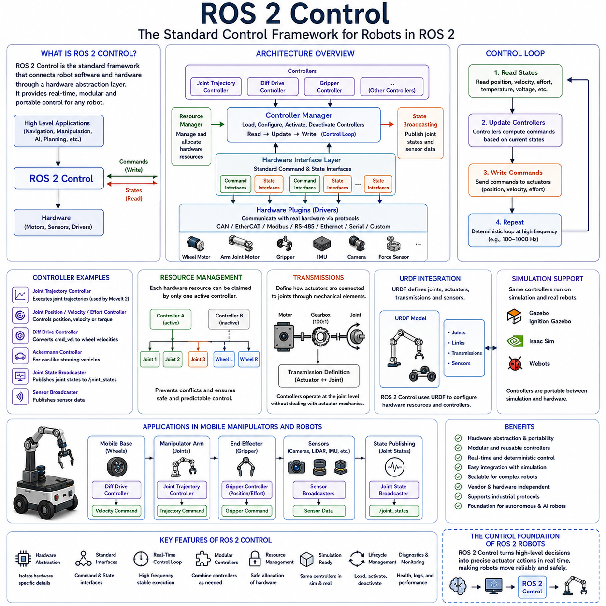{width="7.268055555555556in" height="7.268055555555556in"}

ROS 2 Control is the standard hardware abstraction and robot control framework within the ROS 2 ecosystem. It provides a unified architecture for connecting software controllers to physical hardware while maintaining portability, scalability, modularity, and real-time performance. As robotic systems continue to evolve from simple laboratory platforms into complex industrial, logistics, medical, agricultural, and autonomous systems, the need for a standardized control infrastructure becomes increasingly important. ROS 2 Control was designed to address this requirement by establishing a common framework through which robot hardware, actuators, sensors, controllers, simulators, and higher-level applications can interact consistently.

At its core, ROS 2 Control acts as a bridge between robot software and robot hardware. High-level applications such as navigation, manipulation, perception, fleet management, and autonomous decision-making generate commands that must ultimately be translated into low-level actuator signals. At the same time, hardware devices continuously produce feedback information that must be propagated back into the software system. ROS 2 Control manages this bidirectional information flow while maintaining clear separation between hardware-specific implementations and application-level functionality.

Traditional robot control architectures often relied on custom drivers tightly coupled to specific hardware platforms. Each robot manufacturer developed proprietary interfaces, and software components frequently depended on vendor-specific implementations. This approach created significant integration challenges, increased development costs, and reduced software reusability. ROS 2 Control addresses these limitations by introducing standardized interfaces that allow controllers and hardware devices to interact through common abstractions.

One of the fundamental principles behind ROS 2 Control is hardware abstraction. Rather than requiring controllers to understand the details of motor drivers, encoders, servo amplifiers, or industrial fieldbus protocols, the framework exposes standardized interfaces representing robot resources. Controllers interact with abstract command and state interfaces, while hardware plugins handle device-specific communication behind the scenes.

This separation provides substantial benefits. A motion controller developed for one robot platform can often be reused on another platform with minimal modification. Hardware can be upgraded or replaced without redesigning higher-level software. Simulation and physical deployment can share the same controller architecture. These capabilities significantly improve maintainability and portability.

The architecture of ROS 2 Control consists primarily of hardware interfaces, controllers, controller managers, resource managers, and transmission systems. Together, these components form a layered control framework capable of supporting a wide range of robotic applications.

Hardware interfaces represent the lowest level of the architecture. They provide standardized mechanisms through which physical devices expose command and state information. Command interfaces allow software to send control inputs to actuators, while state interfaces provide feedback measurements such as position, velocity, effort, temperature, voltage, current, or sensor readings.

For example, a wheel motor may expose position, velocity, and effort state interfaces while accepting velocity commands. A robotic arm joint may expose angular position and torque information while accepting position or torque commands. Sensors may provide measurement interfaces without accepting commands. ROS 2 Control treats all these resources consistently through standardized abstractions.

Hardware interfaces are typically implemented as plugins. Each plugin communicates with specific hardware devices through protocols such as CAN, EtherCAT, Modbus, RS-485, Ethernet/IP, serial communication, proprietary APIs, or custom embedded firmware. By isolating protocol-specific logic within hardware plugins, the rest of the system remains hardware-independent.

The Controller Manager serves as the central orchestration component within ROS 2 Control. It loads, configures, activates, deactivates, and unloads controllers dynamically. The Controller Manager also coordinates periodic update cycles that synchronize hardware communication with controller execution.

During each control cycle, the Controller Manager reads state information from hardware interfaces, updates active controllers, and writes command outputs back to hardware devices. This deterministic loop forms the foundation of robot control operations. The timing characteristics of this loop directly influence system performance, responsiveness, and stability.

Real-time behavior is a critical consideration in robotics. Mobile robots, industrial manipulators, humanoids, autonomous vehicles, and precision automation systems often require deterministic control loops operating at frequencies ranging from tens to thousands of Hertz. ROS 2 Control is designed to support real-time execution by minimizing latency, reducing dynamic memory allocation, and promoting predictable execution behavior.

Controllers represent the functional intelligence of the control framework. A controller receives state information, performs computations, and generates command outputs. Different controllers serve different purposes depending on application requirements.

Position controllers regulate actuator positions. Velocity controllers regulate motion speeds. Effort controllers manage torque or force outputs. Trajectory controllers execute predefined motion trajectories. Differential drive controllers manage mobile robot locomotion. Ackermann controllers support autonomous vehicles. Joint state broadcasters publish robot state information. Sensor broadcasters distribute sensor measurements.

Each controller operates independently while interacting through standardized interfaces. This modular design allows developers to combine controllers according to specific application requirements. A mobile manipulator may simultaneously operate wheel controllers, arm controllers, gripper controllers, sensor broadcasters, and state publishers within a unified control architecture.

The Joint Trajectory Controller is among the most widely used ROS 2 Control components. It receives desired joint trajectories and generates commands that guide actuators along those trajectories. MoveIt 2 frequently utilizes this controller when executing robotic manipulation tasks. The controller continuously monitors current joint states and computes appropriate control outputs to achieve desired motion objectives.

Mobile robot applications frequently utilize the Differential Drive Controller. This controller translates high-level velocity commands into wheel velocities appropriate for differential drive platforms. Navigation systems generate desired linear and angular velocities, while the controller computes individual wheel commands required to achieve those motions.

Similarly, Ackermann Steering Controllers support car-like autonomous vehicles. These controllers convert vehicle motion commands into steering angles and wheel velocities while respecting vehicle kinematic constraints.

Resource management is another important aspect of ROS 2 Control. Multiple controllers may compete for access to shared hardware resources. For example, two controllers cannot simultaneously command the same actuator without creating conflicts. ROS 2 Control manages resource allocation and ensures that hardware resources remain under the control of only one active controller at a time.

This capability becomes especially important in complex robotic systems. Mobile manipulators, humanoids, and industrial automation platforms often contain numerous actuators, sensors, and controllers operating simultaneously. Resource management ensures safe and predictable system behavior.

The concept of transmissions plays an important role in connecting actuator outputs to joint motions. In many robotic systems, actuators are not directly attached to joints. Gearboxes, belts, pulleys, lead screws, harmonic drives, and other mechanical transmission elements modify motion and force characteristics. Transmission definitions describe these relationships and allow controllers to operate at the joint level rather than dealing directly with actuator mechanics.

URDF and ROS 2 Control are closely integrated. Robot descriptions define joints, actuators, transmissions, sensors, and hardware interfaces. These definitions provide the information necessary for controller configuration and resource allocation. As a result, robot models and control architectures remain synchronized throughout the development lifecycle.

Simulation support represents one of the most powerful advantages of ROS 2 Control. Modern robotic development increasingly relies on simulation-driven workflows. Gazebo, Ignition Gazebo, Isaac Sim, Webots, and digital twin platforms can integrate directly with ROS 2 Control. Controllers operate identically whether connected to simulated hardware or physical hardware.

This capability dramatically accelerates development. Engineers can design, test, tune, and validate controllers within simulation environments before deploying them to real robots. Once validated, the same controller configurations can often be transferred directly to physical systems.

Mobile manipulators provide an excellent example of the value of ROS 2 Control. These systems combine autonomous mobility, robotic manipulation, perception, and AI-based decision-making. The mobile base may utilize wheel controllers, the robotic arm may employ trajectory controllers, the gripper may use position controllers, and sensors may publish state information through broadcaster interfaces. ROS 2 Control unifies these diverse components within a common framework.

Industrial robotics applications place particularly demanding requirements on control systems. High precision, deterministic timing, safety compliance, fault tolerance, and continuous operation are essential. ROS 2 Control supports these requirements through standardized interfaces, real-time design principles, and integration with industrial communication technologies.

Safety is another critical consideration. Emergency stop systems, safety-rated controllers, fault monitoring, operational limits, and hardware interlocks frequently interact with robot control architectures. ROS 2 Control enables integration of safety mechanisms while maintaining separation between safety logic and application-level functionality.

Cloud robotics and fleet management systems increasingly interact with robot control layers. Fleet managers assign tasks, navigation systems generate trajectories, digital twins monitor operations, and AI planners make decisions. Eventually, these high-level instructions must be translated into actuator commands. ROS 2 Control provides the infrastructure through which this translation occurs reliably and consistently.

The rise of embodied AI further increases the importance of standardized control architectures. Future robots will combine perception, reasoning, planning, learning, navigation, manipulation, and human interaction capabilities within unified systems. While AI models may generate high-level decisions, physical execution still depends upon robust control frameworks. ROS 2 Control serves as the final execution layer that converts intelligent decisions into real-world actions.

Consider a warehouse mobile manipulator performing autonomous picking operations. Vision systems identify target objects. AI models determine grasp strategies. Navigation systems generate paths. MoveIt 2 computes manipulation trajectories. ROS 2 Control then translates these trajectories into coordinated motor commands controlling wheels, joints, and grippers. Every physical movement ultimately passes through the control framework.

Controller lifecycle management is also supported within ROS 2 Control. Controllers can be loaded, configured, activated, deactivated, and unloaded dynamically. This capability aligns closely with ROS 2 Lifecycle Nodes and enables sophisticated operational management strategies. Different controllers may be activated according to mission requirements, operational modes, or fault recovery procedures.

Diagnostic and monitoring capabilities are equally important. Controllers continuously generate state information that can be analyzed for performance evaluation, predictive maintenance, anomaly detection, and system health monitoring. Modern robotic systems increasingly depend upon operational visibility, and ROS 2 Control provides the infrastructure necessary for exposing relevant information.

As robotic systems continue expanding into logistics, healthcare, manufacturing, agriculture, defense, inspection, infrastructure management, and embodied AI applications, the need for standardized control frameworks will continue growing. ROS 2 Control addresses this need by providing a unified architecture capable of supporting diverse hardware platforms, simulation environments, controller types, and application domains.

The framework enables separation of concerns between hardware engineers, control engineers, robotics developers, simulation specialists, and AI researchers. Each group can focus on its respective domain while relying upon standardized interfaces for integration. This architectural approach significantly improves scalability and long-term maintainability.

Within modern ROS 2 deployments, ROS 2 Control has become the de facto standard for robot control infrastructure. It forms the foundation upon which locomotion, manipulation, autonomous navigation, sensor integration, digital twins, industrial automation, and embodied intelligence systems are built. Understanding ROS 2 Control is therefore essential for anyone seeking to develop production-grade robotic platforms capable of operating reliably in real-world environments.

As robots become more intelligent, more autonomous, and more interconnected, ROS 2 Control will remain a critical component of the robotics software stack. Its hardware abstraction model, controller architecture, real-time capabilities, simulation integration, and modular design provide the control foundation necessary for the next generation of autonomous robotic systems. For developers building mobile manipulators, autonomous vehicles, industrial robots, or future embodied AI platforms, mastery of ROS 2 Control represents a crucial step toward creating scalable, reliable, and deployable robotic solutions.

## 09 Component Composition

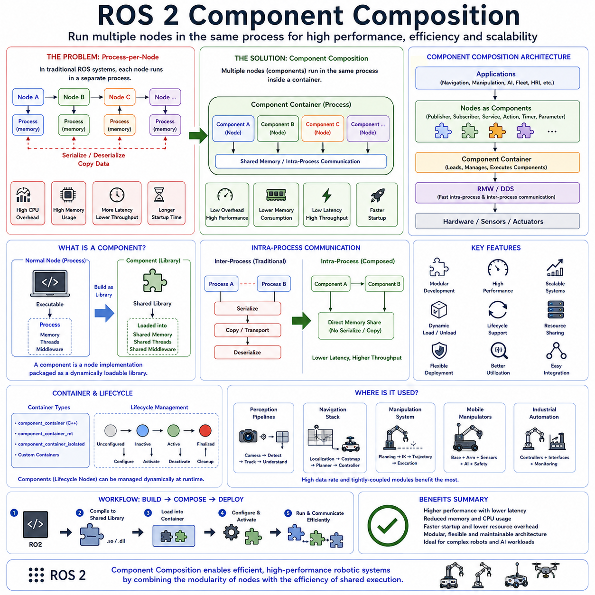{width="7.268055555555556in" height="7.268055555555556in"}

Component Composition is one of the most important architectural capabilities introduced in ROS 2 to improve performance, scalability, maintainability, and resource efficiency. As robotic systems become increasingly complex, a single robot may execute dozens or even hundreds of software nodes simultaneously. These nodes handle perception, localization, navigation, manipulation, planning, communication, diagnostics, fleet management, artificial intelligence, and human-robot interaction. In traditional ROS architectures, each node operates as an independent process. While this design offers simplicity and isolation, it also introduces communication overhead, increased memory consumption, longer startup times, and reduced computational efficiency. ROS 2 Component Composition was developed to overcome these limitations by enabling multiple nodes to execute within a shared process while preserving modular software design principles.

To understand the significance of Component Composition, it is useful to first examine the traditional ROS node model. In ROS 1 and conventional ROS 2 deployments, each node typically runs as a separate operating system process. Every node maintains its own memory space, thread management, communication stack, and runtime resources. When nodes exchange data, information must pass through middleware layers, serialization mechanisms, inter-process communication channels, and operating system scheduling structures.

This architecture provides excellent fault isolation. If one node crashes, other nodes may continue operating. Development and debugging are also straightforward because each node behaves as an independent executable application. However, as robotic systems scale in complexity, the disadvantages become increasingly significant.

Modern autonomous robots generate enormous amounts of data. High-resolution cameras produce image streams at tens or hundreds of megabytes per second. LiDAR sensors generate dense point clouds. AI inference engines process neural network outputs. Localization systems continuously update robot pose estimates. Navigation systems exchange maps, trajectories, and obstacle information. When these data streams move between separate processes, significant computational resources are consumed by message serialization, copying, memory allocation, and operating system context switching.

Consider a perception pipeline consisting of camera acquisition, image preprocessing, object detection, object tracking, and scene understanding modules. In a traditional process-based architecture, each stage may run as a separate node. Every image frame must be serialized, transmitted, deserialized, copied into memory, processed, and then transmitted again to the next stage. The computational overhead accumulates rapidly.

Component Composition addresses this issue by allowing multiple nodes to execute within the same process. Rather than launching independent executables, nodes are compiled as reusable software components that can be dynamically loaded into a shared runtime environment. Since components operate within the same process space, they can exchange information more efficiently while maintaining logical separation.

The core concept behind Component Composition is the component. A component is essentially a ROS 2 node packaged as a dynamically loadable library rather than a standalone executable. Each component retains all the functionality of a normal node, including publishers, subscribers, services, actions, parameters, timers, and lifecycle management capabilities. The primary difference lies in how the node is deployed and executed.

Instead of starting an executable file, a component is loaded into a container process. Multiple components may coexist within the same container. Once loaded, they operate similarly to ordinary ROS nodes while sharing process-level resources.

The container serves as the execution environment for components. ROS 2 provides several container implementations capable of dynamically loading, unloading, and managing component libraries at runtime. The container is responsible for instantiating components, allocating resources, managing execution contexts, and coordinating interactions between loaded modules.

One of the most important advantages of Component Composition is reduced communication overhead. When nodes reside in separate processes, communication generally requires serialization and deserialization. Messages are converted into middleware formats, transmitted through communication layers, and reconstructed at the receiving side.

Within a composed system, many of these operations can be eliminated. Components can exchange data through direct memory references or optimized intra-process communication mechanisms. This significantly reduces CPU utilization, memory copying, and communication latency.

Intra-process communication is a key enabling technology within Component Composition. ROS 2 provides specialized mechanisms allowing messages to be passed between components without leaving the process boundary. Instead of creating multiple copies of large data structures, components can share references to the same data object.

This capability is particularly important for high-bandwidth sensor data. Camera images, LiDAR point clouds, depth maps, semantic segmentation outputs, and neural network tensors may contain millions of data elements. Eliminating unnecessary memory copies can dramatically improve performance.

Memory efficiency represents another major advantage. Traditional node architectures allocate separate memory resources for each process. Every process maintains its own middleware context, memory pools, thread structures, and communication resources. In large systems, this duplication can become substantial.

Component Composition reduces memory consumption by sharing common infrastructure within a single process. Middleware resources, communication contexts, thread pools, and runtime libraries can often be reused across multiple components. This leads to lower overall memory requirements and improved scalability.

Startup performance also improves significantly. Launching a large robotic application may involve dozens of processes. Process creation, library loading, middleware initialization, and communication discovery all contribute to startup latency. Component-based systems can often initialize more rapidly because components are loaded into existing containers rather than creating entirely new processes.

Modularity remains a central design objective despite shared execution environments. Component Composition does not require developers to abandon modular software engineering practices. Each component remains logically independent and can be developed, tested, documented, versioned, and maintained separately.

This balance between modularity and efficiency is one of the strongest advantages of ROS 2 Component Composition. Developers retain the flexibility of component-based design while benefiting from the performance characteristics of integrated execution.

The ROS 2 component architecture relies heavily on dynamic loading technologies. Components are typically compiled as shared libraries. During runtime, containers load these libraries dynamically and instantiate component objects. This process allows systems to be reconfigured without recompilation.

Dynamic loading enables considerable flexibility. Components can be added, removed, replaced, upgraded, or reconfigured according to operational requirements. Different deployment configurations may utilize the same component libraries in various combinations.

This flexibility is particularly valuable in large robotic systems. Mobile manipulators, warehouse robots, industrial automation systems, autonomous vehicles, and humanoid robots frequently require different operational modes. Component-based architectures allow functionality to be tailored to specific mission requirements.

Lifecycle management integrates naturally with Component Composition. Lifecycle Nodes may be deployed as components and managed within shared containers. This combination provides both operational control and deployment efficiency. Components can be loaded dynamically while retaining structured lifecycle transitions such as configuration, activation, deactivation, cleanup, and shutdown.

The benefits become especially apparent in perception systems. A modern robotic perception pipeline may include image acquisition, camera calibration, image rectification, neural network inference, object tracking, semantic understanding, and sensor fusion. These modules often process large data streams continuously.

By deploying such pipelines as composed components, data can flow efficiently through shared memory structures while preserving modular organization. The resulting system achieves lower latency, reduced CPU usage, and improved throughput.

Autonomous navigation systems also benefit significantly. Localization modules, map servers, costmap generators, path planners, behavior trees, obstacle detectors, and motion controllers frequently exchange large quantities of information. Component Composition reduces communication overhead throughout the navigation stack.

Manipulation systems provide another compelling example. MoveIt 2, robot state publishers, planning scene monitors, collision checkers, inverse kinematics solvers, trajectory generators, and execution managers often interact continuously. Running these modules within composed containers improves responsiveness and resource utilization.

Mobile manipulators combine all these requirements simultaneously. A typical mobile manipulator may include perception pipelines, localization systems, navigation frameworks, manipulation planners, AI inference engines, fleet communication modules, and safety monitoring systems. Component Composition allows these subsystems to be organized efficiently while maintaining modularity.

Real-time robotics applications often require deterministic performance. Communication overhead introduces latency variability that can negatively impact control systems. Component-based architectures reduce such variability by minimizing middleware traversal and memory copying operations.

Industrial automation systems frequently deploy ROS 2 Control alongside Component Composition. Controllers, state publishers, sensor interfaces, diagnostic modules, and monitoring tools can operate within shared execution environments. This architecture supports high-performance control while preserving modular software design.

Cloud robotics and edge computing environments also benefit from Component Composition. Resource-constrained edge devices often have limited CPU and memory capacity. Reducing communication overhead and memory duplication improves system efficiency and allows more functionality to execute on the same hardware.

Artificial intelligence workloads increasingly drive robotic architectures. Computer vision models, large language models, vision-language models, robot foundation models, and embodied AI systems generate substantial computational demands. Efficient software infrastructure becomes essential for maximizing available hardware resources.

Component Composition helps ensure that computational resources are devoted to AI processing rather than unnecessary communication overhead. This advantage becomes increasingly important as robotic intelligence systems grow more sophisticated.

The relationship between Component Composition and executors is also significant. Executors manage callback execution within ROS 2 applications. Composed systems may utilize single-threaded executors, multi-threaded executors, static executors, or custom execution strategies depending on application requirements.

Careful executor selection influences performance, concurrency, responsiveness, and determinism. Advanced deployments often combine Component Composition with customized execution architectures to optimize resource utilization.

Debugging and fault isolation require additional consideration within composed systems. Since multiple components share a process, failures may affect multiple modules simultaneously. Developers must therefore balance performance gains against isolation requirements. In some cases, critical safety functions may remain in separate processes while high-bandwidth processing pipelines utilize composition.

This hybrid deployment strategy is common in production systems. Performance-sensitive modules operate within composed containers, while safety-critical or fault-sensitive modules maintain process-level isolation. ROS 2 supports both approaches simultaneously, allowing architects to choose the most appropriate deployment model for each subsystem.

Security considerations also influence deployment decisions. Shared execution environments require careful management of access control, resource usage, and software integrity. Component-based architectures should be integrated with broader system security strategies to ensure reliable operation.

The emergence of digital twins further increases the importance of efficient software composition. Digital twins replicate robot state, sensor information, operational status, and environmental interactions. Large amounts of information must be exchanged continuously between simulation environments and physical systems. Component Composition helps reduce communication overhead within these complex architectures.

Embodied AI represents perhaps the strongest motivation for advanced software composition techniques. Future robotic systems will integrate perception, reasoning, planning, learning, manipulation, mobility, communication, and human interaction into unified cognitive architectures. Efficient execution becomes essential as software complexity continues increasing.

Component Composition provides one of the key architectural mechanisms enabling this future. By reducing overhead while preserving modularity, it allows increasingly sophisticated robotic systems to scale efficiently.

Within ROS 2, Component Composition has become a foundational technology for high-performance robotic applications. It bridges the gap between traditional process-oriented architectures and modern component-based software engineering practices. The result is a framework capable of supporting demanding workloads while maintaining flexibility, maintainability, and scalability.

For developers building mobile manipulators, autonomous vehicles, industrial robots, warehouse automation systems, digital twins, and future embodied AI platforms, understanding Component Composition is essential. It is not merely an optimization technique but a fundamental architectural approach that enables modern ROS 2 systems to achieve the performance, efficiency, and scalability required for real-world deployment. As robotic applications continue growing in complexity and intelligence, Component Composition will remain a critical pillar of advanced ROS 2 software architecture.

## 10 Multi Robot ROS2

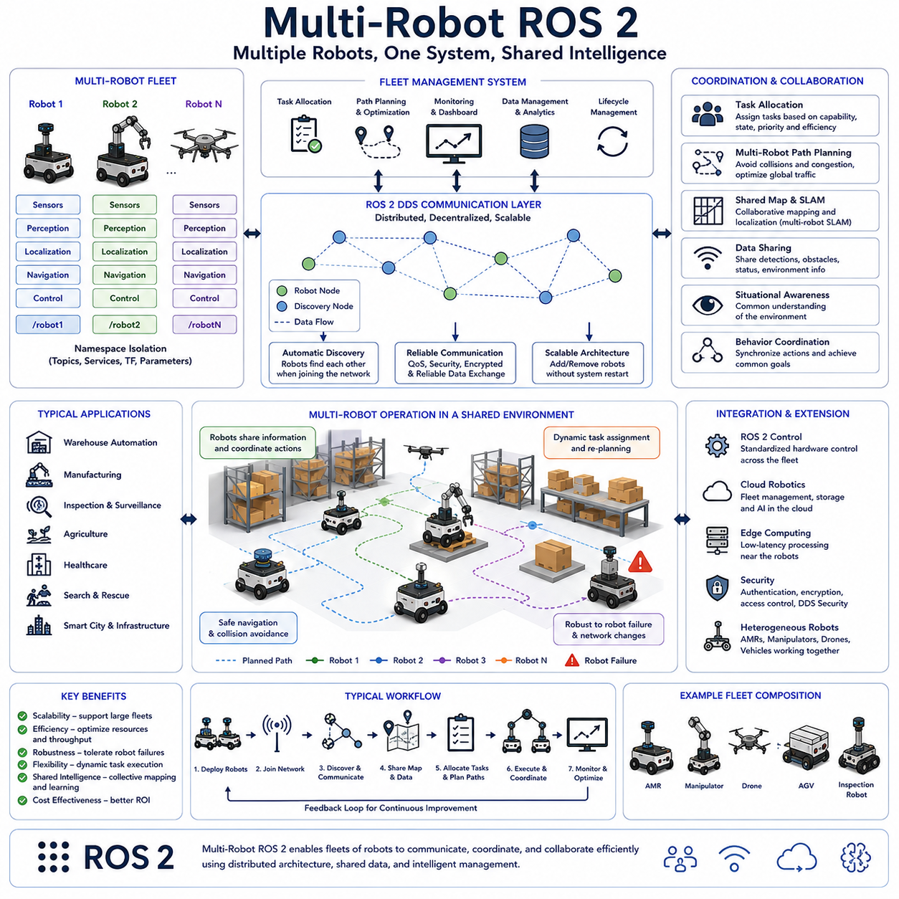{width="7.268055555555556in" height="7.268055555555556in"}

Multi-Robot ROS 2 refers to the architecture, communication framework, coordination mechanisms, and software infrastructure that enable multiple robots to operate simultaneously within a shared environment while collaborating toward common objectives. As robotics systems evolve beyond individual autonomous machines into fleets of intelligent agents, multi-robot systems are becoming increasingly important in logistics, manufacturing, warehousing, healthcare, agriculture, security, infrastructure inspection, smart cities, military operations, and future embodied AI ecosystems. ROS 2 was designed with distributed computing and scalability in mind, making it particularly well suited for multi-robot deployments where dozens, hundreds, or even thousands of robots must communicate and cooperate efficiently.

Traditional robotic systems often focused on a single autonomous robot operating independently. Such systems typically perform perception, planning, navigation, manipulation, and control using onboard resources while interacting minimally with external agents. While this approach remains useful for many applications, modern operational environments increasingly demand coordinated behavior among multiple robots. A single warehouse robot may transport one pallet, but a fleet of robots can optimize entire warehouse operations. A single inspection robot may survey one area, while multiple robots can inspect an entire industrial facility simultaneously. Multi-robot systems therefore offer significant advantages in scalability, efficiency, robustness, coverage, redundancy, and task parallelization.

The transition from single-robot systems to multi-robot systems introduces substantial complexity. Robots must exchange information, coordinate activities, avoid conflicts, share resources, distribute tasks, synchronize actions, and maintain situational awareness across the fleet. Communication architecture becomes a critical component because the effectiveness of the entire system depends upon reliable information exchange.

ROS 2 provides several architectural advantages that make it suitable for multi-robot deployments. Unlike ROS 1, which relied heavily on a centralized ROS Master, ROS 2 utilizes DDS-based distributed communication. Each robot can participate in a decentralized network without requiring a single coordination server for basic communication. This eliminates single points of failure and improves scalability.

DDS discovery mechanisms allow robots to automatically detect and communicate with one another when operating within the same communication domain. This capability greatly simplifies deployment. New robots can join operational environments dynamically without requiring extensive reconfiguration. Similarly, robots can leave the system due to maintenance, battery replacement, or operational constraints without disrupting overall communication infrastructure.

One of the most fundamental concepts in multi-robot ROS 2 systems is namespace management. Every robot contains publishers, subscribers, services, actions, parameters, and coordinate frames. If multiple robots share identical names for these resources, communication conflicts occur. ROS 2 namespaces provide logical separation between robots.

For example, a fleet containing three robots may use namespaces such as /robot1, /robot2, and /robot3. Topics such as /cmd_vel, /scan, /odom, and /camera/image become isolated within each namespace. As a result, navigation commands intended for one robot do not affect other robots. This namespace-based isolation forms the foundation of multi-robot software organization.

Coordinate frame management is equally important. TF2 transformation trees must remain unique for each robot. Every robot typically maintains its own base_link, odom, sensor frames, and manipulation frames. Namespacing TF frames prevents conflicts and ensures that localization, navigation, and manipulation systems operate correctly within multi-robot environments.

The concept of robot identity extends beyond namespaces. Each robot typically possesses unique identifiers, network addresses, operational capabilities, hardware configurations, and mission assignments. Fleet management systems maintain these identities and utilize them when assigning tasks, monitoring status, and coordinating activities.

Communication architectures in multi-robot systems generally fall into several categories. Fully centralized architectures rely upon a central fleet manager that coordinates all robots. Fully decentralized architectures allow robots to communicate directly and make collective decisions. Hybrid architectures combine centralized supervision with decentralized execution. ROS 2 supports all of these approaches.

Centralized fleet management systems are common in logistics and warehouse environments. A fleet manager receives operational requests, assigns tasks, optimizes routes, monitors robot status, and coordinates resource allocation. Individual robots execute assigned tasks while periodically reporting status updates. This architecture simplifies global optimization and operational oversight.

Decentralized architectures are often used in exploration, search-and-rescue, military, and scientific applications. Robots exchange information directly and collectively determine how to accomplish objectives. Such architectures improve fault tolerance because operations can continue even if individual robots fail.

Hybrid architectures frequently represent the most practical solution. Strategic decisions are handled centrally while tactical execution remains distributed. Fleet managers assign objectives, while robots independently navigate, avoid obstacles, and adapt to local environmental conditions.

Task allocation represents one of the most important challenges in multi-robot systems. When multiple robots are available, the system must determine which robot should perform each task. Effective task allocation significantly influences overall efficiency.

Various task allocation strategies exist. Simple systems may assign tasks based on proximity. More sophisticated approaches consider robot capabilities, battery levels, workload distribution, traffic conditions, mission priorities, maintenance schedules, and predicted completion times. Advanced systems may utilize optimization algorithms, auction-based methods, market-based coordination, or AI-driven scheduling mechanisms.

Warehouse automation provides an excellent example. Multiple AMRs may receive transport requests simultaneously. The fleet management system evaluates robot locations, battery states, current workloads, and route availability before assigning tasks. Efficient allocation reduces travel distance, increases throughput, and minimizes operational costs.

Path planning becomes more complex when multiple robots share the same environment. A single robot only needs to avoid static and dynamic obstacles. Multi-robot systems must also avoid collisions with other robots while maintaining operational efficiency.

Multi-agent path planning algorithms address this challenge by considering the future trajectories of multiple robots simultaneously. Conflict resolution mechanisms prevent deadlocks, congestion, and inefficient traffic patterns. ROS 2-based fleet systems often integrate centralized traffic management with local collision avoidance capabilities.

Shared maps play a crucial role in many multi-robot deployments. Multiple robots operating within the same environment often utilize common maps for localization and navigation. These maps may be generated offline, updated dynamically, or constructed collaboratively through multi-robot SLAM.

Collaborative mapping represents one of the most powerful applications of multi-robot robotics. Multiple robots explore different regions simultaneously while sharing sensor observations and map updates. The resulting map can be generated more quickly and accurately than would be possible using a single robot.

Multi-robot SLAM systems leverage ROS 2 communication infrastructure to exchange localization estimates, map fragments, loop closure information, and environmental observations. DDS-based communication enables efficient sharing of these large datasets across distributed robotic platforms.

Data sharing extends beyond mapping applications. Robots may exchange object detections, obstacle information, environmental conditions, mission status, inventory data, inspection results, and AI-generated knowledge. Shared situational awareness enables coordinated decision-making and improves operational effectiveness.

Fleet monitoring is another critical component of multi-robot systems. Operators require visibility into robot locations, battery levels, mission status, communication health, sensor status, controller performance, and operational efficiency. ROS 2 supports real-time monitoring through topics, services, diagnostics, and visualization tools.

Visualization platforms often display fleet-wide operational status within centralized dashboards. Operators can observe robot positions, active tasks, traffic conditions, system alerts, and resource utilization. Such situational awareness becomes increasingly important as fleet size grows.

ROS 2 Lifecycle Nodes contribute significantly to multi-robot management. Fleet operators can configure, activate, deactivate, update, and recover robot subsystems remotely. Lifecycle management improves reliability and simplifies maintenance across large deployments.

ROS 2 Control also plays a role in multi-robot systems. Although each robot maintains its own control architecture, fleet-level management may coordinate controller configurations, software updates, operational modes, and diagnostics. Standardized control interfaces simplify deployment across heterogeneous robot fleets.

Heterogeneous fleets represent an increasingly important trend. Multi-robot systems may include different robot types operating together. Mobile robots, manipulators, drones, inspection platforms, autonomous vehicles, and service robots may all participate within the same operational ecosystem.

ROS 2\'s standardized communication framework supports interoperability among heterogeneous platforms. Robots can exchange information regardless of their internal hardware configurations, provided they utilize compatible communication interfaces and message definitions.

Cloud robotics further expands multi-robot capabilities. Fleet management systems, AI inference engines, digital twins, data analytics platforms, and operational databases may reside in cloud infrastructure rather than onboard robots. ROS 2 enables communication between robots, edge servers, and cloud services.

Edge computing frequently complements cloud robotics architectures. High-bandwidth sensor processing, AI inference, fleet coordination, and data aggregation may be performed on local edge servers. Robots exchange information with edge infrastructure while maintaining autonomy for time-critical operations.

Security becomes increasingly important as robot fleets grow larger and more connected. Authentication, encryption, access control, secure discovery, and communication integrity must be maintained throughout the system. ROS 2 DDS Security provides mechanisms for protecting communication channels and preventing unauthorized access.

Reliability and fault tolerance are major advantages of multi-robot systems. If a single robot fails, remaining robots can often continue operations. Tasks can be reassigned dynamically, ensuring continuity of service. This redundancy improves overall system resilience and operational availability.

Scalability is another defining characteristic. ROS 2\'s distributed communication model allows systems to expand incrementally. Additional robots can be introduced without fundamentally redesigning communication infrastructure. This capability is particularly important in warehouse automation, manufacturing, and smart city deployments.

Simulation plays a critical role in multi-robot development. Gazebo, Ignition Gazebo, Isaac Sim, Webots, and digital twin environments enable large-scale testing before physical deployment. Developers can evaluate coordination algorithms, traffic management systems, fleet optimization strategies, and communication architectures within virtual environments.

Digital twins provide comprehensive representations of entire robot fleets. Real-time synchronization between physical robots and virtual models enables predictive maintenance, operational optimization, anomaly detection, training, and what-if analysis. Multi-robot digital twins increasingly serve as operational command centers for large robotic deployments.

Artificial intelligence is becoming deeply integrated into multi-robot systems. Machine learning algorithms optimize task allocation, traffic management, predictive maintenance, energy management, and fleet scheduling. Large language models and vision-language models may support human-robot interaction and operational planning.

Embodied AI introduces even greater opportunities. Future multi-robot systems may consist of fleets of intelligent agents capable of reasoning collaboratively, sharing experiences, learning collectively, and coordinating complex missions autonomously. Rather than functioning as independent robots, fleets may operate as distributed cognitive systems.

Consider a future logistics center containing hundreds of autonomous mobile manipulators. Robots share maps, exchange object information, coordinate inventory movements, optimize workflows, and learn from collective operational experience. ROS 2 provides much of the communication infrastructure required to support such systems.

Industrial environments similarly benefit from coordinated robotic ecosystems. Inspection robots, maintenance robots, material handling robots, drones, and autonomous vehicles may collaborate across factories, ports, airports, rail networks, and energy facilities. Shared communication frameworks enable efficient integration and coordination.

Healthcare applications may involve fleets of delivery robots, telepresence systems, service robots, cleaning robots, and patient assistance platforms operating within hospitals. Multi-robot coordination improves resource utilization and operational efficiency while reducing human workload.

Agricultural robotics represents another promising domain. Multiple autonomous tractors, drones, harvesters, inspection robots, and monitoring platforms may collaborate across large farms. Shared mapping, coordinated task execution, and collective decision-making increase productivity while reducing operational costs.

The future of robotics increasingly points toward large-scale, distributed robotic ecosystems rather than isolated autonomous machines. Multi-robot ROS 2 architectures provide the communication, coordination, scalability, and interoperability foundations necessary to support this evolution. Through distributed DDS communication, namespace isolation, task coordination, fleet management, cloud integration, and AI-driven optimization, ROS 2 enables the creation of sophisticated multi-robot systems capable of operating efficiently in complex real-world environments.

For developers building warehouse automation systems, autonomous vehicle fleets, inspection platforms, industrial automation solutions, mobile manipulator fleets, or future embodied AI ecosystems, understanding Multi-Robot ROS 2 is essential. It represents not only a communication architecture but also a fundamental shift toward distributed robotic intelligence, where multiple autonomous systems cooperate to achieve objectives beyond the capabilities of any individual robot.

## 11 Debugging and Monitoring

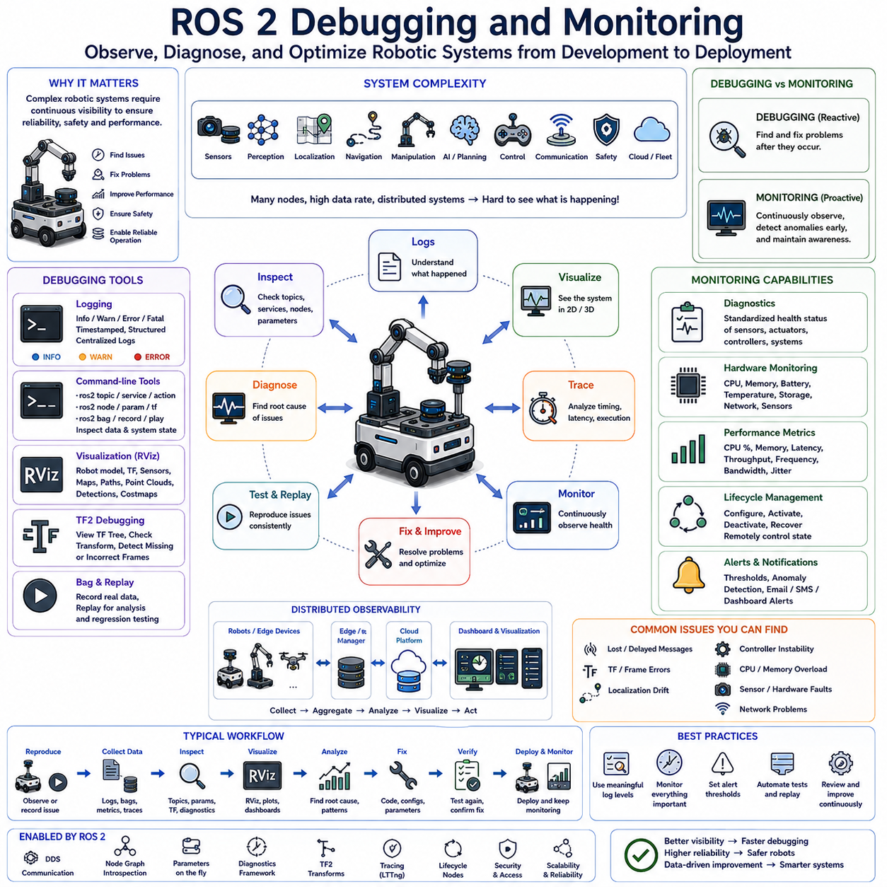{width="7.268055555555556in" height="7.268055555555556in"}

Debugging and Monitoring are among the most critical activities in robotics system development and operation. Regardless of how sophisticated a robot's perception, navigation, manipulation, artificial intelligence, or control algorithms may be, the overall system cannot be considered reliable unless engineers can observe its behavior, diagnose failures, identify performance bottlenecks, and verify operational correctness. In modern ROS 2-based robotic systems, debugging and monitoring are not merely development tasks performed during implementation. They are continuous processes that extend throughout the entire lifecycle of a robotic platform, from simulation and laboratory testing to field deployment, fleet management, cloud robotics, and long-term autonomous operation.

As robotic systems become increasingly complex, the challenge of understanding system behavior grows significantly. A modern autonomous robot may include hundreds of software nodes, dozens of sensors, multiple AI inference pipelines, localization systems, navigation frameworks, manipulation planners, communication modules, cloud interfaces, safety systems, and fleet management integrations. These components operate simultaneously and exchange large volumes of data in real time. Failures can originate from hardware faults, communication delays, software bugs, timing issues, configuration errors, resource exhaustion, environmental disturbances, or unexpected interactions between subsystems. Effective debugging and monitoring therefore become essential for ensuring reliability, safety, and operational success.

The fundamental purpose of debugging is to identify and resolve problems within a robotic system. Monitoring, by contrast, focuses on continuously observing system behavior to detect anomalies, evaluate performance, and maintain operational awareness. Although closely related, debugging is generally reactive, occurring after a problem is discovered, whereas monitoring is proactive, seeking to identify issues before they lead to failures.

ROS 2 provides a comprehensive ecosystem of tools, frameworks, and architectural features that support debugging and monitoring across all layers of robotic software systems. These capabilities include logging systems, diagnostics frameworks, command-line tools, visualization environments, topic inspection utilities, performance monitoring tools, lifecycle management mechanisms, tracing infrastructures, and distributed observability solutions.

One of the most fundamental debugging mechanisms in ROS 2 is logging. Every software component can generate informational messages, warnings, errors, and diagnostic information during execution. Logging allows developers and operators to observe internal system behavior without directly inspecting source code or interrupting robot operations.

ROS 2 provides a structured logging framework that supports multiple severity levels. Informational messages describe normal operations. Warning messages indicate potential concerns that may require attention. Error messages identify failures that affect functionality. Fatal messages indicate critical failures that prevent continued operation. This hierarchy enables developers to filter and prioritize information according to operational needs.

Logging becomes particularly valuable in distributed robotic systems. Since components may execute across multiple computers, robots, edge servers, and cloud platforms, centralized visibility into system behavior is essential. Consistent logging practices enable engineers to reconstruct operational timelines, identify failure sequences, and analyze root causes.

Timestamped logs provide important contextual information. Because robotic systems operate asynchronously, understanding when events occurred is often as important as understanding what occurred. Accurate timestamps allow engineers to correlate sensor measurements, control actions, network events, and software state transitions.

Structured logging further improves diagnostic capabilities. Rather than producing arbitrary text messages, structured logs include metadata such as component names, process identifiers, robot identifiers, severity levels, timestamps, operational modes, and contextual parameters. This additional information facilitates automated analysis and large-scale monitoring.

ROS 2 command-line tools play an essential role in debugging. Developers frequently use these tools to inspect topics, services, actions, nodes, parameters, and communication structures. Command-line inspection provides rapid visibility into system state without requiring specialized software or graphical interfaces.

Topic inspection tools allow engineers to verify whether messages are being published correctly. Developers can examine message contents, publication frequencies, communication rates, and data structures. These capabilities are invaluable when diagnosing communication failures, sensor integration issues, or middleware-related problems.

Service and action inspection tools provide similar visibility into request-response interactions and long-running operations. Engineers can verify service availability, action execution status, goal progression, and result generation. This information helps identify coordination problems within complex robotic workflows.

Node inspection capabilities allow developers to observe active components, communication relationships, subscriptions, publications, services, and parameters. Understanding the current node graph often provides critical insights into system behavior and integration issues.

Parameter inspection is equally important. Configuration errors represent one of the most common sources of robotic system failures. Parameters influence controller gains, sensor calibration values, navigation settings, communication behavior, AI model configurations, safety thresholds, and operational policies. ROS 2 tools allow developers to examine and modify parameters dynamically, simplifying troubleshooting and system tuning.

Visualization represents another powerful debugging mechanism. Humans generally understand complex relationships more effectively through visual representations than through textual data alone. ROS 2 visualization tools therefore play a central role in debugging robotic systems.

RViz is perhaps the most widely used visualization environment within ROS 2. It enables developers to observe robot models, coordinate frames, sensor data, localization estimates, maps, trajectories, point clouds, object detections, planning results, and navigation behavior within a unified three-dimensional environment.

Localization debugging often depends heavily on visualization. Engineers can compare estimated robot positions against environmental maps, observe coordinate frame relationships, verify sensor alignment, and identify drift or inconsistency within localization systems. Such issues may be difficult to detect through numerical data alone but become immediately apparent when visualized.

Navigation debugging similarly benefits from graphical inspection. Planned paths, obstacle maps, robot footprints, sensor observations, costmaps, and controller outputs can be visualized simultaneously. This integrated perspective allows developers to understand why a robot selected a particular route, avoided specific obstacles, or failed to reach a destination.

Manipulation systems also rely extensively on visualization. Developers can inspect robot kinematics, collision models, grasp targets, planning scenes, inverse kinematics solutions, and trajectory execution. Visualization often reveals configuration errors or geometric inconsistencies that would otherwise remain difficult to diagnose.

TF2 debugging represents a specialized but critically important area. Coordinate frame errors are among the most common challenges in robotics development. Incorrect transformations can lead to localization failures, navigation errors, manipulation inaccuracies, and perception inconsistencies.

ROS 2 provides dedicated TF2 inspection tools that allow developers to visualize transformation trees, examine frame relationships, identify missing transformations, detect timing inconsistencies, and verify coordinate alignment. Since nearly every robotic subsystem depends on spatial information, TF2 debugging is frequently a central component of system integration efforts.

Diagnostics frameworks provide structured monitoring capabilities beyond simple logging. The ROS diagnostics ecosystem enables components to publish standardized health information regarding sensors, actuators, communication systems, controllers, batteries, processors, storage devices, and software modules.

Diagnostic information typically includes operational status, performance metrics, warning conditions, and fault indicators. Monitoring systems can aggregate this information to provide comprehensive views of overall robot health.

Hardware monitoring represents a particularly important application. Robotic systems depend upon numerous physical devices whose behavior may degrade over time. Battery voltage, motor temperatures, processor utilization, memory consumption, storage capacity, network quality, sensor status, and communication reliability all influence operational effectiveness.

Continuous monitoring of these metrics enables predictive maintenance strategies. Rather than waiting for failures to occur, operators can identify deteriorating conditions and schedule maintenance proactively. This approach improves reliability, reduces downtime, and lowers operational costs.

Performance monitoring extends beyond hardware health. Software performance metrics such as CPU utilization, memory allocation, message latency, communication bandwidth, callback execution time, controller update frequency, and AI inference duration provide critical insights into system efficiency.

Latency analysis is especially important in robotics. Delays in perception, localization, planning, communication, or control can significantly impact system behavior. Monitoring latency throughout processing pipelines helps engineers identify bottlenecks and optimize performance.

ROS 2 tracing capabilities provide detailed visibility into software execution. Tracing records low-level events occurring throughout the system, including callback execution, middleware communication, memory allocation, scheduling behavior, and resource utilization. Unlike conventional logging, tracing captures fine-grained operational details with minimal runtime overhead.

Tracing enables developers to analyze timing relationships, identify scheduling delays, measure execution durations, and understand complex interactions between components. This capability becomes particularly valuable when debugging intermittent failures or performance anomalies that are difficult to reproduce consistently.

Real-time robotic systems benefit significantly from tracing. Control loops operating at high frequencies require deterministic timing behavior. Tracing allows engineers to verify whether timing requirements are satisfied and identify sources of jitter or latency.

Lifecycle Nodes contribute substantially to monitoring and operational management. Lifecycle states provide explicit visibility into component status. Operators can determine whether nodes are configured, active, inactive, shutting down, or recovering from errors. This information simplifies system supervision and fault diagnosis.

Lifecycle transitions also facilitate controlled recovery procedures. When failures occur, affected components can be reconfigured, restarted, or reactivated without requiring complete system shutdown. Monitoring lifecycle state transitions therefore becomes an important aspect of operational reliability.

Distributed robotic systems introduce additional monitoring challenges. Multi-robot fleets, cloud robotics platforms, edge computing infrastructures, and digital twin environments may involve hundreds or thousands of interacting components distributed across multiple locations.

Centralized observability platforms address these challenges by aggregating logs, diagnostics, metrics, traces, and operational events into unified monitoring dashboards. Operators gain visibility into system-wide behavior while retaining access to detailed information regarding individual components.

Fleet management systems often incorporate extensive monitoring capabilities. Operators can observe robot locations, battery levels, mission progress, communication quality, sensor health, controller status, software versions, and maintenance requirements across entire fleets. Such visibility becomes essential as robotic deployments scale.

Cloud robotics further expands monitoring possibilities. Historical operational data can be stored and analyzed centrally. Machine learning algorithms may identify patterns indicating impending failures, performance degradation, or abnormal behavior. Predictive analytics transforms monitoring from a reactive activity into a proactive operational capability.

Artificial intelligence workloads introduce new monitoring requirements. AI models require visibility into inference latency, model accuracy, confidence levels, resource utilization, dataset quality, and operational effectiveness. Monitoring these metrics helps ensure that intelligent behaviors remain reliable in changing environments.

Embodied AI systems further increase complexity. Future robots may integrate perception, reasoning, planning, learning, navigation, manipulation, communication, and human interaction within unified cognitive architectures. Observability becomes essential for understanding how these interconnected systems behave under real-world conditions.

Simulation environments provide important debugging opportunities before physical deployment. Platforms such as Gazebo, Isaac Sim, Webots, and digital twins allow developers to observe robot behavior, reproduce failures, evaluate performance, and validate monitoring strategies within controlled environments.

Digital twins offer particularly powerful monitoring capabilities. By maintaining synchronized virtual representations of physical robots, digital twins provide comprehensive operational visibility. Engineers can analyze system behavior, replay historical events, perform root-cause investigations, and evaluate hypothetical scenarios without disrupting ongoing operations.

Security monitoring is becoming increasingly important as robotic systems become network-connected. Authentication failures, unauthorized access attempts, abnormal communication patterns, configuration changes, and cybersecurity events must be detected and analyzed promptly. ROS 2 security infrastructures can integrate with broader monitoring ecosystems to support secure operations.

The future of robotic debugging and monitoring increasingly resembles modern cloud-native observability practices. Concepts such as logging, metrics, traces, dashboards, anomaly detection, predictive analytics, health monitoring, and distributed observability are becoming standard requirements for advanced robotic systems.

As robots evolve into large-scale autonomous ecosystems, debugging and monitoring will no longer be optional support activities. They will become core operational capabilities necessary for ensuring safety, reliability, maintainability, and scalability. Successful robotic deployments depend not only on intelligent algorithms but also on the ability to understand, observe, diagnose, and improve system behavior continuously.

For ROS 2 developers, debugging and monitoring represent foundational engineering disciplines. Whether building mobile manipulators, autonomous vehicles, industrial robots, warehouse automation systems, digital twins, cloud robotics platforms, or future embodied AI ecosystems, mastery of debugging and monitoring techniques is essential. These capabilities provide the visibility necessary to transform complex robotic software from experimental prototypes into reliable production systems capable of operating safely and effectively in real-world environments.
