**Volume 04. Mobile Manipulation Software and Operations**


# Chapter 02. MoveIt2

##  

## 01 MoveIt2 Overview

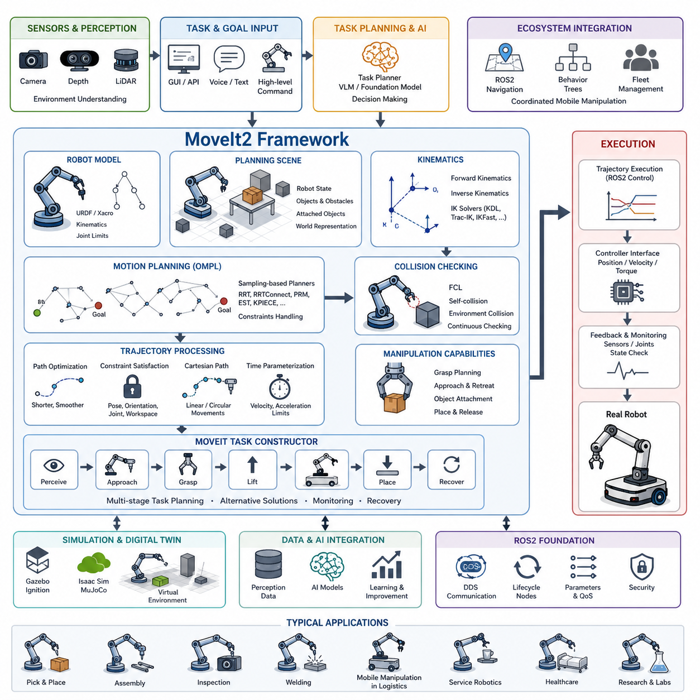{width="7.268055555555556in" height="7.268055555555556in"}

MoveIt2 is one of the most important software frameworks in modern robot manipulation. As robots evolve from fixed industrial manipulators to intelligent mobile manipulators operating in dynamic environments, the need for a flexible, scalable, and real-time motion planning system has become increasingly critical. MoveIt2 addresses this need by providing a comprehensive manipulation framework built on top of ROS2, enabling robots to perceive their environment, plan collision-free motions, execute trajectories, and interact safely with the world. Within the software architecture of a mobile manipulator, MoveIt2 serves as the bridge between high-level task planning and low-level robot control, transforming desired goals into executable motions. It occupies a central role in the manipulation stack and is widely adopted in research laboratories, industrial automation systems, logistics robots, service robots, and next-generation autonomous mobile manipulators.

The origins of MoveIt can be traced to the ROS ecosystem, where the original MoveIt framework emerged as a successor to earlier manipulation software packages. As ROS evolved into ROS2, a new generation of robotics middleware designed for distributed systems, real-time communication, and industrial deployment, MoveIt2 was developed to fully leverage the capabilities of ROS2. Unlike its predecessor, MoveIt2 benefits from DDS-based communication, improved multi-threading, lifecycle management, enhanced security mechanisms, and better support for distributed robotic architectures. These capabilities make MoveIt2 suitable not only for laboratory experiments but also for production-grade robotic systems operating in real-world environments.

At its core, MoveIt2 is a motion planning and manipulation framework. Given a desired end-effector goal, such as reaching an object, inserting a component, opening a door, or placing a package on a shelf, MoveIt2 computes a feasible robot motion that satisfies kinematic constraints while avoiding collisions. This process involves multiple subsystems working together. The framework must understand the robot's geometry, calculate possible joint configurations, evaluate collision risks, generate valid trajectories, optimize motion quality, and communicate commands to robot controllers. The integration of these components into a unified framework significantly reduces development complexity for robotics engineers.

One of the foundational concepts within MoveIt2 is robot modeling. Every robot must be represented digitally before planning can occur. MoveIt2 relies on robot descriptions typically defined through URDF and Xacro models. These descriptions specify links, joints, sensors, collision geometries, inertial properties, and kinematic relationships. By loading these models, MoveIt2 constructs an internal representation of the robot known as the Robot Model. This model becomes the basis for kinematic calculations, collision checking, and trajectory generation. Accurate robot modeling is essential because even small discrepancies between the digital representation and physical hardware can lead to planning failures or unsafe robot behavior.

A key capability of MoveIt2 is inverse kinematics. Manipulation tasks are often specified in Cartesian space rather than joint space. For example, an engineer may instruct a robot to move its gripper to a particular position and orientation relative to an object. The robot must then determine which joint angles correspond to that desired pose. MoveIt2 provides a flexible kinematics framework that supports multiple inverse kinematics solvers, including KDL, Trac-IK, IKFast, and custom plugins. This plugin-based architecture allows developers to select the solver that best matches their robot's requirements in terms of speed, accuracy, and robustness.

Collision avoidance is another fundamental component of MoveIt2. Robots frequently operate in environments containing obstacles, equipment, humans, and other robots. Any manipulation system must ensure that generated motions do not result in collisions. MoveIt2 maintains a planning scene that represents both the robot and its surrounding environment. Using collision checking libraries such as FCL, the framework continuously evaluates potential interactions between objects. Before a trajectory is approved, every intermediate state is validated to ensure that collisions do not occur. This capability is particularly important for mobile manipulators working in warehouses, factories, hospitals, and public environments where obstacles are constantly changing.

The planning scene is one of the most powerful abstractions in MoveIt2. It acts as a dynamic digital twin of the robot\'s operational environment. The planning scene contains information about robot states, collision objects, attached objects, environmental obstacles, and workspace boundaries. Sensors such as RGB cameras, depth cameras, LiDARs, and 3D vision systems can continuously update the planning scene to reflect changes in the environment. As a result, MoveIt2 can generate plans based on current environmental conditions rather than relying solely on predefined maps.

Motion planning itself is performed using planning algorithms integrated through the Open Motion Planning Library (OMPL). OMPL provides a collection of sampling-based planning algorithms such as RRT, RRTConnect, PRM, EST, and KPIECE. These algorithms search for feasible paths through high-dimensional configuration spaces. When a target pose is specified, the planner explores possible robot configurations until a collision-free solution is found. Sampling-based planning is particularly effective for robots with many degrees of freedom because exhaustive search approaches become computationally infeasible as dimensionality increases.

In addition to generating feasible trajectories, MoveIt2 supports path optimization. Initial trajectories generated by planners may be unnecessarily long, inefficient, or contain abrupt movements. Path optimization algorithms refine these trajectories by reducing path length, smoothing joint motion, minimizing energy consumption, and improving execution quality. This optimization process leads to faster task completion, reduced mechanical wear, and improved overall system performance.

Trajectory execution is another critical aspect of MoveIt2. Planning alone is insufficient unless generated trajectories can be reliably executed by physical hardware. MoveIt2 interfaces with ROS2 Control and various robot controllers to send commands to actuators. Once a trajectory is validated, it is transmitted to the execution layer, where controllers manage velocity, position, and torque commands. Feedback from robot sensors is monitored throughout execution to ensure that actual motion follows the planned trajectory. If significant deviations occur, corrective actions can be triggered.

MoveIt2 also supports Cartesian path planning, which is especially useful for industrial manipulation tasks. In Cartesian planning, the end-effector follows a specified path through Cartesian space rather than simply moving between two poses. Applications such as welding, painting, polishing, assembly, and inspection often require precise Cartesian trajectories. MoveIt2 provides tools for generating smooth Cartesian paths while maintaining orientation constraints and collision safety.

Another important capability is constraint-based planning. Real-world manipulation tasks often involve additional requirements beyond simply reaching a target. A robot carrying a cup of liquid may need to keep the container upright. A robotic screwdriver may need to maintain a specific orientation during insertion. A medical robot may have strict workspace limitations. MoveIt2 allows developers to define positional, orientational, and kinematic constraints that planners must satisfy throughout trajectory generation. This capability significantly expands the range of practical applications that can be addressed.

For grasping applications, MoveIt2 provides dedicated manipulation functionality. Grasp planning involves determining how an end-effector should approach, grasp, and manipulate an object. The framework supports grasp pose generation, pre-grasp planning, grasp execution, and object attachment. Once an object is grasped, MoveIt2 updates the planning scene to treat the object as part of the robot, ensuring accurate collision checking during subsequent motions. This feature is essential for warehouse picking, manufacturing automation, service robotics, and mobile manipulation systems.

MoveIt Task Constructor extends MoveIt2 beyond individual motions into complete manipulation workflows. Instead of planning a single trajectory, developers can define multi-stage tasks consisting of perception, approach, grasping, lifting, transportation, placement, and recovery operations. Each stage can generate multiple candidate solutions, allowing the system to evaluate alternatives and select the most effective sequence. This capability forms the foundation for sophisticated autonomous manipulation behaviors.

The importance of MoveIt2 becomes even greater when considering mobile manipulators. Traditional industrial robots operate within fixed workcells, but mobile manipulators combine robotic arms with autonomous mobile bases. In these systems, manipulation planning and navigation planning must be coordinated. The robot may first navigate toward a target location before executing arm motions. MoveIt2 can be integrated with ROS2 Navigation, enabling coordinated motion planning across both the manipulator and mobile base. This integration allows robots to perform tasks across large environments rather than being limited to a fixed workspace.

Simulation plays a major role in MoveIt2 development. Before deploying robots in the real world, engineers typically validate manipulation strategies in simulation environments such as Gazebo, Ignition Gazebo, and NVIDIA Isaac Sim. MoveIt2 integrates seamlessly with these simulators, enabling developers to test robot models, verify trajectories, evaluate collision avoidance strategies, and optimize manipulation workflows before hardware deployment. Simulation-driven development reduces costs, improves safety, and accelerates system integration.

Modern AI-driven robotics systems increasingly integrate MoveIt2 with perception and decision-making frameworks. Computer vision systems identify objects and estimate poses. Foundation models and vision-language models interpret high-level instructions. Task planners generate symbolic goals. MoveIt2 then converts these goals into executable robot motions. In this architecture, MoveIt2 serves as the physical execution engine connecting cognitive intelligence to physical action. Without reliable motion planning, even the most advanced AI systems cannot effectively interact with the physical world.

From an industrial perspective, MoveIt2 offers significant advantages. It is open source, widely supported by the robotics community, continuously maintained, and compatible with a broad range of robotic hardware. Its modular architecture allows organizations to customize planners, kinematics solvers, collision checkers, and execution pipelines according to specific requirements. The framework also benefits from a large ecosystem of tutorials, plugins, research contributions, and industrial deployments, making it one of the most mature manipulation platforms available today.

As robotics continues to move toward autonomous warehouses, smart factories, logistics automation, healthcare robotics, service robots, and embodied AI systems, the importance of robust manipulation software will only increase. MoveIt2 provides a foundation capable of supporting this evolution by combining advanced motion planning, collision avoidance, trajectory optimization, execution management, and integration with modern ROS2 ecosystems. It transforms robotic hardware into intelligent manipulation systems capable of operating safely and efficiently in complex real-world environments.

For mobile manipulation engineers, understanding MoveIt2 is not merely an optional skill but a fundamental requirement. It represents the core manipulation framework upon which higher-level task planning, autonomous behaviors, AI-driven decision making, and real-world robot operations are built. As a result, MoveIt2 occupies a central position within modern mobile manipulator software architectures and serves as one of the most important technologies in the development of next-generation intelligent robotic systems.

MoveIt2는 현대 로봇 매니퓰레이션 분야에서 가장 중요한 소프트웨어 프레임워크 중 하나이다. 로봇이 고정형 산업용 로봇팔에서 동적인 환경에서 작업하는 지능형 모바일 매니퓰레이터로 발전함에 따라, 유연하고 확장 가능하며 실시간으로 동작하는 모션 플래닝 시스템의 필요성이 크게 증가하였다. MoveIt2는 이러한 요구를 충족하기 위해 ROS2 기반의 통합 매니퓰레이션 프레임워크를 제공하며, 로봇이 환경을 인식하고, 충돌 없는 경로를 계획하며, 궤적을 실행하고, 주변 환경과 안전하게 상호작용할 수 있도록 지원한다. 모바일 매니퓰레이터의 소프트웨어 아키텍처에서 MoveIt2는 상위 수준의 작업 계획(Task Planning)과 하위 수준의 제어(Control) 사이를 연결하는 핵심 계층으로서, 목표를 실제 실행 가능한 움직임으로 변환하는 역할을 수행한다. 이러한 이유로 MoveIt2는 연구용 로봇, 산업 자동화 시스템, 물류 로봇, 서비스 로봇, 그리고 차세대 자율 모바일 매니퓰레이터에 널리 사용되고 있다.

MoveIt의 기원은 ROS 생태계에서 시작되었다. 초기 MoveIt은 기존 매니퓰레이션 소프트웨어를 대체하기 위해 개발되었으며, 이후 ROS가 ROS2로 발전하면서 MoveIt2가 새롭게 등장하였다. ROS2는 분산 시스템, 실시간 통신, 산업 현장 적용을 목표로 설계된 차세대 로봇 미들웨어이다. MoveIt2는 DDS 기반 통신, 향상된 멀티스레딩, 라이프사이클 노드, 보안 기능, 그리고 분산 로봇 아키텍처 지원과 같은 ROS2의 장점을 활용하도록 설계되었다. 이러한 특징 덕분에 MoveIt2는 단순한 연구용 도구를 넘어 실제 산업 현장에서도 활용 가능한 수준의 성숙한 플랫폼으로 발전하였다.

MoveIt2의 핵심 기능은 모션 플래닝(Motion Planning)과 매니퓰레이션(Manipulation)이다. 예를 들어 로봇이 물체를 집거나, 부품을 조립하거나, 문을 열거나, 선반에 물건을 놓는 작업을 수행할 때, MoveIt2는 목표 위치와 자세를 입력받아 이를 수행할 수 있는 충돌 없는 로봇 움직임을 계산한다. 이 과정에서 로봇의 기구학 모델을 이해하고, 가능한 관절 상태를 계산하며, 충돌 여부를 평가하고, 유효한 경로를 생성하며, 최적화된 궤적을 도출한 후, 실제 제어기로 전달한다. 이러한 다양한 기능이 하나의 프레임워크 안에 통합되어 있기 때문에 로봇 개발자는 복잡한 알고리즘을 직접 구현하지 않고도 고급 매니퓰레이션 기능을 활용할 수 있다.

MoveIt2의 가장 중요한 기반 개념 중 하나는 로봇 모델링(Robot Modeling)이다. 로봇은 먼저 디지털 형태로 정의되어야 하며, 일반적으로 URDF와 Xacro를 이용하여 모델링된다. 이 모델에는 링크(Link), 조인트(Joint), 센서(Sensor), 충돌 형상(Collision Geometry), 관성 정보(Inertia), 그리고 기구학적 연결 관계가 포함된다. MoveIt2는 이러한 정보를 기반으로 Robot Model을 생성하며, 이후 기구학 계산, 충돌 검사, 궤적 생성의 기준으로 활용한다. 디지털 모델과 실제 하드웨어의 차이가 클 경우 계획된 동작이 실패하거나 안전 문제가 발생할 수 있으므로 정확한 모델링이 매우 중요하다.

MoveIt2의 또 다른 핵심 기능은 역기구학(Inverse Kinematics)이다. 대부분의 작업은 관절 각도가 아니라 작업 공간의 목표 위치와 자세로 정의된다. 예를 들어 로봇 그리퍼를 특정 물체의 위치로 이동시키고자 할 때, 로봇은 해당 위치를 만들기 위한 관절 각도를 계산해야 한다. MoveIt2는 KDL, Trac-IK, IKFast 등 다양한 역기구학 솔버를 지원하며, 플러그인 구조를 통해 사용자가 원하는 솔버를 선택할 수 있다. 이를 통해 속도, 정확도, 안정성 측면에서 로봇의 특성에 가장 적합한 솔루션을 적용할 수 있다.

충돌 회피(Collision Avoidance)는 MoveIt2의 핵심 기능 중 하나이다. 로봇은 장애물, 장비, 사람, 다른 로봇이 존재하는 환경에서 작업해야 하므로, 계획된 경로가 충돌을 일으키지 않아야 한다. MoveIt2는 Planning Scene이라는 개념을 사용하여 로봇과 주변 환경을 함께 모델링한다. FCL(Flexible Collision Library)과 같은 충돌 검사 라이브러리를 활용하여 경로 생성 과정에서 지속적으로 충돌 가능성을 평가한다. 계획된 경로의 모든 중간 상태가 검증되며, 충돌이 없는 경우에만 실행이 허용된다. 이는 창고, 공장, 병원, 서비스 환경과 같이 동적인 공간에서 매우 중요한 기능이다.

Planning Scene은 MoveIt2에서 가장 강력한 개념 중 하나이다. 이는 로봇이 작업하는 환경의 디지털 트윈(Digital Twin) 역할을 수행한다. Planning Scene에는 현재 로봇 상태, 장애물, 부착된 물체, 작업 공간 경계 등이 포함된다. RGB 카메라, Depth Camera, LiDAR, 3D 비전 센서와 같은 다양한 센서가 실시간으로 환경 정보를 업데이트할 수 있으며, 이를 통해 MoveIt2는 현재 환경 상태를 반영한 모션 계획을 수행할 수 있다.

실제 경로 생성은 OMPL(Open Motion Planning Library)을 통해 수행된다. OMPL은 RRT, RRTConnect, PRM, EST, KPIECE 등 다양한 샘플링 기반 플래닝 알고리즘을 제공한다. 이러한 알고리즘은 고차원 구성 공간(Configuration Space)에서 가능한 경로를 탐색하여 충돌 없는 경로를 찾는다. 자유도가 많은 로봇의 경우 모든 상태를 탐색하는 것은 현실적으로 불가능하기 때문에 샘플링 기반 접근 방식이 매우 효과적이다.

MoveIt2는 단순히 경로를 찾는 것에 그치지 않고 경로 최적화(Path Optimization) 기능도 제공한다. 초기 계획 경로는 불필요하게 길거나 비효율적일 수 있다. 최적화 알고리즘은 경로 길이를 줄이고, 관절 움직임을 부드럽게 만들며, 에너지 소비를 감소시키고, 전체적인 실행 품질을 향상시킨다. 그 결과 작업 시간이 단축되고 기계적 마모가 줄어들며 생산성이 향상된다.

궤적 실행(Trajectory Execution) 역시 MoveIt2의 중요한 기능이다. 계획된 경로는 실제 하드웨어에서 안정적으로 실행되어야 한다. MoveIt2는 ROS2 Control 및 다양한 로봇 제어기와 연동하여 생성된 궤적을 실행한다. 로봇의 실제 상태는 센서를 통해 지속적으로 모니터링되며, 계획된 경로와 실제 동작 간의 차이가 발생하면 이를 감지하고 대응할 수 있다.

MoveIt2는 Cartesian Path Planning 기능도 제공한다. 이는 단순히 시작점과 목표점 사이를 이동하는 것이 아니라, 작업 공간 내에서 특정 경로를 따라 이동하도록 계획하는 기능이다. 용접, 도장, 연마, 조립, 검사와 같은 산업 작업에서는 엔드이펙터가 정해진 궤적을 따라 움직여야 한다. MoveIt2는 이러한 요구를 충족하면서도 충돌 회피와 자세 제약 조건을 동시에 만족시킬 수 있다.

실제 산업 환경에서는 단순한 목표 도달 외에도 다양한 제약 조건이 존재한다. 예를 들어 액체가 담긴 컵을 운반할 때는 컵을 기울이지 않아야 하고, 전동 드라이버를 사용할 때는 특정 방향을 유지해야 하며, 의료 로봇은 엄격한 작업 공간 제한을 만족해야 한다. MoveIt2는 위치 제약, 자세 제약, 기구학적 제약 등을 정의할 수 있으며, 플래너는 이러한 조건을 만족하는 경로만 생성한다. 이를 통해 복잡한 산업 및 서비스 작업을 효과적으로 수행할 수 있다.

물체 집기(Grasping) 역시 MoveIt2의 중요한 기능이다. Grasp Planning은 물체에 접근하고, 파지하고, 이동하는 전체 과정을 포함한다. MoveIt2는 그립 포즈 생성, 접근 경로 계획, 파지 실행, 물체 부착 관리 기능을 제공한다. 물체를 집은 이후에는 해당 물체를 로봇의 일부로 간주하여 충돌 검사를 수행하므로 더욱 정확한 경로 계획이 가능하다. 이는 창고 피킹, 제조 자동화, 서비스 로봇, 모바일 매니퓰레이션 분야에서 필수적인 기능이다.

MoveIt Task Constructor는 단일 동작 계획을 넘어 복합 작업 계획을 가능하게 한다. 인식, 접근, 파지, 이동, 배치, 복구 등의 여러 단계를 하나의 작업으로 구성할 수 있으며, 각 단계에서 다양한 후보 경로를 생성하여 최적의 실행 시나리오를 선택할 수 있다. 이를 통해 보다 지능적이고 복잡한 자동화 작업을 구현할 수 있다.

모바일 매니퓰레이터 환경에서는 MoveIt2의 중요성이 더욱 커진다. 기존 산업용 로봇은 고정된 작업 셀에서 동작하지만, 모바일 매니퓰레이터는 이동 플랫폼과 로봇팔을 결합한 시스템이다. 따라서 내비게이션과 매니퓰레이션 계획이 긴밀하게 연동되어야 한다. 로봇은 먼저 목표 위치까지 이동한 후 물체를 집거나 작업을 수행해야 한다. MoveIt2는 ROS2 Navigation과 통합되어 이동 경로 계획과 조작 계획을 함께 수행할 수 있다. 이를 통해 창고, 병원, 공항, 물류센터와 같은 대규모 환경에서도 자율 작업이 가능해진다.

시뮬레이션은 MoveIt2 개발 과정에서 매우 중요한 역할을 한다. 실제 로봇에 적용하기 전에 Gazebo, Ignition Gazebo, NVIDIA Isaac Sim과 같은 시뮬레이터에서 알고리즘을 검증할 수 있다. 개발자는 로봇 모델을 테스트하고, 충돌 회피 전략을 검증하며, 작업 흐름을 최적화할 수 있다. 이러한 시뮬레이션 기반 개발은 비용을 절감하고 안전성을 높이며 개발 속도를 향상시킨다.

최근에는 인공지능 기반 로봇 시스템과 MoveIt2의 통합도 활발하게 이루어지고 있다. 컴퓨터 비전 시스템은 물체를 인식하고 위치를 추정하며, 비전-언어 모델(VLM)과 파운데이션 모델은 인간의 명령을 이해한다. 작업 계획 시스템은 목표를 생성하고, MoveIt2는 이를 실제 로봇 동작으로 변환한다. 즉, MoveIt2는 인공지능의 의사결정 결과를 현실 세계의 물리적 행동으로 연결하는 실행 엔진(Execution Engine)의 역할을 수행한다.

산업적 관점에서 MoveIt2는 오픈소스이면서도 매우 높은 성숙도를 가진 플랫폼이다. 광범위한 사용자 커뮤니티와 지속적인 개발이 이루어지고 있으며, 다양한 로봇 하드웨어와 호환된다. 또한 플래너, 역기구학 솔버, 충돌 검사기, 실행 모듈을 자유롭게 교체할 수 있는 모듈형 구조를 갖추고 있어 기업의 요구사항에 맞게 쉽게 확장할 수 있다.

향후 로봇 산업이 자율 물류, 스마트 팩토리, 병원 자동화, 서비스 로봇, 휴머노이드, Embodied AI 방향으로 발전할수록 고성능 매니퓰레이션 소프트웨어의 중요성은 더욱 커질 것이다. MoveIt2는 고급 모션 플래닝, 충돌 회피, 경로 최적화, 실행 관리, ROS2 생태계 통합 기능을 제공함으로써 이러한 미래를 실현하는 핵심 기술 중 하나로 자리 잡고 있다.

모바일 매니퓰레이터 엔지니어에게 MoveIt2는 단순한 소프트웨어 패키지가 아니다. 그것은 작업 계획, 자율 행동, 인공지능 의사결정, 실제 로봇 운영을 연결하는 핵심 매니퓰레이션 플랫폼이며, 차세대 지능형 로봇 시스템을 구축하기 위한 필수 기술이라고 할 수 있다.

##  

## 02 Robot Modeling

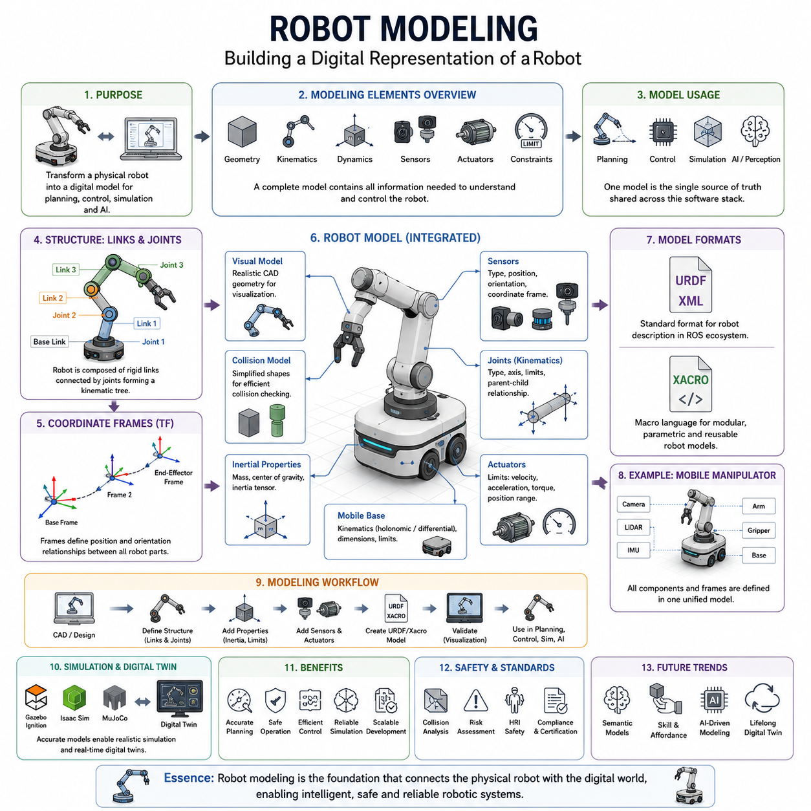{width="7.268055555555556in" height="7.268055555555556in"}

Robot modeling is one of the most fundamental disciplines in modern robotics and serves as the foundation upon which perception, planning, control, simulation, and autonomous operation are built. Before a robot can move, perceive its environment, manipulate objects, or collaborate with humans, it must first possess an accurate digital representation of itself. This representation is known as a robot model. In the context of MoveIt2, ROS2, digital twins, simulation environments, and mobile manipulators, robot modeling is the critical process that transforms a physical machine into a computational entity that software can understand, analyze, and control. Without a proper robot model, advanced robotics software frameworks cannot perform motion planning, collision avoidance, kinematic calculations, or trajectory execution.

Robot modeling can be viewed as the creation of a virtual counterpart of a physical robot. This virtual counterpart contains detailed descriptions of the robot\'s structure, dimensions, joints, sensors, actuators, mass properties, and operational constraints. The goal is to provide sufficient information for software systems to accurately predict and control robot behavior. A robot model acts as a common language shared among various software modules including simulation engines, motion planners, controllers, visualization tools, and AI systems. It ensures that every component within the robotics software stack has a consistent understanding of the robot\'s physical characteristics.

Historically, industrial robots operated in highly structured environments where robot configurations were relatively fixed and predictable. Robot models were primarily used for offline programming and kinematic calculations. As robotics evolved toward mobile manipulators, autonomous service robots, humanoids, and embodied AI systems, the complexity of robot modeling increased significantly. Modern robots are no longer static machines confined to manufacturing cells. They operate in dynamic environments, interact with humans, manipulate diverse objects, and perform complex decision-making tasks. Consequently, robot models must now capture far more information than simple geometric descriptions.

At the most basic level, a robot model consists of links and joints. Links represent rigid bodies such as arm segments, end-effectors, mobile bases, sensor mounts, and structural components. Joints define the relationships between links and specify how one component can move relative to another. Together, links and joints form the robot\'s kinematic structure. This structure is commonly represented as a tree-like hierarchy beginning at a root frame and extending through all movable components of the robot. Every motion generated by the robot ultimately results from transformations occurring along this kinematic chain.

The concept of coordinate frames is central to robot modeling. Every link in a robot has its own coordinate frame, defining its position and orientation relative to other links. These coordinate frames create a network of transformations that describe how different parts of the robot relate to one another. When a robotic arm moves, the transformations between frames change dynamically. Accurate frame management enables perception systems to localize objects, allows planners to calculate trajectories, and permits controllers to generate appropriate actuator commands. In ROS2 ecosystems, TF2 is commonly used to manage and distribute these coordinate transformations throughout the system.

Robot modeling extends beyond geometry and kinematics. Dynamic properties are equally important. A realistic robot model must include mass distributions, inertial tensors, center-of-gravity locations, friction coefficients, damping parameters, and actuator characteristics. These parameters influence how the robot responds to forces and torques. Dynamic models are essential for high-performance control systems, physics-based simulations, force control applications, and advanced manipulation tasks. Without accurate dynamic information, simulated robot behavior may differ significantly from real-world performance.

Modern robot modeling relies heavily on standardized description formats. Within the ROS ecosystem, the Unified Robot Description Format (URDF) has become the de facto standard for representing robot structures. URDF provides a structured XML-based format for defining links, joints, visual geometries, collision geometries, inertial properties, and coordinate relationships. Because URDF is supported by a broad range of tools, it serves as the foundation for simulation, visualization, planning, and control frameworks. A single URDF file can be used simultaneously by RViz, Gazebo, MoveIt2, ROS2 Control, and numerous other software components.

Although URDF provides a powerful modeling framework, large and complex robots often require more flexibility than static XML definitions can offer. This need led to the development of Xacro, a macro language that extends URDF capabilities. Xacro enables parameterized robot descriptions, reusable templates, conditional logic, and modular robot definitions. Engineers can create scalable robot models that support multiple hardware configurations using a single codebase. For example, a mobile manipulator product family may include robots with different arm lengths, sensor configurations, wheelbases, and payload capacities. Xacro allows these variations to be generated automatically through parameter substitution.

Visual representation is another important aspect of robot modeling. Every robot model typically includes visual geometry used for rendering in simulation and visualization tools. These visual models are often derived from CAD data and provide realistic representations of robot components. Accurate visualization assists engineers during development, debugging, and system integration. Operators can monitor robot states through graphical interfaces, while simulation environments can render realistic digital twins for testing and validation.

Collision modeling is equally critical. Visual models often contain highly detailed geometries that are computationally expensive for collision checking. Therefore, robot models generally include simplified collision geometries optimized for real-time planning. Collision models define the physical boundaries used by planning systems such as MoveIt2. During motion planning, every candidate trajectory is evaluated against these collision geometries to ensure safe operation. Proper collision modeling significantly improves planning performance while maintaining safety.

Sensor modeling plays an increasingly important role in modern robotic systems. Robots frequently rely on cameras, LiDARs, IMUs, depth sensors, force-torque sensors, GPS receivers, radar systems, and numerous other sensing devices. A complete robot model includes the physical placement, orientation, and coordinate frames associated with each sensor. Accurate sensor models enable perception algorithms to correctly interpret environmental data and fuse information from multiple sources. In autonomous mobile manipulators, sensor placement directly influences navigation performance, object detection accuracy, and manipulation success rates.

Actuator modeling is another important consideration. Robot joints are driven by motors, hydraulic systems, pneumatic systems, or other actuation technologies. Robot models often include actuator limits such as maximum velocity, acceleration, torque, position ranges, and control interfaces. These constraints define the operational envelope within which planning and control algorithms must operate. Respecting actuator limits prevents unrealistic plans and helps ensure safe execution on physical hardware.

Kinematic modeling forms the mathematical core of robot modeling. Kinematics describes the relationship between joint variables and end-effector motion without considering forces. Forward kinematics computes end-effector positions based on joint values, while inverse kinematics determines the joint configurations required to achieve desired poses. Accurate kinematic models are essential for manipulation tasks, motion planning, grasping, and trajectory execution. MoveIt2 relies heavily on robot kinematic models to generate feasible motion plans.

For mobile manipulators, robot modeling becomes more complex because the system combines multiple subsystems. A mobile manipulator typically consists of a mobile base, robotic arm, end-effector, sensors, computing hardware, batteries, and communication devices. Each subsystem introduces additional coordinate frames, kinematic relationships, and physical constraints. The integration of these elements into a unified robot model is essential for coordinated navigation and manipulation. Motion planners must understand both arm motion and base motion when generating task-level behaviors.

Robot modeling is also fundamental to simulation. Simulation platforms such as Gazebo, Ignition Gazebo, Isaac Sim, Webots, and MuJoCo require detailed robot models to reproduce physical behavior. These simulators use robot descriptions to calculate dynamics, render visualizations, simulate sensors, and evaluate interactions with environments. High-fidelity simulation enables developers to test algorithms before deploying them on expensive hardware. This simulation-first approach has become a standard practice in robotics engineering.

Digital twins represent a further evolution of robot modeling. A digital twin is a continuously synchronized virtual representation of a physical robot operating in the real world. Unlike static models, digital twins incorporate real-time sensor data, operational states, maintenance information, and performance metrics. Robot models serve as the structural foundation of digital twins. By combining geometric, kinematic, dynamic, and operational information, digital twins enable predictive maintenance, performance optimization, remote diagnostics, and lifecycle management.

The emergence of AI-driven robotics has expanded the role of robot modeling even further. Vision-language models, foundation models, and robot agents increasingly require semantic information about robot structures. Future robot models may include knowledge about capabilities, task affordances, manipulation skills, and environmental interactions. Such enriched representations will enable robots to reason not only about geometry and motion but also about the meaning and purpose of actions.

Robot modeling also plays a critical role in safety engineering. Safety certification processes often require detailed documentation of robot structures, motion limits, collision zones, and operational constraints. Accurate robot models support risk assessments, collision analysis, human-robot interaction studies, and compliance with international standards. In industrial environments, robot models are frequently used to validate safe operating conditions before deployment.

From a software architecture perspective, robot models serve as the central source of truth within robotic systems. Motion planners rely on them for path generation. Controllers depend on them for state estimation and command generation. Simulators use them to reproduce physical behavior. Visualization tools display them to operators. AI systems reference them when making decisions. Because so many components depend on the robot model, maintaining consistency and accuracy is one of the most important responsibilities in robotics engineering.

The future of robot modeling is closely tied to the evolution of autonomous systems and embodied intelligence. Humanoid robots, collaborative robots, autonomous vehicles, warehouse robots, healthcare robots, and service robots will require increasingly sophisticated models capable of representing not only physical structures but also behaviors, skills, intentions, and environmental relationships. Advances in simulation technology, digital twins, synthetic data generation, and AI-driven development workflows will further elevate the importance of robot modeling.

For robotics engineers working with ROS2 and MoveIt2, robot modeling is not simply a preparatory step performed before development begins. It is a foundational engineering discipline that influences every aspect of robot behavior. A well-designed robot model enables accurate simulation, reliable motion planning, safe operation, efficient control, and scalable software integration. Conversely, deficiencies in robot modeling often propagate throughout the system, causing planning failures, execution errors, inaccurate simulations, and operational safety risks.

Ultimately, robot modeling provides the bridge between physical reality and computational intelligence. It transforms mechanical structures into digital entities that software can understand, predict, and control. As robotics systems continue to become more autonomous, intelligent, and capable, robot modeling will remain one of the most essential technologies underlying the entire robotics ecosystem. It forms the foundation upon which modern mobile manipulation, autonomous robotics, digital twins, embodied AI, and future intelligent machines are built.

로봇 모델링은 현대 로봇공학의 가장 기본적이고 중요한 분야 중 하나이며, 인식(Perception), 계획(Planning), 제어(Control), 시뮬레이션(Simulation), 자율운용(Autonomous Operation)의 기반이 되는 핵심 기술이다. 로봇이 움직이고, 환경을 인식하며, 물체를 조작하고, 사람과 협업하기 위해서는 먼저 자신에 대한 정확한 디지털 표현을 가져야 한다. 이러한 디지털 표현을 로봇 모델(Robot Model)이라고 한다. MoveIt2, ROS2, 디지털 트윈(Digital Twin), 시뮬레이션 환경, 모바일 매니퓰레이터 분야에서 로봇 모델링은 물리적인 기계를 소프트웨어가 이해하고 분석하며 제어할 수 있는 디지털 객체로 변환하는 과정이다. 적절한 로봇 모델이 없다면 모션 플래닝, 충돌 회피, 기구학 계산, 궤적 생성과 같은 고급 로봇 기능은 수행될 수 없다.

로봇 모델링은 물리적 로봇의 가상 복제본(Virtual Counterpart)을 만드는 과정으로 이해할 수 있다. 이 가상 모델에는 로봇의 구조, 크기, 관절, 센서, 구동기, 질량 특성, 운동 제한 조건 등이 포함된다. 목적은 소프트웨어 시스템이 실제 로봇의 동작을 정확하게 예측하고 제어할 수 있도록 충분한 정보를 제공하는 것이다. 로봇 모델은 시뮬레이터, 모션 플래너, 제어기, 시각화 도구, 인공지능 시스템 등 다양한 소프트웨어 구성요소가 공유하는 공통 언어 역할을 수행한다. 이를 통해 전체 로봇 소프트웨어 스택이 동일한 로봇 구조를 이해할 수 있게 된다.

초기의 산업용 로봇은 고정된 제조 셀(Cell) 내부에서 동작했기 때문에 로봇 모델은 주로 기구학 계산과 오프라인 프로그래밍 용도로 사용되었다. 그러나 모바일 매니퓰레이터, 서비스 로봇, 휴머노이드, Embodied AI 시스템이 등장하면서 로봇 모델링의 복잡성은 크게 증가하였다. 현대의 로봇은 더 이상 고정된 공간에서 반복 작업만 수행하는 기계가 아니다. 사람과 협업하고, 다양한 환경에서 이동하며, 복잡한 의사결정을 수행해야 한다. 따라서 현대의 로봇 모델은 단순한 기하학적 구조를 넘어 훨씬 더 많은 정보를 포함해야 한다.

가장 기본적인 수준에서 로봇 모델은 링크(Link)와 조인트(Joint)로 구성된다. 링크는 로봇의 팔, 프레임, 엔드이펙터, 센서 브래킷, 모바일 베이스와 같은 강체(Rigid Body)를 의미한다. 조인트는 링크와 링크를 연결하며 각 링크가 어떻게 움직일 수 있는지를 정의한다. 링크와 조인트가 결합되어 로봇의 기구학적 구조(Kinematic Structure)를 형성한다. 일반적으로 이러한 구조는 루트 프레임(Root Frame)에서 시작하여 여러 링크와 조인트를 통해 연결되는 트리(Tree) 형태로 표현된다. 로봇의 모든 움직임은 이러한 기구학 체인(Kinematic Chain)을 통해 발생한다.

좌표계(Frame)의 개념은 로봇 모델링에서 매우 중요하다. 로봇의 각 링크는 자신만의 좌표계를 가지며, 이를 통해 다른 링크와의 상대 위치와 방향을 정의한다. 이들 좌표계는 서로 연결되어 변환 관계(Transformation Network)를 형성한다. 로봇팔이 움직이면 각 프레임 간의 관계도 실시간으로 변화한다. 이러한 프레임 관리가 정확해야 비전 시스템이 물체 위치를 계산할 수 있고, 플래너가 경로를 생성할 수 있으며, 제어기가 적절한 명령을 생성할 수 있다. ROS2에서는 TF2가 이러한 좌표 변환을 관리하는 핵심 프레임워크로 사용된다.

로봇 모델링은 단순한 기하학과 기구학만 포함하는 것이 아니다. 동역학(Dynamics) 정보 역시 매우 중요하다. 현실적인 로봇 모델은 질량(Mass), 관성 텐서(Inertia Tensor), 무게중심(Center of Gravity), 마찰 계수(Friction Coefficient), 감쇠(Damping), 구동기 특성 등을 포함해야 한다. 이러한 정보는 로봇이 힘과 토크에 어떻게 반응하는지를 결정한다. 동역학 모델은 고성능 제어, 힘 제어, 물리 기반 시뮬레이션, 정밀 조작 작업 등에 필수적이다. 동역학 정보가 부정확하면 시뮬레이션 결과와 실제 로봇의 움직임이 크게 달라질 수 있다.

현대 로봇 개발에서는 표준화된 로봇 기술서(Description Format)를 사용한다. ROS 생태계에서는 URDF(Unified Robot Description Format)가 사실상의 표준으로 자리 잡고 있다. URDF는 XML 기반 형식으로 링크, 조인트, 시각화 모델, 충돌 모델, 관성 정보, 좌표 관계 등을 정의한다. URDF는 RViz, Gazebo, MoveIt2, ROS2 Control 등 다양한 소프트웨어에서 공통적으로 사용되기 때문에 로봇 소프트웨어 개발의 중심 역할을 수행한다.

하지만 대형 로봇이나 복잡한 로봇 플랫폼에서는 URDF만으로는 관리가 어려운 경우가 많다. 이를 해결하기 위해 Xacro가 개발되었다. Xacro는 URDF를 확장한 매크로 기반 언어로서 변수(Parameter), 재사용 가능한 템플릿, 조건문, 모듈화를 지원한다. 예를 들어 동일한 플랫폼에서 다양한 암 길이, 센서 구성, 휠베이스, 적재 중량을 지원해야 하는 경우 Xacro를 사용하면 하나의 코드베이스로 여러 로봇 모델을 생성할 수 있다.

시각 모델(Visual Model)은 로봇 모델링의 또 다른 중요한 요소이다. 일반적으로 CAD 데이터를 기반으로 생성되며, 시뮬레이션과 시각화 환경에서 실제 로봇과 유사한 외형을 제공한다. 이를 통해 개발자는 디지털 환경에서 로봇 상태를 직관적으로 확인할 수 있으며, 디지털 트윈 구축 시에도 사실적인 표현이 가능하다.

반면 충돌 모델(Collision Model)은 시각 모델과는 다른 목적을 가진다. CAD 모델은 매우 복잡하기 때문에 충돌 검사를 수행하기에는 계산량이 너무 크다. 따라서 충돌 모델은 단순화된 기하학 형태로 구성된다. MoveIt2는 이러한 충돌 모델을 사용하여 경로 계획 과정에서 충돌 여부를 빠르게 검사한다. 적절한 충돌 모델은 계산 성능을 향상시키면서도 안전성을 유지할 수 있게 해준다.

센서 모델링(Sensor Modeling)의 중요성도 점점 커지고 있다. 현대 로봇은 카메라, LiDAR, IMU, Depth Sensor, Force-Torque Sensor, GNSS, Radar 등 다양한 센서를 사용한다. 로봇 모델에는 센서의 위치, 방향, 좌표계 정보가 포함되어야 한다. 이러한 정보가 정확해야 센서 데이터 융합(Sensor Fusion)과 환경 인식이 올바르게 수행될 수 있다. 특히 모바일 매니퓰레이터에서는 센서 배치가 자율주행 성능과 조작 성공률에 직접적인 영향을 미친다.

구동기 모델링(Actuator Modeling) 역시 중요하다. 로봇의 각 관절은 전기 모터, 유압 시스템, 공압 시스템 등의 구동기를 사용한다. 로봇 모델에는 최대 속도, 최대 가속도, 최대 토크, 위치 제한 등의 정보가 포함된다. 이러한 제한 조건은 모션 플래너와 제어기가 반드시 고려해야 하는 요소이며, 실제 하드웨어에서 실행 불가능한 계획이 생성되는 것을 방지한다.

기구학 모델링(Kinematic Modeling)은 로봇 모델링의 수학적 핵심이다. 기구학은 힘을 고려하지 않고 관절 변수와 엔드이펙터 움직임 간의 관계를 설명한다. 순기구학(Forward Kinematics)은 관절값으로부터 엔드이펙터 위치를 계산하며, 역기구학(Inverse Kinematics)은 원하는 위치를 달성하기 위한 관절값을 계산한다. MoveIt2는 이러한 기구학 모델을 기반으로 경로를 생성하고 조작 작업을 수행한다.

모바일 매니퓰레이터에서는 로봇 모델링이 더욱 복잡해진다. 일반적인 모바일 매니퓰레이터는 이동 베이스, 로봇팔, 그리퍼, 센서, 컴퓨팅 시스템, 배터리, 통신 장치 등으로 구성된다. 각각의 구성 요소는 새로운 좌표계와 물리적 제약 조건을 추가한다. 따라서 이 모든 요소를 통합한 하나의 통합 모델(Unified Model)을 구축해야 한다. 이를 통해 이동과 조작을 동시에 고려하는 계획이 가능해진다.

시뮬레이션 역시 로봇 모델링에 크게 의존한다. Gazebo, Ignition Gazebo, NVIDIA Isaac Sim, Webots, MuJoCo와 같은 시뮬레이터는 로봇 모델을 이용하여 물리 현상, 센서 데이터, 환경 상호작용을 재현한다. 개발자는 실제 하드웨어를 사용하기 전에 시뮬레이션 환경에서 알고리즘을 검증할 수 있으며, 이는 비용 절감과 안전성 향상에 크게 기여한다.

디지털 트윈은 로봇 모델링의 발전된 형태라고 볼 수 있다. 디지털 트윈은 단순한 정적 모델이 아니라 실제 로봇의 상태와 지속적으로 동기화되는 가상 모델이다. 센서 데이터, 운영 정보, 유지보수 이력, 성능 지표 등이 지속적으로 반영된다. 로봇 모델은 디지털 트윈의 구조적 기반이 되며, 이를 통해 예측 유지보수, 성능 최적화, 원격 진단, 수명주기 관리가 가능해진다.

최근 AI 기반 로봇 기술이 발전하면서 로봇 모델링의 역할도 확대되고 있다. 비전-언어 모델(VLM), 파운데이션 모델, 로봇 에이전트는 단순한 기하학 정보뿐 아니라 로봇의 기능, 작업 능력, 조작 가능성(Affordance) 등에 대한 의미론적 정보까지 필요로 한다. 미래의 로봇 모델은 구조와 운동학뿐 아니라 로봇이 무엇을 할 수 있는지에 대한 지식까지 포함하게 될 가능성이 높다.

안전성 측면에서도 로봇 모델링은 매우 중요하다. 기능 안전(Function Safety), 충돌 분석, 인간-로봇 상호작용(HRI), 위험성 평가(Risk Assessment), 국제 안전 규격 인증 과정에서 로봇 모델은 필수적인 자료가 된다. 정확한 모델은 안전한 운영 범위를 정의하고 위험 요소를 사전에 분석하는 데 활용된다.

소프트웨어 아키텍처 관점에서 로봇 모델은 전체 시스템의 단일 진실 원천(Single Source of Truth) 역할을 한다. 모션 플래너는 이를 이용하여 경로를 생성하고, 제어기는 이를 기반으로 명령을 생성하며, 시뮬레이터는 이를 사용해 물리 현상을 재현한다. AI 시스템 역시 로봇 모델을 참고하여 의사결정을 수행한다. 따라서 로봇 모델의 정확성과 일관성을 유지하는 것은 로봇 개발에서 가장 중요한 업무 중 하나이다.

향후 휴머노이드 로봇, 협동로봇, 자율주행 차량, 물류 로봇, 의료 로봇, 서비스 로봇이 확산될수록 로봇 모델링의 중요성은 더욱 커질 것이다. 미래의 로봇 모델은 단순한 구조 표현을 넘어 행동, 기술(Skill), 의도(Intent), 환경 관계까지 포함하는 고차원 모델로 발전할 것으로 예상된다.

ROS2와 MoveIt2를 사용하는 엔지니어에게 로봇 모델링은 단순히 개발 초기 단계에서 수행하는 작업이 아니다. 그것은 시뮬레이션, 모션 플래닝, 제어, 안전성, AI 통합의 모든 기반이 되는 핵심 공학 분야이다. 우수한 로봇 모델은 정확한 시뮬레이션과 안정적인 제어, 효율적인 경로 계획을 가능하게 하지만, 잘못된 모델은 계획 실패, 제어 오류, 시뮬레이션 불일치, 안전 문제를 초래할 수 있다.

결국 로봇 모델링은 물리적 현실과 디지털 지능을 연결하는 다리 역할을 한다. 기계 구조물을 소프트웨어가 이해하고 예측하며 제어할 수 있는 디지털 존재로 변환하는 기술이다. 미래의 자율 로봇, 모바일 매니퓰레이션, 디지털 트윈, Embodied AI, 지능형 기계의 발전은 모두 정확하고 체계적인 로봇 모델링 위에서 이루어진다고 할 수 있다.

##  

## 03 Kinematics Plugins

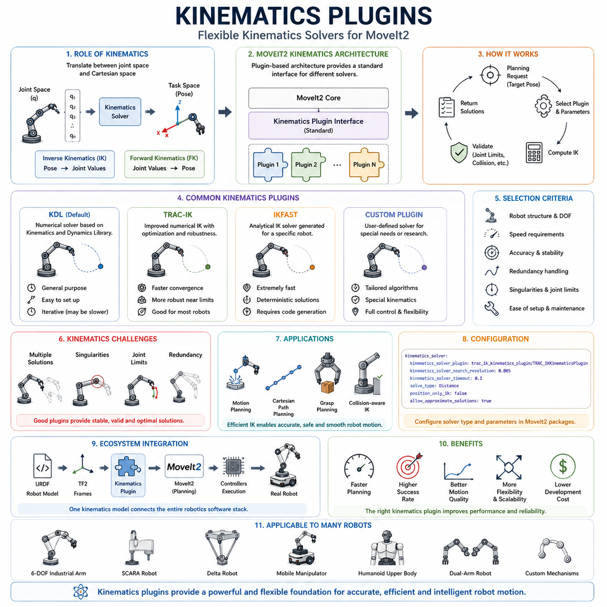{width="7.268055555555556in" height="7.268055555555556in"}

Kinematics is one of the most fundamental technologies in robotics and serves as the mathematical foundation for robot motion planning, manipulation, control, and autonomous operation. Within the MoveIt2 ecosystem, kinematics is responsible for translating between robot joint configurations and end-effector positions. Every manipulation task, whether it involves picking an object from a shelf, assembling components on a production line, opening a door, or performing a complex inspection procedure, ultimately depends on accurate kinematic calculations. Because different robots possess different mechanical structures, degrees of freedom, workspace characteristics, and performance requirements, MoveIt2 adopts a flexible plugin-based architecture that allows multiple kinematic solvers to be integrated seamlessly. These components are known as Kinematics Plugins.

A kinematics plugin is a software module that implements mathematical algorithms used to solve forward and inverse kinematics problems for a specific robot. Rather than embedding a single universal solver into the framework, MoveIt2 provides a generic interface through which different solvers can be connected. This design allows robotics engineers to select the most appropriate solver based on the robot\'s geometry, performance requirements, accuracy demands, and computational constraints. The plugin architecture improves flexibility, scalability, maintainability, and long-term compatibility across a wide variety of robotic platforms.

To understand the importance of kinematics plugins, it is first necessary to understand the role of kinematics itself. Kinematics describes motion without considering forces or torques. It focuses on the geometric relationship between joints, links, and end-effectors. Given a set of joint angles, forward kinematics computes the resulting position and orientation of the end-effector. Conversely, given a desired end-effector pose, inverse kinematics calculates the joint values required to achieve that pose. While forward kinematics is generally straightforward and deterministic, inverse kinematics is often significantly more challenging because multiple solutions, singularities, joint limits, and geometric constraints may exist.

In practical robotic systems, inverse kinematics is one of the most frequently executed calculations. Every time a robot is instructed to move its gripper to a target position, align a tool with a workpiece, grasp an object, or follow a Cartesian trajectory, an inverse kinematics solver must determine the corresponding joint configuration. Since these calculations occur continuously during motion planning and execution, the efficiency and reliability of the inverse kinematics solver directly influence overall system performance.

MoveIt2 addresses this challenge through its kinematics plugin framework. The framework defines a standardized interface that allows different kinematic solvers to interact with the motion planning system. As long as a solver implements the required interface functions, it can be integrated into MoveIt2 without modifying the core framework. This modular architecture encourages experimentation, customization, and optimization while protecting developers from vendor lock-in.

One of the most widely used kinematics plugins in MoveIt2 is KDL, which is based on the Kinematics and Dynamics Library. KDL provides a generic numerical approach for solving inverse kinematics and supports a wide range of robotic manipulators. Because it does not require robot-specific code generation, KDL can be used immediately after defining a robot model. It is often the default choice for development and prototyping because of its simplicity, reliability, and broad compatibility. However, numerical approaches may require iterative computations, which can sometimes limit performance in highly demanding real-time applications.

Trac-IK is another popular plugin that builds upon traditional numerical inverse kinematics techniques while introducing significant improvements in speed and robustness. Trac-IK combines optimization-based search methods with advanced numerical algorithms to improve convergence rates and solution quality. In many practical applications, Trac-IK can find valid solutions more quickly and reliably than traditional KDL implementations, particularly when robots operate near joint limits or in constrained workspaces. As a result, Trac-IK has become a preferred option for many industrial and research robotics systems.

For applications demanding maximum performance, IKFast is often considered the gold standard. Unlike numerical solvers, IKFast generates analytical inverse kinematics solutions tailored to a specific robot geometry. During the setup process, the robot\'s kinematic structure is analyzed and specialized solver code is automatically generated. The resulting solver can compute inverse kinematics solutions extremely quickly, often several orders of magnitude faster than iterative methods. This speed advantage makes IKFast particularly attractive for high-frequency motion planning, dynamic manipulation, and large-scale planning problems. However, the generation process can be complex, and analytical solutions are not available for every robot architecture.

The choice between numerical and analytical solvers represents one of the most important considerations in robot manipulation system design. Numerical solvers are generally more flexible and easier to deploy because they can accommodate a wide variety of robot structures. Analytical solvers offer exceptional speed and deterministic behavior but require additional setup and may not support highly complex kinematic chains. The plugin architecture of MoveIt2 allows organizations to select whichever approach best matches their operational requirements.

One of the challenges encountered in inverse kinematics is the existence of multiple valid solutions. A six-degree-of-freedom robotic arm may be able to reach the same end-effector pose using several different joint configurations. Human arms exhibit similar behavior. A person can reach the same object with their elbow positioned in different ways. Kinematics plugins must evaluate these possibilities and determine which solution is most appropriate. Selection criteria may include proximity to the current robot state, energy efficiency, collision avoidance, manipulability, joint limit margins, and task-specific preferences.

Singularities represent another significant challenge in kinematic computation. A singularity occurs when the robot loses one or more degrees of motion in a particular configuration. Near singularities, small end-effector movements may require extremely large joint motions, leading to instability, poor control performance, and planning difficulties. High-quality kinematics plugins incorporate mechanisms to detect and manage singularities, ensuring stable operation even in challenging regions of the workspace.

Joint limits further complicate inverse kinematics calculations. Every physical robot has constraints on how far its joints can move. A mathematically valid solution may not be physically achievable if it exceeds these limits. Kinematics plugins must therefore consider joint constraints throughout the solution process. Advanced solvers actively search for solutions that remain comfortably within allowable operating ranges, reducing mechanical stress and improving reliability.

Redundancy is another important concept in modern robotics. Many robots possess more degrees of freedom than are strictly required to achieve a given task. For example, a seven-axis manipulator can often reach the same pose using an infinite number of joint configurations. Redundant manipulators provide greater flexibility for obstacle avoidance, ergonomic motion generation, and optimization. However, they also introduce additional computational complexity. Kinematics plugins designed for redundant robots must incorporate optimization strategies that select desirable solutions from among many possibilities.

Mobile manipulators introduce even greater complexity because the robot consists of both a mobile base and a manipulator arm. Traditional inverse kinematics assumes a fixed base, but mobile manipulation requires coordination between navigation and arm motion. The robot may need to reposition its base before the arm can successfully reach a target. Future generations of kinematics plugins increasingly support whole-body kinematics, allowing coordinated planning across multiple subsystems. This capability is particularly important for warehouse automation, service robotics, humanoids, and field robotics.

MoveIt2 allows different planning groups within a robot to use different kinematics plugins. For example, a mobile manipulator may use one solver for the arm, another for a pan-tilt camera system, and yet another for a specialized end-effector mechanism. This flexibility enables highly customized robotic architectures while maintaining a unified software framework.

The configuration of kinematics plugins typically occurs through MoveIt2 configuration packages. Engineers specify which solver should be used, define solver-specific parameters, and configure optimization settings. Parameters may include solution tolerances, timeout values, search resolutions, redundancy handling strategies, and collision-aware constraints. Proper tuning of these parameters can significantly improve planning performance and operational reliability.

Kinematics plugins also play an important role in Cartesian path planning. During Cartesian motion generation, the end-effector follows a specified path through workspace coordinates. At every intermediate waypoint, inverse kinematics calculations are required to determine valid joint states. Efficient kinematics plugins allow smooth Cartesian trajectories to be generated in real time while preserving accuracy and constraint compliance.

Collision-aware inverse kinematics is an emerging area of development. Traditional inverse kinematics solvers focus exclusively on geometric reachability. However, a solution that reaches the target may still collide with obstacles. Modern kinematics plugins increasingly integrate collision checking into the solution process itself, allowing safer and more intelligent motion generation. This integration reduces planning failures and improves operational efficiency in cluttered environments.

Simulation environments such as Gazebo, Isaac Sim, MuJoCo, and Webots rely heavily on kinematic calculations. During simulation, kinematics plugins enable accurate robot motion, support interactive planning, and facilitate validation before deployment. Because simulation and physical deployment share the same kinematics framework, developers can maintain consistency across the entire development lifecycle.

The emergence of digital twins further increases the importance of accurate kinematics modeling. A digital twin continuously mirrors the physical robot\'s state and behavior. Kinematics plugins ensure that virtual robot motion accurately reflects real-world behavior, enabling predictive analysis, remote monitoring, and performance optimization.

Artificial intelligence is also beginning to influence kinematic computation. Machine learning techniques are being explored for inverse kinematics approximation, adaptive solver selection, singularity prediction, and motion optimization. Neural network-based inverse kinematics models can sometimes provide solutions faster than traditional methods while maintaining acceptable accuracy. Future kinematics plugins may combine analytical methods, numerical optimization, and AI-driven prediction to achieve unprecedented performance levels.

In industrial applications, the choice of kinematics plugin can significantly impact productivity. Faster inverse kinematics calculations reduce planning latency, enabling higher throughput in manufacturing and logistics systems. More reliable solvers reduce planning failures and improve system availability. Better redundancy handling leads to smoother motions, lower mechanical wear, and enhanced safety. Consequently, kinematics plugin selection is often a strategic engineering decision rather than a simple software configuration choice.

As robotics advances toward humanoid systems, autonomous mobile manipulators, collaborative robots, and embodied AI platforms, kinematic complexity will continue to grow. Future robots will possess dozens of degrees of freedom, dynamically changing configurations, and sophisticated interaction capabilities. The plugin-based architecture of MoveIt2 provides a scalable foundation capable of adapting to these evolving requirements.

Ultimately, kinematics plugins serve as the mathematical intelligence layer that transforms high-level motion goals into physically achievable robot configurations. They connect geometry with motion, planning with execution, and software intelligence with physical action. Without robust kinematics plugins, advanced motion planning, autonomous manipulation, and intelligent robotic behavior would not be possible. For engineers developing modern robotic systems using MoveIt2, understanding kinematics plugins is therefore essential to achieving high-performance, reliable, and scalable robot manipulation solutions.

기구학(Kinematics)은 로봇공학의 가장 기본적인 기술 중 하나이며, 모션 플래닝(Motion Planning), 매니퓰레이션(Manipulation), 제어(Control), 자율운용(Autonomous Operation)의 수학적 기반을 제공한다. MoveIt2 환경에서 기구학은 로봇의 관절 상태(Joint Configuration)와 엔드이펙터(End-Effector)의 위치 및 자세 사이의 관계를 계산하는 역할을 수행한다. 로봇이 선반에서 물체를 집거나, 생산라인에서 부품을 조립하거나, 문을 열거나, 복잡한 검사 작업을 수행하는 모든 과정은 정확한 기구학 계산에 의존한다. 로봇마다 기계 구조, 자유도(Degree of Freedom), 작업 공간, 성능 요구사항이 서로 다르기 때문에 MoveIt2는 다양한 기구학 솔버를 유연하게 사용할 수 있도록 플러그인 기반 구조를 채택하고 있으며, 이를 기구학 플러그인(Kinematics Plugin)이라고 부른다.

기구학 플러그인은 특정 로봇의 순기구학(Forward Kinematics)과 역기구학(Inverse Kinematics)을 계산하는 소프트웨어 모듈이다. MoveIt2는 하나의 기구학 솔버만을 강제하지 않고, 표준 인터페이스를 통해 다양한 솔버를 연결할 수 있도록 설계되어 있다. 따라서 개발자는 로봇 구조, 성능 요구사항, 정확도, 계산 자원 등을 고려하여 가장 적합한 솔버를 선택할 수 있다. 이러한 플러그인 구조는 유연성, 확장성, 유지보수성, 그리고 장기적인 호환성을 크게 향상시킨다.

기구학 플러그인의 중요성을 이해하기 위해서는 먼저 기구학 자체를 이해할 필요가 있다. 기구학은 힘과 토크를 고려하지 않고 로봇의 움직임을 수학적으로 분석하는 분야이다. 순기구학은 관절 각도를 입력받아 엔드이펙터의 위치와 자세를 계산하며, 역기구학은 목표 위치와 자세를 달성하기 위해 필요한 관절 값을 계산한다. 순기구학은 일반적으로 계산이 비교적 단순하지만, 역기구학은 다중 해(Multiple Solutions), 특이점(Singularity), 관절 제한(Joint Limits), 다양한 제약 조건이 존재하기 때문에 훨씬 복잡한 문제로 간주된다.

실제 로봇 시스템에서 가장 자주 수행되는 계산 중 하나가 바로 역기구학이다. 로봇이 특정 물체를 집기 위해 그리퍼를 이동시키거나, 공구를 정렬하거나, 카메라를 특정 방향으로 향하게 하거나, 작업 경로를 따라 이동할 때마다 역기구학 계산이 수행된다. 따라서 역기구학 솔버의 성능은 전체 로봇 시스템의 응답성, 계획 속도, 작업 성공률에 직접적인 영향을 미친다.

MoveIt2는 이러한 문제를 해결하기 위해 기구학 플러그인 프레임워크를 제공한다. 이 프레임워크는 다양한 솔버가 동일한 인터페이스를 통해 동작할 수 있도록 정의되어 있다. 따라서 개발자는 MoveIt2의 핵심 코드를 수정하지 않고도 새로운 기구학 알고리즘을 쉽게 추가할 수 있다. 이러한 모듈화 구조는 연구 개발뿐 아니라 산업용 로봇 시스템에서도 매우 중요한 장점으로 작용한다.

MoveIt2에서 가장 널리 사용되는 기구학 플러그인 중 하나는 KDL(Kinematics and Dynamics Library)이다. KDL은 수치해석(Numerical Method) 기반의 기구학 계산 라이브러리로서 다양한 로봇 구조를 지원한다. 별도의 코드 생성 과정 없이 URDF 모델만 정의하면 바로 사용할 수 있기 때문에 개발 초기 단계에서 매우 편리하다. 안정성과 범용성이 뛰어나며, 많은 연구 프로젝트와 산업용 시스템에서 기본 솔버로 사용된다. 그러나 반복 계산을 수행하는 수치해석 방식의 특성상 매우 빠른 응답이 요구되는 응용에서는 성능 한계가 존재할 수 있다.

Trac-IK는 KDL을 개선한 형태의 역기구학 솔버로 널리 사용된다. Trac-IK는 최적화 기반 탐색 알고리즘과 향상된 수치해석 기법을 결합하여 더 빠르고 안정적인 해를 찾을 수 있도록 설계되었다. 특히 관절 제한 근처나 복잡한 작업 공간에서 KDL보다 높은 성공률을 보이는 경우가 많다. 따라서 산업용 매니퓰레이터와 연구용 로봇에서 Trac-IK를 선호하는 경우가 많다.

최고 수준의 성능이 필요한 경우 IKFast가 자주 사용된다. IKFast는 수치해석 기반이 아니라 해석적(Analytical) 기구학 솔버이다. 로봇의 기구학 구조를 분석하여 특정 로봇 전용 코드를 자동 생성한다. 생성된 코드는 역기구학을 매우 빠르게 계산할 수 있으며, 일반적인 수치해석 방식보다 수십 배에서 수백 배 빠른 성능을 제공할 수 있다. 이러한 특성 때문에 고속 모션 플래닝, 실시간 조작, 대규모 경로 탐색 문제에서 매우 유용하다. 그러나 설정 과정이 복잡하며, 모든 로봇 구조에 대해 해석적 해를 생성할 수 있는 것은 아니다.

수치해석 방식과 해석적 방식의 선택은 로봇 시스템 설계에서 중요한 의사결정 중 하나이다. 수치해석 기반 솔버는 유연성과 범용성이 뛰어나지만 계산 시간이 더 길 수 있다. 반면 해석적 솔버는 매우 빠르지만 로봇 구조에 따라 적용이 제한될 수 있다. MoveIt2의 플러그인 구조는 이러한 다양한 요구사항을 수용할 수 있도록 설계되어 있다.

역기구학 계산에서 자주 발생하는 문제 중 하나는 다중 해(Multiple Solutions)이다. 예를 들어 6축 로봇팔은 동일한 위치와 자세를 여러 가지 관절 조합으로 달성할 수 있다. 인간의 팔도 같은 물체를 잡을 때 팔꿈치 방향을 다르게 하여 동일한 목표를 달성할 수 있다. 기구학 플러그인은 이러한 여러 해 중에서 가장 적절한 해를 선택해야 한다. 선택 기준으로는 현재 관절 상태와의 거리, 에너지 효율, 충돌 가능성, 조작성(Manipulability), 관절 제한 여유도 등이 사용될 수 있다.

특이점(Singularity)은 기구학 계산에서 또 다른 중요한 문제이다. 특이점은 특정 자세에서 로봇이 일부 자유도를 상실하는 현상을 의미한다. 특이점 근처에서는 엔드이펙터를 조금만 움직여도 관절이 매우 크게 움직여야 할 수 있으며, 제어 성능이 급격히 저하될 수 있다. 우수한 기구학 플러그인은 이러한 특이점을 탐지하고 회피하거나 안정적으로 처리할 수 있는 기능을 제공한다.

관절 제한(Joint Limits) 역시 중요한 고려 요소이다. 모든 실제 로봇은 각 관절마다 허용 가능한 회전 범위를 가진다. 수학적으로는 가능한 해가 존재하더라도 실제 로봇에서는 해당 자세를 만들 수 없는 경우가 있다. 따라서 기구학 플러그인은 관절 제한을 고려하여 현실적으로 실행 가능한 해만을 선택해야 한다.

현대 로봇에서는 중복 자유도(Redundancy)가 자주 사용된다. 예를 들어 7축 로봇은 동일한 목표 자세를 무수히 많은 방법으로 달성할 수 있다. 이러한 중복 자유도는 장애물 회피, 자세 최적화, 에너지 절감 등의 장점을 제공하지만 동시에 계산 복잡도를 증가시킨다. 따라서 기구학 플러그인은 여러 가능한 해 중에서 가장 적합한 해를 선택하기 위한 최적화 기법을 포함해야 한다.

모바일 매니퓰레이터에서는 기구학 문제가 더욱 복잡해진다. 일반적인 산업용 로봇은 고정된 베이스를 가정하지만, 모바일 매니퓰레이터는 이동 플랫폼과 로봇팔이 결합되어 있다. 따라서 목표 위치에 도달하기 위해 로봇팔뿐 아니라 모바일 베이스도 함께 움직여야 한다. 미래의 기구학 플러그인은 전체 로봇 몸체(Whole-Body Kinematics)를 고려하여 이동과 조작을 동시에 계획하는 방향으로 발전하고 있다. 이러한 기능은 물류 자동화, 서비스 로봇, 휴머노이드, 야외 작업 로봇에서 특히 중요하다.

MoveIt2는 하나의 로봇 내에서도 서로 다른 기구학 플러그인을 사용할 수 있다. 예를 들어 로봇팔에는 Trac-IK를 사용하고, 팬틸트 카메라 시스템에는 KDL을 사용하며, 특수 엔드이펙터에는 별도의 사용자 정의 솔버를 적용할 수 있다. 이러한 유연성은 복잡한 로봇 시스템 설계에 큰 장점을 제공한다.

기구학 플러그인의 설정은 일반적으로 MoveIt2 Configuration Package를 통해 이루어진다. 개발자는 사용할 솔버를 지정하고, 오차 허용 범위, 탐색 시간 제한, 중복 자유도 처리 방식, 탐색 해상도 등의 매개변수를 조정할 수 있다. 적절한 파라미터 튜닝은 계획 성능과 작업 성공률을 크게 향상시킨다.

Cartesian Path Planning에서도 기구학 플러그인은 중요한 역할을 수행한다. 엔드이펙터가 직선 또는 곡선 경로를 따라 이동할 때 경로상의 모든 지점에 대해 역기구학 계산이 수행되어야 한다. 효율적인 기구학 플러그인은 이러한 계산을 실시간으로 수행하여 부드럽고 정확한 경로 생성을 가능하게 한다.

최근에는 충돌 인식 역기구학(Collision-Aware Inverse Kinematics)에 대한 연구도 활발하게 진행되고 있다. 기존의 역기구학 솔버는 목표 위치에 도달하는 것만 고려했지만, 최신 솔버는 계산 과정에서 충돌 여부도 함께 고려한다. 이를 통해 장애물이 많은 환경에서도 더 안전하고 효율적인 경로를 생성할 수 있다.

Gazebo, Isaac Sim, MuJoCo, Webots와 같은 시뮬레이션 환경에서도 기구학 플러그인은 중요한 역할을 한다. 시뮬레이션에서 사용되는 기구학 모델과 실제 로봇에서 사용되는 모델이 동일하기 때문에 개발자는 가상 환경에서 검증한 결과를 실제 시스템에 그대로 적용할 수 있다.

디지털 트윈 환경에서도 정확한 기구학 모델은 필수적이다. 디지털 트윈은 실제 로봇의 상태를 실시간으로 반영하는 가상 모델이다. 기구학 플러그인은 가상 로봇의 움직임이 실제 로봇과 일치하도록 보장하며, 이를 통해 예측 분석, 원격 모니터링, 성능 최적화가 가능해진다.

최근에는 인공지능 기술도 기구학 계산에 활용되기 시작했다. 딥러닝 기반 역기구학 모델은 기존의 수치해석 방식보다 더 빠르게 해를 예측할 수 있으며, 특이점 예측, 솔버 선택, 경로 최적화 등의 분야에서도 연구가 진행되고 있다. 미래의 기구학 플러그인은 해석적 방법, 수치해석 방법, AI 기반 예측 기술을 결합한 하이브리드 구조로 발전할 가능성이 높다.

산업 현장에서는 기구학 플러그인의 선택이 생산성에 직접적인 영향을 미친다. 빠른 역기구학 계산은 모션 플래닝 지연 시간을 줄여 처리량을 증가시키고, 높은 성공률은 시스템 가동률을 향상시킨다. 또한 우수한 중복 자유도 처리는 더 부드러운 움직임과 낮은 기계적 마모를 제공한다. 따라서 기구학 플러그인의 선택은 단순한 소프트웨어 설정이 아니라 전략적인 엔지니어링 결정이라고 할 수 있다.

향후 휴머노이드, 협동로봇, 모바일 매니퓰레이터, Embodied AI 시스템이 발전할수록 기구학 문제는 더욱 복잡해질 것이다. 수십 개 이상의 자유도를 가진 로봇이 등장하면서 더욱 강력하고 지능적인 기구학 솔버가 요구될 것이다. MoveIt2의 플러그인 기반 구조는 이러한 미래 요구사항에 대응할 수 있는 확장 가능한 기반을 제공한다.

결국 기구학 플러그인은 고수준의 작업 목표를 실제 로봇이 실행 가능한 관절 상태로 변환하는 수학적 지능 계층(Mathematical Intelligence Layer)이라고 할 수 있다. 이는 기하학과 움직임을 연결하고, 계획과 실행을 연결하며, 소프트웨어 지능과 물리적 행동을 연결한다. 강력한 기구학 플러그인이 없다면 고급 모션 플래닝, 자율 조작, 지능형 로봇 행동은 실현될 수 없다. 따라서 MoveIt2 기반의 현대 로봇 시스템을 개발하는 엔지니어에게 기구학 플러그인에 대한 이해는 고성능, 고신뢰성, 확장 가능한 로봇 조작 시스템 구축을 위한 필수 역량이라고 할 수 있다.

##  

## 04 Motion Planning Framework

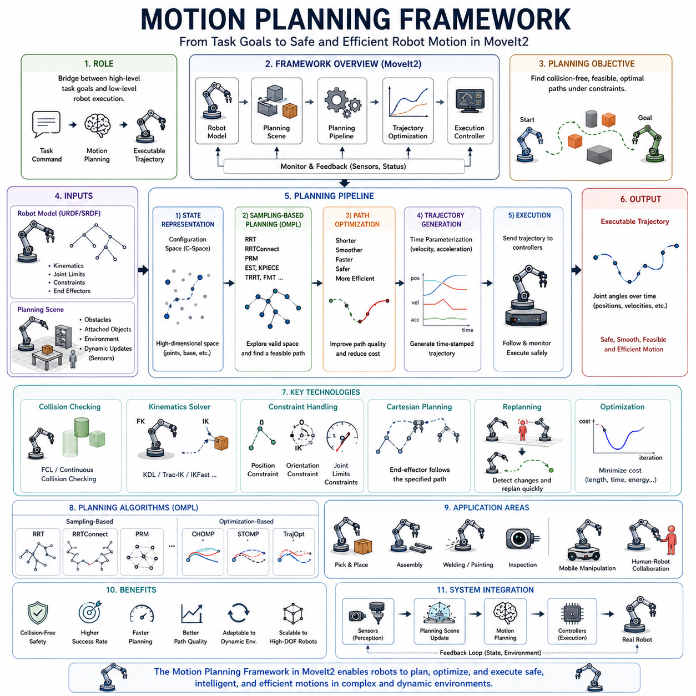{width="7.268055555555556in" height="7.268055555555556in"}

Motion planning is one of the most important capabilities in robotics because it enables a robot to move intelligently from one state to another while satisfying physical, environmental, and operational constraints. In modern robotic systems, motion planning serves as the bridge between high-level task objectives and low-level robot execution. A robot may receive a command such as "pick up the box," "inspect the machine," "assemble the component," or "move to the charging station." However, these commands do not directly specify how the robot should move. The responsibility of the motion planning framework is to transform these high-level goals into safe, feasible, efficient, and executable trajectories. Within the MoveIt2 ecosystem, the Motion Planning Framework represents the core intelligence responsible for generating collision-free robot motions in both structured and unstructured environments.

At a fundamental level, motion planning can be viewed as a search problem. The planner must determine how a robot can move from an initial configuration to a desired goal configuration while avoiding obstacles and respecting all physical constraints. Unlike simple pathfinding problems in two-dimensional environments, robot motion planning occurs in high-dimensional configuration spaces. A six-axis manipulator, for example, operates in a six-dimensional configuration space where each dimension corresponds to a joint variable. Mobile manipulators, humanoids, and dual-arm robots often operate in configuration spaces containing dozens of dimensions. The complexity of planning increases dramatically as the number of dimensions grows, making efficient planning algorithms essential.

The Motion Planning Framework within MoveIt2 provides a modular architecture that separates planning logic from robot-specific implementations. This design allows developers to utilize different planning algorithms, optimization strategies, collision-checking systems, and execution mechanisms while maintaining a consistent user interface. The framework integrates multiple components into a unified planning pipeline, including robot models, kinematics solvers, collision checkers, planning scene management, path planners, trajectory optimizers, and execution controllers.

The planning process begins with a robot model. Before any planning can occur, the framework must understand the robot's physical structure, kinematic relationships, joint limits, workspace boundaries, and operational constraints. This information is typically provided through URDF and SRDF descriptions. The robot model acts as the mathematical representation of the physical robot and provides the foundation for all subsequent calculations. Every generated trajectory must conform to the capabilities and limitations defined by this model.

The next critical component is the planning scene. The planning scene represents the robot's understanding of its environment. It contains information about obstacles, workpieces, fixtures, walls, shelves, humans, attached objects, and environmental constraints. Unlike static maps, planning scenes can be updated dynamically using sensor data. Cameras, LiDARs, depth sensors, and perception systems continuously provide information about the surrounding environment, allowing the planner to adapt to changing conditions. This capability is particularly important in warehouses, factories, hospitals, and service environments where obstacles may appear unexpectedly.

Motion planning fundamentally requires solving two questions. The first question is whether a valid path exists. The second question is which valid path should be chosen. Many different trajectories may satisfy the same goal. Some may be shorter, smoother, safer, faster, or more energy-efficient than others. Consequently, motion planning is not simply a feasibility problem but also an optimization problem. Modern planning frameworks attempt to balance multiple objectives simultaneously.

One of the most important concepts in motion planning is configuration space, often abbreviated as C-space. Instead of reasoning directly in physical workspace coordinates, planners represent robot states using configuration variables such as joint angles and base positions. Every point within the configuration space corresponds to a unique robot configuration. Regions of the configuration space that result in collisions are considered invalid, while collision-free regions are considered valid. The planner's objective is to find a continuous path through the valid regions that connects the start state to the goal state.

As robotic systems become increasingly complex, exhaustive search methods become computationally impractical. This challenge led to the development of sampling-based planning algorithms, which have become the dominant approach in modern robot motion planning. Rather than exploring every possible state, sampling-based planners randomly generate candidate states and gradually build a representation of feasible paths through the configuration space. These methods provide practical solutions for high-dimensional planning problems that would otherwise be impossible to solve efficiently.

MoveIt2 primarily relies on the Open Motion Planning Library (OMPL) for motion planning. OMPL provides a large collection of planning algorithms designed for robotic applications. Among the most widely used algorithms is Rapidly Exploring Random Trees (RRT). RRT incrementally grows a search tree from the starting configuration by randomly sampling new states and connecting them to the existing tree. This approach efficiently explores large configuration spaces and can quickly find feasible solutions.

An extension known as RRTConnect further improves planning efficiency by simultaneously growing trees from both the start and goal states. When the two trees meet, a complete path is generated. RRTConnect is widely used in industrial robotics because it provides a good balance between planning speed and solution quality. In many practical manipulation applications, it serves as the default planning algorithm.

Probabilistic Roadmaps (PRM) represent another important planning strategy. Unlike RRT, which is designed primarily for single-query planning problems, PRM constructs a reusable graph of collision-free configurations. This roadmap can then be queried repeatedly to solve multiple planning tasks within the same environment. PRM is particularly effective in applications where robots repeatedly operate within known workspaces, such as manufacturing cells and automated warehouses.

Other planning algorithms within OMPL include EST, KPIECE, LBKPIECE, TRRT, and FMT. Each algorithm offers different trade-offs between planning speed, exploration efficiency, path quality, memory usage, and robustness. The modular architecture of MoveIt2 allows engineers to evaluate multiple algorithms and select the most appropriate solution for a given application.

Finding a collision-free path is only the first stage of motion planning. Initial solutions generated by sampling-based planners are often suboptimal. They may contain unnecessary detours, abrupt direction changes, or inefficient joint movements. Therefore, modern motion planning frameworks incorporate path optimization techniques. These optimizers improve trajectory quality by reducing path length, minimizing execution time, smoothing motion profiles, reducing energy consumption, and increasing safety margins.

Trajectory optimization represents a complementary approach to sampling-based planning. Rather than constructing paths through random exploration, optimization-based planners formulate motion planning as a mathematical optimization problem. The planner iteratively adjusts a candidate trajectory until it satisfies constraints and minimizes a defined cost function. Frameworks such as CHOMP, STOMP, and TrajOpt exemplify this approach. These methods often generate smoother and more efficient trajectories than purely sampling-based algorithms, although they may require higher computational resources.

Constraint handling is another critical aspect of motion planning. Real-world robotic tasks rarely involve unrestricted motion. Robots frequently operate under positional, orientational, kinematic, dynamic, and environmental constraints. A robot carrying a tray of food must maintain level orientation. A welding robot must follow a predefined tool path. A medical robot may need to remain within a safe operating region. The Motion Planning Framework must ensure that all generated trajectories satisfy these constraints throughout execution.

Cartesian path planning is particularly important in manipulation applications. While standard planners focus on reaching a target configuration, Cartesian planners ensure that the end-effector follows a specified geometric path through space. This capability is essential for tasks such as welding, painting, dispensing, polishing, cutting, assembly, and inspection. MoveIt2 provides dedicated Cartesian planning functionality that generates paths while respecting kinematic and collision constraints.

Collision checking is deeply integrated into every stage of the planning process. Every candidate motion must be evaluated against the planning scene to ensure safety. MoveIt2 commonly employs collision detection libraries such as FCL to perform these calculations efficiently. Continuous collision checking further improves safety by evaluating the entire motion trajectory rather than only discrete waypoints. This reduces the risk of collisions occurring between sampled states.

For mobile manipulators, motion planning becomes substantially more challenging because planning must consider both navigation and manipulation simultaneously. The robot may need to reposition its base before a manipulation task becomes feasible. Traditional motion planning frameworks focused exclusively on robotic arms with fixed bases. Modern frameworks increasingly support whole-body planning, where mobile bases, manipulators, sensors, and other subsystems are planned together as a unified system. This capability is becoming increasingly important for warehouse robotics, logistics automation, service robots, and humanoid systems.

Real-time planning represents another major challenge. In dynamic environments, obstacles can move unexpectedly, requiring rapid replanning. Human workers, forklifts, autonomous vehicles, and other robots continuously alter the environment. The Motion Planning Framework must therefore support incremental updates and fast replanning strategies. Reactive planning techniques allow robots to adapt quickly without recomputing entire trajectories from scratch.

The integration of perception and planning is a defining characteristic of modern robotic systems. Motion planning is no longer performed in isolation. Perception systems continuously update the planning scene with information about object locations, environmental changes, and potential hazards. The planner uses this information to generate context-aware trajectories. This integration creates a closed-loop system in which sensing and planning continuously influence one another.

Simulation plays a vital role in motion planning development. Before deployment on physical hardware, planners are typically evaluated within simulation environments such as Gazebo, Isaac Sim, MuJoCo, and Webots. Simulation allows engineers to test algorithms, validate safety, analyze performance, and identify edge cases without risking damage to expensive equipment. Because MoveIt2 uses the same planning framework in simulation and real-world deployment, the transition from virtual testing to physical operation becomes significantly more reliable.

Digital twins further extend the role of motion planning. A digital twin maintains a continuously updated representation of a physical robot and its environment. Motion planning can be executed within the digital twin before commands are transmitted to the physical system. This approach enables predictive validation, risk assessment, performance optimization, and advanced operational monitoring.

Artificial intelligence is increasingly influencing motion planning frameworks. Traditional planning algorithms excel at geometric reasoning but often lack semantic understanding. AI systems can provide higher-level context, predict environmental changes, estimate task success probabilities, and generate intelligent planning objectives. Vision-language models, foundation models, and robot agents are beginning to work alongside motion planners, creating hybrid architectures that combine symbolic reasoning, machine learning, and geometric planning.

In industrial applications, motion planning directly influences productivity, safety, and operational efficiency. Faster planners increase throughput. Better optimization reduces cycle times. Improved collision avoidance enhances safety. Robust constraint handling improves task success rates. Consequently, the motion planning framework often becomes one of the most critical components in the overall robotic architecture.

As robotics evolves toward autonomous mobile manipulators, humanoid robots, collaborative robots, and embodied AI systems, motion planning frameworks must continue to advance. Future frameworks will support increasingly complex robots, dynamic environments, multi-agent coordination, semantic reasoning, and learning-based planning strategies. The boundaries between planning, perception, control, and artificial intelligence will become increasingly blurred.

Ultimately, the Motion Planning Framework serves as the decision-making engine that transforms desired goals into executable robot motions. It combines robot modeling, kinematics, collision avoidance, optimization, environmental awareness, and execution management into a unified system. Within MoveIt2, this framework forms the heart of robot manipulation, enabling robots to move intelligently, safely, and efficiently through the physical world. For modern robotics engineers, understanding the Motion Planning Framework is essential because it provides the foundation upon which advanced manipulation, autonomous operation, and intelligent robotic behavior are built.

모션 플래닝(Motion Planning)은 로봇이 하나의 상태에서 다른 상태로 지능적으로 이동할 수 있도록 해주는 핵심 기술이다. 로봇이 이동하는 과정에서 물리적 제약 조건, 환경적 제약 조건, 그리고 작업상의 요구사항을 모두 만족해야 하므로 모션 플래닝은 현대 로봇 시스템의 가장 중요한 기능 중 하나로 평가된다. 현대 로봇 시스템에서 모션 플래닝은 상위 수준의 작업 목표와 실제 로봇의 움직임을 연결하는 역할을 수행한다. 예를 들어 로봇이 "상자를 집어라", "설비를 검사하라", "부품을 조립하라", "충전 스테이션으로 이동하라"와 같은 명령을 받았을 때, 이러한 명령은 무엇을 해야 하는지는 알려주지만 어떻게 움직여야 하는지는 설명하지 않는다. 바로 이 부분을 담당하는 것이 모션 플래닝 프레임워크이다. MoveIt2 환경에서 Motion Planning Framework는 충돌이 없는 안전한 경로를 생성하고 이를 실제 로봇이 실행할 수 있는 형태로 변환하는 핵심 엔진 역할을 수행한다.

가장 기본적인 관점에서 모션 플래닝은 탐색(Search) 문제로 볼 수 있다. 로봇은 현재 상태에서 목표 상태까지 이동해야 하며, 그 과정에서 장애물을 피하고 모든 제약 조건을 만족해야 한다. 단순한 2차원 경로 탐색과 달리 로봇의 모션 플래닝은 고차원 구성 공간(Configuration Space, C-Space)에서 이루어진다. 예를 들어 6축 산업용 로봇은 6차원 공간에서 움직이며, 모바일 매니퓰레이터나 휴머노이드는 수십 개의 자유도를 가지므로 훨씬 더 복잡한 공간을 다루어야 한다. 자유도가 증가할수록 가능한 상태의 수는 기하급수적으로 증가하기 때문에 효율적인 알고리즘이 필수적이다.

MoveIt2의 Motion Planning Framework는 계획 알고리즘과 로봇 구현을 분리하는 모듈형 구조를 제공한다. 이를 통해 개발자는 다양한 플래닝 알고리즘, 최적화 기법, 충돌 검사기, 실행 제어기를 자유롭게 선택할 수 있다. 프레임워크는 로봇 모델, 기구학 솔버, 충돌 검사 시스템, 플래닝 씬(Planning Scene), 경로 생성기, 궤적 최적화기, 실행 제어기 등을 하나의 통합 파이프라인으로 구성한다.

모션 플래닝은 먼저 로봇 모델(Robot Model)로부터 시작된다. 플래너는 로봇의 물리적 구조, 관절 제한, 작업 공간 범위, 운동학적 제약 조건 등을 이해해야 한다. 이러한 정보는 일반적으로 URDF와 SRDF 파일을 통해 제공된다. 로봇 모델은 실제 로봇을 수학적으로 표현한 것이며, 생성되는 모든 경로는 이 모델이 정의하는 제약 조건을 반드시 따라야 한다.

그 다음 중요한 요소는 플래닝 씬(Planning Scene)이다. 플래닝 씬은 로봇이 현재 환경을 어떻게 이해하고 있는지를 표현하는 디지털 환경 모델이다. 여기에는 벽, 선반, 장비, 공작물, 작업자, 이동 장애물, 로봇이 집고 있는 물체 등의 정보가 포함된다. 플래닝 씬은 정적인 데이터가 아니라 센서 정보를 통해 지속적으로 업데이트될 수 있다. 카메라, LiDAR, Depth Sensor, 비전 시스템 등이 새로운 환경 정보를 제공하면 플래너는 이를 반영하여 경로를 재계산할 수 있다. 이러한 기능은 창고, 병원, 공장, 서비스 환경과 같이 지속적으로 변화하는 공간에서 매우 중요하다.

모션 플래닝은 본질적으로 두 가지 질문에 답해야 한다. 첫 번째는 "유효한 경로가 존재하는가?"이고, 두 번째는 "여러 가능한 경로 중 어떤 경로가 가장 좋은가?"이다. 동일한 목표를 달성하는 경로는 여러 개가 존재할 수 있으며, 어떤 경로는 더 짧고, 더 빠르고, 더 안전하며, 더 적은 에너지를 사용할 수 있다. 따라서 모션 플래닝은 단순한 경로 탐색 문제가 아니라 최적화 문제(Optimization Problem)로도 볼 수 있다.

모션 플래닝에서 가장 중요한 개념 중 하나는 구성 공간(Configuration Space, C-Space)이다. 플래너는 실제 작업 공간에서 직접 계산하는 대신 관절 각도, 모바일 베이스 위치와 같은 상태 변수로 로봇을 표현한다. 구성 공간의 각 점은 하나의 로봇 자세를 의미한다. 충돌이 발생하는 영역은 비유효 영역(Invalid Region)이며, 충돌이 없는 영역은 유효 영역(Valid Region)이다. 플래너의 목표는 시작 상태와 목표 상태를 연결하는 연속적인 유효 경로를 찾는 것이다.

고차원 공간에서는 모든 상태를 탐색하는 것이 현실적으로 불가능하기 때문에 샘플링 기반(Sampling-Based) 알고리즘이 널리 사용된다. 샘플링 기반 플래너는 가능한 상태를 무작위로 생성하면서 경로를 탐색한다. 이러한 방법은 수십 개 이상의 자유도를 가진 로봇에서도 현실적인 시간 내에 경로를 생성할 수 있다.

MoveIt2는 주로 OMPL(Open Motion Planning Library)을 사용하여 경로를 생성한다. OMPL은 다양한 모션 플래닝 알고리즘을 제공하는 대표적인 라이브러리이다. 그 중 가장 유명한 알고리즘은 RRT(Rapidly Exploring Random Tree)이다. RRT는 시작점에서부터 트리를 확장하면서 무작위로 샘플링된 상태를 연결해 나간다. 이를 통해 넓은 공간을 효율적으로 탐색할 수 있다.

RRT의 발전형인 RRTConnect는 시작점과 목표점에서 동시에 트리를 생성한다. 두 트리가 만나면 완전한 경로가 형성된다. RRTConnect는 속도와 품질의 균형이 뛰어나기 때문에 산업용 로봇에서 가장 널리 사용되는 플래닝 알고리즘 중 하나이다.

PRM(Probabilistic Roadmap)은 또 다른 대표적인 알고리즘이다. RRT가 단일 질의(Single Query)에 적합한 반면, PRM은 환경 내에 재사용 가능한 경로 그래프를 생성한다. 따라서 동일한 환경에서 반복적으로 경로를 계산해야 하는 제조 공정이나 물류 창고 환경에 매우 적합하다.

OMPL은 이 외에도 EST, KPIECE, LBKPIECE, TRRT, FMT와 같은 다양한 알고리즘을 제공한다. 각각의 알고리즘은 속도, 메모리 사용량, 경로 품질, 탐색 효율성, 안정성 측면에서 서로 다른 특성을 가진다. MoveIt2는 이러한 알고리즘을 자유롭게 교체할 수 있는 구조를 제공한다.

플래너가 생성한 초기 경로는 반드시 최적이라고 할 수 없다. 경로가 불필요하게 길거나, 갑작스러운 방향 전환이 많거나, 비효율적인 관절 움직임을 포함할 수 있다. 따라서 모션 플래닝 프레임워크는 일반적으로 경로 최적화(Path Optimization) 과정을 수행한다. 이를 통해 경로 길이를 줄이고, 움직임을 부드럽게 하며, 실행 시간을 단축하고, 에너지 소비를 감소시킨다.

최근에는 최적화 기반 플래닝(Trajectory Optimization) 기법도 널리 사용된다. CHOMP, STOMP, TrajOpt와 같은 알고리즘은 경로를 수학적 최적화 문제로 정의하고 반복적으로 개선해 나간다. 이러한 방식은 일반적으로 더 부드럽고 효율적인 경로를 생성할 수 있지만 계산 비용이 상대적으로 높다.

실제 환경에서는 다양한 제약 조건을 고려해야 한다. 로봇이 액체가 담긴 트레이를 운반할 경우 수평 자세를 유지해야 하며, 용접 로봇은 특정 궤적을 따라 이동해야 한다. 의료 로봇은 지정된 안전 영역을 벗어나면 안 된다. 모션 플래닝 프레임워크는 위치 제약, 자세 제약, 속도 제한, 작업 공간 제한 등을 모두 만족하는 경로를 생성해야 한다.

Cartesian Path Planning은 특히 조작 작업에서 중요하다. 일반적인 플래닝은 목표 자세에 도달하는 것을 목표로 하지만, Cartesian Planning은 엔드이펙터가 작업 공간 내 특정 경로를 정확하게 따라가도록 한다. 이는 용접, 도장, 절삭, 연마, 조립, 검사와 같은 산업 작업에 필수적이다.

충돌 검사는 모션 플래닝의 모든 단계에 통합되어 있다. MoveIt2는 일반적으로 FCL(Flexible Collision Library)을 사용하여 충돌 여부를 계산한다. 최신 시스템은 연속 충돌 검사(Continuous Collision Checking)를 통해 경로의 모든 구간을 평가하며, 단순히 몇 개의 점만 검사하는 방식보다 훨씬 높은 안전성을 제공한다.

모바일 매니퓰레이터에서는 문제의 복잡성이 더욱 증가한다. 로봇팔만 움직이는 것이 아니라 모바일 베이스까지 함께 고려해야 하기 때문이다. 목표 물체를 집기 위해 먼저 베이스를 이동해야 할 수도 있다. 따라서 최신 모션 플래닝 프레임워크는 Whole-Body Planning을 지원하여 이동과 조작을 동시에 계획한다. 이는 물류 로봇, 서비스 로봇, 휴머노이드에서 매우 중요한 기능이다.

실시간 플래닝(Real-Time Planning)도 중요한 과제이다. 사람이 갑자기 나타나거나, 지게차가 지나가거나, 다른 로봇이 경로를 가로막을 수 있다. 이러한 상황에서는 기존 경로를 빠르게 수정하거나 재생성해야 한다. 최신 플래너는 전체 경로를 처음부터 다시 계산하는 대신 부분적으로 수정하는 재계획(Replanning) 기능을 제공한다.

현대 로봇에서는 인식(Perception)과 계획(Planning)의 통합이 필수적이다. 비전 시스템과 센서는 지속적으로 환경 정보를 제공하고, 플래너는 이를 기반으로 새로운 경로를 생성한다. 이러한 폐루프(Closed Loop) 구조는 변화하는 환경에서도 안정적인 자율 동작을 가능하게 한다.

시뮬레이션은 모션 플래닝 개발에서 매우 중요한 역할을 수행한다. Gazebo, Isaac Sim, MuJoCo, Webots와 같은 시뮬레이터에서 경로 계획 알고리즘을 검증할 수 있다. 실제 하드웨어를 사용하기 전에 성능과 안전성을 평가할 수 있기 때문에 개발 비용과 위험을 크게 줄일 수 있다.

디지털 트윈(Digital Twin)은 모션 플래닝의 활용 범위를 더욱 확장한다. 디지털 트윈은 실제 로봇과 환경을 가상 공간에 실시간으로 복제한다. 플래너는 먼저 디지털 트윈에서 경로를 검증한 후 실제 로봇에 적용할 수 있다. 이를 통해 위험을 줄이고 운영 효율을 향상시킬 수 있다.

최근에는 인공지능이 모션 플래닝에도 영향을 미치고 있다. 기존 플래너는 기하학적 문제를 해결하는 데 강점을 가지지만, 의미론적 이해(Semantic Understanding)는 부족하다. AI는 환경 변화 예측, 작업 성공 가능성 평가, 목표 생성, 상황 판단 등의 기능을 제공할 수 있다. 앞으로는 비전-언어 모델(VLM), 파운데이션 모델, 로봇 에이전트와 모션 플래너가 결합된 하이브리드 구조가 더욱 보편화될 것으로 예상된다.

산업 현장에서 모션 플래닝은 생산성, 안전성, 운영 효율성을 직접 결정하는 핵심 요소이다. 빠른 플래너는 생산성을 향상시키고, 우수한 최적화는 사이클 타임을 단축하며, 강력한 충돌 회피 기능은 안전성을 높인다. 따라서 Motion Planning Framework는 로봇 소프트웨어 아키텍처에서 가장 중요한 구성 요소 중 하나로 간주된다.

향후 모바일 매니퓰레이터, 휴머노이드, 협동로봇, Embodied AI 시스템이 발전함에 따라 모션 플래닝 프레임워크도 더욱 진화할 것이다. 미래의 프레임워크는 다중 로봇 협업, 의미 기반 추론, 학습 기반 계획, 환경 적응형 최적화 등을 지원하게 될 것이다.

결국 Motion Planning Framework는 목표를 실제 움직임으로 변환하는 로봇의 의사결정 엔진(Decision-Making Engine)이라고 할 수 있다. 로봇 모델링, 기구학, 충돌 회피, 경로 최적화, 환경 인식, 실행 제어를 하나의 통합 시스템으로 결합하며, MoveIt2에서 로봇이 안전하고 효율적으로 움직일 수 있도록 만드는 핵심 기술이다. 현대 로봇 엔지니어에게 모션 플래닝 프레임워크에 대한 이해는 자율 조작, 지능형 행동, 모바일 매니퓰레이션을 구현하기 위한 필수 역량이라고 할 수 있다.

##  

## 05 Collision Checking

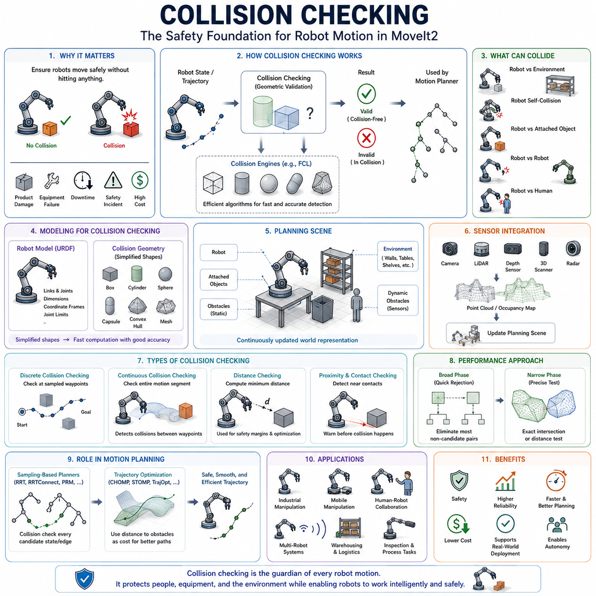{width="7.268055555555556in" height="7.268055555555556in"}

Collision checking is one of the most critical components in robotic motion planning and autonomous manipulation systems. Regardless of how intelligent a robot may be, how accurate its perception system is, or how sophisticated its planning algorithms are, the robot cannot operate safely if it cannot reliably detect and avoid collisions. Within the MoveIt2 ecosystem, collision checking serves as the safety foundation that ensures every generated motion is physically feasible and free from unintended contact with the environment, other robots, equipment, workpieces, or human operators. It is one of the core technologies that transforms a mathematical motion plan into a safe and executable robot action.

In robotics, a collision occurs whenever two objects occupy overlapping physical space. Such collisions may involve the robot colliding with obstacles, parts of the robot colliding with itself, multiple robots interfering with each other, or the robot contacting humans in unsafe ways. Even a small collision can cause product damage, equipment failures, production downtime, safety incidents, or costly repairs. Consequently, modern robotic systems place a strong emphasis on collision detection and collision avoidance throughout the entire planning and execution process.

Collision checking can be viewed as a geometric validation process. Given a candidate robot configuration or trajectory, the collision checking system evaluates whether any part of the robot intersects with any object in the environment. If an intersection is detected, the configuration is considered invalid and cannot be used by the motion planner. The planning system then searches for alternative solutions that satisfy all safety requirements while still accomplishing the desired task.

The importance of collision checking increases significantly as robots become more autonomous and operate in dynamic environments. Traditional industrial robots often worked inside fenced workcells where the environment was carefully controlled and rarely changed. Under those conditions, collision risks could be minimized through mechanical design and fixed safety barriers. Modern robots, however, operate in warehouses, hospitals, airports, retail facilities, laboratories, public spaces, and outdoor environments. In these settings, obstacles can move unexpectedly, people can enter the workspace, and environmental conditions can change continuously. As a result, collision checking must function as a real-time process rather than a static validation step.

MoveIt2 integrates collision checking deeply into its Motion Planning Framework. Every motion planning query relies on collision validation before a trajectory can be accepted. During planning, thousands or even millions of candidate robot states may be generated. Each candidate state must be evaluated to determine whether it is collision-free. Only those states that satisfy collision constraints are allowed to participate in path generation. This process ensures that safety considerations are embedded directly into the planning algorithm rather than being applied as an afterthought.

Collision checking begins with accurate robot modeling. Before collisions can be detected, the system must understand the robot's physical structure. Robot models define links, joints, geometries, dimensions, and coordinate relationships. These models provide the basis for all collision calculations. In MoveIt2, robot descriptions are typically provided through URDF and SRDF files. While visual models are often highly detailed for visualization purposes, collision models are usually simplified representations optimized for computational efficiency.

Collision geometry plays a particularly important role in collision checking performance. High-fidelity CAD models may contain hundreds of thousands of polygons, making collision calculations computationally expensive. To improve performance, simplified geometric primitives such as boxes, cylinders, spheres, capsules, and convex hulls are often used for collision detection. These simplified models approximate the physical structure of the robot while significantly reducing computational complexity.

One of the most common forms of collision checking is self-collision detection. Robots consist of multiple interconnected links, and certain configurations may cause different parts of the robot to intersect. For example, a robotic arm may accidentally fold into itself if joint limits are not properly enforced. Self-collision detection identifies such situations and prevents planners from generating unsafe motions. In complex manipulators with many degrees of freedom, self-collision checking is performed continuously throughout the planning process.

Environmental collision checking represents another major category. In this case, the robot is evaluated against objects present in the planning scene. These objects may include worktables, walls, shelves, pallets, machinery, vehicles, storage racks, containers, or any other environmental obstacle. The planner must ensure that the robot can move safely without contacting any of these structures. As environmental complexity increases, efficient collision detection algorithms become increasingly important.

Attached object collision checking introduces additional complexity. When a robot grasps an object, the object effectively becomes part of the robot\'s geometry. The collision system must account for the object\'s size, shape, and position during subsequent planning operations. A robot carrying a large box, for example, occupies significantly more space than an empty robot. Failure to consider attached objects could result in collisions even when the robot itself remains collision-free.

The planning scene serves as the central data structure for collision checking within MoveIt2. The planning scene maintains a complete representation of the robot, attached objects, environmental obstacles, and workspace constraints. It functions as a continuously updated digital model of the robot's operating environment. Whenever sensors detect changes in the environment, the planning scene can be updated accordingly, allowing collision calculations to reflect current conditions.

Sensor integration is essential for modern collision checking systems. Cameras, LiDARs, depth sensors, stereo vision systems, radar sensors, and 3D scanners continuously provide environmental information. This data can be used to generate obstacle representations within the planning scene. Dynamic obstacle detection allows the robot to respond to changing environments and avoid unexpected collisions. In autonomous mobile manipulation systems, this capability is often critical for safe operation.

MoveIt2 commonly utilizes the Flexible Collision Library (FCL) as its primary collision detection engine. FCL is a high-performance collision detection framework specifically designed for robotic applications. It supports a wide variety of geometric representations and provides efficient algorithms for collision detection, distance computation, and proximity analysis. FCL has become one of the most widely adopted collision checking libraries within the robotics community due to its performance, flexibility, and reliability.

The collision detection process itself involves several stages. Broad-phase collision detection quickly identifies pairs of objects that may potentially collide. This stage eliminates large numbers of irrelevant object pairs and significantly reduces computational workload. Once potential collisions are identified, narrow-phase collision detection performs detailed geometric analysis to determine whether actual intersections exist. This two-stage approach balances computational efficiency with accuracy.

Distance checking is closely related to collision detection. Instead of simply determining whether a collision exists, distance calculations measure how close objects are to colliding. Distance information can be used to establish safety margins, optimize trajectories, and generate more conservative motion plans. In many industrial applications, maintaining a minimum clearance distance is as important as avoiding collisions entirely.

Continuous collision checking represents an important advancement over traditional discrete collision checking methods. In discrete collision checking, only selected robot states along a trajectory are evaluated. While computationally efficient, this approach may miss collisions that occur between sampled states. Continuous collision checking evaluates the entire motion segment and can detect collisions occurring at any point along the trajectory. This provides significantly higher levels of safety and reliability, particularly for high-speed robot motions.

Collision checking is closely connected to motion planning algorithms. Sampling-based planners such as RRT, RRTConnect, and PRM continuously invoke collision detection functions while exploring configuration space. Every candidate state and path segment must be validated before being incorporated into the search structure. Consequently, collision checking often becomes one of the dominant computational costs in motion planning. Efficient collision detection directly improves overall planning performance.

Trajectory optimization frameworks such as CHOMP, STOMP, and TrajOpt also rely heavily on collision information. Rather than treating collisions as binary events, these algorithms often use collision distances as optimization objectives. The planner gradually modifies trajectories to maximize clearance from obstacles while minimizing path length, execution time, or energy consumption. This approach produces smoother and safer motions compared to simple collision avoidance strategies.

Mobile manipulators present unique collision checking challenges because both the mobile base and manipulator arm contribute to overall robot geometry. A path that is collision-free for the arm alone may become unsafe once base motion is considered. Therefore, collision checking systems for mobile manipulators must evaluate the entire robot as a unified system. This whole-body collision checking capability is increasingly important in logistics automation, warehouse robotics, and service robotics applications.

Multi-robot environments further increase collision complexity. When multiple robots operate within a shared workspace, collision checking must consider interactions between all participating robots. Dynamic coordination systems often exchange planned trajectories among robots and evaluate potential conflicts before execution. Collision checking becomes a key component of multi-robot scheduling, task allocation, and traffic management systems.

Human-robot collaboration introduces additional safety requirements. Collaborative robots, or cobots, are specifically designed to operate near humans. In such environments, collision checking extends beyond obstacle avoidance and becomes a critical element of functional safety. Human detection systems continuously monitor worker positions, while collision prediction algorithms estimate potential future interactions. The robot can then slow down, modify its trajectory, or stop entirely to maintain safe operation.

Simulation environments provide an ideal platform for validating collision checking systems. Tools such as Gazebo, Isaac Sim, MuJoCo, and Webots allow engineers to test collision models, evaluate safety margins, analyze failure cases, and optimize planning parameters before deployment. Simulation-based validation significantly reduces development risk and improves system reliability.

Digital twins further enhance collision analysis capabilities. By maintaining a synchronized virtual representation of the physical environment, digital twins allow collision risks to be evaluated before actions are executed on real hardware. This predictive capability supports safer operations, faster troubleshooting, and improved decision-making.

Artificial intelligence is beginning to influence collision checking as well. Machine learning models can predict collision likelihood, estimate obstacle motion, identify high-risk situations, and assist planners in selecting safer trajectories. Future collision checking systems may combine traditional geometric methods with AI-driven prediction models to achieve higher levels of robustness and adaptability.

From an industrial perspective, effective collision checking directly influences productivity, reliability, equipment lifespan, and workplace safety. Poor collision handling can lead to damaged products, broken tools, production delays, maintenance costs, and safety incidents. Conversely, robust collision checking enables robots to operate confidently in complex environments while maintaining high levels of efficiency.

As robotics continues to evolve toward autonomous mobile manipulators, humanoids, collaborative robots, and embodied AI systems, collision checking will become even more important. Future robots will operate in increasingly dynamic and unstructured environments where safety cannot be guaranteed through physical barriers alone. Advanced collision detection, predictive safety systems, real-time environmental awareness, and intelligent avoidance strategies will become essential components of robotic autonomy.

Ultimately, collision checking serves as the guardian of robotic motion. It ensures that every planned movement respects physical reality, protects equipment, safeguards humans, and enables reliable autonomous operation. Within MoveIt2, collision checking is far more than a supporting feature; it is a foundational technology that underpins safe motion planning, intelligent manipulation, and trustworthy robotic behavior. For robotics engineers, mastering collision checking concepts is therefore essential for designing high-performance, safe, and scalable robotic systems capable of operating successfully in the real world.

충돌 검사(Collision Checking)는 로봇 모션 플래닝과 자율 조작 시스템에서 가장 중요한 핵심 기술 중 하나이다. 아무리 뛰어난 인공지능을 갖춘 로봇이라 하더라도, 아무리 정확한 인식 시스템과 정교한 계획 알고리즘을 보유하고 있더라도 충돌을 정확하게 감지하고 회피할 수 없다면 안전하게 작업을 수행할 수 없다. MoveIt2 환경에서 충돌 검사는 생성된 모든 움직임이 물리적으로 실행 가능하며, 환경·설비·작업물·다른 로봇·사람과의 의도하지 않은 접촉이 발생하지 않도록 보장하는 안전성의 기반 기술이다. 다시 말해 충돌 검사는 수학적으로 생성된 경로를 실제 세계에서 안전하게 실행 가능한 동작으로 변환하는 핵심 역할을 수행한다.

로봇공학에서 충돌은 두 개 이상의 물체가 동일한 공간을 동시에 점유할 때 발생한다. 이러한 충돌은 로봇과 장애물 사이에서 발생할 수도 있고, 로봇의 서로 다른 링크끼리 충돌할 수도 있으며, 여러 대의 로봇 간 간섭이나 인간과의 위험한 접촉 형태로 나타날 수도 있다. 작은 충돌이라도 제품 손상, 설비 고장, 생산 중단, 안전 사고, 유지보수 비용 증가로 이어질 수 있기 때문에 현대 로봇 시스템은 충돌 감지와 충돌 회피를 매우 중요한 요소로 다루고 있다.

충돌 검사는 기본적으로 기하학적 검증(Geometric Validation) 과정이다. 로봇의 특정 자세 또는 경로가 주어지면, 충돌 검사 시스템은 로봇의 어느 부분이든 환경 내 다른 물체와 겹치는지를 계산한다. 만약 교차가 발생하면 해당 자세는 유효하지 않은 상태로 판단되며 모션 플래너는 이를 사용할 수 없다. 이후 플래너는 목표를 달성하면서도 충돌이 발생하지 않는 새로운 경로를 탐색하게 된다.

로봇이 점점 더 자율화되고 동적인 환경에서 작업하게 되면서 충돌 검사의 중요성은 더욱 커지고 있다. 전통적인 산업용 로봇은 안전 펜스 내부의 고정된 작업 셀에서 동작했기 때문에 환경 변화가 거의 없었다. 따라서 기계 설계와 물리적 차단장치만으로도 충돌 위험을 상당 부분 제거할 수 있었다. 그러나 현대의 로봇은 물류창고, 병원, 공항, 연구소, 공공시설, 서비스 환경, 야외 환경 등에서 사람과 함께 작업한다. 이러한 환경에서는 장애물이 수시로 이동하고 사람이 예기치 않게 나타날 수 있기 때문에 충돌 검사는 정적인 검증 기능이 아니라 실시간 안전 시스템으로 동작해야 한다.

MoveIt2는 충돌 검사를 모션 플래닝 프레임워크의 핵심 구성 요소로 통합하고 있다. 모션 계획 과정에서 생성되는 모든 후보 경로는 충돌 검증을 통과해야만 유효한 경로로 인정된다. 실제로 플래닝 과정에서는 수천 개에서 수백만 개에 이르는 후보 상태가 생성될 수 있으며, 각각에 대해 충돌 여부를 검사한다. 충돌이 없는 상태만이 경로 생성에 사용될 수 있기 때문에 충돌 검사는 단순한 사후 검증이 아니라 계획 과정 자체에 깊게 통합되어 있다.

충돌 검사의 시작점은 정확한 로봇 모델이다. 충돌을 계산하기 위해서는 먼저 로봇의 물리적 구조를 알아야 한다. 로봇 모델에는 링크, 조인트, 형상 정보, 크기, 좌표계 관계가 정의되어 있다. MoveIt2에서는 일반적으로 URDF와 SRDF를 사용하여 이러한 정보를 정의한다. 시각화 모델은 외형 표현을 위해 매우 정교하게 구성되지만, 충돌 검사용 모델은 계산 성능을 위해 단순화된 구조를 사용한다.

충돌 형상(Collision Geometry)은 충돌 검사 성능에 직접적인 영향을 미친다. 실제 CAD 모델은 수십만 개 이상의 폴리곤으로 구성될 수 있기 때문에 이를 그대로 충돌 검사에 사용하면 계산 비용이 매우 커진다. 따라서 충돌 모델은 박스(Box), 원통(Cylinder), 구(Sphere), 캡슐(Capsule), Convex Hull과 같은 단순한 기하학적 구조로 표현된다. 이러한 단순화는 계산 속도를 크게 향상시키면서도 충분한 정확도를 유지할 수 있게 해준다.

가장 기본적인 충돌 검사 형태는 자기 충돌(Self-Collision Detection)이다. 로봇은 여러 개의 링크로 구성되어 있기 때문에 특정 자세에서는 자신의 링크끼리 충돌할 수 있다. 예를 들어 로봇팔이 지나치게 접히면서 상완부와 전완부가 겹칠 수 있다. 자기 충돌 검사는 이러한 상황을 탐지하여 안전하지 않은 자세가 계획되지 않도록 한다. 자유도가 높은 로봇일수록 자기 충돌 검사는 더욱 중요해진다.

환경 충돌(Environment Collision Checking)은 로봇과 외부 물체 간의 충돌을 검사하는 기능이다. 작업 테이블, 벽, 선반, 장비, 차량, 파렛트, 컨테이너 등 다양한 환경 요소가 여기에 포함된다. 플래너는 로봇이 목표 위치까지 이동하는 과정에서 이러한 물체와 접촉하지 않도록 경로를 생성해야 한다. 환경이 복잡할수록 충돌 검사 알고리즘의 효율성이 중요해진다.

부착 물체 충돌 검사(Attached Object Collision Checking)는 더욱 복잡한 문제를 다룬다. 로봇이 물체를 집으면 그 물체는 로봇의 일부로 간주된다. 예를 들어 로봇이 대형 박스를 집은 상태라면 로봇의 실제 점유 공간은 크게 증가한다. 충돌 검사 시스템은 로봇뿐만 아니라 부착된 물체의 크기와 위치까지 고려해야 한다. 이를 무시하면 로봇 자체는 충돌하지 않더라도 운반 중인 물체가 장애물과 충돌할 수 있다.

MoveIt2에서 플래닝 씬(Planning Scene)은 충돌 검사의 중심 역할을 수행한다. 플래닝 씬은 로봇, 환경 장애물, 부착 물체, 작업 공간 제약 조건 등을 포함하는 디지털 환경 모델이다. 이는 로봇이 현재 환경을 어떻게 인식하고 있는지를 나타내며, 센서 정보에 따라 지속적으로 업데이트될 수 있다.

현대의 충돌 검사는 센서와 긴밀하게 연동된다. 카메라, LiDAR, Depth Sensor, Stereo Vision, Radar, 3D Scanner 등이 환경 정보를 수집하고 이를 플래닝 씬에 반영한다. 이러한 기능을 통해 로봇은 새롭게 등장한 장애물을 인식하고 실시간으로 경로를 수정할 수 있다. 자율주행 모바일 매니퓰레이터에서는 이러한 동적 장애물 대응 기능이 필수적이다.

MoveIt2는 주로 FCL(Flexible Collision Library)을 충돌 검사 엔진으로 사용한다. FCL은 로봇 응용을 위해 설계된 고성능 충돌 검사 라이브러리로서 다양한 기하학 형상을 지원하며, 충돌 감지, 거리 계산, 근접성 분석 기능을 제공한다. 높은 성능과 안정성 덕분에 로봇 분야에서 가장 널리 사용되는 충돌 검사 라이브러리 중 하나로 자리 잡았다.

충돌 검사는 일반적으로 Broad Phase와 Narrow Phase의 두 단계로 수행된다. Broad Phase에서는 충돌 가능성이 있는 물체 쌍을 빠르게 추려낸다. 이후 Narrow Phase에서는 실제 기하학 계산을 수행하여 실제 충돌 여부를 판단한다. 이러한 2단계 구조는 계산 효율성과 정확성을 동시에 확보할 수 있게 한다.

거리 계산(Distance Checking)은 충돌 검사와 밀접한 관계를 가진다. 단순히 충돌 여부만 판단하는 것이 아니라 두 물체 간의 최소 거리를 계산하는 것이다. 거리 정보는 안전 여유(Safety Margin)를 설정하고, 더 안전한 경로를 생성하며, 최적화 과정에서 활용될 수 있다. 산업 현장에서는 충돌을 피하는 것뿐 아니라 일정 이상의 이격 거리를 유지하는 것이 매우 중요하다.

연속 충돌 검사(Continuous Collision Checking)는 기존의 이산 충돌 검사보다 훨씬 높은 수준의 안전성을 제공한다. 이산 충돌 검사는 경로상의 일부 지점만 검사하기 때문에 두 지점 사이에서 발생하는 충돌을 놓칠 수 있다. 반면 연속 충돌 검사는 경로 전체를 평가하여 중간 구간에서 발생하는 충돌까지 탐지할 수 있다. 특히 고속 로봇 시스템에서는 매우 중요한 기능이다.

충돌 검사는 모션 플래닝 알고리즘과 밀접하게 연계된다. RRT, RRTConnect, PRM과 같은 샘플링 기반 플래너는 새로운 상태를 생성할 때마다 충돌 검사를 수행한다. 실제로 모션 플래닝에서 사용되는 계산 시간의 상당 부분이 충돌 검사에 소비된다. 따라서 충돌 검사 성능은 전체 플래닝 성능에 직접적인 영향을 준다.

CHOMP, STOMP, TrajOpt와 같은 최적화 기반 플래너 역시 충돌 정보를 적극적으로 활용한다. 이러한 알고리즘은 충돌을 단순한 금지 조건으로 처리하지 않고 장애물과의 거리를 비용 함수(Cost Function)로 사용한다. 이를 통해 장애물과 충분한 거리를 유지하면서도 효율적인 경로를 생성할 수 있다.

모바일 매니퓰레이터에서는 충돌 문제가 더욱 복잡하다. 로봇팔뿐 아니라 모바일 베이스까지 고려해야 하기 때문이다. 팔만 보면 안전한 경로라도 베이스까지 포함하면 충돌이 발생할 수 있다. 따라서 모바일 매니퓰레이터에서는 전체 로봇을 하나의 시스템으로 간주하는 Whole-Body Collision Checking이 필요하다. 이는 물류 자동화, 서비스 로봇, 실외 자율주행 로봇에서 매우 중요한 기능이다.

다중 로봇(Multi-Robot) 환경에서는 충돌 복잡성이 더욱 증가한다. 여러 대의 로봇이 동일한 공간에서 작업할 경우 로봇 간 충돌까지 고려해야 한다. 이를 위해 각 로봇은 계획된 경로를 공유하고 잠재적인 충돌을 사전에 분석해야 한다. 충돌 검사는 다중 로봇 스케줄링, 작업 할당, 교통 관리의 핵심 기술로 활용된다.

인간-로봇 협업(Human-Robot Collaboration) 환경에서는 더욱 엄격한 안전성이 요구된다. 협동로봇(Cobot)은 사람과 가까운 거리에서 작업하도록 설계되었다. 따라서 충돌 검사는 단순한 장애물 회피를 넘어 기능 안전(Functional Safety)의 핵심 요소가 된다. 사람의 위치를 지속적으로 추적하고 충돌 가능성을 예측하여 속도를 줄이거나 정지하는 기능이 필요하다.

시뮬레이션 환경은 충돌 검증에 매우 유용하다. Gazebo, Isaac Sim, MuJoCo, Webots와 같은 플랫폼을 사용하면 실제 장비를 위험에 노출시키지 않고 충돌 모델을 검증할 수 있다. 개발자는 안전 여유를 분석하고 실패 사례를 재현하며 시스템 성능을 최적화할 수 있다.

디지털 트윈은 충돌 분석을 한 단계 더 발전시킨다. 실제 환경을 실시간으로 반영하는 가상 모델에서 충돌 가능성을 먼저 분석한 후 실제 로봇에 적용할 수 있다. 이를 통해 운영 안전성을 향상시키고 문제 해결 시간을 단축할 수 있다.

최근에는 인공지능 기술도 충돌 검사에 활용되기 시작했다. 머신러닝 모델은 충돌 가능성을 예측하고, 장애물의 미래 움직임을 추정하며, 위험 상황을 조기에 감지할 수 있다. 미래의 충돌 검사 시스템은 전통적인 기하학 계산과 AI 기반 예측 기술을 결합한 형태로 발전할 가능성이 높다.

산업 현장에서 충돌 검사는 생산성, 신뢰성, 장비 수명, 작업자 안전에 직접적인 영향을 준다. 충돌이 자주 발생하면 제품 손상, 공구 파손, 생산 지연, 유지보수 비용 증가, 안전 사고가 발생한다. 반대로 강력한 충돌 검사 시스템은 복잡한 환경에서도 높은 생산성과 안전성을 동시에 확보할 수 있게 해준다.

앞으로 모바일 매니퓰레이터, 휴머노이드, 협동로봇, Embodied AI 시스템이 발전할수록 충돌 검사의 중요성은 더욱 증가할 것이다. 미래의 로봇은 물리적 안전 펜스 없이 사람과 함께 작업해야 하므로, 실시간 충돌 감지, 예측 기반 안전 시스템, 지능형 회피 전략이 필수 기술이 될 것이다.

결국 충돌 검사는 로봇 움직임의 수호자(Guardian of Robotic Motion)라고 할 수 있다. 모든 움직임이 물리 법칙을 준수하도록 보장하고, 장비를 보호하며, 인간의 안전을 확보하고, 자율 시스템의 신뢰성을 높인다. MoveIt2에서 충돌 검사는 단순한 부가 기능이 아니라 안전한 모션 플래닝과 지능형 조작을 가능하게 하는 핵심 기반 기술이다. 따라서 로봇 엔지니어에게 충돌 검사 기술에 대한 이해는 고성능·고신뢰성·고안전성 로봇 시스템을 구축하기 위한 필수 역량이라고 할 수 있다.

##  

## 06 Path Optimization

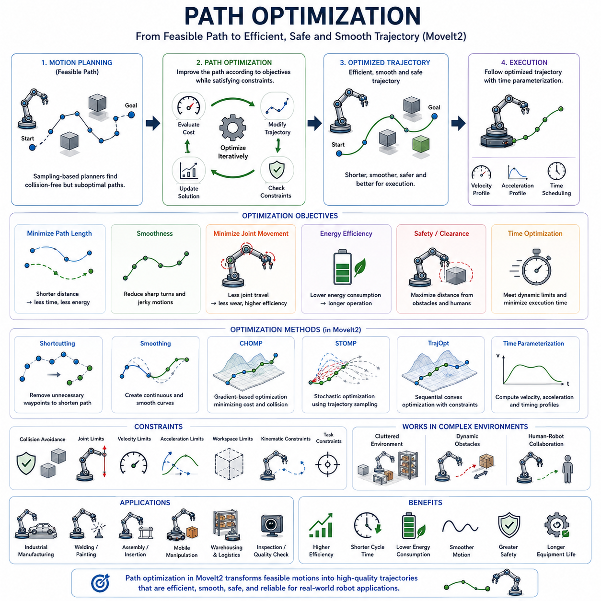{width="7.268055555555556in" height="7.268055555555556in"}

Path optimization is a fundamental component of modern robotic motion planning systems and plays a critical role in transforming feasible robot motions into efficient, safe, smooth, and executable trajectories. While motion planning algorithms are primarily responsible for finding collision-free paths between a start state and a goal state, the initial solutions they generate are often far from ideal. These paths may contain unnecessary detours, abrupt direction changes, excessive joint movements, inefficient timing profiles, or motions that are technically feasible but operationally undesirable. Path optimization addresses these limitations by refining planned trajectories and improving overall motion quality before execution.

In the context of robotics, a path represents a geometric route through the robot's configuration space, while a trajectory extends this concept by incorporating timing information such as velocity, acceleration, and execution duration. The distinction between path planning and path optimization is important. Path planning focuses on discovering a valid route, whereas path optimization focuses on improving the quality of that route according to specific objectives. In practical robotic systems, optimization is often the step that separates a merely functional robot from a highly efficient and professional autonomous system.

The need for path optimization arises because many motion planning algorithms prioritize feasibility over quality. Sampling-based planners such as Rapidly Exploring Random Trees, RRTConnect, Probabilistic Roadmaps, and related algorithms are extremely effective at finding collision-free paths in high-dimensional spaces. However, the resulting paths often contain irregular segments, unnecessary waypoints, and sharp transitions. These imperfections are natural consequences of the stochastic exploration processes used by sampling-based methods. Without optimization, such paths may lead to inefficient execution, increased energy consumption, excessive actuator wear, and reduced operational performance.

Path optimization can be viewed as a process of minimizing a cost function while maintaining all necessary constraints. The cost function may represent path length, execution time, energy consumption, joint movement, collision risk, safety margins, smoothness, or a combination of multiple objectives. The optimization system evaluates the trajectory and iteratively improves it until a satisfactory balance between performance and feasibility is achieved. Different applications emphasize different optimization criteria depending on operational requirements.

One of the most common objectives in path optimization is minimizing path length. Shorter paths generally reduce execution time and energy consumption while increasing productivity. In industrial manufacturing environments, even small reductions in path length can produce significant gains when multiplied across thousands of repeated operations. Warehouse robots, autonomous mobile manipulators, and production-line robots all benefit from shorter and more direct trajectories. However, minimizing path length alone is not always sufficient because the shortest path may not be the safest or smoothest option.

Trajectory smoothness is another major optimization objective. Robots execute physical motions through motors, gearboxes, actuators, and control systems. Sudden changes in direction, velocity, or acceleration can generate undesirable mechanical stresses, vibration, and wear. Smooth trajectories reduce these effects and improve overall system reliability. From a control perspective, smooth motions are easier to track accurately, resulting in improved precision and reduced tracking errors during execution.

Joint-space optimization focuses specifically on minimizing unnecessary joint movement. Many robotic manipulators possess multiple inverse kinematic solutions for the same end-effector pose. Some solutions require large joint displacements while others involve more efficient motions. Optimization algorithms evaluate these alternatives and select trajectories that minimize joint travel distance, reduce mechanical effort, and improve overall efficiency. This is particularly important for robots operating continuously in industrial environments where long-term component wear must be minimized.

Energy optimization has become increasingly important as robotics expands into mobile and autonomous systems. Mobile robots rely on batteries and limited onboard energy resources. Every unnecessary movement consumes power and reduces operational endurance. Path optimization can minimize energy expenditure by reducing travel distance, avoiding excessive accelerations, maintaining efficient velocity profiles, and selecting energetically favorable configurations. In large-scale warehouse operations or outdoor autonomous robotics platforms, energy-efficient planning directly influences mission duration and operational cost.

Safety optimization represents another critical dimension of path refinement. While collision-free paths satisfy minimum safety requirements, optimized paths often seek to maximize clearance from obstacles. Maintaining larger distances from surrounding objects increases robustness against localization errors, perception uncertainties, environmental changes, and unexpected disturbances. Safety-oriented optimization is particularly important in human-robot collaboration environments where maintaining protective separation distances is essential.

Time optimization focuses on minimizing task completion duration while respecting dynamic constraints. Industrial production systems frequently prioritize throughput and cycle time reduction. Optimization algorithms adjust velocity and acceleration profiles to achieve the fastest possible execution without violating actuator limits or compromising safety. Advanced time-parameterization techniques allow robots to move efficiently while remaining within mechanical and control limitations.

The mathematical foundations of path optimization are rooted in optimization theory. Most optimization problems involve an objective function that must be minimized or maximized while satisfying a set of constraints. Constraints may include collision avoidance requirements, joint limits, velocity limits, acceleration limits, workspace boundaries, kinematic restrictions, and task-specific conditions. The optimizer searches for solutions that achieve the best possible objective value while satisfying all constraints simultaneously.

MoveIt2 supports several optimization techniques through its planning pipeline architecture. After a planner generates an initial solution, additional optimization stages can refine the resulting path before execution. These stages may include shortcutting algorithms, smoothing procedures, trajectory simplification techniques, and dedicated optimization frameworks. This modular approach allows developers to combine multiple optimization methods according to application requirements.

Path shortcutting is one of the simplest and most effective optimization methods. The algorithm examines existing path segments and attempts to replace longer routes with shorter direct connections whenever possible. If two points along the path can be connected without collisions, intermediate waypoints may be removed. Repeated application of shortcutting can significantly reduce path complexity while preserving safety.

Path smoothing further improves trajectory quality by reducing sharp turns and discontinuities. Instead of following abrupt piecewise-linear paths, smoothing algorithms generate continuous curves that transition gradually between waypoints. Smoother trajectories improve control stability, reduce vibration, and create more natural robot motions. Service robots and collaborative robots particularly benefit from smooth movements because humans perceive smooth behavior as safer and more predictable.

Trajectory optimization frameworks such as CHOMP, STOMP, and TrajOpt represent more advanced approaches. CHOMP, which stands for Covariant Hamiltonian Optimization for Motion Planning, treats trajectory optimization as a continuous optimization problem. It seeks paths that simultaneously minimize collision risk and motion cost while producing smooth trajectories. CHOMP has become widely recognized for generating high-quality robotic motions in cluttered environments.

STOMP, or Stochastic Trajectory Optimization for Motion Planning, adopts a probabilistic optimization strategy. Rather than relying on gradient information, STOMP evaluates multiple trajectory variations and iteratively improves performance through stochastic sampling. This approach allows optimization in situations where gradient information may be unavailable or difficult to compute. STOMP has demonstrated effectiveness in manipulation tasks involving complex constraints and challenging environments.

TrajOpt approaches path optimization through sequential convex optimization techniques. The trajectory is represented as a mathematical optimization problem that can be solved efficiently through iterative refinement. TrajOpt often produces high-quality trajectories while maintaining strong computational performance. Its ability to handle collision constraints directly within the optimization process makes it attractive for many industrial applications.

Optimization is particularly important in Cartesian motion planning. Tasks such as welding, painting, polishing, cutting, inspection, and assembly often require the end-effector to follow specific geometric paths. Even when the Cartesian path is fixed, optimization can improve timing profiles, orientation transitions, velocity distributions, and joint-space behavior. This ensures that the robot performs the task efficiently while maintaining process quality.

Mobile manipulators introduce additional optimization challenges because both navigation and manipulation must be considered simultaneously. A robot may need to reposition its mobile base before executing an arm motion. The combined system possesses significantly higher dimensionality than a fixed manipulator, creating more complex optimization problems. Whole-body optimization techniques address these challenges by considering all robot subsystems together and searching for globally efficient solutions.

Dynamic environments further increase the importance of optimization. Obstacles may move, humans may enter the workspace, and environmental conditions may change unexpectedly. In such situations, optimization must often occur in real time. Real-time path optimization enables robots to adapt quickly while maintaining smooth and efficient behavior. This capability is increasingly important for autonomous service robots, logistics systems, and outdoor robotic platforms.

Simulation environments provide valuable opportunities for optimization development and validation. Platforms such as Gazebo, Isaac Sim, MuJoCo, and Webots allow engineers to test optimization algorithms under diverse conditions before deployment. Through simulation, developers can evaluate trajectory quality, energy consumption, safety margins, execution times, and failure scenarios without risking physical hardware.

Digital twins further extend optimization capabilities. A digital twin maintains a synchronized virtual representation of the physical robot and environment. Optimization algorithms can evaluate multiple trajectory alternatives within the digital twin before selecting the most effective solution for real-world execution. This predictive capability supports higher levels of efficiency, reliability, and operational intelligence.

Artificial intelligence is increasingly influencing path optimization. Machine learning techniques can predict high-quality trajectories, estimate optimization parameters, learn task-specific motion preferences, and adapt optimization objectives based on operational experience. Reinforcement learning, imitation learning, and neural trajectory generation methods are emerging as complementary approaches to traditional optimization algorithms. Future robotic systems may combine classical optimization with AI-driven adaptation to achieve superior performance.

In industrial settings, the benefits of path optimization are substantial. Optimized trajectories reduce cycle times, increase throughput, decrease energy consumption, improve motion smoothness, extend equipment life, enhance safety, and improve overall system reliability. These benefits accumulate over time and can significantly influence operational costs and productivity. As robotic systems become more autonomous and widely deployed, optimization will continue to play an increasingly strategic role.

The future of path optimization is closely connected to the broader evolution of robotics. Humanoid robots, collaborative robots, autonomous mobile manipulators, warehouse automation systems, healthcare robots, and embodied AI platforms will require increasingly sophisticated optimization capabilities. Future optimization frameworks will likely integrate perception, planning, control, learning, and semantic reasoning into unified decision-making architectures capable of generating highly efficient motions in complex real-world environments.

Ultimately, path optimization serves as the refinement engine of robotic motion. It transforms feasible solutions into high-quality trajectories that are efficient, smooth, safe, and practical. Within MoveIt2, path optimization complements motion planning by improving every aspect of robot behavior before execution. For robotics engineers, understanding path optimization is essential because it directly influences performance, reliability, energy efficiency, safety, and the overall effectiveness of autonomous robotic systems operating in the physical world.

경로 최적화(Path Optimization)는 현대 로봇 모션 플래닝 시스템의 핵심 구성 요소 중 하나이며, 단순히 실행 가능한 경로를 생성하는 수준을 넘어 효율적이고 안전하며 부드럽고 실제 운용에 적합한 궤적으로 개선하는 역할을 수행한다. 모션 플래닝 알고리즘은 일반적으로 시작 상태와 목표 상태 사이의 충돌 없는 경로를 찾는 데 초점을 맞추지만, 처음 생성된 경로는 대부분 최적의 상태가 아니다. 불필요한 우회 경로, 급격한 방향 전환, 과도한 관절 움직임, 비효율적인 시간 분배, 실제 운용에 적합하지 않은 움직임이 포함될 수 있다. 경로 최적화는 이러한 문제를 해결하고 실행 전에 전체적인 경로 품질을 향상시키는 과정이다.

로봇공학에서 경로(Path)는 구성 공간(Configuration Space) 내에서의 기하학적 이동 경로를 의미하며, 궤적(Trajectory)은 여기에 시간 정보, 속도, 가속도, 실행 시간 등을 포함한 개념이다. 경로 계획(Path Planning)은 목적지까지 도달할 수 있는 유효한 경로를 찾는 과정이고, 경로 최적화는 그 경로를 더 효율적이고 실용적으로 개선하는 과정이다. 실제 로봇 시스템에서는 바로 이 최적화 단계가 단순히 동작 가능한 로봇과 고성능 자율 로봇을 구분하는 중요한 요소가 된다.

경로 최적화가 필요한 이유는 대부분의 모션 플래닝 알고리즘이 경로 품질보다 경로의 존재 여부에 우선순위를 두기 때문이다. RRT, RRTConnect, PRM과 같은 샘플링 기반 플래너는 고차원 공간에서도 매우 효과적으로 충돌 없는 경로를 찾을 수 있지만, 생성된 경로는 종종 불필요한 굴곡과 우회 구간, 과도한 웨이포인트를 포함한다. 이러한 특성은 샘플링 기반 탐색 방식의 자연스러운 결과이다. 만약 최적화 과정을 거치지 않는다면 로봇은 비효율적으로 움직이고, 에너지를 낭비하며, 기계적 마모가 증가하고, 전체 작업 성능이 저하될 수 있다.

경로 최적화는 일반적으로 비용 함수(Cost Function)를 최소화하는 과정으로 이해할 수 있다. 비용 함수는 경로 길이, 실행 시간, 에너지 소비, 관절 이동량, 충돌 위험도, 안전 여유, 부드러움(Smoothness) 등 다양한 요소를 포함할 수 있다. 최적화 시스템은 이러한 비용을 반복적으로 평가하면서 더 나은 해를 찾아 나간다. 실제 응용 분야에서는 여러 목표를 동시에 고려하는 다목적 최적화(Multi-Objective Optimization)가 자주 사용된다.

가장 일반적인 최적화 목표 중 하나는 경로 길이(Path Length)를 최소화하는 것이다. 짧은 경로는 일반적으로 더 빠르게 실행되며 에너지 소비도 적다. 제조 자동화 환경에서는 수천 번 반복되는 작업에서 몇 센티미터의 경로 단축만으로도 상당한 생산성 향상을 얻을 수 있다. 물류 로봇, 모바일 매니퓰레이터, 생산 설비 로봇 모두 보다 짧고 직접적인 경로를 선호한다. 하지만 항상 가장 짧은 경로가 가장 좋은 경로는 아니다. 짧은 경로가 오히려 위험하거나 부드럽지 않을 수도 있기 때문이다.

경로의 부드러움(Smoothness) 역시 중요한 최적화 목표이다. 로봇은 모터, 감속기, 액추에이터, 제어기를 이용하여 움직인다. 갑작스러운 방향 전환이나 급격한 속도 변화는 진동과 충격을 발생시키고 기계적 마모를 증가시킨다. 부드러운 경로는 이러한 문제를 줄여 장비 수명을 연장하고 제어 성능을 향상시킨다. 또한 제어기가 목표 경로를 보다 정확하게 추종할 수 있도록 만들어 전체 시스템의 정밀도를 높인다.

관절 공간 최적화(Joint-Space Optimization)는 불필요한 관절 움직임을 최소화하는 데 초점을 둔다. 동일한 엔드이펙터 자세에 대해 여러 개의 역기구학 해가 존재할 수 있는데, 어떤 해는 큰 관절 이동을 요구하고 어떤 해는 훨씬 효율적일 수 있다. 최적화 알고리즘은 이러한 여러 후보 중에서 가장 효율적인 해를 선택하여 관절 이동량을 줄이고 기계적 부하를 감소시킨다. 특히 24시간 운영되는 산업용 로봇에서는 이러한 최적화가 장기적인 유지보수 비용 절감에 크게 기여한다.

에너지 최적화(Energy Optimization)의 중요성은 자율주행 로봇과 모바일 로봇의 확산과 함께 더욱 커지고 있다. 모바일 로봇은 배터리라는 제한된 에너지 자원을 사용한다. 불필요한 움직임은 곧 작동 시간 감소로 이어진다. 경로 최적화는 이동 거리 감소, 급격한 가감속 최소화, 효율적인 속도 프로파일 생성 등을 통해 에너지 소비를 줄일 수 있다. 대형 물류창고나 실외 자율주행 플랫폼에서는 에너지 최적화가 운영 비용과 임무 수행 시간을 직접적으로 결정한다.

안전성 최적화(Safety Optimization)도 중요한 요소이다. 충돌이 없는 경로라 하더라도 장애물과 지나치게 가까운 경우에는 위험성이 존재한다. 최적화 알고리즘은 장애물과 충분한 거리를 유지하도록 경로를 수정할 수 있다. 이러한 안전 여유는 위치 오차, 센서 노이즈, 환경 변화에 대한 강인성을 높여준다. 특히 사람과 함께 작업하는 협동로봇 환경에서는 안전 여유 확보가 매우 중요하다.

시간 최적화(Time Optimization)는 작업 완료 시간을 최소화하는 것을 목표로 한다. 산업 자동화 시스템에서는 생산성 향상을 위해 사이클 타임(Cycle Time)을 줄이는 것이 중요하다. 최적화 알고리즘은 속도와 가속도 프로파일을 조정하여 가장 빠른 실행을 달성하면서도 모터 한계와 안전 조건을 만족하도록 한다. 이를 통해 생산 효율성을 크게 향상시킬 수 있다.

경로 최적화의 수학적 기반은 최적화 이론(Optimization Theory)에 있다. 일반적으로 하나의 목적 함수(Objective Function)를 최소화하거나 최대화하면서 여러 제약 조건을 만족하는 문제로 정의된다. 제약 조건에는 충돌 회피, 관절 제한, 속도 제한, 가속도 제한, 작업 공간 범위, 기구학적 제약 등이 포함된다. 최적화 알고리즘은 이러한 조건을 모두 만족하면서 가장 좋은 해를 찾는다.

MoveIt2는 다양한 최적화 기법을 지원한다. 모션 플래너가 초기 경로를 생성하면 이후 여러 단계의 최적화 과정이 수행될 수 있다. 여기에는 경로 단축(Path Shortcutting), 스무딩(Smoothing), 경로 단순화(Path Simplification), 그리고 전용 최적화 프레임워크가 포함된다. 이러한 모듈식 구조 덕분에 개발자는 자신의 응용 분야에 적합한 최적화 기법을 선택할 수 있다.

경로 단축(Path Shortcutting)은 가장 단순하면서도 효과적인 최적화 기법 중 하나이다. 기존 경로의 두 지점을 직접 연결할 수 있는 경우 중간 웨이포인트를 제거하여 경로를 단순화한다. 이러한 과정을 반복하면 경로 길이를 크게 줄일 수 있다.

경로 스무딩(Path Smoothing)은 급격한 방향 전환을 줄이고 연속적인 곡선을 생성한다. 기존의 직선 연결 방식 대신 부드러운 곡선을 사용함으로써 제어 안정성과 승차감, 동작 품질을 향상시킨다. 서비스 로봇과 협동로봇은 특히 이러한 부드러운 움직임이 중요하다. 사람들은 부드럽게 움직이는 로봇을 더 안전하고 신뢰할 수 있는 존재로 인식하기 때문이다.

CHOMP, STOMP, TrajOpt는 대표적인 고급 궤적 최적화 프레임워크이다. CHOMP(Covariant Hamiltonian Optimization for Motion Planning)는 충돌 위험과 운동 비용을 동시에 최소화하면서 부드러운 경로를 생성한다. 복잡한 환경에서도 높은 품질의 궤적을 생성할 수 있어 널리 사용된다.

STOMP(Stochastic Trajectory Optimization for Motion Planning)는 확률적 최적화 기법을 사용한다. 여러 개의 경로 후보를 생성하고 반복적으로 평가하여 점진적으로 개선한다. 기울기 정보가 없는 문제에서도 적용할 수 있다는 장점이 있다.

TrajOpt는 순차적 볼록 최적화(Sequential Convex Optimization)를 사용한다. 충돌 제약 조건을 최적화 문제 내부에 직접 포함시킬 수 있어 효율적인 계산과 높은 경로 품질을 동시에 제공한다. 산업용 응용 분야에서 특히 높은 관심을 받고 있다.

Cartesian Motion Planning에서도 최적화는 매우 중요하다. 용접, 도장, 절단, 연마, 검사, 조립과 같은 작업은 엔드이펙터가 특정 경로를 정확히 따라야 한다. 이 경우에도 최적화는 속도 프로파일, 자세 변화, 관절 움직임을 개선하여 작업 품질과 효율성을 높인다.

모바일 매니퓰레이터는 더욱 복잡한 최적화 문제를 가진다. 이동 베이스와 로봇팔을 동시에 고려해야 하기 때문이다. 목표 물체에 도달하기 위해 베이스를 먼저 이동해야 할 수도 있다. 전체 시스템의 자유도가 크게 증가하므로 Whole-Body Optimization이 필요하다. 이는 이동과 조작을 통합적으로 고려하여 전체적으로 가장 효율적인 해를 찾는 방법이다.

동적인 환경에서는 실시간 최적화의 중요성이 더욱 커진다. 사람이 작업 공간에 들어오거나 장애물이 이동하면 기존 경로를 즉시 수정해야 한다. 실시간 경로 최적화는 변화하는 환경에 빠르게 대응하면서도 부드럽고 효율적인 움직임을 유지하도록 지원한다.

시뮬레이션 환경은 최적화 알고리즘을 검증하는 데 매우 유용하다. Gazebo, Isaac Sim, MuJoCo, Webots와 같은 플랫폼을 사용하면 실제 하드웨어를 위험에 노출시키지 않고 다양한 시나리오를 테스트할 수 있다. 개발자는 에너지 소비, 실행 시간, 안전 여유, 경로 품질 등을 분석하며 최적화 알고리즘을 개선할 수 있다.

디지털 트윈(Digital Twin)은 최적화의 활용 범위를 더욱 확장한다. 실제 로봇과 환경을 실시간으로 반영하는 가상 모델에서 다양한 경로를 평가한 후 가장 효율적인 경로를 선택할 수 있다. 이를 통해 운영 효율성과 신뢰성을 크게 향상시킬 수 있다.

최근에는 인공지능이 경로 최적화에도 활용되고 있다. 머신러닝과 강화학습은 고품질 경로를 예측하고, 최적화 파라미터를 자동 조정하며, 작업별 최적 움직임을 학습할 수 있다. 앞으로는 전통적인 최적화 기법과 AI 기반 학습 기법이 결합된 하이브리드 시스템이 더욱 보편화될 것으로 예상된다.

산업 현장에서 경로 최적화의 효과는 매우 크다. 최적화된 경로는 사이클 타임을 줄이고, 처리량을 증가시키며, 에너지 소비를 감소시키고, 기계 수명을 연장하며, 안전성을 향상시킨다. 이러한 효과는 장기간 누적되면서 운영 비용 절감과 생산성 향상으로 이어진다.

향후 휴머노이드 로봇, 협동로봇, 모바일 매니퓰레이터, 물류 자동화 시스템, 의료 로봇, Embodied AI 플랫폼이 발전할수록 경로 최적화 기술도 더욱 중요해질 것이다. 미래의 최적화 프레임워크는 인식, 계획, 제어, 학습, 의미론적 추론을 통합하여 더욱 지능적이고 효율적인 움직임을 생성하게 될 것이다.

결국 경로 최적화는 로봇 움직임의 정제 엔진(Refinement Engine)이라고 할 수 있다. 단순히 가능한 경로를 찾는 것을 넘어, 그것을 더 빠르고, 더 부드럽고, 더 안전하며, 더 효율적인 경로로 개선한다. MoveIt2에서 경로 최적화는 모션 플래닝을 보완하는 핵심 기술로서 로봇의 성능, 신뢰성, 에너지 효율, 안전성, 그리고 전체 시스템의 경쟁력을 결정하는 중요한 요소이다. 따라서 현대 로봇 엔지니어에게 경로 최적화에 대한 이해는 고성능 자율 로봇 시스템을 구축하기 위한 필수 역량이라 할 수 있다.

##  

## 07 Grasp Planning

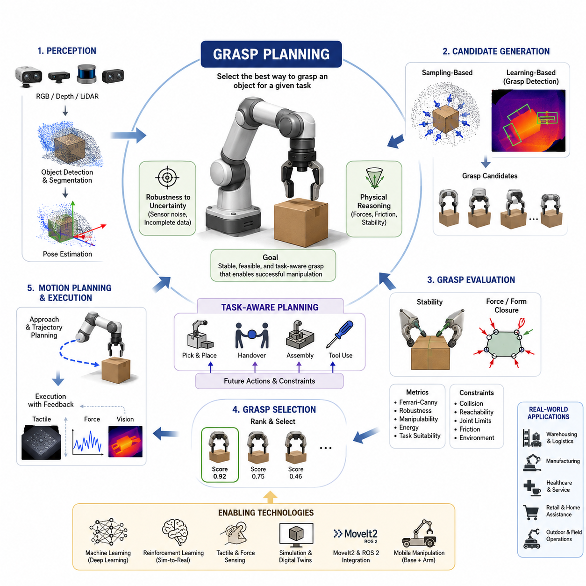{width="7.268055555555556in" height="7.268055555555556in"}

Grasp planning is one of the most important capabilities in robotic manipulation because it bridges the gap between perception and physical interaction. A robot may successfully detect an object, estimate its pose, and plan a collision-free arm trajectory, yet the entire manipulation process can still fail if the robot chooses an inappropriate grasp. Grasp planning is therefore the process of determining how a robotic end-effector should approach, contact, and securely hold an object so that a desired manipulation task can be completed successfully. In modern mobile manipulators and industrial robotic systems, grasp planning serves as the critical decision-making layer between object understanding and motion execution.

The fundamental objective of grasp planning is to identify contact configurations that maximize stability while satisfying task requirements. A robot must determine where to place its fingers, how much force to apply, what orientation the gripper should have, and how the object should be manipulated after grasping. Unlike simple pick-and-place operations in structured industrial environments, modern robotic systems often operate in semi-structured or unstructured environments where object locations, orientations, and surrounding obstacles constantly change. Under such conditions, grasp planning becomes a highly dynamic and context-dependent problem.

From a robotics perspective, grasp planning involves both geometric and physical reasoning. Geometric reasoning determines where the gripper can physically contact an object, while physical reasoning evaluates whether the selected contacts can generate sufficient forces to resist disturbances. A successful grasp must maintain object stability against gravity, inertial forces, collisions, and unexpected environmental interactions. Consequently, grasp planning combines concepts from geometry, kinematics, dynamics, optimization, machine learning, and control theory.

One of the earliest approaches to grasp planning relied heavily on analytical models. In analytical grasp planning, the robot uses mathematical representations of object geometry and contact mechanics to determine feasible grasp configurations. Objects are typically represented as meshes, point clouds, or primitive geometric shapes. Potential contact points are generated on the object\'s surface, and grasp quality metrics are evaluated for each candidate. The robot then selects the grasp that maximizes stability according to predefined criteria.

A central concept in analytical grasp planning is force closure. A grasp achieves force closure when the contact forces generated by the gripper can counteract arbitrary external disturbances applied to the object. If a grasp satisfies force closure conditions, the object can theoretically be held securely regardless of the direction of external forces. Force closure analysis often involves studying friction cones at contact points and evaluating whether the combined wrench space spans all possible disturbance directions.

Closely related to force closure is the concept of form closure. Form closure occurs when the object is completely constrained by geometric contacts alone, even in the absence of friction. While form closure provides extremely strong constraints, it is difficult to achieve in practical robotic systems because it often requires multiple precisely positioned contact points. Most real-world robotic grasping relies on force closure rather than form closure.

The quality of a grasp can be evaluated using grasp metrics. One widely used metric is the Ferrari-Canny grasp quality measure, which estimates the ability of a grasp to resist disturbances in all directions. Other metrics consider factors such as manipulability, robustness, energy efficiency, contact stability, and task suitability. In industrial environments, grasp planners often rank candidate grasps according to these metrics and select the highest-scoring option.

As robotic applications expanded beyond structured manufacturing environments, object uncertainty became a major challenge. Real-world perception systems produce noisy measurements, incomplete point clouds, and imperfect pose estimates. Consequently, modern grasp planning systems must account for uncertainty when evaluating candidate grasps. Rather than identifying a single optimal grasp, the robot may generate multiple robust grasp candidates capable of tolerating perception errors and environmental variations.

The rise of 3D perception technologies significantly transformed grasp planning methodologies. RGB cameras, stereo vision systems, depth cameras, LiDAR sensors, and structured-light scanners now provide rich three-dimensional representations of objects and environments. These sensing technologies allow grasp planners to operate directly on point clouds rather than relying solely on predefined CAD models. This capability is particularly important in warehouse automation, logistics operations, and service robotics applications where robots frequently encounter previously unseen objects.

Point-cloud-based grasp planning has become one of the most common approaches in modern robotics. The robot first segments an object from the environment and generates a three-dimensional point cloud representation. Potential grasp poses are then sampled around the object surface. Each candidate grasp is evaluated according to geometric compatibility, collision constraints, reachability, and stability metrics. The highest-ranked grasp is subsequently selected for execution.

Sampling-based grasp planning methods explore large spaces of possible grasps through random or heuristic sampling strategies. Instead of attempting to analytically solve the grasping problem, these methods generate numerous candidate grasp poses and evaluate them according to predefined criteria. Sampling-based approaches are particularly useful when dealing with complex object geometries where analytical solutions become computationally expensive.

Machine learning has introduced a new paradigm in grasp planning. Rather than explicitly programming grasp rules, robots can learn grasping strategies directly from data. Deep learning models are trained using large datasets containing successful and unsuccessful grasp examples. During inference, these models predict grasp locations and orientations directly from sensor inputs such as RGB images, depth maps, or point clouds.

Learning-based grasp planning offers significant advantages in unstructured environments. Neural networks can generalize across object categories and discover grasping patterns that are difficult to encode manually. For example, a trained model may learn that cylindrical objects are typically grasped along their sides, while box-shaped objects are best grasped from opposing faces. Such knowledge emerges naturally through training without requiring explicit programming.

One influential development in this field is grasp detection. Grasp detection algorithms directly identify suitable grasp configurations from sensory observations. Instead of reconstructing complete object models, these systems predict grasp rectangles, grasp poses, or grasp quality maps from camera images. This significantly reduces computational complexity and enables real-time robotic manipulation.

Convolutional neural networks have been widely used for image-based grasp detection. More recently, transformer architectures and foundation models have demonstrated improved performance in understanding object geometry and predicting robust grasps. These models leverage large-scale visual representations to improve grasp planning across diverse object categories.

Another important advancement is reinforcement learning-based grasp planning. In reinforcement learning, robots learn grasping policies through repeated interaction with environments. Successful grasps receive positive rewards, while failed attempts receive penalties. Over time, the robot develops strategies that maximize long-term grasp success. Reinforcement learning is particularly valuable for tasks involving complex object dynamics, deformable materials, or uncertain environments.

Simulation environments play a critical role in reinforcement learning. Platforms such as Gazebo, MuJoCo, Isaac Sim, and PyBullet allow robots to perform millions of grasping trials without physical hardware. Domain randomization techniques further improve transferability by exposing learning algorithms to diverse object appearances, lighting conditions, physical properties, and environmental variations.

Task-aware grasp planning represents another important evolution in the field. Not all grasps are equally suitable for every manipulation task. A grasp selected for lifting an object may not be appropriate for inserting it into a container or using it as a tool. Task-aware grasp planning considers the future actions that will follow the grasp. The robot selects grasp configurations that facilitate downstream manipulation objectives rather than merely maximizing immediate grasp stability.

Consider a warehouse robot tasked with moving boxes. The robot may grasp a box from its side for transportation. However, if the box must later be stacked, the robot may choose a grasp that preserves access to the top surface. Similarly, a service robot picking up a cup may grasp the cup differently depending on whether it intends to place the cup on a table or hand it to a person.

In mobile manipulation systems, grasp planning becomes even more complex because both the manipulator and the mobile base contribute to overall reachability. The robot must determine not only how to grasp an object but also where to position itself before executing the grasp. This introduces additional optimization variables involving base location, arm configuration, obstacle avoidance, and task efficiency. Mobile manipulation platforms therefore frequently combine navigation planning, arm motion planning, and grasp planning into unified decision-making frameworks.

Collision avoidance is another essential consideration during grasp planning. A theoretically stable grasp may be physically impossible if the gripper collides with nearby objects, shelves, walls, or other environmental structures. Modern grasp planners integrate collision checking systems such as those provided by MoveIt2 to ensure that candidate grasps remain feasible within real-world environments. Candidate grasps that violate collision constraints are automatically discarded.

MoveIt2 provides extensive support for grasp planning within ROS2-based robotic systems. The framework integrates perception pipelines, planning scene management, collision checking, inverse kinematics solvers, motion planners, and execution controllers into a unified architecture. Grasp candidates can be generated, evaluated, ranked, and executed within the MoveIt2 ecosystem. This capability makes MoveIt2 a widely adopted platform for industrial and research manipulation applications.

Multi-finger robotic hands introduce additional challenges compared to parallel-jaw grippers. While parallel-jaw grippers typically involve two contact surfaces, anthropomorphic robotic hands may contain dozens of joints and multiple fingers. Planning grasps for such systems requires consideration of finger coordination, contact sequencing, dexterous manipulation, and hand kinematics. The resulting search space becomes substantially larger, making optimization significantly more difficult.

Dexterous grasp planning seeks to replicate aspects of human manipulation. Humans continuously adjust finger positions, contact forces, and grasp configurations during object interaction. Advanced robotic hands attempt to emulate these capabilities through sophisticated sensing and control systems. Tactile sensors, force sensors, and proprioceptive measurements provide feedback that enables continuous grasp adaptation.

Tactile sensing has become increasingly important for grasp planning and execution. Vision-based planning alone cannot always guarantee successful manipulation because surface properties such as friction, compliance, and texture are often difficult to estimate visually. Tactile feedback allows robots to detect slipping, contact loss, excessive force, and object movement. By incorporating tactile information, grasp planners can refine grasp quality estimates and improve execution reliability.

Grasp planning for deformable objects remains one of the most challenging problems in robotics. Traditional grasp planning techniques assume rigid-body physics, but many real-world objects are flexible, elastic, or deformable. Examples include clothing, food products, cables, medical materials, and packaging. Manipulating such objects requires models capable of predicting shape changes and deformation dynamics during grasping.

Human-robot collaboration introduces additional requirements for grasp planning. Collaborative robots operating near humans must prioritize safety, predictability, and comfort. Grasp configurations should avoid sharp motions, excessive gripping forces, and unsafe object orientations. In handover tasks, robots must also consider how humans will subsequently grasp the object. Human-aware grasp planning therefore extends beyond physical stability to include ergonomic and social considerations.

Recent developments in foundation models and embodied AI are creating new opportunities for grasp planning. Large-scale vision-language-action models can reason about object functionality, semantic context, and task intent. Instead of relying solely on geometry, future grasp planners may understand why an object is being manipulated and how it should be used. This semantic understanding enables more intelligent and adaptable robotic behavior.

For example, an embodied AI system may recognize that a screwdriver should be grasped by its handle, that a mug should be grasped differently when full versus empty, or that fragile medical equipment requires gentle handling. Such reasoning extends grasp planning beyond physical interaction into the domain of cognitive manipulation.

Future grasp planning systems will likely combine analytical models, deep learning, reinforcement learning, tactile sensing, digital twins, and foundation models into integrated architectures. These hybrid systems will leverage the strengths of multiple methodologies while compensating for their individual limitations. Digital twin environments will allow extensive grasp validation before deployment, while real-time feedback systems will continuously adapt grasps during execution.

As mobile manipulators become increasingly prevalent in warehouses, hospitals, factories, retail environments, service applications, and outdoor robotic systems, grasp planning will remain one of the foundational technologies enabling reliable physical interaction. The ability to identify, evaluate, and execute robust grasps across diverse objects and environments is essential for achieving truly autonomous manipulation. Consequently, grasp planning continues to be a central research area in robotics and serves as a critical building block for the next generation of intelligent robotic systems capable of operating safely and effectively in complex real-world environments.

그라스프 계획(Grasp Planning)은 로봇 조작 분야에서 가장 중요한 기술 중 하나로, 인지(Perception)와 실제 물리적 상호작용 사이를 연결하는 핵심 역할을 수행한다. 로봇이 물체를 성공적으로 인식하고 자세(Pose)를 추정하며 충돌 없는 경로를 생성하더라도, 적절한 그립(Grasp)을 선택하지 못하면 전체 작업은 실패할 수 있다. 따라서 그라스프 계획은 로봇의 엔드이펙터가 어떤 방식으로 물체에 접근하고 접촉하며 안정적으로 파지할 것인지를 결정하는 과정이라고 할 수 있다. 현대의 모바일 매니퓰레이터와 산업용 로봇에서는 그라스프 계획이 물체 인식과 모션 실행 사이의 핵심 의사결정 계층으로 작동한다.

그라스프 계획의 기본 목표는 작업 목적을 만족하면서도 최대한 안정적인 접촉 구성을 찾는 것이다. 로봇은 손가락을 어디에 배치할지, 어느 정도의 힘을 가할지, 그리퍼의 방향을 어떻게 설정할지, 그리고 파지 이후 물체를 어떻게 조작할지를 결정해야 한다. 과거의 정형화된 산업 환경에서는 이러한 문제가 비교적 단순했지만, 현대 로봇은 물류창고, 병원, 서비스 환경과 같은 반정형 또는 비정형 환경에서 동작한다. 이러한 환경에서는 물체의 위치와 방향, 주변 장애물이 계속 변하기 때문에 그라스프 계획 역시 동적으로 수행되어야 한다.

로봇 공학적 관점에서 그라스프 계획은 기하학적 추론과 물리적 추론을 모두 포함한다. 기하학적 추론은 로봇이 물체의 어느 부분을 잡을 수 있는지를 판단하는 과정이며, 물리적 추론은 선택된 접촉점이 충분한 힘을 생성하여 외부 교란을 견딜 수 있는지를 평가하는 과정이다. 성공적인 그립은 중력, 관성력, 충격, 환경과의 상호작용 등 다양한 외란에도 물체를 안정적으로 유지할 수 있어야 한다. 따라서 그라스프 계획은 기하학, 운동학, 동역학, 최적화, 머신러닝, 제어이론이 결합된 복합적인 문제이다.

초기의 그라스프 계획은 주로 해석적(Analytical) 접근법에 기반하였다. 이 방법에서는 물체의 형상과 접촉 역학을 수학적으로 모델링하여 가능한 그립 후보를 생성하고 평가한다. 물체는 메쉬(Mesh), 포인트 클라우드(Point Cloud), 또는 기본 기하학 형상으로 표현되며, 표면 위의 잠재적인 접촉점을 탐색한 후 각 후보의 품질을 평가한다. 최종적으로 가장 높은 안정성을 제공하는 그립이 선택된다.

이 과정에서 가장 중요한 개념 중 하나가 Force Closure이다. Force Closure를 만족하는 그립은 외부에서 어떤 방향의 힘이 가해지더라도 접촉점에서 생성되는 힘을 이용하여 이를 상쇄할 수 있다. 즉, 물체를 안정적으로 유지할 수 있는 능력을 의미한다. 실제 로봇 시스템에서는 마찰이 존재하기 때문에 접촉점의 마찰 콘(Friction Cone)을 고려하여 Force Closure 여부를 평가한다.

이와 유사한 개념으로 Form Closure가 있다. Form Closure는 마찰이 전혀 없더라도 접촉 기하학만으로 물체의 움직임을 완전히 제한하는 상태를 의미한다. 이론적으로는 매우 강력한 안정성을 제공하지만, 실제 환경에서는 정밀한 다중 접촉이 필요하기 때문에 구현이 어렵다. 따라서 대부분의 산업용 로봇은 Form Closure보다는 Force Closure를 기반으로 설계된다.

그립의 품질은 다양한 평가 지표를 통해 측정된다. 대표적으로 Ferrari-Canny 지표가 있으며, 이는 그립이 모든 방향의 외란에 얼마나 강하게 대응할 수 있는지를 수치화한다. 그 외에도 조작성(Manipulability), 견고성(Robustness), 에너지 효율성, 접촉 안정성, 작업 적합성 등이 평가 기준으로 사용된다. 산업 현장에서는 이러한 품질 지표를 기준으로 여러 후보 그립을 순위화한 후 최적의 그립을 선택한다.

현실 환경에서는 센서 노이즈와 인식 오차가 존재하기 때문에 불확실성(Uncertainty)이 큰 문제로 등장한다. 카메라와 센서가 생성하는 데이터는 완벽하지 않으며, 포인트 클라우드 역시 부분적으로 누락되거나 왜곡될 수 있다. 따라서 현대의 그라스프 계획 시스템은 단일 최적 해답을 찾기보다는 다양한 오차를 허용할 수 있는 강건한(Robust) 그립 후보를 생성하는 방향으로 발전하고 있다.

RGB 카메라, 스테레오 카메라, 깊이 카메라, LiDAR, 구조광 센서 등의 발전은 그라스프 계획의 패러다임을 크게 변화시켰다. 과거에는 CAD 모델이 필수적이었지만, 현재는 포인트 클라우드를 직접 이용하여 그립을 생성할 수 있다. 이는 물류창고, 서비스 로봇, 모바일 매니퓰레이터와 같이 처음 보는 물체를 다루어야 하는 환경에서 매우 중요한 기능이다.

포인트 클라우드 기반 그라스프 계획에서는 먼저 물체를 배경으로부터 분리하고 3차원 형태를 추정한다. 이후 다양한 그립 후보를 생성하고, 각 후보에 대해 충돌 여부, 도달 가능성, 안정성, 작업 적합성을 평가한다. 최종적으로 가장 높은 점수를 받은 그립이 선택된다.

샘플링 기반 접근법은 수많은 후보 그립을 무작위 또는 휴리스틱 방식으로 생성한 후 평가하는 방법이다. 해석적으로 최적해를 찾기 어려운 복잡한 물체에 대해 효과적이며, 현재 많은 연구와 산업 시스템에서 사용되고 있다.

최근에는 머신러닝 기반 접근법이 빠르게 확산되고 있다. 로봇은 성공 및 실패 사례가 포함된 대규모 데이터셋을 학습하여 어떤 형태의 물체를 어떻게 잡아야 하는지를 스스로 학습한다. 학습이 완료되면 RGB 이미지, 깊이 이미지, 포인트 클라우드만으로도 적절한 그립 위치와 방향을 예측할 수 있다.

딥러닝 기반 방법은 특히 비정형 환경에서 강력한 성능을 보인다. 예를 들어 원통형 물체는 측면을 잡는 것이 유리하고, 박스형 물체는 서로 마주보는 면을 잡는 것이 안정적이라는 사실을 데이터로부터 자동으로 학습할 수 있다. 이는 사람이 직접 규칙을 작성하지 않아도 되는 큰 장점을 제공한다.

그라스프 검출(Grasp Detection)은 이러한 학습 기반 기술의 대표적인 예이다. 그라스프 검출 알고리즘은 센서 입력으로부터 직접 그립 위치와 방향을 예측한다. 물체 전체를 복원할 필요 없이 이미지에서 바로 그립 사각형(Grasp Rectangle)이나 그립 자세를 계산할 수 있기 때문에 실시간성이 뛰어나다.

최근에는 CNN뿐 아니라 Transformer 기반 모델과 대규모 Foundation Model도 그라스프 계획에 적용되고 있다. 이러한 모델은 대규모 시각 데이터를 학습하여 물체의 형상과 의미를 동시에 이해할 수 있으며, 보다 일반화된 그립 전략을 생성할 수 있다.

강화학습(Reinforcement Learning) 역시 중요한 연구 분야이다. 로봇은 수많은 시행착오를 통해 성공적인 그립에 보상을 받고 실패한 경우에는 패널티를 받는다. 반복 학습을 통해 장기적으로 성공 확률을 최대화하는 정책을 스스로 획득하게 된다.

강화학습을 위해서는 시뮬레이션 환경이 매우 중요하다. Gazebo, MuJoCo, Isaac Sim, PyBullet과 같은 플랫폼에서는 수백만 번의 그립 실험을 수행할 수 있다. 또한 Domain Randomization 기법을 적용하면 실제 환경으로의 전이 성능을 향상시킬 수 있다.

최근의 중요한 흐름 중 하나는 Task-Aware Grasp Planning이다. 단순히 물체를 들어 올리는 것이 아니라 이후에 수행할 작업까지 고려하여 그립을 결정하는 방식이다. 같은 물체라도 목적에 따라 최적의 그립은 달라질 수 있다.

예를 들어 창고 로봇이 박스를 운반할 때와 적재(Stacking)할 때는 서로 다른 그립이 필요하다. 컵을 잡는 경우에도 테이블에 내려놓을 것인지 사람에게 전달할 것인지에 따라 그립 방식이 달라질 수 있다. 따라서 현대의 그라스프 계획은 단순한 안정성 최적화를 넘어 작업 목적까지 고려하는 방향으로 발전하고 있다.

모바일 매니퓰레이터에서는 문제가 더욱 복잡해진다. 로봇 암뿐 아니라 이동 플랫폼도 함께 최적화해야 하기 때문이다. 로봇은 물체를 잡는 방법뿐 아니라 어느 위치에 서서 잡을 것인지도 결정해야 한다. 따라서 내비게이션 계획, 모션 계획, 그라스프 계획이 통합적으로 수행된다.

충돌 회피 역시 필수 요소이다. 아무리 안정적인 그립이라도 주변 선반, 벽, 장애물과 충돌한다면 실제로 사용할 수 없다. MoveIt2와 같은 프레임워크는 충돌 검사를 통합하여 실행 가능한 그립만을 선택하도록 지원한다.

다지(多指) 로봇 핸드는 평행 그리퍼보다 훨씬 복잡한 문제를 가진다. 인간의 손처럼 여러 개의 손가락과 많은 관절을 가진 시스템에서는 접촉점 수가 증가하고 자유도가 크게 늘어난다. 따라서 탐색 공간이 폭발적으로 증가하며, 더욱 정교한 최적화 기법이 필요하다.

인간 수준의 조작 능력을 목표로 하는 Dexterous Manipulation 분야에서는 촉각 센서와 힘 센서가 중요한 역할을 한다. 인간은 물체를 잡을 때 지속적으로 손가락 위치와 힘을 조정하는데, 고급 로봇 핸드 역시 이러한 능력을 구현하려고 한다.

촉각 센서는 미끄러짐(Slip), 접촉 손실, 과도한 힘, 물체의 미세한 움직임을 감지할 수 있다. 시각 정보만으로는 파악하기 어려운 마찰 계수나 표면 상태를 감지할 수 있기 때문에, 실제 환경에서의 그립 성공률을 크게 향상시킨다.

변형 가능한 물체(Deformable Objects)에 대한 그라스프 계획은 현재도 매우 어려운 문제이다. 의류, 케이블, 식품, 의료 재료와 같은 물체는 잡는 순간 형태가 변하기 때문에 기존의 강체(Rigid Body) 모델을 적용하기 어렵다. 따라서 변형 모델과 물리 시뮬레이션을 함께 고려해야 한다.

인간과 협업하는 로봇에서는 안전성과 예측 가능성도 중요한 요소이다. 협동로봇(Cobot)은 지나치게 강한 힘을 사용하거나 위험한 방향으로 물체를 들지 않아야 한다. 또한 사람에게 물체를 전달하는 경우에는 사람이 쉽게 잡을 수 있는 방향을 고려해야 한다. 이러한 Human-Aware Grasp Planning은 최근 서비스 로봇과 의료 로봇 분야에서 매우 중요한 연구 주제로 떠오르고 있다.

최근 등장한 Foundation Model과 Embodied AI는 그라스프 계획에 새로운 가능성을 열고 있다. 미래의 로봇은 단순히 물체의 형상을 이해하는 수준을 넘어, 물체의 기능과 사용 목적까지 이해하며 그립을 계획하게 될 것이다. 예를 들어 드라이버는 손잡이를 잡아야 하고, 컵은 내용물의 유무에 따라 다른 방식으로 잡아야 하며, 의료 장비는 특별히 조심스럽게 다루어야 한다는 것을 스스로 이해하게 된다.

향후의 그라스프 계획 시스템은 해석적 모델, 딥러닝, 강화학습, 촉각 센서, 디지털 트윈, Foundation Model을 통합한 하이브리드 구조로 발전할 가능성이 높다. 디지털 트윈 환경에서 대규모 검증을 수행하고, 실제 작업 중에는 실시간 센서 피드백을 통해 그립을 지속적으로 보정하는 형태가 될 것이다.

모바일 매니퓰레이터가 물류창고, 병원, 제조공장, 서비스 현장, 실외 자율주행 로봇 등 다양한 분야로 확산됨에 따라, 그라스프 계획은 로봇이 실제 세계와 상호작용하기 위한 핵심 기술로 남게 될 것이다. 다양한 물체와 환경에서 안정적이고 신뢰성 있는 파지를 수행하는 능력은 완전한 자율 조작 시스템의 필수 조건이며, 차세대 지능형 로봇 개발의 핵심 기반 기술로 계속 발전할 것이다.

##  

## 08 Task Constructor

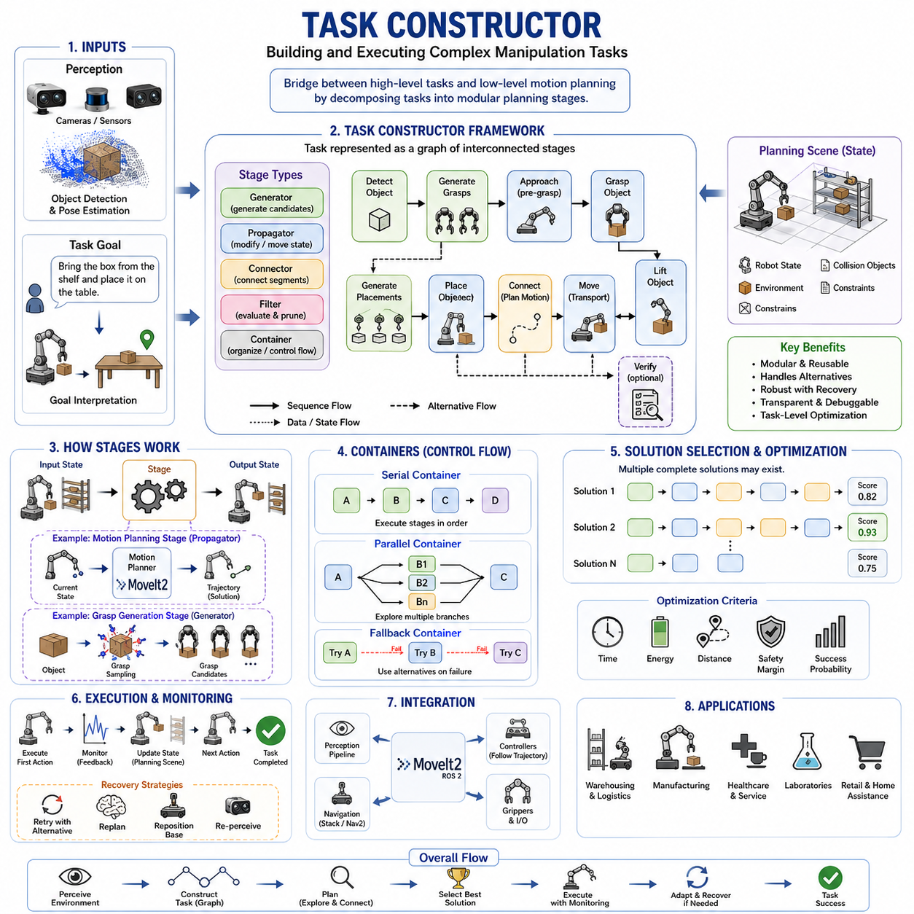{width="7.268055555555556in" height="7.268055555555556in"}

Task Constructor is one of the most important components in modern robotic manipulation systems because it bridges the gap between low-level motion planning and high-level task execution. While traditional motion planners focus on generating a collision-free trajectory from one robot state to another, real-world robotic applications require a much richer representation of tasks that consist of multiple interconnected actions, decisions, constraints, and recovery strategies. A robot operating in a warehouse, factory, hospital, laboratory, or service environment rarely performs a single motion in isolation. Instead, it executes complex workflows that involve perception, grasping, navigation, manipulation, placement, verification, and error handling. Task Constructor provides a structured framework for organizing these activities into coherent executable plans.

In the context of MoveIt2, the MoveIt Task Constructor (MTC) represents a powerful framework for building and executing complex manipulation tasks. Rather than treating a task as a single planning problem, MTC decomposes the task into a sequence of smaller planning stages. Each stage solves a specific subproblem and contributes to the overall task solution. This decomposition dramatically improves flexibility, maintainability, debugging capability, and solution quality.

Traditional robotic manipulation pipelines often suffer from a disconnect between task planning and motion planning. High-level planners may generate symbolic actions such as "pick object," "move object," or "place object," while motion planners operate at the geometric and kinematic level. The challenge arises when translating abstract goals into executable robot motions. Task Constructor addresses this challenge by creating an intermediate layer where task-level objectives and motion-level constraints can be integrated into a unified planning process.

The fundamental philosophy behind Task Constructor is modularity. Every robotic task can be represented as a collection of planning stages connected together in a logical sequence. Each stage has a clearly defined input state, processing logic, and output state. By combining multiple stages, complex robotic behaviors can be created while maintaining transparency and modularity.

Consider a simple pick-and-place operation. At first glance, the task appears straightforward. However, when examined in detail, numerous subtasks emerge. The robot must detect the object, estimate its pose, identify grasp candidates, move to a pre-grasp position, approach the object, close the gripper, lift the object, transport it to the destination, place it at the target location, release the object, and retreat safely. Each of these actions involves its own planning requirements, constraints, and potential failure conditions. Task Constructor allows these subtasks to be modeled explicitly as individual planning stages.

One of the key strengths of Task Constructor is its ability to represent planning as a directed graph rather than a simple linear sequence. In many situations, multiple alternative solutions may exist. Different grasp candidates may be available, multiple placement locations may satisfy task requirements, and various motion trajectories may achieve the same objective. Instead of committing to a single solution early in the planning process, Task Constructor can explore multiple branches simultaneously and evaluate alternative execution paths.

The concept of stages forms the foundation of Task Constructor. A stage represents a planning operation that transforms one state into another. Some stages generate new states, while others modify existing states or evaluate feasibility. Stages can represent perception operations, inverse kinematics calculations, grasp generation, collision checking, motion planning, object attachment, object detachment, or arbitrary user-defined actions.

Generator stages are responsible for producing candidate states or task solutions. For example, a grasp generation stage may produce multiple grasp poses around an object. A placement generator may identify several valid placement configurations. These generated candidates become inputs for subsequent planning stages.

Propagator stages modify states by applying actions or planning operations. A motion planning stage may propagate a robot state from one configuration to another through a collision-free trajectory. Similarly, a manipulation stage may update the planning scene after an object has been attached to the robot gripper.

Connector stages play a particularly important role. These stages connect independent task segments by generating feasible transitions between them. For example, a connector may generate a collision-free motion trajectory between a grasping stage and a transport stage. Without such connections, individual task segments would remain isolated and could not form a complete executable solution.

Filtering stages provide another critical capability. Real-world robotic planning often generates a large number of candidate solutions. Many of these solutions may be suboptimal, redundant, or infeasible. Filtering stages evaluate candidate solutions according to predefined criteria and remove those that do not satisfy task requirements. This process improves computational efficiency and increases the likelihood of successful execution.

The hierarchical nature of Task Constructor enables the creation of highly complex robotic behaviors. Multiple stages can be grouped into containers that represent larger task structures. Serial containers execute stages sequentially, while parallel containers allow multiple planning branches to be explored simultaneously. Fallback containers provide alternative solutions when primary plans fail. This hierarchical organization makes large robotic applications easier to design and maintain.

One of the most valuable features of Task Constructor is the explicit representation of planning states. Each stage operates on a planning scene that contains information about robot configurations, object positions, collision geometries, environmental constraints, and task-specific metadata. As the task progresses, the planning scene evolves to reflect changes in the environment and robot state. This state-centric approach enables accurate reasoning about task execution and environmental interactions.

Planning scene management is especially important in manipulation tasks involving object interactions. When a robot grasps an object, the object effectively becomes part of the robot\'s kinematic structure. Collision relationships change, reachable workspace changes, and dynamic properties may change as well. Task Constructor explicitly models these transitions, ensuring that subsequent planning stages operate on consistent world representations.

Collision checking remains one of the most critical aspects of task construction. Every stage must consider environmental obstacles, robot self-collisions, object collisions, and workspace constraints. By integrating collision checking throughout the planning pipeline, Task Constructor ensures that generated solutions remain physically executable.

Inverse kinematics plays a central role in many Task Constructor workflows. Whenever the robot must interact with an object, a desired end-effector pose must be converted into valid joint configurations. Multiple inverse kinematic solutions may exist for a given pose. Task Constructor can evaluate these alternatives and select solutions that optimize criteria such as manipulability, collision avoidance, energy efficiency, or execution speed.

Grasp planning and Task Constructor are closely interconnected. A manipulation task often begins with a grasp generation stage that produces candidate grasp configurations. These candidates are evaluated according to grasp quality metrics, reachability constraints, and collision conditions. Successful grasp candidates are then integrated into larger task plans that include approach motions, object transportation, and placement actions.

Task Constructor is particularly valuable for mobile manipulators because these systems combine navigation and manipulation within a single platform. A mobile manipulator must determine where to position its base before executing an arm manipulation task. Consequently, planning involves both base movement and arm movement. Task Constructor provides a unified framework for coordinating these activities.

Consider a warehouse robot tasked with retrieving a package from a storage shelf. The robot must first navigate to an appropriate position near the shelf. It must then perceive the package, generate grasp candidates, plan an approach trajectory, grasp the package, transport it safely, and place it at a designated destination. Each step depends on the success of previous steps and may require dynamic adaptation if conditions change. Task Constructor enables these complex dependencies to be modeled explicitly.

Task Constructor also supports task-level optimization. Rather than optimizing individual motions independently, the framework can evaluate complete task solutions. Metrics such as execution time, energy consumption, travel distance, manipulation effort, safety margins, and task success probability can be considered during solution selection. This holistic optimization approach often produces more efficient and reliable robotic behaviors.

Error handling is another area where Task Constructor provides substantial benefits. Real-world robotic systems inevitably encounter failures. Objects may be missing, perception systems may produce incorrect estimates, grasp attempts may fail, and environmental conditions may change unexpectedly. Traditional robotic applications often struggle to recover gracefully from such situations. Task Constructor allows alternative execution branches and recovery strategies to be incorporated directly into the task definition.

For example, if a grasp attempt fails, the robot may generate alternative grasp candidates and retry the operation. If an object cannot be reached from the current base position, the robot may reposition itself and attempt the task again. If perception confidence falls below a specified threshold, additional sensing actions may be triggered automatically. These recovery mechanisms improve robustness and autonomy.

Visualization and debugging capabilities are among the most appreciated features of Task Constructor. Because tasks are represented as explicit planning graphs, developers can inspect individual stages, examine intermediate states, visualize candidate solutions, and identify failure points. This transparency significantly simplifies development and troubleshooting compared to monolithic planning architectures.

Simulation environments further enhance Task Constructor development workflows. Platforms such as Gazebo, Isaac Sim, Webots, and MuJoCo allow complex tasks to be validated before deployment on physical robots. Developers can evaluate task performance under diverse conditions, identify weaknesses, and optimize planning strategies without risking hardware damage.

The integration of perception systems represents another important capability. Modern robots increasingly rely on visual perception, depth sensing, object recognition, pose estimation, and semantic understanding. Task Constructor can incorporate perception results directly into task planning workflows. Perception stages update the planning scene, enabling subsequent manipulation stages to operate on current environmental information.

Machine learning is beginning to influence Task Constructor architectures as well. Learning-based modules can generate grasp candidates, predict object affordances, estimate task success probabilities, or optimize planning parameters. These learned capabilities can be integrated as stages within larger task construction pipelines. As a result, Task Constructor serves as a bridge between classical robotics algorithms and modern AI-based approaches.

The emergence of foundation models and embodied AI is likely to further expand the role of Task Constructor. Future robotic systems may receive high-level instructions expressed in natural language. Rather than manually defining every planning stage, robots will automatically decompose objectives into executable task structures. Task Constructor provides a natural framework for representing these dynamically generated task plans.

For example, a user might instruct a robot to "bring me the red coffee mug from the kitchen." The robot must interpret the request, identify the target object, navigate to the kitchen, locate the mug, generate grasp plans, retrieve the object, return to the user, and perform a safe handover. Each of these operations can be represented as interconnected stages within a Task Constructor framework.

Industrial automation increasingly demands flexible robotic systems capable of handling variable products, changing workflows, and dynamic environments. Traditional hard-coded automation solutions often lack the adaptability required for such applications. Task Constructor addresses this challenge by enabling reusable, modular, and configurable task definitions. New tasks can be assembled from existing stages without redesigning entire planning architectures.

In collaborative robotics, Task Constructor supports the integration of safety constraints, human-aware planning, and dynamic task adaptation. Robots can monitor human activities, adjust task execution sequences, and modify plans in response to changing workspace conditions. This flexibility is essential for safe and efficient human-robot collaboration.

As robotic systems continue to evolve toward higher levels of autonomy, Task Constructor is becoming a fundamental technology for organizing robotic intelligence. It provides a structured methodology for connecting perception, planning, control, manipulation, navigation, reasoning, and recovery into coherent task execution frameworks. By decomposing complex operations into manageable planning stages while maintaining global task awareness, Task Constructor enables robots to perform sophisticated real-world activities with greater reliability and flexibility.

Within the MoveIt2 ecosystem, Task Constructor represents a significant advancement beyond traditional motion planning. It transforms robotic planning from a single-trajectory generation problem into a comprehensive task reasoning framework capable of supporting next-generation mobile manipulators, warehouse automation systems, service robots, industrial robotic cells, and future embodied AI platforms. As the complexity of robotic applications continues to increase, Task Constructor will remain one of the key enabling technologies for achieving scalable, intelligent, and robust robotic autonomy.

Task Constructor는 현대 로봇 조작 시스템에서 가장 중요한 구성 요소 중 하나로, 저수준 모션 계획(Motion Planning)과 고수준 작업 실행(Task Execution) 사이를 연결하는 역할을 수행한다. 기존의 모션 플래너가 단순히 한 상태에서 다른 상태로 이동하는 충돌 없는 경로를 생성하는 데 집중했다면, 실제 산업 현장의 로봇은 훨씬 복잡한 작업을 수행해야 한다. 창고, 공장, 병원, 연구실, 서비스 환경에서 동작하는 로봇은 단일 동작이 아니라 인식, 파지, 이동, 배치, 검증, 오류 복구와 같은 여러 작업이 연결된 복합적인 워크플로우를 수행한다. Task Constructor는 이러한 복잡한 작업을 체계적으로 구성하고 실행 가능한 계획으로 변환하는 프레임워크이다.

MoveIt2 환경에서 제공되는 MoveIt Task Constructor(MTC)는 복잡한 조작 작업을 설계하고 실행하기 위한 강력한 도구이다. MTC는 하나의 작업을 단일 계획 문제로 취급하지 않고, 여러 개의 작은 계획 단계(Stage)로 분해한다. 각 단계는 특정 문제를 해결하며 전체 작업의 일부를 담당한다. 이러한 구조는 유연성, 유지보수성, 디버깅 편의성, 그리고 전체 작업의 성공률을 크게 향상시킨다.

기존의 로봇 시스템에서는 작업 계획(Task Planning)과 모션 계획(Motion Planning) 사이에 단절이 존재하는 경우가 많았다. 상위 계층에서는 "물체를 집어라", "물체를 옮겨라", "물체를 놓아라"와 같은 추상적인 명령을 생성하지만, 실제 모션 플래너는 기하학적 제약과 관절 움직임만을 고려한다. Task Constructor는 이러한 간극을 해소하기 위해 작업 수준의 목표와 모션 수준의 제약 조건을 하나의 계획 체계 안에서 통합한다.

Task Constructor의 핵심 철학은 모듈화(Modularity)이다. 모든 작업은 여러 개의 계획 단계(Stage)로 표현될 수 있으며, 각 단계는 명확한 입력 상태와 출력 상태를 가진다. 이러한 단계들을 연결함으로써 복잡한 로봇 작업도 체계적이고 재사용 가능한 형태로 설계할 수 있다.

예를 들어 단순한 Pick-and-Place 작업을 생각해 보자. 겉보기에는 간단한 작업처럼 보이지만 실제로는 여러 개의 세부 단계로 구성된다. 로봇은 먼저 물체를 인식하고 자세를 추정해야 한다. 이후 파지 후보를 생성하고, 접근 위치를 계산하고, 물체에 접근하며, 그리퍼를 닫고, 물체를 들어 올리고, 목적지까지 이동한 뒤, 목표 위치에 배치하고, 그리퍼를 열고, 안전하게 후퇴해야 한다. Task Constructor는 이러한 각각의 과정을 독립적인 단계로 모델링할 수 있게 해준다.

Task Constructor의 강점 중 하나는 단순한 선형 시퀀스가 아니라 그래프(Graph) 구조로 작업을 표현할 수 있다는 점이다. 실제 환경에서는 하나의 정답만 존재하는 경우가 드물다. 여러 개의 파지 후보가 존재할 수 있으며, 다양한 배치 위치가 가능하고, 여러 개의 경로가 동일한 목표를 달성할 수 있다. Task Constructor는 이러한 다양한 가능성을 동시에 탐색하고 최적의 작업 경로를 선택할 수 있다.

Stage는 Task Constructor의 기본 구성 요소이다. Stage는 특정 상태를 다른 상태로 변환하는 작업 단위를 의미한다. 어떤 Stage는 새로운 상태를 생성하고, 어떤 Stage는 상태를 수정하거나 검증한다. 인식, 역기구학 계산, 파지 생성, 충돌 검사, 경로 계획, 물체 부착 및 분리와 같은 다양한 기능이 Stage 형태로 구현될 수 있다.

Generator Stage는 새로운 후보 상태를 생성하는 역할을 수행한다. 예를 들어 Grasp Generation Stage는 물체 주변에서 가능한 여러 파지 자세를 생성한다. Placement Generator는 물체를 놓을 수 있는 여러 후보 위치를 생성한다. 이렇게 생성된 후보들은 이후 단계에서 평가되고 선택된다.

Propagator Stage는 기존 상태를 수정하거나 발전시키는 역할을 수행한다. 예를 들어 모션 계획 Stage는 현재 상태에서 목표 상태까지의 경로를 생성한다. 또한 물체를 집은 이후에는 계획 장면(Planning Scene)을 업데이트하여 물체가 로봇의 일부로 인식되도록 할 수 있다.

Connector Stage는 독립적인 계획 구간을 연결하는 역할을 수행한다. 예를 들어 파지 단계와 운반 단계 사이에 실제 이동 경로를 생성하는 것이 Connector Stage의 역할이다. 이를 통해 개별 단계들이 하나의 완전한 작업으로 연결될 수 있다.

Filtering Stage는 수많은 후보 솔루션 중 적합하지 않은 것을 제거한다. 실제 작업에서는 많은 파지 후보와 경로 후보가 생성되지만, 일부는 충돌을 일으키거나 비효율적일 수 있다. 필터링 단계는 이러한 후보를 제거하여 계산 효율성과 성공률을 높인다.

Task Constructor는 계층적 구조를 지원한다. 여러 개의 Stage를 묶어 더 큰 작업 단위로 구성할 수 있다. Serial Container는 단계를 순차적으로 실행하며, Parallel Container는 여러 후보를 동시에 탐색한다. Fallback Container는 기본 계획이 실패했을 때 대체 계획을 제공한다. 이러한 계층 구조는 대규모 로봇 응용 프로그램을 보다 쉽게 설계하고 관리할 수 있도록 해준다.

Task Constructor의 또 다른 중요한 특징은 Planning Scene의 명시적인 관리이다. Planning Scene은 로봇의 관절 상태, 물체 위치, 충돌 모델, 환경 정보, 작업 메타데이터 등을 포함한다. 작업이 진행됨에 따라 이 정보는 지속적으로 갱신된다.

특히 조작 작업에서는 Planning Scene 관리가 매우 중요하다. 로봇이 물체를 집으면 해당 물체는 사실상 로봇의 일부가 된다. 이에 따라 충돌 관계, 도달 가능 영역, 동역학 특성이 모두 변한다. Task Constructor는 이러한 변화를 정확하게 반영하여 이후 계획 단계가 일관된 환경 정보를 사용할 수 있도록 한다.

충돌 검사는 Task Constructor의 모든 단계에서 핵심적인 역할을 수행한다. 로봇은 주변 장애물, 자기 충돌(Self-Collision), 작업 대상 물체와의 충돌 등을 고려해야 한다. 이를 통해 생성된 계획이 실제 환경에서도 실행 가능하도록 보장한다.

역기구학(Inverse Kinematics) 역시 핵심 기술이다. 엔드이펙터의 목표 자세가 주어지면 이를 실현할 수 있는 관절 각도를 계산해야 한다. 하나의 자세에 대해 여러 개의 역기구학 해가 존재할 수 있으며, Task Constructor는 이들 중 조작성, 안정성, 충돌 여부 등을 고려하여 최적의 해를 선택할 수 있다.

그라스프 계획(Grasp Planning)은 Task Constructor와 매우 밀접하게 연결되어 있다. 일반적으로 작업은 파지 후보 생성 단계에서 시작된다. 이후 생성된 후보들은 파지 품질, 도달 가능성, 충돌 여부 등을 기준으로 평가된다. 선택된 파지는 접근 동작, 운반 동작, 배치 동작과 연결되어 전체 작업 흐름을 구성한다.

모바일 매니퓰레이터에서는 Task Constructor의 중요성이 더욱 커진다. 이동 플랫폼과 로봇 암을 동시에 고려해야 하기 때문이다. 로봇은 물체를 잡는 방법뿐 아니라 어디에 위치해야 하는지도 결정해야 한다. 따라서 이동 계획과 조작 계획을 통합적으로 수행할 수 있는 Task Constructor가 매우 유용하다.

예를 들어 창고 로봇이 선반에서 박스를 꺼내야 한다고 가정하자. 로봇은 먼저 적절한 위치까지 이동하고, 물체를 인식한 뒤, 파지 계획을 생성하고, 접근 경로를 계산하고, 물체를 집고, 목적지까지 운반한 뒤, 지정된 위치에 배치해야 한다. 각 단계는 이전 단계의 성공 여부에 의존하며 환경 변화에 따라 동적으로 수정될 수 있다. Task Constructor는 이러한 복잡한 의존 관계를 체계적으로 관리한다.

Task Constructor는 작업 수준 최적화(Task-Level Optimization)도 지원한다. 개별 경로만 최적화하는 것이 아니라 전체 작업을 평가 대상으로 삼는다. 실행 시간, 에너지 소비, 이동 거리, 조작 효율성, 안전 여유도, 성공 확률 등을 종합적으로 고려하여 최적의 작업 계획을 선택할 수 있다.

오류 처리(Error Handling)는 Task Constructor의 또 다른 강력한 기능이다. 실제 환경에서는 물체가 없거나, 인식이 실패하거나, 파지가 실패하는 일이 자주 발생한다. 기존의 로봇 시스템은 이러한 실패에 취약했지만, Task Constructor는 대체 경로와 복구 전략을 작업 구조 안에 포함시킬 수 있다.

예를 들어 첫 번째 파지가 실패하면 다른 파지 후보를 시도할 수 있다. 현재 위치에서 물체에 도달할 수 없다면 모바일 베이스를 이동한 후 다시 시도할 수 있다. 인식 신뢰도가 낮다면 추가적인 센서 데이터를 수집하도록 계획을 수정할 수도 있다. 이러한 복구 기능은 시스템의 자율성과 신뢰성을 크게 향상시킨다.

Task Constructor는 시각화와 디버깅 기능도 매우 우수하다. 작업이 명시적인 그래프 구조로 표현되기 때문에 개발자는 각 단계의 상태를 확인하고, 중간 결과를 분석하며, 실패 원인을 쉽게 파악할 수 있다. 이는 복잡한 조작 시스템 개발 과정에서 큰 장점이 된다.

Gazebo, Isaac Sim, Webots, MuJoCo와 같은 시뮬레이션 플랫폼은 Task Constructor 기반 시스템의 개발을 더욱 효율적으로 만든다. 개발자는 실제 하드웨어를 사용하기 전에 다양한 환경에서 작업을 검증하고 최적화할 수 있다.

현대의 로봇은 비전 인식, 객체 검출, 자세 추정, 의미 인식과 같은 다양한 인지 기술을 활용한다. Task Constructor는 이러한 인식 결과를 직접 작업 계획에 통합할 수 있다. 인식 단계에서 얻어진 정보는 Planning Scene에 반영되며, 이후 조작 단계는 최신 환경 정보를 기반으로 동작한다.

최근에는 머신러닝과 AI 기술도 Task Constructor와 결합되고 있다. 딥러닝 모델은 파지 후보 생성, 물체 기능 추론, 작업 성공 확률 예측, 최적 계획 선택 등에 활용될 수 있다. 이러한 AI 기반 모듈은 Task Constructor의 하나의 Stage로 통합될 수 있다.

Foundation Model과 Embodied AI의 등장으로 Task Constructor의 중요성은 더욱 커지고 있다. 미래의 로봇은 자연어 명령을 이해하고 이를 자동으로 실행 가능한 작업 구조로 분해해야 한다. Task Constructor는 이러한 작업 분해와 실행을 표현하기에 매우 적합한 프레임워크이다.

예를 들어 사용자가 "주방에서 빨간 머그컵을 가져와라"라고 지시하면 로봇은 명령을 해석하고, 물체를 찾고, 주방으로 이동하고, 머그컵을 파지하고, 사용자에게 가져다주며, 안전하게 전달해야 한다. 이러한 모든 과정은 Task Constructor 내부의 여러 Stage로 표현될 수 있다.

산업 자동화 환경에서는 제품 종류와 작업 방식이 계속 변화한다. 기존의 하드코딩된 자동화 시스템은 이러한 변화에 유연하게 대응하기 어렵다. Task Constructor는 재사용 가능한 모듈 기반 구조를 제공함으로써 새로운 작업을 빠르게 구성할 수 있게 한다.

협동로봇(Cobot) 환경에서도 Task Constructor는 중요한 역할을 수행한다. 사람의 위치와 행동을 고려하여 계획을 수정하고, 안전 제약 조건을 반영하며, 실시간으로 작업 순서를 조정할 수 있다. 이는 안전하고 효율적인 인간-로봇 협업을 가능하게 한다.

로봇의 자율성이 점점 향상됨에 따라 Task Constructor는 로봇 지능을 구성하는 핵심 기술로 자리 잡고 있다. 인식, 계획, 제어, 조작, 이동, 추론, 오류 복구를 하나의 통합된 작업 실행 프레임워크로 연결하며, 복잡한 현실 세계의 작업을 안정적으로 수행할 수 있도록 지원한다.

MoveIt2 생태계에서 Task Constructor는 단순한 경로 생성 도구를 넘어 종합적인 작업 추론(Task Reasoning) 프레임워크로 발전하고 있다. 이는 차세대 모바일 매니퓰레이터, 물류 자동화 시스템, 서비스 로봇, 산업용 로봇 셀, 그리고 미래의 Embodied AI 플랫폼을 위한 핵심 기반 기술로 평가받고 있다. 앞으로 로봇 응용의 복잡성이 증가할수록 Task Constructor의 중요성은 더욱 커질 것이며, 지능적이고 강건한 로봇 자율성을 구현하는 핵심 기술로 계속 활용될 것이다.

##  

## 09 MoveIt2 for Mobile Manipulators

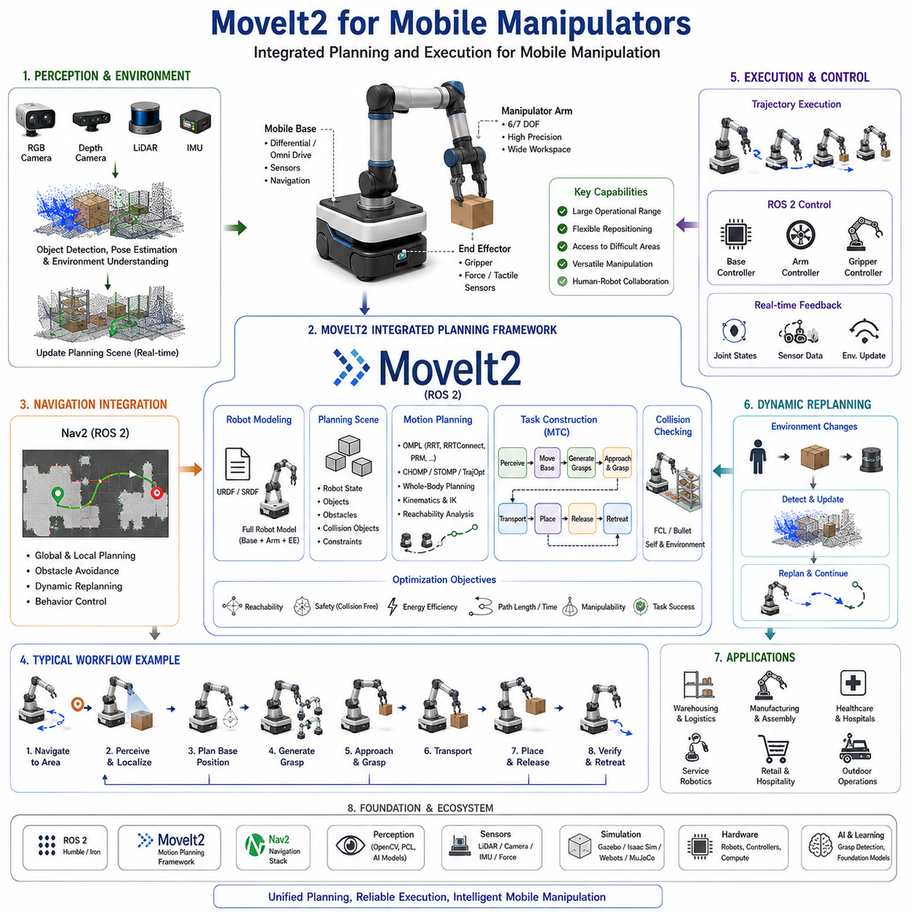{width="7.268055555555556in" height="7.268055555555556in"}

Mobile manipulators represent one of the most significant developments in modern robotics because they combine autonomous mobility with dexterous manipulation. Unlike traditional industrial robotic arms that operate from fixed positions, mobile manipulators integrate a robotic arm with a mobile base, allowing robots to navigate through dynamic environments and interact with objects over large operational areas. This combination dramatically expands robotic capabilities and enables applications in warehouses, factories, hospitals, laboratories, retail environments, service robotics, agriculture, logistics centers, airports, and outdoor autonomous operations. As these systems become increasingly sophisticated, the need for an integrated planning and execution framework becomes essential. MoveIt2 has emerged as one of the most powerful platforms for addressing this challenge by providing unified support for motion planning, manipulation planning, collision checking, task execution, perception integration, and real-time control within ROS2-based robotic systems.

Traditional robot arms operate within a fixed workspace determined by their kinematic reach. Once an object lies outside this workspace, the robot cannot interact with it without external repositioning. Mobile manipulators overcome this limitation by extending the robot's reachable workspace through base mobility. The mobile platform can reposition itself while the manipulator performs fine-grained interaction tasks. This creates a fundamentally different planning problem because the robot must simultaneously consider navigation, arm motion, object interaction, environmental constraints, and task objectives.

MoveIt2 plays a central role in coordinating these capabilities. While MoveIt was originally developed for stationary manipulators, MoveIt2 extends these capabilities into the ROS2 ecosystem and provides the flexibility required for mobile manipulation systems. Rather than treating navigation and manipulation as separate processes, MoveIt2 enables integrated planning architectures where the entire robot, including the mobile base and robotic arm, can be considered as a unified kinematic system.

The primary challenge in mobile manipulation is the coordination of multiple degrees of freedom distributed across different subsystems. A mobile manipulator may consist of a differential-drive or omnidirectional base, a six- or seven-degree-of-freedom robotic arm, a gripper, vision sensors, force sensors, and additional peripherals. The combined configuration space can become extremely large. Planning within such a high-dimensional space requires sophisticated algorithms capable of balancing computational efficiency with solution quality.

MoveIt2 addresses this challenge through its modular architecture. The framework separates robot description, kinematics, planning, execution, perception, and control into reusable components. Developers can configure individual subsystems while maintaining an integrated planning environment. This modularity makes MoveIt2 highly adaptable to different mobile manipulator platforms.

Robot modeling forms the foundation of MoveIt2-based mobile manipulation. Every robot must be represented using Unified Robot Description Format (URDF) and Semantic Robot Description Format (SRDF) models. These descriptions define links, joints, sensors, collision geometries, kinematic chains, and semantic relationships. For mobile manipulators, the robot model includes both the mobile base and manipulator arm, enabling MoveIt2 to reason about the complete robot structure.

One important design decision involves how the mobile base is represented. Some systems treat the base as a separate navigation component and plan arm motions independently. Other systems incorporate the base directly into the kinematic model, allowing joint optimization of base and arm movements. The latter approach often produces more efficient solutions because the planner can simultaneously optimize all robot degrees of freedom.

Kinematic planning becomes substantially more complex in mobile manipulators. A stationary robotic arm typically solves inverse kinematics by determining joint configurations that achieve a desired end-effector pose. In a mobile manipulator, both the base position and arm configuration contribute to end-effector placement. Consequently, multiple valid solutions may exist. MoveIt2 can leverage this redundancy to identify configurations that improve manipulability, reduce energy consumption, avoid collisions, or increase task success probability.

Reachability analysis is particularly important in mobile manipulation. Before attempting a manipulation task, the robot must determine whether the target object can be reached from its current position. If not, the robot must identify an alternative base location. MoveIt2 supports reachability evaluation through kinematic analysis and workspace computation. By integrating these capabilities with navigation systems, robots can autonomously reposition themselves to improve task feasibility.

Perception integration is another critical aspect of mobile manipulation. Unlike industrial robots operating in highly structured environments, mobile manipulators often work in dynamic settings where object positions continuously change. Vision systems provide information about object locations, orientations, obstacles, and environmental context. MoveIt2 integrates perception pipelines that update the planning scene in real time, allowing manipulation plans to adapt to changing conditions.

The planning scene serves as the robot\'s internal representation of the environment. It contains information about obstacles, objects, robot configurations, collision geometries, and task constraints. For mobile manipulators, maintaining an accurate planning scene is especially important because the robot continuously changes its position relative to the environment. Dynamic scene updates ensure that motion plans remain valid during execution.

Collision checking represents one of the most computationally intensive aspects of mobile manipulation planning. The robot must avoid collisions between the arm and environment, the base and environment, the arm and base, and the manipulated object and surrounding obstacles. As the number of movable components increases, collision-checking complexity grows significantly. MoveIt2 utilizes optimized collision detection libraries such as FCL and Bullet to perform these computations efficiently.

Motion planning for mobile manipulators often requires solving multiple interconnected planning problems. The robot may first navigate toward a target area, then position itself optimally for manipulation, execute grasping motions, transport objects, and finally perform placement operations. Each stage involves distinct planning objectives and constraints. MoveIt2 enables these stages to be coordinated through integrated planning frameworks.

Task-level planning becomes increasingly important as task complexity grows. Simple motion planning alone is insufficient for real-world manipulation applications. The robot must reason about sequences of actions, alternative strategies, and recovery procedures. MoveIt Task Constructor provides a powerful mechanism for organizing these activities into structured planning pipelines. For mobile manipulators, Task Constructor allows navigation, perception, grasp planning, manipulation, and recovery actions to be integrated into coherent workflows.

Grasp planning is particularly challenging in mobile manipulation because object accessibility depends on both arm reachability and base positioning. A grasp that appears feasible from one location may become impossible due to arm kinematic limits or environmental obstacles. MoveIt2 evaluates grasp candidates while considering the entire robot configuration. This integrated evaluation improves grasp success rates and reduces execution failures.

Navigation and manipulation traditionally belong to separate software stacks. Navigation frameworks such as Nav2 focus on mobile base movement, while MoveIt2 focuses on manipulation. Mobile manipulators require close coordination between these systems. Modern architectures establish communication channels between Nav2 and MoveIt2 so that navigation decisions influence manipulation planning and vice versa.

For example, consider a warehouse robot retrieving an item from a shelf. Nav2 may identify a safe route to the shelf, while MoveIt2 evaluates whether the target object can be reached from the planned stopping location. If reachability is insufficient, MoveIt2 can request a different base position. This iterative process continues until both navigation and manipulation constraints are satisfied.

Whole-body planning represents one of the most advanced capabilities in mobile manipulation. Instead of planning base and arm motions separately, the planner treats the entire robot as a single kinematic entity. This approach often yields more efficient and natural motions because all available degrees of freedom contribute to task completion. Whole-body planning is particularly valuable in cluttered environments where coordinated motion is required to avoid obstacles.

Sampling-based planning algorithms play a major role in MoveIt2. Algorithms such as RRT, RRTConnect, PRM, and their variants explore large configuration spaces efficiently. These planners are well suited to mobile manipulation because they can handle high-dimensional search spaces and complex constraints. MoveIt2 integrates these algorithms through the Open Motion Planning Library (OMPL).

Optimization-based planners provide an alternative approach. Instead of randomly exploring configuration space, optimization methods formulate planning as a constrained optimization problem. Objectives such as trajectory smoothness, energy efficiency, execution speed, and obstacle clearance can be optimized simultaneously. Libraries such as CHOMP, STOMP, and TrajOpt are frequently used in conjunction with MoveIt2 for these purposes.

Trajectory execution requires accurate coordination between planning and control systems. Once a trajectory is generated, it must be translated into commands for the mobile base and manipulator controllers. ROS2 Control provides standardized interfaces for hardware integration, enabling MoveIt2 to execute trajectories on diverse robotic platforms.

Real-time execution introduces additional challenges. Environmental conditions may change after planning has been completed. Humans may enter the workspace, objects may move unexpectedly, or sensor data may reveal previously unseen obstacles. MoveIt2 supports dynamic replanning mechanisms that allow trajectories to be updated during execution. This capability significantly improves operational robustness.

Multi-sensor fusion is becoming increasingly important in mobile manipulation systems. Modern robots frequently combine RGB cameras, depth cameras, LiDAR sensors, force sensors, tactile sensors, IMUs, and GNSS systems. The integration of these sensors provides richer environmental understanding and improves planning accuracy. MoveIt2 supports the incorporation of sensor-derived information into planning workflows.

Digital twins are increasingly used alongside MoveIt2 for mobile manipulator development. A digital twin provides a virtual representation of the robot and environment, enabling planning algorithms to be validated before deployment. Developers can evaluate task performance, identify potential failures, and optimize system parameters without risking physical hardware.

Simulation platforms such as Gazebo, Isaac Sim, Webots, and MuJoCo play a crucial role in this process. Mobile manipulation tasks can be tested under diverse conditions, including varying lighting, object arrangements, obstacle configurations, and environmental dynamics. Simulation-driven development reduces development costs and accelerates system deployment.

Industrial applications of MoveIt2-based mobile manipulators continue to expand rapidly. In warehouses, robots perform autonomous picking, replenishment, sorting, and transportation. In manufacturing environments, mobile manipulators support flexible production lines by transporting components and performing assembly operations. Hospitals employ mobile manipulators for medication delivery, specimen transportation, and supply management. Service robots utilize mobile manipulation for customer assistance, hospitality services, and retail operations.

Outdoor mobile manipulators introduce additional challenges related to uneven terrain, environmental uncertainty, weather conditions, and large-scale navigation. Inspection robots, maintenance robots, agricultural robots, and autonomous logistics platforms increasingly require integrated manipulation capabilities. MoveIt2 provides a flexible foundation for addressing these emerging applications.

Artificial intelligence is beginning to reshape mobile manipulation workflows. Deep learning models can assist with object detection, pose estimation, grasp prediction, scene understanding, and task planning. Foundation models and vision-language-action systems further extend robotic capabilities by enabling semantic reasoning and natural language interaction. MoveIt2 increasingly serves as the execution layer that translates high-level AI decisions into physically executable motions.

Embodied AI systems represent a particularly important future direction. These systems integrate perception, reasoning, planning, and action into unified architectures. Mobile manipulators provide an ideal physical platform for embodied intelligence because they combine mobility, dexterity, sensing, and environmental interaction. MoveIt2 forms a critical component within these architectures by providing reliable motion generation and task execution capabilities.

Scalability remains an important consideration for real-world deployments. A single mobile manipulator may operate effectively in a laboratory, but large-scale commercial environments often require fleets of robots. Coordination between multiple mobile manipulators introduces additional planning challenges related to traffic management, resource allocation, workspace sharing, and cooperative manipulation. Future MoveIt2 developments are expected to provide increasingly sophisticated support for multi-robot coordination.

As robotics continues its transition from structured industrial environments to dynamic real-world applications, the importance of integrated planning frameworks will continue to grow. Mobile manipulators require the seamless integration of navigation, manipulation, perception, control, task planning, and artificial intelligence. MoveIt2 provides one of the most comprehensive solutions available for addressing these requirements.

Within the ROS2 ecosystem, MoveIt2 has evolved from a manipulator-focused planning framework into a comprehensive platform for intelligent robotic operation. Its support for mobile manipulators enables robots to move beyond fixed workstations and interact autonomously with complex environments. By combining advanced motion planning, perception integration, task reasoning, real-time execution, and AI compatibility, MoveIt2 establishes the technological foundation for the next generation of autonomous mobile manipulation systems operating across industrial, commercial, healthcare, logistics, service, and outdoor domains.

모바일 매니퓰레이터는 자율주행 이동 기능과 정교한 조작 기능을 결합한 현대 로봇 기술의 대표적인 발전 형태이다. 기존 산업용 로봇 암은 고정된 위치에서만 작업할 수 있었지만, 모바일 매니퓰레이터는 이동 플랫폼과 로봇 암을 결합함으로써 넓은 공간을 자유롭게 이동하며 다양한 물체와 상호작용할 수 있다. 이러한 특성 덕분에 물류창고, 제조공장, 병원, 연구소, 소매점, 서비스 현장, 농업, 공항, 실외 점검 및 순찰 분야까지 활용 범위가 빠르게 확대되고 있다. 이러한 복합 시스템을 효율적으로 운영하기 위해서는 이동과 조작을 통합적으로 관리할 수 있는 소프트웨어 프레임워크가 필요하며, MoveIt2는 ROS2 기반 환경에서 이를 지원하는 가장 강력한 플랫폼 중 하나로 자리 잡고 있다.

기존의 산업용 로봇 암은 작업 공간이 로봇 팔의 길이에 의해 제한된다. 따라서 목표 물체가 작업 범위를 벗어나면 외부 장치가 물체를 이동시키거나 로봇 자체를 재배치해야 한다. 반면 모바일 매니퓰레이터는 이동 플랫폼이 새로운 위치로 이동할 수 있기 때문에 작업 가능 범위가 사실상 무한대로 확장된다. 그러나 이는 단순히 이동 기능이 추가된 것이 아니라, 이동과 조작을 동시에 고려해야 하는 훨씬 복잡한 계획 문제를 만들어낸다.

MoveIt2는 이러한 문제를 해결하기 위해 설계된 통합 계획 프레임워크이다. 원래 MoveIt은 고정형 로봇 암을 위한 모션 플래닝 도구로 개발되었지만, MoveIt2는 ROS2 환경으로 발전하면서 모바일 매니퓰레이터를 포함한 보다 복잡한 로봇 시스템을 지원하게 되었다. MoveIt2는 이동 플랫폼과 로봇 암을 별개의 시스템이 아니라 하나의 통합된 운동학적 시스템으로 취급할 수 있도록 지원한다.

모바일 매니퓰레이터의 가장 큰 특징은 매우 많은 자유도(Degree of Freedom)를 가진다는 점이다. 이동 플랫폼은 전진, 후진, 회전 또는 전방향 이동을 수행하며, 로봇 암은 일반적으로 6\~7개의 관절을 가진다. 여기에 그리퍼, 카메라, 힘 센서, IMU, LiDAR 등의 센서가 추가되면 전체 시스템의 상태 공간은 매우 커진다. 이러한 고차원 공간에서 효율적으로 계획을 생성하는 것은 상당히 어려운 문제이다.

MoveIt2는 모듈형 구조를 통해 이러한 복잡성을 관리한다. 로봇 모델링, 운동학 계산, 경로 생성, 충돌 검사, 실행 제어, 센서 통합 등을 독립적인 모듈로 구성하여 개발자가 필요에 따라 조합할 수 있도록 설계되어 있다. 이러한 구조는 다양한 형태의 모바일 매니퓰레이터에 쉽게 적용할 수 있는 유연성을 제공한다.

MoveIt2 기반 시스템의 출발점은 로봇 모델링이다. 모든 로봇은 URDF와 SRDF를 이용해 정의된다. 여기에는 링크, 관절, 센서, 충돌 형상, 운동학 체인, 의미적 관계가 포함된다. 모바일 매니퓰레이터의 경우 이동 플랫폼과 로봇 암을 모두 포함하는 모델이 생성되며, MoveIt2는 이를 기반으로 전체 시스템을 이해하고 계획을 생성한다.

특히 이동 플랫폼을 어떻게 모델링할 것인가는 중요한 설계 결정이다. 일부 시스템은 이동 플랫폼을 Navigation Stack이 관리하고 로봇 암만 MoveIt2가 제어하도록 구성한다. 반면 고급 시스템에서는 이동 플랫폼 자체를 운동학 모델에 포함시켜 베이스와 암을 동시에 최적화한다. 후자의 방식은 더 효율적이고 자연스러운 동작을 생성할 수 있다.

운동학 계산 역시 훨씬 복잡해진다. 고정형 로봇 암에서는 목표 위치에 도달하기 위한 관절 각도만 계산하면 되지만, 모바일 매니퓰레이터에서는 이동 플랫폼의 위치와 로봇 암의 관절 상태가 함께 고려된다. 따라서 동일한 엔드이펙터 위치에 대해 매우 많은 해가 존재할 수 있다. MoveIt2는 이러한 중복 자유도를 활용하여 충돌을 줄이고, 에너지 소비를 감소시키며, 조작 성능을 향상시키는 방향으로 최적화를 수행할 수 있다.

도달 가능성 분석(Reachability Analysis)은 모바일 매니퓰레이터에서 매우 중요한 기능이다. 로봇은 특정 물체를 현재 위치에서 잡을 수 있는지 먼저 판단해야 한다. 만약 불가능하다면 새로운 위치로 이동해야 한다. MoveIt2는 운동학 계산과 작업 공간 분석을 통해 이러한 판단을 수행하며, 필요 시 Navigation 시스템과 협력하여 최적의 위치를 찾는다.

비전 및 인식 시스템과의 통합도 중요한 요소이다. 산업용 로봇과 달리 모바일 매니퓰레이터는 계속 변화하는 환경에서 동작한다. 물체의 위치가 바뀌고, 사람과 다른 로봇이 이동하며, 장애물이 새롭게 나타날 수 있다. MoveIt2는 카메라, LiDAR, 깊이 센서 등의 정보를 이용하여 Planning Scene을 지속적으로 업데이트한다.

Planning Scene은 로봇의 내부 환경 모델이라고 할 수 있다. 여기에는 장애물, 작업 대상 물체, 로봇 상태, 충돌 모델, 작업 제약 조건 등이 포함된다. 모바일 매니퓰레이터는 계속 이동하기 때문에 이 환경 모델 역시 지속적으로 변화해야 하며, MoveIt2는 이를 실시간으로 관리한다.

충돌 검사는 모바일 매니퓰레이터에서 가장 중요한 기능 중 하나이다. 로봇 암과 장애물의 충돌뿐 아니라, 이동 플랫폼과 환경의 충돌, 로봇 암과 베이스 간의 충돌, 물체와 주변 환경의 충돌까지 모두 고려해야 한다. MoveIt2는 FCL과 Bullet 같은 충돌 검사 라이브러리를 활용하여 이러한 계산을 효율적으로 수행한다.

모바일 매니퓰레이터의 작업은 일반적으로 여러 단계로 구성된다. 먼저 목적지까지 이동하고, 적절한 위치에 정지한 뒤, 물체를 인식하고, 파지하고, 운반한 후, 원하는 위치에 배치해야 한다. 각각의 단계는 서로 다른 제약 조건과 계획 문제를 가진다. MoveIt2는 이러한 다양한 단계를 통합적으로 관리할 수 있는 기능을 제공한다.

작업 수준 계획(Task-Level Planning)은 복잡한 응용 분야에서 필수적이다. 단순히 경로를 생성하는 것만으로는 충분하지 않으며, 전체 작업 흐름을 고려해야 한다. MoveIt Task Constructor는 이러한 기능을 제공하는 대표적인 도구이다. 이를 통해 이동, 인식, 파지, 조작, 오류 복구를 하나의 작업 파이프라인으로 구성할 수 있다.

그라스프 계획은 모바일 매니퓰레이터에서 특히 중요하다. 동일한 파지 자세라도 로봇이 어느 위치에 있는지에 따라 성공 여부가 달라질 수 있기 때문이다. MoveIt2는 파지 후보를 평가할 때 로봇 암뿐 아니라 이동 플랫폼의 위치까지 함께 고려하여 보다 현실적인 파지 계획을 생성한다.

전통적으로 이동 계획은 Nav2가 담당하고, 조작 계획은 MoveIt2가 담당한다. 모바일 매니퓰레이터에서는 이 두 시스템의 긴밀한 협력이 필요하다. 예를 들어 창고 로봇이 선반에서 물건을 꺼내야 할 경우, Nav2는 선반까지의 경로를 생성하고, MoveIt2는 해당 위치에서 실제 파지가 가능한지 판단한다. 만약 파지가 불가능하다면 새로운 정지 위치를 요청할 수 있다. 이러한 협력 과정을 통해 이동과 조작이 최적화된다.

Whole-Body Planning은 모바일 매니퓰레이터의 고급 기능 중 하나이다. 이는 이동 플랫폼과 로봇 암을 하나의 통합 시스템으로 보고 동시에 계획을 생성하는 방식이다. 특히 복잡한 환경에서는 이동 플랫폼과 로봇 암의 협조 동작이 필요하기 때문에 매우 효과적이다.

MoveIt2는 OMPL 기반의 샘플링 기반 플래너를 광범위하게 활용한다. RRT, RRTConnect, PRM과 같은 알고리즘은 거대한 상태 공간을 효율적으로 탐색할 수 있으며, 모바일 매니퓰레이터와 같이 자유도가 높은 시스템에 적합하다.

최적화 기반 접근법도 많이 활용된다. CHOMP, STOMP, TrajOpt와 같은 알고리즘은 경로의 부드러움, 에너지 효율성, 실행 속도, 장애물 회피 성능 등을 동시에 최적화할 수 있다. 이러한 방식은 산업 환경에서 특히 유용하다.

경로가 생성되면 이를 실제 하드웨어에서 실행해야 한다. ROS2 Control은 MoveIt2와 연동되어 모바일 플랫폼과 로봇 암을 제어하는 표준 인터페이스를 제공한다. 이를 통해 다양한 하드웨어 플랫폼에서도 동일한 계획 구조를 사용할 수 있다.

실시간 실행 과정에서는 새로운 문제가 발생할 수 있다. 사람이 작업 공간에 들어오거나 물체가 이동할 수 있으며, 새로운 장애물이 나타날 수도 있다. MoveIt2는 이러한 상황에 대응하기 위해 동적 재계획(Dynamic Replanning)을 지원한다. 이를 통해 계획을 실시간으로 수정하여 안전성과 성공률을 향상시킨다.

최근의 모바일 매니퓰레이터는 RGB 카메라, 깊이 카메라, LiDAR, 힘 센서, 촉각 센서, IMU, GNSS RTK 등 다양한 센서를 사용한다. 이러한 센서 데이터를 융합함으로써 더욱 정확한 환경 이해가 가능해지고, MoveIt2 역시 이러한 정보를 계획 과정에 활용할 수 있다.

디지털 트윈 기술 역시 MoveIt2와 함께 널리 활용되고 있다. 디지털 트윈은 실제 로봇과 환경을 가상 공간에 재현하여 계획 알고리즘을 사전에 검증할 수 있도록 해준다. 이를 통해 개발자는 실제 하드웨어를 위험에 노출시키지 않고도 다양한 시나리오를 테스트할 수 있다.

Gazebo, Isaac Sim, Webots, MuJoCo와 같은 시뮬레이션 플랫폼은 이러한 검증 과정에서 핵심 역할을 수행한다. 다양한 조명 조건, 장애물 배치, 물체 위치, 환경 변화 등을 시뮬레이션함으로써 실제 환경에 가까운 테스트를 수행할 수 있다.

MoveIt2 기반 모바일 매니퓰레이터의 활용 분야는 매우 넓다. 물류창고에서는 자동 피킹과 적재, 재고 보충, 분류 작업에 활용된다. 제조공장에서는 부품 운반과 조립 지원에 사용된다. 병원에서는 약품 배송, 검체 운반, 의료 물품 관리에 적용된다. 서비스 로봇은 고객 응대, 호텔 서비스, 리테일 지원과 같은 분야에서 활용되고 있다.

실외 모바일 매니퓰레이터는 더욱 복잡한 환경에서 동작한다. 불규칙한 지형, 기상 변화, 넓은 작업 공간, 높은 환경 불확실성을 고려해야 한다. 실외 순찰 로봇, 점검 로봇, 농업 로봇, 자율 물류 로봇 등은 이동과 조작을 동시에 수행해야 하며, MoveIt2는 이러한 시스템의 핵심 기반 기술로 활용될 수 있다.

인공지능 기술은 모바일 매니퓰레이터의 발전을 더욱 가속화하고 있다. 딥러닝 모델은 객체 인식, 자세 추정, 파지 예측, 장면 이해에 활용되고 있으며, Foundation Model과 Vision-Language-Action 모델은 자연어 명령 이해와 의미 기반 작업 계획을 가능하게 한다. MoveIt2는 이러한 AI 시스템이 생성한 결정을 실제 물리적 움직임으로 변환하는 실행 계층 역할을 수행한다.

Embodied AI는 향후 가장 중요한 발전 방향 중 하나이다. Embodied AI는 인식, 추론, 계획, 행동을 하나의 통합 시스템으로 구성한다. 모바일 매니퓰레이터는 이동성과 조작 능력을 동시에 갖추고 있기 때문에 Embodied AI를 구현하기 위한 이상적인 플랫폼으로 평가된다. MoveIt2는 이러한 시스템에서 실제 행동을 생성하는 핵심 엔진 역할을 담당하게 된다.

실제 상용 환경에서는 한 대의 로봇보다 여러 대의 로봇이 동시에 운영되는 경우가 많다. 따라서 다중 로봇 협업, 교통 관리, 자원 할당, 공동 작업 계획 등의 문제가 중요해지고 있다. 향후 MoveIt2는 이러한 다중 로봇 환경을 더욱 효과적으로 지원하는 방향으로 발전할 것으로 예상된다.

로봇 기술이 고정형 산업 환경에서 동적인 현실 환경으로 확장됨에 따라, 이동과 조작을 통합적으로 계획할 수 있는 플랫폼의 중요성은 더욱 커지고 있다. 모바일 매니퓰레이터는 이동, 조작, 인식, 제어, AI를 하나의 시스템으로 통합해야 하며, MoveIt2는 이러한 요구사항을 충족하는 가장 강력한 프레임워크 중 하나이다.

ROS2 생태계에서 MoveIt2는 단순한 로봇 암 플래너를 넘어 지능형 로봇 운영 플랫폼으로 진화하고 있다. 모바일 매니퓰레이터를 지원함으로써 로봇은 고정 작업 공간을 벗어나 실제 환경에서 자율적으로 이동하고 상호작용할 수 있게 되었다. 고급 모션 플래닝, 실시간 인식 통합, 작업 수준 추론, AI 연계 기능을 제공하는 MoveIt2는 차세대 물류 로봇, 서비스 로봇, 산업용 모바일 매니퓰레이터, 병원 로봇, 실외 자율주행 플랫폼, 그리고 미래의 Embodied AI 시스템을 위한 핵심 기반 기술로 자리매김하고 있다.

##  

## 10 Real Time Execution

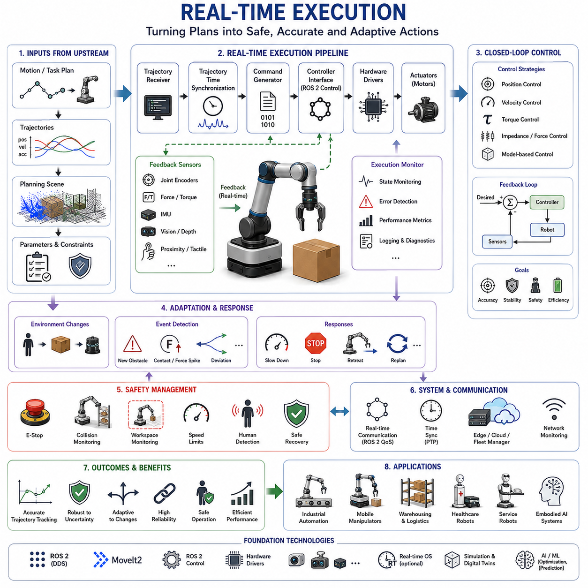{width="7.268055555555556in" height="7.268055555555556in"}

Real-time execution is one of the most critical capabilities in modern robotic systems because it transforms planned robot behavior into actual physical actions occurring in dynamic environments. While motion planning, task planning, perception, and decision-making generate desired actions, the ultimate success of a robotic system depends on its ability to execute those actions accurately, safely, and reliably under real-world conditions. In the MoveIt2 ecosystem, real-time execution represents the final stage of the manipulation pipeline where planned trajectories are converted into controller commands, sensor feedback is continuously monitored, and corrective actions are applied when necessary. For industrial robots, mobile manipulators, service robots, warehouse automation systems, and future embodied AI platforms, real-time execution serves as the bridge between digital planning and physical reality.

A robot operating in a perfectly simulated environment can often achieve near-perfect execution because all variables are known and predictable. However, real-world environments introduce uncertainty at every level. Sensors contain noise, actuators exhibit mechanical imperfections, communication networks introduce latency, objects may move unexpectedly, and environmental conditions continuously change. Real-time execution systems are designed to handle these uncertainties while maintaining acceptable performance, safety, and task success rates.

The fundamental objective of real-time execution is to ensure that the robot follows planned trajectories while continuously adapting to changing conditions. This requires close integration between planning algorithms, control systems, sensors, actuators, and monitoring frameworks. Rather than treating execution as a simple replay of a precomputed trajectory, modern robotic systems view execution as a continuous feedback-driven process in which planning and control operate together.

Within MoveIt2, real-time execution begins after a motion planning algorithm generates a valid trajectory. The trajectory typically consists of a sequence of robot joint positions, velocities, accelerations, and timestamps. This trajectory is then transmitted to the execution subsystem, which coordinates with ROS2 Control and hardware interfaces to drive the physical robot. The execution subsystem is responsible for ensuring that commands are delivered at the correct time and that actual robot motion closely follows the planned path.

Trajectory execution requires accurate synchronization between software and hardware components. Every joint controller must receive commands at precise intervals, and feedback from encoders and sensors must be collected continuously. Even small timing errors can accumulate over time and lead to trajectory deviations. Consequently, deterministic timing becomes a key requirement for real-time robotic systems.

Real-time systems differ from conventional software applications because timing constraints are as important as computational correctness. In a traditional application, a delayed response may simply reduce performance. In robotics, delayed responses can cause collisions, unstable behavior, or task failures. Therefore, real-time execution frameworks prioritize predictable timing behavior and bounded latency.

Latency is one of the most important performance metrics in robotic execution systems. Latency represents the delay between sensing an event and responding to it. For example, when a force sensor detects unexpected contact, the controller must react quickly enough to prevent damage. High latency can reduce responsiveness and compromise safety. Consequently, robotic systems strive to minimize sensing, communication, computation, and actuation delays.

Jitter represents another important consideration. While average latency may appear acceptable, variations in timing can cause unpredictable behavior. Real-time execution frameworks seek to minimize jitter by ensuring consistent update rates across all system components. Consistent timing improves controller stability and enables more accurate trajectory tracking.

ROS2 was designed with real-time robotics applications in mind. Compared to ROS1, ROS2 provides significant improvements in communication reliability, deterministic behavior, and Quality of Service (QoS) management. These features make ROS2 particularly suitable for implementing real-time execution pipelines in industrial and mobile robotic systems.

ROS2 Control serves as the primary execution framework for many MoveIt2 deployments. ROS2 Control provides standardized interfaces between high-level planning software and low-level hardware drivers. Controllers receive trajectory commands from MoveIt2 and generate actuator signals that drive robot joints. This architecture allows developers to replace hardware platforms without redesigning the entire execution pipeline.

Joint trajectory controllers represent one of the most common controller types used in MoveIt2 systems. These controllers receive desired joint trajectories and generate control outputs that drive motors toward target positions. Advanced controllers may incorporate feedforward terms, feedback compensation, dynamic modeling, and adaptive control techniques to improve tracking performance.

Position control is the simplest execution strategy and is widely used in industrial robotic systems. The controller attempts to move each joint to a desired position while minimizing position error. Although position control is straightforward and reliable, it may not provide optimal performance in highly dynamic environments.

Velocity control introduces additional flexibility by controlling joint velocities directly. This approach often improves responsiveness and smoothness, particularly when dealing with continuous motion tasks. Velocity control is frequently used in mobile robot navigation and certain manipulation applications.

Torque control represents the most advanced execution strategy. Instead of directly commanding positions or velocities, the controller commands joint torques. Torque control enables precise force regulation, compliance control, impedance control, and dynamic interaction with the environment. Collaborative robots and force-sensitive manipulation systems often rely on torque-based execution.

Feedback loops are fundamental to real-time execution. Sensors continuously measure robot state information such as joint positions, velocities, forces, temperatures, and environmental conditions. This information is compared against desired values, and corrective actions are applied accordingly. Without feedback loops, robots would operate in an open-loop manner and could not compensate for disturbances or uncertainties.

The concept of closed-loop control lies at the heart of modern robotic execution systems. In a closed-loop architecture, sensors continuously monitor system behavior and provide information to controllers. Controllers calculate errors between desired and actual states and adjust actuator commands accordingly. This continuous correction process enables robots to maintain accurate performance despite changing conditions.

PID controllers remain among the most widely used control algorithms in robotic systems. The proportional term responds to current errors, the integral term compensates for accumulated errors, and the derivative term predicts future trends. Although relatively simple, PID controllers provide robust performance across a wide range of robotic applications.

Model-based control techniques extend beyond PID control by incorporating dynamic models of the robot. These approaches use mathematical representations of inertia, friction, gravity, and external forces to improve control accuracy. Model predictive control, computed torque control, and inverse dynamics control are examples of advanced model-based execution strategies.

Mobile manipulators introduce additional complexity because both the mobile base and manipulator arm must be coordinated simultaneously. A mobile manipulator executing a pick-and-place operation may require synchronized base motion, arm movement, gripper control, and sensor updates. Real-time execution frameworks must coordinate all these subsystems while maintaining overall task consistency.

Synchronization becomes particularly important when multiple actuators must move together. If different robot joints execute commands at different rates, trajectory quality may degrade significantly. Coordinated control mechanisms ensure that all robot components remain synchronized throughout execution.

Sensor integration plays a central role in real-time execution. Cameras, LiDAR sensors, IMUs, force sensors, tactile sensors, proximity sensors, and encoders continuously generate information about the robot and environment. This data must be processed efficiently and incorporated into execution decisions without introducing excessive delays.

Force feedback provides an important example of real-time adaptation. During assembly tasks, insertion operations, or human-robot collaboration, force sensors can detect unexpected contact forces. The execution system can then modify robot behavior in real time to avoid excessive force, prevent damage, or improve task performance.

Tactile sensing extends this capability further by providing detailed information about object contact conditions. During grasping operations, tactile sensors can detect slipping, uneven pressure distribution, or contact loss. The execution system can respond immediately by adjusting grip force or modifying manipulation strategies.

Collision monitoring represents another critical aspect of real-time execution. While motion planning attempts to generate collision-free trajectories, unexpected obstacles may appear during execution. Real-time collision monitoring systems continuously evaluate environmental conditions and intervene when necessary. Depending on the situation, the robot may slow down, stop, retreat, or initiate replanning.

Dynamic replanning is becoming increasingly important in modern robotic systems. Traditional execution frameworks assumed that environments remained static after planning. In reality, humans, vehicles, other robots, and movable objects continuously change the workspace. Dynamic replanning allows robots to modify trajectories during execution in response to environmental changes.

MoveIt2 supports dynamic replanning through integration with planning scene updates and sensor feedback. When significant changes are detected, the robot can generate new trajectories while maintaining task continuity. This capability is particularly valuable in warehouses, hospitals, and service environments where environmental conditions change frequently.

Safety remains a primary concern throughout real-time execution. Industrial robots often operate near expensive equipment, valuable products, and human workers. Safety systems monitor robot behavior continuously and enforce operational constraints. Emergency stop systems, collision detection mechanisms, workspace monitoring, and speed limitations all contribute to safe execution.

Collaborative robots require even more sophisticated safety mechanisms. These robots are specifically designed to operate in close proximity to humans. Real-time execution systems must continuously monitor human positions, predict potential interactions, and adjust robot behavior accordingly. Human-aware execution strategies represent an active area of robotics research.

Network communication introduces additional challenges for distributed robotic systems. Modern robots frequently communicate with edge servers, cloud platforms, fleet management systems, and remote operators. Network delays, packet loss, and bandwidth limitations can affect execution performance. Real-time execution frameworks must tolerate communication uncertainties while maintaining safe operation.

Time synchronization becomes particularly important in distributed robotic systems. Protocols such as Precision Time Protocol (PTP) enable multiple devices to share a common notion of time. Accurate synchronization improves sensor fusion, multi-robot coordination, and distributed control performance.

Execution monitoring provides visibility into system behavior. Monitoring systems track trajectory progress, controller performance, sensor health, communication status, power consumption, and task completion metrics. Operators can use this information to diagnose issues, optimize performance, and ensure operational reliability.

Logging and diagnostics are essential for long-term system maintenance. Real-time execution systems generate large volumes of operational data. This information supports debugging, performance analysis, predictive maintenance, and continuous improvement efforts. Modern robotic platforms increasingly integrate execution logs with fleet management and analytics systems.

Digital twins offer powerful capabilities for execution validation. By maintaining a synchronized virtual representation of the robot, developers can compare planned and actual execution behavior. Deviations can be identified early, and corrective measures can be implemented before significant failures occur.

Artificial intelligence is beginning to influence execution systems as well. Machine learning models can predict execution failures, estimate actuator degradation, optimize controller parameters, and improve adaptation strategies. These capabilities enhance robustness and reduce operational downtime.

The emergence of embodied AI systems further elevates the importance of real-time execution. Embodied AI integrates perception, reasoning, planning, and action into unified cognitive architectures. While high-level reasoning determines what actions should be performed, real-time execution ensures that those actions are physically realized. Reliable execution therefore becomes a prerequisite for intelligent behavior.

Future robotic systems will increasingly operate in complex, dynamic, and unstructured environments. Autonomous warehouse robots, hospital service robots, field inspection robots, agricultural robots, humanoids, and mobile manipulators will all require highly reliable execution frameworks capable of adapting continuously to environmental changes. Real-time execution will evolve from a simple trajectory playback mechanism into a sophisticated decision-making layer that combines control, sensing, prediction, adaptation, and safety management.

Within the MoveIt2 ecosystem, real-time execution serves as the culmination of the entire robotic planning pipeline. It transforms abstract task objectives into physical actions while maintaining responsiveness, safety, and reliability. By integrating ROS2 Control, sensor feedback, dynamic replanning, collision monitoring, and advanced control strategies, MoveIt2 enables robots to execute complex manipulation tasks in real-world environments with increasing levels of autonomy. As robotic applications continue to expand across industrial, commercial, healthcare, logistics, and service domains, real-time execution will remain one of the foundational technologies that determine whether autonomous robotic systems can operate successfully outside controlled laboratory settings.

실시간 실행(Real-Time Execution)은 현대 로봇 시스템에서 가장 중요한 기능 중 하나이다. 모션 플래닝, 작업 계획(Task Planning), 인지(Perception), 의사결정 시스템이 로봇이 수행해야 할 행동을 결정한다면, 실시간 실행은 이러한 계획을 실제 물리적 움직임으로 변환하는 역할을 담당한다. 즉, 디지털 세계에서 생성된 계획을 현실 세계의 행동으로 구현하는 마지막 단계이다. MoveIt2 환경에서 실시간 실행은 계획된 경로를 실제 제어 명령으로 변환하고, 센서 피드백을 지속적으로 모니터링하며, 필요할 경우 즉각적인 수정과 보정을 수행하는 핵심 계층이다. 산업용 로봇, 모바일 매니퓰레이터, 물류 로봇, 서비스 로봇, 그리고 미래의 Embodied AI 시스템에 이르기까지 실시간 실행은 계획과 현실을 연결하는 핵심 기술이다.

시뮬레이션 환경에서는 모든 조건이 알려져 있기 때문에 로봇이 거의 완벽하게 계획을 수행할 수 있다. 그러나 실제 환경에서는 다양한 불확실성이 존재한다. 센서는 노이즈를 포함하고 있으며, 모터와 감속기는 기계적 오차를 가진다. 네트워크는 지연이 발생할 수 있고, 사람이나 물체가 예상치 못한 움직임을 보일 수도 있다. 실시간 실행 시스템은 이러한 불확실성을 처리하면서도 안전하고 정확한 작업 수행을 보장해야 한다.

실시간 실행의 기본 목표는 계획된 경로를 따라가면서도 변화하는 환경에 적응하는 것이다. 이를 위해 계획 알고리즘, 제어기, 센서, 액추에이터, 모니터링 시스템이 긴밀하게 통합되어야 한다. 현대 로봇에서는 실행을 단순히 계획된 경로를 재생하는 과정으로 보지 않는다. 대신 계획과 제어가 지속적인 피드백 루프를 형성하며 함께 동작하는 과정으로 이해한다.

MoveIt2에서는 모션 플래너가 경로를 생성한 이후 실시간 실행이 시작된다. 생성된 경로에는 관절 위치, 속도, 가속도, 시간 정보가 포함되어 있다. 이러한 경로는 실행 시스템으로 전달되며, ROS2 Control과 하드웨어 인터페이스를 통해 실제 모터를 구동하게 된다. 실행 시스템은 명령이 정확한 시점에 전달되도록 보장하며, 실제 로봇의 움직임이 계획된 경로를 최대한 정확하게 따르도록 관리한다.

경로 실행에서는 소프트웨어와 하드웨어 간의 정확한 동기화가 필수적이다. 각 관절 제어기는 정해진 주기로 명령을 받아야 하며, 엔코더와 센서 데이터 역시 지속적으로 수집되어야 한다. 아주 작은 시간 오차도 누적되면 큰 경로 편차를 유발할 수 있기 때문에 결정론적(Deterministic) 시간 관리가 중요하다.

실시간 시스템은 일반적인 소프트웨어와 다르다. 일반 응용 프로그램에서는 응답이 조금 늦어져도 큰 문제가 되지 않지만, 로봇에서는 수 밀리초의 지연이 충돌이나 작업 실패로 이어질 수 있다. 따라서 실시간 시스템은 계산의 정확성뿐 아니라 응답 시간의 예측 가능성도 매우 중요하게 다룬다.

실시간 실행에서 가장 중요한 성능 지표 중 하나는 지연 시간(Latency)이다. 지연 시간은 센서가 이벤트를 감지한 순간부터 시스템이 대응하기까지 걸리는 시간을 의미한다. 예를 들어 힘 센서가 예상치 못한 충돌을 감지했을 때, 로봇은 즉시 반응해야 한다. 지연 시간이 길어질수록 안전성과 작업 품질은 저하된다.

지터(Jitter) 역시 중요한 요소이다. 평균 지연 시간이 짧더라도 실행 시간이 불규칙하게 변하면 로봇의 움직임은 불안정해질 수 있다. 따라서 실시간 시스템은 일정한 주기로 동작하며 지터를 최소화해야 한다.

ROS2는 실시간 로봇 응용을 고려하여 설계되었다. ROS1에 비해 통신 안정성, 결정론적 동작, QoS(Quality of Service) 관리 기능이 크게 향상되었다. 이러한 특성은 MoveIt2 기반의 실시간 실행 시스템 구축에 매우 유리하다.

ROS2 Control은 MoveIt2에서 가장 널리 사용되는 실행 프레임워크이다. ROS2 Control은 상위 수준의 계획 시스템과 실제 하드웨어 사이의 표준 인터페이스를 제공한다. MoveIt2가 생성한 경로를 받아 각 관절 제어기로 전달하며, 다양한 로봇 플랫폼에서도 동일한 구조를 사용할 수 있도록 지원한다.

가장 일반적으로 사용되는 제어기는 Joint Trajectory Controller이다. 이 제어기는 목표 관절 경로를 받아 모터를 제어하며, 계획된 궤적을 따라가도록 한다. 고급 제어기에서는 피드포워드 보상, 동역학 모델, 적응 제어 등의 기법을 활용하여 추종 성능을 향상시킨다.

위치 제어(Position Control)는 가장 단순하면서도 널리 사용되는 방식이다. 목표 위치에 관절을 이동시키는 데 집중하며 산업용 로봇에서 많이 사용된다. 반면 속도 제어(Velocity Control)는 목표 속도를 직접 제어하기 때문에 보다 부드럽고 유연한 움직임을 생성할 수 있다.

토크 제어(Torque Control)는 가장 고급 제어 방식이다. 위치나 속도가 아닌 관절 토크를 직접 제어함으로써 힘 제어, 임피던스 제어, 순응 제어 등을 구현할 수 있다. 협동로봇이나 정밀 조작 시스템에서 주로 활용된다.

실시간 실행의 핵심은 피드백 루프(Feedback Loop)이다. 센서는 관절 위치, 속도, 힘, 온도, 환경 정보를 지속적으로 측정한다. 제어기는 이러한 정보를 이용하여 목표 상태와 실제 상태의 차이를 계산하고, 이를 보정하는 명령을 생성한다. 피드백이 없다면 로봇은 환경 변화에 대응할 수 없게 된다.

현대 로봇은 대부분 폐루프 제어(Closed-Loop Control)를 사용한다. 센서가 현재 상태를 측정하고, 제어기가 오차를 계산하며, 액추에이터가 이를 보정하는 과정이 반복된다. 이러한 구조 덕분에 로봇은 외부 교란이나 모델 오차에도 안정적으로 동작할 수 있다.

PID 제어기는 가장 널리 사용되는 제어 알고리즘이다. 비례(Proportional) 항은 현재 오차에 반응하고, 적분(Integral) 항은 누적 오차를 제거하며, 미분(Derivative) 항은 미래 변화를 예측한다. 단순하지만 매우 강력하여 다양한 로봇 시스템에 적용되고 있다.

보다 정교한 시스템에서는 모델 기반 제어(Model-Based Control)를 사용한다. 이 방법은 로봇의 질량, 관성, 마찰, 중력 효과를 고려하여 보다 정확한 제어를 수행한다. Model Predictive Control(MPC), Computed Torque Control, Inverse Dynamics Control 등이 대표적인 예이다.

모바일 매니퓰레이터는 실시간 실행을 더욱 복잡하게 만든다. 이동 플랫폼과 로봇 암을 동시에 제어해야 하기 때문이다. 물체를 집는 과정에서는 이동 플랫폼, 로봇 암, 그리퍼, 비전 시스템이 모두 협조적으로 동작해야 한다. 따라서 각 서브시스템을 정확히 동기화하는 것이 매우 중요하다.

센서 통합 역시 실시간 실행의 핵심 요소이다. 카메라, LiDAR, IMU, 힘 센서, 촉각 센서, 거리 센서 등은 지속적으로 데이터를 생성한다. 이 정보는 매우 짧은 시간 안에 처리되어 실행 과정에 반영되어야 한다.

힘 센서(Force Sensor)는 실시간 적응의 대표적인 사례이다. 조립 작업이나 삽입 작업에서는 예상치 못한 접촉이 발생할 수 있다. 힘 센서는 이를 감지하고 제어기에 전달하며, 제어기는 즉시 힘을 줄이거나 경로를 수정하여 손상을 방지할 수 있다.

촉각 센서(Tactile Sensor)는 물체와의 접촉 상태를 더욱 세밀하게 측정한다. 파지 과정에서 미끄러짐이 발생하면 즉시 감지하여 그립 힘을 조정할 수 있다. 이를 통해 파지 성공률을 크게 향상시킬 수 있다.

충돌 모니터링(Collision Monitoring)도 중요한 기능이다. 계획 단계에서 충돌이 없는 경로를 생성하더라도 실행 중 새로운 장애물이 나타날 수 있다. 실시간 실행 시스템은 주변 환경을 지속적으로 감시하며 필요 시 감속, 정지, 후퇴 또는 재계획을 수행한다.

동적 재계획(Dynamic Replanning)은 최근 로봇 시스템에서 매우 중요한 기능으로 자리 잡고 있다. 과거에는 계획 이후 환경이 변하지 않는다고 가정했지만, 실제 환경에서는 사람, 차량, 다른 로봇이 계속 움직인다. 따라서 로봇은 실행 중에도 새로운 경로를 생성할 수 있어야 한다.

MoveIt2는 Planning Scene과 센서 피드백을 활용하여 이러한 동적 재계획을 지원한다. 환경 변화가 감지되면 새로운 경로를 생성하면서도 현재 작업을 최대한 유지하려고 시도한다. 이는 물류창고나 병원과 같은 동적인 환경에서 매우 중요한 기능이다.

안전성은 실시간 실행의 최우선 고려사항이다. 산업용 로봇은 고가의 장비와 제품 주변에서 동작하며, 사람과 함께 작업하는 경우도 많다. 따라서 비상 정지(E-Stop), 충돌 감지, 작업 공간 모니터링, 속도 제한과 같은 다양한 안전 기능이 포함된다.

협동로봇(Cobot)은 더욱 정교한 안전 메커니즘을 필요로 한다. 사람과 가까운 거리에서 작업하기 때문에 인간의 위치를 지속적으로 추적하고, 충돌 가능성을 예측하며, 필요 시 동작을 수정해야 한다.

현대 로봇은 엣지 서버, 클라우드, FMS(Robot Fleet Management System), 원격 운영 센터와도 연결된다. 따라서 네트워크 지연과 패킷 손실 역시 고려해야 한다. 실시간 실행 시스템은 이러한 통신 문제에도 안전성을 유지할 수 있어야 한다.

분산 시스템에서는 시간 동기화가 매우 중요하다. PTP(Precision Time Protocol)와 같은 기술을 활용하면 여러 장치가 동일한 시간을 공유할 수 있으며, 이는 센서 융합과 다중 로봇 협업의 정확성을 향상시킨다.

실행 모니터링 시스템은 경로 진행 상황, 제어기 성능, 센서 상태, 통신 품질, 전력 소비 등을 지속적으로 감시한다. 이를 통해 운영자는 시스템 상태를 파악하고 문제를 조기에 발견할 수 있다.

실행 로그와 진단 정보는 유지보수 측면에서도 중요하다. 실시간 실행 과정에서 수집된 데이터는 디버깅, 성능 분석, 예지보전(Predictive Maintenance), 지속적인 성능 개선에 활용될 수 있다.

디지털 트윈은 실시간 실행 검증에도 활용된다. 실제 로봇과 동일한 가상 모델을 유지함으로써 계획과 실제 실행 결과를 비교할 수 있다. 이를 통해 오차를 조기에 발견하고 개선할 수 있다.

최근에는 인공지능이 실시간 실행 시스템에도 적용되고 있다. AI는 실행 실패를 예측하고, 모터의 성능 저하를 감지하며, 제어기 파라미터를 자동으로 최적화할 수 있다. 이러한 기능은 시스템의 신뢰성과 가용성을 크게 향상시킨다.

Embodied AI 시스템에서는 실시간 실행의 중요성이 더욱 커진다. 상위 계층의 AI가 무엇을 할지 결정한다면, 실시간 실행 시스템은 그것을 실제 행동으로 구현한다. 따라서 아무리 뛰어난 인공지능이라도 안정적인 실행 계층이 없다면 실제 환경에서 활용될 수 없다.

미래의 로봇은 더욱 복잡하고 동적인 환경에서 동작하게 될 것이다. 물류 로봇, 병원 로봇, 점검 로봇, 농업 로봇, 휴머노이드, 모바일 매니퓰레이터는 모두 환경 변화에 적응하면서 안정적으로 동작해야 한다. 따라서 실시간 실행은 단순한 경로 재생 기능을 넘어, 제어, 예측, 적응, 안전 관리가 통합된 지능형 실행 계층으로 발전할 것이다.

MoveIt2 생태계에서 실시간 실행은 전체 로봇 계획 파이프라인의 최종 단계이다. 작업 목표를 실제 물리적 행동으로 변환하며, ROS2 Control, 센서 피드백, 동적 재계획, 충돌 모니터링, 고급 제어 기술을 통합하여 높은 수준의 자율성을 제공한다. 산업 자동화, 물류, 의료, 서비스 로봇, 실외 자율주행 플랫폼 등 다양한 분야에서 성공적인 로봇 운영을 가능하게 하는 핵심 기술이며, 앞으로도 자율 로봇 시스템의 성능을 결정하는 가장 중요한 기반 기술 중 하나로 남게 될 것이다.

##  

## 11 Debugging MoveIt2

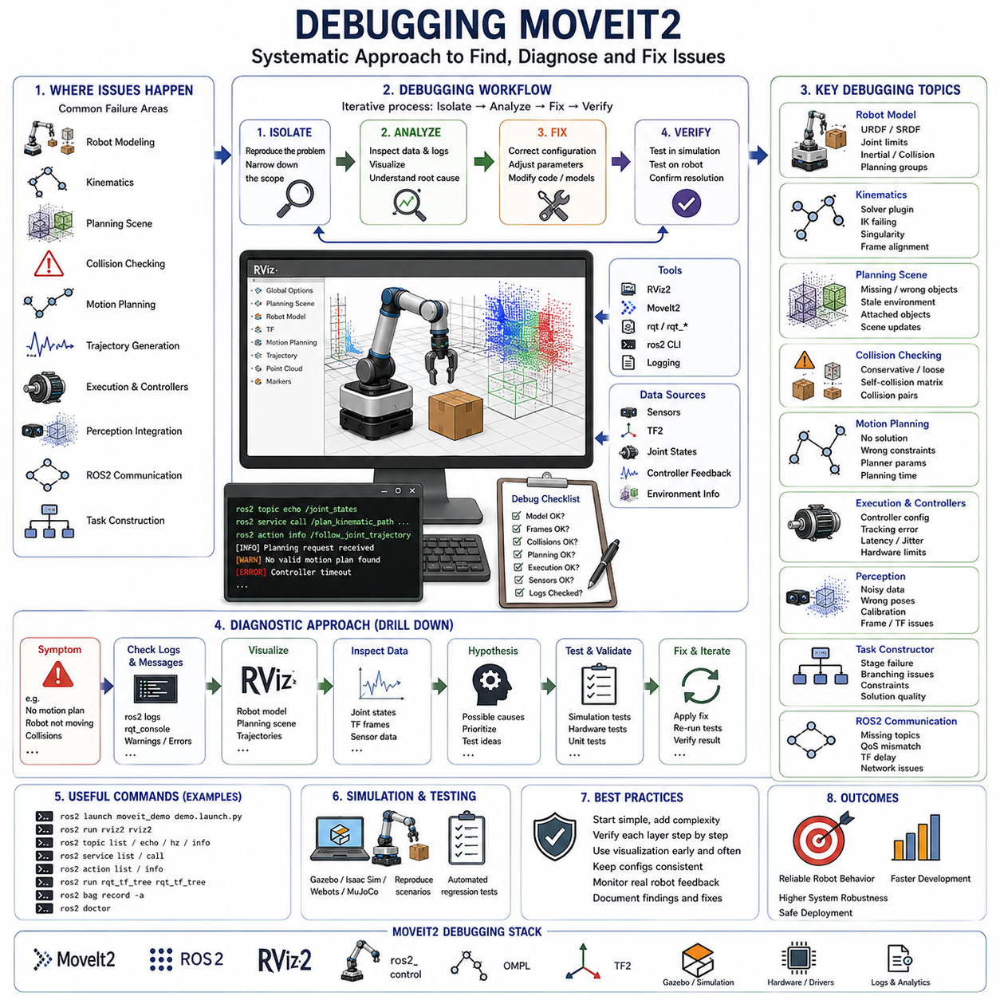{width="7.268055555555556in" height="7.268055555555556in"}

Debugging is one of the most important activities in the development and deployment of robotic systems because even the most sophisticated planning frameworks can fail when confronted with incorrect configurations, hardware inconsistencies, communication issues, environmental uncertainties, or software defects. In the MoveIt2 ecosystem, debugging plays a critical role in ensuring that motion planning, collision checking, kinematic calculations, trajectory execution, perception integration, and task-level planning function correctly under real-world conditions. Since MoveIt2 operates at the intersection of robot modeling, motion planning, ROS2 communication, controller interfaces, and physical hardware, debugging often requires a systematic understanding of the entire robotics software stack rather than a single software component.

Unlike traditional software applications where bugs often manifest as program crashes or incorrect outputs, robotic systems exhibit a much broader range of failure modes. A robot may fail to find a valid motion plan, generate unstable trajectories, misinterpret sensor data, collide with obstacles, execute unexpected movements, lose communication with controllers, or simply remain motionless despite receiving commands. In many cases, the root cause is not immediately visible because multiple software layers interact simultaneously. Consequently, successful MoveIt2 debugging requires a structured methodology that isolates problems systematically and verifies each subsystem independently.

One of the most common debugging challenges involves robot modeling. MoveIt2 relies heavily on accurate robot descriptions defined through URDF and SRDF files. These files describe robot links, joints, collision geometries, visual geometries, kinematic chains, planning groups, end effectors, virtual joints, and semantic relationships. Even small modeling errors can cause significant planning failures. Incorrect joint limits, missing collision geometries, improperly defined inertial properties, or invalid kinematic chains may prevent MoveIt2 from generating feasible plans.

When debugging robot models, developers typically begin by verifying that the robot description loads correctly into RViz and MoveIt2. Every link and joint should appear in the correct position, and the robot should move as expected when individual joints are manipulated. Visualization tools provide an important first step because many configuration errors become immediately visible when inspecting the robot model graphically.

Joint limit configuration represents another frequent source of problems. If joint limits are too restrictive, valid solutions may become unreachable. If limits are excessively permissive, generated trajectories may exceed hardware capabilities or create unsafe motions. MoveIt2 uses joint limits extensively during inverse kinematics calculations and motion planning. Therefore, developers must verify that software limits accurately reflect physical robot constraints.

Kinematic configuration errors are also common during system integration. MoveIt2 relies on kinematics plugins to compute forward and inverse kinematic solutions. If the selected plugin is misconfigured, motion planning may fail entirely. Developers often encounter situations where inverse kinematics solutions cannot be found despite apparently reachable targets. In many cases, these issues originate from incorrect solver parameters, inaccurate robot descriptions, or improperly defined planning groups.

Forward kinematics debugging is generally simpler because it involves computing end-effector positions from known joint states. Inverse kinematics debugging is considerably more challenging because multiple solutions may exist, singularities may occur, and solver convergence depends on initialization conditions. Visualization of target poses and resulting joint configurations often helps identify inverse kinematics issues.

The planning scene is another major source of debugging complexity. MoveIt2 maintains an internal representation of the robot, obstacles, objects, collision geometries, and environmental constraints. If the planning scene does not accurately reflect the physical environment, generated trajectories may become invalid. Objects may appear in incorrect locations, collision models may be missing, or stale environmental information may persist after changes occur.

Developers frequently debug planning scene issues using RViz visualization tools. By inspecting collision objects, occupancy maps, attached objects, and environmental models, discrepancies between the physical world and planning scene can be identified. Planning scene monitoring tools provide additional visibility into how environmental information changes over time.

Collision checking failures represent one of the most common causes of planning problems. MoveIt2 continuously evaluates potential collisions during motion planning. If collision models are overly conservative, valid trajectories may be rejected unnecessarily. Conversely, incomplete collision models may allow unsafe motions. Debugging collision checking often involves visualizing collision geometries, inspecting contact points, and analyzing collision matrices.

Self-collisions deserve particular attention because they can be difficult to identify without specialized tools. Robots with many degrees of freedom may enter configurations where links collide with each other. MoveIt2 automatically generates self-collision matrices to improve planning efficiency, but incorrect configuration of these matrices can lead to unexpected behavior.

Motion planning failures are among the most visible debugging challenges. A robot may simply report that no valid plan could be found. While this appears straightforward, the underlying cause may originate from kinematics, collision checking, environmental constraints, planning parameters, or hardware limitations. Developers must systematically isolate these factors to identify the root cause.

The Open Motion Planning Library (OMPL) provides several planners commonly used within MoveIt2, including RRT, RRTConnect, PRM, and related algorithms. Different planners exhibit different performance characteristics. A planning problem that fails with one planner may succeed with another. Consequently, debugging often involves experimenting with alternative planners and tuning planner-specific parameters.

Sampling-based planners can be particularly sensitive to planning time limits. If insufficient time is allocated, planners may terminate before finding a valid solution. Increasing planning time, adjusting sampling parameters, or simplifying constraints can often improve success rates. However, excessive planning times may reduce system responsiveness, particularly in real-time applications.

Constraint debugging presents another important challenge. MoveIt2 supports position constraints, orientation constraints, visibility constraints, path constraints, and task-specific restrictions. Overly restrictive constraints may eliminate all feasible solutions. Developers frequently discover that planning failures result from constraints that unintentionally conflict with robot capabilities.

Trajectory generation and optimization introduce additional complexity. Even when a valid path exists, the resulting trajectory may exhibit undesirable characteristics such as excessive accelerations, abrupt changes in direction, oscillations, or inefficient motions. Trajectory debugging involves inspecting generated paths, evaluating velocity profiles, and analyzing acceleration limits.

Time parameterization is particularly important for trajectory quality. Motion planners often generate geometric paths without considering timing. MoveIt2 subsequently applies time parameterization algorithms to produce executable trajectories. Problems in this stage may result in unrealistic velocities, excessive accelerations, or controller instability.

Execution failures frequently occur after planning succeeds. A trajectory may appear valid within simulation but fail during hardware execution. These issues often originate from controller configuration, communication delays, synchronization errors, hardware limitations, or inaccurate calibration. Debugging execution problems requires close examination of controller feedback and hardware state information.

ROS2 Control serves as the primary execution framework in many MoveIt2 deployments. Controllers receive planned trajectories and translate them into actuator commands. If controllers are incorrectly configured, trajectories may not execute correctly even when planning succeeds. Developers must verify controller interfaces, update rates, hardware communication channels, and actuator responses.

Joint state feedback provides a critical source of debugging information. Actual joint positions should closely follow commanded positions during execution. Significant discrepancies may indicate calibration errors, mechanical issues, controller instability, or communication problems. Monitoring tools allow developers to compare planned and actual trajectories in real time.

Communication debugging becomes increasingly important in distributed robotic systems. MoveIt2 relies extensively on ROS2 topics, services, actions, and DDS-based communication. Message delivery failures, QoS mismatches, network latency, and synchronization problems can all affect system behavior. ROS2 diagnostic tools provide visibility into communication flows and network performance.

Topic inspection tools allow developers to verify that expected messages are being published and received. Missing messages often indicate launch configuration problems, namespace mismatches, or communication failures. Similarly, service and action debugging tools help identify failures in request-response interactions.

Transform (TF2) issues are among the most frequent sources of perception and planning failures. MoveIt2 depends heavily on accurate coordinate transformations between sensors, robot links, end effectors, and world reference frames. Missing transforms, incorrect frame hierarchies, timing mismatches, or calibration errors can prevent successful planning.

TF2 debugging typically begins by inspecting the transform tree and verifying that all required frames are present. Developers must ensure that transforms are published at appropriate rates and remain consistent throughout system operation. Visualization tools help identify frame inconsistencies and missing connections.

Perception integration introduces additional debugging challenges. MoveIt2 increasingly relies on perception systems for object detection, pose estimation, obstacle recognition, and scene understanding. Errors in perception pipelines can propagate directly into planning failures. Incorrect object poses, noisy point clouds, incomplete environmental models, or sensor calibration errors may all affect planning quality.

Depth cameras, LiDAR sensors, RGB cameras, and stereo vision systems require careful calibration and validation. Developers often debug perception issues by comparing raw sensor outputs against expected environmental conditions. Point cloud visualization and object pose inspection provide valuable diagnostic information.

Task Constructor debugging represents a higher-level challenge. MoveIt Task Constructor decomposes complex tasks into multiple planning stages. Failures may occur within individual stages, transitions between stages, or task-level constraint evaluations. Since tasks often involve multiple alternative branches, identifying the exact failure location requires detailed stage-level inspection.

Visualization tools significantly simplify Task Constructor debugging. Developers can inspect intermediate states, evaluate generated solutions, identify failed stages, and analyze planning decisions. This transparency represents one of the major advantages of MoveIt Task Constructor compared to monolithic planning approaches.

Real-time systems introduce unique debugging requirements because timing behavior becomes critical. Latency, jitter, scheduling delays, and computational bottlenecks can affect planning and execution quality. Performance profiling tools help identify components that consume excessive computational resources or introduce unacceptable delays.

Memory management is another important consideration in long-running robotic systems. Memory leaks, resource exhaustion, and excessive allocation patterns can gradually degrade system performance. Monitoring CPU utilization, memory consumption, and thread behavior helps identify such issues before they affect operational reliability.

Logging plays a central role throughout the debugging process. MoveIt2, ROS2, and associated subsystems generate extensive diagnostic information. Structured logging allows developers to reconstruct system behavior, analyze failure sequences, and identify root causes. Appropriate log levels help balance visibility against information overload.

Simulation environments provide a safe and efficient platform for debugging. Gazebo, Isaac Sim, Webots, and MuJoCo allow developers to reproduce failures, evaluate modifications, and test corrective actions without risking physical hardware. Simulation often enables faster iteration cycles and more controlled experimentation.

Digital twins extend these capabilities further by maintaining synchronized virtual representations of physical systems. Debugging can occur simultaneously in both virtual and physical environments, enabling deeper analysis of discrepancies between planned and observed behavior.

Machine learning and AI components introduce new debugging challenges. Models may produce unexpected outputs, fail to generalize, or exhibit sensitivity to environmental changes. Debugging AI-driven systems often requires examining datasets, feature representations, model confidence levels, and inference pipelines alongside traditional robotics diagnostics.

The emergence of embodied AI systems increases the importance of comprehensive debugging methodologies. Future robots will integrate perception, reasoning, planning, manipulation, navigation, and language understanding into unified architectures. Failures may originate from interactions between these components rather than isolated subsystems. Consequently, debugging approaches must evolve toward system-level analysis.

Effective MoveIt2 debugging ultimately depends on a structured process. Developers should begin with robot models, verify kinematics, inspect planning scenes, validate collision checking, evaluate motion planning, confirm controller behavior, analyze communication systems, inspect perception pipelines, and finally investigate task-level execution. By progressively validating each layer of the robotics stack, complex failures can be isolated and resolved systematically.

Within the MoveIt2 ecosystem, debugging is not merely a maintenance activity but a fundamental engineering discipline. Reliable robotic systems emerge from rigorous validation, careful observation, systematic experimentation, and continuous refinement. As robotic applications become increasingly complex and autonomous, debugging methodologies will continue to evolve alongside planning algorithms, perception systems, AI models, and execution frameworks. The ability to diagnose and resolve issues efficiently will remain one of the most valuable skills for robotics engineers working with MoveIt2, ROS2, mobile manipulators, industrial robots, and future embodied intelligence platforms.

디버깅은 로봇 시스템 개발과 운영 과정에서 가장 중요한 활동 중 하나이다. 아무리 우수한 모션 플래닝 프레임워크라 하더라도 잘못된 설정, 하드웨어 문제, 통신 오류, 환경 변화, 소프트웨어 결함이 존재하면 시스템은 정상적으로 동작할 수 없다. MoveIt2 환경에서 디버깅은 모션 플래닝, 충돌 검사, 운동학 계산, 경로 실행, 인식 시스템 연동, 작업 수준 계획(Task Planning)이 실제 환경에서 올바르게 동작하도록 보장하는 핵심 과정이다. MoveIt2는 로봇 모델링, ROS2 통신, 컨트롤러, 센서, 하드웨어와 밀접하게 연결되어 있기 때문에 특정 모듈만 이해해서는 문제를 해결하기 어렵다. 전체 로봇 소프트웨어 스택에 대한 이해가 필요하다.

일반 소프트웨어에서는 버그가 프로그램 오류나 잘못된 결과 형태로 나타나는 경우가 많다. 그러나 로봇 시스템에서는 훨씬 다양한 형태로 문제가 발생한다. 로봇이 경로를 찾지 못하거나, 이상한 움직임을 하거나, 센서 데이터를 잘못 해석하거나, 충돌을 일으키거나, 명령을 받았음에도 움직이지 않는 경우가 발생할 수 있다. 또한 여러 계층의 소프트웨어가 동시에 동작하기 때문에 실제 원인을 찾는 것이 쉽지 않다. 따라서 MoveIt2 디버깅은 문제를 단계별로 분리하고 각 계층을 독립적으로 검증하는 체계적인 접근이 필요하다.

가장 흔한 문제는 로봇 모델링에서 발생한다. MoveIt2는 URDF와 SRDF를 기반으로 동작하며, 여기에는 링크, 관절, 충돌 모델, 시각 모델, 운동학 체인, 엔드이펙터, 가상 조인트 등의 정보가 포함된다. 작은 설정 오류 하나만으로도 전체 계획 과정이 실패할 수 있다. 잘못된 관절 제한값, 누락된 충돌 모델, 오류가 있는 운동학 체인은 계획 실패의 대표적인 원인이다.

로봇 모델 디버깅의 첫 단계는 RViz에서 모델이 정상적으로 표시되는지 확인하는 것이다. 모든 링크와 관절이 올바른 위치에 존재하는지, 각 관절을 움직였을 때 예상대로 동작하는지 검증해야 한다. 시각화는 많은 문제를 가장 빠르게 발견할 수 있는 방법이다.

관절 제한(Joint Limit) 설정도 매우 중요하다. 제한값이 지나치게 작으면 도달 가능한 위치조차 접근할 수 없게 된다. 반대로 제한값이 실제 하드웨어보다 크게 설정되면 위험한 움직임이나 실행 실패가 발생할 수 있다. MoveIt2는 역기구학 계산과 경로 계획 과정에서 이러한 제한값을 적극적으로 사용하기 때문에 실제 하드웨어와 정확히 일치해야 한다.

운동학(Kinematics) 설정 문제도 자주 발생한다. MoveIt2는 Kinematics Plugin을 사용하여 순기구학과 역기구학을 계산한다. 플러그인이 잘못 설정되면 목표 위치가 분명히 도달 가능해 보이는데도 역기구학 해를 찾지 못하는 상황이 발생할 수 있다. 이러한 문제는 솔버 설정, 플러그인 선택, 계획 그룹 정의 오류 등에서 비롯되는 경우가 많다.

순기구학은 상대적으로 디버깅이 쉽다. 주어진 관절값에 대해 엔드이펙터 위치를 계산하면 되기 때문이다. 반면 역기구학은 여러 개의 해가 존재할 수 있으며 특이점(Singularity) 문제도 발생할 수 있기 때문에 훨씬 복잡하다. 목표 자세와 계산 결과를 시각적으로 비교하는 것이 매우 효과적이다.

Planning Scene 역시 주요 디버깅 대상이다. Planning Scene은 로봇, 장애물, 작업 대상 물체, 환경 제약조건을 포함하는 내부 환경 모델이다. 만약 Planning Scene이 실제 환경과 다르면 계획된 경로는 현실에서 사용할 수 없게 된다. 장애물 위치가 잘못되었거나, 충돌 모델이 누락되었거나, 오래된 환경 정보가 남아있는 경우가 대표적이다.

RViz의 Planning Scene 시각화 기능은 이러한 문제를 확인하는 데 매우 유용하다. 충돌 객체, Occupancy Map, 부착된 물체(Attached Object), 환경 모델을 시각적으로 확인함으로써 실제 환경과의 차이를 발견할 수 있다.

충돌 검사(Collision Checking)는 MoveIt2 디버깅에서 가장 자주 다루는 문제 중 하나이다. 충돌 모델이 지나치게 보수적이면 실제로 가능한 경로도 모두 거부될 수 있다. 반대로 충돌 모델이 불완전하면 위험한 경로가 허용될 수 있다. 따라서 충돌 형상과 접촉 지점을 시각적으로 검증하는 과정이 필요하다.

자기 충돌(Self-Collision) 문제도 빈번하게 발생한다. 자유도가 높은 로봇은 특정 자세에서 자신의 링크끼리 충돌할 수 있다. MoveIt2는 Self-Collision Matrix를 생성하여 이러한 문제를 효율적으로 처리하지만, 설정 오류가 있으면 정상 동작하지 않을 수 있다.

모션 플래닝 실패는 사용자 입장에서 가장 쉽게 보이는 문제이다. 로봇이 단순히 "No Solution Found"를 출력할 수 있다. 그러나 실제 원인은 운동학, 충돌 검사, 환경 제약, 플래너 설정, 하드웨어 제한 등 매우 다양할 수 있다. 따라서 체계적인 원인 분석이 필요하다.

MoveIt2는 OMPL 기반의 다양한 플래너를 제공한다. RRT, RRTConnect, PRM 등의 알고리즘은 각각 특성이 다르기 때문에 동일한 문제라도 특정 플래너에서는 실패하고 다른 플래너에서는 성공할 수 있다. 따라서 플래너를 변경해 보는 것은 매우 일반적인 디버깅 방법이다.

샘플링 기반 플래너는 계획 시간(Time Limit)에 민감하다. 시간이 너무 짧으면 유효한 경로를 찾지 못할 수 있다. 계획 시간을 늘리거나 샘플링 파라미터를 조정하면 문제를 해결할 수 있는 경우가 많다.

제약조건(Constraint) 설정 역시 자주 문제를 일으킨다. 위치 제약, 자세 제약, 시야 제약, 경로 제약 등이 지나치게 엄격하게 설정되면 가능한 해가 존재하지 않을 수 있다. 많은 경우 사용자는 플래너 문제라고 생각하지만 실제 원인은 제약조건 충돌이다.

경로 생성 이후에도 문제가 발생할 수 있다. 경로는 생성되었지만 지나치게 급격한 가속도, 불필요한 진동, 비효율적인 움직임을 보일 수 있다. 이러한 경우에는 Trajectory Optimization과 Time Parameterization을 점검해야 한다.

Time Parameterization은 기하학적 경로에 시간 정보를 부여하는 과정이다. 이 단계에 문제가 있으면 비현실적인 속도와 가속도가 생성되어 실제 하드웨어에서 실행이 어려워질 수 있다.

계획이 성공했더라도 실제 실행 단계에서 실패하는 경우가 많다. 시뮬레이션에서는 정상 동작하지만 실제 로봇에서는 동작하지 않는 경우가 대표적이다. 이러한 문제는 컨트롤러 설정, 통신 지연, 동기화 오류, 하드웨어 보정 문제에서 발생한다.

ROS2 Control은 MoveIt2의 대표적인 실행 계층이다. 컨트롤러가 잘못 설정되면 계획은 성공하지만 실제 모터는 움직이지 않을 수 있다. 따라서 Controller Interface, Update Rate, Hardware Driver 상태를 반드시 점검해야 한다.

Joint State Feedback은 매우 중요한 디버깅 정보이다. 실제 관절 위치가 목표 위치를 제대로 따라가고 있는지 확인해야 한다. 큰 차이가 발생한다면 보정 오류, 기계적 문제, 제어기 불안정성 등을 의심해야 한다.

통신 디버깅도 중요하다. MoveIt2는 ROS2 Topic, Service, Action, DDS 통신에 크게 의존한다. QoS 설정 오류, 네트워크 지연, 메시지 손실은 전체 시스템에 영향을 줄 수 있다.

ROS2의 Topic Echo, Topic Info, Service Call, Action Monitor 도구는 통신 문제를 분석하는 데 유용하다. 메시지가 실제로 송수신되는지 확인하는 것만으로도 많은 문제를 해결할 수 있다.

TF2 문제는 인식 및 계획 실패의 대표적인 원인이다. MoveIt2는 센서 프레임, 로봇 프레임, 월드 프레임 간의 좌표 변환을 지속적으로 사용한다. 프레임 연결이 누락되었거나 잘못된 변환값이 사용되면 전체 계획이 실패할 수 있다.

TF Tree를 시각화하여 모든 프레임이 올바르게 연결되어 있는지 확인하는 것이 중요하다. 특히 카메라와 엔드이펙터 사이의 Hand-Eye Calibration 오류는 자주 발생하는 문제이다.

인식(Perception) 시스템 역시 디버깅 대상이다. 잘못된 물체 자세 추정, 노이즈가 많은 포인트 클라우드, 센서 캘리브레이션 오류는 직접적으로 계획 실패로 이어질 수 있다.

깊이 카메라, LiDAR, RGB 카메라는 정기적으로 보정되어야 한다. 개발자는 원시 센서 데이터를 시각화하고 실제 환경과 비교하여 문제를 확인해야 한다.

MoveIt Task Constructor는 보다 높은 수준의 디버깅 문제를 제공한다. 작업은 여러 개의 Stage로 분해되며, 실패는 특정 Stage 내부 또는 Stage 간 전환 과정에서 발생할 수 있다. 따라서 각 단계의 결과를 개별적으로 검증해야 한다.

Task Constructor의 시각화 기능은 이러한 디버깅을 매우 쉽게 만들어 준다. 중간 상태, 생성된 후보, 실패 원인을 단계별로 분석할 수 있기 때문이다.

실시간 시스템에서는 성능 디버깅도 중요하다. CPU 사용량, 메모리 사용량, 스레드 상태, 지연 시간, 지터를 분석해야 한다. 성능 문제가 심각하면 계획 품질과 실행 안정성이 모두 저하될 수 있다.

메모리 누수나 과도한 리소스 사용은 장시간 운영 환경에서 특히 문제가 된다. 따라서 지속적인 시스템 모니터링이 필요하다.

로그(Log)는 모든 디버깅 과정의 핵심이다. MoveIt2와 ROS2는 풍부한 진단 정보를 제공하며, 이를 통해 문제 발생 시점과 원인을 추적할 수 있다. 적절한 로그 레벨을 설정하면 필요한 정보만 효율적으로 확인할 수 있다.

시뮬레이션 환경은 디버깅을 위한 매우 강력한 도구이다. Gazebo, Isaac Sim, Webots, MuJoCo를 활용하면 실제 하드웨어를 위험에 노출시키지 않고 문제를 재현하고 수정할 수 있다.

디지털 트윈은 이러한 기능을 더욱 확장한다. 실제 시스템과 동일한 가상 모델을 유지함으로써 실제 환경과 시뮬레이션 환경을 동시에 비교 분석할 수 있다.

최근에는 AI 기반 시스템도 디버깅 대상이 되고 있다. 딥러닝 모델이 예상치 못한 결과를 출력하거나 특정 환경에서 성능이 급격히 저하될 수 있기 때문이다. 따라서 데이터셋, 특징 추출, 모델 신뢰도, 추론 결과까지 함께 분석해야 한다.

Embodied AI 시대에는 디버깅의 중요성이 더욱 커질 것이다. 미래 로봇은 인식, 추론, 계획, 이동, 조작, 언어 이해가 하나의 시스템으로 통합될 것이기 때문에 문제 역시 여러 계층의 상호작용에서 발생할 가능성이 높다. 따라서 시스템 전체를 바라보는 디버깅 방법론이 필요하다.

효과적인 MoveIt2 디버깅은 계층별 검증에서 시작된다. 먼저 로봇 모델을 검증하고, 운동학을 확인하며, Planning Scene을 점검하고, 충돌 검사를 검증한 후, 모션 플래닝, 컨트롤러, 통신, 인식 시스템, Task Execution 순으로 문제를 분석해야 한다. 이러한 체계적인 접근법을 통해 복잡한 문제도 효율적으로 해결할 수 있다.

MoveIt2 생태계에서 디버깅은 단순한 유지보수 작업이 아니라 핵심 엔지니어링 역량이다. 신뢰성 있는 로봇 시스템은 철저한 검증, 지속적인 관찰, 체계적인 실험, 반복적인 개선 과정을 통해 만들어진다. 로봇 시스템이 더욱 복잡해지고 자율성이 높아질수록 디버깅 기술의 중요성은 더욱 커질 것이며, MoveIt2, ROS2, 모바일 매니퓰레이터, 산업용 로봇, 그리고 미래의 Embodied AI 시스템을 개발하는 엔지니어에게 필수적인 핵심 역량으로 남게 될 것이다.
