**Volume 04. Mobile Manipulation Software and Operations**

# Chapter 02. MoveIt2

## 01 MoveIt2 Overview

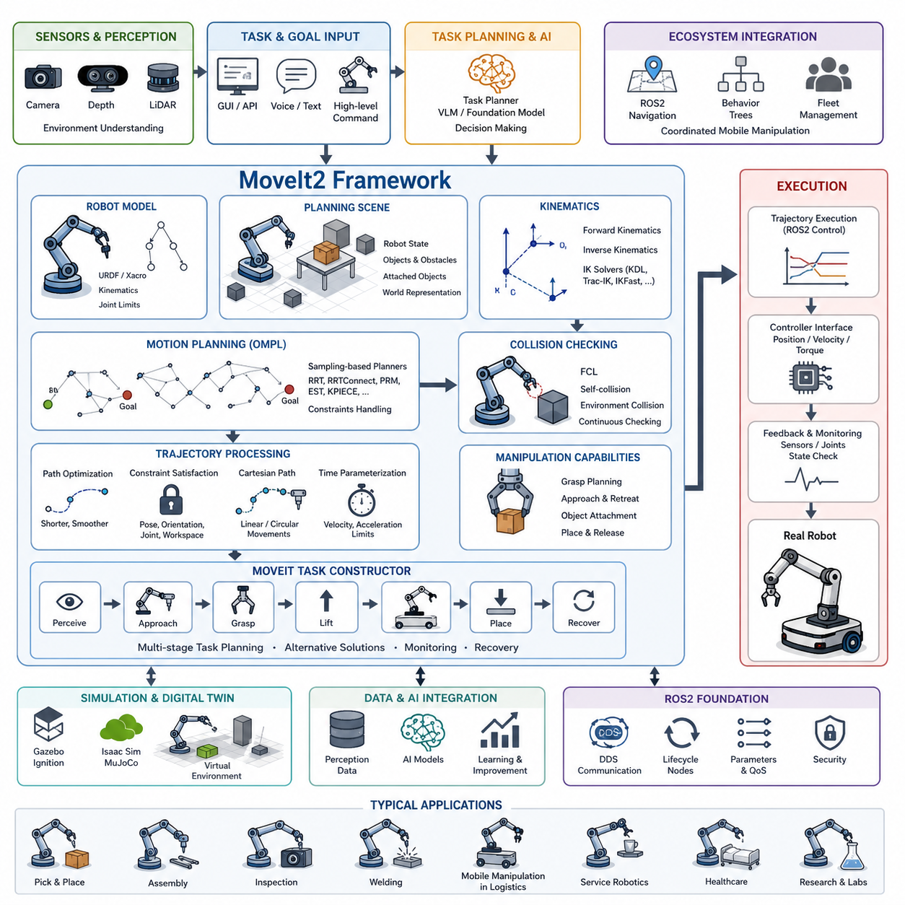{width="7.268055555555556in" height="7.268055555555556in"}

MoveIt2 is one of the most important software frameworks in modern robot manipulation. As robots evolve from fixed industrial manipulators to intelligent mobile manipulators operating in dynamic environments, the need for a flexible, scalable, and real-time motion planning system has become increasingly critical. MoveIt2 addresses this need by providing a comprehensive manipulation framework built on top of ROS2, enabling robots to perceive their environment, plan collision-free motions, execute trajectories, and interact safely with the world. Within the software architecture of a mobile manipulator, MoveIt2 serves as the bridge between high-level task planning and low-level robot control, transforming desired goals into executable motions. It occupies a central role in the manipulation stack and is widely adopted in research laboratories, industrial automation systems, logistics robots, service robots, and next-generation autonomous mobile manipulators.

The origins of MoveIt can be traced to the ROS ecosystem, where the original MoveIt framework emerged as a successor to earlier manipulation software packages. As ROS evolved into ROS2, a new generation of robotics middleware designed for distributed systems, real-time communication, and industrial deployment, MoveIt2 was developed to fully leverage the capabilities of ROS2. Unlike its predecessor, MoveIt2 benefits from DDS-based communication, improved multi-threading, lifecycle management, enhanced security mechanisms, and better support for distributed robotic architectures. These capabilities make MoveIt2 suitable not only for laboratory experiments but also for production-grade robotic systems operating in real-world environments.

At its core, MoveIt2 is a motion planning and manipulation framework. Given a desired end-effector goal, such as reaching an object, inserting a component, opening a door, or placing a package on a shelf, MoveIt2 computes a feasible robot motion that satisfies kinematic constraints while avoiding collisions. This process involves multiple subsystems working together. The framework must understand the robot's geometry, calculate possible joint configurations, evaluate collision risks, generate valid trajectories, optimize motion quality, and communicate commands to robot controllers. The integration of these components into a unified framework significantly reduces development complexity for robotics engineers.

One of the foundational concepts within MoveIt2 is robot modeling. Every robot must be represented digitally before planning can occur. MoveIt2 relies on robot descriptions typically defined through URDF and Xacro models. These descriptions specify links, joints, sensors, collision geometries, inertial properties, and kinematic relationships. By loading these models, MoveIt2 constructs an internal representation of the robot known as the Robot Model. This model becomes the basis for kinematic calculations, collision checking, and trajectory generation. Accurate robot modeling is essential because even small discrepancies between the digital representation and physical hardware can lead to planning failures or unsafe robot behavior.

A key capability of MoveIt2 is inverse kinematics. Manipulation tasks are often specified in Cartesian space rather than joint space. For example, an engineer may instruct a robot to move its gripper to a particular position and orientation relative to an object. The robot must then determine which joint angles correspond to that desired pose. MoveIt2 provides a flexible kinematics framework that supports multiple inverse kinematics solvers, including KDL, Trac-IK, IKFast, and custom plugins. This plugin-based architecture allows developers to select the solver that best matches their robot's requirements in terms of speed, accuracy, and robustness.

Collision avoidance is another fundamental component of MoveIt2. Robots frequently operate in environments containing obstacles, equipment, humans, and other robots. Any manipulation system must ensure that generated motions do not result in collisions. MoveIt2 maintains a planning scene that represents both the robot and its surrounding environment. Using collision checking libraries such as FCL, the framework continuously evaluates potential interactions between objects. Before a trajectory is approved, every intermediate state is validated to ensure that collisions do not occur. This capability is particularly important for mobile manipulators working in warehouses, factories, hospitals, and public environments where obstacles are constantly changing.

The planning scene is one of the most powerful abstractions in MoveIt2. It acts as a dynamic digital twin of the robot\'s operational environment. The planning scene contains information about robot states, collision objects, attached objects, environmental obstacles, and workspace boundaries. Sensors such as RGB cameras, depth cameras, LiDARs, and 3D vision systems can continuously update the planning scene to reflect changes in the environment. As a result, MoveIt2 can generate plans based on current environmental conditions rather than relying solely on predefined maps.

Motion planning itself is performed using planning algorithms integrated through the Open Motion Planning Library (OMPL). OMPL provides a collection of sampling-based planning algorithms such as RRT, RRTConnect, PRM, EST, and KPIECE. These algorithms search for feasible paths through high-dimensional configuration spaces. When a target pose is specified, the planner explores possible robot configurations until a collision-free solution is found. Sampling-based planning is particularly effective for robots with many degrees of freedom because exhaustive search approaches become computationally infeasible as dimensionality increases.

In addition to generating feasible trajectories, MoveIt2 supports path optimization. Initial trajectories generated by planners may be unnecessarily long, inefficient, or contain abrupt movements. Path optimization algorithms refine these trajectories by reducing path length, smoothing joint motion, minimizing energy consumption, and improving execution quality. This optimization process leads to faster task completion, reduced mechanical wear, and improved overall system performance.

Trajectory execution is another critical aspect of MoveIt2. Planning alone is insufficient unless generated trajectories can be reliably executed by physical hardware. MoveIt2 interfaces with ROS2 Control and various robot controllers to send commands to actuators. Once a trajectory is validated, it is transmitted to the execution layer, where controllers manage velocity, position, and torque commands. Feedback from robot sensors is monitored throughout execution to ensure that actual motion follows the planned trajectory. If significant deviations occur, corrective actions can be triggered.

MoveIt2 also supports Cartesian path planning, which is especially useful for industrial manipulation tasks. In Cartesian planning, the end-effector follows a specified path through Cartesian space rather than simply moving between two poses. Applications such as welding, painting, polishing, assembly, and inspection often require precise Cartesian trajectories. MoveIt2 provides tools for generating smooth Cartesian paths while maintaining orientation constraints and collision safety.

Another important capability is constraint-based planning. Real-world manipulation tasks often involve additional requirements beyond simply reaching a target. A robot carrying a cup of liquid may need to keep the container upright. A robotic screwdriver may need to maintain a specific orientation during insertion. A medical robot may have strict workspace limitations. MoveIt2 allows developers to define positional, orientational, and kinematic constraints that planners must satisfy throughout trajectory generation. This capability significantly expands the range of practical applications that can be addressed.

For grasping applications, MoveIt2 provides dedicated manipulation functionality. Grasp planning involves determining how an end-effector should approach, grasp, and manipulate an object. The framework supports grasp pose generation, pre-grasp planning, grasp execution, and object attachment. Once an object is grasped, MoveIt2 updates the planning scene to treat the object as part of the robot, ensuring accurate collision checking during subsequent motions. This feature is essential for warehouse picking, manufacturing automation, service robotics, and mobile manipulation systems.

MoveIt Task Constructor extends MoveIt2 beyond individual motions into complete manipulation workflows. Instead of planning a single trajectory, developers can define multi-stage tasks consisting of perception, approach, grasping, lifting, transportation, placement, and recovery operations. Each stage can generate multiple candidate solutions, allowing the system to evaluate alternatives and select the most effective sequence. This capability forms the foundation for sophisticated autonomous manipulation behaviors.

The importance of MoveIt2 becomes even greater when considering mobile manipulators. Traditional industrial robots operate within fixed workcells, but mobile manipulators combine robotic arms with autonomous mobile bases. In these systems, manipulation planning and navigation planning must be coordinated. The robot may first navigate toward a target location before executing arm motions. MoveIt2 can be integrated with ROS2 Navigation, enabling coordinated motion planning across both the manipulator and mobile base. This integration allows robots to perform tasks across large environments rather than being limited to a fixed workspace.

Simulation plays a major role in MoveIt2 development. Before deploying robots in the real world, engineers typically validate manipulation strategies in simulation environments such as Gazebo, Ignition Gazebo, and NVIDIA Isaac Sim. MoveIt2 integrates seamlessly with these simulators, enabling developers to test robot models, verify trajectories, evaluate collision avoidance strategies, and optimize manipulation workflows before hardware deployment. Simulation-driven development reduces costs, improves safety, and accelerates system integration.

Modern AI-driven robotics systems increasingly integrate MoveIt2 with perception and decision-making frameworks. Computer vision systems identify objects and estimate poses. Foundation models and vision-language models interpret high-level instructions. Task planners generate symbolic goals. MoveIt2 then converts these goals into executable robot motions. In this architecture, MoveIt2 serves as the physical execution engine connecting cognitive intelligence to physical action. Without reliable motion planning, even the most advanced AI systems cannot effectively interact with the physical world.

From an industrial perspective, MoveIt2 offers significant advantages. It is open source, widely supported by the robotics community, continuously maintained, and compatible with a broad range of robotic hardware. Its modular architecture allows organizations to customize planners, kinematics solvers, collision checkers, and execution pipelines according to specific requirements. The framework also benefits from a large ecosystem of tutorials, plugins, research contributions, and industrial deployments, making it one of the most mature manipulation platforms available today.

As robotics continues to move toward autonomous warehouses, smart factories, logistics automation, healthcare robotics, service robots, and embodied AI systems, the importance of robust manipulation software will only increase. MoveIt2 provides a foundation capable of supporting this evolution by combining advanced motion planning, collision avoidance, trajectory optimization, execution management, and integration with modern ROS2 ecosystems. It transforms robotic hardware into intelligent manipulation systems capable of operating safely and efficiently in complex real-world environments.

For mobile manipulation engineers, understanding MoveIt2 is not merely an optional skill but a fundamental requirement. It represents the core manipulation framework upon which higher-level task planning, autonomous behaviors, AI-driven decision making, and real-world robot operations are built. As a result, MoveIt2 occupies a central position within modern mobile manipulator software architectures and serves as one of the most important technologies in the development of next-generation intelligent robotic systems.

## 02 Robot Modeling

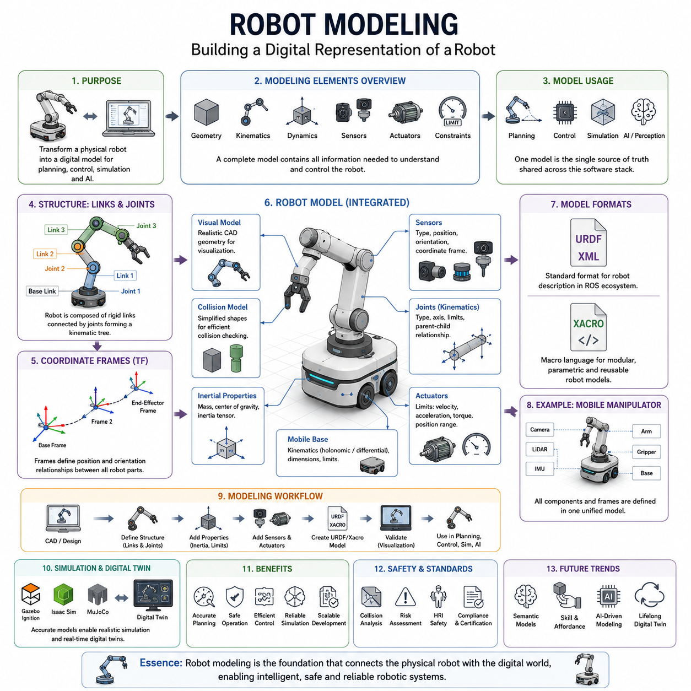{width="7.268055555555556in" height="7.268055555555556in"}

Robot modeling is one of the most fundamental disciplines in modern robotics and serves as the foundation upon which perception, planning, control, simulation, and autonomous operation are built. Before a robot can move, perceive its environment, manipulate objects, or collaborate with humans, it must first possess an accurate digital representation of itself. This representation is known as a robot model. In the context of MoveIt2, ROS2, digital twins, simulation environments, and mobile manipulators, robot modeling is the critical process that transforms a physical machine into a computational entity that software can understand, analyze, and control. Without a proper robot model, advanced robotics software frameworks cannot perform motion planning, collision avoidance, kinematic calculations, or trajectory execution.

Robot modeling can be viewed as the creation of a virtual counterpart of a physical robot. This virtual counterpart contains detailed descriptions of the robot\'s structure, dimensions, joints, sensors, actuators, mass properties, and operational constraints. The goal is to provide sufficient information for software systems to accurately predict and control robot behavior. A robot model acts as a common language shared among various software modules including simulation engines, motion planners, controllers, visualization tools, and AI systems. It ensures that every component within the robotics software stack has a consistent understanding of the robot\'s physical characteristics.

Historically, industrial robots operated in highly structured environments where robot configurations were relatively fixed and predictable. Robot models were primarily used for offline programming and kinematic calculations. As robotics evolved toward mobile manipulators, autonomous service robots, humanoids, and embodied AI systems, the complexity of robot modeling increased significantly. Modern robots are no longer static machines confined to manufacturing cells. They operate in dynamic environments, interact with humans, manipulate diverse objects, and perform complex decision-making tasks. Consequently, robot models must now capture far more information than simple geometric descriptions.

At the most basic level, a robot model consists of links and joints. Links represent rigid bodies such as arm segments, end-effectors, mobile bases, sensor mounts, and structural components. Joints define the relationships between links and specify how one component can move relative to another. Together, links and joints form the robot\'s kinematic structure. This structure is commonly represented as a tree-like hierarchy beginning at a root frame and extending through all movable components of the robot. Every motion generated by the robot ultimately results from transformations occurring along this kinematic chain.

The concept of coordinate frames is central to robot modeling. Every link in a robot has its own coordinate frame, defining its position and orientation relative to other links. These coordinate frames create a network of transformations that describe how different parts of the robot relate to one another. When a robotic arm moves, the transformations between frames change dynamically. Accurate frame management enables perception systems to localize objects, allows planners to calculate trajectories, and permits controllers to generate appropriate actuator commands. In ROS2 ecosystems, TF2 is commonly used to manage and distribute these coordinate transformations throughout the system.

Robot modeling extends beyond geometry and kinematics. Dynamic properties are equally important. A realistic robot model must include mass distributions, inertial tensors, center-of-gravity locations, friction coefficients, damping parameters, and actuator characteristics. These parameters influence how the robot responds to forces and torques. Dynamic models are essential for high-performance control systems, physics-based simulations, force control applications, and advanced manipulation tasks. Without accurate dynamic information, simulated robot behavior may differ significantly from real-world performance.

Modern robot modeling relies heavily on standardized description formats. Within the ROS ecosystem, the Unified Robot Description Format (URDF) has become the de facto standard for representing robot structures. URDF provides a structured XML-based format for defining links, joints, visual geometries, collision geometries, inertial properties, and coordinate relationships. Because URDF is supported by a broad range of tools, it serves as the foundation for simulation, visualization, planning, and control frameworks. A single URDF file can be used simultaneously by RViz, Gazebo, MoveIt2, ROS2 Control, and numerous other software components.

Although URDF provides a powerful modeling framework, large and complex robots often require more flexibility than static XML definitions can offer. This need led to the development of Xacro, a macro language that extends URDF capabilities. Xacro enables parameterized robot descriptions, reusable templates, conditional logic, and modular robot definitions. Engineers can create scalable robot models that support multiple hardware configurations using a single codebase. For example, a mobile manipulator product family may include robots with different arm lengths, sensor configurations, wheelbases, and payload capacities. Xacro allows these variations to be generated automatically through parameter substitution.

Visual representation is another important aspect of robot modeling. Every robot model typically includes visual geometry used for rendering in simulation and visualization tools. These visual models are often derived from CAD data and provide realistic representations of robot components. Accurate visualization assists engineers during development, debugging, and system integration. Operators can monitor robot states through graphical interfaces, while simulation environments can render realistic digital twins for testing and validation.

Collision modeling is equally critical. Visual models often contain highly detailed geometries that are computationally expensive for collision checking. Therefore, robot models generally include simplified collision geometries optimized for real-time planning. Collision models define the physical boundaries used by planning systems such as MoveIt2. During motion planning, every candidate trajectory is evaluated against these collision geometries to ensure safe operation. Proper collision modeling significantly improves planning performance while maintaining safety.

Sensor modeling plays an increasingly important role in modern robotic systems. Robots frequently rely on cameras, LiDARs, IMUs, depth sensors, force-torque sensors, GPS receivers, radar systems, and numerous other sensing devices. A complete robot model includes the physical placement, orientation, and coordinate frames associated with each sensor. Accurate sensor models enable perception algorithms to correctly interpret environmental data and fuse information from multiple sources. In autonomous mobile manipulators, sensor placement directly influences navigation performance, object detection accuracy, and manipulation success rates.

Actuator modeling is another important consideration. Robot joints are driven by motors, hydraulic systems, pneumatic systems, or other actuation technologies. Robot models often include actuator limits such as maximum velocity, acceleration, torque, position ranges, and control interfaces. These constraints define the operational envelope within which planning and control algorithms must operate. Respecting actuator limits prevents unrealistic plans and helps ensure safe execution on physical hardware.

Kinematic modeling forms the mathematical core of robot modeling. Kinematics describes the relationship between joint variables and end-effector motion without considering forces. Forward kinematics computes end-effector positions based on joint values, while inverse kinematics determines the joint configurations required to achieve desired poses. Accurate kinematic models are essential for manipulation tasks, motion planning, grasping, and trajectory execution. MoveIt2 relies heavily on robot kinematic models to generate feasible motion plans.

For mobile manipulators, robot modeling becomes more complex because the system combines multiple subsystems. A mobile manipulator typically consists of a mobile base, robotic arm, end-effector, sensors, computing hardware, batteries, and communication devices. Each subsystem introduces additional coordinate frames, kinematic relationships, and physical constraints. The integration of these elements into a unified robot model is essential for coordinated navigation and manipulation. Motion planners must understand both arm motion and base motion when generating task-level behaviors.

Robot modeling is also fundamental to simulation. Simulation platforms such as Gazebo, Ignition Gazebo, Isaac Sim, Webots, and MuJoCo require detailed robot models to reproduce physical behavior. These simulators use robot descriptions to calculate dynamics, render visualizations, simulate sensors, and evaluate interactions with environments. High-fidelity simulation enables developers to test algorithms before deploying them on expensive hardware. This simulation-first approach has become a standard practice in robotics engineering.

Digital twins represent a further evolution of robot modeling. A digital twin is a continuously synchronized virtual representation of a physical robot operating in the real world. Unlike static models, digital twins incorporate real-time sensor data, operational states, maintenance information, and performance metrics. Robot models serve as the structural foundation of digital twins. By combining geometric, kinematic, dynamic, and operational information, digital twins enable predictive maintenance, performance optimization, remote diagnostics, and lifecycle management.

The emergence of AI-driven robotics has expanded the role of robot modeling even further. Vision-language models, foundation models, and robot agents increasingly require semantic information about robot structures. Future robot models may include knowledge about capabilities, task affordances, manipulation skills, and environmental interactions. Such enriched representations will enable robots to reason not only about geometry and motion but also about the meaning and purpose of actions.

Robot modeling also plays a critical role in safety engineering. Safety certification processes often require detailed documentation of robot structures, motion limits, collision zones, and operational constraints. Accurate robot models support risk assessments, collision analysis, human-robot interaction studies, and compliance with international standards. In industrial environments, robot models are frequently used to validate safe operating conditions before deployment.

From a software architecture perspective, robot models serve as the central source of truth within robotic systems. Motion planners rely on them for path generation. Controllers depend on them for state estimation and command generation. Simulators use them to reproduce physical behavior. Visualization tools display them to operators. AI systems reference them when making decisions. Because so many components depend on the robot model, maintaining consistency and accuracy is one of the most important responsibilities in robotics engineering.

The future of robot modeling is closely tied to the evolution of autonomous systems and embodied intelligence. Humanoid robots, collaborative robots, autonomous vehicles, warehouse robots, healthcare robots, and service robots will require increasingly sophisticated models capable of representing not only physical structures but also behaviors, skills, intentions, and environmental relationships. Advances in simulation technology, digital twins, synthetic data generation, and AI-driven development workflows will further elevate the importance of robot modeling.

For robotics engineers working with ROS2 and MoveIt2, robot modeling is not simply a preparatory step performed before development begins. It is a foundational engineering discipline that influences every aspect of robot behavior. A well-designed robot model enables accurate simulation, reliable motion planning, safe operation, efficient control, and scalable software integration. Conversely, deficiencies in robot modeling often propagate throughout the system, causing planning failures, execution errors, inaccurate simulations, and operational safety risks.

Ultimately, robot modeling provides the bridge between physical reality and computational intelligence. It transforms mechanical structures into digital entities that software can understand, predict, and control. As robotics systems continue to become more autonomous, intelligent, and capable, robot modeling will remain one of the most essential technologies underlying the entire robotics ecosystem. It forms the foundation upon which modern mobile manipulation, autonomous robotics, digital twins, embodied AI, and future intelligent machines are built.

## 03 Kinematics Plugins

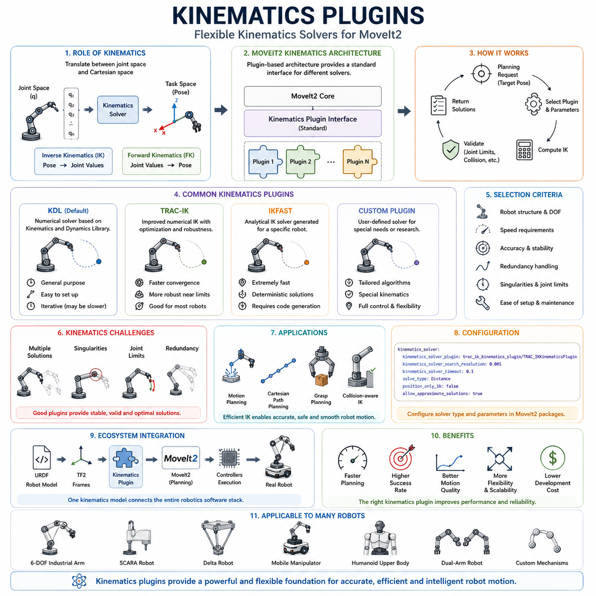{width="7.268055555555556in" height="7.268055555555556in"}

Kinematics is one of the most fundamental technologies in robotics and serves as the mathematical foundation for robot motion planning, manipulation, control, and autonomous operation. Within the MoveIt2 ecosystem, kinematics is responsible for translating between robot joint configurations and end-effector positions. Every manipulation task, whether it involves picking an object from a shelf, assembling components on a production line, opening a door, or performing a complex inspection procedure, ultimately depends on accurate kinematic calculations. Because different robots possess different mechanical structures, degrees of freedom, workspace characteristics, and performance requirements, MoveIt2 adopts a flexible plugin-based architecture that allows multiple kinematic solvers to be integrated seamlessly. These components are known as Kinematics Plugins.

A kinematics plugin is a software module that implements mathematical algorithms used to solve forward and inverse kinematics problems for a specific robot. Rather than embedding a single universal solver into the framework, MoveIt2 provides a generic interface through which different solvers can be connected. This design allows robotics engineers to select the most appropriate solver based on the robot\'s geometry, performance requirements, accuracy demands, and computational constraints. The plugin architecture improves flexibility, scalability, maintainability, and long-term compatibility across a wide variety of robotic platforms.

To understand the importance of kinematics plugins, it is first necessary to understand the role of kinematics itself. Kinematics describes motion without considering forces or torques. It focuses on the geometric relationship between joints, links, and end-effectors. Given a set of joint angles, forward kinematics computes the resulting position and orientation of the end-effector. Conversely, given a desired end-effector pose, inverse kinematics calculates the joint values required to achieve that pose. While forward kinematics is generally straightforward and deterministic, inverse kinematics is often significantly more challenging because multiple solutions, singularities, joint limits, and geometric constraints may exist.

In practical robotic systems, inverse kinematics is one of the most frequently executed calculations. Every time a robot is instructed to move its gripper to a target position, align a tool with a workpiece, grasp an object, or follow a Cartesian trajectory, an inverse kinematics solver must determine the corresponding joint configuration. Since these calculations occur continuously during motion planning and execution, the efficiency and reliability of the inverse kinematics solver directly influence overall system performance.

MoveIt2 addresses this challenge through its kinematics plugin framework. The framework defines a standardized interface that allows different kinematic solvers to interact with the motion planning system. As long as a solver implements the required interface functions, it can be integrated into MoveIt2 without modifying the core framework. This modular architecture encourages experimentation, customization, and optimization while protecting developers from vendor lock-in.

One of the most widely used kinematics plugins in MoveIt2 is KDL, which is based on the Kinematics and Dynamics Library. KDL provides a generic numerical approach for solving inverse kinematics and supports a wide range of robotic manipulators. Because it does not require robot-specific code generation, KDL can be used immediately after defining a robot model. It is often the default choice for development and prototyping because of its simplicity, reliability, and broad compatibility. However, numerical approaches may require iterative computations, which can sometimes limit performance in highly demanding real-time applications.

Trac-IK is another popular plugin that builds upon traditional numerical inverse kinematics techniques while introducing significant improvements in speed and robustness. Trac-IK combines optimization-based search methods with advanced numerical algorithms to improve convergence rates and solution quality. In many practical applications, Trac-IK can find valid solutions more quickly and reliably than traditional KDL implementations, particularly when robots operate near joint limits or in constrained workspaces. As a result, Trac-IK has become a preferred option for many industrial and research robotics systems.

For applications demanding maximum performance, IKFast is often considered the gold standard. Unlike numerical solvers, IKFast generates analytical inverse kinematics solutions tailored to a specific robot geometry. During the setup process, the robot\'s kinematic structure is analyzed and specialized solver code is automatically generated. The resulting solver can compute inverse kinematics solutions extremely quickly, often several orders of magnitude faster than iterative methods. This speed advantage makes IKFast particularly attractive for high-frequency motion planning, dynamic manipulation, and large-scale planning problems. However, the generation process can be complex, and analytical solutions are not available for every robot architecture.

The choice between numerical and analytical solvers represents one of the most important considerations in robot manipulation system design. Numerical solvers are generally more flexible and easier to deploy because they can accommodate a wide variety of robot structures. Analytical solvers offer exceptional speed and deterministic behavior but require additional setup and may not support highly complex kinematic chains. The plugin architecture of MoveIt2 allows organizations to select whichever approach best matches their operational requirements.

One of the challenges encountered in inverse kinematics is the existence of multiple valid solutions. A six-degree-of-freedom robotic arm may be able to reach the same end-effector pose using several different joint configurations. Human arms exhibit similar behavior. A person can reach the same object with their elbow positioned in different ways. Kinematics plugins must evaluate these possibilities and determine which solution is most appropriate. Selection criteria may include proximity to the current robot state, energy efficiency, collision avoidance, manipulability, joint limit margins, and task-specific preferences.

Singularities represent another significant challenge in kinematic computation. A singularity occurs when the robot loses one or more degrees of motion in a particular configuration. Near singularities, small end-effector movements may require extremely large joint motions, leading to instability, poor control performance, and planning difficulties. High-quality kinematics plugins incorporate mechanisms to detect and manage singularities, ensuring stable operation even in challenging regions of the workspace.

Joint limits further complicate inverse kinematics calculations. Every physical robot has constraints on how far its joints can move. A mathematically valid solution may not be physically achievable if it exceeds these limits. Kinematics plugins must therefore consider joint constraints throughout the solution process. Advanced solvers actively search for solutions that remain comfortably within allowable operating ranges, reducing mechanical stress and improving reliability.

Redundancy is another important concept in modern robotics. Many robots possess more degrees of freedom than are strictly required to achieve a given task. For example, a seven-axis manipulator can often reach the same pose using an infinite number of joint configurations. Redundant manipulators provide greater flexibility for obstacle avoidance, ergonomic motion generation, and optimization. However, they also introduce additional computational complexity. Kinematics plugins designed for redundant robots must incorporate optimization strategies that select desirable solutions from among many possibilities.

Mobile manipulators introduce even greater complexity because the robot consists of both a mobile base and a manipulator arm. Traditional inverse kinematics assumes a fixed base, but mobile manipulation requires coordination between navigation and arm motion. The robot may need to reposition its base before the arm can successfully reach a target. Future generations of kinematics plugins increasingly support whole-body kinematics, allowing coordinated planning across multiple subsystems. This capability is particularly important for warehouse automation, service robotics, humanoids, and field robotics.

MoveIt2 allows different planning groups within a robot to use different kinematics plugins. For example, a mobile manipulator may use one solver for the arm, another for a pan-tilt camera system, and yet another for a specialized end-effector mechanism. This flexibility enables highly customized robotic architectures while maintaining a unified software framework.

The configuration of kinematics plugins typically occurs through MoveIt2 configuration packages. Engineers specify which solver should be used, define solver-specific parameters, and configure optimization settings. Parameters may include solution tolerances, timeout values, search resolutions, redundancy handling strategies, and collision-aware constraints. Proper tuning of these parameters can significantly improve planning performance and operational reliability.

Kinematics plugins also play an important role in Cartesian path planning. During Cartesian motion generation, the end-effector follows a specified path through workspace coordinates. At every intermediate waypoint, inverse kinematics calculations are required to determine valid joint states. Efficient kinematics plugins allow smooth Cartesian trajectories to be generated in real time while preserving accuracy and constraint compliance.

Collision-aware inverse kinematics is an emerging area of development. Traditional inverse kinematics solvers focus exclusively on geometric reachability. However, a solution that reaches the target may still collide with obstacles. Modern kinematics plugins increasingly integrate collision checking into the solution process itself, allowing safer and more intelligent motion generation. This integration reduces planning failures and improves operational efficiency in cluttered environments.

Simulation environments such as Gazebo, Isaac Sim, MuJoCo, and Webots rely heavily on kinematic calculations. During simulation, kinematics plugins enable accurate robot motion, support interactive planning, and facilitate validation before deployment. Because simulation and physical deployment share the same kinematics framework, developers can maintain consistency across the entire development lifecycle.

The emergence of digital twins further increases the importance of accurate kinematics modeling. A digital twin continuously mirrors the physical robot\'s state and behavior. Kinematics plugins ensure that virtual robot motion accurately reflects real-world behavior, enabling predictive analysis, remote monitoring, and performance optimization.

Artificial intelligence is also beginning to influence kinematic computation. Machine learning techniques are being explored for inverse kinematics approximation, adaptive solver selection, singularity prediction, and motion optimization. Neural network-based inverse kinematics models can sometimes provide solutions faster than traditional methods while maintaining acceptable accuracy. Future kinematics plugins may combine analytical methods, numerical optimization, and AI-driven prediction to achieve unprecedented performance levels.

In industrial applications, the choice of kinematics plugin can significantly impact productivity. Faster inverse kinematics calculations reduce planning latency, enabling higher throughput in manufacturing and logistics systems. More reliable solvers reduce planning failures and improve system availability. Better redundancy handling leads to smoother motions, lower mechanical wear, and enhanced safety. Consequently, kinematics plugin selection is often a strategic engineering decision rather than a simple software configuration choice.

As robotics advances toward humanoid systems, autonomous mobile manipulators, collaborative robots, and embodied AI platforms, kinematic complexity will continue to grow. Future robots will possess dozens of degrees of freedom, dynamically changing configurations, and sophisticated interaction capabilities. The plugin-based architecture of MoveIt2 provides a scalable foundation capable of adapting to these evolving requirements.

Ultimately, kinematics plugins serve as the mathematical intelligence layer that transforms high-level motion goals into physically achievable robot configurations. They connect geometry with motion, planning with execution, and software intelligence with physical action. Without robust kinematics plugins, advanced motion planning, autonomous manipulation, and intelligent robotic behavior would not be possible. For engineers developing modern robotic systems using MoveIt2, understanding kinematics plugins is therefore essential to achieving high-performance, reliable, and scalable robot manipulation solutions.

## 04 Motion Planning Framework

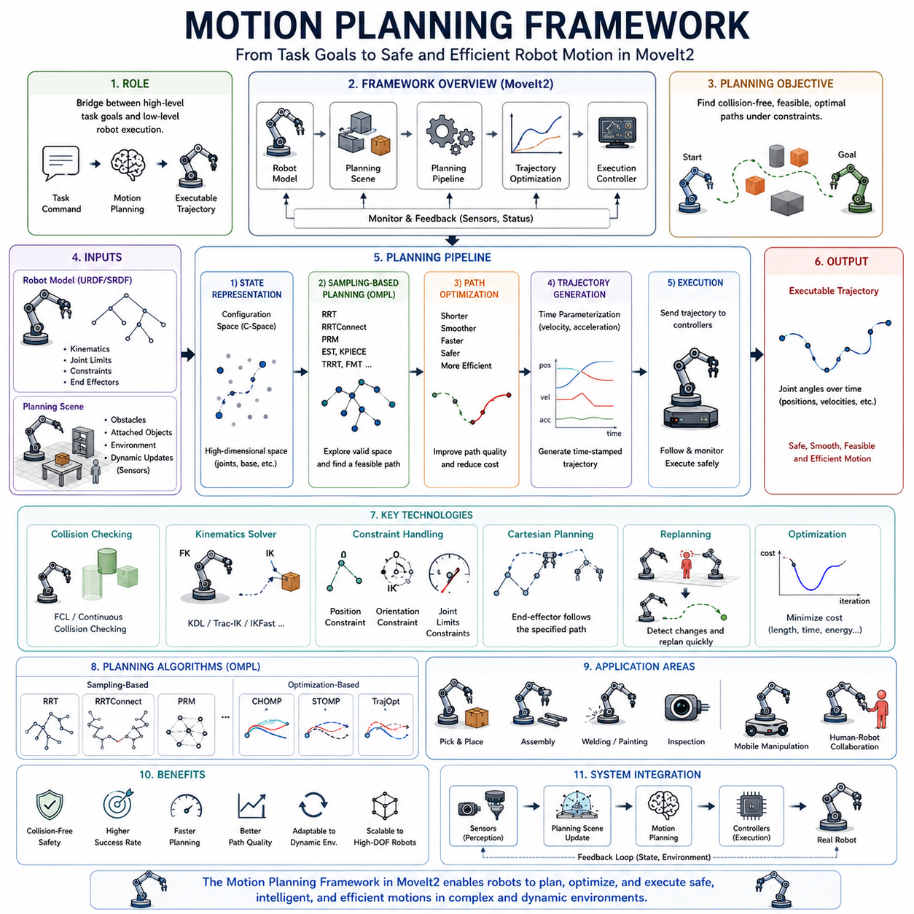{width="7.268055555555556in" height="7.268055555555556in"}

Motion planning is one of the most important capabilities in robotics because it enables a robot to move intelligently from one state to another while satisfying physical, environmental, and operational constraints. In modern robotic systems, motion planning serves as the bridge between high-level task objectives and low-level robot execution. A robot may receive a command such as "pick up the box," "inspect the machine," "assemble the component," or "move to the charging station." However, these commands do not directly specify how the robot should move. The responsibility of the motion planning framework is to transform these high-level goals into safe, feasible, efficient, and executable trajectories. Within the MoveIt2 ecosystem, the Motion Planning Framework represents the core intelligence responsible for generating collision-free robot motions in both structured and unstructured environments.

At a fundamental level, motion planning can be viewed as a search problem. The planner must determine how a robot can move from an initial configuration to a desired goal configuration while avoiding obstacles and respecting all physical constraints. Unlike simple pathfinding problems in two-dimensional environments, robot motion planning occurs in high-dimensional configuration spaces. A six-axis manipulator, for example, operates in a six-dimensional configuration space where each dimension corresponds to a joint variable. Mobile manipulators, humanoids, and dual-arm robots often operate in configuration spaces containing dozens of dimensions. The complexity of planning increases dramatically as the number of dimensions grows, making efficient planning algorithms essential.

The Motion Planning Framework within MoveIt2 provides a modular architecture that separates planning logic from robot-specific implementations. This design allows developers to utilize different planning algorithms, optimization strategies, collision-checking systems, and execution mechanisms while maintaining a consistent user interface. The framework integrates multiple components into a unified planning pipeline, including robot models, kinematics solvers, collision checkers, planning scene management, path planners, trajectory optimizers, and execution controllers.

The planning process begins with a robot model. Before any planning can occur, the framework must understand the robot's physical structure, kinematic relationships, joint limits, workspace boundaries, and operational constraints. This information is typically provided through URDF and SRDF descriptions. The robot model acts as the mathematical representation of the physical robot and provides the foundation for all subsequent calculations. Every generated trajectory must conform to the capabilities and limitations defined by this model.

The next critical component is the planning scene. The planning scene represents the robot's understanding of its environment. It contains information about obstacles, workpieces, fixtures, walls, shelves, humans, attached objects, and environmental constraints. Unlike static maps, planning scenes can be updated dynamically using sensor data. Cameras, LiDARs, depth sensors, and perception systems continuously provide information about the surrounding environment, allowing the planner to adapt to changing conditions. This capability is particularly important in warehouses, factories, hospitals, and service environments where obstacles may appear unexpectedly.

Motion planning fundamentally requires solving two questions. The first question is whether a valid path exists. The second question is which valid path should be chosen. Many different trajectories may satisfy the same goal. Some may be shorter, smoother, safer, faster, or more energy-efficient than others. Consequently, motion planning is not simply a feasibility problem but also an optimization problem. Modern planning frameworks attempt to balance multiple objectives simultaneously.

One of the most important concepts in motion planning is configuration space, often abbreviated as C-space. Instead of reasoning directly in physical workspace coordinates, planners represent robot states using configuration variables such as joint angles and base positions. Every point within the configuration space corresponds to a unique robot configuration. Regions of the configuration space that result in collisions are considered invalid, while collision-free regions are considered valid. The planner's objective is to find a continuous path through the valid regions that connects the start state to the goal state.

As robotic systems become increasingly complex, exhaustive search methods become computationally impractical. This challenge led to the development of sampling-based planning algorithms, which have become the dominant approach in modern robot motion planning. Rather than exploring every possible state, sampling-based planners randomly generate candidate states and gradually build a representation of feasible paths through the configuration space. These methods provide practical solutions for high-dimensional planning problems that would otherwise be impossible to solve efficiently.

MoveIt2 primarily relies on the Open Motion Planning Library (OMPL) for motion planning. OMPL provides a large collection of planning algorithms designed for robotic applications. Among the most widely used algorithms is Rapidly Exploring Random Trees (RRT). RRT incrementally grows a search tree from the starting configuration by randomly sampling new states and connecting them to the existing tree. This approach efficiently explores large configuration spaces and can quickly find feasible solutions.

An extension known as RRTConnect further improves planning efficiency by simultaneously growing trees from both the start and goal states. When the two trees meet, a complete path is generated. RRTConnect is widely used in industrial robotics because it provides a good balance between planning speed and solution quality. In many practical manipulation applications, it serves as the default planning algorithm.

Probabilistic Roadmaps (PRM) represent another important planning strategy. Unlike RRT, which is designed primarily for single-query planning problems, PRM constructs a reusable graph of collision-free configurations. This roadmap can then be queried repeatedly to solve multiple planning tasks within the same environment. PRM is particularly effective in applications where robots repeatedly operate within known workspaces, such as manufacturing cells and automated warehouses.

Other planning algorithms within OMPL include EST, KPIECE, LBKPIECE, TRRT, and FMT. Each algorithm offers different trade-offs between planning speed, exploration efficiency, path quality, memory usage, and robustness. The modular architecture of MoveIt2 allows engineers to evaluate multiple algorithms and select the most appropriate solution for a given application.

Finding a collision-free path is only the first stage of motion planning. Initial solutions generated by sampling-based planners are often suboptimal. They may contain unnecessary detours, abrupt direction changes, or inefficient joint movements. Therefore, modern motion planning frameworks incorporate path optimization techniques. These optimizers improve trajectory quality by reducing path length, minimizing execution time, smoothing motion profiles, reducing energy consumption, and increasing safety margins.

Trajectory optimization represents a complementary approach to sampling-based planning. Rather than constructing paths through random exploration, optimization-based planners formulate motion planning as a mathematical optimization problem. The planner iteratively adjusts a candidate trajectory until it satisfies constraints and minimizes a defined cost function. Frameworks such as CHOMP, STOMP, and TrajOpt exemplify this approach. These methods often generate smoother and more efficient trajectories than purely sampling-based algorithms, although they may require higher computational resources.

Constraint handling is another critical aspect of motion planning. Real-world robotic tasks rarely involve unrestricted motion. Robots frequently operate under positional, orientational, kinematic, dynamic, and environmental constraints. A robot carrying a tray of food must maintain level orientation. A welding robot must follow a predefined tool path. A medical robot may need to remain within a safe operating region. The Motion Planning Framework must ensure that all generated trajectories satisfy these constraints throughout execution.

Cartesian path planning is particularly important in manipulation applications. While standard planners focus on reaching a target configuration, Cartesian planners ensure that the end-effector follows a specified geometric path through space. This capability is essential for tasks such as welding, painting, dispensing, polishing, cutting, assembly, and inspection. MoveIt2 provides dedicated Cartesian planning functionality that generates paths while respecting kinematic and collision constraints.

Collision checking is deeply integrated into every stage of the planning process. Every candidate motion must be evaluated against the planning scene to ensure safety. MoveIt2 commonly employs collision detection libraries such as FCL to perform these calculations efficiently. Continuous collision checking further improves safety by evaluating the entire motion trajectory rather than only discrete waypoints. This reduces the risk of collisions occurring between sampled states.

For mobile manipulators, motion planning becomes substantially more challenging because planning must consider both navigation and manipulation simultaneously. The robot may need to reposition its base before a manipulation task becomes feasible. Traditional motion planning frameworks focused exclusively on robotic arms with fixed bases. Modern frameworks increasingly support whole-body planning, where mobile bases, manipulators, sensors, and other subsystems are planned together as a unified system. This capability is becoming increasingly important for warehouse robotics, logistics automation, service robots, and humanoid systems.

Real-time planning represents another major challenge. In dynamic environments, obstacles can move unexpectedly, requiring rapid replanning. Human workers, forklifts, autonomous vehicles, and other robots continuously alter the environment. The Motion Planning Framework must therefore support incremental updates and fast replanning strategies. Reactive planning techniques allow robots to adapt quickly without recomputing entire trajectories from scratch.

The integration of perception and planning is a defining characteristic of modern robotic systems. Motion planning is no longer performed in isolation. Perception systems continuously update the planning scene with information about object locations, environmental changes, and potential hazards. The planner uses this information to generate context-aware trajectories. This integration creates a closed-loop system in which sensing and planning continuously influence one another.

Simulation plays a vital role in motion planning development. Before deployment on physical hardware, planners are typically evaluated within simulation environments such as Gazebo, Isaac Sim, MuJoCo, and Webots. Simulation allows engineers to test algorithms, validate safety, analyze performance, and identify edge cases without risking damage to expensive equipment. Because MoveIt2 uses the same planning framework in simulation and real-world deployment, the transition from virtual testing to physical operation becomes significantly more reliable.

Digital twins further extend the role of motion planning. A digital twin maintains a continuously updated representation of a physical robot and its environment. Motion planning can be executed within the digital twin before commands are transmitted to the physical system. This approach enables predictive validation, risk assessment, performance optimization, and advanced operational monitoring.

Artificial intelligence is increasingly influencing motion planning frameworks. Traditional planning algorithms excel at geometric reasoning but often lack semantic understanding. AI systems can provide higher-level context, predict environmental changes, estimate task success probabilities, and generate intelligent planning objectives. Vision-language models, foundation models, and robot agents are beginning to work alongside motion planners, creating hybrid architectures that combine symbolic reasoning, machine learning, and geometric planning.

In industrial applications, motion planning directly influences productivity, safety, and operational efficiency. Faster planners increase throughput. Better optimization reduces cycle times. Improved collision avoidance enhances safety. Robust constraint handling improves task success rates. Consequently, the motion planning framework often becomes one of the most critical components in the overall robotic architecture.

As robotics evolves toward autonomous mobile manipulators, humanoid robots, collaborative robots, and embodied AI systems, motion planning frameworks must continue to advance. Future frameworks will support increasingly complex robots, dynamic environments, multi-agent coordination, semantic reasoning, and learning-based planning strategies. The boundaries between planning, perception, control, and artificial intelligence will become increasingly blurred.

Ultimately, the Motion Planning Framework serves as the decision-making engine that transforms desired goals into executable robot motions. It combines robot modeling, kinematics, collision avoidance, optimization, environmental awareness, and execution management into a unified system. Within MoveIt2, this framework forms the heart of robot manipulation, enabling robots to move intelligently, safely, and efficiently through the physical world. For modern robotics engineers, understanding the Motion Planning Framework is essential because it provides the foundation upon which advanced manipulation, autonomous operation, and intelligent robotic behavior are built.

## 05 Collision Checking

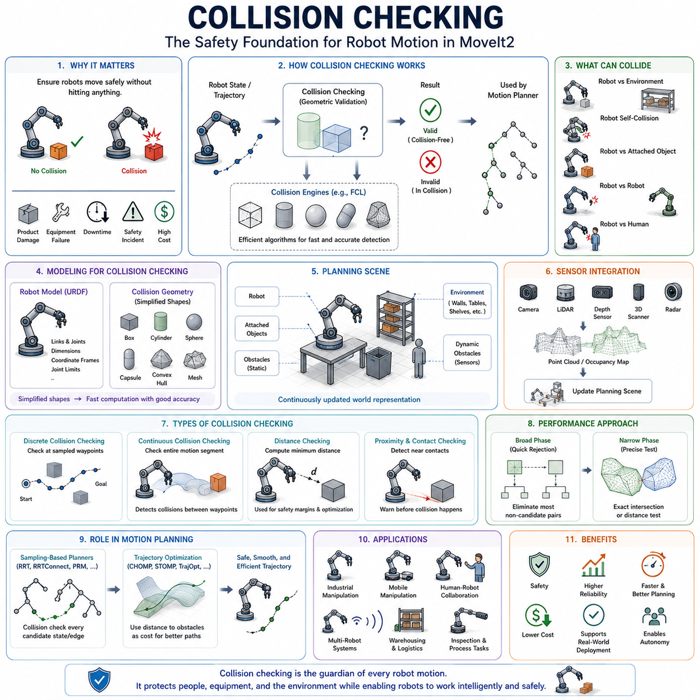{width="7.268055555555556in" height="7.268055555555556in"}

Collision checking is one of the most critical components in robotic motion planning and autonomous manipulation systems. Regardless of how intelligent a robot may be, how accurate its perception system is, or how sophisticated its planning algorithms are, the robot cannot operate safely if it cannot reliably detect and avoid collisions. Within the MoveIt2 ecosystem, collision checking serves as the safety foundation that ensures every generated motion is physically feasible and free from unintended contact with the environment, other robots, equipment, workpieces, or human operators. It is one of the core technologies that transforms a mathematical motion plan into a safe and executable robot action.

In robotics, a collision occurs whenever two objects occupy overlapping physical space. Such collisions may involve the robot colliding with obstacles, parts of the robot colliding with itself, multiple robots interfering with each other, or the robot contacting humans in unsafe ways. Even a small collision can cause product damage, equipment failures, production downtime, safety incidents, or costly repairs. Consequently, modern robotic systems place a strong emphasis on collision detection and collision avoidance throughout the entire planning and execution process.

Collision checking can be viewed as a geometric validation process. Given a candidate robot configuration or trajectory, the collision checking system evaluates whether any part of the robot intersects with any object in the environment. If an intersection is detected, the configuration is considered invalid and cannot be used by the motion planner. The planning system then searches for alternative solutions that satisfy all safety requirements while still accomplishing the desired task.

The importance of collision checking increases significantly as robots become more autonomous and operate in dynamic environments. Traditional industrial robots often worked inside fenced workcells where the environment was carefully controlled and rarely changed. Under those conditions, collision risks could be minimized through mechanical design and fixed safety barriers. Modern robots, however, operate in warehouses, hospitals, airports, retail facilities, laboratories, public spaces, and outdoor environments. In these settings, obstacles can move unexpectedly, people can enter the workspace, and environmental conditions can change continuously. As a result, collision checking must function as a real-time process rather than a static validation step.

MoveIt2 integrates collision checking deeply into its Motion Planning Framework. Every motion planning query relies on collision validation before a trajectory can be accepted. During planning, thousands or even millions of candidate robot states may be generated. Each candidate state must be evaluated to determine whether it is collision-free. Only those states that satisfy collision constraints are allowed to participate in path generation. This process ensures that safety considerations are embedded directly into the planning algorithm rather than being applied as an afterthought.

Collision checking begins with accurate robot modeling. Before collisions can be detected, the system must understand the robot's physical structure. Robot models define links, joints, geometries, dimensions, and coordinate relationships. These models provide the basis for all collision calculations. In MoveIt2, robot descriptions are typically provided through URDF and SRDF files. While visual models are often highly detailed for visualization purposes, collision models are usually simplified representations optimized for computational efficiency.

Collision geometry plays a particularly important role in collision checking performance. High-fidelity CAD models may contain hundreds of thousands of polygons, making collision calculations computationally expensive. To improve performance, simplified geometric primitives such as boxes, cylinders, spheres, capsules, and convex hulls are often used for collision detection. These simplified models approximate the physical structure of the robot while significantly reducing computational complexity.

One of the most common forms of collision checking is self-collision detection. Robots consist of multiple interconnected links, and certain configurations may cause different parts of the robot to intersect. For example, a robotic arm may accidentally fold into itself if joint limits are not properly enforced. Self-collision detection identifies such situations and prevents planners from generating unsafe motions. In complex manipulators with many degrees of freedom, self-collision checking is performed continuously throughout the planning process.

Environmental collision checking represents another major category. In this case, the robot is evaluated against objects present in the planning scene. These objects may include worktables, walls, shelves, pallets, machinery, vehicles, storage racks, containers, or any other environmental obstacle. The planner must ensure that the robot can move safely without contacting any of these structures. As environmental complexity increases, efficient collision detection algorithms become increasingly important.

Attached object collision checking introduces additional complexity. When a robot grasps an object, the object effectively becomes part of the robot\'s geometry. The collision system must account for the object\'s size, shape, and position during subsequent planning operations. A robot carrying a large box, for example, occupies significantly more space than an empty robot. Failure to consider attached objects could result in collisions even when the robot itself remains collision-free.

The planning scene serves as the central data structure for collision checking within MoveIt2. The planning scene maintains a complete representation of the robot, attached objects, environmental obstacles, and workspace constraints. It functions as a continuously updated digital model of the robot's operating environment. Whenever sensors detect changes in the environment, the planning scene can be updated accordingly, allowing collision calculations to reflect current conditions.

Sensor integration is essential for modern collision checking systems. Cameras, LiDARs, depth sensors, stereo vision systems, radar sensors, and 3D scanners continuously provide environmental information. This data can be used to generate obstacle representations within the planning scene. Dynamic obstacle detection allows the robot to respond to changing environments and avoid unexpected collisions. In autonomous mobile manipulation systems, this capability is often critical for safe operation.

MoveIt2 commonly utilizes the Flexible Collision Library (FCL) as its primary collision detection engine. FCL is a high-performance collision detection framework specifically designed for robotic applications. It supports a wide variety of geometric representations and provides efficient algorithms for collision detection, distance computation, and proximity analysis. FCL has become one of the most widely adopted collision checking libraries within the robotics community due to its performance, flexibility, and reliability.

The collision detection process itself involves several stages. Broad-phase collision detection quickly identifies pairs of objects that may potentially collide. This stage eliminates large numbers of irrelevant object pairs and significantly reduces computational workload. Once potential collisions are identified, narrow-phase collision detection performs detailed geometric analysis to determine whether actual intersections exist. This two-stage approach balances computational efficiency with accuracy.

Distance checking is closely related to collision detection. Instead of simply determining whether a collision exists, distance calculations measure how close objects are to colliding. Distance information can be used to establish safety margins, optimize trajectories, and generate more conservative motion plans. In many industrial applications, maintaining a minimum clearance distance is as important as avoiding collisions entirely.

Continuous collision checking represents an important advancement over traditional discrete collision checking methods. In discrete collision checking, only selected robot states along a trajectory are evaluated. While computationally efficient, this approach may miss collisions that occur between sampled states. Continuous collision checking evaluates the entire motion segment and can detect collisions occurring at any point along the trajectory. This provides significantly higher levels of safety and reliability, particularly for high-speed robot motions.

Collision checking is closely connected to motion planning algorithms. Sampling-based planners such as RRT, RRTConnect, and PRM continuously invoke collision detection functions while exploring configuration space. Every candidate state and path segment must be validated before being incorporated into the search structure. Consequently, collision checking often becomes one of the dominant computational costs in motion planning. Efficient collision detection directly improves overall planning performance.

Trajectory optimization frameworks such as CHOMP, STOMP, and TrajOpt also rely heavily on collision information. Rather than treating collisions as binary events, these algorithms often use collision distances as optimization objectives. The planner gradually modifies trajectories to maximize clearance from obstacles while minimizing path length, execution time, or energy consumption. This approach produces smoother and safer motions compared to simple collision avoidance strategies.

Mobile manipulators present unique collision checking challenges because both the mobile base and manipulator arm contribute to overall robot geometry. A path that is collision-free for the arm alone may become unsafe once base motion is considered. Therefore, collision checking systems for mobile manipulators must evaluate the entire robot as a unified system. This whole-body collision checking capability is increasingly important in logistics automation, warehouse robotics, and service robotics applications.

Multi-robot environments further increase collision complexity. When multiple robots operate within a shared workspace, collision checking must consider interactions between all participating robots. Dynamic coordination systems often exchange planned trajectories among robots and evaluate potential conflicts before execution. Collision checking becomes a key component of multi-robot scheduling, task allocation, and traffic management systems.

Human-robot collaboration introduces additional safety requirements. Collaborative robots, or cobots, are specifically designed to operate near humans. In such environments, collision checking extends beyond obstacle avoidance and becomes a critical element of functional safety. Human detection systems continuously monitor worker positions, while collision prediction algorithms estimate potential future interactions. The robot can then slow down, modify its trajectory, or stop entirely to maintain safe operation.

Simulation environments provide an ideal platform for validating collision checking systems. Tools such as Gazebo, Isaac Sim, MuJoCo, and Webots allow engineers to test collision models, evaluate safety margins, analyze failure cases, and optimize planning parameters before deployment. Simulation-based validation significantly reduces development risk and improves system reliability.

Digital twins further enhance collision analysis capabilities. By maintaining a synchronized virtual representation of the physical environment, digital twins allow collision risks to be evaluated before actions are executed on real hardware. This predictive capability supports safer operations, faster troubleshooting, and improved decision-making.

Artificial intelligence is beginning to influence collision checking as well. Machine learning models can predict collision likelihood, estimate obstacle motion, identify high-risk situations, and assist planners in selecting safer trajectories. Future collision checking systems may combine traditional geometric methods with AI-driven prediction models to achieve higher levels of robustness and adaptability.

From an industrial perspective, effective collision checking directly influences productivity, reliability, equipment lifespan, and workplace safety. Poor collision handling can lead to damaged products, broken tools, production delays, maintenance costs, and safety incidents. Conversely, robust collision checking enables robots to operate confidently in complex environments while maintaining high levels of efficiency.

As robotics continues to evolve toward autonomous mobile manipulators, humanoids, collaborative robots, and embodied AI systems, collision checking will become even more important. Future robots will operate in increasingly dynamic and unstructured environments where safety cannot be guaranteed through physical barriers alone. Advanced collision detection, predictive safety systems, real-time environmental awareness, and intelligent avoidance strategies will become essential components of robotic autonomy.

Ultimately, collision checking serves as the guardian of robotic motion. It ensures that every planned movement respects physical reality, protects equipment, safeguards humans, and enables reliable autonomous operation. Within MoveIt2, collision checking is far more than a supporting feature; it is a foundational technology that underpins safe motion planning, intelligent manipulation, and trustworthy robotic behavior. For robotics engineers, mastering collision checking concepts is therefore essential for designing high-performance, safe, and scalable robotic systems capable of operating successfully in the real world.

## 06 Path Optimization

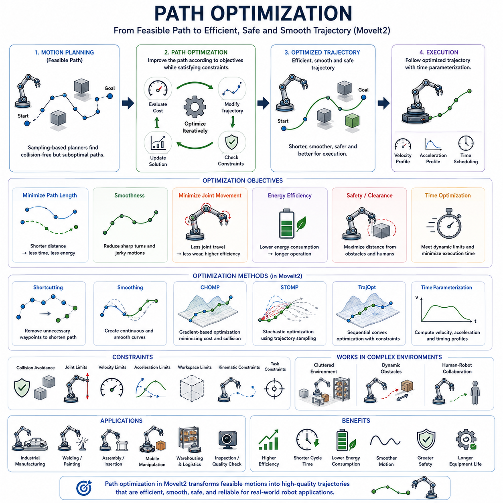{width="7.268055555555556in" height="7.268055555555556in"}

Path optimization is a fundamental component of modern robotic motion planning systems and plays a critical role in transforming feasible robot motions into efficient, safe, smooth, and executable trajectories. While motion planning algorithms are primarily responsible for finding collision-free paths between a start state and a goal state, the initial solutions they generate are often far from ideal. These paths may contain unnecessary detours, abrupt direction changes, excessive joint movements, inefficient timing profiles, or motions that are technically feasible but operationally undesirable. Path optimization addresses these limitations by refining planned trajectories and improving overall motion quality before execution.

In the context of robotics, a path represents a geometric route through the robot's configuration space, while a trajectory extends this concept by incorporating timing information such as velocity, acceleration, and execution duration. The distinction between path planning and path optimization is important. Path planning focuses on discovering a valid route, whereas path optimization focuses on improving the quality of that route according to specific objectives. In practical robotic systems, optimization is often the step that separates a merely functional robot from a highly efficient and professional autonomous system.

The need for path optimization arises because many motion planning algorithms prioritize feasibility over quality. Sampling-based planners such as Rapidly Exploring Random Trees, RRTConnect, Probabilistic Roadmaps, and related algorithms are extremely effective at finding collision-free paths in high-dimensional spaces. However, the resulting paths often contain irregular segments, unnecessary waypoints, and sharp transitions. These imperfections are natural consequences of the stochastic exploration processes used by sampling-based methods. Without optimization, such paths may lead to inefficient execution, increased energy consumption, excessive actuator wear, and reduced operational performance.

Path optimization can be viewed as a process of minimizing a cost function while maintaining all necessary constraints. The cost function may represent path length, execution time, energy consumption, joint movement, collision risk, safety margins, smoothness, or a combination of multiple objectives. The optimization system evaluates the trajectory and iteratively improves it until a satisfactory balance between performance and feasibility is achieved. Different applications emphasize different optimization criteria depending on operational requirements.

One of the most common objectives in path optimization is minimizing path length. Shorter paths generally reduce execution time and energy consumption while increasing productivity. In industrial manufacturing environments, even small reductions in path length can produce significant gains when multiplied across thousands of repeated operations. Warehouse robots, autonomous mobile manipulators, and production-line robots all benefit from shorter and more direct trajectories. However, minimizing path length alone is not always sufficient because the shortest path may not be the safest or smoothest option.

Trajectory smoothness is another major optimization objective. Robots execute physical motions through motors, gearboxes, actuators, and control systems. Sudden changes in direction, velocity, or acceleration can generate undesirable mechanical stresses, vibration, and wear. Smooth trajectories reduce these effects and improve overall system reliability. From a control perspective, smooth motions are easier to track accurately, resulting in improved precision and reduced tracking errors during execution.

Joint-space optimization focuses specifically on minimizing unnecessary joint movement. Many robotic manipulators possess multiple inverse kinematic solutions for the same end-effector pose. Some solutions require large joint displacements while others involve more efficient motions. Optimization algorithms evaluate these alternatives and select trajectories that minimize joint travel distance, reduce mechanical effort, and improve overall efficiency. This is particularly important for robots operating continuously in industrial environments where long-term component wear must be minimized.

Energy optimization has become increasingly important as robotics expands into mobile and autonomous systems. Mobile robots rely on batteries and limited onboard energy resources. Every unnecessary movement consumes power and reduces operational endurance. Path optimization can minimize energy expenditure by reducing travel distance, avoiding excessive accelerations, maintaining efficient velocity profiles, and selecting energetically favorable configurations. In large-scale warehouse operations or outdoor autonomous robotics platforms, energy-efficient planning directly influences mission duration and operational cost.

Safety optimization represents another critical dimension of path refinement. While collision-free paths satisfy minimum safety requirements, optimized paths often seek to maximize clearance from obstacles. Maintaining larger distances from surrounding objects increases robustness against localization errors, perception uncertainties, environmental changes, and unexpected disturbances. Safety-oriented optimization is particularly important in human-robot collaboration environments where maintaining protective separation distances is essential.

Time optimization focuses on minimizing task completion duration while respecting dynamic constraints. Industrial production systems frequently prioritize throughput and cycle time reduction. Optimization algorithms adjust velocity and acceleration profiles to achieve the fastest possible execution without violating actuator limits or compromising safety. Advanced time-parameterization techniques allow robots to move efficiently while remaining within mechanical and control limitations.

The mathematical foundations of path optimization are rooted in optimization theory. Most optimization problems involve an objective function that must be minimized or maximized while satisfying a set of constraints. Constraints may include collision avoidance requirements, joint limits, velocity limits, acceleration limits, workspace boundaries, kinematic restrictions, and task-specific conditions. The optimizer searches for solutions that achieve the best possible objective value while satisfying all constraints simultaneously.

MoveIt2 supports several optimization techniques through its planning pipeline architecture. After a planner generates an initial solution, additional optimization stages can refine the resulting path before execution. These stages may include shortcutting algorithms, smoothing procedures, trajectory simplification techniques, and dedicated optimization frameworks. This modular approach allows developers to combine multiple optimization methods according to application requirements.

Path shortcutting is one of the simplest and most effective optimization methods. The algorithm examines existing path segments and attempts to replace longer routes with shorter direct connections whenever possible. If two points along the path can be connected without collisions, intermediate waypoints may be removed. Repeated application of shortcutting can significantly reduce path complexity while preserving safety.

Path smoothing further improves trajectory quality by reducing sharp turns and discontinuities. Instead of following abrupt piecewise-linear paths, smoothing algorithms generate continuous curves that transition gradually between waypoints. Smoother trajectories improve control stability, reduce vibration, and create more natural robot motions. Service robots and collaborative robots particularly benefit from smooth movements because humans perceive smooth behavior as safer and more predictable.

Trajectory optimization frameworks such as CHOMP, STOMP, and TrajOpt represent more advanced approaches. CHOMP, which stands for Covariant Hamiltonian Optimization for Motion Planning, treats trajectory optimization as a continuous optimization problem. It seeks paths that simultaneously minimize collision risk and motion cost while producing smooth trajectories. CHOMP has become widely recognized for generating high-quality robotic motions in cluttered environments.

STOMP, or Stochastic Trajectory Optimization for Motion Planning, adopts a probabilistic optimization strategy. Rather than relying on gradient information, STOMP evaluates multiple trajectory variations and iteratively improves performance through stochastic sampling. This approach allows optimization in situations where gradient information may be unavailable or difficult to compute. STOMP has demonstrated effectiveness in manipulation tasks involving complex constraints and challenging environments.

TrajOpt approaches path optimization through sequential convex optimization techniques. The trajectory is represented as a mathematical optimization problem that can be solved efficiently through iterative refinement. TrajOpt often produces high-quality trajectories while maintaining strong computational performance. Its ability to handle collision constraints directly within the optimization process makes it attractive for many industrial applications.

Optimization is particularly important in Cartesian motion planning. Tasks such as welding, painting, polishing, cutting, inspection, and assembly often require the end-effector to follow specific geometric paths. Even when the Cartesian path is fixed, optimization can improve timing profiles, orientation transitions, velocity distributions, and joint-space behavior. This ensures that the robot performs the task efficiently while maintaining process quality.

Mobile manipulators introduce additional optimization challenges because both navigation and manipulation must be considered simultaneously. A robot may need to reposition its mobile base before executing an arm motion. The combined system possesses significantly higher dimensionality than a fixed manipulator, creating more complex optimization problems. Whole-body optimization techniques address these challenges by considering all robot subsystems together and searching for globally efficient solutions.

Dynamic environments further increase the importance of optimization. Obstacles may move, humans may enter the workspace, and environmental conditions may change unexpectedly. In such situations, optimization must often occur in real time. Real-time path optimization enables robots to adapt quickly while maintaining smooth and efficient behavior. This capability is increasingly important for autonomous service robots, logistics systems, and outdoor robotic platforms.

Simulation environments provide valuable opportunities for optimization development and validation. Platforms such as Gazebo, Isaac Sim, MuJoCo, and Webots allow engineers to test optimization algorithms under diverse conditions before deployment. Through simulation, developers can evaluate trajectory quality, energy consumption, safety margins, execution times, and failure scenarios without risking physical hardware.

Digital twins further extend optimization capabilities. A digital twin maintains a synchronized virtual representation of the physical robot and environment. Optimization algorithms can evaluate multiple trajectory alternatives within the digital twin before selecting the most effective solution for real-world execution. This predictive capability supports higher levels of efficiency, reliability, and operational intelligence.

Artificial intelligence is increasingly influencing path optimization. Machine learning techniques can predict high-quality trajectories, estimate optimization parameters, learn task-specific motion preferences, and adapt optimization objectives based on operational experience. Reinforcement learning, imitation learning, and neural trajectory generation methods are emerging as complementary approaches to traditional optimization algorithms. Future robotic systems may combine classical optimization with AI-driven adaptation to achieve superior performance.

In industrial settings, the benefits of path optimization are substantial. Optimized trajectories reduce cycle times, increase throughput, decrease energy consumption, improve motion smoothness, extend equipment life, enhance safety, and improve overall system reliability. These benefits accumulate over time and can significantly influence operational costs and productivity. As robotic systems become more autonomous and widely deployed, optimization will continue to play an increasingly strategic role.

The future of path optimization is closely connected to the broader evolution of robotics. Humanoid robots, collaborative robots, autonomous mobile manipulators, warehouse automation systems, healthcare robots, and embodied AI platforms will require increasingly sophisticated optimization capabilities. Future optimization frameworks will likely integrate perception, planning, control, learning, and semantic reasoning into unified decision-making architectures capable of generating highly efficient motions in complex real-world environments.

Ultimately, path optimization serves as the refinement engine of robotic motion. It transforms feasible solutions into high-quality trajectories that are efficient, smooth, safe, and practical. Within MoveIt2, path optimization complements motion planning by improving every aspect of robot behavior before execution. For robotics engineers, understanding path optimization is essential because it directly influences performance, reliability, energy efficiency, safety, and the overall effectiveness of autonomous robotic systems operating in the physical world.

## 07 Grasp Planning

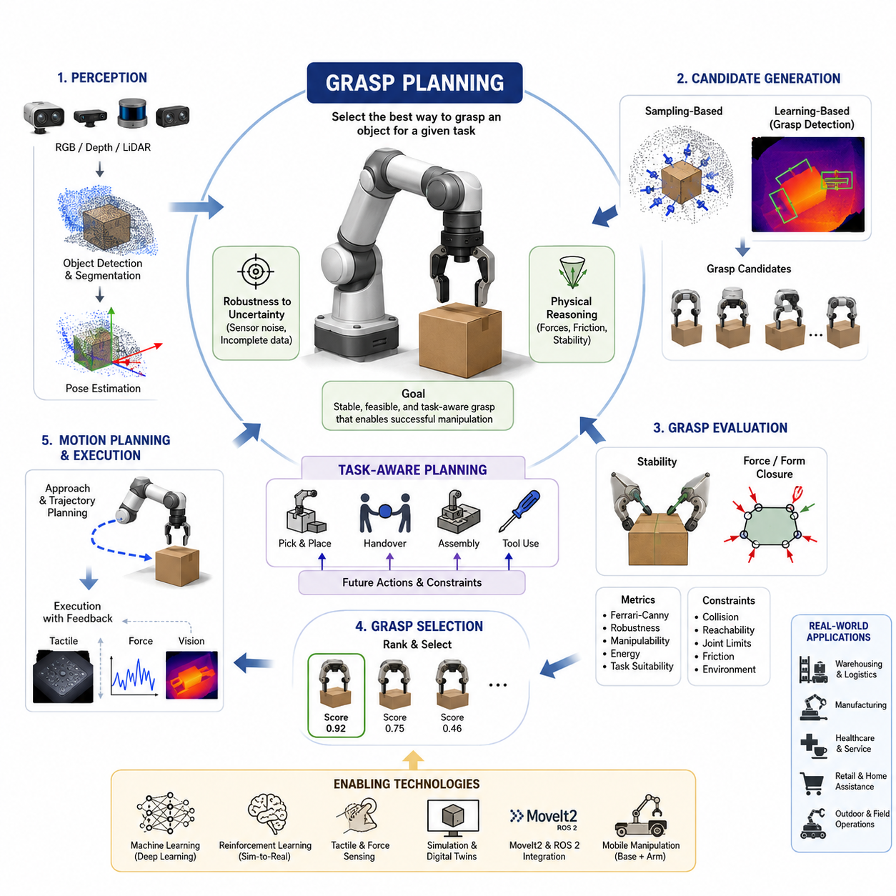{width="7.268055555555556in" height="7.268055555555556in"}

Grasp planning is one of the most important capabilities in robotic manipulation because it bridges the gap between perception and physical interaction. A robot may successfully detect an object, estimate its pose, and plan a collision-free arm trajectory, yet the entire manipulation process can still fail if the robot chooses an inappropriate grasp. Grasp planning is therefore the process of determining how a robotic end-effector should approach, contact, and securely hold an object so that a desired manipulation task can be completed successfully. In modern mobile manipulators and industrial robotic systems, grasp planning serves as the critical decision-making layer between object understanding and motion execution.

The fundamental objective of grasp planning is to identify contact configurations that maximize stability while satisfying task requirements. A robot must determine where to place its fingers, how much force to apply, what orientation the gripper should have, and how the object should be manipulated after grasping. Unlike simple pick-and-place operations in structured industrial environments, modern robotic systems often operate in semi-structured or unstructured environments where object locations, orientations, and surrounding obstacles constantly change. Under such conditions, grasp planning becomes a highly dynamic and context-dependent problem.

From a robotics perspective, grasp planning involves both geometric and physical reasoning. Geometric reasoning determines where the gripper can physically contact an object, while physical reasoning evaluates whether the selected contacts can generate sufficient forces to resist disturbances. A successful grasp must maintain object stability against gravity, inertial forces, collisions, and unexpected environmental interactions. Consequently, grasp planning combines concepts from geometry, kinematics, dynamics, optimization, machine learning, and control theory.

One of the earliest approaches to grasp planning relied heavily on analytical models. In analytical grasp planning, the robot uses mathematical representations of object geometry and contact mechanics to determine feasible grasp configurations. Objects are typically represented as meshes, point clouds, or primitive geometric shapes. Potential contact points are generated on the object\'s surface, and grasp quality metrics are evaluated for each candidate. The robot then selects the grasp that maximizes stability according to predefined criteria.

A central concept in analytical grasp planning is force closure. A grasp achieves force closure when the contact forces generated by the gripper can counteract arbitrary external disturbances applied to the object. If a grasp satisfies force closure conditions, the object can theoretically be held securely regardless of the direction of external forces. Force closure analysis often involves studying friction cones at contact points and evaluating whether the combined wrench space spans all possible disturbance directions.

Closely related to force closure is the concept of form closure. Form closure occurs when the object is completely constrained by geometric contacts alone, even in the absence of friction. While form closure provides extremely strong constraints, it is difficult to achieve in practical robotic systems because it often requires multiple precisely positioned contact points. Most real-world robotic grasping relies on force closure rather than form closure.

The quality of a grasp can be evaluated using grasp metrics. One widely used metric is the Ferrari-Canny grasp quality measure, which estimates the ability of a grasp to resist disturbances in all directions. Other metrics consider factors such as manipulability, robustness, energy efficiency, contact stability, and task suitability. In industrial environments, grasp planners often rank candidate grasps according to these metrics and select the highest-scoring option.

As robotic applications expanded beyond structured manufacturing environments, object uncertainty became a major challenge. Real-world perception systems produce noisy measurements, incomplete point clouds, and imperfect pose estimates. Consequently, modern grasp planning systems must account for uncertainty when evaluating candidate grasps. Rather than identifying a single optimal grasp, the robot may generate multiple robust grasp candidates capable of tolerating perception errors and environmental variations.

The rise of 3D perception technologies significantly transformed grasp planning methodologies. RGB cameras, stereo vision systems, depth cameras, LiDAR sensors, and structured-light scanners now provide rich three-dimensional representations of objects and environments. These sensing technologies allow grasp planners to operate directly on point clouds rather than relying solely on predefined CAD models. This capability is particularly important in warehouse automation, logistics operations, and service robotics applications where robots frequently encounter previously unseen objects.

Point-cloud-based grasp planning has become one of the most common approaches in modern robotics. The robot first segments an object from the environment and generates a three-dimensional point cloud representation. Potential grasp poses are then sampled around the object surface. Each candidate grasp is evaluated according to geometric compatibility, collision constraints, reachability, and stability metrics. The highest-ranked grasp is subsequently selected for execution.

Sampling-based grasp planning methods explore large spaces of possible grasps through random or heuristic sampling strategies. Instead of attempting to analytically solve the grasping problem, these methods generate numerous candidate grasp poses and evaluate them according to predefined criteria. Sampling-based approaches are particularly useful when dealing with complex object geometries where analytical solutions become computationally expensive.

Machine learning has introduced a new paradigm in grasp planning. Rather than explicitly programming grasp rules, robots can learn grasping strategies directly from data. Deep learning models are trained using large datasets containing successful and unsuccessful grasp examples. During inference, these models predict grasp locations and orientations directly from sensor inputs such as RGB images, depth maps, or point clouds.

Learning-based grasp planning offers significant advantages in unstructured environments. Neural networks can generalize across object categories and discover grasping patterns that are difficult to encode manually. For example, a trained model may learn that cylindrical objects are typically grasped along their sides, while box-shaped objects are best grasped from opposing faces. Such knowledge emerges naturally through training without requiring explicit programming.

One influential development in this field is grasp detection. Grasp detection algorithms directly identify suitable grasp configurations from sensory observations. Instead of reconstructing complete object models, these systems predict grasp rectangles, grasp poses, or grasp quality maps from camera images. This significantly reduces computational complexity and enables real-time robotic manipulation.

Convolutional neural networks have been widely used for image-based grasp detection. More recently, transformer architectures and foundation models have demonstrated improved performance in understanding object geometry and predicting robust grasps. These models leverage large-scale visual representations to improve grasp planning across diverse object categories.

Another important advancement is reinforcement learning-based grasp planning. In reinforcement learning, robots learn grasping policies through repeated interaction with environments. Successful grasps receive positive rewards, while failed attempts receive penalties. Over time, the robot develops strategies that maximize long-term grasp success. Reinforcement learning is particularly valuable for tasks involving complex object dynamics, deformable materials, or uncertain environments.

Simulation environments play a critical role in reinforcement learning. Platforms such as Gazebo, MuJoCo, Isaac Sim, and PyBullet allow robots to perform millions of grasping trials without physical hardware. Domain randomization techniques further improve transferability by exposing learning algorithms to diverse object appearances, lighting conditions, physical properties, and environmental variations.

Task-aware grasp planning represents another important evolution in the field. Not all grasps are equally suitable for every manipulation task. A grasp selected for lifting an object may not be appropriate for inserting it into a container or using it as a tool. Task-aware grasp planning considers the future actions that will follow the grasp. The robot selects grasp configurations that facilitate downstream manipulation objectives rather than merely maximizing immediate grasp stability.

Consider a warehouse robot tasked with moving boxes. The robot may grasp a box from its side for transportation. However, if the box must later be stacked, the robot may choose a grasp that preserves access to the top surface. Similarly, a service robot picking up a cup may grasp the cup differently depending on whether it intends to place the cup on a table or hand it to a person.

In mobile manipulation systems, grasp planning becomes even more complex because both the manipulator and the mobile base contribute to overall reachability. The robot must determine not only how to grasp an object but also where to position itself before executing the grasp. This introduces additional optimization variables involving base location, arm configuration, obstacle avoidance, and task efficiency. Mobile manipulation platforms therefore frequently combine navigation planning, arm motion planning, and grasp planning into unified decision-making frameworks.

Collision avoidance is another essential consideration during grasp planning. A theoretically stable grasp may be physically impossible if the gripper collides with nearby objects, shelves, walls, or other environmental structures. Modern grasp planners integrate collision checking systems such as those provided by MoveIt2 to ensure that candidate grasps remain feasible within real-world environments. Candidate grasps that violate collision constraints are automatically discarded.

MoveIt2 provides extensive support for grasp planning within ROS2-based robotic systems. The framework integrates perception pipelines, planning scene management, collision checking, inverse kinematics solvers, motion planners, and execution controllers into a unified architecture. Grasp candidates can be generated, evaluated, ranked, and executed within the MoveIt2 ecosystem. This capability makes MoveIt2 a widely adopted platform for industrial and research manipulation applications.

Multi-finger robotic hands introduce additional challenges compared to parallel-jaw grippers. While parallel-jaw grippers typically involve two contact surfaces, anthropomorphic robotic hands may contain dozens of joints and multiple fingers. Planning grasps for such systems requires consideration of finger coordination, contact sequencing, dexterous manipulation, and hand kinematics. The resulting search space becomes substantially larger, making optimization significantly more difficult.

Dexterous grasp planning seeks to replicate aspects of human manipulation. Humans continuously adjust finger positions, contact forces, and grasp configurations during object interaction. Advanced robotic hands attempt to emulate these capabilities through sophisticated sensing and control systems. Tactile sensors, force sensors, and proprioceptive measurements provide feedback that enables continuous grasp adaptation.

Tactile sensing has become increasingly important for grasp planning and execution. Vision-based planning alone cannot always guarantee successful manipulation because surface properties such as friction, compliance, and texture are often difficult to estimate visually. Tactile feedback allows robots to detect slipping, contact loss, excessive force, and object movement. By incorporating tactile information, grasp planners can refine grasp quality estimates and improve execution reliability.

Grasp planning for deformable objects remains one of the most challenging problems in robotics. Traditional grasp planning techniques assume rigid-body physics, but many real-world objects are flexible, elastic, or deformable. Examples include clothing, food products, cables, medical materials, and packaging. Manipulating such objects requires models capable of predicting shape changes and deformation dynamics during grasping.

Human-robot collaboration introduces additional requirements for grasp planning. Collaborative robots operating near humans must prioritize safety, predictability, and comfort. Grasp configurations should avoid sharp motions, excessive gripping forces, and unsafe object orientations. In handover tasks, robots must also consider how humans will subsequently grasp the object. Human-aware grasp planning therefore extends beyond physical stability to include ergonomic and social considerations.

Recent developments in foundation models and embodied AI are creating new opportunities for grasp planning. Large-scale vision-language-action models can reason about object functionality, semantic context, and task intent. Instead of relying solely on geometry, future grasp planners may understand why an object is being manipulated and how it should be used. This semantic understanding enables more intelligent and adaptable robotic behavior.

For example, an embodied AI system may recognize that a screwdriver should be grasped by its handle, that a mug should be grasped differently when full versus empty, or that fragile medical equipment requires gentle handling. Such reasoning extends grasp planning beyond physical interaction into the domain of cognitive manipulation.

Future grasp planning systems will likely combine analytical models, deep learning, reinforcement learning, tactile sensing, digital twins, and foundation models into integrated architectures. These hybrid systems will leverage the strengths of multiple methodologies while compensating for their individual limitations. Digital twin environments will allow extensive grasp validation before deployment, while real-time feedback systems will continuously adapt grasps during execution.

As mobile manipulators become increasingly prevalent in warehouses, hospitals, factories, retail environments, service applications, and outdoor robotic systems, grasp planning will remain one of the foundational technologies enabling reliable physical interaction. The ability to identify, evaluate, and execute robust grasps across diverse objects and environments is essential for achieving truly autonomous manipulation. Consequently, grasp planning continues to be a central research area in robotics and serves as a critical building block for the next generation of intelligent robotic systems capable of operating safely and effectively in complex real-world environments.

## 08 Task Constructor

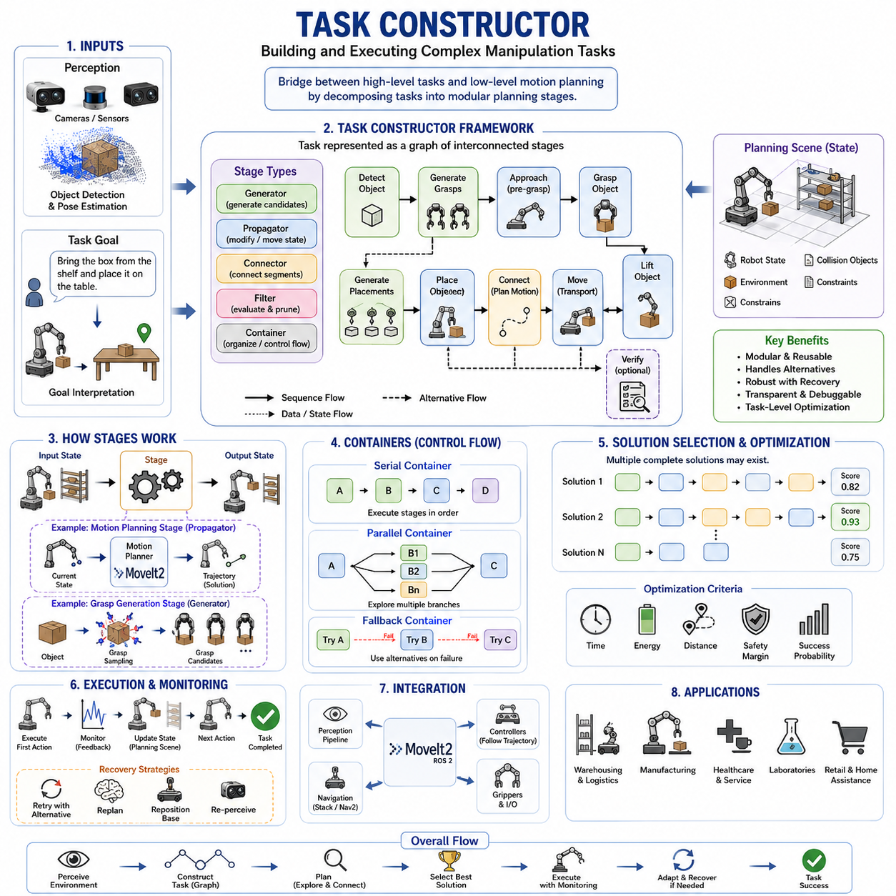{width="7.268055555555556in" height="7.268055555555556in"}

Task Constructor is one of the most important components in modern robotic manipulation systems because it bridges the gap between low-level motion planning and high-level task execution. While traditional motion planners focus on generating a collision-free trajectory from one robot state to another, real-world robotic applications require a much richer representation of tasks that consist of multiple interconnected actions, decisions, constraints, and recovery strategies. A robot operating in a warehouse, factory, hospital, laboratory, or service environment rarely performs a single motion in isolation. Instead, it executes complex workflows that involve perception, grasping, navigation, manipulation, placement, verification, and error handling. Task Constructor provides a structured framework for organizing these activities into coherent executable plans.

In the context of MoveIt2, the MoveIt Task Constructor (MTC) represents a powerful framework for building and executing complex manipulation tasks. Rather than treating a task as a single planning problem, MTC decomposes the task into a sequence of smaller planning stages. Each stage solves a specific subproblem and contributes to the overall task solution. This decomposition dramatically improves flexibility, maintainability, debugging capability, and solution quality.

Traditional robotic manipulation pipelines often suffer from a disconnect between task planning and motion planning. High-level planners may generate symbolic actions such as "pick object," "move object," or "place object," while motion planners operate at the geometric and kinematic level. The challenge arises when translating abstract goals into executable robot motions. Task Constructor addresses this challenge by creating an intermediate layer where task-level objectives and motion-level constraints can be integrated into a unified planning process.

The fundamental philosophy behind Task Constructor is modularity. Every robotic task can be represented as a collection of planning stages connected together in a logical sequence. Each stage has a clearly defined input state, processing logic, and output state. By combining multiple stages, complex robotic behaviors can be created while maintaining transparency and modularity.

Consider a simple pick-and-place operation. At first glance, the task appears straightforward. However, when examined in detail, numerous subtasks emerge. The robot must detect the object, estimate its pose, identify grasp candidates, move to a pre-grasp position, approach the object, close the gripper, lift the object, transport it to the destination, place it at the target location, release the object, and retreat safely. Each of these actions involves its own planning requirements, constraints, and potential failure conditions. Task Constructor allows these subtasks to be modeled explicitly as individual planning stages.

One of the key strengths of Task Constructor is its ability to represent planning as a directed graph rather than a simple linear sequence. In many situations, multiple alternative solutions may exist. Different grasp candidates may be available, multiple placement locations may satisfy task requirements, and various motion trajectories may achieve the same objective. Instead of committing to a single solution early in the planning process, Task Constructor can explore multiple branches simultaneously and evaluate alternative execution paths.

The concept of stages forms the foundation of Task Constructor. A stage represents a planning operation that transforms one state into another. Some stages generate new states, while others modify existing states or evaluate feasibility. Stages can represent perception operations, inverse kinematics calculations, grasp generation, collision checking, motion planning, object attachment, object detachment, or arbitrary user-defined actions.

Generator stages are responsible for producing candidate states or task solutions. For example, a grasp generation stage may produce multiple grasp poses around an object. A placement generator may identify several valid placement configurations. These generated candidates become inputs for subsequent planning stages.

Propagator stages modify states by applying actions or planning operations. A motion planning stage may propagate a robot state from one configuration to another through a collision-free trajectory. Similarly, a manipulation stage may update the planning scene after an object has been attached to the robot gripper.

Connector stages play a particularly important role. These stages connect independent task segments by generating feasible transitions between them. For example, a connector may generate a collision-free motion trajectory between a grasping stage and a transport stage. Without such connections, individual task segments would remain isolated and could not form a complete executable solution.

Filtering stages provide another critical capability. Real-world robotic planning often generates a large number of candidate solutions. Many of these solutions may be suboptimal, redundant, or infeasible. Filtering stages evaluate candidate solutions according to predefined criteria and remove those that do not satisfy task requirements. This process improves computational efficiency and increases the likelihood of successful execution.

The hierarchical nature of Task Constructor enables the creation of highly complex robotic behaviors. Multiple stages can be grouped into containers that represent larger task structures. Serial containers execute stages sequentially, while parallel containers allow multiple planning branches to be explored simultaneously. Fallback containers provide alternative solutions when primary plans fail. This hierarchical organization makes large robotic applications easier to design and maintain.

One of the most valuable features of Task Constructor is the explicit representation of planning states. Each stage operates on a planning scene that contains information about robot configurations, object positions, collision geometries, environmental constraints, and task-specific metadata. As the task progresses, the planning scene evolves to reflect changes in the environment and robot state. This state-centric approach enables accurate reasoning about task execution and environmental interactions.

Planning scene management is especially important in manipulation tasks involving object interactions. When a robot grasps an object, the object effectively becomes part of the robot\'s kinematic structure. Collision relationships change, reachable workspace changes, and dynamic properties may change as well. Task Constructor explicitly models these transitions, ensuring that subsequent planning stages operate on consistent world representations.

Collision checking remains one of the most critical aspects of task construction. Every stage must consider environmental obstacles, robot self-collisions, object collisions, and workspace constraints. By integrating collision checking throughout the planning pipeline, Task Constructor ensures that generated solutions remain physically executable.

Inverse kinematics plays a central role in many Task Constructor workflows. Whenever the robot must interact with an object, a desired end-effector pose must be converted into valid joint configurations. Multiple inverse kinematic solutions may exist for a given pose. Task Constructor can evaluate these alternatives and select solutions that optimize criteria such as manipulability, collision avoidance, energy efficiency, or execution speed.

Grasp planning and Task Constructor are closely interconnected. A manipulation task often begins with a grasp generation stage that produces candidate grasp configurations. These candidates are evaluated according to grasp quality metrics, reachability constraints, and collision conditions. Successful grasp candidates are then integrated into larger task plans that include approach motions, object transportation, and placement actions.

Task Constructor is particularly valuable for mobile manipulators because these systems combine navigation and manipulation within a single platform. A mobile manipulator must determine where to position its base before executing an arm manipulation task. Consequently, planning involves both base movement and arm movement. Task Constructor provides a unified framework for coordinating these activities.

Consider a warehouse robot tasked with retrieving a package from a storage shelf. The robot must first navigate to an appropriate position near the shelf. It must then perceive the package, generate grasp candidates, plan an approach trajectory, grasp the package, transport it safely, and place it at a designated destination. Each step depends on the success of previous steps and may require dynamic adaptation if conditions change. Task Constructor enables these complex dependencies to be modeled explicitly.

Task Constructor also supports task-level optimization. Rather than optimizing individual motions independently, the framework can evaluate complete task solutions. Metrics such as execution time, energy consumption, travel distance, manipulation effort, safety margins, and task success probability can be considered during solution selection. This holistic optimization approach often produces more efficient and reliable robotic behaviors.

Error handling is another area where Task Constructor provides substantial benefits. Real-world robotic systems inevitably encounter failures. Objects may be missing, perception systems may produce incorrect estimates, grasp attempts may fail, and environmental conditions may change unexpectedly. Traditional robotic applications often struggle to recover gracefully from such situations. Task Constructor allows alternative execution branches and recovery strategies to be incorporated directly into the task definition.

For example, if a grasp attempt fails, the robot may generate alternative grasp candidates and retry the operation. If an object cannot be reached from the current base position, the robot may reposition itself and attempt the task again. If perception confidence falls below a specified threshold, additional sensing actions may be triggered automatically. These recovery mechanisms improve robustness and autonomy.

Visualization and debugging capabilities are among the most appreciated features of Task Constructor. Because tasks are represented as explicit planning graphs, developers can inspect individual stages, examine intermediate states, visualize candidate solutions, and identify failure points. This transparency significantly simplifies development and troubleshooting compared to monolithic planning architectures.

Simulation environments further enhance Task Constructor development workflows. Platforms such as Gazebo, Isaac Sim, Webots, and MuJoCo allow complex tasks to be validated before deployment on physical robots. Developers can evaluate task performance under diverse conditions, identify weaknesses, and optimize planning strategies without risking hardware damage.

The integration of perception systems represents another important capability. Modern robots increasingly rely on visual perception, depth sensing, object recognition, pose estimation, and semantic understanding. Task Constructor can incorporate perception results directly into task planning workflows. Perception stages update the planning scene, enabling subsequent manipulation stages to operate on current environmental information.

Machine learning is beginning to influence Task Constructor architectures as well. Learning-based modules can generate grasp candidates, predict object affordances, estimate task success probabilities, or optimize planning parameters. These learned capabilities can be integrated as stages within larger task construction pipelines. As a result, Task Constructor serves as a bridge between classical robotics algorithms and modern AI-based approaches.

The emergence of foundation models and embodied AI is likely to further expand the role of Task Constructor. Future robotic systems may receive high-level instructions expressed in natural language. Rather than manually defining every planning stage, robots will automatically decompose objectives into executable task structures. Task Constructor provides a natural framework for representing these dynamically generated task plans.

For example, a user might instruct a robot to "bring me the red coffee mug from the kitchen." The robot must interpret the request, identify the target object, navigate to the kitchen, locate the mug, generate grasp plans, retrieve the object, return to the user, and perform a safe handover. Each of these operations can be represented as interconnected stages within a Task Constructor framework.

Industrial automation increasingly demands flexible robotic systems capable of handling variable products, changing workflows, and dynamic environments. Traditional hard-coded automation solutions often lack the adaptability required for such applications. Task Constructor addresses this challenge by enabling reusable, modular, and configurable task definitions. New tasks can be assembled from existing stages without redesigning entire planning architectures.

In collaborative robotics, Task Constructor supports the integration of safety constraints, human-aware planning, and dynamic task adaptation. Robots can monitor human activities, adjust task execution sequences, and modify plans in response to changing workspace conditions. This flexibility is essential for safe and efficient human-robot collaboration.

As robotic systems continue to evolve toward higher levels of autonomy, Task Constructor is becoming a fundamental technology for organizing robotic intelligence. It provides a structured methodology for connecting perception, planning, control, manipulation, navigation, reasoning, and recovery into coherent task execution frameworks. By decomposing complex operations into manageable planning stages while maintaining global task awareness, Task Constructor enables robots to perform sophisticated real-world activities with greater reliability and flexibility.

Within the MoveIt2 ecosystem, Task Constructor represents a significant advancement beyond traditional motion planning. It transforms robotic planning from a single-trajectory generation problem into a comprehensive task reasoning framework capable of supporting next-generation mobile manipulators, warehouse automation systems, service robots, industrial robotic cells, and future embodied AI platforms. As the complexity of robotic applications continues to increase, Task Constructor will remain one of the key enabling technologies for achieving scalable, intelligent, and robust robotic autonomy.

## 09 MoveIt2 for Mobile Manipulators

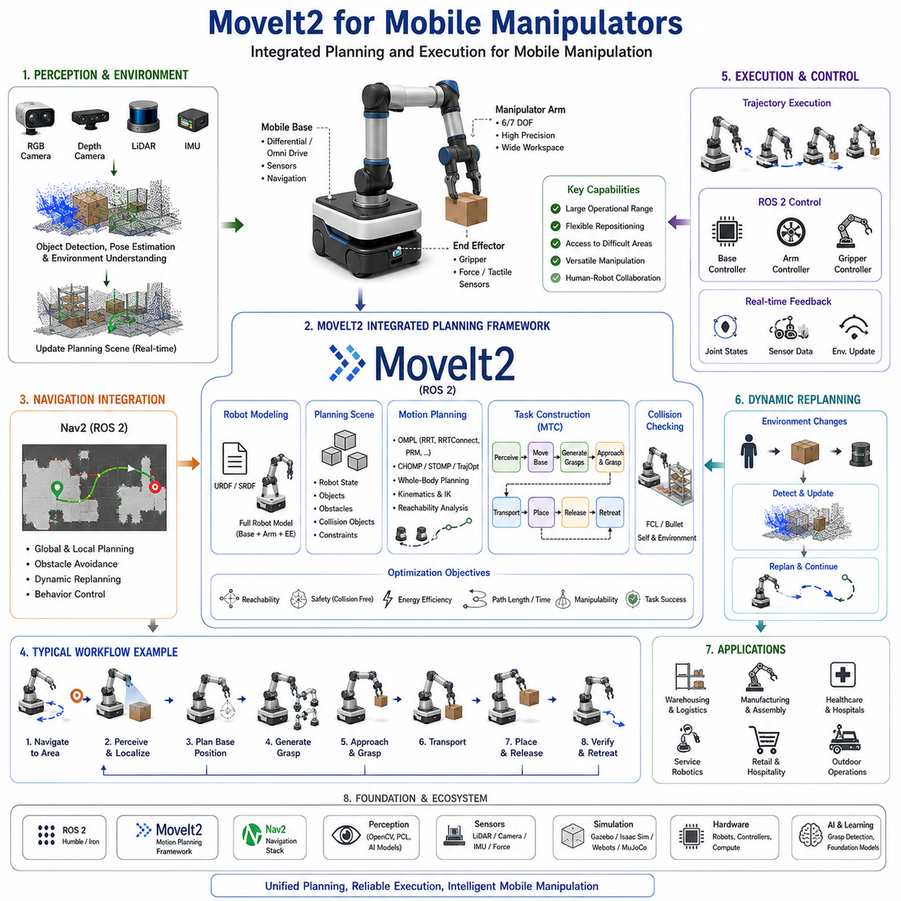{width="7.268055555555556in" height="7.268055555555556in"}

Mobile manipulators represent one of the most significant developments in modern robotics because they combine autonomous mobility with dexterous manipulation. Unlike traditional industrial robotic arms that operate from fixed positions, mobile manipulators integrate a robotic arm with a mobile base, allowing robots to navigate through dynamic environments and interact with objects over large operational areas. This combination dramatically expands robotic capabilities and enables applications in warehouses, factories, hospitals, laboratories, retail environments, service robotics, agriculture, logistics centers, airports, and outdoor autonomous operations. As these systems become increasingly sophisticated, the need for an integrated planning and execution framework becomes essential. MoveIt2 has emerged as one of the most powerful platforms for addressing this challenge by providing unified support for motion planning, manipulation planning, collision checking, task execution, perception integration, and real-time control within ROS2-based robotic systems.

Traditional robot arms operate within a fixed workspace determined by their kinematic reach. Once an object lies outside this workspace, the robot cannot interact with it without external repositioning. Mobile manipulators overcome this limitation by extending the robot's reachable workspace through base mobility. The mobile platform can reposition itself while the manipulator performs fine-grained interaction tasks. This creates a fundamentally different planning problem because the robot must simultaneously consider navigation, arm motion, object interaction, environmental constraints, and task objectives.

MoveIt2 plays a central role in coordinating these capabilities. While MoveIt was originally developed for stationary manipulators, MoveIt2 extends these capabilities into the ROS2 ecosystem and provides the flexibility required for mobile manipulation systems. Rather than treating navigation and manipulation as separate processes, MoveIt2 enables integrated planning architectures where the entire robot, including the mobile base and robotic arm, can be considered as a unified kinematic system.

The primary challenge in mobile manipulation is the coordination of multiple degrees of freedom distributed across different subsystems. A mobile manipulator may consist of a differential-drive or omnidirectional base, a six- or seven-degree-of-freedom robotic arm, a gripper, vision sensors, force sensors, and additional peripherals. The combined configuration space can become extremely large. Planning within such a high-dimensional space requires sophisticated algorithms capable of balancing computational efficiency with solution quality.

MoveIt2 addresses this challenge through its modular architecture. The framework separates robot description, kinematics, planning, execution, perception, and control into reusable components. Developers can configure individual subsystems while maintaining an integrated planning environment. This modularity makes MoveIt2 highly adaptable to different mobile manipulator platforms.

Robot modeling forms the foundation of MoveIt2-based mobile manipulation. Every robot must be represented using Unified Robot Description Format (URDF) and Semantic Robot Description Format (SRDF) models. These descriptions define links, joints, sensors, collision geometries, kinematic chains, and semantic relationships. For mobile manipulators, the robot model includes both the mobile base and manipulator arm, enabling MoveIt2 to reason about the complete robot structure.

One important design decision involves how the mobile base is represented. Some systems treat the base as a separate navigation component and plan arm motions independently. Other systems incorporate the base directly into the kinematic model, allowing joint optimization of base and arm movements. The latter approach often produces more efficient solutions because the planner can simultaneously optimize all robot degrees of freedom.

Kinematic planning becomes substantially more complex in mobile manipulators. A stationary robotic arm typically solves inverse kinematics by determining joint configurations that achieve a desired end-effector pose. In a mobile manipulator, both the base position and arm configuration contribute to end-effector placement. Consequently, multiple valid solutions may exist. MoveIt2 can leverage this redundancy to identify configurations that improve manipulability, reduce energy consumption, avoid collisions, or increase task success probability.

Reachability analysis is particularly important in mobile manipulation. Before attempting a manipulation task, the robot must determine whether the target object can be reached from its current position. If not, the robot must identify an alternative base location. MoveIt2 supports reachability evaluation through kinematic analysis and workspace computation. By integrating these capabilities with navigation systems, robots can autonomously reposition themselves to improve task feasibility.

Perception integration is another critical aspect of mobile manipulation. Unlike industrial robots operating in highly structured environments, mobile manipulators often work in dynamic settings where object positions continuously change. Vision systems provide information about object locations, orientations, obstacles, and environmental context. MoveIt2 integrates perception pipelines that update the planning scene in real time, allowing manipulation plans to adapt to changing conditions.

The planning scene serves as the robot\'s internal representation of the environment. It contains information about obstacles, objects, robot configurations, collision geometries, and task constraints. For mobile manipulators, maintaining an accurate planning scene is especially important because the robot continuously changes its position relative to the environment. Dynamic scene updates ensure that motion plans remain valid during execution.

Collision checking represents one of the most computationally intensive aspects of mobile manipulation planning. The robot must avoid collisions between the arm and environment, the base and environment, the arm and base, and the manipulated object and surrounding obstacles. As the number of movable components increases, collision-checking complexity grows significantly. MoveIt2 utilizes optimized collision detection libraries such as FCL and Bullet to perform these computations efficiently.

Motion planning for mobile manipulators often requires solving multiple interconnected planning problems. The robot may first navigate toward a target area, then position itself optimally for manipulation, execute grasping motions, transport objects, and finally perform placement operations. Each stage involves distinct planning objectives and constraints. MoveIt2 enables these stages to be coordinated through integrated planning frameworks.

Task-level planning becomes increasingly important as task complexity grows. Simple motion planning alone is insufficient for real-world manipulation applications. The robot must reason about sequences of actions, alternative strategies, and recovery procedures. MoveIt Task Constructor provides a powerful mechanism for organizing these activities into structured planning pipelines. For mobile manipulators, Task Constructor allows navigation, perception, grasp planning, manipulation, and recovery actions to be integrated into coherent workflows.

Grasp planning is particularly challenging in mobile manipulation because object accessibility depends on both arm reachability and base positioning. A grasp that appears feasible from one location may become impossible due to arm kinematic limits or environmental obstacles. MoveIt2 evaluates grasp candidates while considering the entire robot configuration. This integrated evaluation improves grasp success rates and reduces execution failures.

Navigation and manipulation traditionally belong to separate software stacks. Navigation frameworks such as Nav2 focus on mobile base movement, while MoveIt2 focuses on manipulation. Mobile manipulators require close coordination between these systems. Modern architectures establish communication channels between Nav2 and MoveIt2 so that navigation decisions influence manipulation planning and vice versa.

For example, consider a warehouse robot retrieving an item from a shelf. Nav2 may identify a safe route to the shelf, while MoveIt2 evaluates whether the target object can be reached from the planned stopping location. If reachability is insufficient, MoveIt2 can request a different base position. This iterative process continues until both navigation and manipulation constraints are satisfied.

Whole-body planning represents one of the most advanced capabilities in mobile manipulation. Instead of planning base and arm motions separately, the planner treats the entire robot as a single kinematic entity. This approach often yields more efficient and natural motions because all available degrees of freedom contribute to task completion. Whole-body planning is particularly valuable in cluttered environments where coordinated motion is required to avoid obstacles.

Sampling-based planning algorithms play a major role in MoveIt2. Algorithms such as RRT, RRTConnect, PRM, and their variants explore large configuration spaces efficiently. These planners are well suited to mobile manipulation because they can handle high-dimensional search spaces and complex constraints. MoveIt2 integrates these algorithms through the Open Motion Planning Library (OMPL).

Optimization-based planners provide an alternative approach. Instead of randomly exploring configuration space, optimization methods formulate planning as a constrained optimization problem. Objectives such as trajectory smoothness, energy efficiency, execution speed, and obstacle clearance can be optimized simultaneously. Libraries such as CHOMP, STOMP, and TrajOpt are frequently used in conjunction with MoveIt2 for these purposes.

Trajectory execution requires accurate coordination between planning and control systems. Once a trajectory is generated, it must be translated into commands for the mobile base and manipulator controllers. ROS2 Control provides standardized interfaces for hardware integration, enabling MoveIt2 to execute trajectories on diverse robotic platforms.

Real-time execution introduces additional challenges. Environmental conditions may change after planning has been completed. Humans may enter the workspace, objects may move unexpectedly, or sensor data may reveal previously unseen obstacles. MoveIt2 supports dynamic replanning mechanisms that allow trajectories to be updated during execution. This capability significantly improves operational robustness.

Multi-sensor fusion is becoming increasingly important in mobile manipulation systems. Modern robots frequently combine RGB cameras, depth cameras, LiDAR sensors, force sensors, tactile sensors, IMUs, and GNSS systems. The integration of these sensors provides richer environmental understanding and improves planning accuracy. MoveIt2 supports the incorporation of sensor-derived information into planning workflows.

Digital twins are increasingly used alongside MoveIt2 for mobile manipulator development. A digital twin provides a virtual representation of the robot and environment, enabling planning algorithms to be validated before deployment. Developers can evaluate task performance, identify potential failures, and optimize system parameters without risking physical hardware.

Simulation platforms such as Gazebo, Isaac Sim, Webots, and MuJoCo play a crucial role in this process. Mobile manipulation tasks can be tested under diverse conditions, including varying lighting, object arrangements, obstacle configurations, and environmental dynamics. Simulation-driven development reduces development costs and accelerates system deployment.

Industrial applications of MoveIt2-based mobile manipulators continue to expand rapidly. In warehouses, robots perform autonomous picking, replenishment, sorting, and transportation. In manufacturing environments, mobile manipulators support flexible production lines by transporting components and performing assembly operations. Hospitals employ mobile manipulators for medication delivery, specimen transportation, and supply management. Service robots utilize mobile manipulation for customer assistance, hospitality services, and retail operations.

Outdoor mobile manipulators introduce additional challenges related to uneven terrain, environmental uncertainty, weather conditions, and large-scale navigation. Inspection robots, maintenance robots, agricultural robots, and autonomous logistics platforms increasingly require integrated manipulation capabilities. MoveIt2 provides a flexible foundation for addressing these emerging applications.

Artificial intelligence is beginning to reshape mobile manipulation workflows. Deep learning models can assist with object detection, pose estimation, grasp prediction, scene understanding, and task planning. Foundation models and vision-language-action systems further extend robotic capabilities by enabling semantic reasoning and natural language interaction. MoveIt2 increasingly serves as the execution layer that translates high-level AI decisions into physically executable motions.

Embodied AI systems represent a particularly important future direction. These systems integrate perception, reasoning, planning, and action into unified architectures. Mobile manipulators provide an ideal physical platform for embodied intelligence because they combine mobility, dexterity, sensing, and environmental interaction. MoveIt2 forms a critical component within these architectures by providing reliable motion generation and task execution capabilities.

Scalability remains an important consideration for real-world deployments. A single mobile manipulator may operate effectively in a laboratory, but large-scale commercial environments often require fleets of robots. Coordination between multiple mobile manipulators introduces additional planning challenges related to traffic management, resource allocation, workspace sharing, and cooperative manipulation. Future MoveIt2 developments are expected to provide increasingly sophisticated support for multi-robot coordination.

As robotics continues its transition from structured industrial environments to dynamic real-world applications, the importance of integrated planning frameworks will continue to grow. Mobile manipulators require the seamless integration of navigation, manipulation, perception, control, task planning, and artificial intelligence. MoveIt2 provides one of the most comprehensive solutions available for addressing these requirements.

Within the ROS2 ecosystem, MoveIt2 has evolved from a manipulator-focused planning framework into a comprehensive platform for intelligent robotic operation. Its support for mobile manipulators enables robots to move beyond fixed workstations and interact autonomously with complex environments. By combining advanced motion planning, perception integration, task reasoning, real-time execution, and AI compatibility, MoveIt2 establishes the technological foundation for the next generation of autonomous mobile manipulation systems operating across industrial, commercial, healthcare, logistics, service, and outdoor domains.

## 10 Real Time Execution

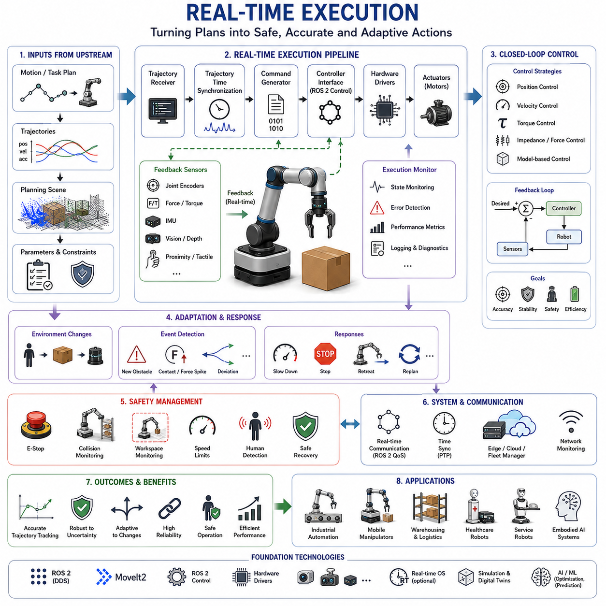{width="7.268055555555556in" height="7.268055555555556in"}

Real-time execution is one of the most critical capabilities in modern robotic systems because it transforms planned robot behavior into actual physical actions occurring in dynamic environments. While motion planning, task planning, perception, and decision-making generate desired actions, the ultimate success of a robotic system depends on its ability to execute those actions accurately, safely, and reliably under real-world conditions. In the MoveIt2 ecosystem, real-time execution represents the final stage of the manipulation pipeline where planned trajectories are converted into controller commands, sensor feedback is continuously monitored, and corrective actions are applied when necessary. For industrial robots, mobile manipulators, service robots, warehouse automation systems, and future embodied AI platforms, real-time execution serves as the bridge between digital planning and physical reality.

A robot operating in a perfectly simulated environment can often achieve near-perfect execution because all variables are known and predictable. However, real-world environments introduce uncertainty at every level. Sensors contain noise, actuators exhibit mechanical imperfections, communication networks introduce latency, objects may move unexpectedly, and environmental conditions continuously change. Real-time execution systems are designed to handle these uncertainties while maintaining acceptable performance, safety, and task success rates.

The fundamental objective of real-time execution is to ensure that the robot follows planned trajectories while continuously adapting to changing conditions. This requires close integration between planning algorithms, control systems, sensors, actuators, and monitoring frameworks. Rather than treating execution as a simple replay of a precomputed trajectory, modern robotic systems view execution as a continuous feedback-driven process in which planning and control operate together.

Within MoveIt2, real-time execution begins after a motion planning algorithm generates a valid trajectory. The trajectory typically consists of a sequence of robot joint positions, velocities, accelerations, and timestamps. This trajectory is then transmitted to the execution subsystem, which coordinates with ROS2 Control and hardware interfaces to drive the physical robot. The execution subsystem is responsible for ensuring that commands are delivered at the correct time and that actual robot motion closely follows the planned path.

Trajectory execution requires accurate synchronization between software and hardware components. Every joint controller must receive commands at precise intervals, and feedback from encoders and sensors must be collected continuously. Even small timing errors can accumulate over time and lead to trajectory deviations. Consequently, deterministic timing becomes a key requirement for real-time robotic systems.

Real-time systems differ from conventional software applications because timing constraints are as important as computational correctness. In a traditional application, a delayed response may simply reduce performance. In robotics, delayed responses can cause collisions, unstable behavior, or task failures. Therefore, real-time execution frameworks prioritize predictable timing behavior and bounded latency.

Latency is one of the most important performance metrics in robotic execution systems. Latency represents the delay between sensing an event and responding to it. For example, when a force sensor detects unexpected contact, the controller must react quickly enough to prevent damage. High latency can reduce responsiveness and compromise safety. Consequently, robotic systems strive to minimize sensing, communication, computation, and actuation delays.

Jitter represents another important consideration. While average latency may appear acceptable, variations in timing can cause unpredictable behavior. Real-time execution frameworks seek to minimize jitter by ensuring consistent update rates across all system components. Consistent timing improves controller stability and enables more accurate trajectory tracking.

ROS2 was designed with real-time robotics applications in mind. Compared to ROS1, ROS2 provides significant improvements in communication reliability, deterministic behavior, and Quality of Service (QoS) management. These features make ROS2 particularly suitable for implementing real-time execution pipelines in industrial and mobile robotic systems.

ROS2 Control serves as the primary execution framework for many MoveIt2 deployments. ROS2 Control provides standardized interfaces between high-level planning software and low-level hardware drivers. Controllers receive trajectory commands from MoveIt2 and generate actuator signals that drive robot joints. This architecture allows developers to replace hardware platforms without redesigning the entire execution pipeline.

Joint trajectory controllers represent one of the most common controller types used in MoveIt2 systems. These controllers receive desired joint trajectories and generate control outputs that drive motors toward target positions. Advanced controllers may incorporate feedforward terms, feedback compensation, dynamic modeling, and adaptive control techniques to improve tracking performance.

Position control is the simplest execution strategy and is widely used in industrial robotic systems. The controller attempts to move each joint to a desired position while minimizing position error. Although position control is straightforward and reliable, it may not provide optimal performance in highly dynamic environments.

Velocity control introduces additional flexibility by controlling joint velocities directly. This approach often improves responsiveness and smoothness, particularly when dealing with continuous motion tasks. Velocity control is frequently used in mobile robot navigation and certain manipulation applications.

Torque control represents the most advanced execution strategy. Instead of directly commanding positions or velocities, the controller commands joint torques. Torque control enables precise force regulation, compliance control, impedance control, and dynamic interaction with the environment. Collaborative robots and force-sensitive manipulation systems often rely on torque-based execution.

Feedback loops are fundamental to real-time execution. Sensors continuously measure robot state information such as joint positions, velocities, forces, temperatures, and environmental conditions. This information is compared against desired values, and corrective actions are applied accordingly. Without feedback loops, robots would operate in an open-loop manner and could not compensate for disturbances or uncertainties.

The concept of closed-loop control lies at the heart of modern robotic execution systems. In a closed-loop architecture, sensors continuously monitor system behavior and provide information to controllers. Controllers calculate errors between desired and actual states and adjust actuator commands accordingly. This continuous correction process enables robots to maintain accurate performance despite changing conditions.

PID controllers remain among the most widely used control algorithms in robotic systems. The proportional term responds to current errors, the integral term compensates for accumulated errors, and the derivative term predicts future trends. Although relatively simple, PID controllers provide robust performance across a wide range of robotic applications.

Model-based control techniques extend beyond PID control by incorporating dynamic models of the robot. These approaches use mathematical representations of inertia, friction, gravity, and external forces to improve control accuracy. Model predictive control, computed torque control, and inverse dynamics control are examples of advanced model-based execution strategies.

Mobile manipulators introduce additional complexity because both the mobile base and manipulator arm must be coordinated simultaneously. A mobile manipulator executing a pick-and-place operation may require synchronized base motion, arm movement, gripper control, and sensor updates. Real-time execution frameworks must coordinate all these subsystems while maintaining overall task consistency.

Synchronization becomes particularly important when multiple actuators must move together. If different robot joints execute commands at different rates, trajectory quality may degrade significantly. Coordinated control mechanisms ensure that all robot components remain synchronized throughout execution.

Sensor integration plays a central role in real-time execution. Cameras, LiDAR sensors, IMUs, force sensors, tactile sensors, proximity sensors, and encoders continuously generate information about the robot and environment. This data must be processed efficiently and incorporated into execution decisions without introducing excessive delays.

Force feedback provides an important example of real-time adaptation. During assembly tasks, insertion operations, or human-robot collaboration, force sensors can detect unexpected contact forces. The execution system can then modify robot behavior in real time to avoid excessive force, prevent damage, or improve task performance.

Tactile sensing extends this capability further by providing detailed information about object contact conditions. During grasping operations, tactile sensors can detect slipping, uneven pressure distribution, or contact loss. The execution system can respond immediately by adjusting grip force or modifying manipulation strategies.

Collision monitoring represents another critical aspect of real-time execution. While motion planning attempts to generate collision-free trajectories, unexpected obstacles may appear during execution. Real-time collision monitoring systems continuously evaluate environmental conditions and intervene when necessary. Depending on the situation, the robot may slow down, stop, retreat, or initiate replanning.

Dynamic replanning is becoming increasingly important in modern robotic systems. Traditional execution frameworks assumed that environments remained static after planning. In reality, humans, vehicles, other robots, and movable objects continuously change the workspace. Dynamic replanning allows robots to modify trajectories during execution in response to environmental changes.

MoveIt2 supports dynamic replanning through integration with planning scene updates and sensor feedback. When significant changes are detected, the robot can generate new trajectories while maintaining task continuity. This capability is particularly valuable in warehouses, hospitals, and service environments where environmental conditions change frequently.

Safety remains a primary concern throughout real-time execution. Industrial robots often operate near expensive equipment, valuable products, and human workers. Safety systems monitor robot behavior continuously and enforce operational constraints. Emergency stop systems, collision detection mechanisms, workspace monitoring, and speed limitations all contribute to safe execution.

Collaborative robots require even more sophisticated safety mechanisms. These robots are specifically designed to operate in close proximity to humans. Real-time execution systems must continuously monitor human positions, predict potential interactions, and adjust robot behavior accordingly. Human-aware execution strategies represent an active area of robotics research.

Network communication introduces additional challenges for distributed robotic systems. Modern robots frequently communicate with edge servers, cloud platforms, fleet management systems, and remote operators. Network delays, packet loss, and bandwidth limitations can affect execution performance. Real-time execution frameworks must tolerate communication uncertainties while maintaining safe operation.

Time synchronization becomes particularly important in distributed robotic systems. Protocols such as Precision Time Protocol (PTP) enable multiple devices to share a common notion of time. Accurate synchronization improves sensor fusion, multi-robot coordination, and distributed control performance.

Execution monitoring provides visibility into system behavior. Monitoring systems track trajectory progress, controller performance, sensor health, communication status, power consumption, and task completion metrics. Operators can use this information to diagnose issues, optimize performance, and ensure operational reliability.

Logging and diagnostics are essential for long-term system maintenance. Real-time execution systems generate large volumes of operational data. This information supports debugging, performance analysis, predictive maintenance, and continuous improvement efforts. Modern robotic platforms increasingly integrate execution logs with fleet management and analytics systems.

Digital twins offer powerful capabilities for execution validation. By maintaining a synchronized virtual representation of the robot, developers can compare planned and actual execution behavior. Deviations can be identified early, and corrective measures can be implemented before significant failures occur.

Artificial intelligence is beginning to influence execution systems as well. Machine learning models can predict execution failures, estimate actuator degradation, optimize controller parameters, and improve adaptation strategies. These capabilities enhance robustness and reduce operational downtime.

The emergence of embodied AI systems further elevates the importance of real-time execution. Embodied AI integrates perception, reasoning, planning, and action into unified cognitive architectures. While high-level reasoning determines what actions should be performed, real-time execution ensures that those actions are physically realized. Reliable execution therefore becomes a prerequisite for intelligent behavior.

Future robotic systems will increasingly operate in complex, dynamic, and unstructured environments. Autonomous warehouse robots, hospital service robots, field inspection robots, agricultural robots, humanoids, and mobile manipulators will all require highly reliable execution frameworks capable of adapting continuously to environmental changes. Real-time execution will evolve from a simple trajectory playback mechanism into a sophisticated decision-making layer that combines control, sensing, prediction, adaptation, and safety management.

Within the MoveIt2 ecosystem, real-time execution serves as the culmination of the entire robotic planning pipeline. It transforms abstract task objectives into physical actions while maintaining responsiveness, safety, and reliability. By integrating ROS2 Control, sensor feedback, dynamic replanning, collision monitoring, and advanced control strategies, MoveIt2 enables robots to execute complex manipulation tasks in real-world environments with increasing levels of autonomy. As robotic applications continue to expand across industrial, commercial, healthcare, logistics, and service domains, real-time execution will remain one of the foundational technologies that determine whether autonomous robotic systems can operate successfully outside controlled laboratory settings.

## 11 Debugging MoveIt2

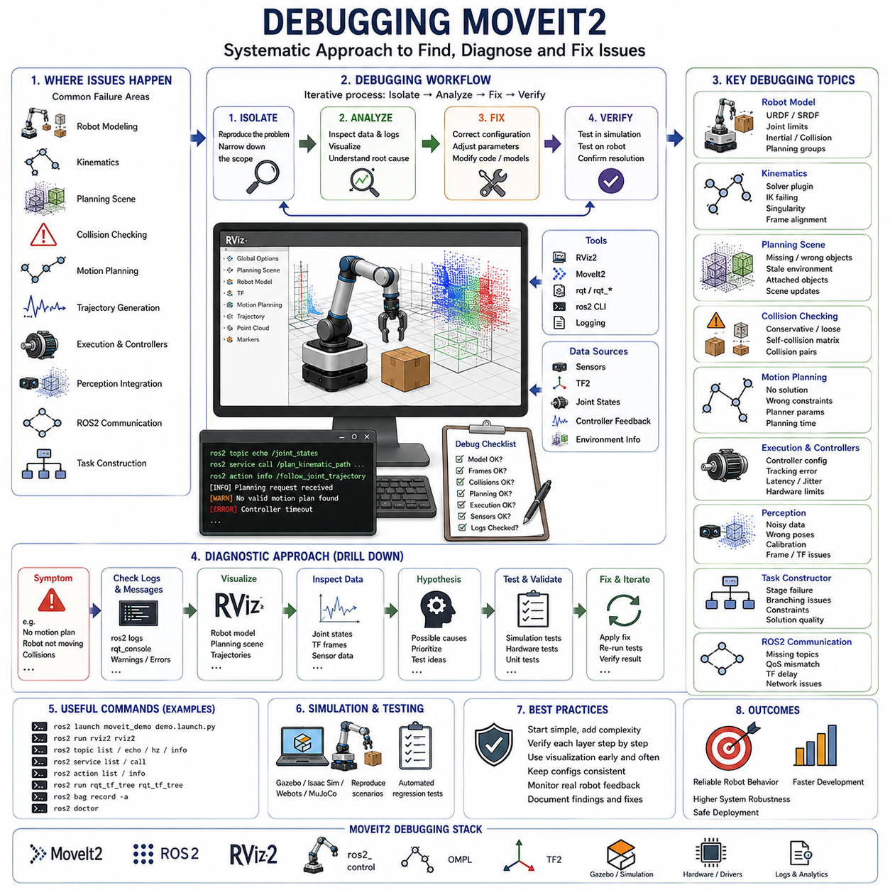{width="7.268055555555556in" height="7.268055555555556in"}

Debugging is one of the most important activities in the development and deployment of robotic systems because even the most sophisticated planning frameworks can fail when confronted with incorrect configurations, hardware inconsistencies, communication issues, environmental uncertainties, or software defects. In the MoveIt2 ecosystem, debugging plays a critical role in ensuring that motion planning, collision checking, kinematic calculations, trajectory execution, perception integration, and task-level planning function correctly under real-world conditions. Since MoveIt2 operates at the intersection of robot modeling, motion planning, ROS2 communication, controller interfaces, and physical hardware, debugging often requires a systematic understanding of the entire robotics software stack rather than a single software component.

Unlike traditional software applications where bugs often manifest as program crashes or incorrect outputs, robotic systems exhibit a much broader range of failure modes. A robot may fail to find a valid motion plan, generate unstable trajectories, misinterpret sensor data, collide with obstacles, execute unexpected movements, lose communication with controllers, or simply remain motionless despite receiving commands. In many cases, the root cause is not immediately visible because multiple software layers interact simultaneously. Consequently, successful MoveIt2 debugging requires a structured methodology that isolates problems systematically and verifies each subsystem independently.

One of the most common debugging challenges involves robot modeling. MoveIt2 relies heavily on accurate robot descriptions defined through URDF and SRDF files. These files describe robot links, joints, collision geometries, visual geometries, kinematic chains, planning groups, end effectors, virtual joints, and semantic relationships. Even small modeling errors can cause significant planning failures. Incorrect joint limits, missing collision geometries, improperly defined inertial properties, or invalid kinematic chains may prevent MoveIt2 from generating feasible plans.

When debugging robot models, developers typically begin by verifying that the robot description loads correctly into RViz and MoveIt2. Every link and joint should appear in the correct position, and the robot should move as expected when individual joints are manipulated. Visualization tools provide an important first step because many configuration errors become immediately visible when inspecting the robot model graphically.

Joint limit configuration represents another frequent source of problems. If joint limits are too restrictive, valid solutions may become unreachable. If limits are excessively permissive, generated trajectories may exceed hardware capabilities or create unsafe motions. MoveIt2 uses joint limits extensively during inverse kinematics calculations and motion planning. Therefore, developers must verify that software limits accurately reflect physical robot constraints.

Kinematic configuration errors are also common during system integration. MoveIt2 relies on kinematics plugins to compute forward and inverse kinematic solutions. If the selected plugin is misconfigured, motion planning may fail entirely. Developers often encounter situations where inverse kinematics solutions cannot be found despite apparently reachable targets. In many cases, these issues originate from incorrect solver parameters, inaccurate robot descriptions, or improperly defined planning groups.

Forward kinematics debugging is generally simpler because it involves computing end-effector positions from known joint states. Inverse kinematics debugging is considerably more challenging because multiple solutions may exist, singularities may occur, and solver convergence depends on initialization conditions. Visualization of target poses and resulting joint configurations often helps identify inverse kinematics issues.

The planning scene is another major source of debugging complexity. MoveIt2 maintains an internal representation of the robot, obstacles, objects, collision geometries, and environmental constraints. If the planning scene does not accurately reflect the physical environment, generated trajectories may become invalid. Objects may appear in incorrect locations, collision models may be missing, or stale environmental information may persist after changes occur.

Developers frequently debug planning scene issues using RViz visualization tools. By inspecting collision objects, occupancy maps, attached objects, and environmental models, discrepancies between the physical world and planning scene can be identified. Planning scene monitoring tools provide additional visibility into how environmental information changes over time.

Collision checking failures represent one of the most common causes of planning problems. MoveIt2 continuously evaluates potential collisions during motion planning. If collision models are overly conservative, valid trajectories may be rejected unnecessarily. Conversely, incomplete collision models may allow unsafe motions. Debugging collision checking often involves visualizing collision geometries, inspecting contact points, and analyzing collision matrices.

Self-collisions deserve particular attention because they can be difficult to identify without specialized tools. Robots with many degrees of freedom may enter configurations where links collide with each other. MoveIt2 automatically generates self-collision matrices to improve planning efficiency, but incorrect configuration of these matrices can lead to unexpected behavior.

Motion planning failures are among the most visible debugging challenges. A robot may simply report that no valid plan could be found. While this appears straightforward, the underlying cause may originate from kinematics, collision checking, environmental constraints, planning parameters, or hardware limitations. Developers must systematically isolate these factors to identify the root cause.

The Open Motion Planning Library (OMPL) provides several planners commonly used within MoveIt2, including RRT, RRTConnect, PRM, and related algorithms. Different planners exhibit different performance characteristics. A planning problem that fails with one planner may succeed with another. Consequently, debugging often involves experimenting with alternative planners and tuning planner-specific parameters.

Sampling-based planners can be particularly sensitive to planning time limits. If insufficient time is allocated, planners may terminate before finding a valid solution. Increasing planning time, adjusting sampling parameters, or simplifying constraints can often improve success rates. However, excessive planning times may reduce system responsiveness, particularly in real-time applications.

Constraint debugging presents another important challenge. MoveIt2 supports position constraints, orientation constraints, visibility constraints, path constraints, and task-specific restrictions. Overly restrictive constraints may eliminate all feasible solutions. Developers frequently discover that planning failures result from constraints that unintentionally conflict with robot capabilities.

Trajectory generation and optimization introduce additional complexity. Even when a valid path exists, the resulting trajectory may exhibit undesirable characteristics such as excessive accelerations, abrupt changes in direction, oscillations, or inefficient motions. Trajectory debugging involves inspecting generated paths, evaluating velocity profiles, and analyzing acceleration limits.

Time parameterization is particularly important for trajectory quality. Motion planners often generate geometric paths without considering timing. MoveIt2 subsequently applies time parameterization algorithms to produce executable trajectories. Problems in this stage may result in unrealistic velocities, excessive accelerations, or controller instability.

Execution failures frequently occur after planning succeeds. A trajectory may appear valid within simulation but fail during hardware execution. These issues often originate from controller configuration, communication delays, synchronization errors, hardware limitations, or inaccurate calibration. Debugging execution problems requires close examination of controller feedback and hardware state information.

ROS2 Control serves as the primary execution framework in many MoveIt2 deployments. Controllers receive planned trajectories and translate them into actuator commands. If controllers are incorrectly configured, trajectories may not execute correctly even when planning succeeds. Developers must verify controller interfaces, update rates, hardware communication channels, and actuator responses.

Joint state feedback provides a critical source of debugging information. Actual joint positions should closely follow commanded positions during execution. Significant discrepancies may indicate calibration errors, mechanical issues, controller instability, or communication problems. Monitoring tools allow developers to compare planned and actual trajectories in real time.

Communication debugging becomes increasingly important in distributed robotic systems. MoveIt2 relies extensively on ROS2 topics, services, actions, and DDS-based communication. Message delivery failures, QoS mismatches, network latency, and synchronization problems can all affect system behavior. ROS2 diagnostic tools provide visibility into communication flows and network performance.

Topic inspection tools allow developers to verify that expected messages are being published and received. Missing messages often indicate launch configuration problems, namespace mismatches, or communication failures. Similarly, service and action debugging tools help identify failures in request-response interactions.

Transform (TF2) issues are among the most frequent sources of perception and planning failures. MoveIt2 depends heavily on accurate coordinate transformations between sensors, robot links, end effectors, and world reference frames. Missing transforms, incorrect frame hierarchies, timing mismatches, or calibration errors can prevent successful planning.

TF2 debugging typically begins by inspecting the transform tree and verifying that all required frames are present. Developers must ensure that transforms are published at appropriate rates and remain consistent throughout system operation. Visualization tools help identify frame inconsistencies and missing connections.

Perception integration introduces additional debugging challenges. MoveIt2 increasingly relies on perception systems for object detection, pose estimation, obstacle recognition, and scene understanding. Errors in perception pipelines can propagate directly into planning failures. Incorrect object poses, noisy point clouds, incomplete environmental models, or sensor calibration errors may all affect planning quality.

Depth cameras, LiDAR sensors, RGB cameras, and stereo vision systems require careful calibration and validation. Developers often debug perception issues by comparing raw sensor outputs against expected environmental conditions. Point cloud visualization and object pose inspection provide valuable diagnostic information.

Task Constructor debugging represents a higher-level challenge. MoveIt Task Constructor decomposes complex tasks into multiple planning stages. Failures may occur within individual stages, transitions between stages, or task-level constraint evaluations. Since tasks often involve multiple alternative branches, identifying the exact failure location requires detailed stage-level inspection.

Visualization tools significantly simplify Task Constructor debugging. Developers can inspect intermediate states, evaluate generated solutions, identify failed stages, and analyze planning decisions. This transparency represents one of the major advantages of MoveIt Task Constructor compared to monolithic planning approaches.

Real-time systems introduce unique debugging requirements because timing behavior becomes critical. Latency, jitter, scheduling delays, and computational bottlenecks can affect planning and execution quality. Performance profiling tools help identify components that consume excessive computational resources or introduce unacceptable delays.

Memory management is another important consideration in long-running robotic systems. Memory leaks, resource exhaustion, and excessive allocation patterns can gradually degrade system performance. Monitoring CPU utilization, memory consumption, and thread behavior helps identify such issues before they affect operational reliability.

Logging plays a central role throughout the debugging process. MoveIt2, ROS2, and associated subsystems generate extensive diagnostic information. Structured logging allows developers to reconstruct system behavior, analyze failure sequences, and identify root causes. Appropriate log levels help balance visibility against information overload.

Simulation environments provide a safe and efficient platform for debugging. Gazebo, Isaac Sim, Webots, and MuJoCo allow developers to reproduce failures, evaluate modifications, and test corrective actions without risking physical hardware. Simulation often enables faster iteration cycles and more controlled experimentation.

Digital twins extend these capabilities further by maintaining synchronized virtual representations of physical systems. Debugging can occur simultaneously in both virtual and physical environments, enabling deeper analysis of discrepancies between planned and observed behavior.

Machine learning and AI components introduce new debugging challenges. Models may produce unexpected outputs, fail to generalize, or exhibit sensitivity to environmental changes. Debugging AI-driven systems often requires examining datasets, feature representations, model confidence levels, and inference pipelines alongside traditional robotics diagnostics.

The emergence of embodied AI systems increases the importance of comprehensive debugging methodologies. Future robots will integrate perception, reasoning, planning, manipulation, navigation, and language understanding into unified architectures. Failures may originate from interactions between these components rather than isolated subsystems. Consequently, debugging approaches must evolve toward system-level analysis.

Effective MoveIt2 debugging ultimately depends on a structured process. Developers should begin with robot models, verify kinematics, inspect planning scenes, validate collision checking, evaluate motion planning, confirm controller behavior, analyze communication systems, inspect perception pipelines, and finally investigate task-level execution. By progressively validating each layer of the robotics stack, complex failures can be isolated and resolved systematically.

Within the MoveIt2 ecosystem, debugging is not merely a maintenance activity but a fundamental engineering discipline. Reliable robotic systems emerge from rigorous validation, careful observation, systematic experimentation, and continuous refinement. As robotic applications become increasingly complex and autonomous, debugging methodologies will continue to evolve alongside planning algorithms, perception systems, AI models, and execution frameworks. The ability to diagnose and resolve issues efficiently will remain one of the most valuable skills for robotics engineers working with MoveIt2, ROS2, mobile manipulators, industrial robots, and future embodied intelligence platforms.
