# Chapter 02. MoveIt2

## 01 MoveIt2 Overview

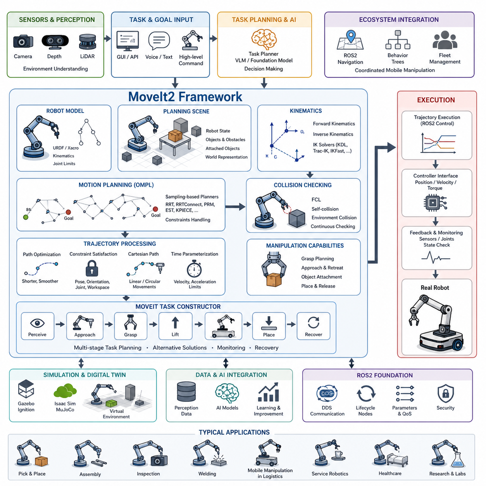{width="7.268055555555556in" height="7.268055555555556in"}

MoveIt2는 현대 로봇 매니퓰레이션 분야에서 가장 중요한 소프트웨어 프레임워크 중 하나이다. 로봇이 고정형 산업용 로봇팔에서 동적인 환경에서 작업하는 지능형 모바일 매니퓰레이터로 발전함에 따라, 유연하고 확장 가능하며 실시간으로 동작하는 모션 플래닝 시스템의 필요성이 크게 증가하였다. MoveIt2는 이러한 요구를 충족하기 위해 ROS2 기반의 통합 매니퓰레이션 프레임워크를 제공하며, 로봇이 환경을 인식하고, 충돌 없는 경로를 계획하며, 궤적을 실행하고, 주변 환경과 안전하게 상호작용할 수 있도록 지원한다. 모바일 매니퓰레이터의 소프트웨어 아키텍처에서 MoveIt2는 상위 수준의 작업 계획(Task Planning)과 하위 수준의 제어(Control) 사이를 연결하는 핵심 계층으로서, 목표를 실제 실행 가능한 움직임으로 변환하는 역할을 수행한다. 이러한 이유로 MoveIt2는 연구용 로봇, 산업 자동화 시스템, 물류 로봇, 서비스 로봇, 그리고 차세대 자율 모바일 매니퓰레이터에 널리 사용되고 있다.

MoveIt의 기원은 ROS 생태계에서 시작되었다. 초기 MoveIt은 기존 매니퓰레이션 소프트웨어를 대체하기 위해 개발되었으며, 이후 ROS가 ROS2로 발전하면서 MoveIt2가 새롭게 등장하였다. ROS2는 분산 시스템, 실시간 통신, 산업 현장 적용을 목표로 설계된 차세대 로봇 미들웨어이다. MoveIt2는 DDS 기반 통신, 향상된 멀티스레딩, 라이프사이클 노드, 보안 기능, 그리고 분산 로봇 아키텍처 지원과 같은 ROS2의 장점을 활용하도록 설계되었다. 이러한 특징 덕분에 MoveIt2는 단순한 연구용 도구를 넘어 실제 산업 현장에서도 활용 가능한 수준의 성숙한 플랫폼으로 발전하였다.

MoveIt2의 핵심 기능은 모션 플래닝(Motion Planning)과 매니퓰레이션(Manipulation)이다. 예를 들어 로봇이 물체를 집거나, 부품을 조립하거나, 문을 열거나, 선반에 물건을 놓는 작업을 수행할 때, MoveIt2는 목표 위치와 자세를 입력받아 이를 수행할 수 있는 충돌 없는 로봇 움직임을 계산한다. 이 과정에서 로봇의 기구학 모델을 이해하고, 가능한 관절 상태를 계산하며, 충돌 여부를 평가하고, 유효한 경로를 생성하며, 최적화된 궤적을 도출한 후, 실제 제어기로 전달한다. 이러한 다양한 기능이 하나의 프레임워크 안에 통합되어 있기 때문에 로봇 개발자는 복잡한 알고리즘을 직접 구현하지 않고도 고급 매니퓰레이션 기능을 활용할 수 있다.

MoveIt2의 가장 중요한 기반 개념 중 하나는 로봇 모델링(Robot Modeling)이다. 로봇은 먼저 디지털 형태로 정의되어야 하며, 일반적으로 URDF와 Xacro를 이용하여 모델링된다. 이 모델에는 링크(Link), 조인트(Joint), 센서(Sensor), 충돌 형상(Collision Geometry), 관성 정보(Inertia), 그리고 기구학적 연결 관계가 포함된다. MoveIt2는 이러한 정보를 기반으로 Robot Model을 생성하며, 이후 기구학 계산, 충돌 검사, 궤적 생성의 기준으로 활용한다. 디지털 모델과 실제 하드웨어의 차이가 클 경우 계획된 동작이 실패하거나 안전 문제가 발생할 수 있으므로 정확한 모델링이 매우 중요하다.

MoveIt2의 또 다른 핵심 기능은 역기구학(Inverse Kinematics)이다. 대부분의 작업은 관절 각도가 아니라 작업 공간의 목표 위치와 자세로 정의된다. 예를 들어 로봇 그리퍼를 특정 물체의 위치로 이동시키고자 할 때, 로봇은 해당 위치를 만들기 위한 관절 각도를 계산해야 한다. MoveIt2는 KDL, Trac-IK, IKFast 등 다양한 역기구학 솔버를 지원하며, 플러그인 구조를 통해 사용자가 원하는 솔버를 선택할 수 있다. 이를 통해 속도, 정확도, 안정성 측면에서 로봇의 특성에 가장 적합한 솔루션을 적용할 수 있다.

충돌 회피(Collision Avoidance)는 MoveIt2의 핵심 기능 중 하나이다. 로봇은 장애물, 장비, 사람, 다른 로봇이 존재하는 환경에서 작업해야 하므로, 계획된 경로가 충돌을 일으키지 않아야 한다. MoveIt2는 Planning Scene이라는 개념을 사용하여 로봇과 주변 환경을 함께 모델링한다. FCL(Flexible Collision Library)과 같은 충돌 검사 라이브러리를 활용하여 경로 생성 과정에서 지속적으로 충돌 가능성을 평가한다. 계획된 경로의 모든 중간 상태가 검증되며, 충돌이 없는 경우에만 실행이 허용된다. 이는 창고, 공장, 병원, 서비스 환경과 같이 동적인 공간에서 매우 중요한 기능이다.

Planning Scene은 MoveIt2에서 가장 강력한 개념 중 하나이다. 이는 로봇이 작업하는 환경의 디지털 트윈(Digital Twin) 역할을 수행한다. Planning Scene에는 현재 로봇 상태, 장애물, 부착된 물체, 작업 공간 경계 등이 포함된다. RGB 카메라, Depth Camera, LiDAR, 3D 비전 센서와 같은 다양한 센서가 실시간으로 환경 정보를 업데이트할 수 있으며, 이를 통해 MoveIt2는 현재 환경 상태를 반영한 모션 계획을 수행할 수 있다.

실제 경로 생성은 OMPL(Open Motion Planning Library)을 통해 수행된다. OMPL은 RRT, RRTConnect, PRM, EST, KPIECE 등 다양한 샘플링 기반 플래닝 알고리즘을 제공한다. 이러한 알고리즘은 고차원 구성 공간(Configuration Space)에서 가능한 경로를 탐색하여 충돌 없는 경로를 찾는다. 자유도가 많은 로봇의 경우 모든 상태를 탐색하는 것은 현실적으로 불가능하기 때문에 샘플링 기반 접근 방식이 매우 효과적이다.

MoveIt2는 단순히 경로를 찾는 것에 그치지 않고 경로 최적화(Path Optimization) 기능도 제공한다. 초기 계획 경로는 불필요하게 길거나 비효율적일 수 있다. 최적화 알고리즘은 경로 길이를 줄이고, 관절 움직임을 부드럽게 만들며, 에너지 소비를 감소시키고, 전체적인 실행 품질을 향상시킨다. 그 결과 작업 시간이 단축되고 기계적 마모가 줄어들며 생산성이 향상된다.

궤적 실행(Trajectory Execution) 역시 MoveIt2의 중요한 기능이다. 계획된 경로는 실제 하드웨어에서 안정적으로 실행되어야 한다. MoveIt2는 ROS2 Control 및 다양한 로봇 제어기와 연동하여 생성된 궤적을 실행한다. 로봇의 실제 상태는 센서를 통해 지속적으로 모니터링되며, 계획된 경로와 실제 동작 간의 차이가 발생하면 이를 감지하고 대응할 수 있다.

MoveIt2는 Cartesian Path Planning 기능도 제공한다. 이는 단순히 시작점과 목표점 사이를 이동하는 것이 아니라, 작업 공간 내에서 특정 경로를 따라 이동하도록 계획하는 기능이다. 용접, 도장, 연마, 조립, 검사와 같은 산업 작업에서는 엔드이펙터가 정해진 궤적을 따라 움직여야 한다. MoveIt2는 이러한 요구를 충족하면서도 충돌 회피와 자세 제약 조건을 동시에 만족시킬 수 있다.

실제 산업 환경에서는 단순한 목표 도달 외에도 다양한 제약 조건이 존재한다. 예를 들어 액체가 담긴 컵을 운반할 때는 컵을 기울이지 않아야 하고, 전동 드라이버를 사용할 때는 특정 방향을 유지해야 하며, 의료 로봇은 엄격한 작업 공간 제한을 만족해야 한다. MoveIt2는 위치 제약, 자세 제약, 기구학적 제약 등을 정의할 수 있으며, 플래너는 이러한 조건을 만족하는 경로만 생성한다. 이를 통해 복잡한 산업 및 서비스 작업을 효과적으로 수행할 수 있다.

물체 집기(Grasping) 역시 MoveIt2의 중요한 기능이다. Grasp Planning은 물체에 접근하고, 파지하고, 이동하는 전체 과정을 포함한다. MoveIt2는 그립 포즈 생성, 접근 경로 계획, 파지 실행, 물체 부착 관리 기능을 제공한다. 물체를 집은 이후에는 해당 물체를 로봇의 일부로 간주하여 충돌 검사를 수행하므로 더욱 정확한 경로 계획이 가능하다. 이는 창고 피킹, 제조 자동화, 서비스 로봇, 모바일 매니퓰레이션 분야에서 필수적인 기능이다.

MoveIt Task Constructor는 단일 동작 계획을 넘어 복합 작업 계획을 가능하게 한다. 인식, 접근, 파지, 이동, 배치, 복구 등의 여러 단계를 하나의 작업으로 구성할 수 있으며, 각 단계에서 다양한 후보 경로를 생성하여 최적의 실행 시나리오를 선택할 수 있다. 이를 통해 보다 지능적이고 복잡한 자동화 작업을 구현할 수 있다.

모바일 매니퓰레이터 환경에서는 MoveIt2의 중요성이 더욱 커진다. 기존 산업용 로봇은 고정된 작업 셀에서 동작하지만, 모바일 매니퓰레이터는 이동 플랫폼과 로봇팔을 결합한 시스템이다. 따라서 내비게이션과 매니퓰레이션 계획이 긴밀하게 연동되어야 한다. 로봇은 먼저 목표 위치까지 이동한 후 물체를 집거나 작업을 수행해야 한다. MoveIt2는 ROS2 Navigation과 통합되어 이동 경로 계획과 조작 계획을 함께 수행할 수 있다. 이를 통해 창고, 병원, 공항, 물류센터와 같은 대규모 환경에서도 자율 작업이 가능해진다.

시뮬레이션은 MoveIt2 개발 과정에서 매우 중요한 역할을 한다. 실제 로봇에 적용하기 전에 Gazebo, Ignition Gazebo, NVIDIA Isaac Sim과 같은 시뮬레이터에서 알고리즘을 검증할 수 있다. 개발자는 로봇 모델을 테스트하고, 충돌 회피 전략을 검증하며, 작업 흐름을 최적화할 수 있다. 이러한 시뮬레이션 기반 개발은 비용을 절감하고 안전성을 높이며 개발 속도를 향상시킨다.

최근에는 인공지능 기반 로봇 시스템과 MoveIt2의 통합도 활발하게 이루어지고 있다. 컴퓨터 비전 시스템은 물체를 인식하고 위치를 추정하며, 비전-언어 모델(VLM)과 파운데이션 모델은 인간의 명령을 이해한다. 작업 계획 시스템은 목표를 생성하고, MoveIt2는 이를 실제 로봇 동작으로 변환한다. 즉, MoveIt2는 인공지능의 의사결정 결과를 현실 세계의 물리적 행동으로 연결하는 실행 엔진(Execution Engine)의 역할을 수행한다.

산업적 관점에서 MoveIt2는 오픈소스이면서도 매우 높은 성숙도를 가진 플랫폼이다. 광범위한 사용자 커뮤니티와 지속적인 개발이 이루어지고 있으며, 다양한 로봇 하드웨어와 호환된다. 또한 플래너, 역기구학 솔버, 충돌 검사기, 실행 모듈을 자유롭게 교체할 수 있는 모듈형 구조를 갖추고 있어 기업의 요구사항에 맞게 쉽게 확장할 수 있다.

향후 로봇 산업이 자율 물류, 스마트 팩토리, 병원 자동화, 서비스 로봇, 휴머노이드, Embodied AI 방향으로 발전할수록 고성능 매니퓰레이션 소프트웨어의 중요성은 더욱 커질 것이다. MoveIt2는 고급 모션 플래닝, 충돌 회피, 경로 최적화, 실행 관리, ROS2 생태계 통합 기능을 제공함으로써 이러한 미래를 실현하는 핵심 기술 중 하나로 자리 잡고 있다.

모바일 매니퓰레이터 엔지니어에게 MoveIt2는 단순한 소프트웨어 패키지가 아니다. 그것은 작업 계획, 자율 행동, 인공지능 의사결정, 실제 로봇 운영을 연결하는 핵심 매니퓰레이션 플랫폼이며, 차세대 지능형 로봇 시스템을 구축하기 위한 필수 기술이라고 할 수 있다.

## 02 Robot Modeling

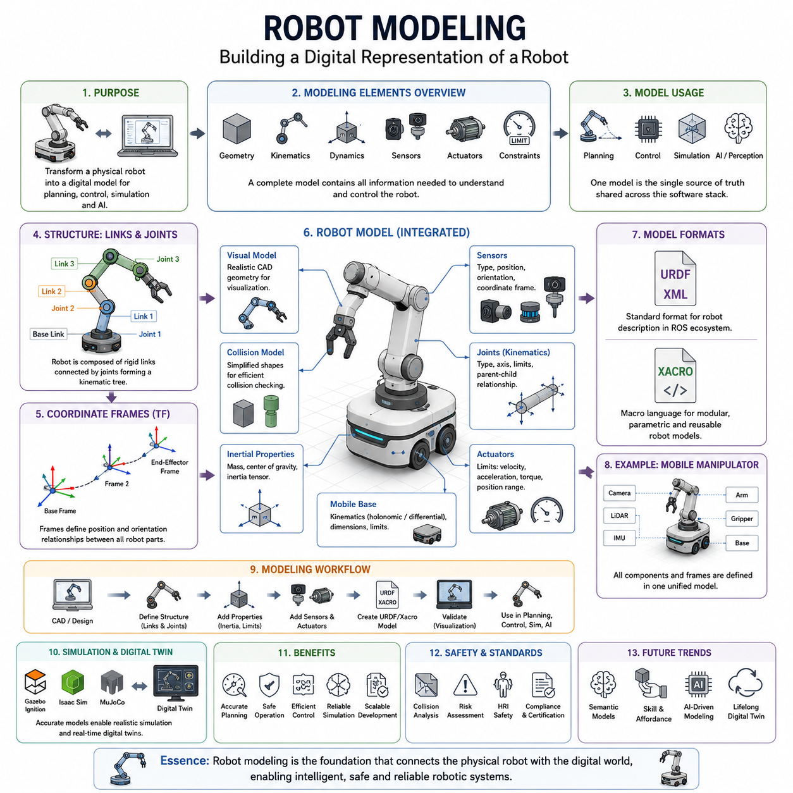{width="7.268055555555556in" height="7.268055555555556in"}

로봇 모델링은 현대 로봇공학의 가장 기본적이고 중요한 분야 중 하나이며, 인식(Perception), 계획(Planning), 제어(Control), 시뮬레이션(Simulation), 자율운용(Autonomous Operation)의 기반이 되는 핵심 기술이다. 로봇이 움직이고, 환경을 인식하며, 물체를 조작하고, 사람과 협업하기 위해서는 먼저 자신에 대한 정확한 디지털 표현을 가져야 한다. 이러한 디지털 표현을 로봇 모델(Robot Model)이라고 한다. MoveIt2, ROS2, 디지털 트윈(Digital Twin), 시뮬레이션 환경, 모바일 매니퓰레이터 분야에서 로봇 모델링은 물리적인 기계를 소프트웨어가 이해하고 분석하며 제어할 수 있는 디지털 객체로 변환하는 과정이다. 적절한 로봇 모델이 없다면 모션 플래닝, 충돌 회피, 기구학 계산, 궤적 생성과 같은 고급 로봇 기능은 수행될 수 없다.

로봇 모델링은 물리적 로봇의 가상 복제본(Virtual Counterpart)을 만드는 과정으로 이해할 수 있다. 이 가상 모델에는 로봇의 구조, 크기, 관절, 센서, 구동기, 질량 특성, 운동 제한 조건 등이 포함된다. 목적은 소프트웨어 시스템이 실제 로봇의 동작을 정확하게 예측하고 제어할 수 있도록 충분한 정보를 제공하는 것이다. 로봇 모델은 시뮬레이터, 모션 플래너, 제어기, 시각화 도구, 인공지능 시스템 등 다양한 소프트웨어 구성요소가 공유하는 공통 언어 역할을 수행한다. 이를 통해 전체 로봇 소프트웨어 스택이 동일한 로봇 구조를 이해할 수 있게 된다.

초기의 산업용 로봇은 고정된 제조 셀(Cell) 내부에서 동작했기 때문에 로봇 모델은 주로 기구학 계산과 오프라인 프로그래밍 용도로 사용되었다. 그러나 모바일 매니퓰레이터, 서비스 로봇, 휴머노이드, Embodied AI 시스템이 등장하면서 로봇 모델링의 복잡성은 크게 증가하였다. 현대의 로봇은 더 이상 고정된 공간에서 반복 작업만 수행하는 기계가 아니다. 사람과 협업하고, 다양한 환경에서 이동하며, 복잡한 의사결정을 수행해야 한다. 따라서 현대의 로봇 모델은 단순한 기하학적 구조를 넘어 훨씬 더 많은 정보를 포함해야 한다.

가장 기본적인 수준에서 로봇 모델은 링크(Link)와 조인트(Joint)로 구성된다. 링크는 로봇의 팔, 프레임, 엔드이펙터, 센서 브래킷, 모바일 베이스와 같은 강체(Rigid Body)를 의미한다. 조인트는 링크와 링크를 연결하며 각 링크가 어떻게 움직일 수 있는지를 정의한다. 링크와 조인트가 결합되어 로봇의 기구학적 구조(Kinematic Structure)를 형성한다. 일반적으로 이러한 구조는 루트 프레임(Root Frame)에서 시작하여 여러 링크와 조인트를 통해 연결되는 트리(Tree) 형태로 표현된다. 로봇의 모든 움직임은 이러한 기구학 체인(Kinematic Chain)을 통해 발생한다.

좌표계(Frame)의 개념은 로봇 모델링에서 매우 중요하다. 로봇의 각 링크는 자신만의 좌표계를 가지며, 이를 통해 다른 링크와의 상대 위치와 방향을 정의한다. 이들 좌표계는 서로 연결되어 변환 관계(Transformation Network)를 형성한다. 로봇팔이 움직이면 각 프레임 간의 관계도 실시간으로 변화한다. 이러한 프레임 관리가 정확해야 비전 시스템이 물체 위치를 계산할 수 있고, 플래너가 경로를 생성할 수 있으며, 제어기가 적절한 명령을 생성할 수 있다. ROS2에서는 TF2가 이러한 좌표 변환을 관리하는 핵심 프레임워크로 사용된다.

로봇 모델링은 단순한 기하학과 기구학만 포함하는 것이 아니다. 동역학(Dynamics) 정보 역시 매우 중요하다. 현실적인 로봇 모델은 질량(Mass), 관성 텐서(Inertia Tensor), 무게중심(Center of Gravity), 마찰 계수(Friction Coefficient), 감쇠(Damping), 구동기 특성 등을 포함해야 한다. 이러한 정보는 로봇이 힘과 토크에 어떻게 반응하는지를 결정한다. 동역학 모델은 고성능 제어, 힘 제어, 물리 기반 시뮬레이션, 정밀 조작 작업 등에 필수적이다. 동역학 정보가 부정확하면 시뮬레이션 결과와 실제 로봇의 움직임이 크게 달라질 수 있다.

현대 로봇 개발에서는 표준화된 로봇 기술서(Description Format)를 사용한다. ROS 생태계에서는 URDF(Unified Robot Description Format)가 사실상의 표준으로 자리 잡고 있다. URDF는 XML 기반 형식으로 링크, 조인트, 시각화 모델, 충돌 모델, 관성 정보, 좌표 관계 등을 정의한다. URDF는 RViz, Gazebo, MoveIt2, ROS2 Control 등 다양한 소프트웨어에서 공통적으로 사용되기 때문에 로봇 소프트웨어 개발의 중심 역할을 수행한다.

하지만 대형 로봇이나 복잡한 로봇 플랫폼에서는 URDF만으로는 관리가 어려운 경우가 많다. 이를 해결하기 위해 Xacro가 개발되었다. Xacro는 URDF를 확장한 매크로 기반 언어로서 변수(Parameter), 재사용 가능한 템플릿, 조건문, 모듈화를 지원한다. 예를 들어 동일한 플랫폼에서 다양한 암 길이, 센서 구성, 휠베이스, 적재 중량을 지원해야 하는 경우 Xacro를 사용하면 하나의 코드베이스로 여러 로봇 모델을 생성할 수 있다.

시각 모델(Visual Model)은 로봇 모델링의 또 다른 중요한 요소이다. 일반적으로 CAD 데이터를 기반으로 생성되며, 시뮬레이션과 시각화 환경에서 실제 로봇과 유사한 외형을 제공한다. 이를 통해 개발자는 디지털 환경에서 로봇 상태를 직관적으로 확인할 수 있으며, 디지털 트윈 구축 시에도 사실적인 표현이 가능하다.

반면 충돌 모델(Collision Model)은 시각 모델과는 다른 목적을 가진다. CAD 모델은 매우 복잡하기 때문에 충돌 검사를 수행하기에는 계산량이 너무 크다. 따라서 충돌 모델은 단순화된 기하학 형태로 구성된다. MoveIt2는 이러한 충돌 모델을 사용하여 경로 계획 과정에서 충돌 여부를 빠르게 검사한다. 적절한 충돌 모델은 계산 성능을 향상시키면서도 안전성을 유지할 수 있게 해준다.

센서 모델링(Sensor Modeling)의 중요성도 점점 커지고 있다. 현대 로봇은 카메라, LiDAR, IMU, Depth Sensor, Force-Torque Sensor, GNSS, Radar 등 다양한 센서를 사용한다. 로봇 모델에는 센서의 위치, 방향, 좌표계 정보가 포함되어야 한다. 이러한 정보가 정확해야 센서 데이터 융합(Sensor Fusion)과 환경 인식이 올바르게 수행될 수 있다. 특히 모바일 매니퓰레이터에서는 센서 배치가 자율주행 성능과 조작 성공률에 직접적인 영향을 미친다.

구동기 모델링(Actuator Modeling) 역시 중요하다. 로봇의 각 관절은 전기 모터, 유압 시스템, 공압 시스템 등의 구동기를 사용한다. 로봇 모델에는 최대 속도, 최대 가속도, 최대 토크, 위치 제한 등의 정보가 포함된다. 이러한 제한 조건은 모션 플래너와 제어기가 반드시 고려해야 하는 요소이며, 실제 하드웨어에서 실행 불가능한 계획이 생성되는 것을 방지한다.

기구학 모델링(Kinematic Modeling)은 로봇 모델링의 수학적 핵심이다. 기구학은 힘을 고려하지 않고 관절 변수와 엔드이펙터 움직임 간의 관계를 설명한다. 순기구학(Forward Kinematics)은 관절값으로부터 엔드이펙터 위치를 계산하며, 역기구학(Inverse Kinematics)은 원하는 위치를 달성하기 위한 관절값을 계산한다. MoveIt2는 이러한 기구학 모델을 기반으로 경로를 생성하고 조작 작업을 수행한다.

모바일 매니퓰레이터에서는 로봇 모델링이 더욱 복잡해진다. 일반적인 모바일 매니퓰레이터는 이동 베이스, 로봇팔, 그리퍼, 센서, 컴퓨팅 시스템, 배터리, 통신 장치 등으로 구성된다. 각각의 구성 요소는 새로운 좌표계와 물리적 제약 조건을 추가한다. 따라서 이 모든 요소를 통합한 하나의 통합 모델(Unified Model)을 구축해야 한다. 이를 통해 이동과 조작을 동시에 고려하는 계획이 가능해진다.

시뮬레이션 역시 로봇 모델링에 크게 의존한다. Gazebo, Ignition Gazebo, NVIDIA Isaac Sim, Webots, MuJoCo와 같은 시뮬레이터는 로봇 모델을 이용하여 물리 현상, 센서 데이터, 환경 상호작용을 재현한다. 개발자는 실제 하드웨어를 사용하기 전에 시뮬레이션 환경에서 알고리즘을 검증할 수 있으며, 이는 비용 절감과 안전성 향상에 크게 기여한다.

디지털 트윈은 로봇 모델링의 발전된 형태라고 볼 수 있다. 디지털 트윈은 단순한 정적 모델이 아니라 실제 로봇의 상태와 지속적으로 동기화되는 가상 모델이다. 센서 데이터, 운영 정보, 유지보수 이력, 성능 지표 등이 지속적으로 반영된다. 로봇 모델은 디지털 트윈의 구조적 기반이 되며, 이를 통해 예측 유지보수, 성능 최적화, 원격 진단, 수명주기 관리가 가능해진다.

최근 AI 기반 로봇 기술이 발전하면서 로봇 모델링의 역할도 확대되고 있다. 비전-언어 모델(VLM), 파운데이션 모델, 로봇 에이전트는 단순한 기하학 정보뿐 아니라 로봇의 기능, 작업 능력, 조작 가능성(Affordance) 등에 대한 의미론적 정보까지 필요로 한다. 미래의 로봇 모델은 구조와 운동학뿐 아니라 로봇이 무엇을 할 수 있는지에 대한 지식까지 포함하게 될 가능성이 높다.

안전성 측면에서도 로봇 모델링은 매우 중요하다. 기능 안전(Function Safety), 충돌 분석, 인간-로봇 상호작용(HRI), 위험성 평가(Risk Assessment), 국제 안전 규격 인증 과정에서 로봇 모델은 필수적인 자료가 된다. 정확한 모델은 안전한 운영 범위를 정의하고 위험 요소를 사전에 분석하는 데 활용된다.

소프트웨어 아키텍처 관점에서 로봇 모델은 전체 시스템의 단일 진실 원천(Single Source of Truth) 역할을 한다. 모션 플래너는 이를 이용하여 경로를 생성하고, 제어기는 이를 기반으로 명령을 생성하며, 시뮬레이터는 이를 사용해 물리 현상을 재현한다. AI 시스템 역시 로봇 모델을 참고하여 의사결정을 수행한다. 따라서 로봇 모델의 정확성과 일관성을 유지하는 것은 로봇 개발에서 가장 중요한 업무 중 하나이다.

향후 휴머노이드 로봇, 협동로봇, 자율주행 차량, 물류 로봇, 의료 로봇, 서비스 로봇이 확산될수록 로봇 모델링의 중요성은 더욱 커질 것이다. 미래의 로봇 모델은 단순한 구조 표현을 넘어 행동, 기술(Skill), 의도(Intent), 환경 관계까지 포함하는 고차원 모델로 발전할 것으로 예상된다.

ROS2와 MoveIt2를 사용하는 엔지니어에게 로봇 모델링은 단순히 개발 초기 단계에서 수행하는 작업이 아니다. 그것은 시뮬레이션, 모션 플래닝, 제어, 안전성, AI 통합의 모든 기반이 되는 핵심 공학 분야이다. 우수한 로봇 모델은 정확한 시뮬레이션과 안정적인 제어, 효율적인 경로 계획을 가능하게 하지만, 잘못된 모델은 계획 실패, 제어 오류, 시뮬레이션 불일치, 안전 문제를 초래할 수 있다.

결국 로봇 모델링은 물리적 현실과 디지털 지능을 연결하는 다리 역할을 한다. 기계 구조물을 소프트웨어가 이해하고 예측하며 제어할 수 있는 디지털 존재로 변환하는 기술이다. 미래의 자율 로봇, 모바일 매니퓰레이션, 디지털 트윈, Embodied AI, 지능형 기계의 발전은 모두 정확하고 체계적인 로봇 모델링 위에서 이루어진다고 할 수 있다.

## 03 Kinematics Plugins

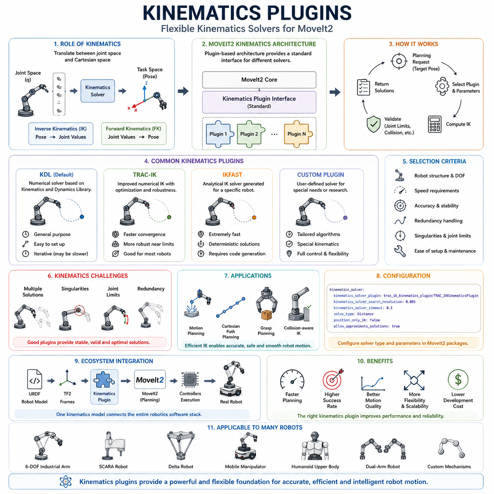{width="7.268055555555556in" height="7.268055555555556in"}

기구학(Kinematics)은 로봇공학의 가장 기본적인 기술 중 하나이며, 모션 플래닝(Motion Planning), 매니퓰레이션(Manipulation), 제어(Control), 자율운용(Autonomous Operation)의 수학적 기반을 제공한다. MoveIt2 환경에서 기구학은 로봇의 관절 상태(Joint Configuration)와 엔드이펙터(End-Effector)의 위치 및 자세 사이의 관계를 계산하는 역할을 수행한다. 로봇이 선반에서 물체를 집거나, 생산라인에서 부품을 조립하거나, 문을 열거나, 복잡한 검사 작업을 수행하는 모든 과정은 정확한 기구학 계산에 의존한다. 로봇마다 기계 구조, 자유도(Degree of Freedom), 작업 공간, 성능 요구사항이 서로 다르기 때문에 MoveIt2는 다양한 기구학 솔버를 유연하게 사용할 수 있도록 플러그인 기반 구조를 채택하고 있으며, 이를 기구학 플러그인(Kinematics Plugin)이라고 부른다.

기구학 플러그인은 특정 로봇의 순기구학(Forward Kinematics)과 역기구학(Inverse Kinematics)을 계산하는 소프트웨어 모듈이다. MoveIt2는 하나의 기구학 솔버만을 강제하지 않고, 표준 인터페이스를 통해 다양한 솔버를 연결할 수 있도록 설계되어 있다. 따라서 개발자는 로봇 구조, 성능 요구사항, 정확도, 계산 자원 등을 고려하여 가장 적합한 솔버를 선택할 수 있다. 이러한 플러그인 구조는 유연성, 확장성, 유지보수성, 그리고 장기적인 호환성을 크게 향상시킨다.

기구학 플러그인의 중요성을 이해하기 위해서는 먼저 기구학 자체를 이해할 필요가 있다. 기구학은 힘과 토크를 고려하지 않고 로봇의 움직임을 수학적으로 분석하는 분야이다. 순기구학은 관절 각도를 입력받아 엔드이펙터의 위치와 자세를 계산하며, 역기구학은 목표 위치와 자세를 달성하기 위해 필요한 관절 값을 계산한다. 순기구학은 일반적으로 계산이 비교적 단순하지만, 역기구학은 다중 해(Multiple Solutions), 특이점(Singularity), 관절 제한(Joint Limits), 다양한 제약 조건이 존재하기 때문에 훨씬 복잡한 문제로 간주된다.

실제 로봇 시스템에서 가장 자주 수행되는 계산 중 하나가 바로 역기구학이다. 로봇이 특정 물체를 집기 위해 그리퍼를 이동시키거나, 공구를 정렬하거나, 카메라를 특정 방향으로 향하게 하거나, 작업 경로를 따라 이동할 때마다 역기구학 계산이 수행된다. 따라서 역기구학 솔버의 성능은 전체 로봇 시스템의 응답성, 계획 속도, 작업 성공률에 직접적인 영향을 미친다.

MoveIt2는 이러한 문제를 해결하기 위해 기구학 플러그인 프레임워크를 제공한다. 이 프레임워크는 다양한 솔버가 동일한 인터페이스를 통해 동작할 수 있도록 정의되어 있다. 따라서 개발자는 MoveIt2의 핵심 코드를 수정하지 않고도 새로운 기구학 알고리즘을 쉽게 추가할 수 있다. 이러한 모듈화 구조는 연구 개발뿐 아니라 산업용 로봇 시스템에서도 매우 중요한 장점으로 작용한다.

MoveIt2에서 가장 널리 사용되는 기구학 플러그인 중 하나는 KDL(Kinematics and Dynamics Library)이다. KDL은 수치해석(Numerical Method) 기반의 기구학 계산 라이브러리로서 다양한 로봇 구조를 지원한다. 별도의 코드 생성 과정 없이 URDF 모델만 정의하면 바로 사용할 수 있기 때문에 개발 초기 단계에서 매우 편리하다. 안정성과 범용성이 뛰어나며, 많은 연구 프로젝트와 산업용 시스템에서 기본 솔버로 사용된다. 그러나 반복 계산을 수행하는 수치해석 방식의 특성상 매우 빠른 응답이 요구되는 응용에서는 성능 한계가 존재할 수 있다.

Trac-IK는 KDL을 개선한 형태의 역기구학 솔버로 널리 사용된다. Trac-IK는 최적화 기반 탐색 알고리즘과 향상된 수치해석 기법을 결합하여 더 빠르고 안정적인 해를 찾을 수 있도록 설계되었다. 특히 관절 제한 근처나 복잡한 작업 공간에서 KDL보다 높은 성공률을 보이는 경우가 많다. 따라서 산업용 매니퓰레이터와 연구용 로봇에서 Trac-IK를 선호하는 경우가 많다.

최고 수준의 성능이 필요한 경우 IKFast가 자주 사용된다. IKFast는 수치해석 기반이 아니라 해석적(Analytical) 기구학 솔버이다. 로봇의 기구학 구조를 분석하여 특정 로봇 전용 코드를 자동 생성한다. 생성된 코드는 역기구학을 매우 빠르게 계산할 수 있으며, 일반적인 수치해석 방식보다 수십 배에서 수백 배 빠른 성능을 제공할 수 있다. 이러한 특성 때문에 고속 모션 플래닝, 실시간 조작, 대규모 경로 탐색 문제에서 매우 유용하다. 그러나 설정 과정이 복잡하며, 모든 로봇 구조에 대해 해석적 해를 생성할 수 있는 것은 아니다.

수치해석 방식과 해석적 방식의 선택은 로봇 시스템 설계에서 중요한 의사결정 중 하나이다. 수치해석 기반 솔버는 유연성과 범용성이 뛰어나지만 계산 시간이 더 길 수 있다. 반면 해석적 솔버는 매우 빠르지만 로봇 구조에 따라 적용이 제한될 수 있다. MoveIt2의 플러그인 구조는 이러한 다양한 요구사항을 수용할 수 있도록 설계되어 있다.

역기구학 계산에서 자주 발생하는 문제 중 하나는 다중 해(Multiple Solutions)이다. 예를 들어 6축 로봇팔은 동일한 위치와 자세를 여러 가지 관절 조합으로 달성할 수 있다. 인간의 팔도 같은 물체를 잡을 때 팔꿈치 방향을 다르게 하여 동일한 목표를 달성할 수 있다. 기구학 플러그인은 이러한 여러 해 중에서 가장 적절한 해를 선택해야 한다. 선택 기준으로는 현재 관절 상태와의 거리, 에너지 효율, 충돌 가능성, 조작성(Manipulability), 관절 제한 여유도 등이 사용될 수 있다.

특이점(Singularity)은 기구학 계산에서 또 다른 중요한 문제이다. 특이점은 특정 자세에서 로봇이 일부 자유도를 상실하는 현상을 의미한다. 특이점 근처에서는 엔드이펙터를 조금만 움직여도 관절이 매우 크게 움직여야 할 수 있으며, 제어 성능이 급격히 저하될 수 있다. 우수한 기구학 플러그인은 이러한 특이점을 탐지하고 회피하거나 안정적으로 처리할 수 있는 기능을 제공한다.

관절 제한(Joint Limits) 역시 중요한 고려 요소이다. 모든 실제 로봇은 각 관절마다 허용 가능한 회전 범위를 가진다. 수학적으로는 가능한 해가 존재하더라도 실제 로봇에서는 해당 자세를 만들 수 없는 경우가 있다. 따라서 기구학 플러그인은 관절 제한을 고려하여 현실적으로 실행 가능한 해만을 선택해야 한다.

현대 로봇에서는 중복 자유도(Redundancy)가 자주 사용된다. 예를 들어 7축 로봇은 동일한 목표 자세를 무수히 많은 방법으로 달성할 수 있다. 이러한 중복 자유도는 장애물 회피, 자세 최적화, 에너지 절감 등의 장점을 제공하지만 동시에 계산 복잡도를 증가시킨다. 따라서 기구학 플러그인은 여러 가능한 해 중에서 가장 적합한 해를 선택하기 위한 최적화 기법을 포함해야 한다.

모바일 매니퓰레이터에서는 기구학 문제가 더욱 복잡해진다. 일반적인 산업용 로봇은 고정된 베이스를 가정하지만, 모바일 매니퓰레이터는 이동 플랫폼과 로봇팔이 결합되어 있다. 따라서 목표 위치에 도달하기 위해 로봇팔뿐 아니라 모바일 베이스도 함께 움직여야 한다. 미래의 기구학 플러그인은 전체 로봇 몸체(Whole-Body Kinematics)를 고려하여 이동과 조작을 동시에 계획하는 방향으로 발전하고 있다. 이러한 기능은 물류 자동화, 서비스 로봇, 휴머노이드, 야외 작업 로봇에서 특히 중요하다.

MoveIt2는 하나의 로봇 내에서도 서로 다른 기구학 플러그인을 사용할 수 있다. 예를 들어 로봇팔에는 Trac-IK를 사용하고, 팬틸트 카메라 시스템에는 KDL을 사용하며, 특수 엔드이펙터에는 별도의 사용자 정의 솔버를 적용할 수 있다. 이러한 유연성은 복잡한 로봇 시스템 설계에 큰 장점을 제공한다.

기구학 플러그인의 설정은 일반적으로 MoveIt2 Configuration Package를 통해 이루어진다. 개발자는 사용할 솔버를 지정하고, 오차 허용 범위, 탐색 시간 제한, 중복 자유도 처리 방식, 탐색 해상도 등의 매개변수를 조정할 수 있다. 적절한 파라미터 튜닝은 계획 성능과 작업 성공률을 크게 향상시킨다.

Cartesian Path Planning에서도 기구학 플러그인은 중요한 역할을 수행한다. 엔드이펙터가 직선 또는 곡선 경로를 따라 이동할 때 경로상의 모든 지점에 대해 역기구학 계산이 수행되어야 한다. 효율적인 기구학 플러그인은 이러한 계산을 실시간으로 수행하여 부드럽고 정확한 경로 생성을 가능하게 한다.

최근에는 충돌 인식 역기구학(Collision-Aware Inverse Kinematics)에 대한 연구도 활발하게 진행되고 있다. 기존의 역기구학 솔버는 목표 위치에 도달하는 것만 고려했지만, 최신 솔버는 계산 과정에서 충돌 여부도 함께 고려한다. 이를 통해 장애물이 많은 환경에서도 더 안전하고 효율적인 경로를 생성할 수 있다.

Gazebo, Isaac Sim, MuJoCo, Webots와 같은 시뮬레이션 환경에서도 기구학 플러그인은 중요한 역할을 한다. 시뮬레이션에서 사용되는 기구학 모델과 실제 로봇에서 사용되는 모델이 동일하기 때문에 개발자는 가상 환경에서 검증한 결과를 실제 시스템에 그대로 적용할 수 있다.

디지털 트윈 환경에서도 정확한 기구학 모델은 필수적이다. 디지털 트윈은 실제 로봇의 상태를 실시간으로 반영하는 가상 모델이다. 기구학 플러그인은 가상 로봇의 움직임이 실제 로봇과 일치하도록 보장하며, 이를 통해 예측 분석, 원격 모니터링, 성능 최적화가 가능해진다.

최근에는 인공지능 기술도 기구학 계산에 활용되기 시작했다. 딥러닝 기반 역기구학 모델은 기존의 수치해석 방식보다 더 빠르게 해를 예측할 수 있으며, 특이점 예측, 솔버 선택, 경로 최적화 등의 분야에서도 연구가 진행되고 있다. 미래의 기구학 플러그인은 해석적 방법, 수치해석 방법, AI 기반 예측 기술을 결합한 하이브리드 구조로 발전할 가능성이 높다.

산업 현장에서는 기구학 플러그인의 선택이 생산성에 직접적인 영향을 미친다. 빠른 역기구학 계산은 모션 플래닝 지연 시간을 줄여 처리량을 증가시키고, 높은 성공률은 시스템 가동률을 향상시킨다. 또한 우수한 중복 자유도 처리는 더 부드러운 움직임과 낮은 기계적 마모를 제공한다. 따라서 기구학 플러그인의 선택은 단순한 소프트웨어 설정이 아니라 전략적인 엔지니어링 결정이라고 할 수 있다.

향후 휴머노이드, 협동로봇, 모바일 매니퓰레이터, Embodied AI 시스템이 발전할수록 기구학 문제는 더욱 복잡해질 것이다. 수십 개 이상의 자유도를 가진 로봇이 등장하면서 더욱 강력하고 지능적인 기구학 솔버가 요구될 것이다. MoveIt2의 플러그인 기반 구조는 이러한 미래 요구사항에 대응할 수 있는 확장 가능한 기반을 제공한다.

결국 기구학 플러그인은 고수준의 작업 목표를 실제 로봇이 실행 가능한 관절 상태로 변환하는 수학적 지능 계층(Mathematical Intelligence Layer)이라고 할 수 있다. 이는 기하학과 움직임을 연결하고, 계획과 실행을 연결하며, 소프트웨어 지능과 물리적 행동을 연결한다. 강력한 기구학 플러그인이 없다면 고급 모션 플래닝, 자율 조작, 지능형 로봇 행동은 실현될 수 없다. 따라서 MoveIt2 기반의 현대 로봇 시스템을 개발하는 엔지니어에게 기구학 플러그인에 대한 이해는 고성능, 고신뢰성, 확장 가능한 로봇 조작 시스템 구축을 위한 필수 역량이라고 할 수 있다.

## 04 Motion Planning Framework

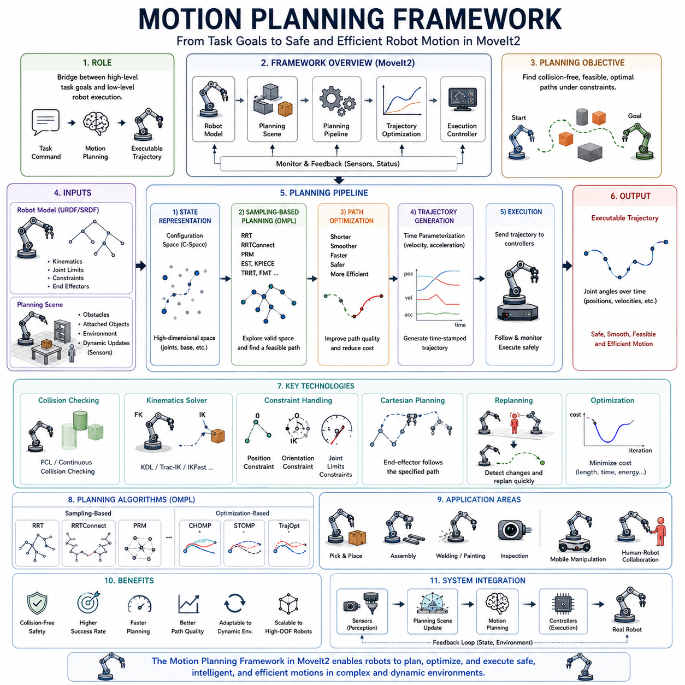{width="7.268055555555556in" height="7.268055555555556in"}

모션 플래닝(Motion Planning)은 로봇이 하나의 상태에서 다른 상태로 지능적으로 이동할 수 있도록 해주는 핵심 기술이다. 로봇이 이동하는 과정에서 물리적 제약 조건, 환경적 제약 조건, 그리고 작업상의 요구사항을 모두 만족해야 하므로 모션 플래닝은 현대 로봇 시스템의 가장 중요한 기능 중 하나로 평가된다. 현대 로봇 시스템에서 모션 플래닝은 상위 수준의 작업 목표와 실제 로봇의 움직임을 연결하는 역할을 수행한다. 예를 들어 로봇이 "상자를 집어라", "설비를 검사하라", "부품을 조립하라", "충전 스테이션으로 이동하라"와 같은 명령을 받았을 때, 이러한 명령은 무엇을 해야 하는지는 알려주지만 어떻게 움직여야 하는지는 설명하지 않는다. 바로 이 부분을 담당하는 것이 모션 플래닝 프레임워크이다. MoveIt2 환경에서 Motion Planning Framework는 충돌이 없는 안전한 경로를 생성하고 이를 실제 로봇이 실행할 수 있는 형태로 변환하는 핵심 엔진 역할을 수행한다.

가장 기본적인 관점에서 모션 플래닝은 탐색(Search) 문제로 볼 수 있다. 로봇은 현재 상태에서 목표 상태까지 이동해야 하며, 그 과정에서 장애물을 피하고 모든 제약 조건을 만족해야 한다. 단순한 2차원 경로 탐색과 달리 로봇의 모션 플래닝은 고차원 구성 공간(Configuration Space, C-Space)에서 이루어진다. 예를 들어 6축 산업용 로봇은 6차원 공간에서 움직이며, 모바일 매니퓰레이터나 휴머노이드는 수십 개의 자유도를 가지므로 훨씬 더 복잡한 공간을 다루어야 한다. 자유도가 증가할수록 가능한 상태의 수는 기하급수적으로 증가하기 때문에 효율적인 알고리즘이 필수적이다.

MoveIt2의 Motion Planning Framework는 계획 알고리즘과 로봇 구현을 분리하는 모듈형 구조를 제공한다. 이를 통해 개발자는 다양한 플래닝 알고리즘, 최적화 기법, 충돌 검사기, 실행 제어기를 자유롭게 선택할 수 있다. 프레임워크는 로봇 모델, 기구학 솔버, 충돌 검사 시스템, 플래닝 씬(Planning Scene), 경로 생성기, 궤적 최적화기, 실행 제어기 등을 하나의 통합 파이프라인으로 구성한다.

모션 플래닝은 먼저 로봇 모델(Robot Model)로부터 시작된다. 플래너는 로봇의 물리적 구조, 관절 제한, 작업 공간 범위, 운동학적 제약 조건 등을 이해해야 한다. 이러한 정보는 일반적으로 URDF와 SRDF 파일을 통해 제공된다. 로봇 모델은 실제 로봇을 수학적으로 표현한 것이며, 생성되는 모든 경로는 이 모델이 정의하는 제약 조건을 반드시 따라야 한다.

그 다음 중요한 요소는 플래닝 씬(Planning Scene)이다. 플래닝 씬은 로봇이 현재 환경을 어떻게 이해하고 있는지를 표현하는 디지털 환경 모델이다. 여기에는 벽, 선반, 장비, 공작물, 작업자, 이동 장애물, 로봇이 집고 있는 물체 등의 정보가 포함된다. 플래닝 씬은 정적인 데이터가 아니라 센서 정보를 통해 지속적으로 업데이트될 수 있다. 카메라, LiDAR, Depth Sensor, 비전 시스템 등이 새로운 환경 정보를 제공하면 플래너는 이를 반영하여 경로를 재계산할 수 있다. 이러한 기능은 창고, 병원, 공장, 서비스 환경과 같이 지속적으로 변화하는 공간에서 매우 중요하다.

모션 플래닝은 본질적으로 두 가지 질문에 답해야 한다. 첫 번째는 "유효한 경로가 존재하는가?"이고, 두 번째는 "여러 가능한 경로 중 어떤 경로가 가장 좋은가?"이다. 동일한 목표를 달성하는 경로는 여러 개가 존재할 수 있으며, 어떤 경로는 더 짧고, 더 빠르고, 더 안전하며, 더 적은 에너지를 사용할 수 있다. 따라서 모션 플래닝은 단순한 경로 탐색 문제가 아니라 최적화 문제(Optimization Problem)로도 볼 수 있다.

모션 플래닝에서 가장 중요한 개념 중 하나는 구성 공간(Configuration Space, C-Space)이다. 플래너는 실제 작업 공간에서 직접 계산하는 대신 관절 각도, 모바일 베이스 위치와 같은 상태 변수로 로봇을 표현한다. 구성 공간의 각 점은 하나의 로봇 자세를 의미한다. 충돌이 발생하는 영역은 비유효 영역(Invalid Region)이며, 충돌이 없는 영역은 유효 영역(Valid Region)이다. 플래너의 목표는 시작 상태와 목표 상태를 연결하는 연속적인 유효 경로를 찾는 것이다.

고차원 공간에서는 모든 상태를 탐색하는 것이 현실적으로 불가능하기 때문에 샘플링 기반(Sampling-Based) 알고리즘이 널리 사용된다. 샘플링 기반 플래너는 가능한 상태를 무작위로 생성하면서 경로를 탐색한다. 이러한 방법은 수십 개 이상의 자유도를 가진 로봇에서도 현실적인 시간 내에 경로를 생성할 수 있다.

MoveIt2는 주로 OMPL(Open Motion Planning Library)을 사용하여 경로를 생성한다. OMPL은 다양한 모션 플래닝 알고리즘을 제공하는 대표적인 라이브러리이다. 그 중 가장 유명한 알고리즘은 RRT(Rapidly Exploring Random Tree)이다. RRT는 시작점에서부터 트리를 확장하면서 무작위로 샘플링된 상태를 연결해 나간다. 이를 통해 넓은 공간을 효율적으로 탐색할 수 있다.

RRT의 발전형인 RRTConnect는 시작점과 목표점에서 동시에 트리를 생성한다. 두 트리가 만나면 완전한 경로가 형성된다. RRTConnect는 속도와 품질의 균형이 뛰어나기 때문에 산업용 로봇에서 가장 널리 사용되는 플래닝 알고리즘 중 하나이다.

PRM(Probabilistic Roadmap)은 또 다른 대표적인 알고리즘이다. RRT가 단일 질의(Single Query)에 적합한 반면, PRM은 환경 내에 재사용 가능한 경로 그래프를 생성한다. 따라서 동일한 환경에서 반복적으로 경로를 계산해야 하는 제조 공정이나 물류 창고 환경에 매우 적합하다.

OMPL은 이 외에도 EST, KPIECE, LBKPIECE, TRRT, FMT와 같은 다양한 알고리즘을 제공한다. 각각의 알고리즘은 속도, 메모리 사용량, 경로 품질, 탐색 효율성, 안정성 측면에서 서로 다른 특성을 가진다. MoveIt2는 이러한 알고리즘을 자유롭게 교체할 수 있는 구조를 제공한다.

플래너가 생성한 초기 경로는 반드시 최적이라고 할 수 없다. 경로가 불필요하게 길거나, 갑작스러운 방향 전환이 많거나, 비효율적인 관절 움직임을 포함할 수 있다. 따라서 모션 플래닝 프레임워크는 일반적으로 경로 최적화(Path Optimization) 과정을 수행한다. 이를 통해 경로 길이를 줄이고, 움직임을 부드럽게 하며, 실행 시간을 단축하고, 에너지 소비를 감소시킨다.

최근에는 최적화 기반 플래닝(Trajectory Optimization) 기법도 널리 사용된다. CHOMP, STOMP, TrajOpt와 같은 알고리즘은 경로를 수학적 최적화 문제로 정의하고 반복적으로 개선해 나간다. 이러한 방식은 일반적으로 더 부드럽고 효율적인 경로를 생성할 수 있지만 계산 비용이 상대적으로 높다.

실제 환경에서는 다양한 제약 조건을 고려해야 한다. 로봇이 액체가 담긴 트레이를 운반할 경우 수평 자세를 유지해야 하며, 용접 로봇은 특정 궤적을 따라 이동해야 한다. 의료 로봇은 지정된 안전 영역을 벗어나면 안 된다. 모션 플래닝 프레임워크는 위치 제약, 자세 제약, 속도 제한, 작업 공간 제한 등을 모두 만족하는 경로를 생성해야 한다.

Cartesian Path Planning은 특히 조작 작업에서 중요하다. 일반적인 플래닝은 목표 자세에 도달하는 것을 목표로 하지만, Cartesian Planning은 엔드이펙터가 작업 공간 내 특정 경로를 정확하게 따라가도록 한다. 이는 용접, 도장, 절삭, 연마, 조립, 검사와 같은 산업 작업에 필수적이다.

충돌 검사는 모션 플래닝의 모든 단계에 통합되어 있다. MoveIt2는 일반적으로 FCL(Flexible Collision Library)을 사용하여 충돌 여부를 계산한다. 최신 시스템은 연속 충돌 검사(Continuous Collision Checking)를 통해 경로의 모든 구간을 평가하며, 단순히 몇 개의 점만 검사하는 방식보다 훨씬 높은 안전성을 제공한다.

모바일 매니퓰레이터에서는 문제의 복잡성이 더욱 증가한다. 로봇팔만 움직이는 것이 아니라 모바일 베이스까지 함께 고려해야 하기 때문이다. 목표 물체를 집기 위해 먼저 베이스를 이동해야 할 수도 있다. 따라서 최신 모션 플래닝 프레임워크는 Whole-Body Planning을 지원하여 이동과 조작을 동시에 계획한다. 이는 물류 로봇, 서비스 로봇, 휴머노이드에서 매우 중요한 기능이다.

실시간 플래닝(Real-Time Planning)도 중요한 과제이다. 사람이 갑자기 나타나거나, 지게차가 지나가거나, 다른 로봇이 경로를 가로막을 수 있다. 이러한 상황에서는 기존 경로를 빠르게 수정하거나 재생성해야 한다. 최신 플래너는 전체 경로를 처음부터 다시 계산하는 대신 부분적으로 수정하는 재계획(Replanning) 기능을 제공한다.

현대 로봇에서는 인식(Perception)과 계획(Planning)의 통합이 필수적이다. 비전 시스템과 센서는 지속적으로 환경 정보를 제공하고, 플래너는 이를 기반으로 새로운 경로를 생성한다. 이러한 폐루프(Closed Loop) 구조는 변화하는 환경에서도 안정적인 자율 동작을 가능하게 한다.

시뮬레이션은 모션 플래닝 개발에서 매우 중요한 역할을 수행한다. Gazebo, Isaac Sim, MuJoCo, Webots와 같은 시뮬레이터에서 경로 계획 알고리즘을 검증할 수 있다. 실제 하드웨어를 사용하기 전에 성능과 안전성을 평가할 수 있기 때문에 개발 비용과 위험을 크게 줄일 수 있다.

디지털 트윈(Digital Twin)은 모션 플래닝의 활용 범위를 더욱 확장한다. 디지털 트윈은 실제 로봇과 환경을 가상 공간에 실시간으로 복제한다. 플래너는 먼저 디지털 트윈에서 경로를 검증한 후 실제 로봇에 적용할 수 있다. 이를 통해 위험을 줄이고 운영 효율을 향상시킬 수 있다.

최근에는 인공지능이 모션 플래닝에도 영향을 미치고 있다. 기존 플래너는 기하학적 문제를 해결하는 데 강점을 가지지만, 의미론적 이해(Semantic Understanding)는 부족하다. AI는 환경 변화 예측, 작업 성공 가능성 평가, 목표 생성, 상황 판단 등의 기능을 제공할 수 있다. 앞으로는 비전-언어 모델(VLM), 파운데이션 모델, 로봇 에이전트와 모션 플래너가 결합된 하이브리드 구조가 더욱 보편화될 것으로 예상된다.

산업 현장에서 모션 플래닝은 생산성, 안전성, 운영 효율성을 직접 결정하는 핵심 요소이다. 빠른 플래너는 생산성을 향상시키고, 우수한 최적화는 사이클 타임을 단축하며, 강력한 충돌 회피 기능은 안전성을 높인다. 따라서 Motion Planning Framework는 로봇 소프트웨어 아키텍처에서 가장 중요한 구성 요소 중 하나로 간주된다.

향후 모바일 매니퓰레이터, 휴머노이드, 협동로봇, Embodied AI 시스템이 발전함에 따라 모션 플래닝 프레임워크도 더욱 진화할 것이다. 미래의 프레임워크는 다중 로봇 협업, 의미 기반 추론, 학습 기반 계획, 환경 적응형 최적화 등을 지원하게 될 것이다.

결국 Motion Planning Framework는 목표를 실제 움직임으로 변환하는 로봇의 의사결정 엔진(Decision-Making Engine)이라고 할 수 있다. 로봇 모델링, 기구학, 충돌 회피, 경로 최적화, 환경 인식, 실행 제어를 하나의 통합 시스템으로 결합하며, MoveIt2에서 로봇이 안전하고 효율적으로 움직일 수 있도록 만드는 핵심 기술이다. 현대 로봇 엔지니어에게 모션 플래닝 프레임워크에 대한 이해는 자율 조작, 지능형 행동, 모바일 매니퓰레이션을 구현하기 위한 필수 역량이라고 할 수 있다.

## 05 Collision Checking

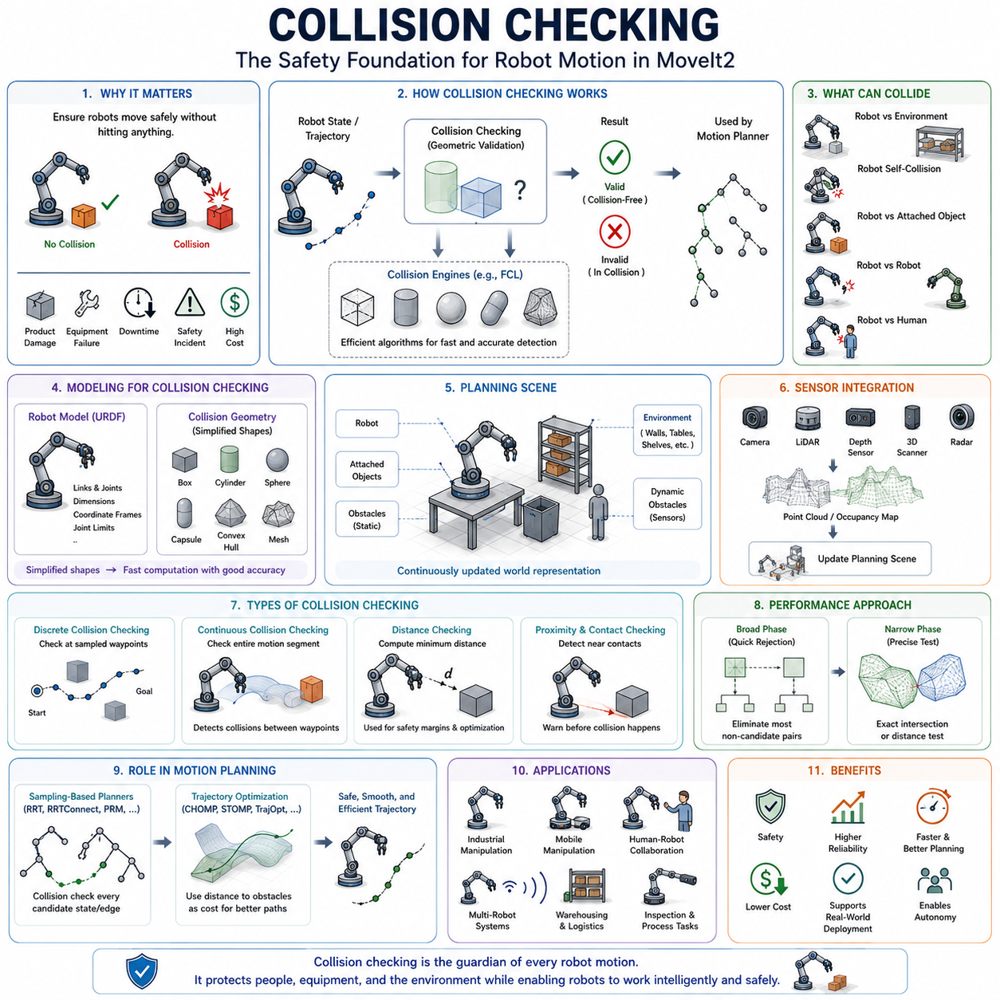{width="7.268055555555556in" height="7.268055555555556in"}

충돌 검사(Collision Checking)는 로봇 모션 플래닝과 자율 조작 시스템에서 가장 중요한 핵심 기술 중 하나이다. 아무리 뛰어난 인공지능을 갖춘 로봇이라 하더라도, 아무리 정확한 인식 시스템과 정교한 계획 알고리즘을 보유하고 있더라도 충돌을 정확하게 감지하고 회피할 수 없다면 안전하게 작업을 수행할 수 없다. MoveIt2 환경에서 충돌 검사는 생성된 모든 움직임이 물리적으로 실행 가능하며, 환경·설비·작업물·다른 로봇·사람과의 의도하지 않은 접촉이 발생하지 않도록 보장하는 안전성의 기반 기술이다. 다시 말해 충돌 검사는 수학적으로 생성된 경로를 실제 세계에서 안전하게 실행 가능한 동작으로 변환하는 핵심 역할을 수행한다.

로봇공학에서 충돌은 두 개 이상의 물체가 동일한 공간을 동시에 점유할 때 발생한다. 이러한 충돌은 로봇과 장애물 사이에서 발생할 수도 있고, 로봇의 서로 다른 링크끼리 충돌할 수도 있으며, 여러 대의 로봇 간 간섭이나 인간과의 위험한 접촉 형태로 나타날 수도 있다. 작은 충돌이라도 제품 손상, 설비 고장, 생산 중단, 안전 사고, 유지보수 비용 증가로 이어질 수 있기 때문에 현대 로봇 시스템은 충돌 감지와 충돌 회피를 매우 중요한 요소로 다루고 있다.

충돌 검사는 기본적으로 기하학적 검증(Geometric Validation) 과정이다. 로봇의 특정 자세 또는 경로가 주어지면, 충돌 검사 시스템은 로봇의 어느 부분이든 환경 내 다른 물체와 겹치는지를 계산한다. 만약 교차가 발생하면 해당 자세는 유효하지 않은 상태로 판단되며 모션 플래너는 이를 사용할 수 없다. 이후 플래너는 목표를 달성하면서도 충돌이 발생하지 않는 새로운 경로를 탐색하게 된다.

로봇이 점점 더 자율화되고 동적인 환경에서 작업하게 되면서 충돌 검사의 중요성은 더욱 커지고 있다. 전통적인 산업용 로봇은 안전 펜스 내부의 고정된 작업 셀에서 동작했기 때문에 환경 변화가 거의 없었다. 따라서 기계 설계와 물리적 차단장치만으로도 충돌 위험을 상당 부분 제거할 수 있었다. 그러나 현대의 로봇은 물류창고, 병원, 공항, 연구소, 공공시설, 서비스 환경, 야외 환경 등에서 사람과 함께 작업한다. 이러한 환경에서는 장애물이 수시로 이동하고 사람이 예기치 않게 나타날 수 있기 때문에 충돌 검사는 정적인 검증 기능이 아니라 실시간 안전 시스템으로 동작해야 한다.

MoveIt2는 충돌 검사를 모션 플래닝 프레임워크의 핵심 구성 요소로 통합하고 있다. 모션 계획 과정에서 생성되는 모든 후보 경로는 충돌 검증을 통과해야만 유효한 경로로 인정된다. 실제로 플래닝 과정에서는 수천 개에서 수백만 개에 이르는 후보 상태가 생성될 수 있으며, 각각에 대해 충돌 여부를 검사한다. 충돌이 없는 상태만이 경로 생성에 사용될 수 있기 때문에 충돌 검사는 단순한 사후 검증이 아니라 계획 과정 자체에 깊게 통합되어 있다.

충돌 검사의 시작점은 정확한 로봇 모델이다. 충돌을 계산하기 위해서는 먼저 로봇의 물리적 구조를 알아야 한다. 로봇 모델에는 링크, 조인트, 형상 정보, 크기, 좌표계 관계가 정의되어 있다. MoveIt2에서는 일반적으로 URDF와 SRDF를 사용하여 이러한 정보를 정의한다. 시각화 모델은 외형 표현을 위해 매우 정교하게 구성되지만, 충돌 검사용 모델은 계산 성능을 위해 단순화된 구조를 사용한다.

충돌 형상(Collision Geometry)은 충돌 검사 성능에 직접적인 영향을 미친다. 실제 CAD 모델은 수십만 개 이상의 폴리곤으로 구성될 수 있기 때문에 이를 그대로 충돌 검사에 사용하면 계산 비용이 매우 커진다. 따라서 충돌 모델은 박스(Box), 원통(Cylinder), 구(Sphere), 캡슐(Capsule), Convex Hull과 같은 단순한 기하학적 구조로 표현된다. 이러한 단순화는 계산 속도를 크게 향상시키면서도 충분한 정확도를 유지할 수 있게 해준다.

가장 기본적인 충돌 검사 형태는 자기 충돌(Self-Collision Detection)이다. 로봇은 여러 개의 링크로 구성되어 있기 때문에 특정 자세에서는 자신의 링크끼리 충돌할 수 있다. 예를 들어 로봇팔이 지나치게 접히면서 상완부와 전완부가 겹칠 수 있다. 자기 충돌 검사는 이러한 상황을 탐지하여 안전하지 않은 자세가 계획되지 않도록 한다. 자유도가 높은 로봇일수록 자기 충돌 검사는 더욱 중요해진다.

환경 충돌(Environment Collision Checking)은 로봇과 외부 물체 간의 충돌을 검사하는 기능이다. 작업 테이블, 벽, 선반, 장비, 차량, 파렛트, 컨테이너 등 다양한 환경 요소가 여기에 포함된다. 플래너는 로봇이 목표 위치까지 이동하는 과정에서 이러한 물체와 접촉하지 않도록 경로를 생성해야 한다. 환경이 복잡할수록 충돌 검사 알고리즘의 효율성이 중요해진다.

부착 물체 충돌 검사(Attached Object Collision Checking)는 더욱 복잡한 문제를 다룬다. 로봇이 물체를 집으면 그 물체는 로봇의 일부로 간주된다. 예를 들어 로봇이 대형 박스를 집은 상태라면 로봇의 실제 점유 공간은 크게 증가한다. 충돌 검사 시스템은 로봇뿐만 아니라 부착된 물체의 크기와 위치까지 고려해야 한다. 이를 무시하면 로봇 자체는 충돌하지 않더라도 운반 중인 물체가 장애물과 충돌할 수 있다.

MoveIt2에서 플래닝 씬(Planning Scene)은 충돌 검사의 중심 역할을 수행한다. 플래닝 씬은 로봇, 환경 장애물, 부착 물체, 작업 공간 제약 조건 등을 포함하는 디지털 환경 모델이다. 이는 로봇이 현재 환경을 어떻게 인식하고 있는지를 나타내며, 센서 정보에 따라 지속적으로 업데이트될 수 있다.

현대의 충돌 검사는 센서와 긴밀하게 연동된다. 카메라, LiDAR, Depth Sensor, Stereo Vision, Radar, 3D Scanner 등이 환경 정보를 수집하고 이를 플래닝 씬에 반영한다. 이러한 기능을 통해 로봇은 새롭게 등장한 장애물을 인식하고 실시간으로 경로를 수정할 수 있다. 자율주행 모바일 매니퓰레이터에서는 이러한 동적 장애물 대응 기능이 필수적이다.

MoveIt2는 주로 FCL(Flexible Collision Library)을 충돌 검사 엔진으로 사용한다. FCL은 로봇 응용을 위해 설계된 고성능 충돌 검사 라이브러리로서 다양한 기하학 형상을 지원하며, 충돌 감지, 거리 계산, 근접성 분석 기능을 제공한다. 높은 성능과 안정성 덕분에 로봇 분야에서 가장 널리 사용되는 충돌 검사 라이브러리 중 하나로 자리 잡았다.

충돌 검사는 일반적으로 Broad Phase와 Narrow Phase의 두 단계로 수행된다. Broad Phase에서는 충돌 가능성이 있는 물체 쌍을 빠르게 추려낸다. 이후 Narrow Phase에서는 실제 기하학 계산을 수행하여 실제 충돌 여부를 판단한다. 이러한 2단계 구조는 계산 효율성과 정확성을 동시에 확보할 수 있게 한다.

거리 계산(Distance Checking)은 충돌 검사와 밀접한 관계를 가진다. 단순히 충돌 여부만 판단하는 것이 아니라 두 물체 간의 최소 거리를 계산하는 것이다. 거리 정보는 안전 여유(Safety Margin)를 설정하고, 더 안전한 경로를 생성하며, 최적화 과정에서 활용될 수 있다. 산업 현장에서는 충돌을 피하는 것뿐 아니라 일정 이상의 이격 거리를 유지하는 것이 매우 중요하다.

연속 충돌 검사(Continuous Collision Checking)는 기존의 이산 충돌 검사보다 훨씬 높은 수준의 안전성을 제공한다. 이산 충돌 검사는 경로상의 일부 지점만 검사하기 때문에 두 지점 사이에서 발생하는 충돌을 놓칠 수 있다. 반면 연속 충돌 검사는 경로 전체를 평가하여 중간 구간에서 발생하는 충돌까지 탐지할 수 있다. 특히 고속 로봇 시스템에서는 매우 중요한 기능이다.

충돌 검사는 모션 플래닝 알고리즘과 밀접하게 연계된다. RRT, RRTConnect, PRM과 같은 샘플링 기반 플래너는 새로운 상태를 생성할 때마다 충돌 검사를 수행한다. 실제로 모션 플래닝에서 사용되는 계산 시간의 상당 부분이 충돌 검사에 소비된다. 따라서 충돌 검사 성능은 전체 플래닝 성능에 직접적인 영향을 준다.

CHOMP, STOMP, TrajOpt와 같은 최적화 기반 플래너 역시 충돌 정보를 적극적으로 활용한다. 이러한 알고리즘은 충돌을 단순한 금지 조건으로 처리하지 않고 장애물과의 거리를 비용 함수(Cost Function)로 사용한다. 이를 통해 장애물과 충분한 거리를 유지하면서도 효율적인 경로를 생성할 수 있다.

모바일 매니퓰레이터에서는 충돌 문제가 더욱 복잡하다. 로봇팔뿐 아니라 모바일 베이스까지 고려해야 하기 때문이다. 팔만 보면 안전한 경로라도 베이스까지 포함하면 충돌이 발생할 수 있다. 따라서 모바일 매니퓰레이터에서는 전체 로봇을 하나의 시스템으로 간주하는 Whole-Body Collision Checking이 필요하다. 이는 물류 자동화, 서비스 로봇, 실외 자율주행 로봇에서 매우 중요한 기능이다.

다중 로봇(Multi-Robot) 환경에서는 충돌 복잡성이 더욱 증가한다. 여러 대의 로봇이 동일한 공간에서 작업할 경우 로봇 간 충돌까지 고려해야 한다. 이를 위해 각 로봇은 계획된 경로를 공유하고 잠재적인 충돌을 사전에 분석해야 한다. 충돌 검사는 다중 로봇 스케줄링, 작업 할당, 교통 관리의 핵심 기술로 활용된다.

인간-로봇 협업(Human-Robot Collaboration) 환경에서는 더욱 엄격한 안전성이 요구된다. 협동로봇(Cobot)은 사람과 가까운 거리에서 작업하도록 설계되었다. 따라서 충돌 검사는 단순한 장애물 회피를 넘어 기능 안전(Functional Safety)의 핵심 요소가 된다. 사람의 위치를 지속적으로 추적하고 충돌 가능성을 예측하여 속도를 줄이거나 정지하는 기능이 필요하다.

시뮬레이션 환경은 충돌 검증에 매우 유용하다. Gazebo, Isaac Sim, MuJoCo, Webots와 같은 플랫폼을 사용하면 실제 장비를 위험에 노출시키지 않고 충돌 모델을 검증할 수 있다. 개발자는 안전 여유를 분석하고 실패 사례를 재현하며 시스템 성능을 최적화할 수 있다.

디지털 트윈은 충돌 분석을 한 단계 더 발전시킨다. 실제 환경을 실시간으로 반영하는 가상 모델에서 충돌 가능성을 먼저 분석한 후 실제 로봇에 적용할 수 있다. 이를 통해 운영 안전성을 향상시키고 문제 해결 시간을 단축할 수 있다.

최근에는 인공지능 기술도 충돌 검사에 활용되기 시작했다. 머신러닝 모델은 충돌 가능성을 예측하고, 장애물의 미래 움직임을 추정하며, 위험 상황을 조기에 감지할 수 있다. 미래의 충돌 검사 시스템은 전통적인 기하학 계산과 AI 기반 예측 기술을 결합한 형태로 발전할 가능성이 높다.

산업 현장에서 충돌 검사는 생산성, 신뢰성, 장비 수명, 작업자 안전에 직접적인 영향을 준다. 충돌이 자주 발생하면 제품 손상, 공구 파손, 생산 지연, 유지보수 비용 증가, 안전 사고가 발생한다. 반대로 강력한 충돌 검사 시스템은 복잡한 환경에서도 높은 생산성과 안전성을 동시에 확보할 수 있게 해준다.

앞으로 모바일 매니퓰레이터, 휴머노이드, 협동로봇, Embodied AI 시스템이 발전할수록 충돌 검사의 중요성은 더욱 증가할 것이다. 미래의 로봇은 물리적 안전 펜스 없이 사람과 함께 작업해야 하므로, 실시간 충돌 감지, 예측 기반 안전 시스템, 지능형 회피 전략이 필수 기술이 될 것이다.

결국 충돌 검사는 로봇 움직임의 수호자(Guardian of Robotic Motion)라고 할 수 있다. 모든 움직임이 물리 법칙을 준수하도록 보장하고, 장비를 보호하며, 인간의 안전을 확보하고, 자율 시스템의 신뢰성을 높인다. MoveIt2에서 충돌 검사는 단순한 부가 기능이 아니라 안전한 모션 플래닝과 지능형 조작을 가능하게 하는 핵심 기반 기술이다. 따라서 로봇 엔지니어에게 충돌 검사 기술에 대한 이해는 고성능·고신뢰성·고안전성 로봇 시스템을 구축하기 위한 필수 역량이라고 할 수 있다.

## 06 Path Optimization

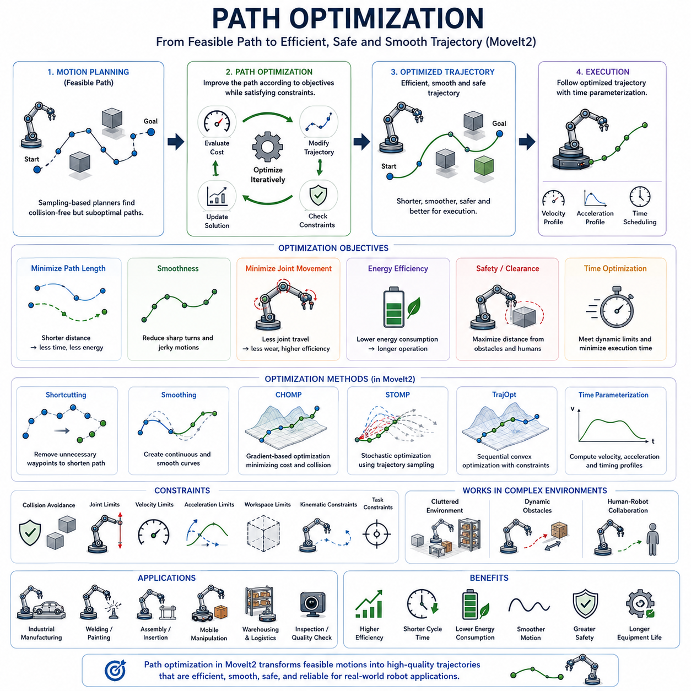{width="7.268055555555556in" height="7.268055555555556in"}

경로 최적화(Path Optimization)는 현대 로봇 모션 플래닝 시스템의 핵심 구성 요소 중 하나이며, 단순히 실행 가능한 경로를 생성하는 수준을 넘어 효율적이고 안전하며 부드럽고 실제 운용에 적합한 궤적으로 개선하는 역할을 수행한다. 모션 플래닝 알고리즘은 일반적으로 시작 상태와 목표 상태 사이의 충돌 없는 경로를 찾는 데 초점을 맞추지만, 처음 생성된 경로는 대부분 최적의 상태가 아니다. 불필요한 우회 경로, 급격한 방향 전환, 과도한 관절 움직임, 비효율적인 시간 분배, 실제 운용에 적합하지 않은 움직임이 포함될 수 있다. 경로 최적화는 이러한 문제를 해결하고 실행 전에 전체적인 경로 품질을 향상시키는 과정이다.

로봇공학에서 경로(Path)는 구성 공간(Configuration Space) 내에서의 기하학적 이동 경로를 의미하며, 궤적(Trajectory)은 여기에 시간 정보, 속도, 가속도, 실행 시간 등을 포함한 개념이다. 경로 계획(Path Planning)은 목적지까지 도달할 수 있는 유효한 경로를 찾는 과정이고, 경로 최적화는 그 경로를 더 효율적이고 실용적으로 개선하는 과정이다. 실제 로봇 시스템에서는 바로 이 최적화 단계가 단순히 동작 가능한 로봇과 고성능 자율 로봇을 구분하는 중요한 요소가 된다.

경로 최적화가 필요한 이유는 대부분의 모션 플래닝 알고리즘이 경로 품질보다 경로의 존재 여부에 우선순위를 두기 때문이다. RRT, RRTConnect, PRM과 같은 샘플링 기반 플래너는 고차원 공간에서도 매우 효과적으로 충돌 없는 경로를 찾을 수 있지만, 생성된 경로는 종종 불필요한 굴곡과 우회 구간, 과도한 웨이포인트를 포함한다. 이러한 특성은 샘플링 기반 탐색 방식의 자연스러운 결과이다. 만약 최적화 과정을 거치지 않는다면 로봇은 비효율적으로 움직이고, 에너지를 낭비하며, 기계적 마모가 증가하고, 전체 작업 성능이 저하될 수 있다.

경로 최적화는 일반적으로 비용 함수(Cost Function)를 최소화하는 과정으로 이해할 수 있다. 비용 함수는 경로 길이, 실행 시간, 에너지 소비, 관절 이동량, 충돌 위험도, 안전 여유, 부드러움(Smoothness) 등 다양한 요소를 포함할 수 있다. 최적화 시스템은 이러한 비용을 반복적으로 평가하면서 더 나은 해를 찾아 나간다. 실제 응용 분야에서는 여러 목표를 동시에 고려하는 다목적 최적화(Multi-Objective Optimization)가 자주 사용된다.

가장 일반적인 최적화 목표 중 하나는 경로 길이(Path Length)를 최소화하는 것이다. 짧은 경로는 일반적으로 더 빠르게 실행되며 에너지 소비도 적다. 제조 자동화 환경에서는 수천 번 반복되는 작업에서 몇 센티미터의 경로 단축만으로도 상당한 생산성 향상을 얻을 수 있다. 물류 로봇, 모바일 매니퓰레이터, 생산 설비 로봇 모두 보다 짧고 직접적인 경로를 선호한다. 하지만 항상 가장 짧은 경로가 가장 좋은 경로는 아니다. 짧은 경로가 오히려 위험하거나 부드럽지 않을 수도 있기 때문이다.

경로의 부드러움(Smoothness) 역시 중요한 최적화 목표이다. 로봇은 모터, 감속기, 액추에이터, 제어기를 이용하여 움직인다. 갑작스러운 방향 전환이나 급격한 속도 변화는 진동과 충격을 발생시키고 기계적 마모를 증가시킨다. 부드러운 경로는 이러한 문제를 줄여 장비 수명을 연장하고 제어 성능을 향상시킨다. 또한 제어기가 목표 경로를 보다 정확하게 추종할 수 있도록 만들어 전체 시스템의 정밀도를 높인다.

관절 공간 최적화(Joint-Space Optimization)는 불필요한 관절 움직임을 최소화하는 데 초점을 둔다. 동일한 엔드이펙터 자세에 대해 여러 개의 역기구학 해가 존재할 수 있는데, 어떤 해는 큰 관절 이동을 요구하고 어떤 해는 훨씬 효율적일 수 있다. 최적화 알고리즘은 이러한 여러 후보 중에서 가장 효율적인 해를 선택하여 관절 이동량을 줄이고 기계적 부하를 감소시킨다. 특히 24시간 운영되는 산업용 로봇에서는 이러한 최적화가 장기적인 유지보수 비용 절감에 크게 기여한다.

에너지 최적화(Energy Optimization)의 중요성은 자율주행 로봇과 모바일 로봇의 확산과 함께 더욱 커지고 있다. 모바일 로봇은 배터리라는 제한된 에너지 자원을 사용한다. 불필요한 움직임은 곧 작동 시간 감소로 이어진다. 경로 최적화는 이동 거리 감소, 급격한 가감속 최소화, 효율적인 속도 프로파일 생성 등을 통해 에너지 소비를 줄일 수 있다. 대형 물류창고나 실외 자율주행 플랫폼에서는 에너지 최적화가 운영 비용과 임무 수행 시간을 직접적으로 결정한다.

안전성 최적화(Safety Optimization)도 중요한 요소이다. 충돌이 없는 경로라 하더라도 장애물과 지나치게 가까운 경우에는 위험성이 존재한다. 최적화 알고리즘은 장애물과 충분한 거리를 유지하도록 경로를 수정할 수 있다. 이러한 안전 여유는 위치 오차, 센서 노이즈, 환경 변화에 대한 강인성을 높여준다. 특히 사람과 함께 작업하는 협동로봇 환경에서는 안전 여유 확보가 매우 중요하다.

시간 최적화(Time Optimization)는 작업 완료 시간을 최소화하는 것을 목표로 한다. 산업 자동화 시스템에서는 생산성 향상을 위해 사이클 타임(Cycle Time)을 줄이는 것이 중요하다. 최적화 알고리즘은 속도와 가속도 프로파일을 조정하여 가장 빠른 실행을 달성하면서도 모터 한계와 안전 조건을 만족하도록 한다. 이를 통해 생산 효율성을 크게 향상시킬 수 있다.

경로 최적화의 수학적 기반은 최적화 이론(Optimization Theory)에 있다. 일반적으로 하나의 목적 함수(Objective Function)를 최소화하거나 최대화하면서 여러 제약 조건을 만족하는 문제로 정의된다. 제약 조건에는 충돌 회피, 관절 제한, 속도 제한, 가속도 제한, 작업 공간 범위, 기구학적 제약 등이 포함된다. 최적화 알고리즘은 이러한 조건을 모두 만족하면서 가장 좋은 해를 찾는다.

MoveIt2는 다양한 최적화 기법을 지원한다. 모션 플래너가 초기 경로를 생성하면 이후 여러 단계의 최적화 과정이 수행될 수 있다. 여기에는 경로 단축(Path Shortcutting), 스무딩(Smoothing), 경로 단순화(Path Simplification), 그리고 전용 최적화 프레임워크가 포함된다. 이러한 모듈식 구조 덕분에 개발자는 자신의 응용 분야에 적합한 최적화 기법을 선택할 수 있다.

경로 단축(Path Shortcutting)은 가장 단순하면서도 효과적인 최적화 기법 중 하나이다. 기존 경로의 두 지점을 직접 연결할 수 있는 경우 중간 웨이포인트를 제거하여 경로를 단순화한다. 이러한 과정을 반복하면 경로 길이를 크게 줄일 수 있다.

경로 스무딩(Path Smoothing)은 급격한 방향 전환을 줄이고 연속적인 곡선을 생성한다. 기존의 직선 연결 방식 대신 부드러운 곡선을 사용함으로써 제어 안정성과 승차감, 동작 품질을 향상시킨다. 서비스 로봇과 협동로봇은 특히 이러한 부드러운 움직임이 중요하다. 사람들은 부드럽게 움직이는 로봇을 더 안전하고 신뢰할 수 있는 존재로 인식하기 때문이다.

CHOMP, STOMP, TrajOpt는 대표적인 고급 궤적 최적화 프레임워크이다. CHOMP(Covariant Hamiltonian Optimization for Motion Planning)는 충돌 위험과 운동 비용을 동시에 최소화하면서 부드러운 경로를 생성한다. 복잡한 환경에서도 높은 품질의 궤적을 생성할 수 있어 널리 사용된다.

STOMP(Stochastic Trajectory Optimization for Motion Planning)는 확률적 최적화 기법을 사용한다. 여러 개의 경로 후보를 생성하고 반복적으로 평가하여 점진적으로 개선한다. 기울기 정보가 없는 문제에서도 적용할 수 있다는 장점이 있다.

TrajOpt는 순차적 볼록 최적화(Sequential Convex Optimization)를 사용한다. 충돌 제약 조건을 최적화 문제 내부에 직접 포함시킬 수 있어 효율적인 계산과 높은 경로 품질을 동시에 제공한다. 산업용 응용 분야에서 특히 높은 관심을 받고 있다.

Cartesian Motion Planning에서도 최적화는 매우 중요하다. 용접, 도장, 절단, 연마, 검사, 조립과 같은 작업은 엔드이펙터가 특정 경로를 정확히 따라야 한다. 이 경우에도 최적화는 속도 프로파일, 자세 변화, 관절 움직임을 개선하여 작업 품질과 효율성을 높인다.

모바일 매니퓰레이터는 더욱 복잡한 최적화 문제를 가진다. 이동 베이스와 로봇팔을 동시에 고려해야 하기 때문이다. 목표 물체에 도달하기 위해 베이스를 먼저 이동해야 할 수도 있다. 전체 시스템의 자유도가 크게 증가하므로 Whole-Body Optimization이 필요하다. 이는 이동과 조작을 통합적으로 고려하여 전체적으로 가장 효율적인 해를 찾는 방법이다.

동적인 환경에서는 실시간 최적화의 중요성이 더욱 커진다. 사람이 작업 공간에 들어오거나 장애물이 이동하면 기존 경로를 즉시 수정해야 한다. 실시간 경로 최적화는 변화하는 환경에 빠르게 대응하면서도 부드럽고 효율적인 움직임을 유지하도록 지원한다.

시뮬레이션 환경은 최적화 알고리즘을 검증하는 데 매우 유용하다. Gazebo, Isaac Sim, MuJoCo, Webots와 같은 플랫폼을 사용하면 실제 하드웨어를 위험에 노출시키지 않고 다양한 시나리오를 테스트할 수 있다. 개발자는 에너지 소비, 실행 시간, 안전 여유, 경로 품질 등을 분석하며 최적화 알고리즘을 개선할 수 있다.

디지털 트윈(Digital Twin)은 최적화의 활용 범위를 더욱 확장한다. 실제 로봇과 환경을 실시간으로 반영하는 가상 모델에서 다양한 경로를 평가한 후 가장 효율적인 경로를 선택할 수 있다. 이를 통해 운영 효율성과 신뢰성을 크게 향상시킬 수 있다.

최근에는 인공지능이 경로 최적화에도 활용되고 있다. 머신러닝과 강화학습은 고품질 경로를 예측하고, 최적화 파라미터를 자동 조정하며, 작업별 최적 움직임을 학습할 수 있다. 앞으로는 전통적인 최적화 기법과 AI 기반 학습 기법이 결합된 하이브리드 시스템이 더욱 보편화될 것으로 예상된다.

산업 현장에서 경로 최적화의 효과는 매우 크다. 최적화된 경로는 사이클 타임을 줄이고, 처리량을 증가시키며, 에너지 소비를 감소시키고, 기계 수명을 연장하며, 안전성을 향상시킨다. 이러한 효과는 장기간 누적되면서 운영 비용 절감과 생산성 향상으로 이어진다.

향후 휴머노이드 로봇, 협동로봇, 모바일 매니퓰레이터, 물류 자동화 시스템, 의료 로봇, Embodied AI 플랫폼이 발전할수록 경로 최적화 기술도 더욱 중요해질 것이다. 미래의 최적화 프레임워크는 인식, 계획, 제어, 학습, 의미론적 추론을 통합하여 더욱 지능적이고 효율적인 움직임을 생성하게 될 것이다.

결국 경로 최적화는 로봇 움직임의 정제 엔진(Refinement Engine)이라고 할 수 있다. 단순히 가능한 경로를 찾는 것을 넘어, 그것을 더 빠르고, 더 부드럽고, 더 안전하며, 더 효율적인 경로로 개선한다. MoveIt2에서 경로 최적화는 모션 플래닝을 보완하는 핵심 기술로서 로봇의 성능, 신뢰성, 에너지 효율, 안전성, 그리고 전체 시스템의 경쟁력을 결정하는 중요한 요소이다. 따라서 현대 로봇 엔지니어에게 경로 최적화에 대한 이해는 고성능 자율 로봇 시스템을 구축하기 위한 필수 역량이라 할 수 있다.

## 07 Grasp Planning

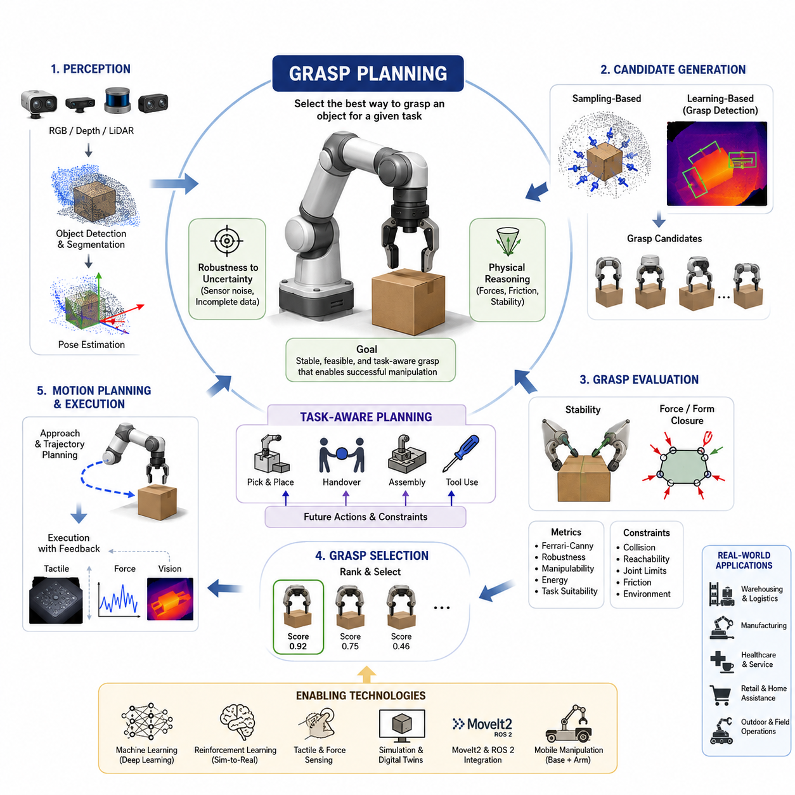{width="7.268055555555556in" height="7.268055555555556in"}

그라스프 계획(Grasp Planning)은 로봇 조작 분야에서 가장 중요한 기술 중 하나로, 인지(Perception)와 실제 물리적 상호작용 사이를 연결하는 핵심 역할을 수행한다. 로봇이 물체를 성공적으로 인식하고 자세(Pose)를 추정하며 충돌 없는 경로를 생성하더라도, 적절한 그립(Grasp)을 선택하지 못하면 전체 작업은 실패할 수 있다. 따라서 그라스프 계획은 로봇의 엔드이펙터가 어떤 방식으로 물체에 접근하고 접촉하며 안정적으로 파지할 것인지를 결정하는 과정이라고 할 수 있다. 현대의 모바일 매니퓰레이터와 산업용 로봇에서는 그라스프 계획이 물체 인식과 모션 실행 사이의 핵심 의사결정 계층으로 작동한다.

그라스프 계획의 기본 목표는 작업 목적을 만족하면서도 최대한 안정적인 접촉 구성을 찾는 것이다. 로봇은 손가락을 어디에 배치할지, 어느 정도의 힘을 가할지, 그리퍼의 방향을 어떻게 설정할지, 그리고 파지 이후 물체를 어떻게 조작할지를 결정해야 한다. 과거의 정형화된 산업 환경에서는 이러한 문제가 비교적 단순했지만, 현대 로봇은 물류창고, 병원, 서비스 환경과 같은 반정형 또는 비정형 환경에서 동작한다. 이러한 환경에서는 물체의 위치와 방향, 주변 장애물이 계속 변하기 때문에 그라스프 계획 역시 동적으로 수행되어야 한다.

로봇 공학적 관점에서 그라스프 계획은 기하학적 추론과 물리적 추론을 모두 포함한다. 기하학적 추론은 로봇이 물체의 어느 부분을 잡을 수 있는지를 판단하는 과정이며, 물리적 추론은 선택된 접촉점이 충분한 힘을 생성하여 외부 교란을 견딜 수 있는지를 평가하는 과정이다. 성공적인 그립은 중력, 관성력, 충격, 환경과의 상호작용 등 다양한 외란에도 물체를 안정적으로 유지할 수 있어야 한다. 따라서 그라스프 계획은 기하학, 운동학, 동역학, 최적화, 머신러닝, 제어이론이 결합된 복합적인 문제이다.

초기의 그라스프 계획은 주로 해석적(Analytical) 접근법에 기반하였다. 이 방법에서는 물체의 형상과 접촉 역학을 수학적으로 모델링하여 가능한 그립 후보를 생성하고 평가한다. 물체는 메쉬(Mesh), 포인트 클라우드(Point Cloud), 또는 기본 기하학 형상으로 표현되며, 표면 위의 잠재적인 접촉점을 탐색한 후 각 후보의 품질을 평가한다. 최종적으로 가장 높은 안정성을 제공하는 그립이 선택된다.

이 과정에서 가장 중요한 개념 중 하나가 Force Closure이다. Force Closure를 만족하는 그립은 외부에서 어떤 방향의 힘이 가해지더라도 접촉점에서 생성되는 힘을 이용하여 이를 상쇄할 수 있다. 즉, 물체를 안정적으로 유지할 수 있는 능력을 의미한다. 실제 로봇 시스템에서는 마찰이 존재하기 때문에 접촉점의 마찰 콘(Friction Cone)을 고려하여 Force Closure 여부를 평가한다.

이와 유사한 개념으로 Form Closure가 있다. Form Closure는 마찰이 전혀 없더라도 접촉 기하학만으로 물체의 움직임을 완전히 제한하는 상태를 의미한다. 이론적으로는 매우 강력한 안정성을 제공하지만, 실제 환경에서는 정밀한 다중 접촉이 필요하기 때문에 구현이 어렵다. 따라서 대부분의 산업용 로봇은 Form Closure보다는 Force Closure를 기반으로 설계된다.

그립의 품질은 다양한 평가 지표를 통해 측정된다. 대표적으로 Ferrari-Canny 지표가 있으며, 이는 그립이 모든 방향의 외란에 얼마나 강하게 대응할 수 있는지를 수치화한다. 그 외에도 조작성(Manipulability), 견고성(Robustness), 에너지 효율성, 접촉 안정성, 작업 적합성 등이 평가 기준으로 사용된다. 산업 현장에서는 이러한 품질 지표를 기준으로 여러 후보 그립을 순위화한 후 최적의 그립을 선택한다.

현실 환경에서는 센서 노이즈와 인식 오차가 존재하기 때문에 불확실성(Uncertainty)이 큰 문제로 등장한다. 카메라와 센서가 생성하는 데이터는 완벽하지 않으며, 포인트 클라우드 역시 부분적으로 누락되거나 왜곡될 수 있다. 따라서 현대의 그라스프 계획 시스템은 단일 최적 해답을 찾기보다는 다양한 오차를 허용할 수 있는 강건한(Robust) 그립 후보를 생성하는 방향으로 발전하고 있다.

RGB 카메라, 스테레오 카메라, 깊이 카메라, LiDAR, 구조광 센서 등의 발전은 그라스프 계획의 패러다임을 크게 변화시켰다. 과거에는 CAD 모델이 필수적이었지만, 현재는 포인트 클라우드를 직접 이용하여 그립을 생성할 수 있다. 이는 물류창고, 서비스 로봇, 모바일 매니퓰레이터와 같이 처음 보는 물체를 다루어야 하는 환경에서 매우 중요한 기능이다.

포인트 클라우드 기반 그라스프 계획에서는 먼저 물체를 배경으로부터 분리하고 3차원 형태를 추정한다. 이후 다양한 그립 후보를 생성하고, 각 후보에 대해 충돌 여부, 도달 가능성, 안정성, 작업 적합성을 평가한다. 최종적으로 가장 높은 점수를 받은 그립이 선택된다.

샘플링 기반 접근법은 수많은 후보 그립을 무작위 또는 휴리스틱 방식으로 생성한 후 평가하는 방법이다. 해석적으로 최적해를 찾기 어려운 복잡한 물체에 대해 효과적이며, 현재 많은 연구와 산업 시스템에서 사용되고 있다.

최근에는 머신러닝 기반 접근법이 빠르게 확산되고 있다. 로봇은 성공 및 실패 사례가 포함된 대규모 데이터셋을 학습하여 어떤 형태의 물체를 어떻게 잡아야 하는지를 스스로 학습한다. 학습이 완료되면 RGB 이미지, 깊이 이미지, 포인트 클라우드만으로도 적절한 그립 위치와 방향을 예측할 수 있다.

딥러닝 기반 방법은 특히 비정형 환경에서 강력한 성능을 보인다. 예를 들어 원통형 물체는 측면을 잡는 것이 유리하고, 박스형 물체는 서로 마주보는 면을 잡는 것이 안정적이라는 사실을 데이터로부터 자동으로 학습할 수 있다. 이는 사람이 직접 규칙을 작성하지 않아도 되는 큰 장점을 제공한다.

그라스프 검출(Grasp Detection)은 이러한 학습 기반 기술의 대표적인 예이다. 그라스프 검출 알고리즘은 센서 입력으로부터 직접 그립 위치와 방향을 예측한다. 물체 전체를 복원할 필요 없이 이미지에서 바로 그립 사각형(Grasp Rectangle)이나 그립 자세를 계산할 수 있기 때문에 실시간성이 뛰어나다.

최근에는 CNN뿐 아니라 Transformer 기반 모델과 대규모 Foundation Model도 그라스프 계획에 적용되고 있다. 이러한 모델은 대규모 시각 데이터를 학습하여 물체의 형상과 의미를 동시에 이해할 수 있으며, 보다 일반화된 그립 전략을 생성할 수 있다.

강화학습(Reinforcement Learning) 역시 중요한 연구 분야이다. 로봇은 수많은 시행착오를 통해 성공적인 그립에 보상을 받고 실패한 경우에는 패널티를 받는다. 반복 학습을 통해 장기적으로 성공 확률을 최대화하는 정책을 스스로 획득하게 된다.

강화학습을 위해서는 시뮬레이션 환경이 매우 중요하다. Gazebo, MuJoCo, Isaac Sim, PyBullet과 같은 플랫폼에서는 수백만 번의 그립 실험을 수행할 수 있다. 또한 Domain Randomization 기법을 적용하면 실제 환경으로의 전이 성능을 향상시킬 수 있다.

최근의 중요한 흐름 중 하나는 Task-Aware Grasp Planning이다. 단순히 물체를 들어 올리는 것이 아니라 이후에 수행할 작업까지 고려하여 그립을 결정하는 방식이다. 같은 물체라도 목적에 따라 최적의 그립은 달라질 수 있다.

예를 들어 창고 로봇이 박스를 운반할 때와 적재(Stacking)할 때는 서로 다른 그립이 필요하다. 컵을 잡는 경우에도 테이블에 내려놓을 것인지 사람에게 전달할 것인지에 따라 그립 방식이 달라질 수 있다. 따라서 현대의 그라스프 계획은 단순한 안정성 최적화를 넘어 작업 목적까지 고려하는 방향으로 발전하고 있다.

모바일 매니퓰레이터에서는 문제가 더욱 복잡해진다. 로봇 암뿐 아니라 이동 플랫폼도 함께 최적화해야 하기 때문이다. 로봇은 물체를 잡는 방법뿐 아니라 어느 위치에 서서 잡을 것인지도 결정해야 한다. 따라서 내비게이션 계획, 모션 계획, 그라스프 계획이 통합적으로 수행된다.

충돌 회피 역시 필수 요소이다. 아무리 안정적인 그립이라도 주변 선반, 벽, 장애물과 충돌한다면 실제로 사용할 수 없다. MoveIt2와 같은 프레임워크는 충돌 검사를 통합하여 실행 가능한 그립만을 선택하도록 지원한다.

다지(多指) 로봇 핸드는 평행 그리퍼보다 훨씬 복잡한 문제를 가진다. 인간의 손처럼 여러 개의 손가락과 많은 관절을 가진 시스템에서는 접촉점 수가 증가하고 자유도가 크게 늘어난다. 따라서 탐색 공간이 폭발적으로 증가하며, 더욱 정교한 최적화 기법이 필요하다.

인간 수준의 조작 능력을 목표로 하는 Dexterous Manipulation 분야에서는 촉각 센서와 힘 센서가 중요한 역할을 한다. 인간은 물체를 잡을 때 지속적으로 손가락 위치와 힘을 조정하는데, 고급 로봇 핸드 역시 이러한 능력을 구현하려고 한다.

촉각 센서는 미끄러짐(Slip), 접촉 손실, 과도한 힘, 물체의 미세한 움직임을 감지할 수 있다. 시각 정보만으로는 파악하기 어려운 마찰 계수나 표면 상태를 감지할 수 있기 때문에, 실제 환경에서의 그립 성공률을 크게 향상시킨다.

변형 가능한 물체(Deformable Objects)에 대한 그라스프 계획은 현재도 매우 어려운 문제이다. 의류, 케이블, 식품, 의료 재료와 같은 물체는 잡는 순간 형태가 변하기 때문에 기존의 강체(Rigid Body) 모델을 적용하기 어렵다. 따라서 변형 모델과 물리 시뮬레이션을 함께 고려해야 한다.

인간과 협업하는 로봇에서는 안전성과 예측 가능성도 중요한 요소이다. 협동로봇(Cobot)은 지나치게 강한 힘을 사용하거나 위험한 방향으로 물체를 들지 않아야 한다. 또한 사람에게 물체를 전달하는 경우에는 사람이 쉽게 잡을 수 있는 방향을 고려해야 한다. 이러한 Human-Aware Grasp Planning은 최근 서비스 로봇과 의료 로봇 분야에서 매우 중요한 연구 주제로 떠오르고 있다.

최근 등장한 Foundation Model과 Embodied AI는 그라스프 계획에 새로운 가능성을 열고 있다. 미래의 로봇은 단순히 물체의 형상을 이해하는 수준을 넘어, 물체의 기능과 사용 목적까지 이해하며 그립을 계획하게 될 것이다. 예를 들어 드라이버는 손잡이를 잡아야 하고, 컵은 내용물의 유무에 따라 다른 방식으로 잡아야 하며, 의료 장비는 특별히 조심스럽게 다루어야 한다는 것을 스스로 이해하게 된다.

향후의 그라스프 계획 시스템은 해석적 모델, 딥러닝, 강화학습, 촉각 센서, 디지털 트윈, Foundation Model을 통합한 하이브리드 구조로 발전할 가능성이 높다. 디지털 트윈 환경에서 대규모 검증을 수행하고, 실제 작업 중에는 실시간 센서 피드백을 통해 그립을 지속적으로 보정하는 형태가 될 것이다.

모바일 매니퓰레이터가 물류창고, 병원, 제조공장, 서비스 현장, 실외 자율주행 로봇 등 다양한 분야로 확산됨에 따라, 그라스프 계획은 로봇이 실제 세계와 상호작용하기 위한 핵심 기술로 남게 될 것이다. 다양한 물체와 환경에서 안정적이고 신뢰성 있는 파지를 수행하는 능력은 완전한 자율 조작 시스템의 필수 조건이며, 차세대 지능형 로봇 개발의 핵심 기반 기술로 계속 발전할 것이다.

## 08 Task Constructor

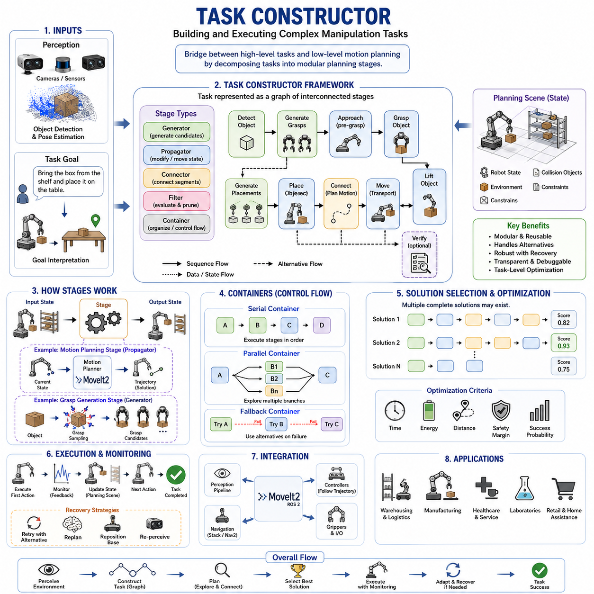{width="7.268055555555556in" height="7.268055555555556in"}

Task Constructor는 현대 로봇 조작 시스템에서 가장 중요한 구성 요소 중 하나로, 저수준 모션 계획(Motion Planning)과 고수준 작업 실행(Task Execution) 사이를 연결하는 역할을 수행한다. 기존의 모션 플래너가 단순히 한 상태에서 다른 상태로 이동하는 충돌 없는 경로를 생성하는 데 집중했다면, 실제 산업 현장의 로봇은 훨씬 복잡한 작업을 수행해야 한다. 창고, 공장, 병원, 연구실, 서비스 환경에서 동작하는 로봇은 단일 동작이 아니라 인식, 파지, 이동, 배치, 검증, 오류 복구와 같은 여러 작업이 연결된 복합적인 워크플로우를 수행한다. Task Constructor는 이러한 복잡한 작업을 체계적으로 구성하고 실행 가능한 계획으로 변환하는 프레임워크이다.

MoveIt2 환경에서 제공되는 MoveIt Task Constructor(MTC)는 복잡한 조작 작업을 설계하고 실행하기 위한 강력한 도구이다. MTC는 하나의 작업을 단일 계획 문제로 취급하지 않고, 여러 개의 작은 계획 단계(Stage)로 분해한다. 각 단계는 특정 문제를 해결하며 전체 작업의 일부를 담당한다. 이러한 구조는 유연성, 유지보수성, 디버깅 편의성, 그리고 전체 작업의 성공률을 크게 향상시킨다.

기존의 로봇 시스템에서는 작업 계획(Task Planning)과 모션 계획(Motion Planning) 사이에 단절이 존재하는 경우가 많았다. 상위 계층에서는 "물체를 집어라", "물체를 옮겨라", "물체를 놓아라"와 같은 추상적인 명령을 생성하지만, 실제 모션 플래너는 기하학적 제약과 관절 움직임만을 고려한다. Task Constructor는 이러한 간극을 해소하기 위해 작업 수준의 목표와 모션 수준의 제약 조건을 하나의 계획 체계 안에서 통합한다.

Task Constructor의 핵심 철학은 모듈화(Modularity)이다. 모든 작업은 여러 개의 계획 단계(Stage)로 표현될 수 있으며, 각 단계는 명확한 입력 상태와 출력 상태를 가진다. 이러한 단계들을 연결함으로써 복잡한 로봇 작업도 체계적이고 재사용 가능한 형태로 설계할 수 있다.

예를 들어 단순한 Pick-and-Place 작업을 생각해 보자. 겉보기에는 간단한 작업처럼 보이지만 실제로는 여러 개의 세부 단계로 구성된다. 로봇은 먼저 물체를 인식하고 자세를 추정해야 한다. 이후 파지 후보를 생성하고, 접근 위치를 계산하고, 물체에 접근하며, 그리퍼를 닫고, 물체를 들어 올리고, 목적지까지 이동한 뒤, 목표 위치에 배치하고, 그리퍼를 열고, 안전하게 후퇴해야 한다. Task Constructor는 이러한 각각의 과정을 독립적인 단계로 모델링할 수 있게 해준다.

Task Constructor의 강점 중 하나는 단순한 선형 시퀀스가 아니라 그래프(Graph) 구조로 작업을 표현할 수 있다는 점이다. 실제 환경에서는 하나의 정답만 존재하는 경우가 드물다. 여러 개의 파지 후보가 존재할 수 있으며, 다양한 배치 위치가 가능하고, 여러 개의 경로가 동일한 목표를 달성할 수 있다. Task Constructor는 이러한 다양한 가능성을 동시에 탐색하고 최적의 작업 경로를 선택할 수 있다.

Stage는 Task Constructor의 기본 구성 요소이다. Stage는 특정 상태를 다른 상태로 변환하는 작업 단위를 의미한다. 어떤 Stage는 새로운 상태를 생성하고, 어떤 Stage는 상태를 수정하거나 검증한다. 인식, 역기구학 계산, 파지 생성, 충돌 검사, 경로 계획, 물체 부착 및 분리와 같은 다양한 기능이 Stage 형태로 구현될 수 있다.

Generator Stage는 새로운 후보 상태를 생성하는 역할을 수행한다. 예를 들어 Grasp Generation Stage는 물체 주변에서 가능한 여러 파지 자세를 생성한다. Placement Generator는 물체를 놓을 수 있는 여러 후보 위치를 생성한다. 이렇게 생성된 후보들은 이후 단계에서 평가되고 선택된다.

Propagator Stage는 기존 상태를 수정하거나 발전시키는 역할을 수행한다. 예를 들어 모션 계획 Stage는 현재 상태에서 목표 상태까지의 경로를 생성한다. 또한 물체를 집은 이후에는 계획 장면(Planning Scene)을 업데이트하여 물체가 로봇의 일부로 인식되도록 할 수 있다.

Connector Stage는 독립적인 계획 구간을 연결하는 역할을 수행한다. 예를 들어 파지 단계와 운반 단계 사이에 실제 이동 경로를 생성하는 것이 Connector Stage의 역할이다. 이를 통해 개별 단계들이 하나의 완전한 작업으로 연결될 수 있다.

Filtering Stage는 수많은 후보 솔루션 중 적합하지 않은 것을 제거한다. 실제 작업에서는 많은 파지 후보와 경로 후보가 생성되지만, 일부는 충돌을 일으키거나 비효율적일 수 있다. 필터링 단계는 이러한 후보를 제거하여 계산 효율성과 성공률을 높인다.

Task Constructor는 계층적 구조를 지원한다. 여러 개의 Stage를 묶어 더 큰 작업 단위로 구성할 수 있다. Serial Container는 단계를 순차적으로 실행하며, Parallel Container는 여러 후보를 동시에 탐색한다. Fallback Container는 기본 계획이 실패했을 때 대체 계획을 제공한다. 이러한 계층 구조는 대규모 로봇 응용 프로그램을 보다 쉽게 설계하고 관리할 수 있도록 해준다.

Task Constructor의 또 다른 중요한 특징은 Planning Scene의 명시적인 관리이다. Planning Scene은 로봇의 관절 상태, 물체 위치, 충돌 모델, 환경 정보, 작업 메타데이터 등을 포함한다. 작업이 진행됨에 따라 이 정보는 지속적으로 갱신된다.

특히 조작 작업에서는 Planning Scene 관리가 매우 중요하다. 로봇이 물체를 집으면 해당 물체는 사실상 로봇의 일부가 된다. 이에 따라 충돌 관계, 도달 가능 영역, 동역학 특성이 모두 변한다. Task Constructor는 이러한 변화를 정확하게 반영하여 이후 계획 단계가 일관된 환경 정보를 사용할 수 있도록 한다.

충돌 검사는 Task Constructor의 모든 단계에서 핵심적인 역할을 수행한다. 로봇은 주변 장애물, 자기 충돌(Self-Collision), 작업 대상 물체와의 충돌 등을 고려해야 한다. 이를 통해 생성된 계획이 실제 환경에서도 실행 가능하도록 보장한다.

역기구학(Inverse Kinematics) 역시 핵심 기술이다. 엔드이펙터의 목표 자세가 주어지면 이를 실현할 수 있는 관절 각도를 계산해야 한다. 하나의 자세에 대해 여러 개의 역기구학 해가 존재할 수 있으며, Task Constructor는 이들 중 조작성, 안정성, 충돌 여부 등을 고려하여 최적의 해를 선택할 수 있다.

그라스프 계획(Grasp Planning)은 Task Constructor와 매우 밀접하게 연결되어 있다. 일반적으로 작업은 파지 후보 생성 단계에서 시작된다. 이후 생성된 후보들은 파지 품질, 도달 가능성, 충돌 여부 등을 기준으로 평가된다. 선택된 파지는 접근 동작, 운반 동작, 배치 동작과 연결되어 전체 작업 흐름을 구성한다.

모바일 매니퓰레이터에서는 Task Constructor의 중요성이 더욱 커진다. 이동 플랫폼과 로봇 암을 동시에 고려해야 하기 때문이다. 로봇은 물체를 잡는 방법뿐 아니라 어디에 위치해야 하는지도 결정해야 한다. 따라서 이동 계획과 조작 계획을 통합적으로 수행할 수 있는 Task Constructor가 매우 유용하다.

예를 들어 창고 로봇이 선반에서 박스를 꺼내야 한다고 가정하자. 로봇은 먼저 적절한 위치까지 이동하고, 물체를 인식한 뒤, 파지 계획을 생성하고, 접근 경로를 계산하고, 물체를 집고, 목적지까지 운반한 뒤, 지정된 위치에 배치해야 한다. 각 단계는 이전 단계의 성공 여부에 의존하며 환경 변화에 따라 동적으로 수정될 수 있다. Task Constructor는 이러한 복잡한 의존 관계를 체계적으로 관리한다.

Task Constructor는 작업 수준 최적화(Task-Level Optimization)도 지원한다. 개별 경로만 최적화하는 것이 아니라 전체 작업을 평가 대상으로 삼는다. 실행 시간, 에너지 소비, 이동 거리, 조작 효율성, 안전 여유도, 성공 확률 등을 종합적으로 고려하여 최적의 작업 계획을 선택할 수 있다.

오류 처리(Error Handling)는 Task Constructor의 또 다른 강력한 기능이다. 실제 환경에서는 물체가 없거나, 인식이 실패하거나, 파지가 실패하는 일이 자주 발생한다. 기존의 로봇 시스템은 이러한 실패에 취약했지만, Task Constructor는 대체 경로와 복구 전략을 작업 구조 안에 포함시킬 수 있다.

예를 들어 첫 번째 파지가 실패하면 다른 파지 후보를 시도할 수 있다. 현재 위치에서 물체에 도달할 수 없다면 모바일 베이스를 이동한 후 다시 시도할 수 있다. 인식 신뢰도가 낮다면 추가적인 센서 데이터를 수집하도록 계획을 수정할 수도 있다. 이러한 복구 기능은 시스템의 자율성과 신뢰성을 크게 향상시킨다.

Task Constructor는 시각화와 디버깅 기능도 매우 우수하다. 작업이 명시적인 그래프 구조로 표현되기 때문에 개발자는 각 단계의 상태를 확인하고, 중간 결과를 분석하며, 실패 원인을 쉽게 파악할 수 있다. 이는 복잡한 조작 시스템 개발 과정에서 큰 장점이 된다.

Gazebo, Isaac Sim, Webots, MuJoCo와 같은 시뮬레이션 플랫폼은 Task Constructor 기반 시스템의 개발을 더욱 효율적으로 만든다. 개발자는 실제 하드웨어를 사용하기 전에 다양한 환경에서 작업을 검증하고 최적화할 수 있다.

현대의 로봇은 비전 인식, 객체 검출, 자세 추정, 의미 인식과 같은 다양한 인지 기술을 활용한다. Task Constructor는 이러한 인식 결과를 직접 작업 계획에 통합할 수 있다. 인식 단계에서 얻어진 정보는 Planning Scene에 반영되며, 이후 조작 단계는 최신 환경 정보를 기반으로 동작한다.

최근에는 머신러닝과 AI 기술도 Task Constructor와 결합되고 있다. 딥러닝 모델은 파지 후보 생성, 물체 기능 추론, 작업 성공 확률 예측, 최적 계획 선택 등에 활용될 수 있다. 이러한 AI 기반 모듈은 Task Constructor의 하나의 Stage로 통합될 수 있다.

Foundation Model과 Embodied AI의 등장으로 Task Constructor의 중요성은 더욱 커지고 있다. 미래의 로봇은 자연어 명령을 이해하고 이를 자동으로 실행 가능한 작업 구조로 분해해야 한다. Task Constructor는 이러한 작업 분해와 실행을 표현하기에 매우 적합한 프레임워크이다.

예를 들어 사용자가 "주방에서 빨간 머그컵을 가져와라"라고 지시하면 로봇은 명령을 해석하고, 물체를 찾고, 주방으로 이동하고, 머그컵을 파지하고, 사용자에게 가져다주며, 안전하게 전달해야 한다. 이러한 모든 과정은 Task Constructor 내부의 여러 Stage로 표현될 수 있다.

산업 자동화 환경에서는 제품 종류와 작업 방식이 계속 변화한다. 기존의 하드코딩된 자동화 시스템은 이러한 변화에 유연하게 대응하기 어렵다. Task Constructor는 재사용 가능한 모듈 기반 구조를 제공함으로써 새로운 작업을 빠르게 구성할 수 있게 한다.

협동로봇(Cobot) 환경에서도 Task Constructor는 중요한 역할을 수행한다. 사람의 위치와 행동을 고려하여 계획을 수정하고, 안전 제약 조건을 반영하며, 실시간으로 작업 순서를 조정할 수 있다. 이는 안전하고 효율적인 인간-로봇 협업을 가능하게 한다.

로봇의 자율성이 점점 향상됨에 따라 Task Constructor는 로봇 지능을 구성하는 핵심 기술로 자리 잡고 있다. 인식, 계획, 제어, 조작, 이동, 추론, 오류 복구를 하나의 통합된 작업 실행 프레임워크로 연결하며, 복잡한 현실 세계의 작업을 안정적으로 수행할 수 있도록 지원한다.

MoveIt2 생태계에서 Task Constructor는 단순한 경로 생성 도구를 넘어 종합적인 작업 추론(Task Reasoning) 프레임워크로 발전하고 있다. 이는 차세대 모바일 매니퓰레이터, 물류 자동화 시스템, 서비스 로봇, 산업용 로봇 셀, 그리고 미래의 Embodied AI 플랫폼을 위한 핵심 기반 기술로 평가받고 있다. 앞으로 로봇 응용의 복잡성이 증가할수록 Task Constructor의 중요성은 더욱 커질 것이며, 지능적이고 강건한 로봇 자율성을 구현하는 핵심 기술로 계속 활용될 것이다.

## 09 MoveIt2 for Mobile Manipulators

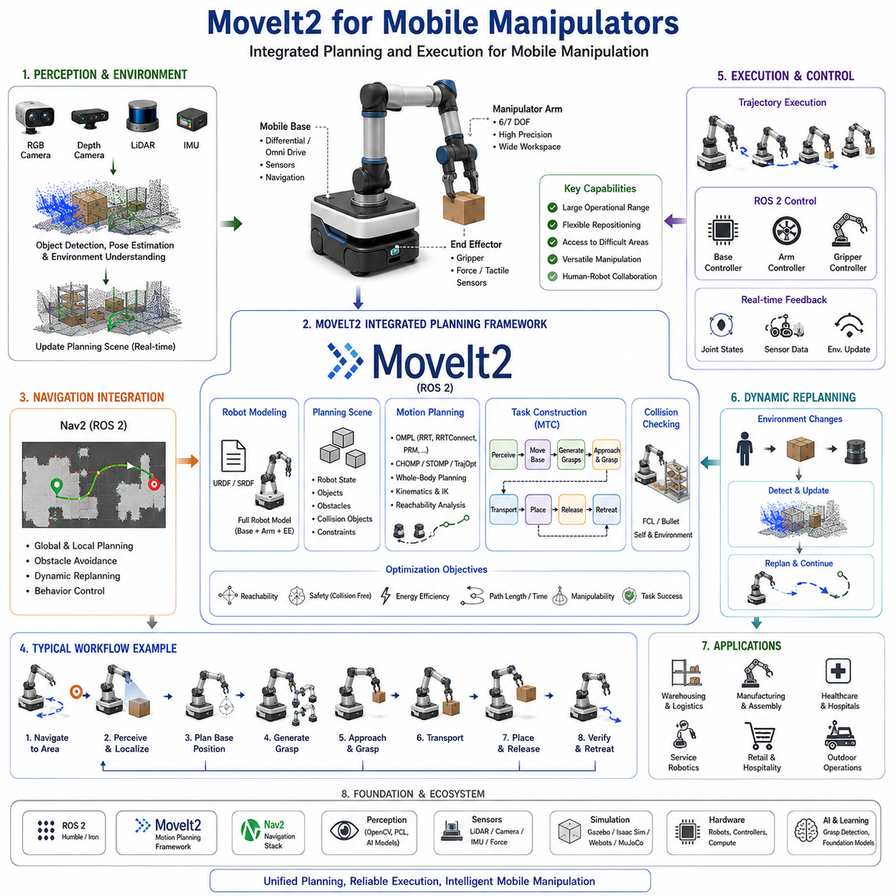{width="7.268055555555556in" height="7.268055555555556in"}

모바일 매니퓰레이터는 자율주행 이동 기능과 정교한 조작 기능을 결합한 현대 로봇 기술의 대표적인 발전 형태이다. 기존 산업용 로봇 암은 고정된 위치에서만 작업할 수 있었지만, 모바일 매니퓰레이터는 이동 플랫폼과 로봇 암을 결합함으로써 넓은 공간을 자유롭게 이동하며 다양한 물체와 상호작용할 수 있다. 이러한 특성 덕분에 물류창고, 제조공장, 병원, 연구소, 소매점, 서비스 현장, 농업, 공항, 실외 점검 및 순찰 분야까지 활용 범위가 빠르게 확대되고 있다. 이러한 복합 시스템을 효율적으로 운영하기 위해서는 이동과 조작을 통합적으로 관리할 수 있는 소프트웨어 프레임워크가 필요하며, MoveIt2는 ROS2 기반 환경에서 이를 지원하는 가장 강력한 플랫폼 중 하나로 자리 잡고 있다.

기존의 산업용 로봇 암은 작업 공간이 로봇 팔의 길이에 의해 제한된다. 따라서 목표 물체가 작업 범위를 벗어나면 외부 장치가 물체를 이동시키거나 로봇 자체를 재배치해야 한다. 반면 모바일 매니퓰레이터는 이동 플랫폼이 새로운 위치로 이동할 수 있기 때문에 작업 가능 범위가 사실상 무한대로 확장된다. 그러나 이는 단순히 이동 기능이 추가된 것이 아니라, 이동과 조작을 동시에 고려해야 하는 훨씬 복잡한 계획 문제를 만들어낸다.

MoveIt2는 이러한 문제를 해결하기 위해 설계된 통합 계획 프레임워크이다. 원래 MoveIt은 고정형 로봇 암을 위한 모션 플래닝 도구로 개발되었지만, MoveIt2는 ROS2 환경으로 발전하면서 모바일 매니퓰레이터를 포함한 보다 복잡한 로봇 시스템을 지원하게 되었다. MoveIt2는 이동 플랫폼과 로봇 암을 별개의 시스템이 아니라 하나의 통합된 운동학적 시스템으로 취급할 수 있도록 지원한다.

모바일 매니퓰레이터의 가장 큰 특징은 매우 많은 자유도(Degree of Freedom)를 가진다는 점이다. 이동 플랫폼은 전진, 후진, 회전 또는 전방향 이동을 수행하며, 로봇 암은 일반적으로 6\~7개의 관절을 가진다. 여기에 그리퍼, 카메라, 힘 센서, IMU, LiDAR 등의 센서가 추가되면 전체 시스템의 상태 공간은 매우 커진다. 이러한 고차원 공간에서 효율적으로 계획을 생성하는 것은 상당히 어려운 문제이다.

MoveIt2는 모듈형 구조를 통해 이러한 복잡성을 관리한다. 로봇 모델링, 운동학 계산, 경로 생성, 충돌 검사, 실행 제어, 센서 통합 등을 독립적인 모듈로 구성하여 개발자가 필요에 따라 조합할 수 있도록 설계되어 있다. 이러한 구조는 다양한 형태의 모바일 매니퓰레이터에 쉽게 적용할 수 있는 유연성을 제공한다.

MoveIt2 기반 시스템의 출발점은 로봇 모델링이다. 모든 로봇은 URDF와 SRDF를 이용해 정의된다. 여기에는 링크, 관절, 센서, 충돌 형상, 운동학 체인, 의미적 관계가 포함된다. 모바일 매니퓰레이터의 경우 이동 플랫폼과 로봇 암을 모두 포함하는 모델이 생성되며, MoveIt2는 이를 기반으로 전체 시스템을 이해하고 계획을 생성한다.

특히 이동 플랫폼을 어떻게 모델링할 것인가는 중요한 설계 결정이다. 일부 시스템은 이동 플랫폼을 Navigation Stack이 관리하고 로봇 암만 MoveIt2가 제어하도록 구성한다. 반면 고급 시스템에서는 이동 플랫폼 자체를 운동학 모델에 포함시켜 베이스와 암을 동시에 최적화한다. 후자의 방식은 더 효율적이고 자연스러운 동작을 생성할 수 있다.

운동학 계산 역시 훨씬 복잡해진다. 고정형 로봇 암에서는 목표 위치에 도달하기 위한 관절 각도만 계산하면 되지만, 모바일 매니퓰레이터에서는 이동 플랫폼의 위치와 로봇 암의 관절 상태가 함께 고려된다. 따라서 동일한 엔드이펙터 위치에 대해 매우 많은 해가 존재할 수 있다. MoveIt2는 이러한 중복 자유도를 활용하여 충돌을 줄이고, 에너지 소비를 감소시키며, 조작 성능을 향상시키는 방향으로 최적화를 수행할 수 있다.

도달 가능성 분석(Reachability Analysis)은 모바일 매니퓰레이터에서 매우 중요한 기능이다. 로봇은 특정 물체를 현재 위치에서 잡을 수 있는지 먼저 판단해야 한다. 만약 불가능하다면 새로운 위치로 이동해야 한다. MoveIt2는 운동학 계산과 작업 공간 분석을 통해 이러한 판단을 수행하며, 필요 시 Navigation 시스템과 협력하여 최적의 위치를 찾는다.

비전 및 인식 시스템과의 통합도 중요한 요소이다. 산업용 로봇과 달리 모바일 매니퓰레이터는 계속 변화하는 환경에서 동작한다. 물체의 위치가 바뀌고, 사람과 다른 로봇이 이동하며, 장애물이 새롭게 나타날 수 있다. MoveIt2는 카메라, LiDAR, 깊이 센서 등의 정보를 이용하여 Planning Scene을 지속적으로 업데이트한다.

Planning Scene은 로봇의 내부 환경 모델이라고 할 수 있다. 여기에는 장애물, 작업 대상 물체, 로봇 상태, 충돌 모델, 작업 제약 조건 등이 포함된다. 모바일 매니퓰레이터는 계속 이동하기 때문에 이 환경 모델 역시 지속적으로 변화해야 하며, MoveIt2는 이를 실시간으로 관리한다.

충돌 검사는 모바일 매니퓰레이터에서 가장 중요한 기능 중 하나이다. 로봇 암과 장애물의 충돌뿐 아니라, 이동 플랫폼과 환경의 충돌, 로봇 암과 베이스 간의 충돌, 물체와 주변 환경의 충돌까지 모두 고려해야 한다. MoveIt2는 FCL과 Bullet 같은 충돌 검사 라이브러리를 활용하여 이러한 계산을 효율적으로 수행한다.

모바일 매니퓰레이터의 작업은 일반적으로 여러 단계로 구성된다. 먼저 목적지까지 이동하고, 적절한 위치에 정지한 뒤, 물체를 인식하고, 파지하고, 운반한 후, 원하는 위치에 배치해야 한다. 각각의 단계는 서로 다른 제약 조건과 계획 문제를 가진다. MoveIt2는 이러한 다양한 단계를 통합적으로 관리할 수 있는 기능을 제공한다.

작업 수준 계획(Task-Level Planning)은 복잡한 응용 분야에서 필수적이다. 단순히 경로를 생성하는 것만으로는 충분하지 않으며, 전체 작업 흐름을 고려해야 한다. MoveIt Task Constructor는 이러한 기능을 제공하는 대표적인 도구이다. 이를 통해 이동, 인식, 파지, 조작, 오류 복구를 하나의 작업 파이프라인으로 구성할 수 있다.

그라스프 계획은 모바일 매니퓰레이터에서 특히 중요하다. 동일한 파지 자세라도 로봇이 어느 위치에 있는지에 따라 성공 여부가 달라질 수 있기 때문이다. MoveIt2는 파지 후보를 평가할 때 로봇 암뿐 아니라 이동 플랫폼의 위치까지 함께 고려하여 보다 현실적인 파지 계획을 생성한다.

전통적으로 이동 계획은 Nav2가 담당하고, 조작 계획은 MoveIt2가 담당한다. 모바일 매니퓰레이터에서는 이 두 시스템의 긴밀한 협력이 필요하다. 예를 들어 창고 로봇이 선반에서 물건을 꺼내야 할 경우, Nav2는 선반까지의 경로를 생성하고, MoveIt2는 해당 위치에서 실제 파지가 가능한지 판단한다. 만약 파지가 불가능하다면 새로운 정지 위치를 요청할 수 있다. 이러한 협력 과정을 통해 이동과 조작이 최적화된다.

Whole-Body Planning은 모바일 매니퓰레이터의 고급 기능 중 하나이다. 이는 이동 플랫폼과 로봇 암을 하나의 통합 시스템으로 보고 동시에 계획을 생성하는 방식이다. 특히 복잡한 환경에서는 이동 플랫폼과 로봇 암의 협조 동작이 필요하기 때문에 매우 효과적이다.

MoveIt2는 OMPL 기반의 샘플링 기반 플래너를 광범위하게 활용한다. RRT, RRTConnect, PRM과 같은 알고리즘은 거대한 상태 공간을 효율적으로 탐색할 수 있으며, 모바일 매니퓰레이터와 같이 자유도가 높은 시스템에 적합하다.

최적화 기반 접근법도 많이 활용된다. CHOMP, STOMP, TrajOpt와 같은 알고리즘은 경로의 부드러움, 에너지 효율성, 실행 속도, 장애물 회피 성능 등을 동시에 최적화할 수 있다. 이러한 방식은 산업 환경에서 특히 유용하다.

경로가 생성되면 이를 실제 하드웨어에서 실행해야 한다. ROS2 Control은 MoveIt2와 연동되어 모바일 플랫폼과 로봇 암을 제어하는 표준 인터페이스를 제공한다. 이를 통해 다양한 하드웨어 플랫폼에서도 동일한 계획 구조를 사용할 수 있다.

실시간 실행 과정에서는 새로운 문제가 발생할 수 있다. 사람이 작업 공간에 들어오거나 물체가 이동할 수 있으며, 새로운 장애물이 나타날 수도 있다. MoveIt2는 이러한 상황에 대응하기 위해 동적 재계획(Dynamic Replanning)을 지원한다. 이를 통해 계획을 실시간으로 수정하여 안전성과 성공률을 향상시킨다.

최근의 모바일 매니퓰레이터는 RGB 카메라, 깊이 카메라, LiDAR, 힘 센서, 촉각 센서, IMU, GNSS RTK 등 다양한 센서를 사용한다. 이러한 센서 데이터를 융합함으로써 더욱 정확한 환경 이해가 가능해지고, MoveIt2 역시 이러한 정보를 계획 과정에 활용할 수 있다.

디지털 트윈 기술 역시 MoveIt2와 함께 널리 활용되고 있다. 디지털 트윈은 실제 로봇과 환경을 가상 공간에 재현하여 계획 알고리즘을 사전에 검증할 수 있도록 해준다. 이를 통해 개발자는 실제 하드웨어를 위험에 노출시키지 않고도 다양한 시나리오를 테스트할 수 있다.

Gazebo, Isaac Sim, Webots, MuJoCo와 같은 시뮬레이션 플랫폼은 이러한 검증 과정에서 핵심 역할을 수행한다. 다양한 조명 조건, 장애물 배치, 물체 위치, 환경 변화 등을 시뮬레이션함으로써 실제 환경에 가까운 테스트를 수행할 수 있다.

MoveIt2 기반 모바일 매니퓰레이터의 활용 분야는 매우 넓다. 물류창고에서는 자동 피킹과 적재, 재고 보충, 분류 작업에 활용된다. 제조공장에서는 부품 운반과 조립 지원에 사용된다. 병원에서는 약품 배송, 검체 운반, 의료 물품 관리에 적용된다. 서비스 로봇은 고객 응대, 호텔 서비스, 리테일 지원과 같은 분야에서 활용되고 있다.

실외 모바일 매니퓰레이터는 더욱 복잡한 환경에서 동작한다. 불규칙한 지형, 기상 변화, 넓은 작업 공간, 높은 환경 불확실성을 고려해야 한다. 실외 순찰 로봇, 점검 로봇, 농업 로봇, 자율 물류 로봇 등은 이동과 조작을 동시에 수행해야 하며, MoveIt2는 이러한 시스템의 핵심 기반 기술로 활용될 수 있다.

인공지능 기술은 모바일 매니퓰레이터의 발전을 더욱 가속화하고 있다. 딥러닝 모델은 객체 인식, 자세 추정, 파지 예측, 장면 이해에 활용되고 있으며, Foundation Model과 Vision-Language-Action 모델은 자연어 명령 이해와 의미 기반 작업 계획을 가능하게 한다. MoveIt2는 이러한 AI 시스템이 생성한 결정을 실제 물리적 움직임으로 변환하는 실행 계층 역할을 수행한다.

Embodied AI는 향후 가장 중요한 발전 방향 중 하나이다. Embodied AI는 인식, 추론, 계획, 행동을 하나의 통합 시스템으로 구성한다. 모바일 매니퓰레이터는 이동성과 조작 능력을 동시에 갖추고 있기 때문에 Embodied AI를 구현하기 위한 이상적인 플랫폼으로 평가된다. MoveIt2는 이러한 시스템에서 실제 행동을 생성하는 핵심 엔진 역할을 담당하게 된다.

실제 상용 환경에서는 한 대의 로봇보다 여러 대의 로봇이 동시에 운영되는 경우가 많다. 따라서 다중 로봇 협업, 교통 관리, 자원 할당, 공동 작업 계획 등의 문제가 중요해지고 있다. 향후 MoveIt2는 이러한 다중 로봇 환경을 더욱 효과적으로 지원하는 방향으로 발전할 것으로 예상된다.

로봇 기술이 고정형 산업 환경에서 동적인 현실 환경으로 확장됨에 따라, 이동과 조작을 통합적으로 계획할 수 있는 플랫폼의 중요성은 더욱 커지고 있다. 모바일 매니퓰레이터는 이동, 조작, 인식, 제어, AI를 하나의 시스템으로 통합해야 하며, MoveIt2는 이러한 요구사항을 충족하는 가장 강력한 프레임워크 중 하나이다.

ROS2 생태계에서 MoveIt2는 단순한 로봇 암 플래너를 넘어 지능형 로봇 운영 플랫폼으로 진화하고 있다. 모바일 매니퓰레이터를 지원함으로써 로봇은 고정 작업 공간을 벗어나 실제 환경에서 자율적으로 이동하고 상호작용할 수 있게 되었다. 고급 모션 플래닝, 실시간 인식 통합, 작업 수준 추론, AI 연계 기능을 제공하는 MoveIt2는 차세대 물류 로봇, 서비스 로봇, 산업용 모바일 매니퓰레이터, 병원 로봇, 실외 자율주행 플랫폼, 그리고 미래의 Embodied AI 시스템을 위한 핵심 기반 기술로 자리매김하고 있다.

## 10 Real Time Execution

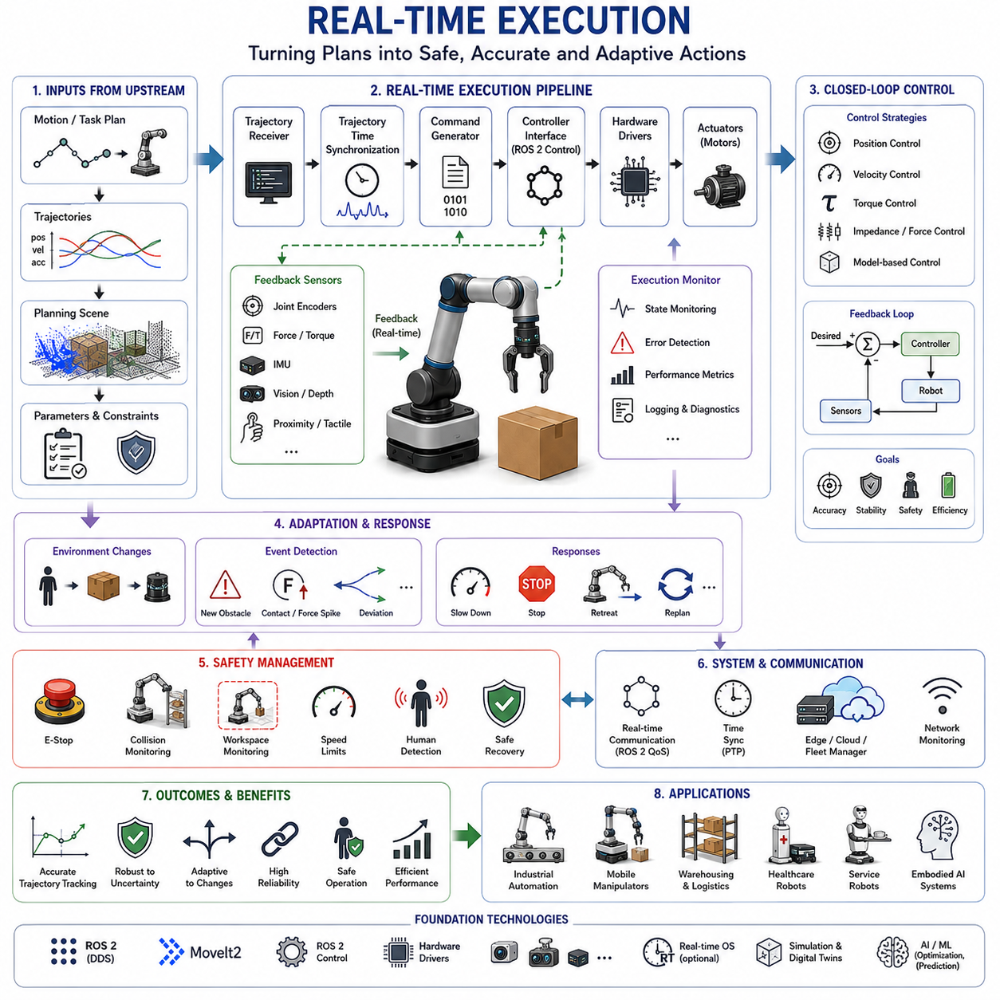{width="7.268055555555556in" height="7.268055555555556in"}

실시간 실행(Real-Time Execution)은 현대 로봇 시스템에서 가장 중요한 기능 중 하나이다. 모션 플래닝, 작업 계획(Task Planning), 인지(Perception), 의사결정 시스템이 로봇이 수행해야 할 행동을 결정한다면, 실시간 실행은 이러한 계획을 실제 물리적 움직임으로 변환하는 역할을 담당한다. 즉, 디지털 세계에서 생성된 계획을 현실 세계의 행동으로 구현하는 마지막 단계이다. MoveIt2 환경에서 실시간 실행은 계획된 경로를 실제 제어 명령으로 변환하고, 센서 피드백을 지속적으로 모니터링하며, 필요할 경우 즉각적인 수정과 보정을 수행하는 핵심 계층이다. 산업용 로봇, 모바일 매니퓰레이터, 물류 로봇, 서비스 로봇, 그리고 미래의 Embodied AI 시스템에 이르기까지 실시간 실행은 계획과 현실을 연결하는 핵심 기술이다.

시뮬레이션 환경에서는 모든 조건이 알려져 있기 때문에 로봇이 거의 완벽하게 계획을 수행할 수 있다. 그러나 실제 환경에서는 다양한 불확실성이 존재한다. 센서는 노이즈를 포함하고 있으며, 모터와 감속기는 기계적 오차를 가진다. 네트워크는 지연이 발생할 수 있고, 사람이나 물체가 예상치 못한 움직임을 보일 수도 있다. 실시간 실행 시스템은 이러한 불확실성을 처리하면서도 안전하고 정확한 작업 수행을 보장해야 한다.

실시간 실행의 기본 목표는 계획된 경로를 따라가면서도 변화하는 환경에 적응하는 것이다. 이를 위해 계획 알고리즘, 제어기, 센서, 액추에이터, 모니터링 시스템이 긴밀하게 통합되어야 한다. 현대 로봇에서는 실행을 단순히 계획된 경로를 재생하는 과정으로 보지 않는다. 대신 계획과 제어가 지속적인 피드백 루프를 형성하며 함께 동작하는 과정으로 이해한다.

MoveIt2에서는 모션 플래너가 경로를 생성한 이후 실시간 실행이 시작된다. 생성된 경로에는 관절 위치, 속도, 가속도, 시간 정보가 포함되어 있다. 이러한 경로는 실행 시스템으로 전달되며, ROS2 Control과 하드웨어 인터페이스를 통해 실제 모터를 구동하게 된다. 실행 시스템은 명령이 정확한 시점에 전달되도록 보장하며, 실제 로봇의 움직임이 계획된 경로를 최대한 정확하게 따르도록 관리한다.

경로 실행에서는 소프트웨어와 하드웨어 간의 정확한 동기화가 필수적이다. 각 관절 제어기는 정해진 주기로 명령을 받아야 하며, 엔코더와 센서 데이터 역시 지속적으로 수집되어야 한다. 아주 작은 시간 오차도 누적되면 큰 경로 편차를 유발할 수 있기 때문에 결정론적(Deterministic) 시간 관리가 중요하다.

실시간 시스템은 일반적인 소프트웨어와 다르다. 일반 응용 프로그램에서는 응답이 조금 늦어져도 큰 문제가 되지 않지만, 로봇에서는 수 밀리초의 지연이 충돌이나 작업 실패로 이어질 수 있다. 따라서 실시간 시스템은 계산의 정확성뿐 아니라 응답 시간의 예측 가능성도 매우 중요하게 다룬다.

실시간 실행에서 가장 중요한 성능 지표 중 하나는 지연 시간(Latency)이다. 지연 시간은 센서가 이벤트를 감지한 순간부터 시스템이 대응하기까지 걸리는 시간을 의미한다. 예를 들어 힘 센서가 예상치 못한 충돌을 감지했을 때, 로봇은 즉시 반응해야 한다. 지연 시간이 길어질수록 안전성과 작업 품질은 저하된다.

지터(Jitter) 역시 중요한 요소이다. 평균 지연 시간이 짧더라도 실행 시간이 불규칙하게 변하면 로봇의 움직임은 불안정해질 수 있다. 따라서 실시간 시스템은 일정한 주기로 동작하며 지터를 최소화해야 한다.

ROS2는 실시간 로봇 응용을 고려하여 설계되었다. ROS1에 비해 통신 안정성, 결정론적 동작, QoS(Quality of Service) 관리 기능이 크게 향상되었다. 이러한 특성은 MoveIt2 기반의 실시간 실행 시스템 구축에 매우 유리하다.

ROS2 Control은 MoveIt2에서 가장 널리 사용되는 실행 프레임워크이다. ROS2 Control은 상위 수준의 계획 시스템과 실제 하드웨어 사이의 표준 인터페이스를 제공한다. MoveIt2가 생성한 경로를 받아 각 관절 제어기로 전달하며, 다양한 로봇 플랫폼에서도 동일한 구조를 사용할 수 있도록 지원한다.

가장 일반적으로 사용되는 제어기는 Joint Trajectory Controller이다. 이 제어기는 목표 관절 경로를 받아 모터를 제어하며, 계획된 궤적을 따라가도록 한다. 고급 제어기에서는 피드포워드 보상, 동역학 모델, 적응 제어 등의 기법을 활용하여 추종 성능을 향상시킨다.

위치 제어(Position Control)는 가장 단순하면서도 널리 사용되는 방식이다. 목표 위치에 관절을 이동시키는 데 집중하며 산업용 로봇에서 많이 사용된다. 반면 속도 제어(Velocity Control)는 목표 속도를 직접 제어하기 때문에 보다 부드럽고 유연한 움직임을 생성할 수 있다.

토크 제어(Torque Control)는 가장 고급 제어 방식이다. 위치나 속도가 아닌 관절 토크를 직접 제어함으로써 힘 제어, 임피던스 제어, 순응 제어 등을 구현할 수 있다. 협동로봇이나 정밀 조작 시스템에서 주로 활용된다.

실시간 실행의 핵심은 피드백 루프(Feedback Loop)이다. 센서는 관절 위치, 속도, 힘, 온도, 환경 정보를 지속적으로 측정한다. 제어기는 이러한 정보를 이용하여 목표 상태와 실제 상태의 차이를 계산하고, 이를 보정하는 명령을 생성한다. 피드백이 없다면 로봇은 환경 변화에 대응할 수 없게 된다.

현대 로봇은 대부분 폐루프 제어(Closed-Loop Control)를 사용한다. 센서가 현재 상태를 측정하고, 제어기가 오차를 계산하며, 액추에이터가 이를 보정하는 과정이 반복된다. 이러한 구조 덕분에 로봇은 외부 교란이나 모델 오차에도 안정적으로 동작할 수 있다.

PID 제어기는 가장 널리 사용되는 제어 알고리즘이다. 비례(Proportional) 항은 현재 오차에 반응하고, 적분(Integral) 항은 누적 오차를 제거하며, 미분(Derivative) 항은 미래 변화를 예측한다. 단순하지만 매우 강력하여 다양한 로봇 시스템에 적용되고 있다.

보다 정교한 시스템에서는 모델 기반 제어(Model-Based Control)를 사용한다. 이 방법은 로봇의 질량, 관성, 마찰, 중력 효과를 고려하여 보다 정확한 제어를 수행한다. Model Predictive Control(MPC), Computed Torque Control, Inverse Dynamics Control 등이 대표적인 예이다.

모바일 매니퓰레이터는 실시간 실행을 더욱 복잡하게 만든다. 이동 플랫폼과 로봇 암을 동시에 제어해야 하기 때문이다. 물체를 집는 과정에서는 이동 플랫폼, 로봇 암, 그리퍼, 비전 시스템이 모두 협조적으로 동작해야 한다. 따라서 각 서브시스템을 정확히 동기화하는 것이 매우 중요하다.

센서 통합 역시 실시간 실행의 핵심 요소이다. 카메라, LiDAR, IMU, 힘 센서, 촉각 센서, 거리 센서 등은 지속적으로 데이터를 생성한다. 이 정보는 매우 짧은 시간 안에 처리되어 실행 과정에 반영되어야 한다.

힘 센서(Force Sensor)는 실시간 적응의 대표적인 사례이다. 조립 작업이나 삽입 작업에서는 예상치 못한 접촉이 발생할 수 있다. 힘 센서는 이를 감지하고 제어기에 전달하며, 제어기는 즉시 힘을 줄이거나 경로를 수정하여 손상을 방지할 수 있다.

촉각 센서(Tactile Sensor)는 물체와의 접촉 상태를 더욱 세밀하게 측정한다. 파지 과정에서 미끄러짐이 발생하면 즉시 감지하여 그립 힘을 조정할 수 있다. 이를 통해 파지 성공률을 크게 향상시킬 수 있다.

충돌 모니터링(Collision Monitoring)도 중요한 기능이다. 계획 단계에서 충돌이 없는 경로를 생성하더라도 실행 중 새로운 장애물이 나타날 수 있다. 실시간 실행 시스템은 주변 환경을 지속적으로 감시하며 필요 시 감속, 정지, 후퇴 또는 재계획을 수행한다.

동적 재계획(Dynamic Replanning)은 최근 로봇 시스템에서 매우 중요한 기능으로 자리 잡고 있다. 과거에는 계획 이후 환경이 변하지 않는다고 가정했지만, 실제 환경에서는 사람, 차량, 다른 로봇이 계속 움직인다. 따라서 로봇은 실행 중에도 새로운 경로를 생성할 수 있어야 한다.

MoveIt2는 Planning Scene과 센서 피드백을 활용하여 이러한 동적 재계획을 지원한다. 환경 변화가 감지되면 새로운 경로를 생성하면서도 현재 작업을 최대한 유지하려고 시도한다. 이는 물류창고나 병원과 같은 동적인 환경에서 매우 중요한 기능이다.

안전성은 실시간 실행의 최우선 고려사항이다. 산업용 로봇은 고가의 장비와 제품 주변에서 동작하며, 사람과 함께 작업하는 경우도 많다. 따라서 비상 정지(E-Stop), 충돌 감지, 작업 공간 모니터링, 속도 제한과 같은 다양한 안전 기능이 포함된다.

협동로봇(Cobot)은 더욱 정교한 안전 메커니즘을 필요로 한다. 사람과 가까운 거리에서 작업하기 때문에 인간의 위치를 지속적으로 추적하고, 충돌 가능성을 예측하며, 필요 시 동작을 수정해야 한다.

현대 로봇은 엣지 서버, 클라우드, FMS(Robot Fleet Management System), 원격 운영 센터와도 연결된다. 따라서 네트워크 지연과 패킷 손실 역시 고려해야 한다. 실시간 실행 시스템은 이러한 통신 문제에도 안전성을 유지할 수 있어야 한다.

분산 시스템에서는 시간 동기화가 매우 중요하다. PTP(Precision Time Protocol)와 같은 기술을 활용하면 여러 장치가 동일한 시간을 공유할 수 있으며, 이는 센서 융합과 다중 로봇 협업의 정확성을 향상시킨다.

실행 모니터링 시스템은 경로 진행 상황, 제어기 성능, 센서 상태, 통신 품질, 전력 소비 등을 지속적으로 감시한다. 이를 통해 운영자는 시스템 상태를 파악하고 문제를 조기에 발견할 수 있다.

실행 로그와 진단 정보는 유지보수 측면에서도 중요하다. 실시간 실행 과정에서 수집된 데이터는 디버깅, 성능 분석, 예지보전(Predictive Maintenance), 지속적인 성능 개선에 활용될 수 있다.

디지털 트윈은 실시간 실행 검증에도 활용된다. 실제 로봇과 동일한 가상 모델을 유지함으로써 계획과 실제 실행 결과를 비교할 수 있다. 이를 통해 오차를 조기에 발견하고 개선할 수 있다.

최근에는 인공지능이 실시간 실행 시스템에도 적용되고 있다. AI는 실행 실패를 예측하고, 모터의 성능 저하를 감지하며, 제어기 파라미터를 자동으로 최적화할 수 있다. 이러한 기능은 시스템의 신뢰성과 가용성을 크게 향상시킨다.

Embodied AI 시스템에서는 실시간 실행의 중요성이 더욱 커진다. 상위 계층의 AI가 무엇을 할지 결정한다면, 실시간 실행 시스템은 그것을 실제 행동으로 구현한다. 따라서 아무리 뛰어난 인공지능이라도 안정적인 실행 계층이 없다면 실제 환경에서 활용될 수 없다.

미래의 로봇은 더욱 복잡하고 동적인 환경에서 동작하게 될 것이다. 물류 로봇, 병원 로봇, 점검 로봇, 농업 로봇, 휴머노이드, 모바일 매니퓰레이터는 모두 환경 변화에 적응하면서 안정적으로 동작해야 한다. 따라서 실시간 실행은 단순한 경로 재생 기능을 넘어, 제어, 예측, 적응, 안전 관리가 통합된 지능형 실행 계층으로 발전할 것이다.

MoveIt2 생태계에서 실시간 실행은 전체 로봇 계획 파이프라인의 최종 단계이다. 작업 목표를 실제 물리적 행동으로 변환하며, ROS2 Control, 센서 피드백, 동적 재계획, 충돌 모니터링, 고급 제어 기술을 통합하여 높은 수준의 자율성을 제공한다. 산업 자동화, 물류, 의료, 서비스 로봇, 실외 자율주행 플랫폼 등 다양한 분야에서 성공적인 로봇 운영을 가능하게 하는 핵심 기술이며, 앞으로도 자율 로봇 시스템의 성능을 결정하는 가장 중요한 기반 기술 중 하나로 남게 될 것이다.

## 11 Debugging MoveIt2

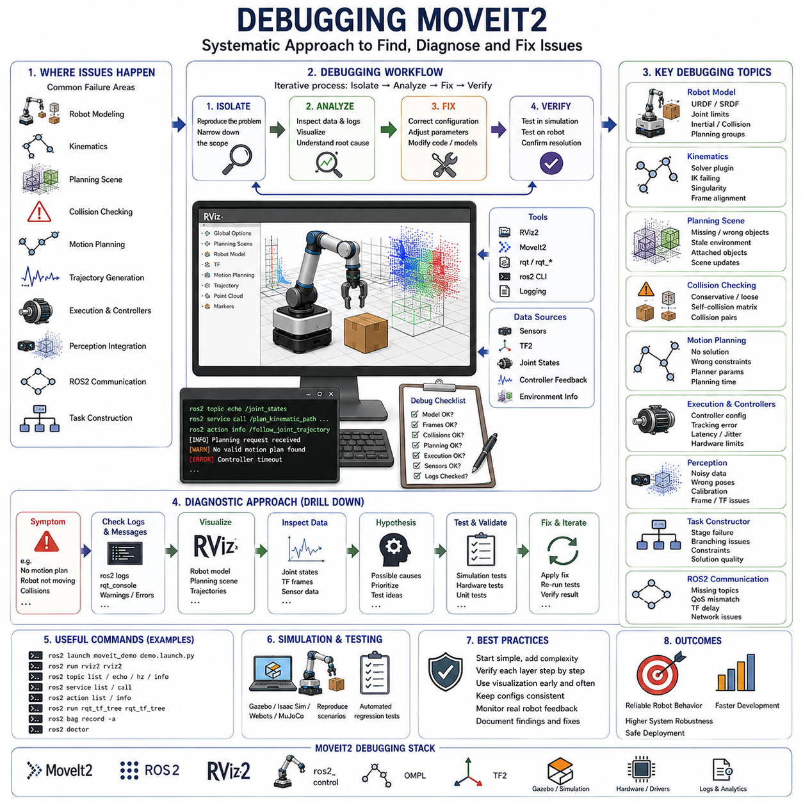{width="7.268055555555556in" height="7.268055555555556in"}

디버깅은 로봇 시스템 개발과 운영 과정에서 가장 중요한 활동 중 하나이다. 아무리 우수한 모션 플래닝 프레임워크라 하더라도 잘못된 설정, 하드웨어 문제, 통신 오류, 환경 변화, 소프트웨어 결함이 존재하면 시스템은 정상적으로 동작할 수 없다. MoveIt2 환경에서 디버깅은 모션 플래닝, 충돌 검사, 운동학 계산, 경로 실행, 인식 시스템 연동, 작업 수준 계획(Task Planning)이 실제 환경에서 올바르게 동작하도록 보장하는 핵심 과정이다. MoveIt2는 로봇 모델링, ROS2 통신, 컨트롤러, 센서, 하드웨어와 밀접하게 연결되어 있기 때문에 특정 모듈만 이해해서는 문제를 해결하기 어렵다. 전체 로봇 소프트웨어 스택에 대한 이해가 필요하다.

일반 소프트웨어에서는 버그가 프로그램 오류나 잘못된 결과 형태로 나타나는 경우가 많다. 그러나 로봇 시스템에서는 훨씬 다양한 형태로 문제가 발생한다. 로봇이 경로를 찾지 못하거나, 이상한 움직임을 하거나, 센서 데이터를 잘못 해석하거나, 충돌을 일으키거나, 명령을 받았음에도 움직이지 않는 경우가 발생할 수 있다. 또한 여러 계층의 소프트웨어가 동시에 동작하기 때문에 실제 원인을 찾는 것이 쉽지 않다. 따라서 MoveIt2 디버깅은 문제를 단계별로 분리하고 각 계층을 독립적으로 검증하는 체계적인 접근이 필요하다.

가장 흔한 문제는 로봇 모델링에서 발생한다. MoveIt2는 URDF와 SRDF를 기반으로 동작하며, 여기에는 링크, 관절, 충돌 모델, 시각 모델, 운동학 체인, 엔드이펙터, 가상 조인트 등의 정보가 포함된다. 작은 설정 오류 하나만으로도 전체 계획 과정이 실패할 수 있다. 잘못된 관절 제한값, 누락된 충돌 모델, 오류가 있는 운동학 체인은 계획 실패의 대표적인 원인이다.

로봇 모델 디버깅의 첫 단계는 RViz에서 모델이 정상적으로 표시되는지 확인하는 것이다. 모든 링크와 관절이 올바른 위치에 존재하는지, 각 관절을 움직였을 때 예상대로 동작하는지 검증해야 한다. 시각화는 많은 문제를 가장 빠르게 발견할 수 있는 방법이다.

관절 제한(Joint Limit) 설정도 매우 중요하다. 제한값이 지나치게 작으면 도달 가능한 위치조차 접근할 수 없게 된다. 반대로 제한값이 실제 하드웨어보다 크게 설정되면 위험한 움직임이나 실행 실패가 발생할 수 있다. MoveIt2는 역기구학 계산과 경로 계획 과정에서 이러한 제한값을 적극적으로 사용하기 때문에 실제 하드웨어와 정확히 일치해야 한다.

운동학(Kinematics) 설정 문제도 자주 발생한다. MoveIt2는 Kinematics Plugin을 사용하여 순기구학과 역기구학을 계산한다. 플러그인이 잘못 설정되면 목표 위치가 분명히 도달 가능해 보이는데도 역기구학 해를 찾지 못하는 상황이 발생할 수 있다. 이러한 문제는 솔버 설정, 플러그인 선택, 계획 그룹 정의 오류 등에서 비롯되는 경우가 많다.

순기구학은 상대적으로 디버깅이 쉽다. 주어진 관절값에 대해 엔드이펙터 위치를 계산하면 되기 때문이다. 반면 역기구학은 여러 개의 해가 존재할 수 있으며 특이점(Singularity) 문제도 발생할 수 있기 때문에 훨씬 복잡하다. 목표 자세와 계산 결과를 시각적으로 비교하는 것이 매우 효과적이다.

Planning Scene 역시 주요 디버깅 대상이다. Planning Scene은 로봇, 장애물, 작업 대상 물체, 환경 제약조건을 포함하는 내부 환경 모델이다. 만약 Planning Scene이 실제 환경과 다르면 계획된 경로는 현실에서 사용할 수 없게 된다. 장애물 위치가 잘못되었거나, 충돌 모델이 누락되었거나, 오래된 환경 정보가 남아있는 경우가 대표적이다.

RViz의 Planning Scene 시각화 기능은 이러한 문제를 확인하는 데 매우 유용하다. 충돌 객체, Occupancy Map, 부착된 물체(Attached Object), 환경 모델을 시각적으로 확인함으로써 실제 환경과의 차이를 발견할 수 있다.

충돌 검사(Collision Checking)는 MoveIt2 디버깅에서 가장 자주 다루는 문제 중 하나이다. 충돌 모델이 지나치게 보수적이면 실제로 가능한 경로도 모두 거부될 수 있다. 반대로 충돌 모델이 불완전하면 위험한 경로가 허용될 수 있다. 따라서 충돌 형상과 접촉 지점을 시각적으로 검증하는 과정이 필요하다.

자기 충돌(Self-Collision) 문제도 빈번하게 발생한다. 자유도가 높은 로봇은 특정 자세에서 자신의 링크끼리 충돌할 수 있다. MoveIt2는 Self-Collision Matrix를 생성하여 이러한 문제를 효율적으로 처리하지만, 설정 오류가 있으면 정상 동작하지 않을 수 있다.

모션 플래닝 실패는 사용자 입장에서 가장 쉽게 보이는 문제이다. 로봇이 단순히 "No Solution Found"를 출력할 수 있다. 그러나 실제 원인은 운동학, 충돌 검사, 환경 제약, 플래너 설정, 하드웨어 제한 등 매우 다양할 수 있다. 따라서 체계적인 원인 분석이 필요하다.

MoveIt2는 OMPL 기반의 다양한 플래너를 제공한다. RRT, RRTConnect, PRM 등의 알고리즘은 각각 특성이 다르기 때문에 동일한 문제라도 특정 플래너에서는 실패하고 다른 플래너에서는 성공할 수 있다. 따라서 플래너를 변경해 보는 것은 매우 일반적인 디버깅 방법이다.

샘플링 기반 플래너는 계획 시간(Time Limit)에 민감하다. 시간이 너무 짧으면 유효한 경로를 찾지 못할 수 있다. 계획 시간을 늘리거나 샘플링 파라미터를 조정하면 문제를 해결할 수 있는 경우가 많다.

제약조건(Constraint) 설정 역시 자주 문제를 일으킨다. 위치 제약, 자세 제약, 시야 제약, 경로 제약 등이 지나치게 엄격하게 설정되면 가능한 해가 존재하지 않을 수 있다. 많은 경우 사용자는 플래너 문제라고 생각하지만 실제 원인은 제약조건 충돌이다.

경로 생성 이후에도 문제가 발생할 수 있다. 경로는 생성되었지만 지나치게 급격한 가속도, 불필요한 진동, 비효율적인 움직임을 보일 수 있다. 이러한 경우에는 Trajectory Optimization과 Time Parameterization을 점검해야 한다.

Time Parameterization은 기하학적 경로에 시간 정보를 부여하는 과정이다. 이 단계에 문제가 있으면 비현실적인 속도와 가속도가 생성되어 실제 하드웨어에서 실행이 어려워질 수 있다.

계획이 성공했더라도 실제 실행 단계에서 실패하는 경우가 많다. 시뮬레이션에서는 정상 동작하지만 실제 로봇에서는 동작하지 않는 경우가 대표적이다. 이러한 문제는 컨트롤러 설정, 통신 지연, 동기화 오류, 하드웨어 보정 문제에서 발생한다.

ROS2 Control은 MoveIt2의 대표적인 실행 계층이다. 컨트롤러가 잘못 설정되면 계획은 성공하지만 실제 모터는 움직이지 않을 수 있다. 따라서 Controller Interface, Update Rate, Hardware Driver 상태를 반드시 점검해야 한다.

Joint State Feedback은 매우 중요한 디버깅 정보이다. 실제 관절 위치가 목표 위치를 제대로 따라가고 있는지 확인해야 한다. 큰 차이가 발생한다면 보정 오류, 기계적 문제, 제어기 불안정성 등을 의심해야 한다.

통신 디버깅도 중요하다. MoveIt2는 ROS2 Topic, Service, Action, DDS 통신에 크게 의존한다. QoS 설정 오류, 네트워크 지연, 메시지 손실은 전체 시스템에 영향을 줄 수 있다.

ROS2의 Topic Echo, Topic Info, Service Call, Action Monitor 도구는 통신 문제를 분석하는 데 유용하다. 메시지가 실제로 송수신되는지 확인하는 것만으로도 많은 문제를 해결할 수 있다.

TF2 문제는 인식 및 계획 실패의 대표적인 원인이다. MoveIt2는 센서 프레임, 로봇 프레임, 월드 프레임 간의 좌표 변환을 지속적으로 사용한다. 프레임 연결이 누락되었거나 잘못된 변환값이 사용되면 전체 계획이 실패할 수 있다.

TF Tree를 시각화하여 모든 프레임이 올바르게 연결되어 있는지 확인하는 것이 중요하다. 특히 카메라와 엔드이펙터 사이의 Hand-Eye Calibration 오류는 자주 발생하는 문제이다.

인식(Perception) 시스템 역시 디버깅 대상이다. 잘못된 물체 자세 추정, 노이즈가 많은 포인트 클라우드, 센서 캘리브레이션 오류는 직접적으로 계획 실패로 이어질 수 있다.

깊이 카메라, LiDAR, RGB 카메라는 정기적으로 보정되어야 한다. 개발자는 원시 센서 데이터를 시각화하고 실제 환경과 비교하여 문제를 확인해야 한다.

MoveIt Task Constructor는 보다 높은 수준의 디버깅 문제를 제공한다. 작업은 여러 개의 Stage로 분해되며, 실패는 특정 Stage 내부 또는 Stage 간 전환 과정에서 발생할 수 있다. 따라서 각 단계의 결과를 개별적으로 검증해야 한다.

Task Constructor의 시각화 기능은 이러한 디버깅을 매우 쉽게 만들어 준다. 중간 상태, 생성된 후보, 실패 원인을 단계별로 분석할 수 있기 때문이다.

실시간 시스템에서는 성능 디버깅도 중요하다. CPU 사용량, 메모리 사용량, 스레드 상태, 지연 시간, 지터를 분석해야 한다. 성능 문제가 심각하면 계획 품질과 실행 안정성이 모두 저하될 수 있다.

메모리 누수나 과도한 리소스 사용은 장시간 운영 환경에서 특히 문제가 된다. 따라서 지속적인 시스템 모니터링이 필요하다.

로그(Log)는 모든 디버깅 과정의 핵심이다. MoveIt2와 ROS2는 풍부한 진단 정보를 제공하며, 이를 통해 문제 발생 시점과 원인을 추적할 수 있다. 적절한 로그 레벨을 설정하면 필요한 정보만 효율적으로 확인할 수 있다.

시뮬레이션 환경은 디버깅을 위한 매우 강력한 도구이다. Gazebo, Isaac Sim, Webots, MuJoCo를 활용하면 실제 하드웨어를 위험에 노출시키지 않고 문제를 재현하고 수정할 수 있다.

디지털 트윈은 이러한 기능을 더욱 확장한다. 실제 시스템과 동일한 가상 모델을 유지함으로써 실제 환경과 시뮬레이션 환경을 동시에 비교 분석할 수 있다.

최근에는 AI 기반 시스템도 디버깅 대상이 되고 있다. 딥러닝 모델이 예상치 못한 결과를 출력하거나 특정 환경에서 성능이 급격히 저하될 수 있기 때문이다. 따라서 데이터셋, 특징 추출, 모델 신뢰도, 추론 결과까지 함께 분석해야 한다.

Embodied AI 시대에는 디버깅의 중요성이 더욱 커질 것이다. 미래 로봇은 인식, 추론, 계획, 이동, 조작, 언어 이해가 하나의 시스템으로 통합될 것이기 때문에 문제 역시 여러 계층의 상호작용에서 발생할 가능성이 높다. 따라서 시스템 전체를 바라보는 디버깅 방법론이 필요하다.

효과적인 MoveIt2 디버깅은 계층별 검증에서 시작된다. 먼저 로봇 모델을 검증하고, 운동학을 확인하며, Planning Scene을 점검하고, 충돌 검사를 검증한 후, 모션 플래닝, 컨트롤러, 통신, 인식 시스템, Task Execution 순으로 문제를 분석해야 한다. 이러한 체계적인 접근법을 통해 복잡한 문제도 효율적으로 해결할 수 있다.

MoveIt2 생태계에서 디버깅은 단순한 유지보수 작업이 아니라 핵심 엔지니어링 역량이다. 신뢰성 있는 로봇 시스템은 철저한 검증, 지속적인 관찰, 체계적인 실험, 반복적인 개선 과정을 통해 만들어진다. 로봇 시스템이 더욱 복잡해지고 자율성이 높아질수록 디버깅 기술의 중요성은 더욱 커질 것이며, MoveIt2, ROS2, 모바일 매니퓰레이터, 산업용 로봇, 그리고 미래의 Embodied AI 시스템을 개발하는 엔지니어에게 필수적인 핵심 역량으로 남게 될 것이다.
