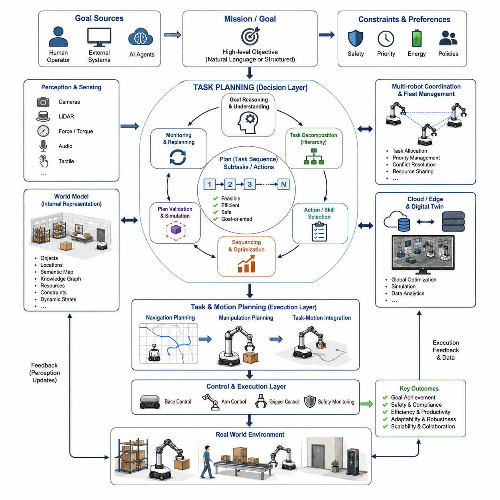
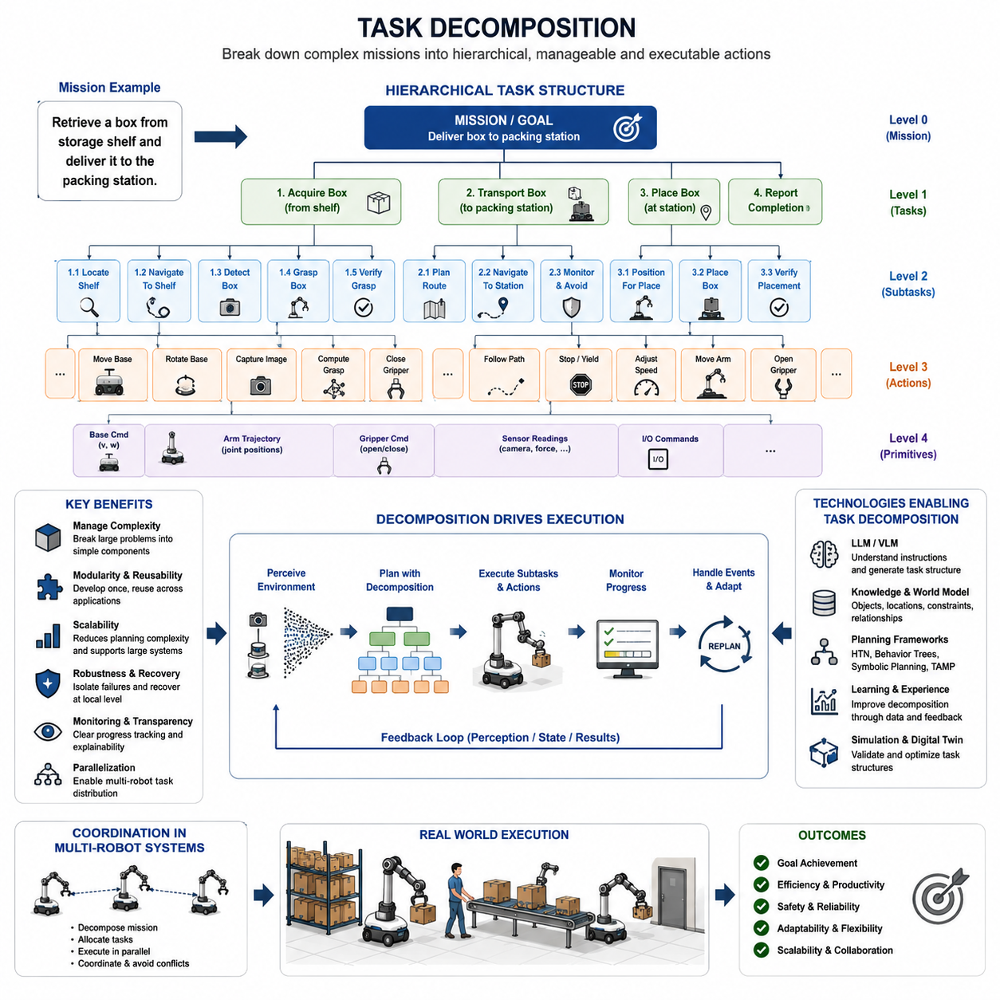
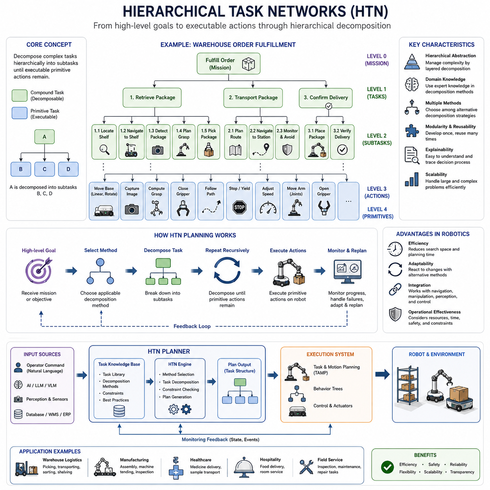
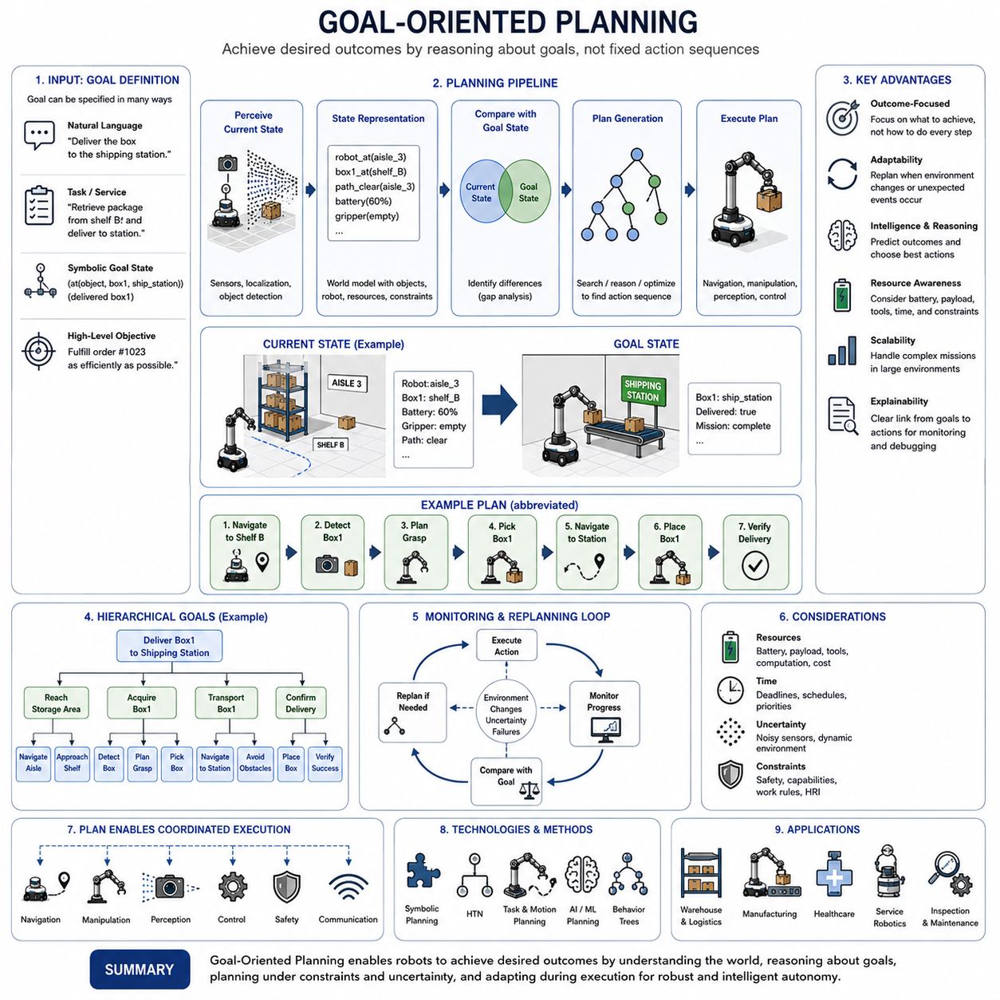
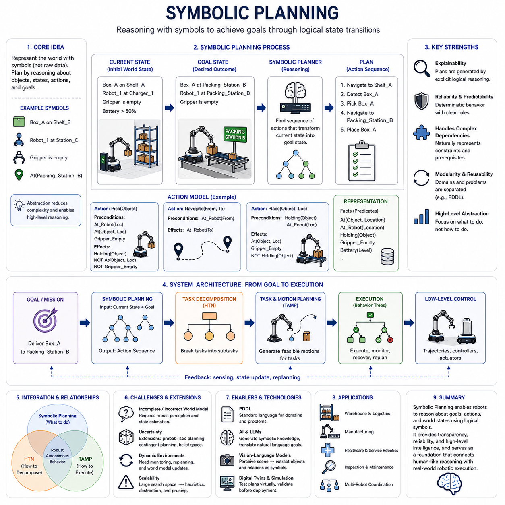
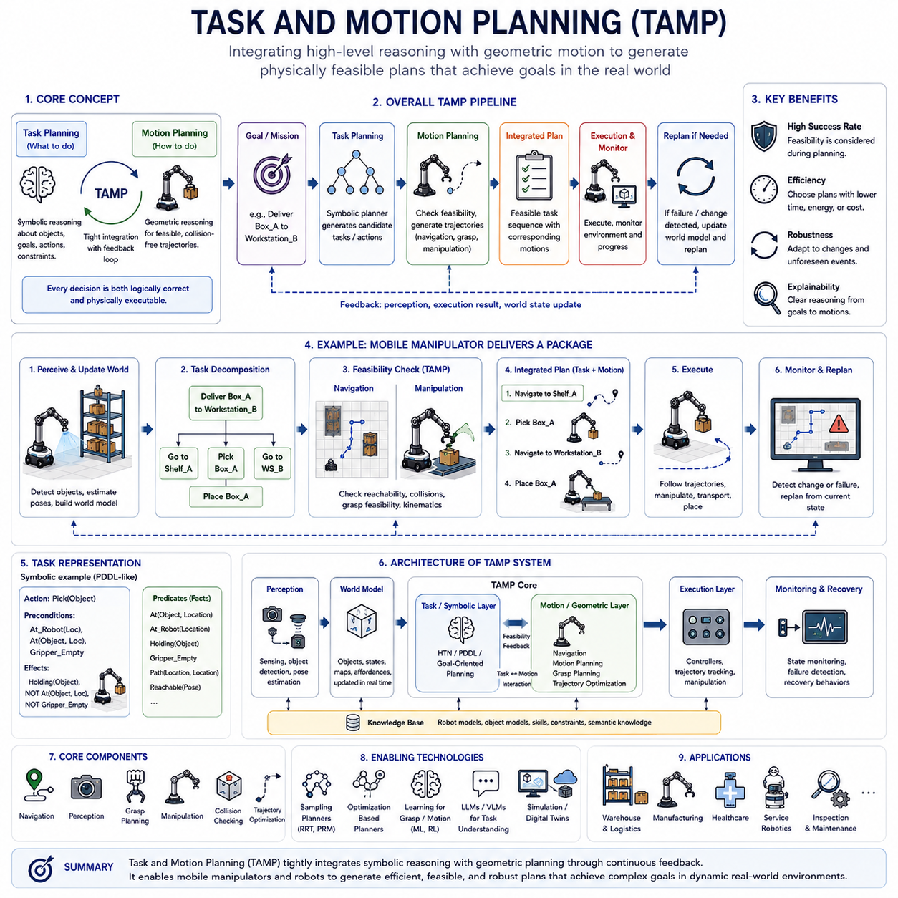
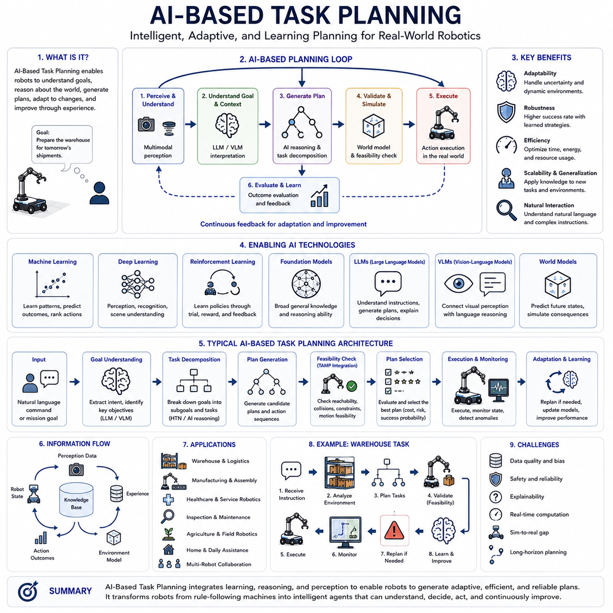
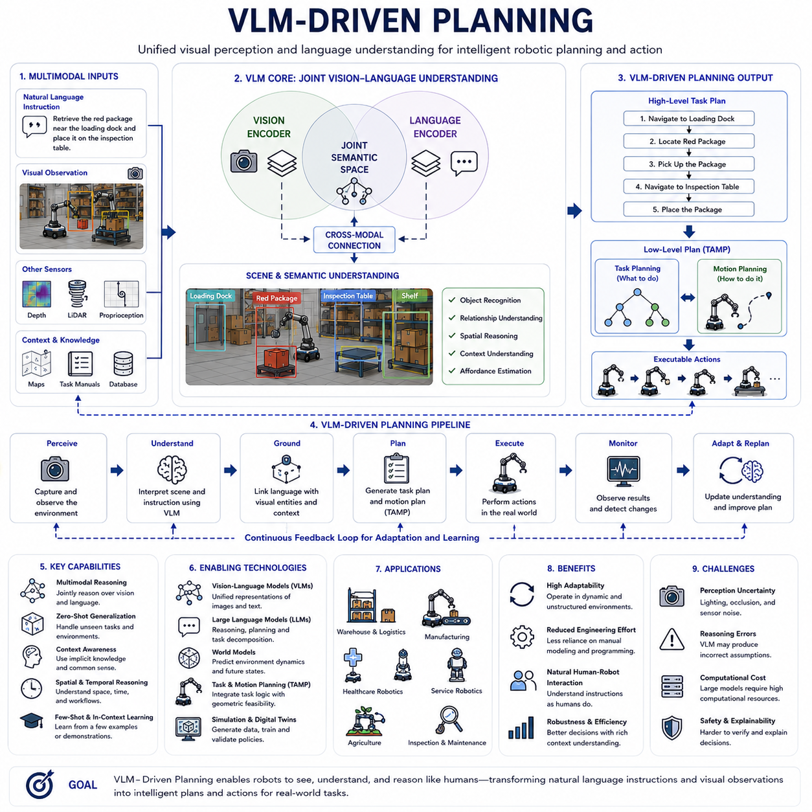
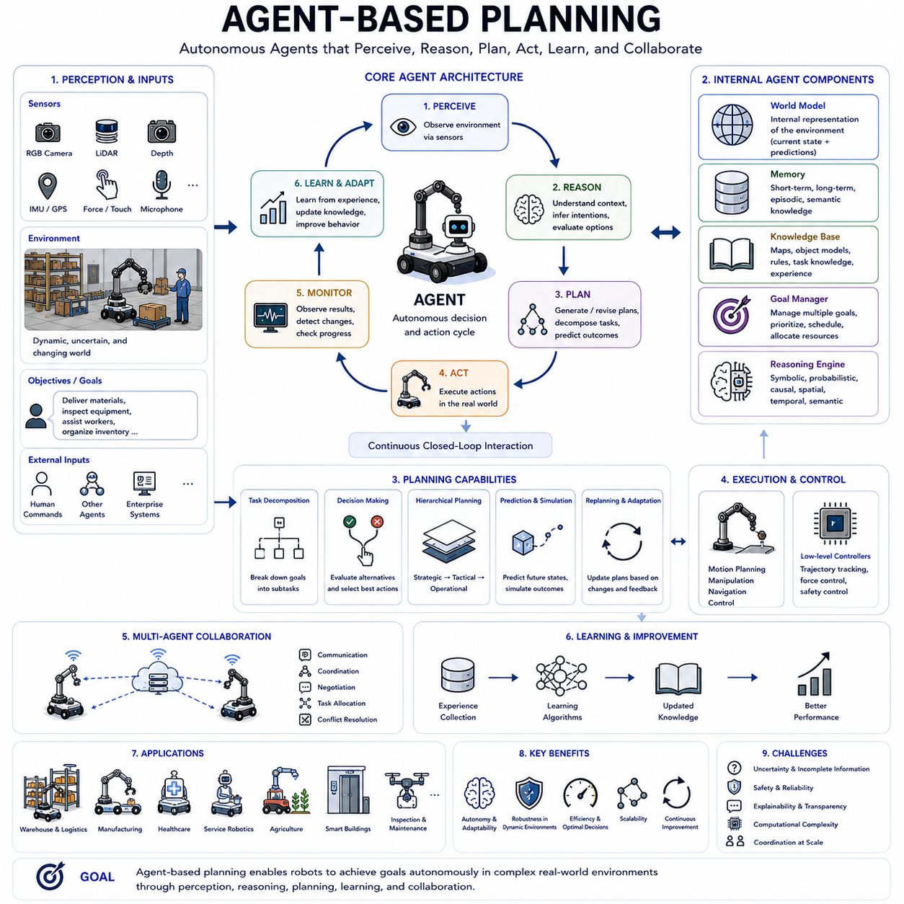
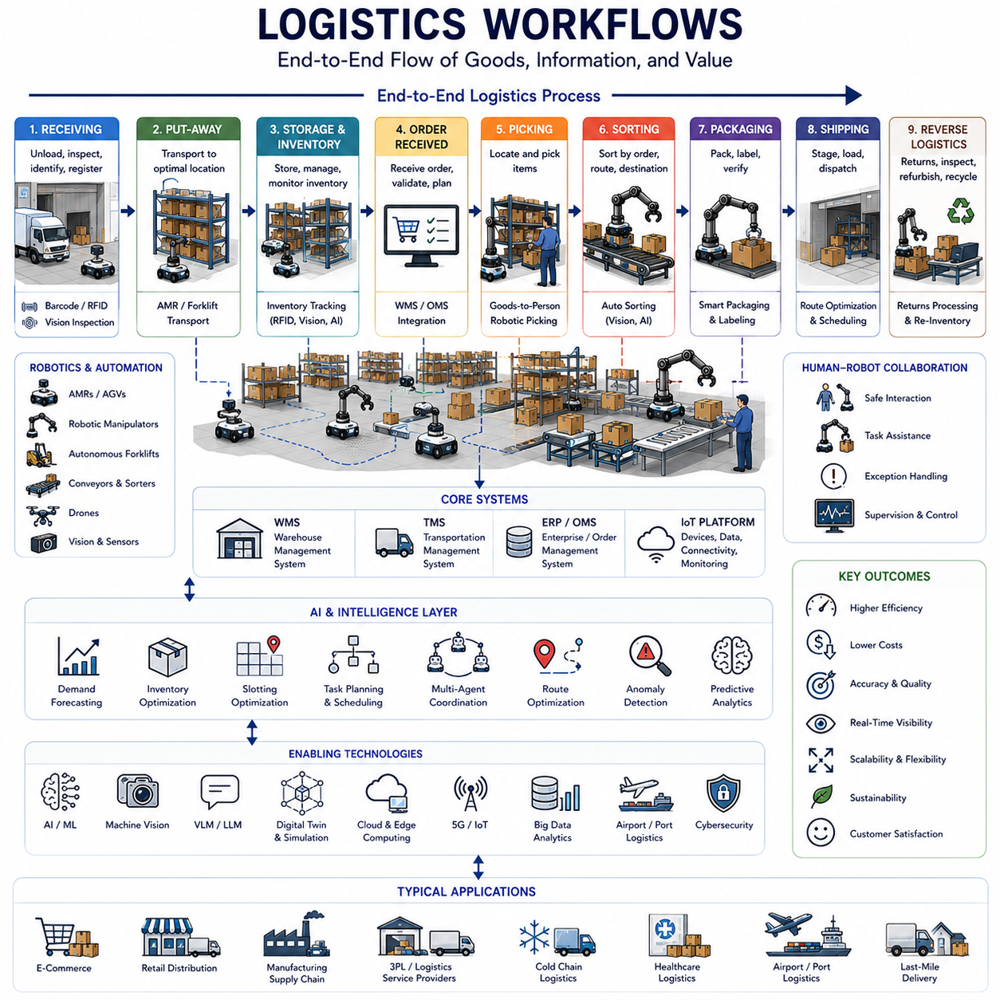

**Volume 04. Mobile Manipulation Software and Operations**

# Chapter 03. Task Planning

## 01 Task Planning Overview

{width="7.268055555555556in" height="7.268055555555556in"}

Task planning is one of the most important capabilities that distinguishes a mobile manipulator from a conventional industrial robot. A traditional industrial robot typically executes preprogrammed motions inside a fixed workspace, repeatedly performing the same operation under tightly controlled conditions. A mobile manipulator, by contrast, operates in dynamic and often unpredictable environments where it must continuously interpret goals, evaluate environmental conditions, coordinate mobility and manipulation functions, and generate action sequences that achieve desired outcomes. As a result, task planning becomes the intelligence layer that transforms a collection of hardware components into an autonomous robotic system capable of completing meaningful work. Within the software architecture of a mobile manipulator, task planning acts as the bridge between high-level mission objectives and low-level motion execution. It determines what actions should be performed, in what order they should occur, and under what conditions alternative actions should be selected. This role makes task planning a central component of modern autonomous robotics systems.

At its core, task planning is the process of converting an abstract objective into a structured sequence of executable actions. A human operator may issue a command such as "retrieve a box from storage shelf B and deliver it to assembly station A." While this instruction appears simple to a human observer, it contains numerous hidden requirements that must be addressed by the robot. The robot must identify the target location, navigate to the storage area, localize the desired object, determine an appropriate grasp strategy, execute the pickup operation, verify successful grasping, plan a collision-free route to the destination, navigate safely through the environment, place the object at the designated location, and confirm mission completion. Each of these activities consists of multiple subtasks and decision points. Task planning provides the framework that organizes and coordinates these activities into a coherent workflow.

In mobile manipulation systems, task planning exists above motion planning and control layers. Motion planning focuses on generating feasible trajectories for robot movement, while control systems execute those trajectories through actuators and sensors. Task planning operates at a higher level of abstraction. Instead of calculating joint trajectories or wheel velocities, it reasons about goals, actions, resources, constraints, and outcomes. A task planner may decide that a robot should first inspect an object before grasping it, or that a different route should be selected because a pathway is currently occupied. These decisions influence subsequent motion planning processes. Consequently, task planning is often viewed as the decision-making layer of robotic autonomy.

The increasing complexity of modern robotic applications has elevated the importance of task planning. In warehouse environments, mobile manipulators may be required to retrieve thousands of different products from dynamic storage locations. In hospitals, robots may transport medications, supplies, and laboratory samples while interacting safely with patients and medical staff. In manufacturing facilities, robots may perform machine tending, assembly support, quality inspection, and material handling within shared workspaces. Each of these environments presents unique challenges involving uncertainty, changing priorities, resource constraints, and human interaction. Task planning enables robots to adapt their behavior to these changing conditions while maintaining operational efficiency and safety.

A key characteristic of task planning is its hierarchical nature. Complex missions are rarely executed as single monolithic actions. Instead, they are decomposed into smaller tasks and subtasks. For example, a warehouse picking mission may be divided into navigation, perception, grasping, transportation, and placement phases. Each phase can be further decomposed into additional activities. Hierarchical decomposition reduces complexity by allowing planners to reason about problems at multiple levels of abstraction. High-level planners focus on strategic decisions, while lower-level planners handle execution details. This hierarchical structure mirrors the way humans approach complex tasks and has become a fundamental principle in robotic task planning architectures.

The concept of goals is central to task planning. Every planning process begins with a desired outcome. Goals may be explicitly defined by operators, generated by external systems, or produced autonomously by higher-level decision-making modules. A goal may specify a physical state, such as moving an object to a target location, or an operational objective, such as completing an inventory inspection route. The planner evaluates the current state of the environment, compares it with the desired goal state, and generates a sequence of actions that transforms one into the other. Effective goal representation is essential because it influences planning efficiency, adaptability, and scalability.

Task planning also relies heavily on environmental models. To make informed decisions, the planner requires knowledge about objects, locations, resources, constraints, and relationships within the workspace. This information is often represented through symbolic models, semantic maps, knowledge graphs, or world models. For example, the planner may know that a shelf contains specific items, that a charging station is located in a particular area, or that certain zones are restricted during operational hours. Such information enables planners to reason about possible actions and their consequences. As robotic systems become more intelligent, world models are becoming increasingly sophisticated, integrating perception data, operational knowledge, and contextual information into unified representations.

Uncertainty represents one of the greatest challenges in task planning. Unlike controlled industrial environments, real-world settings are inherently dynamic. Objects may not be located exactly where expected. Humans may enter robot workspaces unexpectedly. Sensors may produce noisy measurements. Network connections may experience interruptions. Task planners must therefore operate under conditions of incomplete information and uncertainty. Robust planning systems incorporate mechanisms for monitoring execution, detecting failures, and adapting plans when conditions change. This capability is often referred to as replanning or adaptive planning. Instead of rigidly following a predefined sequence, the robot continuously evaluates whether its assumptions remain valid and adjusts its strategy when necessary.

Task planning is closely connected with perception systems. Before actions can be planned, the robot must understand its environment. Cameras, LiDAR systems, force sensors, tactile sensors, and other perception technologies provide information about objects and environmental conditions. The planner uses this information to make decisions about task execution. For example, if an object is partially occluded, the planner may decide to reposition the robot to obtain a better view before attempting a grasp. If a pathway becomes blocked, the planner may select an alternative route. The interaction between perception and planning creates a continuous feedback loop that supports intelligent behavior in changing environments.

Manipulation planning is another critical component of mobile manipulator task execution. Unlike pure AMRs, mobile manipulators must coordinate base movement and arm motion. The planner must determine not only where the robot should travel but also how the manipulator should interact with objects. This coordination introduces additional complexity because mobility and manipulation actions are interdependent. The robot's base position influences arm reachability, collision risks, grasp quality, and task efficiency. Effective task planning therefore considers the robot as an integrated system rather than treating navigation and manipulation as independent functions.

The evolution of artificial intelligence has significantly influenced task planning methodologies. Early robotic planners relied primarily on rule-based systems and manually defined action sequences. While effective in structured environments, these approaches struggled with scalability and adaptability. Modern systems increasingly incorporate machine learning, reinforcement learning, large language models, vision-language models, and foundation models. These technologies enable planners to reason about tasks in more flexible and human-like ways. A robot may interpret natural language instructions, understand contextual relationships between objects, and generate plans that were not explicitly programmed by developers. AI-driven planning represents a major step toward more general-purpose robotic intelligence.

Task planning is also deeply connected to operational efficiency. In industrial deployments, robots are expected to maximize productivity while minimizing operational costs. The planner must therefore consider factors such as travel distance, energy consumption, execution time, equipment utilization, and mission priority. Optimization techniques are frequently integrated into planning frameworks to identify solutions that balance competing objectives. A robot may choose a slightly longer route if it avoids congestion, or postpone a noncritical task to prioritize urgent work orders. Such decisions contribute directly to overall system performance.

Safety considerations play a fundamental role in task planning. Mobile manipulators frequently operate in environments shared with humans. The planner must ensure that actions comply with safety requirements and operational constraints. This may involve maintaining safe separation distances, limiting robot speed in occupied areas, avoiding restricted zones, or selecting safer grasp strategies. Safety-aware planning extends beyond collision avoidance and includes broader considerations related to risk assessment, regulatory compliance, and operational reliability. As robots become more autonomous, integrating safety directly into planning processes becomes increasingly important.

Task planning also serves as the foundation for multi-robot coordination. In many industrial applications, multiple robots collaborate to accomplish shared objectives. A fleet of mobile manipulators may work together to fulfill orders, transport materials, or perform inspections. Coordinating these activities requires planners that can allocate tasks, manage dependencies, resolve conflicts, and optimize resource utilization across the entire fleet. Multi-robot task planning introduces additional challenges related to communication, synchronization, and scalability. Nevertheless, it enables significant improvements in throughput and operational flexibility.

The rise of digital twins has further expanded the capabilities of task planning. Digital twin environments allow planners to simulate task execution before deployment in the physical world. Potential failures, bottlenecks, and inefficiencies can be identified and addressed proactively. Simulation-based planning reduces operational risk and accelerates system development. It also enables continuous optimization as planners evaluate alternative strategies under varying conditions. Digital twins are increasingly becoming an integral part of modern robotic operations.

Another emerging trend is the integration of task planning with cloud and edge computing infrastructures. Complex planning algorithms often require substantial computational resources. Cloud-based planning systems can leverage scalable computing platforms to generate sophisticated plans, while edge computing systems provide low-latency execution support. Hybrid architectures combine the strengths of both approaches, enabling robots to benefit from centralized intelligence while maintaining real-time responsiveness. This trend aligns with the broader movement toward connected robotic ecosystems and cloud robotics.

From a software architecture perspective, task planning is rarely implemented as a standalone module. Instead, it interacts with numerous subsystems, including perception, navigation, manipulation, fleet management, simulation, safety monitoring, data analytics, and human-machine interfaces. The planner receives information from these systems, makes decisions based on available knowledge, and issues commands that drive robot behavior. Effective integration is therefore essential for successful deployment. Modern ROS2-based mobile manipulation platforms commonly use modular architectures in which task planners coordinate multiple specialized components through standardized communication frameworks.

As mobile manipulation technology advances, task planning is evolving from simple action sequencing toward comprehensive autonomous reasoning. Future planners are expected to understand high-level business objectives, interpret human intent, coordinate large fleets of heterogeneous robots, and continuously learn from operational experience. Advances in embodied AI, robot foundation models, large language models, and agent-based architectures are accelerating this transformation. Robots will increasingly be able to understand instructions expressed in natural language, reason about complex objectives, and autonomously generate plans that adapt to changing circumstances.

In summary, task planning serves as the cognitive backbone of mobile manipulation systems. It transforms goals into executable actions, coordinates navigation and manipulation activities, manages uncertainty, integrates perception and decision-making, supports safety and efficiency objectives, and enables collaboration across multiple robotic agents. Without task planning, a mobile manipulator would simply be a collection of sensors, actuators, and software modules. With task planning, it becomes an intelligent autonomous system capable of understanding objectives, making decisions, and accomplishing meaningful work in complex real-world environments. The subsequent chapters of this section will explore the methodologies, algorithms, architectures, and implementation strategies that enable modern mobile manipulators to perform increasingly sophisticated tasks across industrial, logistics, healthcare, service, and future embodied AI applications.

## 02 Task Decomposition

{width="7.268055555555556in" height="7.268055555555556in"}

Task decomposition is one of the most fundamental concepts in mobile manipulation software because it provides the mechanism through which complex missions can be transformed into manageable, executable actions. Modern mobile manipulators operate in environments that are far more dynamic and complex than traditional industrial robotics cells. They must navigate through changing environments, interact with a wide variety of objects, coordinate mobile bases and robotic arms, respond to unexpected events, and often collaborate with humans or other robots. Attempting to solve an entire mission as a single monolithic problem quickly becomes computationally infeasible and operationally unreliable. Task decomposition addresses this challenge by dividing large objectives into smaller, structured components that can be planned, executed, monitored, and optimized independently.

The principle behind task decomposition is similar to how humans solve complicated problems. When a person is asked to assemble a product, prepare a meal, or organize a warehouse operation, they do not think about every detail simultaneously. Instead, they divide the overall goal into smaller tasks and focus on each step individually. A robot must follow a similar strategy. Rather than treating a mission as one enormous optimization problem, the robot separates the mission into hierarchical layers of goals, tasks, subtasks, actions, and primitive motions. This hierarchical organization dramatically reduces complexity while improving scalability, maintainability, explainability, and execution reliability.

Consider a mobile manipulator operating in a warehouse environment. The robot receives a mission to retrieve a package from a storage shelf and deliver it to a packing station. At first glance, this appears to be a single task. However, from the robot\'s perspective, it consists of numerous smaller activities. The robot must identify the target package, determine its location, navigate toward the storage area, avoid obstacles along the way, position itself for manipulation, detect the package, compute a grasp strategy, execute the grasp, verify successful pickup, plan a route toward the destination, navigate safely through the facility, place the package at the designated location, and report mission completion. Each of these steps can be further decomposed into additional actions. Task decomposition provides the framework for managing this complexity.

In robotics, decomposition is often represented as a hierarchy. At the highest level exists the mission or objective. This mission is divided into major tasks. Each task is divided into subtasks, and subtasks are eventually translated into executable actions. At the lowest level, actions are converted into motion plans, trajectories, and control commands. This layered structure enables different software modules to operate at different levels of abstraction. Strategic planning modules focus on mission-level decisions, while execution modules focus on low-level physical actions.

One of the major advantages of task decomposition is modularity. When tasks are decomposed into independent components, each component can be developed, tested, validated, and improved separately. For example, a navigation module can be upgraded without requiring modifications to grasp planning algorithms. Similarly, a new manipulation capability can be added without changing fleet management software. This modularity is particularly important in large-scale robotic deployments where software systems may consist of hundreds of interacting components.

Task decomposition also improves reusability. Many robotic operations share common building blocks. Navigation, object detection, localization, obstacle avoidance, grasp execution, and verification are frequently reused across different applications. By decomposing tasks into reusable modules, developers can create libraries of robotic skills that can be combined in different ways depending on mission requirements. A pick-and-place operation, an inspection task, and a material transport mission may all use the same navigation and perception capabilities even though their overall objectives differ significantly.

Another important benefit is scalability. As robotic systems become more sophisticated, the number of possible actions and environmental conditions increases dramatically. Without decomposition, planning complexity grows exponentially. Hierarchical decomposition reduces this growth by limiting the decision space at each layer. High-level planners focus on strategic goals, while lower-level planners solve local problems. This separation enables robotic systems to handle increasingly large and complex environments without overwhelming computational resources.

Task decomposition plays a critical role in mobile manipulation because these systems must coordinate both mobility and manipulation capabilities. Traditional industrial robots operate within fixed workspaces and generally focus only on manipulation. Autonomous Mobile Robots primarily focus on navigation. Mobile manipulators must integrate both domains simultaneously. A successful task decomposition framework therefore separates navigation-related tasks from manipulation-related tasks while maintaining coordination between them. The system must determine not only where the robot should move but also how it should interact with objects once it reaches its destination.

In practical implementations, task decomposition frequently follows a goal-driven approach. The planner begins with a desired outcome and recursively breaks it into smaller tasks until executable actions are obtained. For example, the goal of delivering a container may be decomposed into acquiring the container and transporting the container. Acquiring the container may be further decomposed into locating, approaching, grasping, and verifying the object. Transporting the container may be decomposed into route planning, navigation, monitoring, and placement. Each level of decomposition introduces additional detail while preserving alignment with the original mission objective.

Task decomposition is also closely connected to workflow modeling. Industrial environments often contain highly structured operational procedures. Manufacturing operations, warehouse fulfillment processes, hospital logistics workflows, and laboratory automation systems all rely on well-defined sequences of activities. Task decomposition enables robotic systems to mirror these workflows. By representing operational procedures as hierarchical task structures, robots can execute complex business processes in a predictable and auditable manner.

One challenge in task decomposition involves determining the appropriate level of granularity. If tasks are too large, planning becomes inflexible and difficult to manage. If tasks are too small, the system becomes overwhelmed by excessive detail and coordination overhead. Effective decomposition requires balancing abstraction and specificity. The optimal level depends on application requirements, environmental complexity, computational resources, and operational objectives. Experienced robotics engineers often refine decomposition structures through extensive field testing and operational feedback.

Another important consideration is dependency management. Tasks rarely exist in isolation. Certain actions must occur before others can begin. A robot cannot grasp an object before locating it. It cannot transport an object before successfully picking it up. It cannot deliver an item before reaching the destination. Task decomposition frameworks therefore include mechanisms for representing dependencies, prerequisites, constraints, and execution ordering. These relationships ensure logical consistency during mission execution.

Task decomposition also supports error recovery and fault tolerance. Real-world environments are unpredictable, and failures are inevitable. A grasp attempt may fail because an object shifts unexpectedly. A pathway may become blocked by a human worker or another robot. A sensor may temporarily lose visibility of the target object. When tasks are decomposed into smaller units, failures can often be isolated and addressed locally without restarting the entire mission. The robot may simply repeat a failed subtask, select an alternative strategy, or invoke a recovery procedure. This capability significantly improves operational robustness.

The relationship between task decomposition and monitoring is equally important. Modern robotic systems continuously evaluate mission progress during execution. Monitoring modules track task completion status, resource utilization, environmental changes, and operational performance. Decomposed task structures provide clear checkpoints that enable monitoring systems to assess progress accurately. If deviations occur, planners can identify which task or subtask is affected and respond accordingly.

Artificial intelligence is increasingly influencing task decomposition methodologies. Traditional robotic systems relied heavily on manually defined task hierarchies designed by engineers. While effective in structured environments, these approaches often struggled to generalize to new situations. Recent advances in machine learning and foundation models are enabling robots to generate task decompositions dynamically. Large Language Models can interpret natural language instructions and automatically propose task hierarchies. Vision-Language Models can incorporate visual context when generating plans. Reinforcement learning systems can discover efficient decomposition strategies through experience. These developments are moving robotics toward more adaptive and autonomous planning architectures.

Task decomposition is also a foundational component of Hierarchical Task Networks, symbolic planning systems, behavior trees, and task-and-motion planning frameworks. Each of these methodologies relies on the concept of breaking complex goals into smaller units. Hierarchical Task Networks explicitly represent decomposition relationships through task hierarchies. Behavior trees organize execution logic into modular behaviors. Symbolic planners reason about actions and states at multiple abstraction levels. Task-and-motion planners integrate high-level decomposition with low-level physical execution. Although these approaches differ in implementation, they all depend on decomposition as a central organizing principle.

In multi-robot systems, task decomposition becomes even more important. Complex missions may be divided not only into subtasks but also distributed among multiple robotic agents. A fleet of mobile manipulators operating in a warehouse may allocate picking tasks, transportation tasks, inspection tasks, and replenishment tasks across different robots. Effective decomposition enables parallel execution, reduces bottlenecks, and improves overall system throughput. The decomposition structure provides a framework for determining which tasks can be executed independently and which require coordination.

Digital twins and simulation environments provide valuable tools for validating task decomposition strategies. Engineers can evaluate alternative decomposition structures, identify inefficiencies, analyze bottlenecks, and measure performance before deploying systems in physical environments. Simulation-based analysis helps ensure that decomposition frameworks support operational objectives while minimizing risk and development costs.

Cloud robotics and distributed computing architectures are also influencing how task decomposition is implemented. High-level planning and decomposition processes may occur in cloud environments with substantial computational resources, while low-level execution occurs on edge devices embedded within robots. This separation enables more sophisticated planning algorithms while preserving real-time responsiveness during operation. As robotic fleets continue to grow, distributed task decomposition architectures are expected to become increasingly common.

From a software engineering perspective, task decomposition contributes significantly to maintainability and lifecycle management. Robotic systems often remain operational for many years and undergo continuous upgrades. Well-structured decomposition frameworks make it easier to introduce new capabilities, replace obsolete components, and adapt systems to changing business requirements. This flexibility is particularly valuable in industrial environments where operational demands evolve over time.

The future of task decomposition is closely tied to the development of embodied AI and autonomous robotic agents. Future robots will likely receive high-level objectives expressed in natural language and autonomously generate detailed task structures without human intervention. They will understand goals, reason about alternatives, predict outcomes, allocate resources, and coordinate multiple skills dynamically. Rather than relying entirely on predefined decomposition templates, they will generate context-aware decompositions tailored to specific environments and operational conditions.

Ultimately, task decomposition serves as the organizational backbone of mobile manipulation systems. It transforms complex missions into structured, executable workflows that can be understood, planned, monitored, optimized, and adapted. By reducing complexity, improving modularity, enabling scalability, supporting fault recovery, and facilitating intelligent decision-making, task decomposition forms the foundation upon which modern autonomous mobile manipulators are built. As robotic autonomy continues to advance, the importance of effective task decomposition will only increase, making it one of the most critical concepts in the design and operation of next-generation robotic systems.

## 03 Hierarchical Task Networks

{width="7.268055555555556in" height="7.268055555555556in"}

Hierarchical Task Networks (HTNs) represent one of the most influential and practical planning methodologies in modern robotics. As robotic systems have evolved from simple industrial manipulators into autonomous mobile manipulators capable of operating in dynamic environments, the need for structured planning frameworks has become increasingly important. HTNs provide a mechanism for organizing complex tasks into manageable hierarchies, enabling robots to reason about high-level objectives while simultaneously maintaining the ability to execute detailed low-level actions. In many respects, HTNs serve as the bridge between strategic mission planning and operational task execution. They provide a structured framework through which robots can transform abstract goals into executable behaviors while preserving logical consistency, operational efficiency, and adaptability.

The fundamental concept behind HTNs is remarkably intuitive because it mirrors the way humans solve complex problems. When a person is assigned a large objective, such as organizing a warehouse, assembling a machine, or delivering materials across a factory, they rarely think about every action simultaneously. Instead, they decompose the objective into progressively smaller tasks. A warehouse manager may divide a fulfillment operation into inventory retrieval, transportation, packaging, and shipping activities. Each of these activities can then be further decomposed into detailed procedures. HTNs formalize this natural hierarchical reasoning process into a planning framework that can be executed by robotic systems.

In a Hierarchical Task Network, a task is represented as a node within a hierarchy. Tasks are divided into two primary categories: compound tasks and primitive tasks. Compound tasks represent high-level objectives that cannot be executed directly. Instead, they must be decomposed into smaller subtasks. Primitive tasks, by contrast, correspond to actions that can be executed directly by the robot. These actions eventually become navigation commands, manipulator motions, sensor operations, communication procedures, or actuator commands. The planning process consists of repeatedly decomposing compound tasks until only primitive tasks remain.

Consider a mobile manipulator operating in a logistics warehouse. The robot receives a mission to retrieve a package from storage and deliver it to a shipping station. In an HTN representation, the top-level task might be labeled "Fulfill Order." This compound task can be decomposed into subtasks such as "Retrieve Package," "Transport Package," and "Confirm Delivery." The "Retrieve Package" task can be further decomposed into "Locate Shelf," "Navigate to Shelf," "Detect Package," "Plan Grasp," and "Pick Package." Each of these tasks may contain additional levels of decomposition until the robot reaches primitive actions such as moving wheels, rotating joints, closing grippers, or capturing sensor data. This hierarchical breakdown allows the robot to reason about the mission at multiple levels of abstraction simultaneously.

One of the key strengths of HTNs is their ability to incorporate domain knowledge directly into the planning process. Traditional planning systems often focus on searching large state spaces to identify valid action sequences. While powerful, these approaches can become computationally expensive in complex environments. HTNs reduce this burden by leveraging expert knowledge about how tasks should be decomposed. Engineers can encode operational procedures, best practices, safety constraints, and workflow structures into decomposition methods. As a result, planning becomes more efficient because the search process is guided by domain-specific knowledge rather than exploring every possible action sequence.

A decomposition method is one of the most important concepts within HTNs. A method defines how a compound task can be transformed into a set of subtasks. Multiple methods may exist for the same task, allowing the planner to choose among alternative strategies depending on environmental conditions and operational requirements. For example, a "Transport Object" task may have one method optimized for speed and another optimized for safety. The planner selects the most appropriate method based on the current situation. This flexibility enables HTNs to adapt to changing conditions while maintaining structured decision-making processes.

The hierarchical nature of HTNs provides several significant advantages. One of the most important is scalability. As robotic systems become more sophisticated, the complexity of planning problems increases dramatically. Without hierarchical abstraction, planning algorithms must reason about enormous numbers of possible actions and states. HTNs mitigate this challenge by dividing planning into multiple levels. High-level planners focus on strategic objectives, while lower-level planners handle execution details. This separation dramatically reduces computational complexity and enables robotic systems to tackle larger and more sophisticated missions.

Another important advantage is explainability. Modern autonomous systems are increasingly required to justify their decisions, particularly in industrial, medical, and safety-critical applications. HTNs naturally produce planning structures that are understandable by humans. Because tasks are organized hierarchically, operators can easily trace the relationship between high-level objectives and low-level actions. If a robot performs an unexpected action, engineers can examine the task hierarchy to understand the reasoning process that led to that decision. This transparency simplifies debugging, validation, certification, and operational oversight.

Modularity is another defining characteristic of HTNs. Decomposition methods can be developed, tested, and maintained independently. New capabilities can be introduced by adding new methods without modifying the entire planning architecture. For example, a mobile manipulator operating in a warehouse may later be deployed in a hospital environment. Many existing decomposition methods, such as navigation, object retrieval, and delivery procedures, can be reused with minimal modification. This modularity significantly reduces development effort and supports long-term software maintainability.

HTNs are particularly valuable for mobile manipulators because these systems must coordinate navigation and manipulation activities. Traditional robotic planning often treats mobility and manipulation as separate problems. However, mobile manipulators require integrated decision-making. A robot must determine where to position its base, how to approach an object, how to execute a grasp, and how to transport the object afterward. HTNs provide a framework for organizing these interdependent activities within a unified task hierarchy. Navigation subtasks and manipulation subtasks can be coordinated while remaining logically separated within the planning structure.

Resource management is another area where HTNs demonstrate considerable value. Real-world robotic systems operate under numerous constraints involving battery capacity, computational resources, tool availability, payload limits, and operational schedules. HTN planners can incorporate these constraints directly into decomposition methods. A robot with low battery capacity may select a delivery strategy that includes a charging stop. A manipulator carrying a heavy object may choose an alternative route that avoids steep inclines. By embedding resource considerations into task decomposition, HTNs support more realistic and operationally effective planning.

Time management also plays a critical role in many robotic applications. Industrial environments often impose strict timing requirements. Production schedules, delivery deadlines, machine utilization targets, and service-level agreements all influence operational decision-making. HTNs can incorporate temporal reasoning by specifying ordering constraints, execution windows, and synchronization requirements. Tasks can be arranged sequentially or in parallel depending on operational objectives. This capability is particularly valuable in multi-robot environments where coordinated execution is required.

Uncertainty represents one of the greatest challenges in robotics, and HTNs provide several mechanisms for addressing it. Although classical HTNs assume deterministic task execution, modern implementations frequently integrate monitoring, replanning, and adaptive behaviors. During execution, the robot continuously evaluates whether tasks are progressing as expected. If a failure occurs, the planner can revisit the hierarchy and select alternative decomposition methods. For example, if a grasp attempt fails, the robot may choose a different grasp strategy or reposition itself before retrying. This adaptive capability significantly improves robustness in dynamic environments.

The relationship between HTNs and symbolic planning is particularly important. Both approaches operate at relatively high levels of abstraction and rely on structured representations of tasks and actions. However, HTNs differ in their emphasis on decomposition rather than state-space search. Symbolic planners typically search for sequences of actions that transform the current state into a desired goal state. HTNs begin with tasks and progressively decompose them into executable actions. In practice, many modern robotic systems combine HTN methodologies with symbolic planning techniques to leverage the strengths of both approaches.

Behavior Trees and HTNs are also closely related. Both organize robotic behavior hierarchically and support modular design. However, their purposes differ. HTNs primarily focus on planning and task decomposition, while Behavior Trees focus on execution control and runtime decision-making. A common architecture in modern robotics uses HTNs to generate task structures and Behavior Trees to execute them. The HTN determines what should be done, while the Behavior Tree determines how execution should proceed under changing conditions.

Task and Motion Planning (TAMP) systems frequently integrate HTNs as well. One of the major challenges in robotics is connecting high-level reasoning with low-level physical execution. HTNs provide a natural framework for this integration. High-level tasks can be decomposed into subtasks that invoke motion planning algorithms when physical actions are required. For example, a "Pick Object" task may ultimately trigger inverse kinematics calculations, collision checking, grasp optimization, and trajectory generation. HTNs therefore serve as a bridge between cognitive reasoning and physical motion.

Artificial intelligence is transforming HTN planning in significant ways. Traditionally, decomposition methods were handcrafted by domain experts. While effective, this approach required substantial engineering effort and limited adaptability. Recent advances in machine learning, reinforcement learning, and foundation models are enabling robots to generate decomposition structures dynamically. Large Language Models can interpret natural language instructions and propose task hierarchies. Vision-Language Models can incorporate visual context into planning decisions. Reinforcement learning systems can optimize decomposition strategies based on operational experience. These developments are creating more flexible and autonomous planning architectures.

Multi-robot systems further highlight the value of HTNs. Complex industrial operations often involve fleets of robots working together toward shared objectives. HTNs provide mechanisms for decomposing missions into subtasks that can be distributed across multiple agents. One robot may retrieve materials while another performs inspection and a third handles transportation. Coordination constraints can be embedded within the hierarchy, ensuring that tasks are executed in the proper sequence and that resources are allocated efficiently. This capability supports scalable automation across large operational environments.

Digital twins and simulation environments are increasingly used to validate HTN structures before deployment. Engineers can simulate task execution, identify bottlenecks, evaluate alternative decomposition methods, and measure performance under various conditions. Simulation-based validation reduces deployment risk and accelerates development cycles. As digital twin technologies continue to mature, HTNs are becoming an integral component of virtual commissioning and operational optimization workflows.

Cloud robotics is also influencing the future of HTNs. High-level planning and decomposition can be performed in cloud environments with extensive computational resources, while low-level execution remains on edge devices embedded within robots. This hybrid architecture enables sophisticated planning capabilities without sacrificing real-time responsiveness. As robotic fleets continue to expand, cloud-based HTN planning is expected to play an increasingly important role.

From a software engineering perspective, HTNs contribute significantly to maintainability, extensibility, and lifecycle management. The hierarchical structure naturally supports modular development practices. New capabilities can be introduced by adding decomposition methods rather than redesigning entire planning systems. This flexibility is particularly valuable in industrial deployments where operational requirements evolve continuously over time.

The future of HTNs is closely connected to the broader evolution of embodied intelligence. As robots become more capable of understanding natural language, interpreting context, and reasoning about complex objectives, HTNs are likely to become increasingly dynamic and adaptive. Future systems may generate decomposition methods automatically, learn from operational experience, and modify task structures in real time. Rather than relying exclusively on predefined hierarchies, robots will create context-sensitive planning structures tailored to specific environments and mission requirements.

Ultimately, Hierarchical Task Networks provide one of the most practical and effective frameworks for robotic planning. They combine human-like hierarchical reasoning with computational efficiency, modular design, operational transparency, and execution flexibility. By transforming abstract goals into structured task hierarchies, HTNs enable mobile manipulators to perform complex missions reliably and efficiently. As autonomous robotics continues to advance, HTNs will remain a foundational technology supporting intelligent decision-making, scalable automation, and the realization of increasingly capable robotic systems.

## 04 Goal Oriented Planning

{width="7.268055555555556in" height="7.268055555555556in"}

Goal-Oriented Planning is one of the most important planning paradigms in modern robotics and autonomous systems. It provides a systematic methodology for enabling robots to achieve desired outcomes by reasoning about goals rather than merely executing predefined sequences of actions. In traditional automation systems, tasks are often represented as fixed workflows that assume predictable environments and stable operating conditions. While this approach works effectively in highly structured industrial settings, it becomes increasingly limited when robots are deployed in dynamic and uncertain environments. Mobile manipulators, autonomous mobile robots, service robots, and future embodied AI systems must continuously adapt their behavior based on changing circumstances. Goal-Oriented Planning addresses this challenge by shifting the focus from action execution to goal achievement.

The central concept of Goal-Oriented Planning is deceptively simple. Instead of explicitly specifying every action the robot should perform, an operator defines a desired outcome or goal state. The planning system then determines how to achieve that goal based on the robot's current understanding of the environment, available resources, operational constraints, and available actions. This approach mirrors human decision-making. Humans typically think in terms of objectives rather than detailed action sequences. A person may decide to deliver a package, prepare a meal, or inspect equipment without consciously planning every movement in advance. Instead, the objective guides decision-making, and detailed actions emerge during execution. Goal-Oriented Planning brings a similar capability to robotic systems.

Within mobile manipulation software architectures, Goal-Oriented Planning occupies a position between mission management and task execution. The mission layer specifies desired objectives, while lower-level execution systems handle navigation, manipulation, perception, and control. The planner serves as an intelligent intermediary that translates goals into executable plans. This translation process involves evaluating the current state of the environment, comparing it with the desired goal state, identifying differences between the two, and generating a sequence of actions that transforms the current state into the target state. This capability makes Goal-Oriented Planning a foundational component of autonomous robotic intelligence.

A goal can be defined in many different forms. In a warehouse environment, a goal may specify that a package must be delivered to a packing station. In a hospital, a goal may require a robot to transport medication to a patient room. In a manufacturing facility, a goal may involve supplying components to an assembly line. In a service robotics application, a goal may require a robot to assist a customer or retrieve an object. Although these examples differ significantly in operational context, they all share a common structure. A desired outcome is specified, and the robot must determine how to achieve it.

One of the most important concepts in Goal-Oriented Planning is state representation. The planner must maintain a model of the current state of the world and compare it against the desired goal state. The world state may include information about object locations, robot positions, environmental conditions, available resources, system status, and operational constraints. For example, a warehouse robot may know that a package is currently located on shelf B, that the robot is positioned near aisle three, and that a charging station is available nearby. The goal state may specify that the package should be located at a shipping station. The planner\'s responsibility is to determine how to transform the current state into the desired state.

This state-based perspective distinguishes Goal-Oriented Planning from simpler workflow execution systems. Traditional workflows focus on executing predefined sequences regardless of context. Goal-Oriented systems instead focus on outcomes. If environmental conditions change, the planner can generate alternative action sequences while preserving the original objective. For example, if a planned route becomes blocked, the robot can select an alternative path. If an object is moved unexpectedly, the robot can update its plan based on the new information. This flexibility is one of the primary reasons Goal-Oriented Planning has become increasingly important in modern robotics.

A significant advantage of Goal-Oriented Planning is adaptability. Real-world environments are rarely static. Humans move through workspaces, equipment changes state, inventory locations shift, and sensor measurements contain uncertainty. Robots operating in such environments must continuously adapt their behavior. Goal-Oriented Planning enables this adaptability by separating objectives from implementation details. The goal remains constant while the plan may change dynamically in response to environmental conditions. This capability allows robots to operate effectively even when conditions differ from those anticipated during system design.

Goal-Oriented Planning is closely related to artificial intelligence because it requires reasoning about future outcomes. The planner must evaluate possible actions, predict their consequences, and determine which sequence is most likely to achieve the desired goal. This reasoning process often involves search algorithms, heuristic evaluation methods, optimization techniques, and symbolic representations. The planner effectively explores possible future states and selects actions that move the system closer to the desired outcome. This predictive capability distinguishes intelligent planning from simple reactive behavior.

In mobile manipulators, Goal-Oriented Planning becomes particularly valuable because navigation and manipulation must be coordinated. Consider a robot tasked with retrieving a box from a shelf. Achieving the goal requires both movement and object interaction. The robot must determine where to navigate, how to position its base, how to orient its manipulator, how to grasp the object, and how to transport it afterward. Each of these decisions contributes to achieving the overall goal. Rather than treating navigation and manipulation as separate problems, Goal-Oriented Planning integrates them into a unified decision-making framework.

Hierarchical planning structures are frequently combined with Goal-Oriented Planning. A high-level goal may be decomposed into multiple subgoals, each representing a specific milestone toward mission completion. For example, delivering a package may involve reaching the storage area, acquiring the package, transporting it to the destination, and verifying successful delivery. Each subgoal can then be planned independently while remaining connected to the overall objective. This hierarchical structure improves scalability and reduces computational complexity.

Resource awareness is another important aspect of Goal-Oriented Planning. Real robotic systems operate under numerous constraints, including battery capacity, payload limits, available tools, computational resources, and operational schedules. Effective planners must consider these constraints when generating plans. A robot with low battery capacity may incorporate a charging operation into its plan before attempting a long-distance delivery. Similarly, a robot may select different strategies depending on payload weight, sensor availability, or environmental conditions. Resource-aware planning improves both reliability and operational efficiency.

Time considerations also play a critical role. Many robotic applications involve deadlines, scheduling requirements, and synchronization constraints. Manufacturing systems may require materials to arrive at specific times. Hospital logistics systems may prioritize urgent medication deliveries. Warehouse operations may optimize order fulfillment based on shipping schedules. Goal-Oriented Planning can incorporate temporal constraints directly into decision-making processes, enabling robots to balance efficiency, urgency, and resource utilization simultaneously.

Uncertainty management is one of the defining challenges of Goal-Oriented Planning. In practice, robots rarely possess perfect knowledge of their environment. Sensors produce noisy data, objects move unexpectedly, and external events may alter environmental conditions. To address this challenge, planners frequently incorporate monitoring and replanning mechanisms. During execution, the robot continuously evaluates progress toward the goal. If assumptions become invalid, the planner updates its world model and generates a revised plan. This continuous cycle of planning, execution, monitoring, and replanning is essential for robust autonomous operation.

Goal-Oriented Planning is strongly connected to symbolic planning techniques. Symbolic representations provide a structured way to describe goals, actions, and world states. Planners reason about relationships between objects, locations, and conditions using symbolic models. For example, a planner may represent facts such as "Object A is on Shelf B" or "Robot R is located at Station C." Goals are similarly represented as desired symbolic states. This abstraction enables efficient reasoning while remaining understandable to human operators.

The relationship between Goal-Oriented Planning and Hierarchical Task Networks is particularly important. HTNs focus on decomposing tasks into subtasks, while Goal-Oriented Planning focuses on achieving desired outcomes. In many practical systems, the two approaches are combined. Goals define what should be achieved, and HTNs define how those goals can be decomposed into executable tasks. This integration leverages the strengths of both methodologies and has become common in industrial robotics architectures.

Behavior Trees also complement Goal-Oriented Planning. While the planner determines the actions required to achieve a goal, Behavior Trees manage execution and runtime decision-making. The planner produces an action sequence, and the Behavior Tree ensures robust execution under varying conditions. If a failure occurs, the Behavior Tree may trigger recovery behaviors or request replanning. This layered architecture provides both strategic intelligence and operational robustness.

Recent advances in artificial intelligence are transforming Goal-Oriented Planning. Large Language Models, Vision-Language Models, foundation models, and agent-based architectures are enabling robots to reason about goals at increasingly abstract levels. Instead of receiving narrowly defined objectives, future robots may receive natural language instructions such as "prepare the room for a meeting" or "organize the warehouse inventory." The system will interpret the intent, generate intermediate goals, create plans, monitor progress, and adapt dynamically throughout execution. These capabilities move robotics closer to human-like problem-solving.

Agent-based systems represent another significant development. In agent architectures, goals drive autonomous behavior. The agent continuously evaluates its environment, identifies opportunities and challenges, selects goals, generates plans, executes actions, and monitors outcomes. Goal-Oriented Planning serves as the cognitive engine that enables these autonomous decision-making processes. This paradigm is increasingly important for embodied AI systems and future generations of intelligent robots.

Multi-robot environments further highlight the importance of Goal-Oriented Planning. In fleet operations, multiple robots may share common objectives while maintaining individual goals. A warehouse may assign a global goal of fulfilling customer orders while individual robots receive specific transportation and picking objectives. Goal-Oriented Planning provides a framework for coordinating these activities while optimizing overall system performance. By focusing on outcomes rather than rigid action sequences, planners can dynamically allocate tasks and resources across multiple robots.

Digital twins and simulation platforms are also becoming valuable tools for Goal-Oriented Planning. Engineers can evaluate planning strategies in virtual environments before deployment. Different goals, environmental conditions, and operational scenarios can be simulated to assess planner performance. This capability reduces risk, improves reliability, and accelerates development cycles. Digital twin technologies are increasingly integrated with planning systems to support continuous optimization and operational improvement.

Cloud robotics further expands the capabilities of Goal-Oriented Planning. High-level reasoning and planning processes may be executed in cloud environments with substantial computational resources, while low-level execution remains on edge devices embedded within robots. This architecture enables sophisticated planning algorithms without compromising real-time responsiveness. As robotic systems become more complex, cloud-assisted planning is expected to play an increasingly important role.

From a software engineering perspective, Goal-Oriented Planning promotes modularity, maintainability, and scalability. Goals provide a stable abstraction layer that remains independent of specific implementation details. New capabilities can be added without redefining existing objectives. As robotic platforms evolve, planners can continue pursuing the same goals while leveraging new sensors, manipulators, AI models, and operational capabilities. This flexibility is essential for long-term system evolution.

The future of Goal-Oriented Planning is closely linked to the development of embodied intelligence. Future robots will increasingly operate in unstructured environments, collaborate with humans, and pursue complex objectives requiring reasoning, adaptation, and learning. Goals will become more abstract, plans will become more dynamic, and robots will become more capable of autonomously generating and achieving objectives. Rather than executing predefined workflows, future robotic systems will behave as intelligent agents that continuously reason about desired outcomes and determine how best to achieve them.

Ultimately, Goal-Oriented Planning represents a fundamental shift in robotic autonomy. Instead of telling robots exactly what to do, engineers and operators specify what should be achieved. The robot assumes responsibility for determining how to accomplish the objective. This outcome-focused approach improves adaptability, scalability, robustness, and intelligence. As mobile manipulators, autonomous mobile robots, and embodied AI systems continue to evolve, Goal-Oriented Planning will remain one of the most important technologies enabling robots to operate effectively in complex real-world environments.

## 05 Symbolic Planning

{width="7.268055555555556in" height="7.268055555555556in"}

Symbolic Planning is one of the foundational concepts in artificial intelligence and autonomous robotics. It provides a structured framework through which robots can reason about goals, actions, objects, and environmental states using symbolic representations rather than raw sensor data or low-level control commands. For decades, Symbolic Planning has served as one of the primary mechanisms for enabling intelligent decision-making in autonomous systems. While modern robotics increasingly incorporates machine learning, foundation models, and data-driven approaches, symbolic reasoning remains an essential component of many planning architectures because of its transparency, explainability, reliability, and ability to reason about complex objectives at a high level of abstraction.

At its core, Symbolic Planning is based on the idea that the world can be represented using symbols that describe relevant facts, relationships, conditions, and actions. Humans naturally reason about the world symbolically. When a person thinks about moving a package from a shelf to a workstation, they rarely consider individual motor commands or muscle movements. Instead, they think in terms of abstract concepts such as objects, locations, goals, and actions. Symbolic Planning applies the same principle to robotic systems. Rather than planning directly in terms of wheel velocities, joint angles, or sensor values, the robot reasons using symbolic descriptions of the environment and desired outcomes.

A symbolic representation consists of facts that describe the current state of the world. These facts may include statements such as "Box_A is on Shelf_B," "Robot_1 is at Station_C," or "Gripper is empty." Such representations simplify complex environments by focusing only on information that is relevant to decision-making. This abstraction dramatically reduces planning complexity because the planner does not need to process every detail of the physical world. Instead, it operates on a compact logical model that captures essential relationships and conditions.

The planning process begins with a description of the current world state and a desired goal state. The planner\'s objective is to identify a sequence of actions that transforms the current state into the goal state. Each action is represented symbolically and includes conditions that must be satisfied before execution, along with effects that describe how the action changes the world. For example, a "Pick Object" action may require that the robot is located near the object and that the gripper is empty. The effect of the action may be that the object is now held by the robot and no longer located on the shelf. By reasoning about these preconditions and effects, the planner can generate valid sequences of actions that achieve the desired outcome.

Consider a mobile manipulator operating in a warehouse. The current state may indicate that a package is located on Shelf A, the robot is positioned at Charging Station 1, and the gripper is empty. The goal state specifies that the package should be located at Packing Station B. The symbolic planner evaluates available actions such as navigation, object detection, grasping, transportation, and placement. By reasoning about the effects of these actions, the planner generates a sequence that achieves the goal. The resulting plan may include navigating to Shelf A, detecting the package, grasping it, transporting it to Packing Station B, and placing it at the destination. The planner focuses on logical state transitions rather than detailed physical execution.

One of the defining characteristics of Symbolic Planning is the separation between decision-making and execution. The symbolic planner determines what actions should be performed, while lower-level systems determine how those actions are executed. Navigation systems compute paths, motion planners generate trajectories, manipulators execute grasping motions, and controllers manage actuator commands. This separation enables modular system architectures in which high-level reasoning and low-level execution remain independent while working toward common objectives.

Symbolic Planning became particularly influential through the development of formal planning languages such as the Planning Domain Definition Language (PDDL). PDDL provides a standardized framework for representing planning problems. It defines objects, predicates, actions, initial states, and goal states in a machine-readable format. By separating domain knowledge from planning algorithms, PDDL enables planners to operate across a wide range of applications without requiring changes to the underlying planning engine. This standardization has significantly contributed to the growth of automated planning research and industrial adoption.

Within a PDDL framework, the planning domain describes available actions and their logical structure. The planning problem specifies a particular environment, including current conditions and desired goals. The planner then searches for a valid sequence of actions that satisfies the goal conditions. This separation between domain and problem definitions promotes reusability, scalability, and maintainability. The same planning framework can often be applied to warehouses, hospitals, factories, service robotics environments, and autonomous inspection systems with only minor modifications.

One of the greatest strengths of Symbolic Planning is explainability. Because plans are generated through explicit logical reasoning, it is possible to understand and analyze every decision the planner makes. This transparency is particularly valuable in industrial, healthcare, and safety-critical applications where operators must understand why a robot selected a particular course of action. Symbolic plans provide clear causal relationships between actions and outcomes, simplifying debugging, verification, certification, and operational monitoring.

Another major advantage is predictability. Symbolic planners operate according to well-defined logical rules. Given the same world model and goal specification, the planner will consistently generate similar plans. This predictability is important in industrial automation environments where reliability and repeatability are essential. Unlike purely data-driven systems, symbolic planners do not rely exclusively on statistical patterns learned from data. Instead, they leverage structured knowledge and logical inference to make decisions.

Symbolic Planning also excels at handling complex dependencies between tasks. Real-world robotic operations often involve constraints, prerequisites, resource limitations, and ordering requirements. For example, an object cannot be placed before it is grasped, and it cannot be grasped before it is located. Symbolic planners naturally represent these relationships through logical predicates and action constraints. As a result, they can reason about complex workflows and generate plans that satisfy all operational requirements simultaneously.

In mobile manipulation systems, Symbolic Planning serves as an important bridge between mission objectives and physical actions. Mobile manipulators must coordinate navigation, perception, manipulation, and environmental interaction. Symbolic representations allow planners to reason about these diverse capabilities within a unified framework. A symbolic plan may specify that a robot should first navigate to a shelf, then inspect an object, then perform a grasp, and finally deliver the object to a target location. Lower-level systems execute these actions while the symbolic planner focuses on overall mission logic.

Despite its strengths, Symbolic Planning faces several challenges. One of the most significant is the need for accurate world models. Symbolic planners rely on representations of environmental states and object relationships. If these representations are incomplete, outdated, or incorrect, planning performance may degrade significantly. Maintaining accurate symbolic knowledge in dynamic environments requires robust perception systems, continuous state estimation, and reliable world model updates.

Uncertainty presents another challenge. Classical Symbolic Planning assumes deterministic actions and complete knowledge of the environment. In reality, robotic systems operate under uncertainty. Sensors produce noisy measurements, objects may move unexpectedly, and actions may fail. To address these issues, researchers have developed extensions such as contingent planning, probabilistic planning, belief-space planning, and execution monitoring frameworks. These approaches enable symbolic planners to reason about uncertainty and adapt plans when conditions change.

The integration of Symbolic Planning with Hierarchical Task Networks has become increasingly common. HTNs focus on decomposing tasks into subtasks, while Symbolic Planning focuses on achieving desired world states. Combining these approaches provides both structured decomposition and logical reasoning. High-level objectives can be decomposed through HTNs, while symbolic planners generate action sequences that achieve individual subgoals. This integration is widely used in industrial robotics, service robotics, and autonomous mission planning systems.

Task and Motion Planning systems also benefit significantly from Symbolic Planning. One of the longstanding challenges in robotics is connecting abstract reasoning with physical execution. Symbolic planners operate at a high level of abstraction, while motion planners operate in continuous geometric spaces. Task and Motion Planning frameworks integrate these domains by allowing symbolic decisions to invoke motion planning procedures when physical actions are required. For example, a symbolic action such as "Pick Box" may trigger grasp planning, inverse kinematics calculations, collision checking, and trajectory optimization. This integration enables robots to reason strategically while maintaining physical feasibility.

Behavior Trees are frequently used alongside Symbolic Planning as well. The symbolic planner generates plans, while Behavior Trees manage execution and runtime adaptation. If an action fails during execution, the Behavior Tree can invoke recovery behaviors, request replanning, or select alternative strategies. This layered architecture combines the strengths of symbolic reasoning and reactive execution control.

Artificial intelligence is driving a significant evolution in Symbolic Planning methodologies. Traditionally, symbolic models were handcrafted by domain experts who explicitly defined objects, predicates, actions, and constraints. While effective, this process was time-consuming and difficult to scale. Recent advances in machine learning and foundation models are enabling automatic generation of symbolic knowledge from data. Robots can increasingly learn symbolic representations through perception, observation, and interaction with the environment. This capability reduces engineering effort and improves adaptability.

Large Language Models are particularly influential in this area. LLMs possess extensive world knowledge and strong reasoning capabilities. They can translate natural language instructions into symbolic goals, generate planning domains, propose action sequences, and assist with task decomposition. A user may instruct a robot to "prepare a workstation for assembly," and the system can automatically generate symbolic representations of relevant goals and actions. This integration significantly expands the usability of Symbolic Planning systems.

Vision-Language Models further enhance symbolic reasoning by connecting visual perception with symbolic representations. A robot can observe an environment through cameras, identify objects and relationships, and generate symbolic descriptions of the scene. These symbolic representations can then be used by planning systems. This capability is particularly important for mobile manipulators operating in unstructured environments where object locations and environmental conditions change frequently.

Agent-based architectures represent another emerging direction. In autonomous agents, symbolic reasoning often serves as the cognitive layer responsible for goal management, planning, decision-making, and resource allocation. The agent continuously updates its symbolic world model, evaluates goals, generates plans, executes actions, and monitors outcomes. This architecture closely resembles human cognitive processes and is increasingly being adopted in embodied AI systems.

Multi-robot systems also benefit from Symbolic Planning. In collaborative environments, multiple robots may share common goals while maintaining individual responsibilities. Symbolic planners can represent shared resources, task dependencies, and coordination constraints. By reasoning about these relationships, planners can generate coordinated plans that optimize overall system performance while preventing conflicts and resource contention.

Digital twins provide additional opportunities for symbolic reasoning. Virtual representations of robotic systems and environments can maintain symbolic world models synchronized with physical operations. Planning algorithms can test alternative strategies within digital twins before deployment. This capability improves reliability, reduces risk, and supports continuous optimization of robotic operations.

Cloud robotics further expands the capabilities of Symbolic Planning. High-level reasoning processes can be executed in cloud environments with substantial computational resources, while execution remains on edge devices. This architecture enables large-scale symbolic reasoning across robotic fleets while maintaining real-time responsiveness at the robot level.

As embodied AI continues to evolve, Symbolic Planning is expected to remain a critical component of intelligent robotic systems. Although data-driven methods have achieved remarkable success, symbolic reasoning provides capabilities that are difficult to replace, including explainability, logical consistency, abstraction, and structured decision-making. Future robotic architectures will likely combine symbolic reasoning, machine learning, foundation models, and probabilistic inference into unified cognitive systems capable of operating effectively in complex real-world environments.

Ultimately, Symbolic Planning represents one of the most important foundations of autonomous intelligence. By enabling robots to reason about goals, actions, states, and outcomes through abstract symbolic representations, it provides a powerful mechanism for structured decision-making. It bridges the gap between human-level conceptual reasoning and robotic execution, allowing mobile manipulators and autonomous systems to transform high-level objectives into meaningful actions. As robotics continues its transition toward embodied intelligence, Symbolic Planning will remain a cornerstone technology supporting reliable, explainable, and scalable autonomy.

## 06 Task and Motion Planning

{width="7.268055555555556in" height="7.268055555555556in"}

Task and Motion Planning (TAMP) is one of the most important planning paradigms in modern robotics because it bridges the long-standing gap between high-level decision making and low-level physical execution. In traditional robotic systems, task planning and motion planning were often treated as separate disciplines. Task planners focused on determining what actions should be performed to achieve a desired objective, while motion planners concentrated on calculating physically feasible trajectories that allowed robots to execute those actions. Although both approaches were individually successful, the separation frequently created limitations when robots operated in complex and dynamic environments. Mobile manipulators, which must simultaneously navigate through the environment and manipulate objects, require planning systems that integrate reasoning and motion into a unified framework. Task and Motion Planning was developed to address this challenge.

The fundamental idea behind Task and Motion Planning is that high-level decisions and low-level physical actions are deeply interconnected. A symbolic task planner may decide that a robot should pick up a box from a shelf and deliver it to a workstation. However, this decision is only meaningful if the robot can physically reach the shelf, generate a valid grasp, avoid obstacles, maintain stability, and transport the object safely to the destination. Likewise, a motion planner may generate a collision-free trajectory, but without understanding the overall mission objective, it cannot determine which trajectory is most useful. TAMP integrates these perspectives by ensuring that logical decisions and physical feasibility are considered simultaneously throughout the planning process.

Historically, robotics research often separated planning into symbolic and geometric domains. Symbolic planning focused on abstract concepts such as objects, locations, actions, goals, and constraints. Motion planning focused on continuous geometric spaces involving robot kinematics, dynamics, collision avoidance, and trajectory optimization. While this separation simplified development, it created difficulties whenever symbolic decisions depended on geometric realities. For example, a symbolic planner might assume that an object can be grasped, while the motion planner later discovers that the object is physically inaccessible due to surrounding obstacles. Such inconsistencies can cause planning failures, inefficient replanning cycles, and reduced operational reliability.

Task and Motion Planning emerged as a solution that combines symbolic reasoning with geometric reasoning. Rather than generating a complete symbolic plan first and checking feasibility later, TAMP continuously considers geometric constraints while constructing task plans. This integrated approach significantly improves plan validity, execution success rates, and overall system robustness. The planner no longer reasons solely about what should happen but also about whether it can happen within the physical environment.

Mobile manipulators represent one of the most compelling applications of Task and Motion Planning. Unlike fixed industrial robots, mobile manipulators combine autonomous navigation with robotic manipulation. They must determine where to move, how to position themselves, how to interact with objects, and how to coordinate these actions to accomplish complex missions. Consider a warehouse robot tasked with retrieving a package from a shelf. The robot must first determine which shelf contains the object, navigate to an appropriate location, select a suitable grasp pose, ensure that the manipulator can reach the object without collision, execute the grasp, transport the package, and place it at the destination. Each of these decisions depends on both task-level reasoning and motion-level feasibility.

A defining characteristic of Task and Motion Planning is its hierarchical nature. High-level planning layers focus on objectives, goals, tasks, and logical state transitions. Low-level planning layers focus on geometric constraints, kinematic feasibility, collision avoidance, and trajectory generation. TAMP creates a feedback loop between these layers. High-level decisions influence motion planning, while motion planning results influence task-level decisions. This bidirectional communication allows the robot to generate plans that are both logically correct and physically executable.

The representation of tasks within TAMP frequently relies on symbolic planning frameworks such as PDDL, Hierarchical Task Networks, or Goal-Oriented Planning architectures. These frameworks describe actions in terms of preconditions and effects. For example, a "Pick Object" action may require that the robot is near the object and that the object is reachable. However, determining reachability often requires geometric reasoning. TAMP therefore incorporates motion planning algorithms that evaluate whether the symbolic preconditions can actually be satisfied in the physical world. If they cannot, alternative actions or task decompositions may be generated.

Motion planning itself involves solving highly complex geometric problems. The robot must identify collision-free trajectories that satisfy kinematic and dynamic constraints. Algorithms such as Rapidly-exploring Random Trees (RRT), RRT\*, Probabilistic Roadmaps (PRM), A\*, Hybrid A\*, optimization-based planners, and trajectory optimization methods are frequently employed. Within a TAMP framework, these motion planners serve as feasibility validators and trajectory generators. They provide essential information that influences task-level decision-making.

One of the major advantages of Task and Motion Planning is improved robustness. Traditional task planners often generate plans that appear logically correct but fail during execution due to physical constraints. TAMP reduces this problem by considering feasibility throughout the planning process. The planner can reject infeasible options early, reducing wasted computation and increasing the likelihood of successful execution. This capability is particularly important in cluttered environments where accessibility and collision avoidance play significant roles.

Another important advantage is efficiency. In many robotic applications, multiple alternative task plans may exist. Some plans may require longer travel distances, more complex manipulator motions, or higher energy consumption. By integrating motion costs into task-level decision-making, TAMP can optimize overall mission performance. The planner can select actions that minimize travel distance, reduce execution time, conserve battery energy, or improve operational safety. This optimization capability contributes directly to industrial productivity.

Task and Motion Planning is especially valuable in environments characterized by uncertainty. Real-world environments are rarely static. Objects may be moved unexpectedly, obstacles may appear, and environmental conditions may change over time. Because TAMP maintains a close relationship between planning and execution, it can adapt more effectively than traditional planning architectures. If a motion planner detects that a previously valid trajectory is no longer feasible, the task planner can revise the plan accordingly. This adaptive capability supports reliable operation in dynamic environments.

Perception systems play a critical role in Task and Motion Planning. Cameras, LiDAR sensors, depth sensors, force sensors, tactile sensors, and other perception technologies continuously provide information about the environment. TAMP relies on this information to maintain accurate world models and evaluate planning feasibility. For example, object pose estimation influences grasp planning, obstacle detection affects navigation planning, and environmental changes may trigger replanning procedures. The close integration of perception and planning is a defining feature of modern TAMP architectures.

Grasp planning is one of the most important components of Task and Motion Planning for mobile manipulators. A symbolic task planner may specify that an object should be picked up, but successful execution requires determining how the object should be grasped. This involves analyzing object geometry, identifying stable grasp configurations, evaluating reachability, avoiding collisions, and ensuring sufficient gripping force. The resulting grasp solutions become critical inputs to the overall planning process. In many cases, task decisions depend directly on the availability of valid grasp options.

Navigation planning represents another major component of TAMP. Mobile manipulators frequently operate in large environments such as warehouses, factories, hospitals, airports, and logistics facilities. Determining where the robot should position itself relative to an object significantly influences manipulation feasibility. A slight change in base position may dramatically improve reachability and reduce collision risks. Consequently, TAMP must coordinate navigation planning and manipulation planning rather than treating them as independent processes.

The relationship between Task and Motion Planning and Hierarchical Task Networks is particularly important. HTNs provide structured methods for decomposing high-level goals into subtasks. TAMP extends this concept by incorporating geometric feasibility checks during decomposition. Rather than assuming that all decompositions are valid, TAMP evaluates whether each task can actually be executed within the physical environment. This integration improves reliability while preserving the organizational advantages of hierarchical planning.

Goal-Oriented Planning also complements TAMP. Goal-oriented systems focus on desired outcomes rather than predefined action sequences. TAMP provides the mechanism through which those goals can be achieved physically. The goal planner determines what should be accomplished, while the TAMP system determines how to achieve it in the real world. Together they form a powerful framework for autonomous decision-making and execution.

Behavior Trees are frequently used as execution frameworks within TAMP architectures. While TAMP generates integrated task and motion plans, Behavior Trees manage runtime execution, monitoring, recovery behaviors, and replanning triggers. This separation enables planners to focus on decision-making while Behavior Trees handle operational control. The combination has become common in industrial robotics, service robotics, and autonomous mobile manipulation systems.

Recent advances in artificial intelligence are significantly influencing Task and Motion Planning. Machine learning algorithms are increasingly used to improve grasp planning, motion prediction, collision avoidance, and environmental understanding. Reinforcement learning methods can discover efficient manipulation strategies through experience. Learning-based planners can accelerate motion generation and improve planning efficiency in complex environments. These techniques complement traditional planning algorithms rather than replacing them entirely.

Large Language Models are introducing new possibilities for TAMP as well. Natural language instructions can be translated into symbolic goals, task hierarchies, and planning constraints. A user may instruct a robot to "organize the storage area" or "prepare a workstation for assembly." The language model can generate structured planning objectives that are subsequently refined through Task and Motion Planning. This capability supports more intuitive human-robot interaction and expands the range of tasks that autonomous systems can perform.

Vision-Language Models provide another important advancement. These models can interpret visual scenes, identify objects and relationships, and generate symbolic representations that support planning. A mobile manipulator equipped with VLM capabilities can understand environmental context more effectively and generate more informed task plans. The integration of VLMs with TAMP is expected to play a major role in future embodied AI systems.

Multi-robot systems represent an increasingly important application area for Task and Motion Planning. In collaborative environments, multiple robots may work together to accomplish shared objectives. Coordinating tasks and motions across multiple agents introduces significant complexity. Robots must avoid collisions, share resources, synchronize activities, and communicate planning information. TAMP provides a framework for addressing these challenges by integrating task allocation, motion coordination, and execution planning into a unified process.

Digital twins are becoming valuable tools for Task and Motion Planning development and validation. Virtual environments allow planners to evaluate alternative strategies before deployment. Engineers can test task decompositions, validate motion feasibility, optimize workflows, and identify potential bottlenecks without risking physical equipment. Digital twins support continuous improvement and accelerate robotic system development.

Cloud robotics further expands TAMP capabilities by providing access to scalable computational resources. Complex planning algorithms often require significant computation. Cloud-based planning systems can perform high-level reasoning, optimization, and simulation, while edge devices execute plans locally. This architecture combines computational power with real-time responsiveness and is becoming increasingly important in large-scale robotic deployments.

One of the most significant trends in modern robotics is the convergence of symbolic planning, motion planning, perception, machine learning, and foundation models into unified cognitive architectures. Task and Motion Planning sits at the center of this convergence. It provides the mechanism through which high-level intelligence can be translated into physically meaningful actions. As robots become more autonomous and capable of operating in complex human environments, the importance of TAMP will continue to grow.

Future embodied AI systems will likely rely heavily on Task and Motion Planning. These systems will receive abstract objectives expressed in natural language, interpret environmental conditions through multimodal perception, generate hierarchical plans, validate physical feasibility, execute actions, monitor outcomes, and adapt dynamically to changing circumstances. TAMP will serve as the critical bridge connecting cognitive reasoning and physical embodiment.

Ultimately, Task and Motion Planning represent one of the most important advances in autonomous robotics. By integrating symbolic reasoning with geometric execution, it enables robots to generate plans that are both intelligent and physically realizable. It overcomes the limitations of traditional planning architectures by ensuring that every decision is grounded in the realities of the physical world. For mobile manipulators, autonomous mobile robots, industrial automation systems, service robots, and future embodied AI platforms, Task and Motion Planning provides the foundation upon which robust, adaptable, and intelligent autonomy can be built.

## 07 AI Based Task Planning

{width="7.268055555555556in" height="7.268055555555556in"}

AI-Based Task Planning represents the next evolutionary stage of robotic autonomy, moving beyond traditional rule-based planning systems toward intelligent planning architectures capable of reasoning, learning, adapting, and making decisions in complex real-world environments. As mobile manipulators, autonomous mobile robots, humanoid robots, and future embodied AI systems become increasingly sophisticated, traditional planning approaches face growing limitations. Classical planning systems often depend on manually defined rules, symbolic models, handcrafted task hierarchies, and predefined workflows. While these methods remain highly effective in structured environments, they struggle to cope with the uncertainty, variability, and complexity of real-world operations. AI-Based Task Planning addresses these limitations by incorporating machine learning, deep learning, reinforcement learning, foundation models, large language models, vision-language models, and agent-based reasoning into the planning process.

The fundamental goal of AI-Based Task Planning is to enable robots to determine not only how to execute predefined tasks but also how to understand objectives, interpret context, generate plans, adapt to unexpected situations, and continuously improve their performance through experience. Rather than relying exclusively on human-engineered planning rules, AI-based planners learn from data, observations, simulations, demonstrations, and operational experience. This shift transforms planning from a static engineering problem into a dynamic intelligence problem, bringing robotic decision-making closer to human reasoning.

Traditional planning systems typically operate within well-defined environments. Engineers explicitly define task structures, action sequences, environmental models, constraints, and recovery procedures. While this approach provides predictability and explainability, it requires significant engineering effort and often lacks flexibility. Every new environment, workflow, or object category may require extensive redesign. AI-Based Task Planning seeks to reduce this dependency on manual engineering by allowing robotic systems to acquire planning knowledge automatically. The planner becomes capable of generalizing from previous experiences and applying learned knowledge to new situations.

One of the most important characteristics of AI-Based Task Planning is its ability to reason under uncertainty. Real-world environments are inherently unpredictable. Objects may be moved unexpectedly, humans may alter workflows, environmental conditions may change, and sensor data may be incomplete or noisy. Traditional planners often struggle when assumptions become invalid. AI-based systems can evaluate probabilities, estimate uncertainty, predict outcomes, and select actions that maximize the likelihood of success even when complete information is unavailable. This capability significantly improves operational robustness.

Machine learning serves as one of the foundational technologies supporting AI-Based Task Planning. By analyzing large amounts of data, machine learning models can identify patterns, relationships, and decision strategies that may be difficult to encode manually. For example, a warehouse robot may learn which storage locations are frequently occupied, which pathways are typically congested, or which grasping strategies produce the highest success rates. These learned insights can directly influence planning decisions and improve operational efficiency.

Deep learning further enhances planning capabilities by enabling robots to process complex sensory information. Cameras, LiDAR sensors, depth sensors, force sensors, microphones, and other perception systems generate enormous volumes of data. Deep neural networks can extract meaningful features from this data and transform raw sensory inputs into actionable information. Object recognition, scene understanding, semantic mapping, activity recognition, and environmental classification all contribute to planning processes. The planner no longer relies solely on handcrafted representations but instead benefits from learned environmental understanding.

Reinforcement learning represents another major pillar of AI-Based Task Planning. In reinforcement learning, an agent learns through trial and error by interacting with an environment and receiving rewards for successful behavior. Over time, the agent discovers policies that maximize long-term rewards. For robotic planning, reinforcement learning can enable robots to learn navigation strategies, manipulation skills, task sequencing policies, and recovery behaviors. Unlike traditional planners that depend on predefined rules, reinforcement learning allows robots to discover novel solutions that may not have been anticipated by human designers.

Simulation environments play a crucial role in reinforcement learning-based planning systems. Training robots directly in physical environments is often expensive, slow, and potentially dangerous. Simulation platforms such as Isaac Sim, Gazebo, MuJoCo, Webots, and Omniverse enable robots to accumulate millions of experiences in virtual environments. Through repeated interaction, planning policies become increasingly sophisticated. Once trained, these policies can be transferred to physical robots through sim-to-real techniques. This approach significantly accelerates development and reduces operational risk.

A major advancement in AI-Based Task Planning has emerged through foundation models. Foundation models are large-scale AI systems trained on massive datasets covering diverse tasks and domains. Unlike specialized models designed for narrow applications, foundation models possess broad knowledge and generalization capabilities. These models provide a common reasoning framework that can support multiple planning tasks simultaneously. Rather than training separate planners for every environment, foundation models enable robots to leverage generalized knowledge across many different situations.

Large Language Models have introduced transformative capabilities to robotic planning. LLMs possess extensive world knowledge and powerful reasoning abilities. They can interpret natural language instructions, generate task decompositions, propose action sequences, explain decisions, and support high-level planning. For example, an operator may instruct a robot to "prepare the warehouse for tomorrow's shipments." Rather than requiring a predefined workflow, the LLM can interpret the intent, identify relevant objectives, generate intermediate goals, and construct a task plan. This capability dramatically improves human-robot interaction and reduces the need for specialized programming.

The integration of Large Language Models into robotic planning architectures is often described as Language-Based Planning. In this approach, language serves as a high-level interface for specifying goals, constraints, and operational objectives. The language model converts these instructions into structured planning representations that can be executed by robotic systems. This process enables non-expert users to interact with robots using natural language, making robotic systems more accessible and flexible.

Vision-Language Models extend these capabilities by combining visual understanding with language-based reasoning. Traditional planners often depend on manually constructed world models. VLMs can directly observe environments through cameras, identify objects, understand relationships, interpret scenes, and connect visual information with planning objectives. For example, a mobile manipulator equipped with a VLM may observe a cluttered workbench and determine which objects are relevant to a given task without requiring explicit object annotations. This capability supports more adaptive and context-aware planning.

Embodied AI has become one of the most important research directions related to AI-Based Task Planning. Embodied AI emphasizes the integration of perception, reasoning, planning, learning, and physical action within a unified system. Unlike purely software-based AI systems, embodied agents must operate in physical environments and interact with real objects. Planning therefore becomes closely linked to perception and action. AI-based planners continuously observe environmental changes, update internal world models, generate plans, execute actions, evaluate outcomes, and learn from experience. This closed-loop interaction resembles biological intelligence and represents a significant step toward more autonomous robotic systems.

World models play a central role in AI-Based Task Planning. A world model represents the robot's internal understanding of its environment, including objects, locations, relationships, dynamics, constraints, and operational context. Traditional world models are often manually constructed, while AI-based systems increasingly learn world models directly from data. These learned representations allow planners to predict future states, evaluate alternative actions, and anticipate potential failures. As world modeling techniques improve, planning systems become increasingly capable of proactive decision-making.

AI-Based Task Planning also benefits from advances in causal reasoning. Understanding correlations alone is often insufficient for effective planning. Robots must understand how actions cause changes in the environment. Causal reasoning enables planners to predict the consequences of actions, identify dependencies, and select strategies that lead to desired outcomes. For example, a robot may recognize that moving a container will expose another object, or that opening a door creates access to a restricted area. Such reasoning supports more intelligent and strategic planning.

Hierarchical planning remains highly relevant within AI-based systems. Complex tasks are typically decomposed into multiple levels of abstraction. High-level reasoning generates strategic objectives, while lower-level systems manage navigation, manipulation, and control. AI methods enhance this hierarchy by learning efficient decomposition strategies, optimizing task structures, and adapting planning hierarchies to different situations. Rather than relying exclusively on handcrafted Hierarchical Task Networks, future systems may generate hierarchical plans dynamically based on context and experience.

Task and Motion Planning increasingly incorporates AI techniques as well. Traditional TAMP frameworks rely on symbolic planners and geometric motion planners. AI-enhanced TAMP systems integrate learned models that predict grasp success, estimate motion feasibility, optimize trajectories, and select efficient action sequences. Machine learning accelerates planning while improving adaptability in dynamic environments. As a result, AI-based TAMP systems achieve higher success rates and better operational performance.

Multi-agent systems represent another important application area. Modern industrial environments often involve fleets of robots collaborating to achieve shared objectives. AI-Based Task Planning enables distributed decision-making, dynamic task allocation, resource optimization, and collaborative problem-solving. Robots can negotiate responsibilities, share information, coordinate activities, and adapt collectively to changing conditions. This capability is essential for large-scale automation systems.

Cloud robotics further expands AI planning capabilities. Large AI models often require computational resources that exceed the capabilities of individual robots. Cloud-based architectures allow robots to access powerful reasoning engines, foundation models, and planning services remotely. High-level planning may occur in the cloud, while low-level execution remains on edge devices. This architecture enables sophisticated reasoning while maintaining real-time responsiveness.

Digital twins provide valuable environments for training and evaluating AI-based planners. Virtual representations of factories, warehouses, hospitals, and other operational environments allow planners to explore alternative strategies, evaluate performance, and learn from simulated experiences. Because AI systems often require extensive training data, digital twins serve as critical infrastructure for developing robust planning capabilities.

One of the most significant advantages of AI-Based Task Planning is continuous improvement. Traditional planners remain largely unchanged after deployment unless engineers modify them. AI-based systems can learn from operational experience and improve over time. Successful strategies can be reinforced, failures can be analyzed, and planning policies can be updated automatically. This capability enables robotic systems to become increasingly efficient and capable throughout their operational lifetimes.

Despite its advantages, AI-Based Task Planning introduces new challenges. Explainability becomes more difficult when decisions emerge from complex neural networks rather than explicit logical rules. Safety verification becomes more challenging because learned behaviors may not always be predictable. Data quality and training biases can influence planning performance. Computational requirements may be substantial, particularly for large foundation models. As a result, many practical systems adopt hybrid architectures that combine AI-based reasoning with symbolic planning, rule-based safety systems, and deterministic execution frameworks.

The future of AI-Based Task Planning is closely connected to the emergence of autonomous agents. Future robots will increasingly function as intelligent agents capable of understanding goals, reasoning about environments, generating plans, executing actions, evaluating outcomes, and learning continuously. Rather than following predefined workflows, they will operate as adaptive decision-makers capable of handling novel situations with minimal human intervention. Agent architectures built upon foundation models, world models, reinforcement learning, and multimodal perception are expected to play a central role in this transformation.

Ultimately, AI-Based Task Planning represents a major step toward truly intelligent robotics. By integrating machine learning, reinforcement learning, foundation models, large language models, vision-language models, world modeling, causal reasoning, and embodied intelligence, AI-based planners enable robots to operate with unprecedented levels of autonomy and adaptability. They transform planning from a static sequence-generation process into a dynamic reasoning capability that continuously interprets goals, evaluates context, learns from experience, and determines the most effective course of action. As mobile manipulators and embodied AI systems continue to evolve, AI-Based Task Planning will become one of the defining technologies enabling robots to function as intelligent partners in complex real-world environments.

## 08 VLM Driven Planning

{width="7.268055555555556in" height="7.268055555555556in"}

Vision-Language Model (VLM)-Driven Planning represents one of the most significant advancements in modern robotic intelligence, combining visual perception and language understanding into a unified planning framework. Traditional robotic planning systems typically rely on structured world models, predefined symbolic representations, and manually engineered task descriptions. While these approaches have proven effective in controlled environments, they often struggle when robots must operate in complex, dynamic, and unstructured real-world settings. Human beings naturally integrate visual observations and linguistic knowledge when making decisions. A person can enter an unfamiliar environment, observe surrounding objects, understand verbal instructions, infer intentions, and immediately formulate an action plan. VLM-Driven Planning aims to provide robots with a similar capability by enabling them to reason jointly over visual information and language-based knowledge.

The emergence of large-scale Vision-Language Models has fundamentally changed the way robots perceive and interact with the world. Earlier robotic systems typically separated perception, planning, and reasoning into distinct modules. Computer vision systems identified objects and generated labels. Planning systems operated on symbolic representations derived from those labels. Language systems processed textual commands independently. This modular architecture often created information bottlenecks because important contextual relationships could be lost during the translation process. VLMs overcome these limitations by learning unified representations that connect visual observations and language concepts within a shared semantic space.

At the core of VLM-Driven Planning lies the ability to understand visual scenes in a manner that goes beyond simple object detection. Traditional computer vision systems may recognize that a table, a box, and a robot arm are present in an image. A VLM, however, can understand relationships among these entities. It can determine that the box is located on the table, that the box appears reachable by the robot arm, and that the object corresponds to a package referenced in a verbal instruction. This deeper semantic understanding enables more intelligent planning and decision-making.

A key characteristic of VLM-Driven Planning is multimodal reasoning. Multimodal reasoning refers to the ability to integrate information from multiple sources, including images, videos, depth maps, sensor measurements, textual instructions, operational manuals, mission objectives, and environmental descriptions. Instead of treating these information sources independently, the VLM creates a unified understanding of the situation. This integrated representation becomes the foundation upon which planning decisions are generated.

Consider a warehouse mobile manipulator receiving the instruction, "Retrieve the red package located near the loading dock and place it on the inspection table." Traditional planning systems would require predefined symbolic identifiers, manually constructed maps, object databases, and carefully engineered task definitions. A VLM-driven system can directly observe the environment through cameras, identify the red package, understand the meaning of the loading dock and inspection table, interpret the instruction, and generate an appropriate task plan. The robot reasons about both language and perception simultaneously, reducing dependence on handcrafted engineering.

One of the most transformative aspects of VLM-Driven Planning is contextual understanding. Human environments are filled with implicit information that is rarely encoded explicitly. A human worker understands that tools are often stored near workstations, that delivery boxes may be found in receiving areas, and that caution is required around fragile equipment. VLMs learn similar contextual knowledge from massive datasets containing images, videos, documents, and natural language descriptions. This knowledge allows robots to infer missing information and make more intelligent planning decisions even when complete world models are unavailable.

Scene understanding forms the foundation of VLM-driven reasoning. Modern VLMs can identify objects, estimate relationships, recognize activities, interpret spatial arrangements, and understand environmental context. Rather than merely detecting isolated objects, they construct a semantic understanding of the scene. For planning systems, this capability is invaluable because successful task execution often depends more on relationships than on individual objects. Understanding that a container is inside a cabinet, that a door blocks access to a room, or that a person is currently using a workstation can significantly influence planning decisions.

Task planning traditionally requires symbolic representations of environmental states. VLMs introduce a new paradigm in which symbolic information can be generated dynamically from visual observations. The robot no longer depends entirely on preconstructed world models. Instead, it continuously observes its environment and generates semantic representations that reflect current conditions. This capability greatly improves adaptability in changing environments where static maps and symbolic databases quickly become outdated.

Natural language understanding is another critical component of VLM-Driven Planning. Human operators often prefer to communicate objectives using natural language rather than specialized programming languages. Instructions such as "Bring the inspection tool to the engineer," "Organize the storage shelf," or "Prepare the assembly station for production" contain high-level intent rather than detailed execution steps. VLMs can interpret these instructions, identify relevant visual elements within the environment, infer missing details, and generate task plans that satisfy the intended objective.

The integration of perception and language also supports zero-shot planning capabilities. Zero-shot planning refers to the ability to perform tasks that were not explicitly encountered during training. Traditional robotic systems often require extensive retraining whenever new tasks are introduced. VLMs possess broad semantic knowledge that enables them to generalize to unfamiliar situations. A robot may never have been specifically trained to organize a particular type of workstation, yet it can infer appropriate actions based on visual observations and language instructions. This capability significantly expands robotic versatility.

Few-shot and in-context learning further enhance planning flexibility. Instead of requiring large datasets for every new task, VLMs can adapt based on a small number of examples or contextual demonstrations. A human operator may show a robot a few examples of desired behavior, and the VLM can generalize from these examples to generate planning strategies for similar situations. This dramatically reduces deployment effort and supports rapid adaptation to new operational requirements.

Spatial reasoning is another major advantage of VLM-driven systems. Effective robotic planning requires understanding geometry, proximity, containment relationships, accessibility constraints, and object arrangements. Modern VLMs increasingly demonstrate the ability to reason about spatial relationships directly from visual inputs. They can identify which objects are reachable, determine whether obstacles block access paths, estimate object orientations, and recognize potential manipulation opportunities. These capabilities directly support task and motion planning processes.

Temporal reasoning is becoming increasingly important as VLM technologies advance. Many robotic tasks involve sequences of actions that unfold over time. Understanding that a package must first be retrieved before it can be delivered, or that a workstation must be cleaned before assembly begins, requires temporal reasoning capabilities. Emerging VLM architectures are beginning to incorporate video understanding and temporal context, enabling planners to reason about actions, events, and workflows across extended time horizons.

World modeling is closely connected to VLM-driven planning. A world model represents the robot's internal understanding of its environment and predicts how the environment may change in response to actions. Traditional world models often rely on handcrafted representations. VLMs enable world models to be generated and updated dynamically from multimodal observations. The planner can continuously refine its understanding of the environment based on visual evidence and contextual reasoning. This creates more adaptive and robust planning systems.

The relationship between VLMs and Large Language Models is particularly important. In many architectures, VLMs provide environmental understanding while LLMs contribute reasoning and planning capabilities. The VLM interprets the scene, identifies relevant objects and relationships, and converts visual information into semantic representations. The LLM then uses these representations to generate task decompositions, planning strategies, and action sequences. Together they create a powerful multimodal cognitive architecture capable of handling complex planning problems.

Hierarchical planning remains highly relevant within VLM-driven systems. High-level objectives are interpreted through language understanding. Intermediate goals are generated based on environmental observations. Lower-level planners manage navigation, manipulation, and control. VLMs enhance every layer of this hierarchy by providing richer contextual information and improving decision quality. Rather than relying solely on predefined task hierarchies, future systems may generate planning structures dynamically based on visual context and mission objectives.

Task and Motion Planning frameworks benefit significantly from VLM integration. Traditional TAMP systems often rely on manually defined symbolic representations and geometric models. VLMs provide richer semantic information that improves both task selection and motion feasibility analysis. A robot can identify manipulation opportunities, evaluate environmental constraints, and generate more informed plans by leveraging visual-semantic understanding. This integration reduces planning failures and improves operational efficiency.

Embodied AI has become one of the primary application domains for VLM-driven planning. Embodied AI systems must continuously perceive, reason, act, and learn within physical environments. VLMs provide the perceptual and semantic foundation necessary for intelligent behavior. By connecting visual observations with language-based reasoning, VLMs enable robots to understand both their environment and their objectives. This capability represents a major step toward human-like cognitive functionality.

Human-robot collaboration is another area where VLM-driven planning offers substantial benefits. Human instructions are often ambiguous, incomplete, or context-dependent. Traditional robotic systems struggle to interpret such instructions reliably. VLMs can combine verbal instructions with visual observations to infer intent more accurately. For example, if an operator says "Bring me that box," the VLM can identify which box is being referenced based on contextual cues within the environment. This capability enables more natural and efficient collaboration.

Industrial robotics stands to benefit significantly from VLM-driven planning. Manufacturing environments are becoming increasingly flexible and customized. Product configurations change frequently, workflows evolve, and human workers interact closely with robotic systems. VLMs provide the adaptability needed to operate effectively under these conditions. Robots can understand changing environments, interpret work instructions, identify components, and generate task plans without extensive reprogramming.

Warehouse automation is another important application domain. Traditional warehouse systems often depend on predefined inventory databases and structured layouts. VLM-driven systems can operate more flexibly by identifying objects visually, understanding storage arrangements, and adapting to changing inventory conditions. This capability improves robustness and reduces operational complexity.

Healthcare robotics also presents compelling opportunities. Service robots operating in hospitals must understand patient rooms, medical equipment, supplies, and staff instructions. VLM-driven planning enables robots to interpret complex visual environments and generate contextually appropriate actions. Similar advantages apply to eldercare, rehabilitation, and assistive robotics applications.

Agricultural robotics represents another emerging application area. Agricultural environments are highly variable and difficult to model symbolically. VLMs allow robots to recognize crops, identify weeds, assess environmental conditions, and plan actions based on direct visual observations. This flexibility is essential for large-scale agricultural automation.

Digital twins and simulation platforms play an increasingly important role in developing VLM-driven planning systems. Virtual environments provide opportunities to collect multimodal training data, evaluate planning strategies, and improve model performance before deployment. Simulation-based learning accelerates development while reducing costs and risks associated with physical experimentation.

Cloud robotics further expands the capabilities of VLM-driven planning. Large VLMs often require substantial computational resources that exceed the capabilities of onboard robotic hardware. Cloud-based architectures allow robots to access powerful multimodal reasoning systems while maintaining real-time execution through edge computing. This hybrid architecture is expected to become increasingly common in future robotic deployments.

Despite its enormous potential, VLM-driven planning faces several challenges. Visual perception remains vulnerable to lighting variations, occlusions, sensor noise, and environmental complexity. Semantic reasoning may occasionally generate incorrect assumptions. Large models require substantial computational resources and can introduce latency. Explainability remains a challenge because multimodal reasoning processes are often difficult to interpret. Safety verification also becomes more complex as planning decisions increasingly emerge from learned representations rather than explicit rules.

To address these challenges, many robotic architectures combine VLMs with symbolic planning, world models, safety constraints, and deterministic execution systems. Hybrid approaches leverage the strengths of both learned intelligence and structured reasoning. Such architectures provide flexibility while maintaining reliability and operational safety.

The future of VLM-Driven Planning is closely tied to the evolution of general-purpose robotics and embodied intelligence. Future robots will increasingly rely on multimodal understanding rather than handcrafted representations. They will interpret visual scenes, understand natural language instructions, reason about context, generate plans, execute actions, monitor outcomes, and learn continuously from experience. Planning will become less dependent on manually engineered knowledge and more dependent on integrated cognitive understanding.

Ultimately, VLM-Driven Planning represents a major transformation in robotic autonomy. By combining visual perception and language understanding within a unified planning framework, it enables robots to reason about the world in ways that more closely resemble human cognition. It bridges the gap between perception and planning, between observation and action, and between human intent and robotic execution. As embodied AI continues to advance, VLM-driven planning is expected to become one of the foundational technologies enabling robots to operate intelligently, flexibly, and autonomously in complex real-world environments.

## 09 Agent Based Planning

{width="7.268055555555556in" height="7.268055555555556in"}

Agent-Based Planning represents one of the most advanced paradigms in modern artificial intelligence and robotics, extending traditional planning methodologies into systems capable of autonomous reasoning, decision-making, learning, adaptation, and long-term goal management. While classical planning systems focus primarily on generating action sequences that transform a current state into a desired goal state, agent-based planning introduces the concept of an intelligent autonomous entity that continuously perceives its environment, interprets objectives, evaluates alternatives, plans actions, executes behaviors, monitors outcomes, learns from experience, and adapts its future decisions accordingly. This shift transforms planning from a static computational process into a dynamic cognitive capability that more closely resembles human decision-making.

The concept of an intelligent agent has existed in artificial intelligence research for decades. An agent is generally defined as an entity capable of perceiving its environment through sensors and acting upon that environment through actuators. However, modern agent-based planning systems extend this definition significantly. Contemporary agents are not merely reactive systems that respond to environmental stimuli. Instead, they maintain internal representations of the world, reason about future possibilities, manage competing objectives, coordinate multiple tasks, interact with humans and other agents, and continuously refine their behavior based on accumulated knowledge. In robotics, these capabilities are becoming increasingly important as systems transition from task-specific automation toward generalized autonomy.

Traditional robotic planning architectures often separate perception, planning, execution, and monitoring into independent modules connected through predefined interfaces. While such architectures remain useful, they can struggle when environments become highly dynamic or objectives become ambiguous. Agent-Based Planning addresses these challenges by placing decision-making at the center of the system. The agent serves as an autonomous decision engine that continuously integrates information from perception systems, world models, planning algorithms, memory systems, and execution frameworks to determine the most appropriate course of action at any given moment.

At the core of Agent-Based Planning is the perception-reasoning-action loop. This loop represents a continuous cycle through which the agent observes its environment, interprets current conditions, evaluates goals, generates plans, executes actions, and assesses outcomes. Unlike traditional planning systems that often generate plans once and execute them sequentially, agents continuously revise their understanding of the world and adapt their plans in response to changing circumstances. This dynamic behavior is essential for operating in complex real-world environments where uncertainty and variability are unavoidable.

Perception plays a foundational role in agent-based systems. Mobile manipulators, autonomous mobile robots, humanoid robots, and service robots rely on cameras, LiDAR sensors, depth sensors, tactile sensors, force sensors, microphones, GNSS receivers, IMUs, and other sensing technologies to gather information about their surroundings. However, perception in agent-based systems extends beyond simple sensing. The agent must transform raw sensory data into meaningful knowledge. Objects, people, environmental conditions, spatial relationships, operational constraints, and mission-relevant information must be interpreted and integrated into a coherent representation of the world.

This internal representation is commonly referred to as a world model. The world model serves as the agent's understanding of its environment and forms the foundation for planning and decision-making. Unlike static databases or manually constructed maps, modern world models are dynamic and continuously updated. They capture not only the current state of the environment but also predictions about future states. For example, an autonomous warehouse agent may understand that a forklift is moving toward a particular corridor, that inventory levels are changing, and that certain pathways may become congested in the near future. This predictive capability allows the agent to make proactive rather than purely reactive decisions.

Goals are another central component of Agent-Based Planning. Unlike traditional systems that execute predefined workflows, agents operate in terms of objectives. Goals may originate from human operators, enterprise management systems, other agents, or internally generated priorities. The agent interprets these goals and determines how they should be achieved within the current operational context. A goal might involve delivering materials, inspecting equipment, assisting personnel, organizing inventory, or preparing an environment for a future task. Rather than following a fixed sequence of actions, the agent dynamically determines the most effective strategy for achieving the objective.

Goal management becomes particularly important when multiple objectives exist simultaneously. Real-world robotic systems often operate under competing demands. A mobile manipulator may be assigned multiple delivery tasks, require battery recharging, respond to urgent requests, and maintain safety constraints simultaneously. Agent-Based Planning enables prioritization, scheduling, and resource allocation across these competing objectives. The agent evaluates urgency, importance, resource availability, operational risk, and expected outcomes to determine how goals should be balanced.

Reasoning serves as the cognitive engine that drives agent behavior. Modern agents employ various forms of reasoning, including symbolic reasoning, probabilistic reasoning, causal reasoning, spatial reasoning, temporal reasoning, and semantic reasoning. Symbolic reasoning enables logical decision-making based on explicit knowledge representations. Probabilistic reasoning addresses uncertainty and incomplete information. Causal reasoning supports understanding of action consequences. Spatial reasoning facilitates navigation and manipulation tasks. Temporal reasoning enables planning across extended time horizons. Semantic reasoning provides contextual understanding of environments and objectives. Together, these reasoning capabilities support sophisticated autonomous decision-making.

Planning within agent architectures is fundamentally different from traditional standalone planning systems. Rather than generating a single static plan, agents continuously generate, evaluate, modify, and replace plans as conditions change. Planning becomes an ongoing activity rather than a discrete computational step. The agent may maintain multiple candidate plans simultaneously, evaluate their expected outcomes, estimate associated risks, and select the strategy most likely to achieve mission objectives. This continuous planning process supports robust operation in dynamic environments.

Memory represents another critical component of Agent-Based Planning. Human intelligence relies heavily on memory, and intelligent agents increasingly incorporate similar mechanisms. Short-term memory stores recent observations, actions, and contextual information. Long-term memory stores accumulated knowledge, operational experience, learned strategies, environmental models, and historical data. Episodic memory captures specific experiences, while semantic memory stores generalized knowledge. By leveraging memory, agents can learn from experience, avoid repeating mistakes, and improve future decision-making.

Learning capabilities significantly enhance agent performance. Traditional robotic systems often remain unchanged after deployment unless explicitly reprogrammed. Agent-based systems can adapt continuously through learning. Machine learning, reinforcement learning, imitation learning, self-supervised learning, and online adaptation techniques allow agents to improve their performance over time. Successful strategies can be reinforced, unsuccessful behaviors can be modified, and new knowledge can be incorporated into future planning processes. This capability enables long-term operational improvement.

The emergence of Large Language Models has transformed Agent-Based Planning. LLMs provide agents with advanced reasoning capabilities, extensive world knowledge, natural language understanding, task decomposition skills, and contextual awareness. Instead of relying exclusively on manually engineered planning rules, agents can leverage language models to interpret goals, generate plans, explain decisions, and interact naturally with human users. This capability significantly expands the flexibility and usability of robotic systems.

Language-based agents are becoming increasingly common in modern robotics. A human operator may issue a high-level instruction such as "prepare the assembly area for tomorrow's production schedule." The agent interprets the objective, identifies relevant subtasks, gathers necessary information, generates a planning strategy, coordinates available resources, and executes actions autonomously. This process reduces the need for detailed programming and allows operators to communicate using natural language.

Vision-Language Models further extend agent capabilities by connecting environmental perception with semantic reasoning. VLMs allow agents to understand visual scenes, identify relevant objects, interpret spatial relationships, and ground language instructions within physical environments. This grounding process is essential for embodied systems because actions must ultimately be executed within the real world. VLM-powered agents can observe an environment, understand a user's request, identify relevant objects, and generate context-aware plans without requiring extensive symbolic modeling.

Multi-agent systems represent one of the most important applications of Agent-Based Planning. In many industrial environments, multiple robots, software services, and intelligent systems must collaborate to achieve shared objectives. Multi-agent planning introduces additional challenges related to communication, coordination, negotiation, resource sharing, conflict resolution, and collective decision-making. Each agent possesses its own goals, knowledge, and capabilities while contributing to larger organizational objectives.

In warehouse automation, for example, multiple autonomous mobile robots may coordinate inventory transportation, order fulfillment, charging schedules, and traffic management. Agent-based approaches enable decentralized decision-making in which each robot acts autonomously while remaining aligned with fleet-level objectives. This decentralized architecture often improves scalability, robustness, and operational flexibility.

Hierarchical agent architectures are increasingly common in large-scale robotic systems. High-level agents focus on strategic planning and mission management. Mid-level agents coordinate task execution and resource allocation. Low-level agents manage navigation, manipulation, perception, and control. This hierarchical structure mirrors organizational systems found in human enterprises and supports efficient management of complex operations.

Task delegation is another important aspect of Agent-Based Planning. Agents may assign subtasks to specialized agents or software modules based on expertise and resource availability. For example, a logistics management agent may delegate navigation planning to a mobility agent, object manipulation to a manipulation agent, and environmental monitoring to a perception agent. This modular approach improves scalability and simplifies system design.

Digital twins play an increasingly important role in agent development and evaluation. Virtual environments allow agents to explore scenarios, learn strategies, test planning algorithms, and evaluate decision-making policies before deployment. Because agent-based systems often involve complex interactions among multiple components, digital twins provide valuable opportunities for validation and optimization.

Cloud robotics significantly expands the capabilities of agent-based systems. Cloud infrastructure provides access to powerful computational resources, large-scale memory systems, foundation models, enterprise databases, and fleet-wide knowledge sharing. Agents operating in the cloud can coordinate large robotic fleets, perform advanced reasoning, access organizational knowledge repositories, and continuously improve planning strategies based on collective operational experience.

Safety remains a critical consideration in Agent-Based Planning. Highly autonomous systems must operate within clearly defined safety boundaries. Modern agent architectures often incorporate safety supervisors, policy constraints, rule-based verification layers, and risk assessment modules. These mechanisms ensure that autonomous decision-making remains aligned with operational requirements, ethical guidelines, and regulatory standards.

Explainability is another major challenge. As agents become more sophisticated, understanding why a particular decision was made becomes increasingly difficult. Explainable AI techniques are therefore being integrated into agent architectures to provide transparency, support debugging, facilitate certification, and improve human trust. Agents capable of explaining their reasoning processes are particularly valuable in industrial, healthcare, and safety-critical environments.

One of the most exciting developments in Agent-Based Planning is the emergence of autonomous agent ecosystems. Rather than operating as isolated systems, future agents may collaborate across enterprise networks, cloud infrastructures, robotic fleets, and digital environments. Agents will exchange information, negotiate responsibilities, share experiences, and collectively solve complex problems. This vision extends beyond individual robots and moves toward intelligent autonomous organizations composed of interacting agents.

Embodied AI represents the ultimate realization of Agent-Based Planning. In embodied systems, perception, reasoning, planning, memory, learning, and action are integrated within a physical entity capable of interacting directly with the world. Such systems continuously interpret their environments, pursue objectives, adapt their behavior, and improve their performance through experience. Agent-based architectures provide the cognitive framework necessary for achieving this level of autonomy.

As foundation models, multimodal AI, world modeling, reinforcement learning, and cognitive architectures continue to evolve, Agent-Based Planning is expected to become a dominant paradigm in robotics. Future mobile manipulators, autonomous vehicles, humanoid robots, industrial automation systems, healthcare assistants, and service robots will increasingly function as intelligent agents rather than task-specific machines. They will understand objectives, reason about environments, generate plans, coordinate resources, execute actions, learn continuously, and collaborate effectively with humans and other agents.

Ultimately, Agent-Based Planning represents a profound transformation in the field of autonomous systems. It shifts robotics from procedural automation toward cognitive autonomy. By integrating perception, world modeling, memory, reasoning, planning, learning, execution, and adaptation into a unified framework, agent-based systems enable robots to operate with unprecedented levels of intelligence and independence. As embodied AI matures, Agent-Based Planning will serve as one of the foundational technologies enabling robots to become capable partners in complex real-world environments.

## 10 Logistics Workflows

{width="7.268055555555556in" height="7.268055555555556in"}

Logistics workflows form the operational backbone of modern supply chains and represent one of the most important application domains for autonomous robotics, artificial intelligence, warehouse automation, and mobile manipulation systems. A logistics workflow can be defined as the structured sequence of activities required to move materials, products, information, and resources from their point of origin to their final destination. These workflows span a broad range of operations including receiving, storage, inventory management, transportation, picking, sorting, packaging, shipping, returns processing, and asset tracking. As global supply chains become increasingly complex and customer expectations continue to rise, logistics workflows have evolved from simple transportation processes into highly interconnected ecosystems requiring advanced planning, coordination, and automation.

Historically, logistics operations relied heavily on manual labor and human decision-making. Warehouse workers performed inventory checks, manually transported materials, executed picking operations, and coordinated shipments through paper-based systems. Although these methods were sufficient for relatively simple supply chains, they became increasingly inefficient as product variety expanded and order volumes increased. Modern logistics environments now process thousands or even millions of transactions daily, requiring levels of speed, accuracy, traceability, and scalability that are difficult to achieve through manual processes alone. This transformation has driven the widespread adoption of digital systems, automation technologies, and intelligent robotic platforms.

The primary objective of any logistics workflow is the efficient movement of goods while minimizing costs, reducing delays, maintaining inventory accuracy, and ensuring customer satisfaction. Achieving these objectives requires the coordination of numerous interconnected processes. Each workflow stage depends on the successful completion of preceding stages while simultaneously influencing downstream operations. Consequently, logistics workflows are often modeled as complex process networks rather than simple linear sequences.

Receiving operations represent the entry point of most logistics workflows. Materials arriving from suppliers, manufacturing facilities, or distribution centers must be unloaded, identified, inspected, recorded, and integrated into inventory systems. Traditionally, receiving operations required extensive manual documentation and physical inspection. Modern facilities increasingly utilize barcode scanners, RFID systems, machine vision technologies, and autonomous mobile robots to automate these activities. Upon arrival, products are automatically identified, matched against purchase orders, inspected for damage, and registered within warehouse management systems. This automation improves inventory visibility and reduces processing times.

Following receiving, goods typically enter put-away workflows. Put-away refers to the process of transporting received inventory from receiving areas to designated storage locations. Although this process appears straightforward, it involves numerous optimization decisions. Storage locations must be selected based on product characteristics, demand frequency, available space, safety requirements, and operational efficiency. Modern warehouse management systems utilize optimization algorithms to determine optimal storage assignments. Autonomous mobile robots and forklifts increasingly execute these transportation tasks, reducing labor requirements while improving consistency and traceability.

Storage management forms another critical component of logistics workflows. Warehouses must maintain accurate records of inventory locations, quantities, conditions, and movement histories. Effective storage workflows maximize space utilization while ensuring accessibility and operational efficiency. High-demand products are often positioned near picking areas, while slower-moving inventory may be stored in more remote locations. Dynamic storage strategies continuously adjust inventory placement based on changing demand patterns. These approaches require sophisticated planning systems capable of analyzing inventory data, forecasting future requirements, and optimizing storage utilization.

Inventory management serves as the informational foundation of logistics workflows. Inventory accuracy directly impacts operational performance, customer satisfaction, and financial outcomes. Inventory management workflows involve stock counting, replenishment planning, discrepancy resolution, cycle counting, expiration monitoring, and inventory forecasting. Modern facilities increasingly employ robotic inventory systems equipped with cameras, RFID readers, LiDAR sensors, and machine learning algorithms. These systems continuously monitor inventory conditions and automatically identify discrepancies before they become operational problems.

Order fulfillment represents one of the most critical workflow categories within logistics operations. Once customer orders are received, products must be identified, retrieved, consolidated, packaged, and prepared for shipment. Order fulfillment workflows often determine overall warehouse productivity and customer service quality. Traditional picking operations are labor-intensive and prone to errors, particularly in large facilities containing thousands of stock keeping units. Autonomous mobile robots, robotic picking systems, and AI-powered planning platforms are transforming these processes by automating product retrieval and reducing fulfillment times.

Picking workflows are particularly important within order fulfillment systems. Picking involves locating and retrieving items required for customer orders. Several picking methodologies are commonly employed, including discrete picking, batch picking, zone picking, wave picking, and cluster picking. Each method offers different advantages depending on order characteristics and facility design. Modern robotic systems increasingly support goods-to-person workflows in which robots transport inventory to stationary operators rather than requiring workers to travel throughout the warehouse. This approach significantly improves efficiency while reducing worker fatigue.

Sorting workflows frequently follow picking operations. Sorting systems organize products according to destinations, order groupings, transportation routes, or customer requirements. Traditional sorting processes often rely on conveyor systems and manual labor. Advanced logistics facilities now utilize machine vision systems, robotic sorting platforms, automated conveyors, and AI-driven decision engines to process large volumes of items with exceptional speed and accuracy. Automated sorting systems play a particularly important role in e-commerce fulfillment centers where thousands of orders must be processed daily.

Packaging workflows ensure that products are prepared for transportation while maintaining product integrity and minimizing shipping costs. Packaging operations involve selecting appropriate containers, securing products, applying labels, generating documentation, and verifying order accuracy. AI-powered systems increasingly optimize packaging decisions by evaluating product dimensions, weight distributions, shipping requirements, and environmental considerations. Automated packaging systems can significantly reduce material usage while improving throughput and consistency.

Shipping workflows represent the final stage of outbound logistics operations. Completed orders must be consolidated, staged, loaded onto transportation vehicles, documented, and dispatched according to delivery schedules. Transportation planning plays a central role in shipping workflows. Route optimization algorithms evaluate distances, traffic conditions, delivery priorities, vehicle capacities, and operational constraints to determine efficient transportation strategies. Increasingly, logistics providers integrate real-time tracking systems, predictive analytics, and autonomous delivery technologies into shipping workflows.

Reverse logistics has become an increasingly important component of modern logistics systems. Product returns, warranty claims, repairs, recycling programs, and asset recovery processes require dedicated workflows. Reverse logistics workflows often involve product inspection, classification, refurbishment, disposal, inventory reintegration, or recycling. Because returned products frequently exhibit variable conditions, reverse logistics presents unique planning challenges. AI-based inspection systems and robotic handling technologies are increasingly employed to automate these operations and improve efficiency.

Cross-docking workflows provide an alternative logistics model designed to minimize storage requirements. In cross-docking operations, incoming products are transferred directly from receiving areas to outbound transportation without entering long-term storage. This approach reduces inventory holding costs, shortens delivery times, and improves supply chain responsiveness. Successful cross-docking requires highly coordinated planning systems capable of synchronizing inbound and outbound transportation schedules.

Material flow management represents a broader perspective on logistics workflows. Rather than focusing on individual processes, material flow management examines how goods move throughout an entire facility or supply chain network. Effective material flow planning minimizes bottlenecks, balances workloads, reduces transportation distances, and improves resource utilization. Simulation tools, digital twins, and AI-based optimization platforms increasingly support material flow analysis and decision-making.

Warehouse Management Systems (WMS) serve as the central coordination platform for most logistics workflows. WMS platforms maintain inventory records, manage storage assignments, coordinate picking operations, track shipments, and generate performance analytics. Modern WMS platforms increasingly integrate with robotics systems, enterprise resource planning systems, transportation management systems, and cloud-based analytics platforms. This integration creates a unified operational environment that supports end-to-end workflow visibility.

Transportation Management Systems (TMS) extend logistics workflows beyond warehouse boundaries. TMS platforms manage carrier selection, route planning, shipment tracking, freight optimization, delivery scheduling, and transportation analytics. By coordinating transportation resources with warehouse operations, TMS platforms improve overall supply chain efficiency and reduce operational costs.

Artificial intelligence is playing an increasingly important role in logistics workflow optimization. AI systems analyze historical data, forecast demand, predict inventory requirements, optimize storage assignments, recommend picking strategies, and identify operational inefficiencies. Machine learning models continuously improve these capabilities by learning from operational experience. As logistics environments become more dynamic, AI-driven decision-making is becoming essential for maintaining competitiveness.

Task planning technologies are particularly important within robotic logistics systems. Autonomous mobile robots must determine how to execute transportation missions, coordinate with other robots, avoid congestion, prioritize urgent deliveries, and respond to changing operational conditions. Goal-oriented planning, symbolic planning, hierarchical planning, task and motion planning, AI-based planning, and agent-based planning all contribute to effective logistics workflow execution.

Multi-agent systems are increasingly common in large-scale logistics facilities. Rather than relying on centralized control, modern robotic fleets often employ distributed decision-making architectures. Individual robots function as autonomous agents capable of perceiving their environment, making decisions, communicating with other agents, and coordinating activities. Multi-agent logistics workflows improve scalability, robustness, and operational flexibility while reducing reliance on centralized control systems.

Vision-Language Models and Large Language Models are introducing new possibilities for logistics workflow management. Operators can increasingly interact with logistics systems using natural language instructions. AI systems can interpret operational objectives, generate workflow recommendations, explain decisions, and support dynamic planning. These capabilities reduce engineering complexity while improving accessibility and adaptability.

Digital twins have become valuable tools for logistics workflow design and optimization. Virtual representations of warehouses, factories, ports, airports, and distribution centers enable engineers to simulate operations before implementing changes in physical environments. Workflow bottlenecks, resource conflicts, and capacity limitations can be identified and resolved through simulation. Digital twins also provide valuable training environments for AI models and robotic systems.

Cloud robotics and cloud-based logistics platforms further enhance workflow management capabilities. Centralized cloud infrastructure enables fleet coordination, data aggregation, predictive analytics, large-scale optimization, and enterprise-wide visibility. Edge computing ensures that real-time decisions remain responsive while leveraging cloud resources for higher-level planning and analysis.

Sustainability is becoming an increasingly important consideration in logistics workflows. Organizations seek to reduce transportation emissions, minimize packaging waste, improve energy efficiency, and optimize resource utilization. AI-driven optimization systems support these objectives by identifying environmentally efficient operating strategies while maintaining operational performance.

Human-robot collaboration represents another major trend within logistics environments. Rather than replacing human workers entirely, many workflows combine human flexibility with robotic efficiency. Robots perform repetitive transportation, inventory, and handling tasks while humans focus on supervision, exception management, quality control, and complex decision-making. Effective workflow design must therefore consider both human and robotic participants.

The future of logistics workflows is closely linked to the emergence of autonomous supply chains. Future logistics networks will increasingly consist of interconnected intelligent systems capable of self-monitoring, self-optimizing, and self-adapting. AI-driven planning engines, autonomous robots, agent-based coordination systems, digital twins, cloud platforms, and multimodal foundation models will work together to create highly responsive logistics ecosystems capable of operating with minimal human intervention.

Ultimately, logistics workflows represent far more than the physical movement of products. They constitute a complex orchestration of information, resources, infrastructure, transportation systems, inventory assets, human operators, and autonomous technologies. As robotics and artificial intelligence continue to evolve, logistics workflows are transforming into intelligent adaptive systems capable of continuous optimization and autonomous decision-making. For modern mobile manipulators, autonomous mobile robots, warehouse automation platforms, and future embodied AI systems, understanding and executing logistics workflows effectively will remain one of the most important applications of advanced planning technologies.
