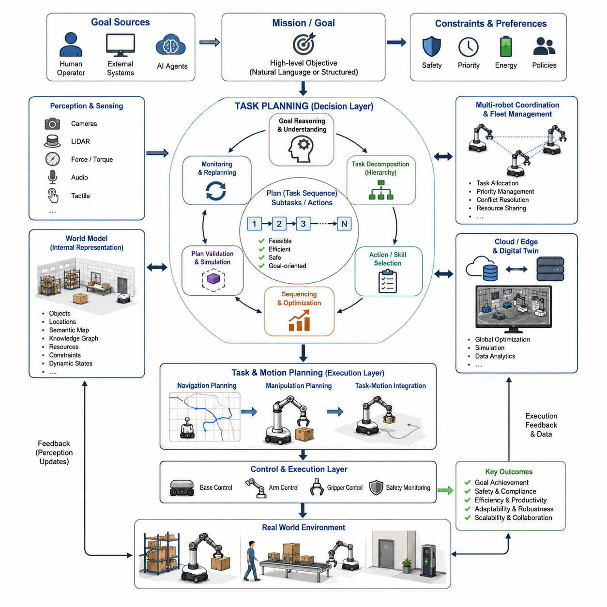
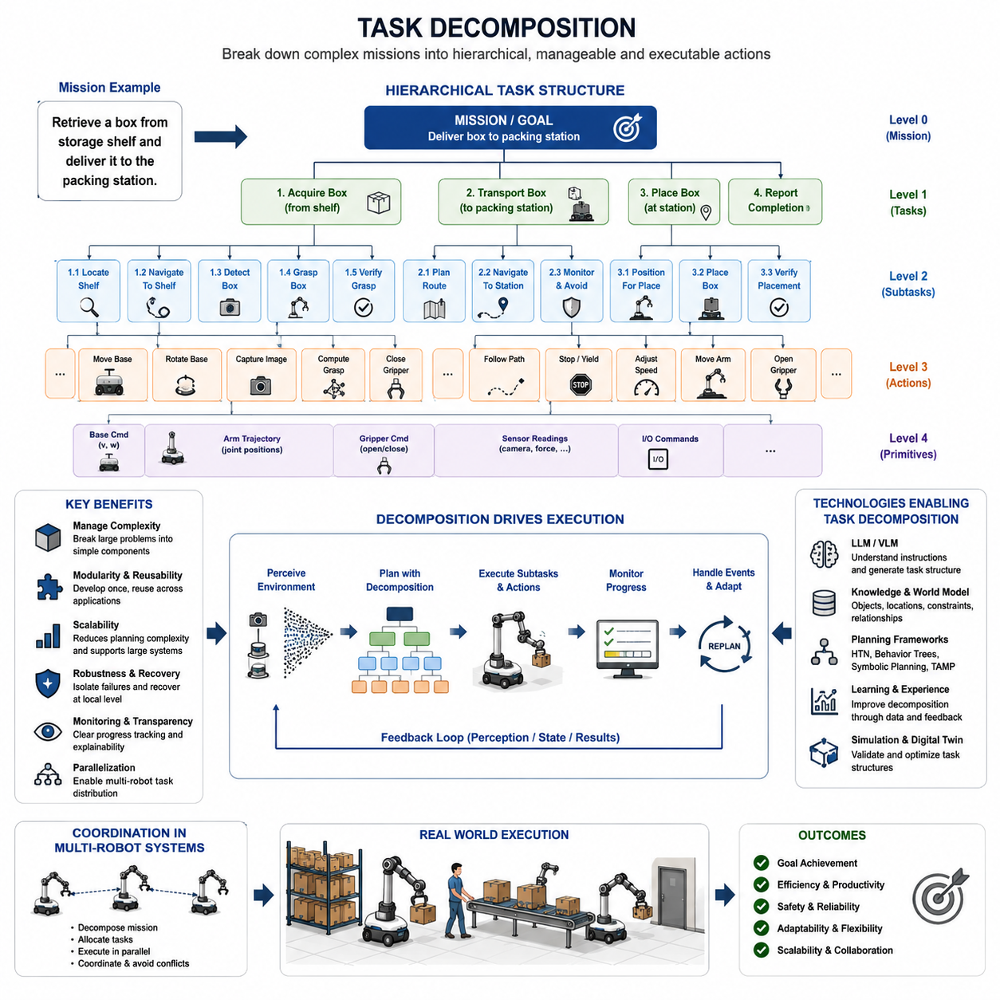
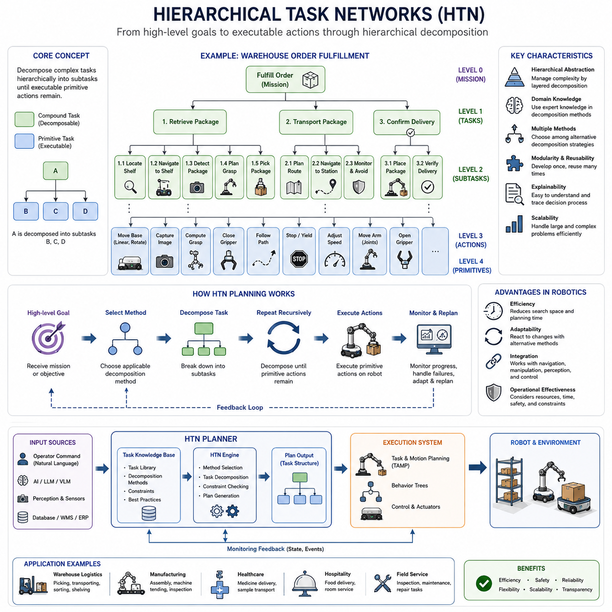
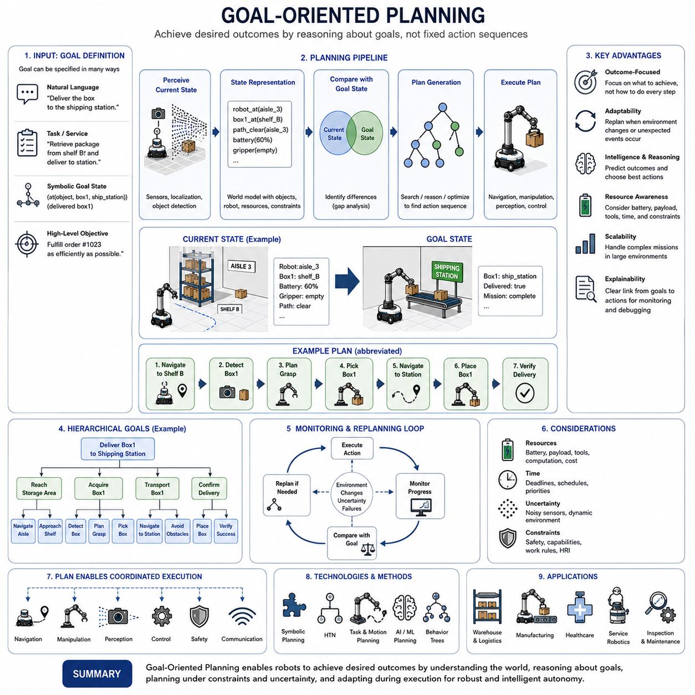
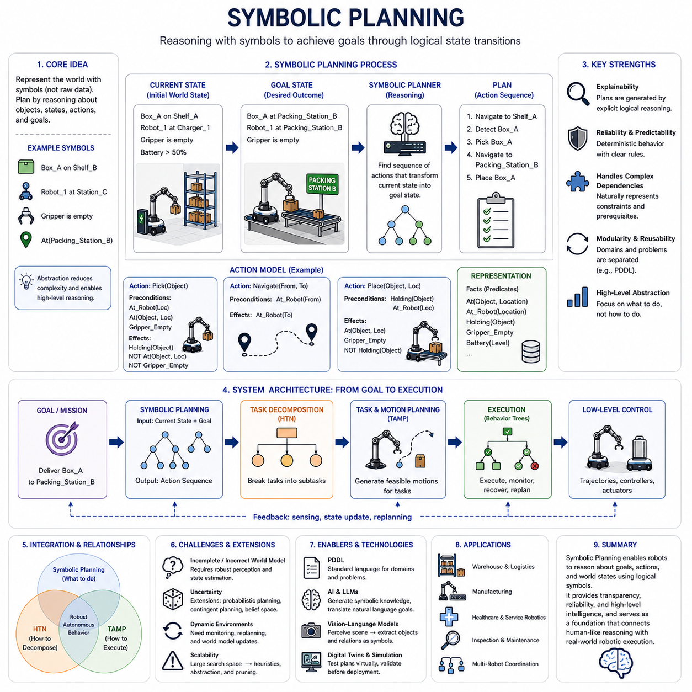
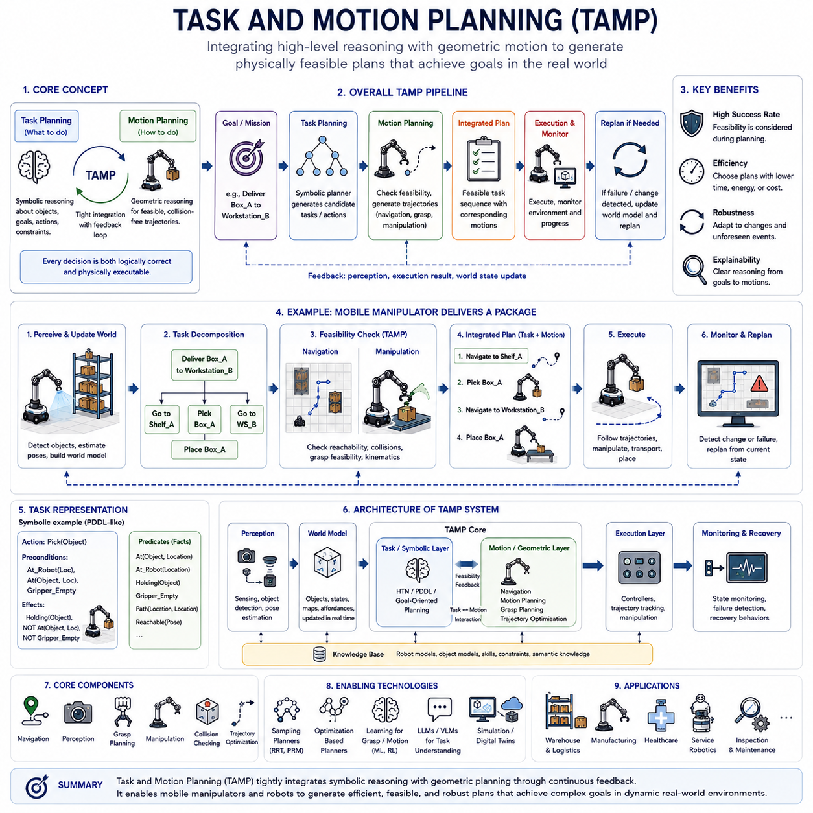
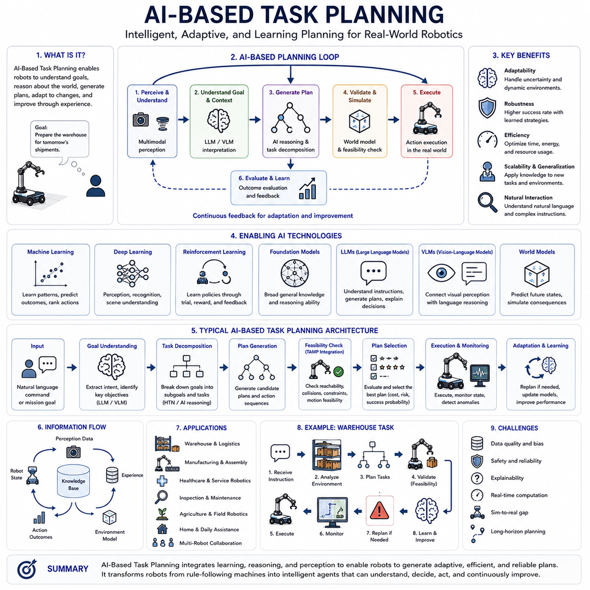
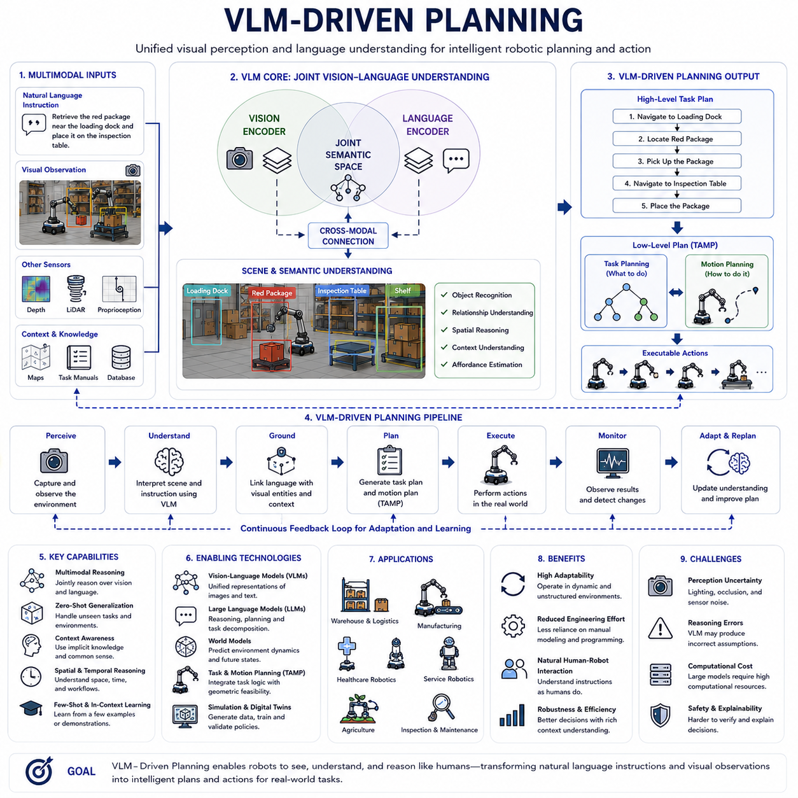
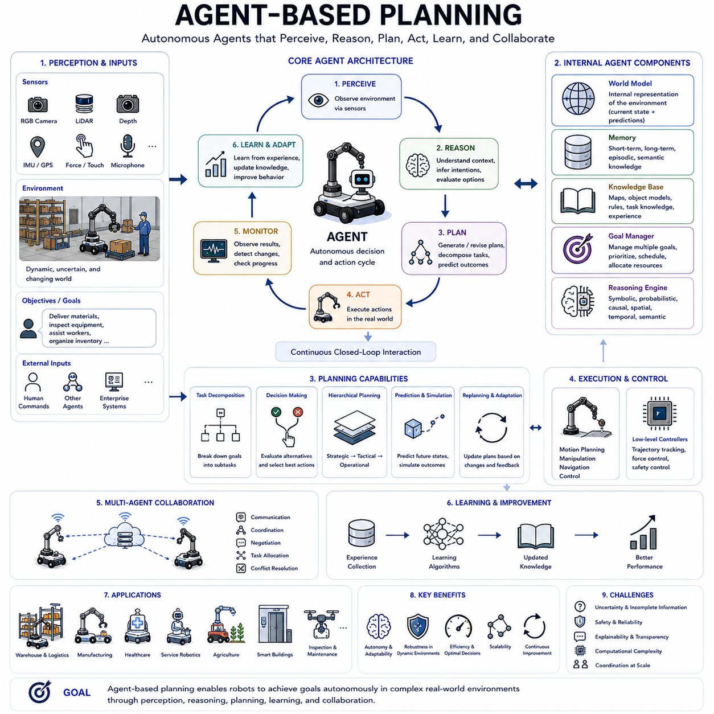
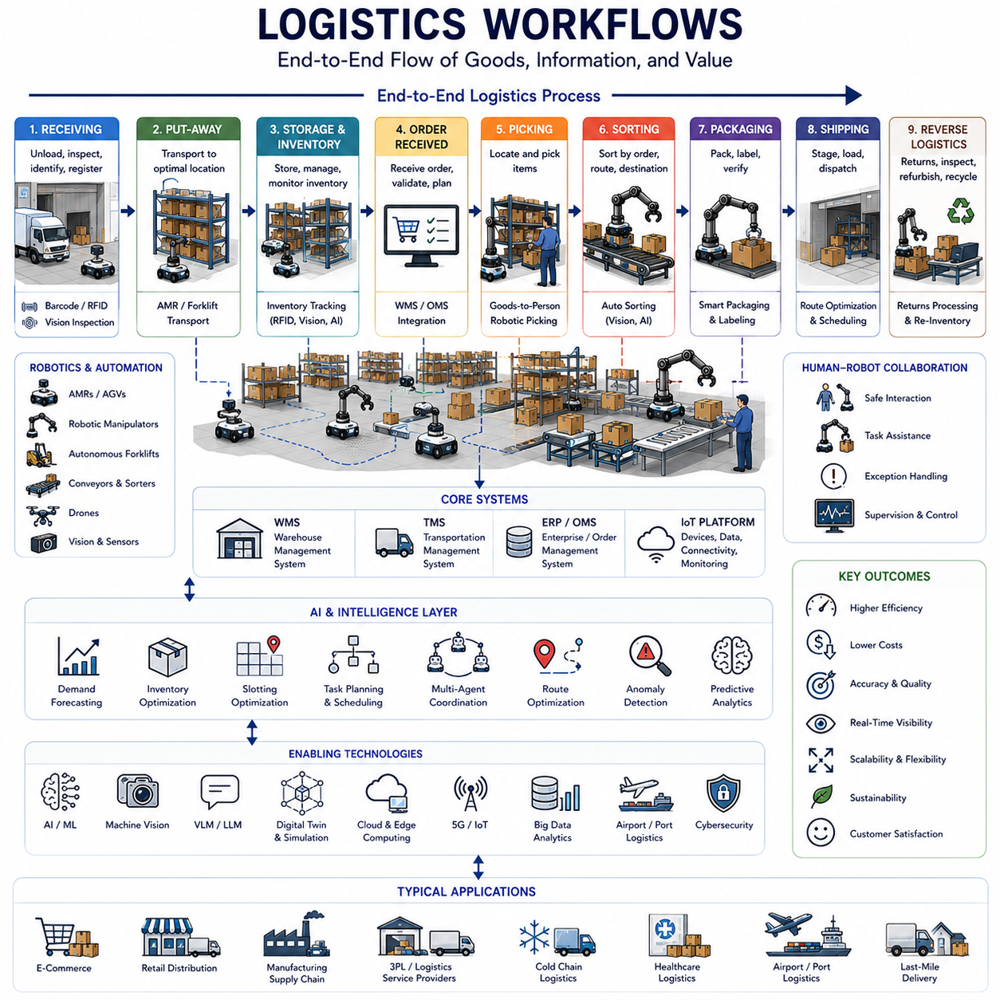

# Chapter 03. Task Planning

## 01 Task Planning Overview

{width="7.268055555555556in" height="7.268055555555556in"}

태스크 플래닝(Task Planning)은 모바일 매니퓰레이터(Mobile Manipulator)를 기존의 산업용 로봇과 구별해 주는 가장 중요한 핵심 기술 중 하나이다. 전통적인 산업용 로봇은 일반적으로 고정된 작업 공간에서 사전에 정의된 동작을 반복 수행하지만, 모바일 매니퓰레이터는 끊임없이 변화하는 환경 속에서 목표를 이해하고, 주변 상황을 판단하며, 이동과 조작 기능을 통합하여 원하는 결과를 달성해야 한다. 따라서 태스크 플래닝은 단순한 하드웨어 집합체를 실제 업무를 수행할 수 있는 지능형 자율 시스템으로 변화시키는 핵심 소프트웨어 계층이라 할 수 있다. 모바일 매니퓰레이터의 소프트웨어 구조에서 태스크 플래닝은 상위 수준의 임무 목표와 하위 수준의 동작 실행을 연결하는 역할을 수행한다. 무엇을 해야 하는지, 어떤 순서로 해야 하는지, 그리고 어떠한 상황에서 대체 행동을 선택해야 하는지를 결정하는 것이 바로 태스크 플래닝의 역할이다.

본질적으로 태스크 플래닝은 추상적인 목표를 실행 가능한 행동 순서로 변환하는 과정이다. 예를 들어 운영자가 "창고 B 선반에서 박스를 가져와 조립 공정 A에 전달하라"라는 명령을 내렸다고 가정해 보자. 사람에게는 단순해 보이는 명령이지만, 실제 로봇 입장에서는 수많은 세부 작업이 포함되어 있다. 로봇은 먼저 목표 위치를 찾아야 하며, 해당 장소까지 안전하게 이동해야 한다. 이후 목표 물체를 인식하고 적절한 파지 전략을 결정한 뒤 물체를 집어야 한다. 물체를 안정적으로 잡았는지 확인한 후 목적지까지 이동하고, 최종적으로 정확한 위치에 내려놓은 뒤 임무 완료를 보고해야 한다. 이러한 모든 과정은 수많은 의사결정과 세부 작업으로 구성되며, 태스크 플래닝은 이를 체계적으로 조직하고 관리하는 역할을 수행한다.

모바일 매니퓰레이션 시스템에서 태스크 플래닝은 모션 플래닝(Motion Planning) 및 제어(Control) 계층보다 상위에 위치한다. 모션 플래닝은 실제 이동 경로와 관절 궤적을 생성하며, 제어 시스템은 이를 액추에이터 수준에서 실행한다. 반면 태스크 플래닝은 목표, 자원, 제약조건, 작업 순서, 성공 조건 등을 중심으로 사고한다. 예를 들어 로봇이 특정 물체를 집기 전에 먼저 시각 검사를 수행해야 하는지, 혹은 현재 경로가 막혀 있으므로 우회 경로를 선택해야 하는지와 같은 의사결정을 담당한다. 이러한 이유로 태스크 플래닝은 로봇의 의사결정 계층(Decision Layer)이라고도 불린다.

최근 모바일 매니퓰레이터가 적용되는 환경이 복잡해지면서 태스크 플래닝의 중요성은 더욱 커지고 있다. 물류 창고에서는 수천 종의 상품을 다양한 위치에서 찾아야 하며, 병원에서는 의약품과 검체를 환자와 의료진이 존재하는 환경에서 안전하게 운반해야 한다. 제조 공장에서는 기계 가공 지원, 부품 공급, 검사 및 조립 지원과 같은 다양한 업무를 수행해야 한다. 이러한 환경에서는 우선순위가 지속적으로 변경되고 예기치 않은 상황이 발생하기 때문에 단순한 시퀀스 제어만으로는 충분하지 않다. 태스크 플래닝은 이러한 변화에 적응하면서도 생산성과 안전성을 유지할 수 있도록 지원한다.

태스크 플래닝의 가장 중요한 특징 중 하나는 계층적 구조(Hierarchical Structure)이다. 복잡한 임무는 일반적으로 하나의 단일 작업으로 실행되지 않는다. 대신 여러 개의 작업과 하위 작업으로 분해된다. 예를 들어 창고 피킹 작업은 이동, 탐색, 물체 인식, 파지, 운반, 배치 등의 단계로 나뉠 수 있다. 각각의 단계는 다시 더 작은 세부 작업으로 나누어진다. 이러한 계층적 분해는 문제를 단순화하며, 상위 계획기는 전략적 의사결정을 담당하고 하위 계획기는 세부 실행을 담당하도록 만든다. 이는 인간이 복잡한 문제를 해결하는 방식과 매우 유사하다.

태스크 플래닝에서 목표(Goal)는 가장 중요한 개념이다. 모든 계획은 특정 목표 상태를 달성하기 위해 시작된다. 목표는 운영자가 직접 입력할 수도 있고, 상위 시스템이나 AI 에이전트에 의해 생성될 수도 있다. 목표는 특정 위치로 물체를 이동시키는 것과 같은 물리적 목표일 수도 있으며, 재고 조사 완료와 같은 운영적 목표일 수도 있다. 플래너는 현재 상태와 목표 상태를 비교하고, 이를 연결하는 행동 시퀀스를 생성한다. 목표를 어떻게 표현하느냐에 따라 계획 성능과 확장성이 크게 달라지므로 목표 모델링은 매우 중요한 연구 분야이다.

태스크 플래닝은 환경 모델(Environment Model)에 크게 의존한다. 로봇이 올바른 의사결정을 하기 위해서는 물체, 위치, 자원, 제약조건, 작업 공간 구조 등에 대한 정보를 알고 있어야 한다. 이러한 정보는 심볼릭 모델(Symbolic Model), 시맨틱 맵(Semantic Map), 지식 그래프(Knowledge Graph), 월드 모델(World Model) 등의 형태로 저장될 수 있다. 예를 들어 특정 선반에 어떤 물체가 존재하는지, 충전 스테이션이 어디에 있는지, 특정 구역이 제한 구역인지 등의 정보를 알고 있어야 한다. 최근에는 인식 데이터와 운영 지식을 통합한 통합 월드 모델이 중요한 연구 주제가 되고 있다.

실제 환경에서는 불확실성(Uncertainty)이 항상 존재한다. 물체가 예상 위치에 없을 수도 있고, 사람이 갑자기 작업 공간에 들어올 수도 있으며, 센서 데이터에 노이즈가 포함될 수도 있다. 따라서 태스크 플래너는 불완전한 정보를 기반으로 의사결정을 내려야 한다. 이를 위해 현대의 플래닝 시스템은 지속적인 모니터링과 재계획(Replanning) 기능을 포함한다. 계획 실행 중 예상과 다른 상황이 발생하면 새로운 계획을 생성하여 임무를 계속 수행한다. 이러한 적응형 계획(Adaptive Planning)은 실제 산업 현장에서 매우 중요한 기능이다.

태스크 플래닝은 인식 시스템과도 긴밀하게 연결된다. 카메라, LiDAR, 힘 센서, 촉각 센서 등은 환경에 대한 정보를 제공한다. 플래너는 이러한 정보를 활용하여 행동을 결정한다. 예를 들어 물체가 가려져 있으면 더 나은 시야를 확보하기 위해 위치를 변경할 수 있고, 통로가 막혀 있으면 다른 경로를 선택할 수 있다. 따라서 인식과 계획은 지속적인 피드백 루프를 형성하며 로봇의 지능적 행동을 가능하게 한다.

모바일 매니퓰레이터에서는 조작 계획(Manipulation Planning) 또한 매우 중요하다. 일반적인 AMR은 이동만 고려하면 되지만, 모바일 매니퓰레이터는 이동과 로봇 팔 동작을 동시에 고려해야 한다. 로봇 베이스의 위치는 팔의 도달 가능 범위, 충돌 위험, 파지 품질, 작업 효율성에 직접적인 영향을 준다. 따라서 태스크 플래닝은 이동과 조작을 별개의 문제로 다루지 않고 통합된 시스템 관점에서 접근해야 한다.

인공지능 기술의 발전은 태스크 플래닝에도 큰 변화를 가져왔다. 초기의 플래너는 규칙 기반(Rule-Based) 방식과 수작업으로 정의된 시퀀스를 주로 사용했다. 그러나 이러한 방식은 확장성과 적응성이 부족했다. 최근에는 머신러닝, 강화학습, 대규모 언어 모델(LLM), 비전-언어 모델(VLM), 파운데이션 모델 등이 계획 시스템에 통합되고 있다. 이를 통해 로봇은 자연어 명령을 이해하고, 상황을 추론하며, 개발자가 명시적으로 정의하지 않은 새로운 계획을 생성할 수 있게 되었다. 이러한 AI 기반 계획은 범용 로봇 지능으로 가는 중요한 단계라 할 수 있다.

태스크 플래닝은 운영 효율성과도 밀접한 관련이 있다. 산업 현장의 로봇은 생산성을 극대화하면서 운영 비용을 최소화해야 한다. 따라서 플래너는 이동 거리, 작업 시간, 배터리 사용량, 장비 활용률, 임무 우선순위 등을 고려해야 한다. 예를 들어 약간 더 긴 경로를 선택하더라도 혼잡 구역을 피할 수 있다면 전체 효율성이 향상될 수 있다. 또한 긴급 작업이 발생하면 기존 작업보다 우선적으로 처리할 수도 있다. 이러한 최적화 능력은 전체 시스템 성능에 직접적인 영향을 미친다.

안전성 역시 태스크 플래닝의 핵심 요소이다. 모바일 매니퓰레이터는 인간과 같은 공간에서 작업하는 경우가 많다. 따라서 플래너는 안전 거리 유지, 속도 제한, 제한 구역 회피, 안전한 파지 전략 선택 등을 고려해야 한다. 현대의 플래너는 단순한 충돌 회피를 넘어 위험도 평가와 기능 안전 요구사항까지 포함하는 방향으로 발전하고 있다.

태스크 플래닝은 다중 로봇 협업(Multi-Robot Coordination)의 기반이 되기도 한다. 여러 대의 모바일 매니퓰레이터가 하나의 작업을 수행하는 경우 작업 할당, 우선순위 조정, 충돌 방지, 자원 공유 등을 관리해야 한다. 이러한 다중 로봇 계획은 통신, 동기화, 스케줄링 문제를 포함하지만 전체 시스템 생산성을 크게 향상시킬 수 있다.

최근에는 디지털 트윈(Digital Twin) 기술과의 연계도 활발해지고 있다. 디지털 트윈 환경에서는 실제 작업을 수행하기 전에 가상 환경에서 계획을 검증할 수 있다. 이를 통해 잠재적인 실패 요인과 병목 현상을 사전에 발견할 수 있으며, 보다 효율적인 작업 전략을 설계할 수 있다.

또한 클라우드 컴퓨팅과 엣지 컴퓨팅의 발전으로 태스크 플래닝의 확장성도 크게 향상되고 있다. 복잡한 계획 알고리즘은 클라우드에서 실행되고, 실시간 실행은 엣지 장치에서 처리하는 하이브리드 구조가 점차 일반화되고 있다. 이러한 구조는 대규모 로봇 운영 환경에서 매우 효과적이다.

소프트웨어 아키텍처 관점에서 태스크 플래닝은 독립적인 모듈이 아니라 인식, 내비게이션, 조작, 플릿 관리, 안전 시스템, 디지털 트윈, 원격 운영 시스템 등 다양한 모듈과 연결되는 중앙 허브 역할을 수행한다. ROS2 기반 모바일 매니퓰레이터 시스템에서는 이러한 모듈들이 표준 인터페이스를 통해 연결되며, 태스크 플래너가 전체 시스템을 조정하는 역할을 담당한다.

향후 태스크 플래닝은 단순한 작업 순서 생성 기술을 넘어 자율 추론(Autonomous Reasoning) 시스템으로 발전할 것으로 예상된다. 미래의 로봇은 인간이 자연어로 제시한 목표를 이해하고, 비즈니스 목적을 해석하며, 다수의 로봇을 조정하고, 운영 경험을 바탕으로 지속적으로 학습하는 능력을 갖추게 될 것이다. 대규모 언어 모델, 비전-언어 모델, 에이전트 기반 AI, 임바디드 AI의 발전은 이러한 변화를 더욱 가속화하고 있다.

결론적으로 태스크 플래닝은 모바일 매니퓰레이터의 두뇌 역할을 수행하는 핵심 기술이다. 목표를 실행 가능한 행동으로 변환하고, 이동과 조작을 통합하며, 불확실한 환경에 적응하고, 안전성과 효율성을 확보하며, 다수의 로봇을 협력시키는 역할을 담당한다. 태스크 플래닝이 없다면 모바일 매니퓰레이터는 단순한 센서와 액추에이터의 집합체에 불과하다. 반대로 강력한 태스크 플래닝 시스템을 갖춘 모바일 매니퓰레이터는 목표를 이해하고 스스로 의사결정을 수행하며 실제 산업 현장에서 의미 있는 작업을 수행할 수 있는 지능형 자율 시스템으로 발전할 수 있다. 이후 장에서는 이러한 능력을 구현하기 위한 태스크 분해, 계층형 태스크 네트워크, 심볼릭 플래닝, 태스크-모션 통합 계획, AI 기반 계획, VLM 기반 계획, 에이전트 기반 계획 등의 세부 기술을 심도 있게 다루게 된다.

## 02 Task Decomposition

{width="7.268055555555556in" height="7.268055555555556in"}

작업 분해(Task Decomposition)는 모바일 매니퓰레이션 소프트웨어에서 가장 기본적이면서도 중요한 개념 중 하나이다. 이는 복잡한 임무를 관리 가능하고 실행 가능한 작업 단위로 변환하는 방법을 제공한다. 현대의 모바일 매니퓰레이터는 기존 산업용 로봇 셀보다 훨씬 복잡한 환경에서 동작한다. 이들은 변화하는 공간을 이동해야 하고, 다양한 물체와 상호작용해야 하며, 이동 플랫폼과 로봇 팔을 동시에 제어해야 하고, 예기치 못한 상황에 대응해야 하며, 때로는 사람이나 다른 로봇과 협력해야 한다. 이러한 복잡한 임무를 하나의 거대한 문제로 처리하려고 하면 계산량이 폭발적으로 증가하고 시스템의 안정성도 떨어지게 된다. 작업 분해는 이러한 문제를 해결하기 위해 전체 목표를 더 작은 작업들로 나누어 계획, 실행, 모니터링 및 최적화를 가능하게 한다.

작업 분해의 기본 원리는 인간이 복잡한 문제를 해결하는 방식과 유사하다. 사람이 제품을 조립하거나 창고를 정리하거나 식사를 준비할 때 모든 세부 사항을 동시에 고려하지 않는다. 대신 전체 목표를 여러 단계로 나누고 각 단계를 순차적으로 수행한다. 로봇 역시 동일한 접근 방식을 사용해야 한다. 하나의 거대한 계획 문제를 직접 해결하는 대신, 임무를 목표(Goal), 작업(Task), 하위 작업(Subtask), 행동(Action), 그리고 최종적으로 제어 가능한 동작(Motion)으로 계층적으로 분해한다. 이러한 구조는 복잡성을 크게 줄이며 확장성, 유지보수성, 설명 가능성 및 실행 안정성을 향상시킨다.

예를 들어 창고에서 동작하는 모바일 매니퓰레이터가 특정 선반에 있는 박스를 찾아 포장 스테이션으로 운반해야 한다고 가정해 보자. 사람의 관점에서는 하나의 작업처럼 보이지만, 로봇 입장에서는 수많은 세부 작업으로 구성된다. 먼저 대상 물체의 위치를 확인해야 하고, 해당 위치까지 이동해야 하며, 이동 중 장애물을 회피해야 한다. 이후 파지 가능한 자세로 위치를 조정하고, 물체를 인식하고, 적절한 파지 전략을 계산한 후 물체를 집어야 한다. 파지가 성공했는지 확인한 뒤 목적지까지 이동하고, 물체를 정확한 위치에 배치하며, 최종적으로 임무 완료를 보고해야 한다. 작업 분해는 이러한 복잡한 과정을 체계적으로 관리할 수 있도록 해준다.

로봇 시스템에서 작업 분해는 일반적으로 계층 구조(Hierarchy) 형태로 표현된다. 최상위에는 미션 또는 목표가 존재하며, 이는 여러 개의 주요 작업으로 나뉜다. 각 작업은 다시 여러 하위 작업으로 나누어지고, 최종적으로 실행 가능한 행동(Action) 수준까지 세분화된다. 가장 아래 단계에서는 행동이 실제 모션 계획과 제어 명령으로 변환된다. 이러한 구조 덕분에 각 소프트웨어 모듈은 자신에게 필요한 수준의 추상화에서 동작할 수 있다. 상위 계획기는 전략적 의사결정을 수행하고, 하위 계층은 실제 물리적 실행을 담당한다.

작업 분해의 가장 큰 장점 중 하나는 모듈성(Modularity)이다. 작업이 독립적인 구성 요소로 분리되면 각각을 별도로 개발하고 검증할 수 있다. 예를 들어 내비게이션 알고리즘을 개선하더라도 파지 알고리즘을 수정할 필요가 없으며, 새로운 조작 기능을 추가하더라도 플릿 관리 시스템에는 영향을 주지 않는다. 이는 수백 개의 소프트웨어 컴포넌트가 포함되는 대규모 로봇 시스템에서 특히 중요한 장점이다.

재사용성(Reusability) 또한 중요한 이점이다. 대부분의 로봇 작업은 공통적인 기능 블록을 공유한다. 이동, 객체 인식, 위치 추정, 장애물 회피, 파지 실행, 성공 여부 검증 등의 기능은 다양한 응용 분야에서 반복적으로 사용된다. 작업 분해를 통해 이러한 기능을 독립적인 모듈로 설계하면 서로 다른 응용 분야에서도 쉽게 재사용할 수 있다. 창고 피킹 시스템, 산업용 검사 시스템, 병원 물류 로봇은 목적은 다르지만 동일한 이동 및 인식 모듈을 공유할 수 있다.

확장성(Scalability) 측면에서도 작업 분해는 매우 중요하다. 로봇 시스템이 복잡해질수록 고려해야 할 행동과 환경 조건의 수는 기하급수적으로 증가한다. 작업 분해는 각 계층이 제한된 범위의 문제만 다루도록 함으로써 이러한 문제를 완화한다. 상위 계층은 목표와 전략을 결정하고, 하위 계층은 세부 실행을 담당한다. 이와 같은 계층적 구조는 대규모 환경에서도 효율적인 계획을 가능하게 한다.

모바일 매니퓰레이터에서는 이동성과 조작성을 동시에 고려해야 하므로 작업 분해의 중요성이 더욱 커진다. 일반적인 산업용 로봇은 주로 조작에 집중하고, AMR은 주로 이동에 집중한다. 반면 모바일 매니퓰레이터는 두 기능을 통합해야 한다. 따라서 작업 분해 구조는 이동 관련 작업과 조작 관련 작업을 구분하면서도 이들 사이의 긴밀한 연계를 유지해야 한다. 로봇은 단순히 어디로 이동할 것인지를 결정하는 것이 아니라, 목적지에 도착한 후 무엇을 어떻게 조작할 것인지도 함께 고려해야 한다.

실제 구현에서는 목표 기반 분해(Goal-Driven Decomposition)가 자주 사용된다. 시스템은 먼저 최종 목표를 정의하고 이를 점진적으로 작은 작업들로 나눈다. 예를 들어 "컨테이너를 배송하라"는 목표는 "컨테이너를 획득하라"와 "컨테이너를 운반하라"는 두 개의 작업으로 분해될 수 있다. 컨테이너 획득은 다시 위치 확인, 접근, 파지, 파지 검증 등의 하위 작업으로 나뉘고, 운반 작업은 경로 계획, 이동, 상태 모니터링, 배치 등의 작업으로 세분화된다. 각 단계는 원래 목표와의 연결성을 유지하면서 세부 사항을 추가해 나간다.

작업 분해는 산업 현장의 업무 프로세스를 로봇에 반영하는 데에도 활용된다. 제조 공정, 물류 창고 운영, 병원 공급 체계, 연구실 자동화 시스템 등은 모두 명확한 절차와 워크플로우를 가진다. 작업 분해는 이러한 프로세스를 계층적 작업 구조로 표현함으로써 로봇이 실제 비즈니스 절차를 따라 업무를 수행할 수 있도록 지원한다.

작업 분해에서 중요한 문제 중 하나는 적절한 세분화 수준(Granularity)을 결정하는 것이다. 작업이 너무 크면 계획의 유연성이 떨어지고 관리가 어려워진다. 반대로 너무 작게 나누면 작업 수가 지나치게 많아져 관리 비용이 증가한다. 따라서 적절한 추상화 수준과 세부화 수준 사이의 균형을 찾는 것이 중요하다. 이는 응용 분야, 환경 복잡도, 계산 자원 및 운영 목표에 따라 달라질 수 있다.

작업 간 의존성(Dependency) 관리 역시 매우 중요하다. 대부분의 작업은 독립적으로 존재하지 않는다. 특정 작업은 반드시 다른 작업이 완료된 이후에만 수행될 수 있다. 예를 들어 물체를 찾기 전에 집을 수는 없으며, 물체를 집기 전에는 운반할 수도 없다. 따라서 작업 분해 프레임워크는 선행 조건, 제약 조건, 실행 순서 등을 명확하게 표현해야 한다. 이러한 구조는 작업 실행의 논리적 일관성을 보장한다.

작업 분해는 오류 복구(Error Recovery)에도 큰 장점을 제공한다. 실제 환경에서는 실패가 불가피하다. 물체가 예상치 못하게 움직일 수도 있고, 사람이 통로를 막을 수도 있으며, 센서가 목표를 놓칠 수도 있다. 작업이 작은 단위로 분해되어 있다면 전체 임무를 처음부터 다시 시작하지 않고 실패한 부분만 재시도할 수 있다. 또한 다른 전략을 선택하거나 복구 절차를 수행하는 것도 가능하다. 이는 시스템의 안정성과 신뢰성을 크게 향상시킨다.

모니터링과 작업 분해의 관계도 매우 중요하다. 현대의 로봇은 작업 수행 중 지속적으로 상태를 확인한다. 작업 구조가 계층적으로 정의되어 있으면 각 단계별 진행 상황을 정확히 추적할 수 있으며, 문제가 발생한 위치도 쉽게 파악할 수 있다. 이는 효율적인 운영과 빠른 문제 해결을 가능하게 한다.

최근 인공지능 기술은 작업 분해 방식에도 큰 영향을 주고 있다. 과거에는 엔지니어가 모든 작업 계층을 수동으로 정의해야 했다. 그러나 현재는 머신러닝과 파운데이션 모델을 활용하여 작업 구조를 자동 생성하는 연구가 활발히 진행되고 있다. 대규모 언어 모델(LLM)은 자연어 명령을 이해하고 적절한 작업 계층을 생성할 수 있으며, 비전-언어 모델(VLM)은 시각 정보를 활용하여 상황에 맞는 작업 구조를 설계할 수 있다. 강화학습 역시 효율적인 작업 분해 전략을 학습하는 데 활용되고 있다.

작업 분해는 계층형 태스크 네트워크(Hierarchical Task Networks), 심볼릭 플래닝(Symbolic Planning), 행동 트리(Behavior Trees), 태스크 및 모션 플래닝(Task and Motion Planning) 등 다양한 계획 기법의 기반이 된다. 이들 방법은 구현 방식은 다르지만 모두 복잡한 목표를 작은 작업으로 나눈다는 공통된 철학을 가지고 있다.

다중 로봇 시스템에서는 작업 분해의 중요성이 더욱 커진다. 대규모 물류 창고에서는 여러 대의 모바일 매니퓰레이터가 서로 다른 작업을 동시에 수행한다. 피킹, 운반, 검사, 재고 보충과 같은 업무를 여러 로봇에 분배함으로써 병렬 작업이 가능해지고 전체 처리량이 증가한다. 효과적인 작업 분해는 어떤 작업이 독립적으로 수행 가능한지, 어떤 작업이 협업을 필요로 하는지를 결정하는 기준을 제공한다.

디지털 트윈과 시뮬레이션 환경은 작업 분해 구조를 검증하는 데 중요한 역할을 한다. 엔지니어는 다양한 작업 구조를 가상 환경에서 실험하면서 병목 현상과 비효율성을 발견할 수 있다. 이를 통해 실제 환경 배치 전에 최적의 작업 구조를 설계할 수 있다.

클라우드 로보틱스와 분산 컴퓨팅 구조 역시 작업 분해에 영향을 주고 있다. 상위 수준의 계획과 작업 분해는 클라우드에서 수행하고, 실시간 실행은 로봇 내부의 엣지 컴퓨터에서 처리하는 구조가 점차 일반화되고 있다. 이러한 방식은 복잡한 계획 능력과 실시간 반응성을 동시에 확보할 수 있게 해준다.

소프트웨어 공학 관점에서 작업 분해는 유지보수성과 시스템 수명주기 관리에도 매우 중요한 역할을 한다. 로봇 시스템은 수년 동안 운영되면서 지속적으로 업그레이드된다. 잘 설계된 작업 분해 구조는 새로운 기능을 추가하거나 기존 기능을 교체하는 과정을 훨씬 쉽게 만들어 준다.

미래의 작업 분해는 임바디드 AI(Embodied AI)와 자율 에이전트 기술의 발전과 함께 더욱 지능화될 것으로 예상된다. 미래의 로봇은 자연어로 주어진 목표를 이해하고, 스스로 작업 구조를 생성하며, 환경에 따라 동적으로 계획을 수정할 수 있게 될 것이다. 또한 여러 로봇과 자원을 자동으로 조정하고 최적의 실행 전략을 선택하는 능력도 갖추게 될 것이다.

결론적으로 작업 분해는 모바일 매니퓰레이터 시스템의 조직적 골격(Organizational Backbone)이라 할 수 있다. 복잡한 임무를 실행 가능한 워크플로우로 변환하고, 시스템 복잡성을 줄이며, 모듈성과 확장성을 높이고, 오류 복구와 지능적 의사결정을 가능하게 한다. 현대의 모바일 매니퓰레이터가 실제 산업 현장에서 안정적이고 효율적으로 동작할 수 있는 이유는 바로 이러한 체계적인 작업 분해 구조에 기반하고 있기 때문이다. 앞으로 로봇의 자율성이 높아질수록 작업 분해는 더욱 중요한 핵심 기술로 자리 잡게 될 것이다.

## 03 Hierarchical Task Networks

{width="7.268055555555556in" height="7.268055555555556in"}

계층형 태스크 네트워크(Hierarchical Task Networks, HTN)는 현대 로보틱스에서 가장 실용적이고 영향력 있는 계획(Planning) 방법론 중 하나이다. 로봇 시스템이 단순한 산업용 매니퓰레이터에서 복잡한 환경에서 자율적으로 동작하는 모바일 매니퓰레이터로 발전함에 따라, 복잡한 임무를 체계적으로 계획할 수 있는 구조화된 프레임워크의 필요성이 점점 커지고 있다. HTN은 복잡한 작업을 계층적으로 구성하여 상위 수준의 목표를 유지하면서도 실제 실행 가능한 세부 행동까지 연결할 수 있는 방법을 제공한다. 다시 말해 HTN은 전략적 임무 계획과 실제 작업 수행을 연결하는 다리 역할을 한다. 이를 통해 로봇은 추상적인 목표를 실행 가능한 행동으로 변환하면서 논리적 일관성, 운영 효율성, 그리고 환경 적응성을 동시에 확보할 수 있다.

HTN의 기본 개념은 인간이 복잡한 문제를 해결하는 방식과 매우 유사하다. 사람이 창고를 운영하거나 기계를 조립하거나 공장 내 자재를 운반해야 할 때 모든 세부 행동을 한 번에 생각하지 않는다. 대신 전체 목표를 여러 단계로 나누고 이를 다시 더 작은 작업들로 분해한다. 예를 들어 창고 관리자는 주문 처리 작업을 재고 검색, 물품 이동, 포장, 출하 등의 단계로 나눈다. 그리고 각각의 단계는 다시 세부 절차로 나뉜다. HTN은 이러한 인간의 계층적 사고 방식을 로봇이 사용할 수 있도록 공식화한 계획 프레임워크라고 볼 수 있다.

HTN에서는 작업(Task)이 계층 구조 안의 노드(Node)로 표현된다. 작업은 크게 복합 작업(Compound Task)과 원시 작업(Primitive Task)으로 구분된다. 복합 작업은 직접 실행할 수 없는 상위 수준의 목표이며, 반드시 더 작은 하위 작업으로 분해되어야 한다. 반면 원시 작업은 로봇이 직접 수행할 수 있는 행동을 의미한다. 이러한 원시 작업은 결국 이동 명령, 관절 제어, 그리퍼 동작, 센서 데이터 수집, 통신 명령 등의 형태로 실행된다. HTN 계획 과정은 복합 작업을 반복적으로 분해하여 최종적으로 원시 작업만 남을 때까지 진행된다.

예를 들어 물류 창고에서 동작하는 모바일 매니퓰레이터가 특정 상품을 가져와 출하 구역으로 운반해야 한다고 가정해 보자. HTN에서 최상위 작업은 "주문 처리(Fulfill Order)"가 될 수 있다. 이 작업은 "상품 획득(Retrieve Package)", "상품 운반(Transport Package)", "배송 확인(Confirm Delivery)" 등의 하위 작업으로 나뉜다. 상품 획득 작업은 다시 "선반 위치 확인", "선반으로 이동", "상품 탐지", "파지 계획", "상품 집기" 등의 세부 작업으로 분해된다. 그리고 각 작업은 다시 더 작은 행동으로 분해되어 결국 바퀴 제어, 로봇 팔 이동, 그리퍼 제어와 같은 실제 실행 가능한 수준에 도달하게 된다. 이러한 계층 구조는 로봇이 다양한 수준의 추상화에서 동시에 문제를 이해하고 계획할 수 있도록 해준다.

HTN의 가장 큰 장점 중 하나는 도메인 지식(Domain Knowledge)을 계획 과정에 직접 반영할 수 있다는 점이다. 전통적인 플래닝 시스템은 가능한 모든 행동을 탐색하여 해결책을 찾는 경우가 많다. 그러나 복잡한 환경에서는 탐색 공간이 지나치게 커져 계산 비용이 급격히 증가한다. HTN은 전문가의 경험과 운영 절차를 분해 방법(Method)의 형태로 시스템에 내장함으로써 이러한 문제를 줄인다. 엔지니어는 작업 절차, 안전 규칙, 운영 정책, 업무 흐름 등을 HTN의 분해 규칙에 반영할 수 있다. 따라서 계획 과정은 무작정 가능한 모든 행동을 탐색하는 것이 아니라 이미 검증된 운영 지식을 기반으로 진행된다.

HTN에서 가장 중요한 요소 중 하나는 분해 방법(Method)이다. 분해 방법은 특정 복합 작업을 어떤 하위 작업들로 나눌 것인지를 정의한다. 하나의 작업에 대해 여러 개의 분해 방법이 존재할 수도 있다. 예를 들어 "물체 운반" 작업은 속도를 우선하는 방법과 안전성을 우선하는 방법으로 나뉠 수 있다. 플래너는 현재 환경과 운영 조건을 고려하여 가장 적절한 방법을 선택한다. 이러한 구조는 HTN이 환경 변화에 유연하게 대응할 수 있도록 해준다.

HTN의 계층 구조는 확장성 측면에서 매우 큰 장점을 제공한다. 로봇 시스템이 복잡해질수록 고려해야 할 행동과 상태의 수는 폭발적으로 증가한다. 계층 구조가 없다면 계획 문제는 지나치게 복잡해진다. HTN은 상위 수준에서는 전략적 목표만 고려하고, 하위 수준에서는 실행 세부 사항만 다루도록 함으로써 문제를 분리한다. 이러한 구조 덕분에 훨씬 더 큰 규모의 문제를 효율적으로 처리할 수 있다.

설명 가능성(Explainability) 또한 HTN의 중요한 장점이다. 최근 자율 시스템은 왜 특정 행동을 선택했는지 설명할 수 있어야 하는 요구를 받고 있다. 특히 산업 현장, 의료 분야, 안전 관련 응용 분야에서는 이러한 요구가 더욱 중요하다. HTN은 작업 구조가 계층적으로 표현되기 때문에 인간이 이해하기 쉽다. 운영자는 최상위 목표부터 최종 행동까지의 연결 과정을 추적할 수 있으며, 로봇이 특정 행동을 수행한 이유를 쉽게 분석할 수 있다. 이는 디버깅, 검증, 인증, 운영 관리 측면에서 큰 장점이 된다.

모듈성(Modularity) 역시 HTN의 핵심 특징이다. 각각의 분해 방법은 독립적으로 개발하고 검증할 수 있다. 새로운 기능을 추가할 때도 전체 시스템을 수정할 필요 없이 새로운 분해 방법만 추가하면 된다. 예를 들어 창고용 모바일 매니퓰레이터를 병원 물류 시스템으로 확장한다고 하더라도 이동, 물체 검색, 운반과 같은 기존 분해 구조를 대부분 재사용할 수 있다. 이는 개발 비용을 줄이고 장기적인 유지보수를 쉽게 만든다.

HTN은 특히 모바일 매니퓰레이터에서 매우 유용하다. 모바일 매니퓰레이터는 이동과 조작을 동시에 고려해야 하기 때문이다. 기존 산업용 로봇은 조작 중심이며, AMR은 이동 중심이다. 반면 모바일 매니퓰레이터는 이동과 조작이 긴밀하게 연결되어 있다. HTN은 이러한 두 영역을 하나의 계층 구조 안에서 통합적으로 관리할 수 있도록 해준다. 이동 계획과 조작 계획은 서로 독립적인 작업으로 유지되면서도 전체 임무 수준에서는 하나의 목표를 위해 협력하게 된다.

자원 관리(Resource Management) 측면에서도 HTN은 강력한 기능을 제공한다. 실제 로봇은 배터리 용량, 계산 자원, 사용 가능한 도구, 적재 하중, 작업 일정 등 다양한 제약 조건 아래에서 운영된다. HTN은 이러한 제약 조건을 분해 방법에 직접 포함할 수 있다. 배터리가 부족한 경우 충전 작업을 포함한 계획을 선택할 수 있으며, 무거운 화물을 운반하는 경우 경사가 적은 경로를 선택할 수도 있다.

시간 관리(Time Management) 역시 중요한 요소이다. 산업 현장에서는 생산 일정과 납기 일정이 존재한다. HTN은 작업 순서, 실행 시간, 동기화 조건 등을 표현할 수 있으며, 이를 통해 시간 제약을 고려한 계획 수립이 가능하다. 작업은 순차적으로 실행될 수도 있고 병렬로 실행될 수도 있다. 이러한 기능은 다수의 로봇이 협력하는 환경에서 특히 중요하다.

불확실성(Uncertainty)은 로보틱스에서 가장 큰 도전 과제 중 하나이다. 고전적인 HTN은 결정론적 환경을 가정하지만, 현대의 HTN 시스템은 모니터링과 재계획(Replanning) 기능을 함께 사용한다. 작업 수행 중 실패가 발생하면 플래너는 다른 분해 방법을 선택하거나 새로운 작업 구조를 생성할 수 있다. 예를 들어 파지가 실패하면 다른 파지 전략을 선택하거나 위치를 재조정한 후 다시 시도할 수 있다. 이러한 적응 능력은 실제 환경에서 매우 중요하다.

HTN과 심볼릭 플래닝(Symbolic Planning)은 밀접한 관련이 있다. 두 방식 모두 높은 수준의 추상화를 사용하며 작업과 행동을 구조적으로 표현한다. 그러나 심볼릭 플래닝은 상태 공간 탐색(State Space Search)에 초점을 두는 반면, HTN은 작업 분해(Task Decomposition)에 초점을 둔다. 실제 산업 시스템에서는 두 방식을 결합하여 사용하는 경우가 많다.

행동 트리(Behavior Tree)와도 깊은 연관이 있다. HTN은 무엇을 해야 하는지를 계획하고, 행동 트리는 어떻게 실행할 것인지를 관리한다. 따라서 현대 로봇 시스템에서는 HTN이 작업 구조를 생성하고 행동 트리가 실행을 담당하는 형태가 매우 일반적이다.

태스크 및 모션 플래닝(Task and Motion Planning, TAMP)에서도 HTN은 중요한 역할을 수행한다. 상위 수준의 작업 계획과 실제 물리적 동작을 연결하는 과정에서 HTN은 자연스러운 계층 구조를 제공한다. 예를 들어 "물체 집기"라는 작업은 결국 역기구학 계산, 충돌 검사, 파지 최적화, 궤적 생성과 같은 저수준 모션 계획으로 연결된다.

최근 인공지능 기술은 HTN에도 큰 변화를 가져오고 있다. 과거에는 전문가가 모든 분해 방법을 직접 설계해야 했다. 그러나 현재는 머신러닝, 강화학습, 파운데이션 모델을 활용하여 분해 구조를 자동 생성하는 연구가 활발히 진행되고 있다. 대규모 언어 모델(LLM)은 자연어 명령을 이해하고 작업 계층을 생성할 수 있으며, 비전-언어 모델(VLM)은 시각 정보를 기반으로 계획 구조를 생성할 수 있다. 이는 HTN을 더욱 유연하고 지능적으로 만들고 있다.

다중 로봇 시스템에서는 HTN의 가치가 더욱 커진다. 대규모 창고나 공장에서는 여러 대의 로봇이 동시에 작업을 수행한다. HTN은 하나의 큰 임무를 여러 하위 작업으로 나누고 이를 서로 다른 로봇에게 할당할 수 있다. 이를 통해 병렬 처리와 자원 최적화가 가능해지며 전체 생산성이 향상된다.

디지털 트윈과 시뮬레이션 기술 역시 HTN과 긴밀하게 연계된다. 엔지니어는 실제 환경에 배치하기 전에 HTN 구조를 시뮬레이션하여 병목 현상과 비효율성을 분석할 수 있다. 이를 통해 운영 리스크를 줄이고 개발 속도를 높일 수 있다.

클라우드 로보틱스 환경에서도 HTN은 중요한 역할을 수행한다. 상위 수준의 계획은 클라우드에서 수행하고, 실제 실행은 로봇 내부의 엣지 컴퓨터에서 처리하는 구조가 점차 확대되고 있다. 이를 통해 강력한 계획 능력과 실시간 실행 성능을 동시에 확보할 수 있다.

소프트웨어 공학 관점에서 HTN은 유지보수성, 확장성, 수명주기 관리 측면에서 매우 유리하다. 새로운 기능은 기존 시스템을 재설계하지 않고 새로운 분해 방법만 추가함으로써 구현할 수 있다. 이는 장기간 운영되는 산업용 로봇 시스템에 특히 중요한 장점이다.

미래의 HTN은 임바디드 AI와 자율 에이전트 기술의 발전과 함께 더욱 진화할 것으로 예상된다. 미래의 로봇은 자연어 목표를 이해하고, 스스로 분해 방법을 생성하며, 환경 변화에 따라 작업 구조를 실시간으로 수정할 수 있게 될 것이다. 또한 경험을 통해 더 효율적인 작업 구조를 학습하고 최적화할 수 있을 것이다.

결론적으로 계층형 태스크 네트워크는 인간과 유사한 계층적 사고 방식을 로봇 계획 시스템에 적용한 매우 실용적인 프레임워크이다. HTN은 추상적인 목표를 체계적인 작업 계층으로 변환함으로써 복잡한 임무를 효율적으로 수행할 수 있게 해준다. 계산 효율성, 모듈성, 설명 가능성, 확장성, 적응성을 동시에 제공하는 HTN은 모바일 매니퓰레이터와 차세대 자율 로봇의 핵심 계획 기술로 앞으로도 중요한 역할을 수행할 것이다.

## 04 Goal Oriented Planning

{width="7.268055555555556in" height="7.268055555555556in"}

목표 지향 계획(Goal-Oriented Planning)은 현대 로보틱스와 자율 시스템에서 가장 중요한 계획 방법론 중 하나이다. 이는 로봇이 단순히 미리 정의된 작업 순서를 수행하는 것이 아니라, 원하는 결과를 달성하기 위해 스스로 행동을 결정할 수 있도록 하는 체계적인 접근 방식이다. 전통적인 자동화 시스템에서는 작업이 고정된 워크플로우 형태로 정의되는 경우가 많았다. 이러한 방식은 구조화된 산업 환경에서는 효과적이지만, 실제 환경처럼 지속적으로 변화하는 공간에서는 한계를 가진다. 모바일 매니퓰레이터, AMR, 서비스 로봇, 그리고 미래의 임바디드 AI 로봇은 주변 상황에 따라 행동을 변경하고 적응해야 한다. 목표 지향 계획은 이러한 문제를 해결하기 위해 행동(Action)이 아닌 목표(Goal)를 중심으로 계획을 수립하는 방식을 제공한다.

목표 지향 계획의 핵심 개념은 매우 직관적이다. 운영자는 로봇에게 모든 행동을 세세하게 지시하는 대신 원하는 결과를 정의한다. 그러면 로봇은 현재 환경 상태, 사용 가능한 자원, 운영 제약 조건, 그리고 자신이 수행할 수 있는 행동들을 고려하여 목표를 달성하는 방법을 스스로 결정한다. 이러한 방식은 인간의 사고 과정과 매우 유사하다. 사람은 택배를 전달하거나 식사를 준비하거나 장비를 점검할 때 모든 행동을 미리 계획하지 않는다. 대신 목표를 설정하고 상황에 따라 필요한 행동을 결정한다. 목표 지향 계획은 이러한 인간의 문제 해결 방식을 로봇에 적용한 개념이라 할 수 있다.

모바일 매니퓰레이션 소프트웨어 아키텍처에서 목표 지향 계획은 미션 관리 계층과 실행 계층 사이에 위치한다. 상위 계층은 목표를 정의하고, 하위 계층은 이동, 조작, 인식, 제어 등을 수행한다. 목표 지향 플래너는 이 둘을 연결하는 지능형 중간 계층으로서 목표를 실제 실행 가능한 계획으로 변환한다. 이를 위해 현재 상태(Current State)와 목표 상태(Goal State)를 비교하고, 두 상태 사이의 차이를 분석한 후, 현재 상태를 목표 상태로 변화시키기 위한 행동 시퀀스를 생성한다. 이러한 능력은 목표 지향 계획을 자율 로봇 지능의 핵심 구성 요소로 만든다.

목표는 다양한 형태로 정의될 수 있다. 물류 창고에서는 특정 상품을 포장 구역으로 이동시키는 것이 목표가 될 수 있다. 병원에서는 약품을 특정 병실로 전달하는 것이 목표일 수 있으며, 제조 공장에서는 생산 라인에 부품을 공급하는 것이 목표가 될 수 있다. 서비스 로봇에서는 고객 지원이나 특정 물체를 찾아오는 것이 목표가 될 수 있다. 이들 응용 분야는 서로 다르지만 모두 공통적으로 "달성해야 할 원하는 상태"를 정의한다는 특징을 가진다.

목표 지향 계획에서 매우 중요한 개념은 상태 표현(State Representation)이다. 플래너는 현재 세계의 상태를 모델링하고 이를 목표 상태와 비교해야 한다. 세계 상태에는 물체의 위치, 로봇의 위치, 환경 정보, 사용 가능한 자원, 시스템 상태, 운영 조건 등이 포함된다. 예를 들어 창고 로봇은 특정 박스가 선반 B에 있고, 자신은 통로 3 근처에 있으며, 근처에 충전 스테이션이 있다는 정보를 알고 있을 수 있다. 목표 상태는 해당 박스가 출하 구역에 존재하는 상태로 정의된다. 플래너는 현재 상태를 목표 상태로 바꾸기 위한 계획을 생성해야 한다.

이러한 상태 기반 접근 방식은 목표 지향 계획을 단순한 워크플로우 시스템과 구별해 준다. 전통적인 워크플로우 시스템은 미리 정의된 순서를 그대로 수행한다. 반면 목표 지향 시스템은 결과에 집중한다. 따라서 환경이 변하더라도 목표만 유지된다면 다른 방법을 사용하여 동일한 결과를 달성할 수 있다. 예를 들어 계획된 경로가 막히면 새로운 경로를 생성할 수 있고, 물체 위치가 변경되면 새로운 정보를 반영하여 계획을 수정할 수 있다. 이러한 유연성이 목표 지향 계획의 가장 큰 장점 중 하나이다.

목표 지향 계획은 적응성(Adaptability)을 제공한다. 실제 환경은 끊임없이 변화한다. 사람은 작업 공간을 이동하고, 장비 상태는 바뀌며, 재고 위치도 변할 수 있다. 센서 데이터에는 항상 오차가 존재한다. 로봇이 이러한 환경에서 효과적으로 동작하기 위해서는 상황 변화에 적응할 수 있어야 한다. 목표 지향 계획은 목표와 실행 방법을 분리함으로써 이러한 적응성을 제공한다. 목표는 변하지 않지만 계획은 상황에 따라 달라질 수 있다.

또한 목표 지향 계획은 미래 결과에 대한 추론(Reasoning)을 요구하기 때문에 인공지능과 밀접한 관련이 있다. 플래너는 가능한 행동들을 평가하고, 각 행동이 가져올 결과를 예측하며, 목표 달성에 가장 적합한 행동 순서를 선택해야 한다. 이를 위해 탐색 알고리즘, 휴리스틱 기법, 최적화 방법, 심볼릭 추론 등이 활용된다. 이러한 과정은 단순한 반응형 제어와 구별되는 지능적 계획의 핵심이다.

모바일 매니퓰레이터에서는 목표 지향 계획의 가치가 더욱 크다. 물체를 집어 운반하는 작업을 생각해 보면, 목표를 달성하기 위해서는 이동과 조작이 동시에 필요하다. 로봇은 어디로 이동할 것인지, 어느 위치에서 정지할 것인지, 로봇 팔을 어떻게 배치할 것인지, 어떤 방식으로 물체를 잡을 것인지, 그리고 이후 어떻게 운반할 것인지를 모두 결정해야 한다. 목표 지향 계획은 이러한 다양한 의사결정을 하나의 통합된 목표 달성 과정으로 관리한다.

실제 시스템에서는 목표 지향 계획과 계층적 계획 구조가 함께 사용되는 경우가 많다. 상위 목표는 여러 개의 하위 목표(Subgoal)로 분해된다. 예를 들어 "상품 배송"이라는 목표는 "상품 위치 도달", "상품 획득", "상품 운반", "배송 확인" 등의 하위 목표로 나뉠 수 있다. 각각의 하위 목표는 독립적으로 계획될 수 있으며, 동시에 전체 목표와 연결되어 있다. 이러한 구조는 계획의 확장성과 계산 효율성을 향상시킨다.

자원(Resource)에 대한 고려도 매우 중요하다. 실제 로봇은 배터리, 적재 하중, 도구, 계산 자원, 작업 일정 등의 제약 조건 아래에서 운영된다. 목표 지향 플래너는 이러한 제약 조건을 고려하여 계획을 생성해야 한다. 배터리가 부족한 경우에는 충전 작업을 포함한 계획을 선택할 수 있고, 무거운 화물을 운반할 경우에는 보다 안전한 경로를 선택할 수 있다. 이러한 자원 인식 계획(Resource-Aware Planning)은 신뢰성과 운영 효율성을 높여준다.

시간(Time) 또한 중요한 요소이다. 제조 공장의 자재 공급, 병원의 응급 약품 배송, 물류 창고의 주문 처리 등은 모두 시간 제약을 가진다. 목표 지향 계획은 일정, 마감 시간, 우선순위 등을 고려하여 계획을 생성할 수 있다. 이를 통해 효율성과 긴급성을 동시에 만족시키는 운영이 가능해진다.

불확실성(Uncertainty)은 목표 지향 계획이 해결해야 하는 가장 큰 문제 중 하나이다. 실제 환경에서는 로봇이 모든 정보를 정확히 알 수 없다. 센서에는 노이즈가 존재하고, 물체는 예상치 못하게 움직이며, 외부 이벤트가 발생할 수 있다. 따라서 현대의 목표 지향 플래너는 모니터링과 재계획(Replanning) 기능을 포함한다. 실행 과정에서 목표 달성 가능성을 지속적으로 평가하고, 필요할 경우 새로운 계획을 생성한다. 이러한 계획-실행-모니터링-재계획의 반복 구조는 자율 로봇의 핵심 동작 원리 중 하나이다.

목표 지향 계획은 심볼릭 플래닝(Symbolic Planning)과도 밀접한 관계를 가진다. 심볼릭 표현은 목표, 행동, 상태를 논리적으로 표현하는 방법을 제공한다. 예를 들어 "물체 A는 선반 B 위에 있다" 또는 "로봇은 작업 구역 C에 있다"와 같은 정보를 심볼 형태로 표현할 수 있다. 목표 역시 원하는 상태의 심볼 집합으로 표현된다. 이러한 추상화는 효율적인 계획과 인간이 이해할 수 있는 설명 가능성을 동시에 제공한다.

계층형 태스크 네트워크(HTN)와의 관계도 매우 중요하다. HTN은 작업을 어떻게 분해할 것인가에 초점을 맞추고, 목표 지향 계획은 무엇을 달성할 것인가에 초점을 맞춘다. 실제 시스템에서는 두 접근 방식이 함께 사용되는 경우가 많다. 목표는 최종적으로 달성해야 할 상태를 정의하고, HTN은 그 목표를 달성하기 위한 작업 구조를 생성한다. 이러한 결합은 현대 로봇 계획 시스템의 대표적인 구조 중 하나이다.

행동 트리(Behavior Tree) 역시 목표 지향 계획과 자주 결합된다. 목표 지향 플래너는 목표 달성을 위한 행동 시퀀스를 생성하고, 행동 트리는 이를 실제로 실행하면서 예외 상황에 대응한다. 실패가 발생하면 행동 트리가 복구 행동을 수행하거나 새로운 계획을 요청할 수 있다. 이 구조는 전략적 지능과 실행 안정성을 동시에 제공한다.

최근 AI 기술의 발전은 목표 지향 계획에도 큰 변화를 가져오고 있다. 대규모 언어 모델(LLM), 비전-언어 모델(VLM), 파운데이션 모델, 에이전트 기반 시스템은 로봇이 더욱 추상적인 목표를 이해할 수 있도록 만들고 있다. 미래의 로봇은 "회의실을 준비하라" 또는 "창고를 정리하라"와 같은 자연어 명령을 이해하고, 이를 하위 목표로 분해하며, 계획을 생성하고, 실행 중에 적응할 수 있게 될 것이다.

특히 에이전트 기반 시스템에서는 목표가 모든 행동의 중심이 된다. 에이전트는 환경을 관찰하고, 목표를 설정하며, 계획을 생성하고, 행동을 수행하고, 결과를 평가한다. 목표 지향 계획은 이러한 자율 의사결정 과정의 핵심 엔진 역할을 수행한다. 이는 미래 임바디드 AI 로봇에서 매우 중요한 기술이 될 것으로 예상된다.

다중 로봇 환경에서도 목표 지향 계획은 매우 중요하다. 물류 창고에서는 전체적으로 "주문 처리"라는 공통 목표가 존재하지만, 개별 로봇은 각기 다른 하위 목표를 수행한다. 목표 지향 계획은 이러한 작업을 효율적으로 분배하고 조정함으로써 전체 시스템 성능을 최적화한다.

디지털 트윈과 시뮬레이션 기술 역시 목표 지향 계획의 발전에 기여하고 있다. 엔지니어는 가상 환경에서 다양한 목표와 시나리오를 실험할 수 있으며, 이를 통해 계획 알고리즘을 개선하고 운영 리스크를 줄일 수 있다. 이러한 기술은 실제 배치 이전에 계획 전략을 검증하는 데 매우 유용하다.

클라우드 로보틱스 환경에서는 상위 수준의 목표 계획을 클라우드에서 수행하고, 실시간 실행은 로봇 내부의 엣지 컴퓨터에서 처리하는 구조가 확대되고 있다. 이를 통해 강력한 계획 능력과 실시간 반응성을 동시에 확보할 수 있다.

소프트웨어 공학 관점에서 목표 지향 계획은 모듈성, 유지보수성, 확장성을 향상시킨다. 목표는 구현 세부 사항과 독립적으로 정의되기 때문에 새로운 센서, 새로운 로봇 팔, 새로운 AI 모델이 추가되더라도 기존 목표를 그대로 유지할 수 있다. 이는 장기적인 시스템 진화에 매우 유리한 구조이다.

미래의 목표 지향 계획은 임바디드 AI와 함께 더욱 발전할 것이다. 미래 로봇은 인간과 협업하고, 비정형 환경에서 동작하며, 스스로 목표를 생성하고 달성하는 수준으로 발전할 가능성이 높다. 목표는 더욱 추상적이 될 것이며, 계획은 더욱 동적이고 적응적으로 변화할 것이다.

결론적으로 목표 지향 계획은 로봇 자율성의 패러다임을 변화시키는 핵심 기술이다. 과거에는 로봇에게 무엇을 해야 하는지를 세부적으로 알려주어야 했다면, 목표 지향 계획에서는 무엇을 달성해야 하는지만 정의한다. 그리고 로봇이 스스로 방법을 결정한다. 이러한 결과 중심 접근 방식은 적응성, 확장성, 강인성, 그리고 지능성을 크게 향상시킨다. 모바일 매니퓰레이터, AMR, 그리고 미래의 임바디드 AI 로봇이 복잡한 현실 세계에서 효과적으로 동작하기 위해서는 목표 지향 계획이 반드시 필요한 핵심 기술로 자리 잡을 것이다.

## 05 Symbolic Planning

{width="7.268055555555556in" height="7.268055555555556in"}

심볼릭 플래닝(Symbolic Planning)은 인공지능과 자율 로보틱스 분야에서 가장 중요한 기초 개념 중 하나이다. 이는 로봇이 센서 데이터나 저수준 제어 명령을 직접 다루는 대신, 기호(Symbol)를 이용하여 목표, 행동, 객체, 환경 상태를 표현하고 추론할 수 있도록 하는 계획 방법론이다. 수십 년 동안 심볼릭 플래닝은 자율 시스템이 지능적인 의사결정을 수행할 수 있도록 지원하는 핵심 기술로 사용되어 왔다. 최근에는 머신러닝, 파운데이션 모델, 대규모 언어 모델과 같은 데이터 기반 기술이 발전하고 있지만, 심볼릭 플래닝은 설명 가능성, 신뢰성, 논리적 일관성, 그리고 높은 수준의 추상적 추론 능력 때문에 여전히 현대 로봇 아키텍처의 중요한 구성 요소로 활용되고 있다.

심볼릭 플래닝의 핵심 개념은 세상을 기호(Symbol)로 표현할 수 있다는 가정에 기반한다. 인간은 원래 심볼릭 방식으로 사고한다. 사람이 창고 선반에서 물건을 꺼내 작업대로 옮긴다고 생각할 때, 실제 근육의 움직임이나 관절 각도를 먼저 떠올리지 않는다. 대신 "물체", "선반", "목적지", "운반"과 같은 추상적인 개념을 사용하여 사고한다. 심볼릭 플래닝은 이러한 인간의 사고 방식을 로봇에 적용한 것이다. 로봇은 바퀴 속도나 모터 토크가 아니라 객체, 위치, 상태, 행동과 같은 추상적 개념을 사용하여 계획을 수립한다.

심볼릭 표현(Symbolic Representation)은 현재 세계 상태를 설명하는 사실(Fact)의 집합으로 구성된다. 예를 들어 "Box_A는 Shelf_B 위에 있다", "Robot_1은 Station_C에 있다", "그리퍼는 비어 있다"와 같은 문장이 심볼릭 표현이 될 수 있다. 이러한 표현은 복잡한 현실 세계를 단순화하여 의사결정에 필요한 정보만 유지한다. 따라서 플래너는 방대한 센서 데이터를 직접 처리하지 않고, 간결한 논리 모델을 사용하여 효율적으로 추론할 수 있다.

심볼릭 플래닝은 현재 상태(Current State)와 목표 상태(Goal State)를 정의하는 것에서 시작된다. 플래너의 목적은 현재 상태를 목표 상태로 변화시키는 행동(Action)들의 순서를 찾는 것이다. 각 행동은 사전 조건(Precondition)과 효과(Effect)를 가진다. 예를 들어 "Pick Object"라는 행동은 로봇이 물체 근처에 위치해야 하고, 그리퍼가 비어 있어야 한다는 조건을 가질 수 있다. 행동이 수행되면 물체는 로봇이 잡고 있는 상태가 되고 더 이상 선반 위에는 존재하지 않는다는 효과가 발생한다. 플래너는 이러한 사전 조건과 효과를 이용하여 목표 달성에 필요한 행동 순서를 생성한다.

예를 들어 모바일 매니퓰레이터가 창고에서 물건을 운반하는 상황을 생각해 보자. 현재 상태는 박스가 선반 A에 있고, 로봇은 충전 스테이션에 있으며, 그리퍼는 비어 있다고 정의될 수 있다. 목표 상태는 박스가 포장 스테이션 B에 존재하는 상태이다. 플래너는 이동, 물체 인식, 파지, 운반, 배치와 같은 행동들을 검토하고, 각각의 효과를 고려하여 목표를 달성할 수 있는 계획을 생성한다. 최종 계획은 선반 A로 이동하고, 물체를 인식하고, 파지한 후, 포장 스테이션 B로 이동하여 물체를 배치하는 순서로 구성될 수 있다. 중요한 점은 플래너가 실제 모터 제어가 아닌 상태 변화(State Transition)를 중심으로 사고한다는 것이다.

심볼릭 플래닝의 가장 중요한 특징 중 하나는 의사결정과 실행의 분리이다. 심볼릭 플래너는 무엇을 해야 하는지를 결정하고, 실제 실행 방법은 하위 계층 시스템이 담당한다. 내비게이션 시스템은 경로를 생성하고, 모션 플래너는 궤적을 생성하며, 제어기는 액추에이터를 제어한다. 이러한 계층 분리는 복잡한 로봇 시스템을 보다 쉽게 설계하고 유지보수할 수 있도록 해준다.

심볼릭 플래닝이 널리 보급된 이유 중 하나는 PDDL(Planning Domain Definition Language)의 등장 때문이다. PDDL은 계획 문제를 표현하기 위한 표준 언어로서 객체, 조건, 행동, 초기 상태, 목표 상태 등을 정의할 수 있도록 한다. 이를 통해 계획 알고리즘과 도메인 지식을 분리할 수 있게 되었으며, 동일한 플래닝 엔진을 다양한 응용 분야에 적용할 수 있게 되었다.

PDDL 기반 시스템에서는 도메인(Domain)과 문제(Problem)가 분리된다. 도메인은 사용 가능한 행동과 논리 구조를 정의하고, 문제는 특정 환경의 상태와 목표를 정의한다. 플래너는 이 두 정보를 바탕으로 목표를 달성하기 위한 행동 시퀀스를 생성한다. 이러한 구조는 재사용성과 확장성을 크게 향상시킨다. 창고, 병원, 제조 공장, 서비스 로봇, 검사 로봇 등 다양한 환경에서 동일한 플래닝 프레임워크를 사용할 수 있다.

심볼릭 플래닝의 가장 큰 장점 중 하나는 설명 가능성(Explainability)이다. 모든 계획은 명시적인 논리 추론 과정을 통해 생성되기 때문에 로봇이 왜 특정 행동을 선택했는지 쉽게 이해할 수 있다. 이는 산업 현장, 의료 분야, 안전 관련 응용 분야에서 매우 중요한 특징이다. 운영자는 행동과 결과 사이의 인과 관계를 추적할 수 있으며, 시스템 검증과 인증 과정도 용이해진다.

또 다른 장점은 예측 가능성(Predictability)이다. 심볼릭 플래너는 명확하게 정의된 논리 규칙에 따라 동작한다. 동일한 상태와 동일한 목표가 주어지면 비슷한 계획을 생성한다. 이러한 특성은 신뢰성과 반복성이 중요한 산업 자동화 환경에서 매우 유용하다. 머신러닝 기반 시스템이 통계적 패턴에 의존하는 반면, 심볼릭 플래너는 구조화된 지식과 논리 추론을 활용한다.

심볼릭 플래닝은 복잡한 작업 의존성(Dependency)을 처리하는 데도 강점을 가진다. 실제 환경에서는 작업 순서와 제약 조건이 매우 중요하다. 예를 들어 물체를 찾기 전에 집을 수는 없고, 집기 전에 운반할 수도 없다. 심볼릭 플래너는 이러한 관계를 논리 조건으로 표현하고 추론할 수 있다. 따라서 복잡한 작업 흐름을 체계적으로 관리할 수 있다.

모바일 매니퓰레이터에서는 심볼릭 플래닝이 미션 목표와 실제 행동 사이를 연결하는 중요한 역할을 한다. 모바일 매니퓰레이터는 이동, 인식, 조작, 환경 상호작용을 동시에 수행해야 한다. 심볼릭 표현은 이러한 다양한 기능을 하나의 통합된 논리 모델 안에서 다룰 수 있도록 해준다. 예를 들어 플래너는 "선반으로 이동 → 물체 확인 → 물체 파지 → 목적지 운반"과 같은 고수준 계획을 생성할 수 있다.

하지만 심볼릭 플래닝에도 한계가 존재한다. 가장 큰 문제 중 하나는 정확한 월드 모델(World Model)에 대한 의존성이다. 심볼릭 플래너는 환경 상태와 객체 관계를 정확히 알고 있어야 한다. 만약 정보가 오래되었거나 잘못되었다면 계획의 품질이 크게 저하될 수 있다. 따라서 강력한 인식 시스템과 지속적인 상태 업데이트가 필수적이다.

불확실성(Uncertainty) 역시 큰 도전 과제이다. 고전적인 심볼릭 플래닝은 환경이 완전히 알려져 있고 행동이 항상 성공한다고 가정한다. 그러나 실제 환경에서는 센서 오차, 객체 이동, 행동 실패 등이 빈번하게 발생한다. 이를 해결하기 위해 확률적 플래닝, 조건부 플래닝, 신념 공간 플래닝(Belief Space Planning), 실행 모니터링 등의 기법이 개발되었다.

심볼릭 플래닝은 HTN(Hierarchical Task Network)과 자주 결합된다. HTN은 작업을 계층적으로 분해하고, 심볼릭 플래닝은 각 작업을 목표 상태 기반으로 해결한다. 이 둘을 결합하면 구조적 작업 분해와 논리적 상태 추론을 동시에 활용할 수 있다. 이는 현대 산업용 로봇 시스템에서 매우 널리 사용되는 구조이다.

Task and Motion Planning(TAMP)에서도 심볼릭 플래닝은 중요한 역할을 한다. 심볼릭 플래너는 "물체를 집어라"와 같은 고수준 결정을 내리고, 실제 파지 계획, 역기구학 계산, 충돌 검사, 궤적 생성은 모션 플래너가 담당한다. 이를 통해 추상적 사고와 물리적 실행이 연결된다.

행동 트리(Behavior Tree) 역시 심볼릭 플래닝과 자주 함께 사용된다. 심볼릭 플래너는 계획을 생성하고, 행동 트리는 실행 과정에서 실패 복구와 상태 관리를 담당한다. 이러한 구조는 논리적 계획과 반응형 제어를 동시에 제공한다.

최근 인공지능 기술은 심볼릭 플래닝에 새로운 가능성을 열어주고 있다. 과거에는 전문가가 직접 객체, 조건, 행동을 정의해야 했지만, 이제는 머신러닝과 파운데이션 모델을 활용하여 자동으로 심볼릭 지식을 생성할 수 있게 되었다. 로봇은 관찰과 경험을 통해 심볼릭 표현을 학습하고 업데이트할 수 있다.

특히 대규모 언어 모델(LLM)은 심볼릭 플래닝 분야에 큰 영향을 주고 있다. LLM은 자연어 명령을 심볼릭 목표로 변환하고, 행동 시퀀스를 생성하며, 작업 분해를 지원할 수 있다. 예를 들어 "작업대를 조립 준비 상태로 만들어라"라는 명령을 이해하고 이를 심볼릭 목표와 행동으로 변환할 수 있다.

비전-언어 모델(VLM)은 시각 정보와 심볼릭 표현을 연결한다. 카메라를 통해 환경을 관찰한 후 객체와 관계를 인식하고, 이를 심볼릭 형태로 변환하여 플래너에 제공할 수 있다. 이는 비정형 환경에서 매우 중요한 역할을 한다.

에이전트 기반 아키텍처에서도 심볼릭 추론은 핵심 역할을 수행한다. 에이전트는 환경을 관찰하고, 목표를 설정하며, 계획을 생성하고, 행동을 실행하고, 결과를 평가한다. 심볼릭 플래닝은 이러한 과정에서 인지 계층(Cognitive Layer)의 역할을 담당한다.

다중 로봇 시스템에서도 심볼릭 플래닝은 유용하다. 여러 로봇이 동일한 목표를 공유하거나 협력 작업을 수행할 때 자원 공유, 작업 의존성, 협업 제약 조건 등을 논리적으로 표현하고 추론할 수 있다. 이를 통해 전체 시스템의 효율성을 높일 수 있다.

디지털 트윈 환경에서도 심볼릭 플래닝은 큰 가치를 가진다. 가상 환경 안에서 다양한 계획 전략을 시험하고 검증할 수 있으며, 이를 통해 실제 배치 이전에 문제를 발견하고 최적화할 수 있다.

클라우드 로보틱스는 심볼릭 플래닝의 확장성을 더욱 향상시킨다. 고수준 추론은 클라우드에서 수행하고, 실제 실행은 로봇 내부의 엣지 컴퓨터에서 수행할 수 있다. 이를 통해 대규모 로봇 플릿의 중앙 집중식 계획이 가능해진다.

미래의 임바디드 AI 시대에도 심볼릭 플래닝은 중요한 위치를 유지할 것으로 예상된다. 데이터 기반 AI가 뛰어난 성능을 보여주고 있지만, 설명 가능성, 논리적 일관성, 추상적 사고 능력은 여전히 심볼릭 접근 방식의 강점이다. 앞으로는 심볼릭 추론, 머신러닝, 파운데이션 모델, 확률적 추론이 통합된 하이브리드 인지 아키텍처가 주류가 될 가능성이 높다.

결론적으로 심볼릭 플래닝은 자율 지능의 가장 중요한 기반 기술 중 하나이다. 목표, 행동, 상태, 결과를 추상적인 기호로 표현하고 논리적으로 추론함으로써 로봇이 구조적이고 설명 가능한 의사결정을 수행할 수 있도록 한다. 이는 인간의 개념적 사고와 로봇의 실제 행동을 연결하는 핵심 기술이며, 모바일 매니퓰레이터와 미래의 임바디드 AI 시스템이 신뢰성 있고 확장 가능한 자율성을 달성하는 데 필수적인 역할을 수행할 것이다.

## 06 Task and Motion Planning

{width="7.268055555555556in" height="7.268055555555556in"}

태스크 및 모션 플래닝(Task and Motion Planning, TAMP)은 현대 로보틱스에서 가장 중요한 계획 기술 중 하나로 평가받는다. 그 이유는 로봇의 고수준 의사결정과 저수준 물리적 실행 사이의 오랜 간극을 연결해 주기 때문이다. 전통적인 로봇 시스템에서는 태스크 플래닝(Task Planning)과 모션 플래닝(Motion Planning)이 별개의 분야로 취급되었다. 태스크 플래너는 목표를 달성하기 위해 무엇을 해야 하는지를 결정하고, 모션 플래너는 실제로 로봇이 움직일 수 있는 궤적을 생성하는 역할을 담당했다. 각각의 방식은 독립적으로는 성공적이었지만, 복잡한 실제 환경에서는 여러 한계를 드러냈다. 특히 이동과 조작을 동시에 수행해야 하는 모바일 매니퓰레이터는 고수준 논리와 저수준 물리 동작을 통합적으로 고려해야 하므로 새로운 접근 방식이 필요하게 되었다. TAMP는 이러한 문제를 해결하기 위해 개발된 통합 계획 프레임워크이다.

TAMP의 핵심 철학은 고수준 의사결정과 저수준 물리적 실행이 서로 밀접하게 연결되어 있다는 것이다. 예를 들어 태스크 플래너가 "선반에서 박스를 집어 작업대까지 운반하라"는 계획을 세웠다고 하자. 이 계획은 로봇이 실제로 선반까지 이동할 수 있고, 물체를 잡을 수 있으며, 충돌 없이 운반할 수 있을 때만 의미가 있다. 반대로 모션 플래너가 훌륭한 궤적을 생성하더라도 전체 목표를 이해하지 못하면 어떤 행동이 가장 적절한지 판단할 수 없다. TAMP는 이러한 두 관점을 결합하여 논리적 계획과 물리적 실행 가능성을 동시에 고려한다.

초기의 로봇 연구에서는 심볼릭 플래닝(Symbolic Planning)과 기하학적 플래닝(Geometric Planning)을 분리하여 다루었다. 심볼릭 플래닝은 객체, 위치, 목표, 행동과 같은 추상적인 개념을 다루었고, 모션 플래닝은 기구학(Kinematics), 동역학(Dynamics), 충돌 회피(Collision Avoidance), 궤적 생성(Trajectory Generation)과 같은 연속 공간 문제를 해결했다. 이러한 분리는 시스템 설계를 단순하게 만들었지만 실제 환경에서는 문제가 발생했다. 예를 들어 심볼릭 플래너는 어떤 물체를 집을 수 있다고 판단했지만, 실제로는 주변 장애물 때문에 접근이 불가능할 수도 있다. 이러한 불일치는 계획 실패와 반복적인 재계획을 초래하며 시스템 신뢰성을 떨어뜨린다.

TAMP는 이러한 문제를 해결하기 위해 심볼릭 추론과 기하학적 추론을 통합한다. 단순히 먼저 태스크 계획을 생성하고 나중에 실행 가능성을 검증하는 것이 아니라, 계획 생성 과정에서부터 물리적 제약 조건을 지속적으로 고려한다. 이를 통해 생성된 계획은 논리적으로도 타당하고 물리적으로도 실행 가능하게 된다. 즉, TAMP는 "무엇을 해야 하는가"뿐만 아니라 "실제로 그것을 할 수 있는가"까지 동시에 검토한다.

모바일 매니퓰레이터는 TAMP가 가장 큰 효과를 발휘하는 대표적인 응용 분야이다. 모바일 매니퓰레이터는 자율주행과 로봇 팔 조작 기능을 동시에 갖고 있기 때문에 이동과 조작이 긴밀하게 연결된다. 예를 들어 창고 로봇이 선반에서 상품을 가져와야 한다면, 먼저 상품이 있는 위치를 찾고, 적절한 위치까지 이동하며, 로봇 팔이 도달 가능한 자세를 선택하고, 충돌 없이 물체를 잡고, 다시 목적지까지 운반해야 한다. 이러한 모든 과정은 태스크 수준의 의사결정과 모션 수준의 실행 가능성을 동시에 고려해야만 성공적으로 수행될 수 있다.

TAMP의 중요한 특징 중 하나는 계층적 구조(Hierarchical Structure)이다. 상위 계층은 목표, 작업, 상태 변화와 같은 논리적 문제를 다루고, 하위 계층은 충돌 검사, 경로 생성, 기구학 계산, 궤적 생성과 같은 물리적 문제를 다룬다. 중요한 점은 두 계층이 지속적으로 정보를 교환한다는 것이다. 상위 계층의 결정은 하위 계층의 계획에 영향을 주고, 하위 계층의 실행 가능성 결과는 다시 상위 계층의 의사결정에 영향을 준다. 이러한 양방향 피드백 구조가 TAMP의 핵심이다.

TAMP에서 태스크는 일반적으로 PDDL, HTN(Hierarchical Task Network), Goal-Oriented Planning 등의 심볼릭 플래닝 프레임워크를 통해 표현된다. 예를 들어 "Pick Object"라는 행동은 "로봇이 물체 근처에 있어야 한다"는 조건을 가진다. 하지만 실제로 물체에 도달 가능한지는 기하학적 계산을 통해 확인해야 한다. 따라서 TAMP는 모션 플래너를 활용하여 이러한 조건이 실제 환경에서 만족 가능한지 검증한다. 만약 만족할 수 없다면 다른 행동이나 다른 작업 구조를 선택한다.

모션 플래닝은 매우 복잡한 계산 문제를 포함한다. 로봇은 충돌 없이 이동할 수 있는 경로를 찾아야 하며, 기구학적 제약과 동역학적 제약도 만족해야 한다. 이를 위해 RRT(Rapidly-exploring Random Tree), RRT\*, PRM(Probabilistic Roadmap), A\*, Hybrid A\*, 최적화 기반 플래너, Trajectory Optimization 등의 알고리즘이 사용된다. TAMP에서 이러한 알고리즘은 단순한 경로 생성기가 아니라 실행 가능성을 판단하는 핵심 구성 요소로 활용된다.

TAMP의 가장 큰 장점 중 하나는 강인성(Robustness)이다. 기존의 태스크 플래너는 논리적으로는 올바른 계획을 생성하더라도 실제 환경에서는 실패하는 경우가 많았다. TAMP는 계획 단계부터 물리적 실행 가능성을 고려하기 때문에 이러한 문제를 크게 줄일 수 있다. 특히 장애물이 많고 환경이 복잡한 산업 현장에서는 매우 중요한 장점이다.

또 다른 장점은 효율성(Efficiency)이다. 동일한 목표를 달성하는 여러 개의 계획이 존재할 수 있는데, 일부는 더 긴 이동 거리나 더 복잡한 조작을 필요로 할 수 있다. TAMP는 이동 비용, 시간, 에너지 소비 등을 고려하여 전체 시스템 성능을 최적화할 수 있다. 따라서 보다 빠르고 경제적인 계획을 선택할 수 있다.

불확실성(Uncertainty)에 대한 대응 역시 TAMP의 중요한 특징이다. 실제 환경에서는 물체 위치가 변경되거나 새로운 장애물이 등장할 수 있다. TAMP는 실행 과정에서 지속적으로 환경을 관찰하고, 기존 계획이 더 이상 유효하지 않다고 판단되면 새로운 계획을 생성할 수 있다. 이러한 재계획(Replanning) 능력은 동적인 환경에서 매우 중요한 역할을 한다.

TAMP는 인식 시스템과도 밀접하게 연결된다. 카메라, LiDAR, 깊이 센서, 힘 센서, 촉각 센서 등은 환경 정보를 제공한다. 예를 들어 물체의 위치 추정은 파지 계획에 영향을 주고, 장애물 인식은 경로 계획에 영향을 준다. 따라서 인식과 계획은 지속적인 피드백 루프를 형성한다.

파지 계획(Grasp Planning)은 모바일 매니퓰레이터에서 특히 중요한 부분이다. 태스크 플래너는 단순히 "물체를 집어라"라고 결정할 수 있지만, 실제로는 어떤 자세로 물체를 잡을 것인지 계산해야 한다. 물체 형상, 무게 중심, 도달 가능성, 충돌 위험, 그리퍼 구조 등을 고려하여 안정적인 파지 방법을 선택해야 한다. 이러한 계산 결과는 다시 전체 계획에 영향을 준다.

내비게이션 계획 역시 TAMP의 핵심 요소이다. 모바일 매니퓰레이터는 창고, 병원, 공장, 공항 등 넓은 환경에서 동작한다. 로봇 베이스의 위치는 파지 가능성과 작업 효율성에 직접적인 영향을 준다. 따라서 TAMP는 이동과 조작을 분리하지 않고 통합적으로 고려한다.

HTN과 TAMP의 관계도 중요하다. HTN은 목표를 여러 개의 하위 작업으로 분해하는 방법을 제공한다. TAMP는 여기에 물리적 실행 가능성 검사를 추가한다. 즉, 단순히 작업을 나누는 것이 아니라 실제 환경에서 수행 가능한 작업만 선택하도록 만든다.

Goal-Oriented Planning 역시 TAMP와 긴밀하게 연결된다. Goal-Oriented Planning은 "무엇을 달성할 것인가"를 결정하고, TAMP는 "그것을 실제로 어떻게 달성할 것인가"를 결정한다. 두 기술이 결합되면 매우 강력한 자율 시스템을 구축할 수 있다.

Behavior Tree는 TAMP의 실행 계층으로 자주 사용된다. TAMP가 계획을 생성하면 Behavior Tree는 이를 실행하고, 실패 발생 시 복구 행동을 수행하거나 재계획을 요청한다. 이는 산업용 로봇과 서비스 로봇에서 매우 널리 사용되는 구조이다.

최근 AI 기술은 TAMP에 큰 변화를 가져오고 있다. 머신러닝은 파지 계획, 충돌 회피, 경로 예측, 환경 이해를 개선하는 데 활용되고 있다. 강화학습은 반복 경험을 통해 효율적인 조작 전략을 학습할 수 있도록 해준다. 이러한 학습 기반 기법들은 기존 TAMP 알고리즘을 보완하는 역할을 수행한다.

대규모 언어 모델(LLM)은 자연어 명령을 구조화된 목표와 작업으로 변환할 수 있다. 예를 들어 "창고를 정리하라" 또는 "작업대를 준비하라"와 같은 명령을 이해하고, 이를 실행 가능한 계획으로 변환할 수 있다. 이는 인간-로봇 상호작용을 더욱 자연스럽게 만든다.

비전-언어 모델(VLM)은 시각 정보와 언어 정보를 통합하여 환경을 이해한다. 로봇은 VLM을 통해 물체와 공간의 관계를 이해하고, 보다 정확한 계획을 생성할 수 있다. 이러한 기술은 미래 임바디드 AI 시스템에서 매우 중요한 역할을 할 것으로 예상된다.

다중 로봇 시스템에서도 TAMP는 매우 중요하다. 여러 로봇이 협력할 경우 작업 분배, 자원 공유, 충돌 방지, 동기화 문제가 발생한다. TAMP는 태스크 할당과 모션 조정을 통합적으로 수행함으로써 이러한 문제를 해결할 수 있다.

디지털 트윈은 TAMP 검증에 매우 유용하다. 가상 환경에서 계획을 미리 검증함으로써 병목 현상과 잠재적 문제를 발견할 수 있다. 이를 통해 실제 배치 전에 최적의 작업 전략을 설계할 수 있다.

클라우드 로보틱스는 TAMP의 계산 능력을 확장한다. 복잡한 계획 계산은 클라우드에서 수행하고, 실제 실행은 엣지 컴퓨터에서 수행함으로써 높은 계산 성능과 실시간 반응성을 동시에 확보할 수 있다.

최근 로보틱스의 가장 중요한 흐름 중 하나는 심볼릭 플래닝, 모션 플래닝, 인식, 머신러닝, 파운데이션 모델을 하나의 인지 아키텍처로 통합하는 것이다. TAMP는 이러한 통합 구조의 중심에 위치한다. 이는 고수준 지능을 실제 물리적 행동으로 연결하는 핵심 기술이다.

미래의 임바디드 AI 로봇은 자연어로 주어진 목표를 이해하고, 환경을 인식하며, 작업을 계층적으로 분해하고, 실행 가능성을 검증한 후 실제 행동을 수행하게 될 것이다. 또한 실행 중 발생하는 문제를 감지하고 스스로 계획을 수정할 것이다. 이러한 과정에서 TAMP는 인지와 물리적 실행을 연결하는 핵심 다리 역할을 수행하게 된다.

결론적으로 TAMP는 현대 자율 로보틱스의 가장 중요한 기술 중 하나이다. 심볼릭 추론과 기하학적 실행을 통합함으로써 로봇이 지능적이면서도 실제로 실행 가능한 계획을 생성할 수 있도록 해준다. 이는 기존 플래닝 방식의 한계를 극복하고, 모바일 매니퓰레이터, AMR, 산업용 로봇, 서비스 로봇, 그리고 미래의 임바디드 AI 플랫폼이 복잡한 현실 세계에서 안정적이고 효율적으로 동작할 수 있도록 하는 핵심 기반 기술이다.

## 07 AI Based Task Planning

{width="7.268055555555556in" height="7.268055555555556in"}

AI 기반 태스크 플래닝(AI-Based Task Planning)은 로봇 자율성의 다음 세대를 대표하는 핵심 기술이다. 이는 기존의 규칙 기반(Rule-Based) 계획 시스템을 넘어, 로봇이 스스로 이해하고, 추론하며, 학습하고, 적응하고, 의사결정을 수행할 수 있도록 만드는 지능형 계획 프레임워크이다. 모바일 매니퓰레이터, 자율주행 로봇, 휴머노이드 로봇, 그리고 미래의 임바디드 AI 시스템이 점점 복잡해지면서 전통적인 계획 방식은 여러 한계를 드러내고 있다. 기존 계획 시스템은 대부분 사람이 정의한 규칙, 심볼릭 모델, 작업 계층 구조, 워크플로우에 의존한다. 이러한 방식은 구조화된 환경에서는 매우 효과적이지만, 변화가 많고 예측이 어려운 실제 환경에서는 유연성이 부족하다. AI 기반 태스크 플래닝은 머신러닝, 딥러닝, 강화학습, 파운데이션 모델, 대규모 언어 모델(LLM), 비전-언어 모델(VLM), 에이전트 기반 추론 등을 활용하여 이러한 한계를 극복하고자 한다.

AI 기반 태스크 플래닝의 궁극적인 목표는 로봇이 단순히 주어진 작업을 수행하는 수준을 넘어, 목표를 이해하고, 환경을 해석하며, 스스로 계획을 생성하고, 예상치 못한 상황에 적응하며, 경험을 통해 지속적으로 성능을 향상시키는 것이다. 전통적인 계획 시스템은 인간이 설계한 규칙에 크게 의존하지만, AI 기반 플래너는 데이터와 경험으로부터 학습한다. 이는 계획을 단순한 소프트웨어 설계 문제가 아니라 지능(Intelligence)의 문제로 변화시키며, 로봇의 의사결정을 인간의 사고 방식에 더욱 가깝게 만든다.

전통적인 계획 시스템은 잘 정의된 환경을 전제로 한다. 엔지니어는 작업 구조, 행동 순서, 환경 모델, 제약 조건, 예외 처리 절차 등을 미리 정의한다. 이러한 접근 방식은 예측 가능성과 안정성을 제공하지만, 새로운 환경이나 새로운 업무가 등장할 때마다 상당한 재설계가 필요하다. AI 기반 태스크 플래닝은 이러한 수작업 의존성을 줄이고, 로봇이 스스로 계획 지식을 습득할 수 있도록 한다. 로봇은 과거 경험을 일반화하여 새로운 상황에서도 적절한 계획을 생성할 수 있다.

AI 기반 태스크 플래닝의 가장 중요한 특징 중 하나는 불확실성(Uncertainty)에 대한 대응 능력이다. 실제 환경은 본질적으로 예측하기 어렵다. 물체 위치가 바뀌거나, 사람이 작업 절차를 변경하거나, 센서 데이터에 노이즈가 포함될 수 있다. 전통적인 플래너는 이러한 상황에서 쉽게 실패할 수 있지만, AI 기반 시스템은 확률을 평가하고, 위험을 예측하며, 성공 가능성이 가장 높은 행동을 선택할 수 있다. 이러한 능력은 시스템의 강인성(Robustness)을 크게 향상시킨다.

머신러닝(Machine Learning)은 AI 기반 태스크 플래닝의 핵심 기술 중 하나이다. 머신러닝 모델은 대량의 데이터를 분석하여 패턴과 관계를 학습할 수 있다. 예를 들어 창고 로봇은 어떤 통로가 자주 혼잡한지, 어떤 저장 위치가 자주 사용되는지, 어떤 파지 전략이 높은 성공률을 보이는지를 학습할 수 있다. 이러한 정보는 계획 과정에 반영되어 운영 효율성을 향상시킨다.

딥러닝(Deep Learning)은 더욱 복잡한 인식 문제를 해결한다. 카메라, LiDAR, 깊이 센서, 힘 센서, 마이크 등에서 생성되는 방대한 데이터를 처리하여 의미 있는 정보를 추출할 수 있다. 객체 인식, 장면 이해, 시맨틱 맵 생성, 인간 행동 인식, 환경 분류 등은 모두 계획 과정에 중요한 입력이 된다. AI 기반 플래너는 수작업으로 정의된 환경 모델뿐만 아니라, 학습을 통해 획득한 환경 이해 능력을 활용할 수 있다.

강화학습(Reinforcement Learning)은 또 다른 중요한 기술이다. 강화학습에서는 에이전트가 환경과 상호작용하면서 보상을 기반으로 행동 정책을 학습한다. 반복적인 시행착오를 통해 장기적으로 가장 큰 보상을 제공하는 전략을 발견한다. 로봇 분야에서는 이동 전략, 조작 전략, 작업 순서 결정, 복구 행동 등을 학습하는 데 활용된다. 기존 계획 방식이 사람이 정의한 규칙에 의존했다면, 강화학습은 로봇이 스스로 새로운 해결책을 발견할 수 있도록 해준다.

강화학습 기반 시스템에서는 시뮬레이션 환경이 매우 중요한 역할을 한다. 실제 환경에서 수백만 번의 학습을 수행하는 것은 비용과 위험이 크다. 따라서 Isaac Sim, Gazebo, MuJoCo, Omniverse 등의 시뮬레이션 플랫폼을 활용하여 가상 환경에서 학습을 수행한다. 이렇게 학습된 정책은 Sim-to-Real 기술을 통해 실제 로봇으로 이전될 수 있다.

최근 AI 기반 태스크 플래닝에서 가장 큰 발전 중 하나는 파운데이션 모델(Foundation Model)의 등장이다. 파운데이션 모델은 방대한 데이터셋을 기반으로 학습된 범용 AI 모델이다. 특정 작업만 수행하는 모델과 달리 다양한 환경과 업무에 적용될 수 있는 일반화 능력을 가진다. 이를 통해 로봇은 개별 환경마다 별도의 플래너를 개발하지 않고도 광범위한 지식을 활용할 수 있게 되었다.

대규모 언어 모델(LLM)은 AI 기반 태스크 플래닝에 혁신적인 변화를 가져오고 있다. LLM은 자연어를 이해하고, 작업을 분해하며, 행동 순서를 제안하고, 계획을 설명할 수 있다. 예를 들어 운영자가 "내일 출하를 위해 창고를 준비하라"라고 지시하면, LLM은 목표를 해석하고 중간 목표를 생성하며 작업 계획을 구성할 수 있다. 이러한 기능은 인간과 로봇 간의 상호작용을 크게 향상시킨다.

이러한 접근 방식은 종종 Language-Based Planning이라고 불린다. 자연어가 계획 시스템의 인터페이스 역할을 하며, 사용자는 복잡한 프로그래밍 없이도 로봇에게 목표를 전달할 수 있다. 이는 로봇 활용의 진입 장벽을 크게 낮추는 중요한 기술이다.

비전-언어 모델(VLM)은 언어와 시각 정보를 결합한다. 기존 플래너는 수동으로 구축된 환경 모델에 의존했지만, VLM은 카메라를 통해 환경을 관찰하고 객체와 관계를 이해할 수 있다. 예를 들어 작업대 위에 여러 물체가 놓여 있을 때, 어떤 물체가 현재 작업과 관련 있는지를 스스로 판단할 수 있다. 이는 비정형 환경에서 매우 강력한 능력을 제공한다.

임바디드 AI(Embodied AI)는 AI 기반 태스크 플래닝과 가장 밀접한 연구 분야 중 하나이다. 임바디드 AI는 인식, 추론, 계획, 학습, 행동을 하나의 통합 시스템으로 결합한다. 순수 소프트웨어 AI와 달리 실제 물리 환경에서 동작하기 때문에 계획은 항상 행동과 연결된다. 로봇은 환경을 관찰하고, 내부 모델을 업데이트하며, 계획을 생성하고, 행동을 수행하고, 결과를 평가하고, 다시 학습한다. 이러한 순환 구조는 인간의 지능과 유사한 형태를 가진다.

월드 모델(World Model)은 AI 기반 태스크 플래닝에서 핵심적인 역할을 수행한다. 월드 모델은 환경, 객체, 위치, 관계, 제약 조건에 대한 로봇의 내부 표현이다. 전통적인 시스템에서는 사람이 직접 구축했지만, AI 시스템은 데이터를 통해 월드 모델을 학습할 수 있다. 이를 통해 미래 상태를 예측하고, 행동 결과를 시뮬레이션하며, 실패 가능성을 사전에 평가할 수 있다.

인과 추론(Causal Reasoning) 역시 중요한 기술이다. 단순히 통계적 상관관계를 아는 것만으로는 충분하지 않다. 로봇은 특정 행동이 어떤 결과를 가져오는지를 이해해야 한다. 예를 들어 상자를 이동하면 뒤에 있는 물체에 접근할 수 있다는 사실을 이해하는 것은 인과 관계에 대한 추론 능력이다. 이러한 능력은 보다 전략적인 계획 수립을 가능하게 한다.

AI 기반 시스템에서도 계층적 계획(Hierarchical Planning)은 여전히 중요하다. 복잡한 목표는 여러 단계의 하위 목표로 분해된다. 상위 계층은 전략적 목표를 다루고, 하위 계층은 이동과 조작을 담당한다. AI는 이러한 계층 구조를 자동으로 생성하고 최적화할 수 있다. 이는 기존의 수작업 HTN 구조를 더욱 유연하게 발전시키는 방향이다.

Task and Motion Planning(TAMP) 역시 AI 기술과 결합되고 있다. 전통적인 TAMP는 심볼릭 플래너와 모션 플래너를 결합하는 방식이었다. AI 기반 TAMP는 파지 성공률 예측, 이동 가능성 예측, 경로 최적화 등을 학습 기반으로 수행한다. 이는 복잡한 환경에서 더 높은 성공률을 제공한다.

다중 에이전트(Multi-Agent) 시스템은 AI 기반 태스크 플래닝의 또 다른 중요한 응용 분야이다. 대규모 창고나 공장에서는 여러 로봇이 협력하여 작업을 수행한다. AI 기반 플래너는 작업 분배, 자원 최적화, 협업 전략 수립을 자동으로 수행할 수 있다. 로봇들은 서로 정보를 공유하고, 역할을 조정하며, 집단적으로 문제를 해결할 수 있다.

클라우드 로보틱스는 AI 기반 계획의 계산 능력을 크게 확장한다. 대규모 AI 모델은 많은 연산 자원을 필요로 한다. 따라서 상위 수준의 추론과 계획은 클라우드에서 수행하고, 실시간 실행은 로봇 내부의 엣지 컴퓨터에서 수행하는 구조가 점점 일반화되고 있다.

디지털 트윈은 AI 기반 플래너의 학습과 검증에 매우 유용하다. 가상 환경에서 다양한 시나리오를 반복적으로 경험함으로써 계획 성능을 향상시킬 수 있다. 이는 실제 환경에서 발생할 수 있는 위험을 줄이고 개발 속도를 높여준다.

AI 기반 태스크 플래닝의 가장 큰 장점 중 하나는 지속적 개선(Continuous Improvement)이다. 기존 플래너는 배포 이후 성능이 거의 변하지 않지만, AI 기반 시스템은 경험을 통해 계속 학습한다. 성공 사례는 강화되고, 실패 사례는 분석되어 새로운 전략이 생성된다. 결과적으로 시간이 지날수록 더 효율적이고 지능적인 시스템으로 발전할 수 있다.

그러나 AI 기반 태스크 플래닝은 새로운 과제도 제시한다. 신경망 기반 의사결정은 설명 가능성이 낮을 수 있으며, 안전성 검증이 어려울 수 있다. 데이터 품질과 학습 편향 문제도 존재한다. 또한 대규모 모델은 상당한 계산 자원을 요구한다. 이러한 이유로 실제 산업 시스템에서는 AI 기반 추론과 심볼릭 플래닝, 규칙 기반 안전 시스템을 결합한 하이브리드 구조가 많이 사용된다.

미래의 AI 기반 태스크 플래닝은 자율 에이전트(Autonomous Agent)의 발전과 함께 더욱 중요해질 것이다. 미래 로봇은 목표를 이해하고, 환경을 분석하며, 계획을 생성하고, 행동을 수행하고, 결과를 평가하며, 스스로 학습하는 완전한 지능형 에이전트로 발전할 것이다. 이러한 변화는 로봇을 단순한 자동화 장비에서 지능적 협업 파트너로 변화시키게 될 것이다.

결론적으로 AI 기반 태스크 플래닝은 진정한 지능형 로봇을 실현하기 위한 핵심 기술이다. 머신러닝, 강화학습, 파운데이션 모델, LLM, VLM, 월드 모델, 인과 추론, 임바디드 AI를 통합함으로써 로봇은 이전보다 훨씬 높은 수준의 자율성과 적응성을 갖게 된다. 계획은 더 이상 단순한 행동 순서 생성 과정이 아니라, 목표를 이해하고, 환경을 해석하며, 경험으로부터 학습하고, 최적의 행동을 결정하는 지능적 추론 과정으로 진화하고 있다. 모바일 매니퓰레이터와 미래의 임바디드 AI 시스템이 현실 세계에서 진정한 지능형 파트너로 동작하기 위해서는 AI 기반 태스크 플래닝이 핵심 기반 기술로 자리 잡게 될 것이다.

## 08 VLM Driven Planning

{width="7.268055555555556in" height="7.268055555555556in"}

VLM(Vision-Language Model) 기반 플래닝은 현대 로봇 지능 분야에서 가장 혁신적인 발전 중 하나로 평가받고 있다. 이는 시각 정보와 언어 정보를 하나의 통합된 계획 프레임워크 안에서 처리함으로써, 로봇이 환경을 이해하고 의사결정을 수행하는 방식을 근본적으로 변화시키고 있다. 기존 로봇 계획 시스템은 대부분 구조화된 월드 모델(World Model), 심볼릭 표현(Symbolic Representation), 그리고 사람이 정의한 작업 구조에 의존하였다. 이러한 접근 방식은 통제된 환경에서는 효과적이지만, 복잡하고 변화가 많은 실제 환경에서는 한계를 가진다. 인간은 낯선 공간에 들어가더라도 주변을 관찰하고, 언어적 지시를 이해하며, 상황을 해석하고, 즉시 행동 계획을 세울 수 있다. VLM 기반 플래닝은 로봇이 이러한 인간의 능력에 가까운 방식으로 시각 정보와 언어 지식을 결합하여 계획을 수립할 수 있도록 하는 기술이다.

대규모 비전-언어 모델의 등장으로 로봇의 인식과 계획 방식은 크게 변화하였다. 과거의 로봇 시스템은 인식, 추론, 계획을 각각 독립적인 모듈로 처리했다. 컴퓨터 비전 시스템은 객체를 인식하고, 플래너는 그 결과를 심볼 형태로 받아 계획을 생성했으며, 언어 시스템은 별도로 텍스트를 처리하였다. 이러한 구조에서는 정보 전달 과정에서 중요한 맥락 정보가 손실될 수 있었다. VLM은 시각 정보와 언어 정보를 동일한 의미 공간(Semantic Space) 안에서 학습하기 때문에 이러한 문제를 크게 줄일 수 있다.

VLM 기반 플래닝의 핵심은 단순한 객체 인식을 넘어서는 장면 이해(Scene Understanding)에 있다. 기존의 컴퓨터 비전 시스템은 이미지 안에 테이블, 박스, 로봇 팔이 존재한다는 사실을 인식할 수 있다. 반면 VLM은 박스가 테이블 위에 놓여 있으며, 로봇 팔이 해당 물체에 접근 가능하고, 특정 작업 지시에서 언급된 대상이라는 점까지 이해할 수 있다. 이러한 관계 중심의 이해는 계획의 품질을 크게 향상시킨다.

VLM 기반 플래닝의 중요한 특징 중 하나는 멀티모달 추론(Multimodal Reasoning)이다. 멀티모달 추론은 이미지, 영상, 깊이 정보, 센서 데이터, 자연어 지시문, 작업 매뉴얼, 임무 설명 등 다양한 형태의 정보를 통합적으로 이해하는 능력을 의미한다. 기존 시스템은 각각의 정보를 독립적으로 처리했지만, VLM은 이를 하나의 통합된 상황 인식(Context Understanding)으로 변환한다. 이 통합된 표현이 계획 수립의 기반이 된다.

예를 들어 창고에서 동작하는 모바일 매니퓰레이터가 "적재 구역 근처의 빨간 박스를 검사 테이블로 옮겨라"라는 지시를 받았다고 가정해 보자. 전통적인 시스템에서는 적재 구역, 검사 테이블, 박스의 위치, 색상 정보 등이 모두 데이터베이스에 등록되어 있어야 한다. 반면 VLM 기반 시스템은 카메라를 통해 환경을 관찰하고, 빨간 박스를 식별하며, 적재 구역과 검사 테이블을 이해하고, 자연어 명령을 해석한 뒤 스스로 작업 계획을 생성할 수 있다. 이는 수작업으로 정의된 심볼릭 모델에 대한 의존성을 크게 줄여준다.

VLM 기반 플래닝의 가장 혁신적인 부분 중 하나는 맥락 이해(Contextual Understanding) 능력이다. 인간은 작업 환경에 대한 상식(Common Sense)을 가지고 있다. 예를 들어 공구는 작업대 근처에 있을 가능성이 높고, 배송 박스는 적재 구역에 있을 가능성이 높으며, 정밀 장비 근처에서는 조심스럽게 움직여야 한다는 사실을 자연스럽게 이해한다. VLM은 방대한 이미지와 텍스트 데이터를 학습하면서 이러한 상식을 내재화한다. 따라서 로봇은 완전한 환경 모델이 없어도 적절한 추론을 수행할 수 있다.

장면 이해(Scene Understanding)는 VLM 기반 플래닝의 핵심 요소이다. 최신 VLM은 객체를 식별할 뿐만 아니라 객체 간의 관계, 작업 상황, 공간 구조, 환경 맥락까지 이해할 수 있다. 계획 관점에서 이는 매우 중요하다. 실제 작업은 개별 객체보다 객체 간 관계에 의해 결정되는 경우가 많기 때문이다. 예를 들어 컨테이너가 캐비닛 안에 있다는 사실, 문이 통로를 막고 있다는 사실, 특정 작업대가 현재 사용 중이라는 사실은 모두 계획에 직접적인 영향을 미친다.

전통적인 플래닝 시스템은 사전에 정의된 심볼릭 상태 표현을 필요로 했다. 그러나 VLM은 시각 정보를 기반으로 동적으로 심볼릭 정보를 생성할 수 있다. 로봇은 환경을 지속적으로 관찰하면서 현재 상태를 반영하는 새로운 의미 표현을 생성한다. 이는 환경 변화에 대한 적응성을 크게 향상시킨다.

자연어 이해(Natural Language Understanding)는 VLM 기반 플래닝의 또 다른 핵심 요소이다. 인간은 로봇에게 전문 프로그래밍 언어가 아니라 자연어로 명령하기를 원한다. "공구를 엔지니어에게 가져다줘", "선반을 정리해줘", "조립 작업을 준비해줘"와 같은 지시는 매우 추상적이다. VLM은 이러한 지시를 이해하고, 환경 속에서 관련 객체를 찾으며, 부족한 정보를 추론하고, 최종적으로 실행 가능한 계획을 생성할 수 있다.

VLM 기반 플래닝은 제로샷 플래닝(Zero-Shot Planning) 능력도 제공한다. 이는 학습 과정에서 한 번도 경험하지 못한 작업을 수행할 수 있는 능력을 의미한다. 전통적인 로봇 시스템은 새로운 작업마다 재프로그래밍이 필요했지만, VLM은 일반화 능력을 활용하여 새로운 환경과 작업에도 대응할 수 있다. 예를 들어 특정 작업대를 정리하는 방법을 학습하지 않았더라도, 유사한 작업 경험과 시각적 정보를 활용하여 적절한 계획을 생성할 수 있다.

퓨샷 학습(Few-Shot Learning)과 인컨텍스트 학습(In-Context Learning) 역시 중요한 특징이다. 몇 개의 예시만 보여주어도 로봇은 새로운 작업을 이해하고 계획할 수 있다. 이는 새로운 생산 라인이나 새로운 작업 환경에 대한 적응 시간을 크게 단축시킨다.

공간 추론(Spatial Reasoning)은 VLM 기반 플래닝의 또 다른 강점이다. 로봇은 물체 간 거리, 접근 가능성, 장애물 위치, 방향성 등을 이해해야 한다. 최신 VLM은 시각 정보를 통해 이러한 공간 관계를 직접 추론할 수 있다. 어떤 물체가 접근 가능한지, 어떤 장애물이 경로를 차단하는지, 어떤 자세로 접근하는 것이 유리한지를 판단할 수 있으며, 이는 계획 수립에 직접 활용된다.

최근에는 시간 추론(Temporal Reasoning) 능력도 발전하고 있다. 많은 작업은 시간적 순서를 가진다. 물체를 운반하기 전에 집어야 하고, 작업대를 사용하기 전에 정리해야 한다. 최신 VLM은 영상 정보와 시간 정보를 함께 이해함으로써 작업 순서를 추론할 수 있다.

월드 모델(World Model) 역시 VLM 기반 플래닝과 밀접하게 연관된다. 월드 모델은 로봇이 환경을 이해하고 미래 상태를 예측하기 위한 내부 표현이다. 기존 월드 모델은 사람이 설계했지만, VLM은 시각 정보와 언어 정보를 바탕으로 동적으로 월드 모델을 생성하고 업데이트할 수 있다. 이를 통해 환경 변화에 더욱 유연하게 대응할 수 있다.

VLM과 대규모 언어 모델(LLM)의 결합은 특히 중요한 발전이다. 일반적으로 VLM은 환경을 이해하고, LLM은 추론과 계획을 담당한다. VLM은 객체와 관계를 파악하고, 이를 의미 정보로 변환한다. LLM은 이러한 정보를 기반으로 작업을 분해하고 행동 순서를 생성한다. 이 조합은 매우 강력한 멀티모달 인지 아키텍처를 형성한다.

계층적 계획(Hierarchical Planning) 역시 VLM 기반 시스템에서 중요하게 사용된다. 상위 계층은 자연어 목표를 해석하고, 중간 계층은 하위 목표를 생성하며, 하위 계층은 실제 이동과 조작을 수행한다. VLM은 모든 계층에서 풍부한 환경 정보를 제공함으로써 계획 품질을 향상시킨다.

Task and Motion Planning(TAMP)도 VLM과 결합되면서 발전하고 있다. 기존 TAMP는 심볼릭 정보와 기하학적 정보를 사용했지만, VLM은 보다 풍부한 의미 정보를 제공한다. 이를 통해 물체 조작 기회를 발견하고, 환경 제약 조건을 이해하며, 더 효율적인 계획을 생성할 수 있다.

임바디드 AI(Embodied AI)는 VLM 기반 플래닝의 대표적인 응용 분야이다. 임바디드 AI는 인식, 추론, 계획, 행동, 학습을 하나의 통합 시스템으로 결합한다. VLM은 이 중 인식과 의미 이해의 핵심 역할을 수행한다. 이를 통해 로봇은 환경과 목표를 동시에 이해할 수 있게 된다.

인간-로봇 협업(Human-Robot Collaboration)에서도 VLM은 큰 장점을 제공한다. 인간의 지시는 종종 모호하고 불완전하다. 예를 들어 "저 상자를 가져와"라는 명령은 어떤 상자를 의미하는지 명확하지 않을 수 있다. VLM은 환경을 관찰하고 맥락을 이해하여 적절한 대상을 추론할 수 있다. 이는 인간과 로봇 간의 자연스러운 협업을 가능하게 한다.

산업용 로봇 분야에서도 VLM 기반 플래닝의 활용 가능성은 매우 크다. 생산 환경은 점점 유연해지고 있으며, 제품 구성과 작업 방식이 자주 변경된다. VLM은 이러한 변화에 적응하면서 작업 지시를 이해하고, 부품을 식별하며, 새로운 작업 계획을 생성할 수 있다.

물류 창고 자동화 역시 중요한 응용 분야이다. 기존 창고 시스템은 데이터베이스와 정형화된 구조에 의존했지만, VLM 기반 시스템은 시각적으로 물체를 인식하고, 선반 상태를 이해하며, 재고 변화를 반영할 수 있다. 이는 운영의 유연성을 크게 향상시킨다.

의료 로봇 분야에서도 VLM 기반 플래닝은 유망하다. 병원 환경은 매우 복잡하며 다양한 장비와 사람들로 구성된다. VLM은 환자실, 의료 장비, 약품, 의료진의 지시를 이해하고 상황에 맞는 계획을 생성할 수 있다.

농업 로봇 역시 중요한 응용 분야이다. 농업 환경은 변화가 많고 정형화하기 어렵다. VLM은 작물을 인식하고, 잡초를 구분하며, 환경 상태를 파악하여 적절한 작업 계획을 생성할 수 있다.

디지털 트윈과 시뮬레이션은 VLM 학습과 검증에 매우 중요한 역할을 한다. 가상 환경에서 대규모 멀티모달 데이터를 생성하고 다양한 시나리오를 실험할 수 있기 때문이다. 이를 통해 실제 환경에서의 위험과 비용을 줄일 수 있다.

클라우드 로보틱스 역시 VLM 기반 플래닝의 발전을 지원한다. 대규모 VLM은 높은 계산 성능을 요구하기 때문에 클라우드에서 추론을 수행하고, 엣지 컴퓨터에서 실시간 실행을 담당하는 구조가 점차 확대되고 있다.

물론 VLM 기반 플래닝에도 도전 과제가 존재한다. 조명 변화, 가림 현상(Occlusion), 센서 노이즈는 인식 정확도에 영향을 줄 수 있다. 또한 VLM의 추론 결과가 항상 정확한 것은 아니며, 잘못된 가정을 할 가능성도 존재한다. 대규모 모델은 높은 연산 자원을 요구하며, 설명 가능성(Explainability)과 안전성 검증도 여전히 중요한 연구 과제이다.

이러한 문제를 해결하기 위해 실제 시스템에서는 VLM, 심볼릭 플래닝, 월드 모델, 안전 규칙 기반 시스템을 결합한 하이브리드 아키텍처가 많이 사용된다. 이러한 구조는 AI의 유연성과 전통적 시스템의 신뢰성을 동시에 확보할 수 있다.

결론적으로 VLM 기반 플래닝은 로봇 자율성의 새로운 패러다임을 제시하는 기술이다. 시각 정보와 언어 정보를 통합적으로 이해함으로써 인간과 유사한 수준의 상황 이해와 계획 수립 능력을 제공한다. 이는 인식과 계획, 관찰과 행동, 인간의 의도와 로봇의 실행 사이의 간극을 연결한다. 미래의 임바디드 AI와 범용 로봇 시대에서 VLM 기반 플래닝은 로봇이 복잡한 현실 세계를 이해하고 자율적으로 행동할 수 있도록 만드는 핵심 기술로 자리 잡을 것이다.

## 09 Agent Based Planning

{width="7.268055555555556in" height="7.268055555555556in"}

에이전트 기반 플래닝(Agent-Based Planning)은 현대 인공지능과 로보틱스 분야에서 가장 진보된 계획 패러다임 중 하나로 평가된다. 이는 기존의 계획 시스템이 단순히 현재 상태를 목표 상태로 변화시키기 위한 행동 순서를 생성하는 데 초점을 두었던 것에서 발전하여, 스스로 인식하고, 추론하며, 학습하고, 적응하고, 장기적인 목표를 관리할 수 있는 자율 지능 시스템을 구현하는 방향으로 확장된 개념이다. 에이전트 기반 플래닝은 계획을 단순한 계산 과정이 아니라 지속적인 인지 활동(Cognitive Process)으로 바라본다. 이러한 접근 방식은 인간의 의사결정 방식과 매우 유사하며, 미래의 임바디드 AI와 범용 로봇의 핵심 기술로 주목받고 있다.

인공지능 분야에서 에이전트(Agent)라는 개념은 오래전부터 존재해 왔다. 일반적으로 에이전트는 센서를 통해 환경을 인식하고, 액추에이터를 통해 환경에 영향을 미칠 수 있는 존재를 의미한다. 그러나 현대의 에이전트는 단순히 환경 변화에 반응하는 수준을 넘어선다. 이들은 내부적으로 환경에 대한 모델을 유지하고, 미래를 예측하며, 여러 목표를 동시에 관리하고, 다른 에이전트나 인간과 협력하며, 경험을 통해 자신의 행동을 개선할 수 있다. 로보틱스가 특정 작업 자동화에서 범용 자율성으로 발전하면서 이러한 능력은 점점 더 중요해지고 있다.

기존 로봇 아키텍처는 인식, 계획, 실행, 모니터링을 각각 독립적인 모듈로 구성하는 경우가 많았다. 이러한 구조는 잘 정의된 환경에서는 효과적이지만, 환경 변화가 심하거나 목표가 모호한 상황에서는 한계를 보인다. 에이전트 기반 플래닝은 의사결정을 시스템의 중심에 위치시킨다. 에이전트는 인식 시스템, 월드 모델, 계획 알고리즘, 메모리 시스템, 실행 시스템으로부터 정보를 수집하고 통합하여 현재 상황에서 가장 적절한 행동을 결정한다.

에이전트 기반 플래닝의 핵심은 인식-추론-행동(Perception-Reasoning-Action) 루프이다. 에이전트는 지속적으로 환경을 관찰하고, 현재 상태를 해석하며, 목표를 평가하고, 계획을 생성하고, 행동을 수행하며, 그 결과를 다시 평가한다. 전통적인 플래너가 한 번 계획을 생성한 후 그대로 실행하는 경우가 많았다면, 에이전트는 실행 중에도 끊임없이 계획을 수정하고 최적화한다. 이러한 동적 적응 능력은 실제 환경에서 매우 중요한 요소이다.

인식(Perception)은 에이전트의 가장 기본적인 기능이다. 모바일 매니퓰레이터, AMR, 휴머노이드, 서비스 로봇은 카메라, LiDAR, 깊이 센서, 촉각 센서, 힘 센서, 마이크, GNSS, IMU 등 다양한 센서를 사용한다. 그러나 에이전트에게 인식은 단순히 데이터를 수집하는 과정이 아니다. 수집된 데이터를 의미 있는 정보로 변환하는 과정까지 포함한다. 객체, 사람, 공간 구조, 작업 조건, 환경 제약 사항 등을 이해하고 이를 통합하여 환경에 대한 지식을 생성해야 한다.

이러한 내부 표현을 월드 모델(World Model)이라고 부른다. 월드 모델은 에이전트가 환경을 이해하는 방식이며, 계획과 의사결정의 기반이 된다. 전통적인 지도나 데이터베이스와 달리, 현대의 월드 모델은 지속적으로 업데이트된다. 또한 현재 상태뿐만 아니라 미래 상태까지 예측한다. 예를 들어 물류 창고의 에이전트는 특정 통로로 지게차가 이동하고 있으며, 특정 구역이 곧 혼잡해질 것이라는 사실을 예측할 수 있다. 이를 통해 단순한 반응형 행동이 아니라 선제적인(Proactive) 행동이 가능해진다.

목표(Goal)는 에이전트 기반 플래닝의 중심 요소이다. 기존 시스템은 미리 정의된 작업 절차를 수행하는 경우가 많았지만, 에이전트는 목표 중심으로 행동한다. 목표는 인간 운영자, 기업 시스템, 다른 에이전트, 또는 내부 정책에 의해 생성될 수 있다. 예를 들어 자재 운반, 설비 점검, 재고 정리, 작업 환경 준비 등이 목표가 될 수 있다. 에이전트는 목표를 해석하고 현재 상황에 가장 적합한 달성 방법을 선택한다.

실제 환경에서는 여러 목표가 동시에 존재한다. 예를 들어 모바일 매니퓰레이터는 여러 배송 작업을 수행해야 하며, 동시에 배터리 상태를 관리하고, 긴급 요청에 대응하며, 안전 규칙도 준수해야 한다. 에이전트 기반 플래닝은 이러한 다중 목표(Multi-Goal)를 관리하고 우선순위를 결정한다. 긴급성, 중요도, 자원 상태, 위험도 등을 종합적으로 고려하여 최적의 행동을 선택한다.

추론(Reasoning)은 에이전트의 인지 엔진 역할을 수행한다. 현대 에이전트는 심볼릭 추론, 확률적 추론, 인과 추론, 공간 추론, 시간 추론, 의미 추론 등을 활용한다. 심볼릭 추론은 논리 기반 의사결정을 지원하고, 확률적 추론은 불확실성을 처리한다. 인과 추론은 행동의 결과를 예측하며, 공간 추론은 이동과 조작을 지원한다. 시간 추론은 장기 계획을 가능하게 하고, 의미 추론은 환경과 목표에 대한 맥락적 이해를 제공한다.

에이전트 기반 플래닝에서 계획은 단발성 작업이 아니다. 에이전트는 여러 후보 계획을 동시에 유지하고, 각각의 성공 가능성과 위험도를 평가한다. 환경 변화가 발생하면 계획을 수정하거나 새로운 계획을 생성한다. 즉, 계획은 지속적인 활동이며 실행과 밀접하게 연결되어 있다.

메모리(Memory)는 인간 지능과 마찬가지로 에이전트 지능의 중요한 요소이다. 단기 메모리는 최근 관찰과 행동을 저장하고, 장기 메모리는 경험과 지식을 축적한다. 에피소드 메모리는 특정 사건을 기억하며, 의미 메모리는 일반화된 지식을 저장한다. 이를 통해 에이전트는 과거 경험을 활용하여 더 나은 결정을 내릴 수 있다.

학습(Learning)은 에이전트 성능을 지속적으로 향상시킨다. 기존 로봇은 배포 이후 성능이 거의 변하지 않았지만, 에이전트는 머신러닝, 강화학습, 모방학습, 자기지도학습 등을 활용하여 지속적으로 발전한다. 성공적인 전략은 강화되고 실패한 전략은 수정된다. 결과적으로 시간이 지날수록 더 효율적이고 지능적인 행동을 수행하게 된다.

대규모 언어 모델(LLM)의 등장은 에이전트 기반 플래닝에 혁신적인 변화를 가져왔다. LLM은 자연어 이해, 세계 지식, 추론 능력, 작업 분해 능력을 제공한다. 이를 통해 에이전트는 인간의 명령을 이해하고 계획으로 변환할 수 있다. 예를 들어 "내일 생산을 위해 조립 구역을 준비하라"는 명령을 받으면, 에이전트는 이를 세부 작업으로 분해하고 필요한 행동을 스스로 계획할 수 있다.

이러한 시스템은 Language Agent라고도 불린다. 사용자는 프로그래밍 언어가 아닌 자연어로 목표를 전달할 수 있으며, 에이전트는 이를 이해하고 실행한다. 이는 인간-로봇 상호작용을 획기적으로 단순화한다.

비전-언어 모델(VLM)은 에이전트의 능력을 더욱 확장한다. VLM은 시각 정보와 언어 정보를 결합하여 환경을 이해한다. 이를 통해 에이전트는 객체를 식별하고, 공간 관계를 이해하며, 언어 명령을 실제 환경에 연결할 수 있다. 이러한 Grounding 능력은 임바디드 AI에서 매우 중요한 역할을 한다.

다중 에이전트 시스템(Multi-Agent System)은 에이전트 기반 플래닝의 대표적인 응용 분야이다. 물류 창고, 스마트 공장, 스마트 시티에서는 여러 로봇과 소프트웨어 시스템이 협력해야 한다. 각 에이전트는 자신의 목표와 지식을 가지면서도 전체 시스템 목표에 기여해야 한다. 이를 위해 통신, 협상, 자원 공유, 충돌 해결 등의 기능이 필요하다.

예를 들어 물류 창고에서는 수십 대의 AMR이 주문 처리, 자재 운반, 충전 관리, 교통 제어를 동시에 수행한다. 에이전트 기반 접근 방식은 중앙 집중형 제어 없이도 각 로봇이 자율적으로 행동하면서 전체 시스템 최적화를 달성할 수 있도록 한다.

대규모 시스템에서는 계층형 에이전트 구조(Hierarchical Agent Architecture)가 사용된다. 상위 에이전트는 전략과 미션을 관리하고, 중간 계층은 작업과 자원을 조정하며, 하위 계층은 이동과 조작을 수행한다. 이러한 구조는 인간 조직과 유사한 형태를 가진다.

태스크 위임(Task Delegation)도 중요한 개념이다. 예를 들어 물류 관리 에이전트는 이동 계획을 내비게이션 에이전트에 위임하고, 물체 조작을 매니퓰레이션 에이전트에 위임할 수 있다. 이러한 분산 구조는 시스템의 확장성과 유연성을 높여준다.

디지털 트윈은 에이전트 학습과 검증에 중요한 역할을 한다. 가상 환경에서 다양한 시나리오를 실험하고, 전략을 학습하며, 의사결정 정책을 검증할 수 있기 때문이다. 이는 실제 환경에서의 위험을 줄이고 개발 속도를 높여준다.

클라우드 로보틱스는 에이전트의 능력을 크게 확장한다. 클라우드 환경은 대규모 메모리, 파운데이션 모델, 기업 데이터베이스, 로봇 플릿 지식 공유를 지원한다. 이를 통해 에이전트는 더 강력한 추론과 협업 능력을 갖출 수 있다.

안전성(Safety)은 에이전트 기반 플래닝에서 매우 중요한 요소이다. 높은 자율성을 가진 시스템일수록 안전 규칙과 정책 제약 조건이 필수적이다. 따라서 대부분의 에이전트 아키텍처는 안전 감독 계층(Safety Supervisor)과 위험 평가 모듈을 포함한다.

설명 가능성(Explainability) 역시 중요한 과제이다. 에이전트가 복잡한 추론을 수행할수록 인간은 왜 특정 결정을 내렸는지 이해하기 어려워진다. 따라서 최근에는 에이전트의 의사결정 과정을 설명할 수 있는 Explainable AI 기술이 적극적으로 연구되고 있다.

최근 가장 흥미로운 발전 중 하나는 자율 에이전트 생태계(Autonomous Agent Ecosystem)의 등장이다. 미래에는 개별 로봇이 아니라 수많은 에이전트가 네트워크를 형성하여 협력하게 될 것이다. 이들은 정보를 공유하고, 경험을 교환하며, 복잡한 문제를 집단적으로 해결할 것이다.

임바디드 AI는 에이전트 기반 플래닝의 최종 진화 형태라고 볼 수 있다. 인식, 추론, 계획, 메모리, 학습, 행동이 하나의 물리적 개체 안에 통합된다. 이러한 시스템은 환경을 이해하고, 목표를 추구하며, 경험을 통해 스스로 발전할 수 있다.

파운데이션 모델, 멀티모달 AI, 월드 모델, 강화학습, 인지 아키텍처 기술이 발전함에 따라 에이전트 기반 플래닝은 앞으로 로보틱스의 핵심 패러다임이 될 것으로 예상된다. 미래의 모바일 매니퓰레이터, 자율주행 차량, 휴머노이드, 산업용 로봇, 의료 보조 로봇은 단순한 자동화 기계가 아니라 지능형 에이전트로 동작하게 될 것이다.

결론적으로 에이전트 기반 플래닝은 로봇을 절차적 자동화 시스템에서 인지적 자율 시스템으로 발전시키는 핵심 기술이다. 인식, 월드 모델, 메모리, 추론, 계획, 학습, 실행, 적응을 하나의 통합 프레임워크로 결합함으로써 이전에는 불가능했던 수준의 자율성과 지능을 제공한다. 미래의 임바디드 AI 시대에 에이전트 기반 플래닝은 인간과 협력하며 복잡한 현실 세계를 이해하고 행동할 수 있는 차세대 로봇의 핵심 두뇌 역할을 수행하게 될 것이다.

## 10 Logistics Workflows

{width="7.268055555555556in" height="7.268055555555556in"}

물류 워크플로우(Logistics Workflows)는 현대 공급망(Supply Chain)의 운영 기반을 형성하는 핵심 프로세스이며, 자율주행 로봇, 모바일 매니퓰레이터, 창고 자동화, 인공지능 기반 운영 시스템이 가장 활발하게 적용되는 분야 중 하나이다. 물류 워크플로우는 원재료나 제품이 출발지에서 최종 목적지까지 이동하는 과정에서 필요한 모든 활동과 정보 흐름을 의미한다. 여기에는 입고, 보관, 재고 관리, 운송, 피킹, 분류, 포장, 출하, 반품 처리, 자산 추적 등이 포함된다. 오늘날 글로벌 공급망이 복잡해지고 고객의 요구 수준이 높아짐에 따라 물류 워크플로우는 단순한 운송 절차를 넘어 지능형 운영 시스템으로 발전하고 있다.

과거의 물류 시스템은 대부분 사람의 노동력에 의존하였다. 작업자는 직접 재고를 확인하고, 물품을 이동시키고, 주문을 처리하며, 종이 문서를 통해 물류 정보를 관리하였다. 그러나 제품 종류와 주문량이 급격히 증가하면서 이러한 방식은 한계를 드러내기 시작했다. 현대 물류센터는 하루에도 수천 건에서 수백만 건의 작업을 처리해야 하며, 높은 정확도와 신속성, 추적 가능성을 요구받고 있다. 이에 따라 자동화 시스템, 로봇 기술, 디지털 플랫폼, 인공지능 기반 의사결정 시스템이 물류 현장에 적극적으로 도입되고 있다.

물류 워크플로우의 가장 중요한 목적은 최소 비용으로 물품을 효율적으로 이동시키고, 배송 지연을 줄이며, 재고 정확성을 유지하고, 고객 만족도를 향상시키는 것이다. 이를 위해 다양한 프로세스가 긴밀하게 연결되어 운영된다. 하나의 단계가 제대로 수행되지 않으면 이후 단계에도 영향을 미치기 때문에 물류 워크플로우는 단순한 순차 작업이 아니라 복잡한 네트워크 구조로 이해해야 한다.

입고(Receiving)는 대부분의 물류 워크플로우가 시작되는 지점이다. 공급업체나 제조 공장에서 도착한 물품은 하역, 식별, 검사, 등록 과정을 거쳐야 한다. 과거에는 이러한 작업이 대부분 수작업으로 수행되었지만, 최근에는 바코드, RFID, 머신비전, 모바일 로봇을 활용하여 자동화가 이루어지고 있다. 입고된 물품은 자동으로 구매 주문 정보와 대조되며, 손상 여부가 확인되고 재고 시스템에 등록된다. 이러한 자동화는 처리 시간을 단축시키고 재고 가시성을 향상시킨다.

입고 이후에는 적치(Put-Away) 과정이 진행된다. 적치는 물품을 입고 구역에서 지정된 보관 위치로 이동시키는 작업이다. 단순해 보이지만 실제로는 다양한 최적화 문제가 포함되어 있다. 저장 위치는 물품의 크기, 무게, 회전율, 안전 요구사항, 작업 효율성을 고려하여 결정된다. 현대 창고 관리 시스템은 이러한 정보를 분석하여 최적의 보관 위치를 자동으로 결정한다. 최근에는 AMR, AGV, 자율 지게차 등이 적치 작업을 수행하면서 작업 효율성을 높이고 있다.

보관(Storage)은 물류 운영의 핵심 요소 중 하나이다. 창고는 재고의 위치, 수량, 상태, 이동 이력을 정확하게 관리해야 한다. 효율적인 보관 전략은 공간 활용도를 높이면서도 접근성을 유지해야 한다. 자주 사용되는 제품은 피킹 구역 근처에 배치되고, 회전율이 낮은 제품은 상대적으로 먼 위치에 보관된다. 최신 창고는 수요 변화에 따라 재고 위치를 동적으로 변경하는 Dynamic Slotting 전략을 사용한다.

재고 관리(Inventory Management)는 물류 워크플로우의 정보적 기반이다. 재고 정확도는 운영 효율성과 고객 만족도에 직접적인 영향을 미친다. 재고 관리에는 재고 조사, 보충 계획, 차이 분석, 순환 재고 조사(Cycle Counting), 유통기한 관리, 수요 예측 등이 포함된다. 최근에는 카메라, RFID, LiDAR를 탑재한 로봇이 창고를 순찰하며 자동으로 재고를 점검하는 시스템이 활용되고 있다.

주문 처리(Order Fulfillment)는 물류센터의 생산성을 결정하는 핵심 프로세스이다. 고객 주문이 접수되면 해당 상품을 찾아서 집고(Picking), 모으고(Consolidation), 포장하고(Packing), 배송 준비를 해야 한다. 전통적인 방식에서는 작업자가 창고를 이동하면서 직접 상품을 찾았지만, 최근에는 AMR과 로봇 피킹 시스템이 이를 자동화하고 있다.

피킹(Picking)은 주문 처리 과정에서 가장 중요한 작업 중 하나이다. 피킹 방식에는 단일 주문 피킹, 배치 피킹, 존 피킹, 웨이브 피킹, 클러스터 피킹 등이 있다. 각 방식은 주문 특성과 창고 구조에 따라 선택된다. 최근에는 Goods-to-Person 방식이 널리 활용되고 있다. 이 방식에서는 작업자가 이동하는 대신 로봇이 선반이나 물품을 작업자에게 가져온다. 이를 통해 이동 시간을 줄이고 생산성을 크게 향상시킬 수 있다.

분류(Sorting)는 피킹 이후 수행되는 중요한 작업이다. 물품은 목적지, 주문 번호, 배송 경로 등에 따라 분류된다. 과거에는 컨베이어와 작업자가 중심이었지만, 현재는 머신비전과 로봇 분류 시스템이 대규모 물류센터에서 활용되고 있다. 특히 전자상거래 물류센터에서는 하루 수십만 건의 주문을 처리해야 하기 때문에 자동 분류 시스템이 필수적이다.

포장(Packaging)은 물품을 안전하게 운송하기 위한 단계이다. 적절한 박스를 선택하고, 완충재를 배치하며, 배송 라벨을 부착하고, 주문 정보를 검증하는 작업이 포함된다. 최근에는 AI가 제품 크기와 무게를 분석하여 최적의 포장 방식을 추천하고 있다. 이를 통해 포장재 사용량을 줄이고 운송 비용을 절감할 수 있다.

출하(Shipping)는 물류 워크플로우의 마지막 단계이다. 완성된 주문은 집하되고, 적재 구역으로 이동하며, 운송 차량에 실린 후 최종 목적지로 배송된다. 출하 과정에서는 경로 최적화(Route Optimization)가 중요한 역할을 한다. 거리, 교통 상황, 차량 용량, 배송 우선순위 등을 고려하여 가장 효율적인 배송 계획을 수립한다.

역물류(Reverse Logistics)는 현대 물류에서 점점 중요성이 커지고 있는 분야이다. 반품, 수리, 재활용, 폐기, 재고 복귀 등의 과정이 포함된다. 반품된 제품은 상태가 일정하지 않기 때문에 일반 물류보다 더 복잡한 계획이 필요하다. 최근에는 AI 기반 검사 시스템과 로봇이 반품 물품을 자동으로 분류하고 처리하는 데 활용되고 있다.

크로스 도킹(Cross-Docking)은 재고 보관을 최소화하는 물류 전략이다. 입고된 제품을 창고에 저장하지 않고 바로 출하 구역으로 이동시킨다. 이를 통해 재고 비용을 줄이고 배송 시간을 단축할 수 있다. 하지만 입고와 출하 일정이 정확하게 맞아야 하므로 고도의 계획 시스템이 필요하다.

자재 흐름 관리(Material Flow Management)는 물류 워크플로우를 전체적인 관점에서 바라보는 개념이다. 특정 작업만이 아니라 창고 전체 또는 공급망 전체에서 물품이 어떻게 이동하는지를 분석한다. 병목 현상을 줄이고, 작업 부하를 균형 있게 배분하며, 이동 거리를 최소화하는 것이 목표이다. 최근에는 디지털 트윈과 시뮬레이션 기술을 활용하여 자재 흐름을 최적화하고 있다.

창고 관리 시스템(WMS)은 대부분의 물류 워크플로우를 통합 관리하는 핵심 플랫폼이다. WMS는 재고 위치 관리, 저장 위치 할당, 피킹 관리, 출하 관리, 성과 분석 등을 수행한다. 최근 WMS는 로봇 시스템, ERP, TMS, 클라우드 분석 플랫폼과 연동되어 전체 물류 운영을 통합 관리하고 있다.

운송 관리 시스템(TMS)은 창고 외부의 물류 활동을 관리한다. 운송사 선택, 경로 계획, 배송 추적, 운임 최적화, 배송 일정 관리 등이 포함된다. WMS와 TMS가 통합되면 창고 운영과 운송 운영을 하나의 공급망으로 최적화할 수 있다.

인공지능(AI)은 물류 워크플로우 최적화에 점점 더 중요한 역할을 하고 있다. AI는 수요를 예측하고, 재고를 최적화하며, 저장 위치를 추천하고, 피킹 전략을 결정하며, 운영 병목을 발견할 수 있다. 머신러닝 모델은 운영 데이터를 학습하면서 지속적으로 성능을 향상시킨다.

로봇 물류 시스템에서는 다양한 계획 기술이 사용된다. Goal-Oriented Planning, Symbolic Planning, Hierarchical Planning, Task and Motion Planning, AI-Based Planning, Agent-Based Planning 등이 대표적이다. 이러한 기술들은 로봇이 자율적으로 물품을 이동하고 작업을 수행할 수 있도록 지원한다.

최근 대규모 물류센터에서는 다중 에이전트(Multi-Agent) 기반 운영이 확산되고 있다. 수십 대에서 수백 대의 AMR이 동시에 동작하면서 서로 협력하여 작업을 수행한다. 각 로봇은 독립적인 에이전트로서 주변 환경을 인식하고, 다른 로봇과 정보를 공유하며, 충돌을 피하고, 작업을 분담한다.

VLM과 LLM 역시 물류 분야에 새로운 가능성을 열어주고 있다. 운영자는 자연어로 작업 지시를 내릴 수 있으며, AI 시스템은 이를 해석하여 물류 작업 계획을 생성할 수 있다. 또한 작업 현황을 설명하고, 문제 원인을 분석하며, 운영 개선안을 제안할 수도 있다.

디지털 트윈은 물류 워크플로우 설계와 최적화에 매우 중요한 도구가 되고 있다. 창고, 공장, 항만, 공항 등을 가상 환경으로 재현하여 운영을 시뮬레이션하고 병목 현상을 분석할 수 있다. 또한 AI 모델과 로봇의 학습 환경으로도 활용된다.

클라우드 로보틱스는 물류 운영의 확장성을 크게 향상시킨다. 클라우드는 플릿 관리, 데이터 분석, 예측 유지보수, 공급망 최적화 등을 지원하며, 엣지 컴퓨팅은 실시간 제어를 담당한다. 이러한 구조는 대규모 물류 시스템 운영에 적합하다.

지속가능성(Sustainability)도 현대 물류의 중요한 목표가 되고 있다. 기업들은 운송 과정에서 발생하는 탄소 배출을 줄이고, 포장재 사용을 최소화하며, 에너지 효율을 향상시키고자 한다. AI 기반 최적화는 이러한 목표를 달성하는 데 중요한 역할을 수행한다.

인간과 로봇의 협업(Human-Robot Collaboration) 역시 물류 현장의 주요 트렌드이다. 로봇은 반복적이고 단순한 작업을 수행하고, 인간은 품질 관리, 예외 상황 처리, 전략적 의사결정을 담당한다. 따라서 미래의 물류 워크플로우는 인간과 로봇이 함께 협력하는 구조로 발전할 가능성이 높다.

미래의 물류 워크플로우는 자율 공급망(Autonomous Supply Chain)으로 진화할 것으로 예상된다. AI 기반 계획 시스템, 에이전트 기반 운영, 디지털 트윈, 클라우드 플랫폼, 자율주행 로봇, 파운데이션 모델이 결합되어 스스로 모니터링하고, 스스로 최적화하며, 스스로 적응하는 공급망이 구축될 것이다.

결론적으로 물류 워크플로우는 단순히 물건을 이동시키는 과정이 아니다. 이는 정보, 재고, 운송 수단, 인프라, 인간 작업자, 로봇 시스템, 인공지능 기술이 유기적으로 연결된 복합 운영 시스템이다. 모바일 매니퓰레이터, AMR, 창고 자동화 시스템, 미래의 임바디드 AI 플랫폼에게 물류 워크플로우는 가장 중요한 응용 분야 중 하나이며, 향후 자율성과 지능이 더욱 발전함에 따라 완전 자율형 물류 생태계로 진화하게 될 것이다.
