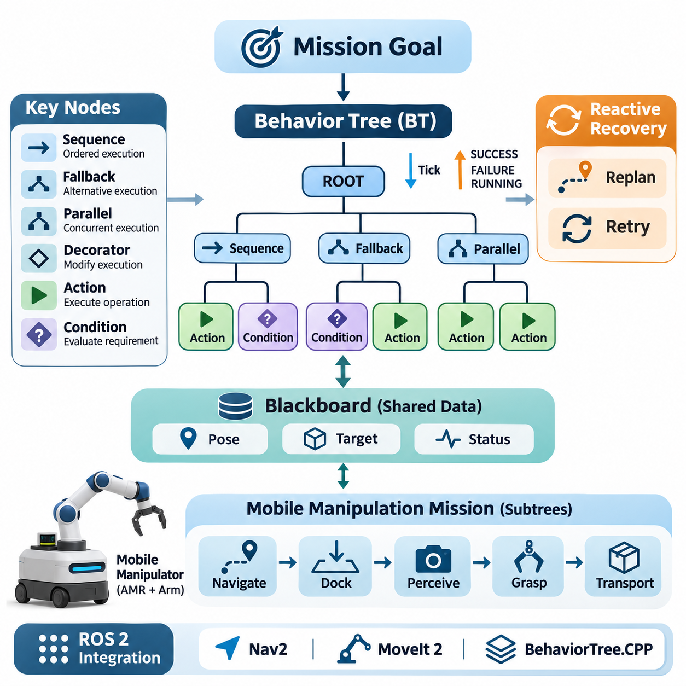
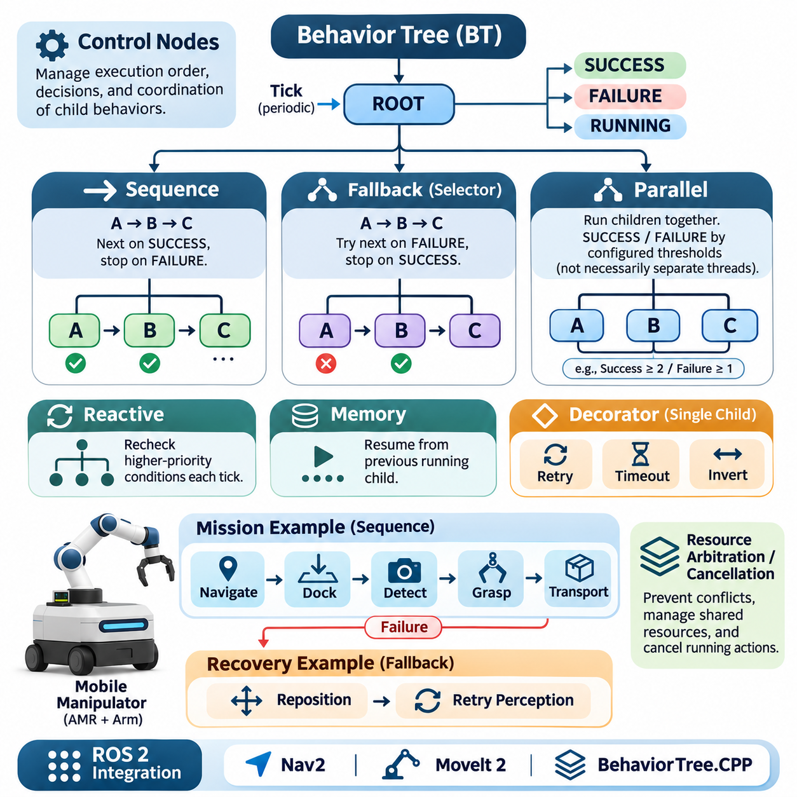
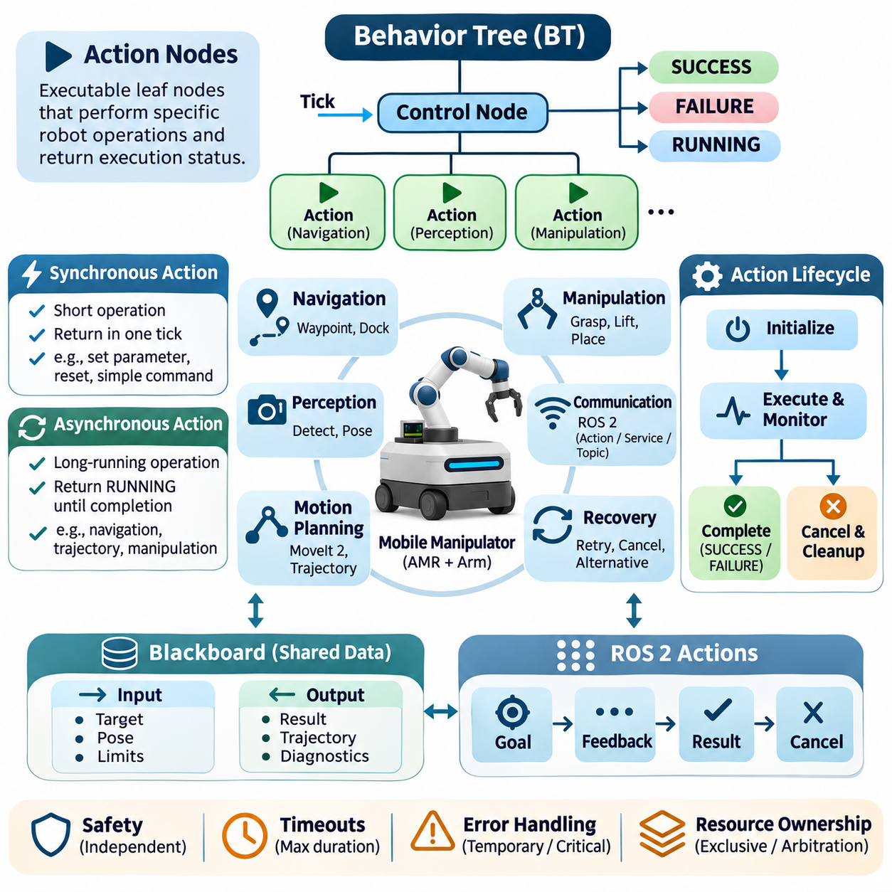
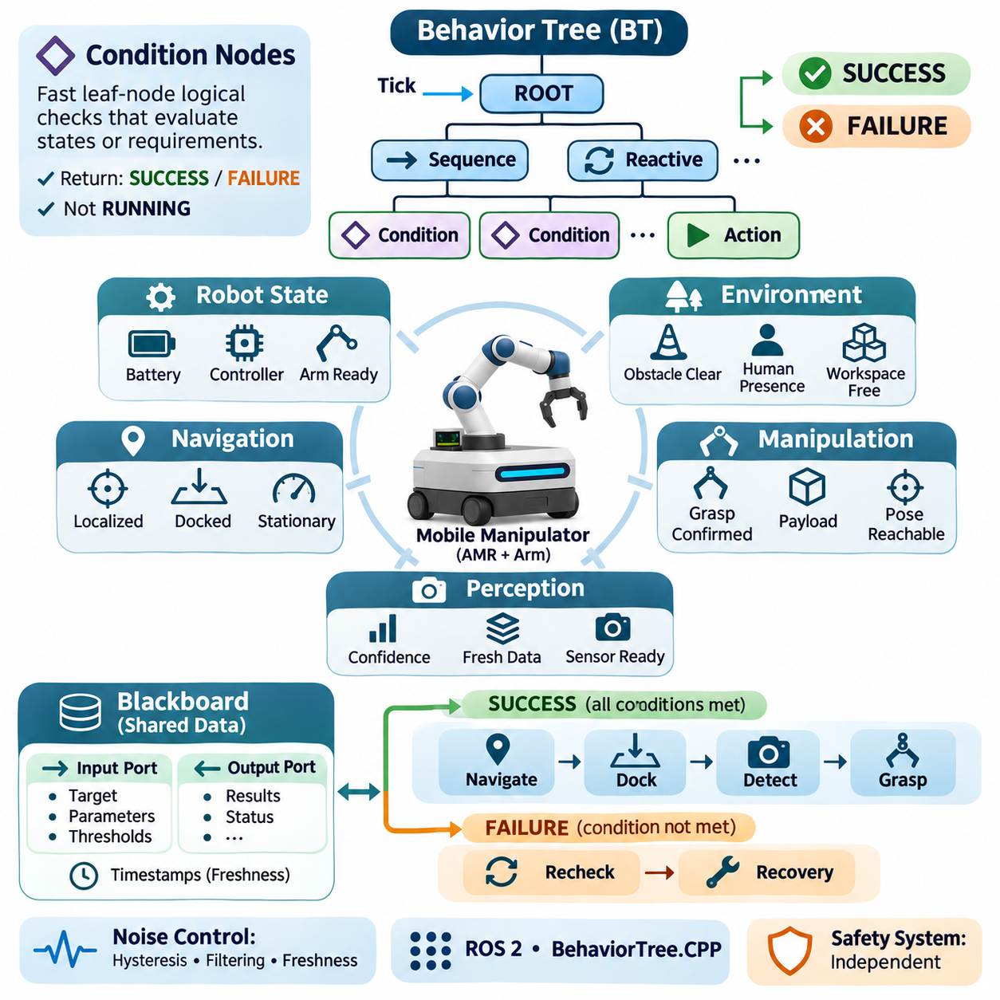
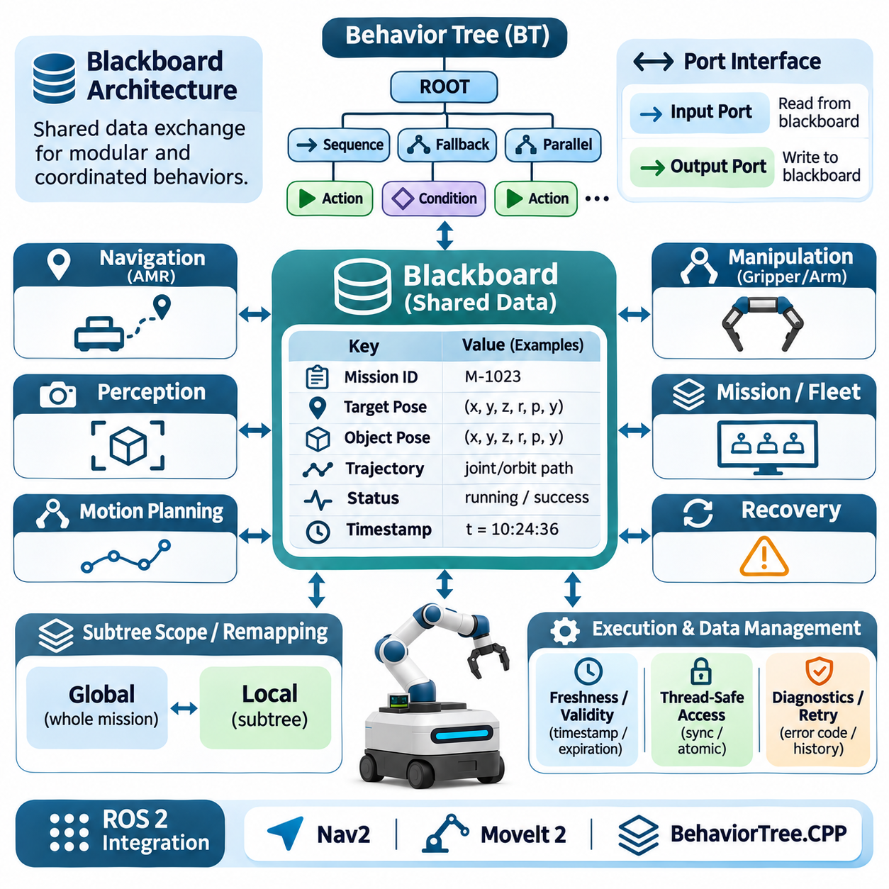
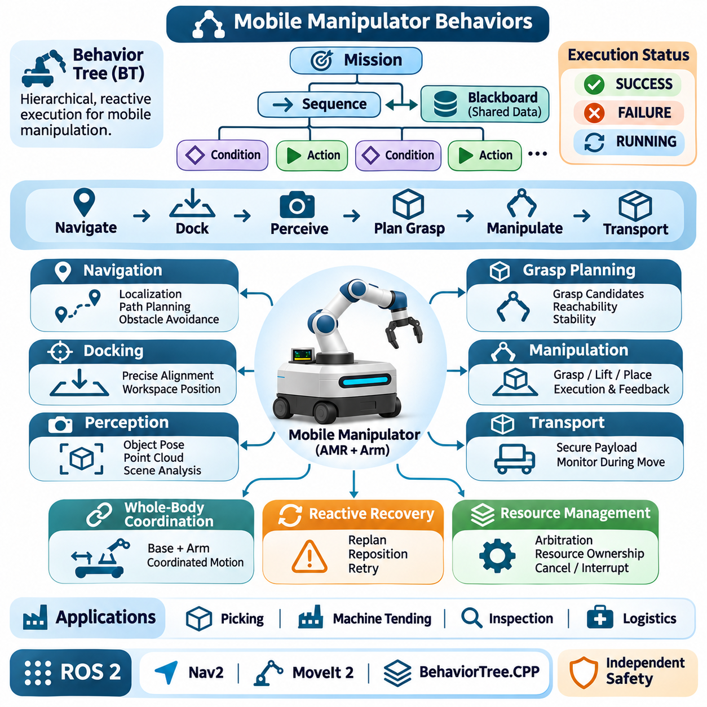
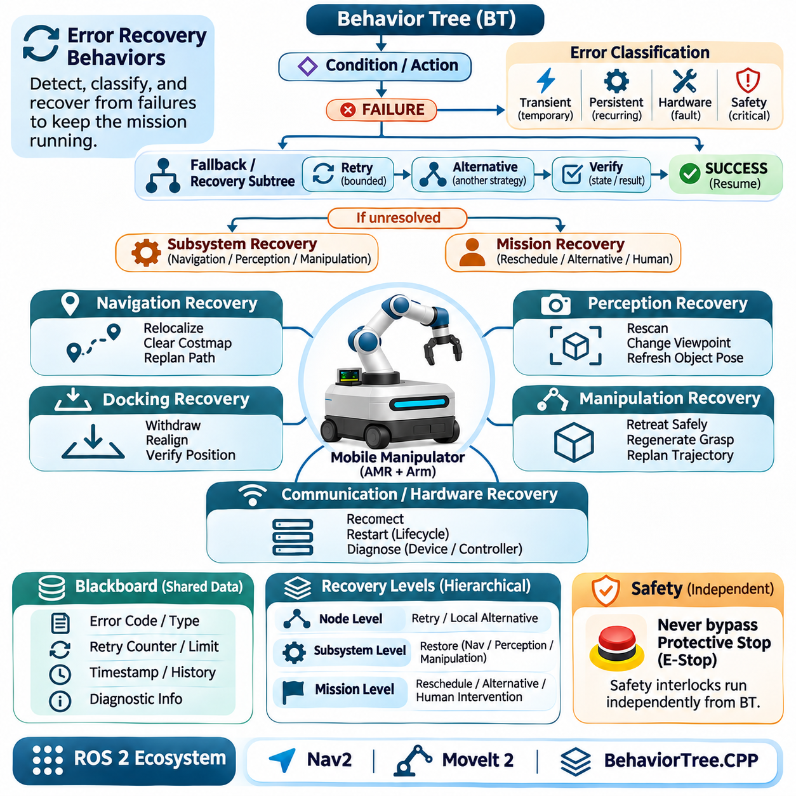
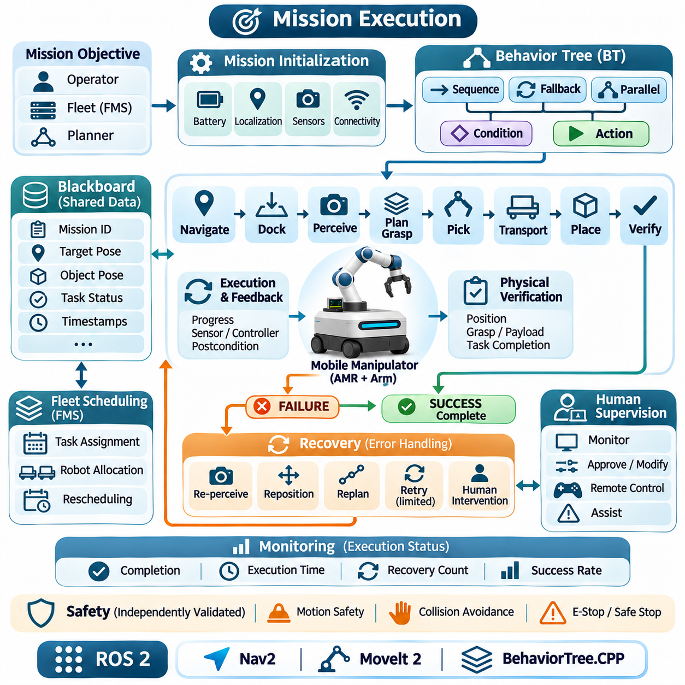
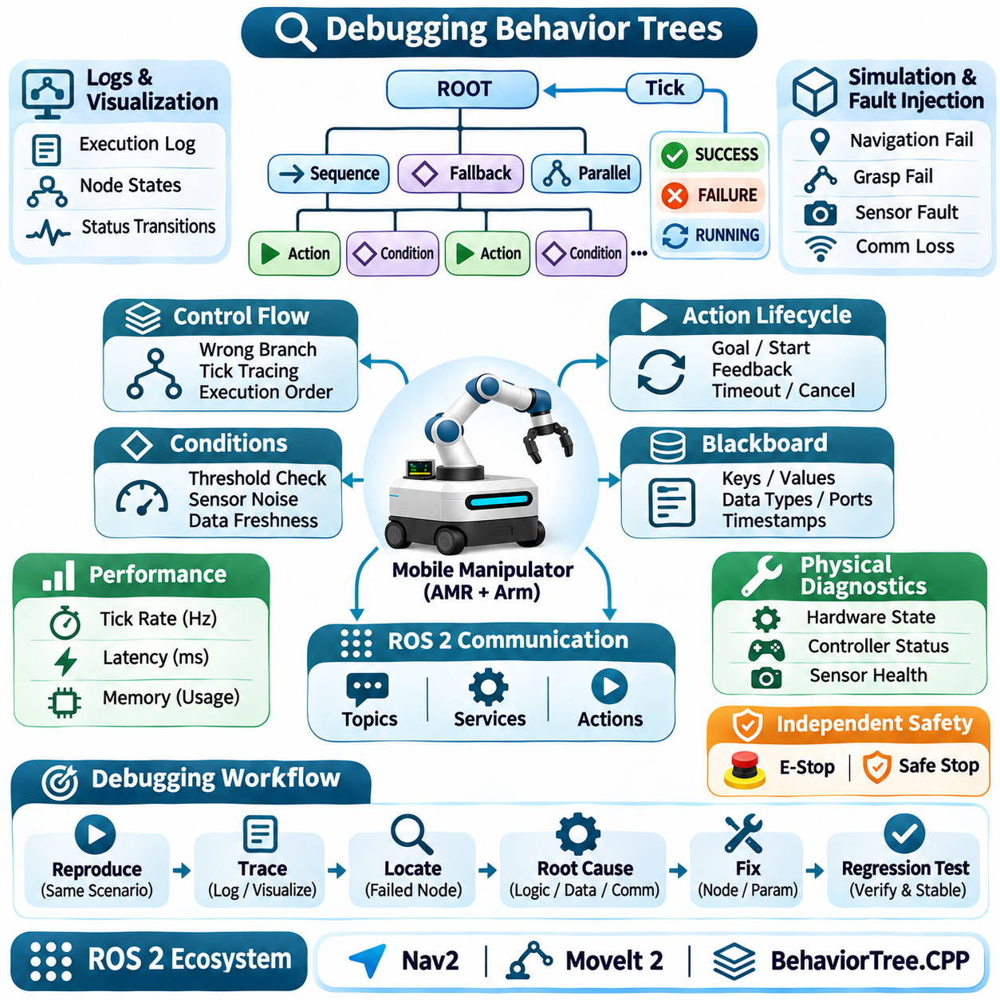

**Volume 04. Mobile Manipulation Software and Operations**

# Chapter 04. Behavior Trees

## 01 Behavior Tree Overview

{width="7.268055555555556in" height="7.268055555555556in"}

A Behavior Tree (BT) is a hierarchical decision-making architecture used to organize, coordinate, and execute complex robotic behaviors in dynamic environments. In mobile manipulation systems, behavior trees provide a structured mechanism for integrating autonomous navigation, environmental perception, object manipulation, task execution, and failure recovery. They connect high-level mission objectives with executable robotic capabilities.

Unlike conventional sequential programming, behavior trees enable robots to continuously evaluate environmental conditions and modify their actions according to changes in operational circumstances. This reactive architecture is particularly important for mobile manipulators operating in warehouses, factories, hospitals, and service environments, where obstacle positions, object availability, and human activities frequently change during mission execution.

A behavior tree consists of interconnected nodes arranged in a hierarchical tree structure. The root node serves as the entry point for execution, while intermediate nodes define decision-making and control relationships between subordinate behaviors. Leaf nodes represent executable actions or conditions that evaluate specific aspects of the robot or its environment. This hierarchy enables complex operational objectives to be decomposed into manageable functional units.

Behavior tree execution is driven by periodic signals known as ticks. Each tick originates from the root and propagates through selected branches according to the logic implemented by their control nodes. Individual nodes return execution statuses, generally categorized as SUCCESS, FAILURE, or RUNNING. These statuses determine how subsequent behaviors are activated, interrupted, continued, or replaced during the execution process.

Control nodes determine the execution order and relationships between child nodes. Sequence nodes execute behaviors in an ordered manner, while Fallback nodes evaluate alternative behaviors until an appropriate option succeeds or remains active. Parallel nodes coordinate multiple behaviors according to predefined completion criteria. Decorator nodes modify the execution semantics of individual child nodes through mechanisms such as repetition, inversion, or timeouts.

Action nodes represent operational capabilities that directly or indirectly interact with the physical robot. Typical examples include navigating toward a destination, detecting an object, calculating a grasp pose, planning a manipulator trajectory, closing a gripper, or returning to a charging station. Long-running actions are generally implemented asynchronously, allowing the behavior tree to evaluate execution progress without unnecessarily blocking other decisions.

Condition nodes evaluate logical requirements associated with the robot, its environment, and the current mission. These requirements may include sufficient battery capacity, object detection confidence, localization accuracy, manipulator readiness, or obstacle clearance. Unlike action nodes, condition nodes typically perform rapid evaluations without directly modifying the physical environment, enabling responsive decision-making throughout autonomous operation.

The blackboard architecture provides a shared data exchange mechanism between behavior tree nodes. Navigation targets, object coordinates, perception results, grasp candidates, mission identifiers, and diagnostic information can be stored and accessed through defined interfaces. Structured blackboard data management reduces direct dependencies between individual behaviors and supports modular software development, component reuse, and coordinated information processing.

In mobile manipulation applications, behavior trees coordinate the autonomous mobile robot (AMR) and robotic manipulator as components of an integrated operational system. A typical mission involves navigating toward a workstation, establishing an appropriate base position, detecting a target object, calculating a grasp configuration, executing manipulation, and transporting the object toward its destination. Each stage can be represented by a reusable behavior subtree.

One of the principal advantages of behavior trees is their ability to support reactive error recovery. When navigation fails, object detection becomes unreliable, or a grasp attempt is unsuccessful, the execution mechanism can activate alternative behaviors. Recovery strategies may include recalculating a navigation path, adjusting the mobile base position, repeating perception, selecting another grasp candidate, or requesting human assistance.

Behavior trees also provide an execution framework for integrating artificial intelligence with conventional robotic software. Vision-language models, symbolic planners, and intelligent robotic agents can generate mission objectives or propose task sequences, while behavior trees coordinate their execution through predefined capabilities. This separation allows AI-generated decisions to be evaluated against operational constraints before physical actions are initiated.

Within the ROS 2 ecosystem, behavior trees can interact with distributed robotic software through topics, services, and actions. Navigation2 (Nav2) uses behavior trees to coordinate navigation and recovery operations, while MoveIt 2 provides motion planning and manipulation capabilities that can be integrated through specialized action nodes. BehaviorTree.CPP offers a practical framework for constructing, executing, and monitoring modular behavior trees in C++.

Behavior trees differ from finite state machines (FSMs) by organizing decision-making logic into composable hierarchical structures rather than primarily relying on explicit transitions between predefined states. This organization can reduce transition complexity as robotic capabilities expand. However, effective implementation still requires careful management of execution states, asynchronous operations, shared data, resource conflicts, and behavior interruption.

Industrial behavior tree implementations must distinguish mission-level decision-making from safety-critical control. Behaviors can respond to safety-related feedback by suspending missions or initiating recovery procedures, but they do not replace independently validated safety mechanisms. Execution logging, timeout management, simulation-based testing, and systematic failure injection further improve operational reliability, maintainability, and traceability.

Ultimately, behavior trees establish a modular execution layer connecting task planning, perception, navigation, manipulation, and autonomous recovery. Their hierarchical organization enables developers to expand robotic capabilities without redesigning the entire mission execution architecture. This makes behavior trees an important software foundation for scalable, adaptive, maintainable, and intelligent mobile manipulation systems.

The supplied documents define the chapter structure rather than detailed technical specifications. Accordingly, this overview expands the provided structure using general robotics engineering principles, while reserving detailed implementation methods for subsequent sections.

## 02 Control Nodes

{width="7.268055555555556in" height="7.268055555555556in"}

Control nodes are fundamental components of a Behavior Tree (BT) that determine the execution order, decision-making relationships, and coordination mechanisms among subordinate behaviors. In mobile manipulation systems, control nodes organize navigation, perception, manipulation, and recovery operations into structured execution workflows. They enable complex robotic missions to be represented through hierarchical and reusable decision-making structures.

Unlike action nodes that execute specific robotic capabilities, control nodes primarily manage the execution logic of their child nodes. When a control node receives a tick from its parent, it evaluates its children according to predefined execution rules. The returned statuses of these children, including SUCCESS, FAILURE, and RUNNING, determine the subsequent execution flow and the overall status returned to the parent node.

The Sequence node is one of the most widely used control nodes in behavior tree architectures. It executes child nodes in a predefined order, progressing to the next child when the current child returns SUCCESS. If a child returns FAILURE, the sequence generally terminates with FAILURE. When a child returns RUNNING, the sequence remains active, with subsequent execution determined by the specific sequence implementation.

In mobile manipulation, a Sequence node can represent an object-handling workflow consisting of navigation toward a workstation, precise docking, object detection, grasp planning, grasp execution, and object transportation. Each operation must satisfy its completion requirements before the subsequent operation begins. This sequential execution structure ensures that operational dependencies and physical constraints are systematically maintained.

The Fallback node, also known as the Selector node, provides an execution mechanism for evaluating alternative behaviors. It generally examines its children in priority order until one returns SUCCESS or RUNNING. When a child returns FAILURE, the fallback proceeds to the next available alternative. If all child nodes return FAILURE, the fallback itself returns FAILURE, indicating that none of the available execution strategies has succeeded.

Fallback nodes are particularly valuable for implementing adaptable robotic behaviors in uncertain environments. When a mobile manipulator fails to detect an object from its current position, alternative behaviors may include adjusting the camera orientation, repositioning the mobile base, applying another perception algorithm, or requesting operator assistance. Such hierarchical alternatives improve mission resilience without requiring extensive conditional programming.

Reactive control nodes extend conventional sequence and fallback mechanisms by reevaluating higher-priority children during successive execution ticks. This approach allows the robot to respond to changing environmental conditions while an operation remains active. For example, a Reactive Sequence can repeatedly evaluate operational readiness before continuing manipulation, interrupting an active behavior when its required preconditions are no longer satisfied.

Memory-based control nodes retain information about previously evaluated children, allowing execution to continue from an appropriate position rather than restarting the entire execution sequence during every tick. This mechanism can reduce unnecessary computation and repeated physical operations. However, developers must carefully distinguish conditions that require continuous reevaluation from completed operations that should retain their execution state.

Parallel nodes coordinate multiple child behaviors within the same execution cycle and determine their overall status according to configured success and failure thresholds. In mobile manipulation, parallel execution may support environmental monitoring, diagnostic evaluation, communication, and mission progress tracking while another operation remains active. Parallel behavior does not necessarily imply simultaneous execution across independent processing threads.

Effective parallel execution requires systematic resource management to prevent conflicting commands from being issued to shared robotic components. Navigation and manipulation behaviors may compete for access to the mobile base, robotic arm, perception sensors, or computational resources. Resource locking, command arbitration, execution constraints, and explicit cancellation mechanisms help maintain consistency and prevent unintended physical interactions.

Decorator nodes complement control nodes by modifying the execution semantics of an individual child behavior. Common decorator mechanisms include status inversion, bounded repetition, retry policies, execution timeouts, and conditional activation. Although decorators are generally classified separately from multi-child control nodes, their combined use enables more flexible execution policies and precise management of operational constraints.

Hierarchical control node composition enables developers to construct sophisticated mission execution architectures from independently reusable subtrees. A warehouse picking mission may combine a Sequence for material handling, a Fallback for alternative grasp strategies, and a Parallel node for operational monitoring. Each subtree encapsulates a specific functional responsibility, reducing software complexity and improving maintainability across different robotic applications.

Within the ROS 2 ecosystem, control nodes can coordinate distributed navigation, manipulation, and perception capabilities through asynchronous interfaces. Navigation2 (Nav2) employs behavior trees to organize navigation and recovery workflows, while BehaviorTree.CPP provides reusable control node implementations and mechanisms for developing customized execution logic. MoveIt 2 operations can similarly be coordinated through dedicated action nodes.

Industrial control node design must account for execution latency, tick frequency, behavior interruption, cancellation handling, and deterministic resource ownership. Developers should verify that interrupted operations release resources appropriately and that recovery loops cannot continue indefinitely. Safety-related conditions can influence mission execution, but behavior tree control nodes must not replace independently validated safety-critical control mechanisms.

Control node performance should be evaluated through simulation, systematic failure injection, execution tracing, and physical robot testing. Relevant evaluation criteria include mission completion rates, recovery success rates, decision-making latency, unnecessary behavior repetition, and resource utilization. Ultimately, properly designed control nodes establish the structural foundation for reliable, reactive, scalable, and maintainable mobile manipulation software.

The supplied documents specify the chapter organization rather than detailed control node implementations. Accordingly, this section expands the provided structure using established behavior tree and robotics engineering principles, while reserving framework-specific implementation details for subsequent sections.

## 03 Action Nodes

{width="7.268055555555556in" height="7.268055555555556in"}

Action nodes are the executable components of a Behavior Tree (BT) that represent specific operational capabilities within a robotic system. In mobile manipulation, action nodes connect high-level decision-making structures with physical robot operations, including autonomous navigation, environmental perception, motion planning, object grasping, and material transportation. They function as the execution interface between mission objectives and underlying robotic subsystems.

An action node is generally implemented as a leaf node within the hierarchical structure of a behavior tree. Unlike control nodes, which determine execution flow, action nodes perform specific operations and report their execution results to parent nodes. Each action node typically returns one of three fundamental execution statuses: SUCCESS, FAILURE, or RUNNING. These statuses allow the behavior tree to coordinate subsequent operations and respond dynamically to execution outcomes.

Synchronous action nodes execute relatively short operations and return their results within a single execution tick. Typical examples include updating configuration parameters, resetting internal variables, publishing lightweight commands, or processing immediately available data. Because synchronous execution can block the behavior tree until an operation completes, such nodes should not be used for computationally intensive processes or prolonged physical robot movements.

Asynchronous action nodes are particularly important for mobile manipulation because physical operations often require several seconds or longer to complete. Navigation, trajectory execution, object manipulation, and docking are representative examples. An asynchronous action node initiates an operation, returns RUNNING while execution continues, and subsequently reports SUCCESS or FAILURE when the operation reaches a terminal state.

The lifecycle of an asynchronous action node generally includes initialization, execution monitoring, completion, and interruption handling. When execution begins, the node validates its input parameters and initiates the corresponding operation. During subsequent ticks, it evaluates execution progress and monitors relevant feedback. If the operation is interrupted, the node must initiate appropriate cancellation and cleanup procedures before relinquishing control.

Navigation action nodes provide interfaces for controlling autonomous mobile robot (AMR) movement within operational environments. These nodes may initiate waypoint navigation, precise docking, position adjustment, or movement toward a designated workstation. By integrating localization feedback, navigation progress, and execution results, navigation action nodes enable the behavior tree to coordinate mobile base movement with subsequent manipulation operations.

Perception action nodes acquire and process environmental information required for autonomous decision-making. Typical operations include object detection, semantic segmentation, six-dimensional object pose estimation, point cloud processing, and grasp candidate generation. Perception results are generally transferred to the behavior tree blackboard, allowing subsequent planning and manipulation nodes to access relevant environmental information through structured interfaces.

Motion planning action nodes calculate feasible movements for robotic manipulators according to target poses, kinematic constraints, collision conditions, and environmental geometry. These nodes can interact with planning frameworks such as MoveIt 2 to generate collision-free trajectories. Planning and trajectory execution are often implemented as separate action nodes, enabling independent validation, alternative planning strategies, and more flexible recovery mechanisms.

Manipulation action nodes execute physical interactions between robotic manipulators and target objects. Representative operations include approaching an object, opening or closing a gripper, executing a grasp, lifting an object, and placing it at a designated location. These nodes should evaluate relevant feedback, such as joint positions, gripping force, tactile measurements, and controller results, to determine whether the intended physical operation has succeeded.

Action nodes exchange operational data through explicitly defined input and output interfaces. Input parameters may include target coordinates, desired velocities, object identifiers, grasp configurations, and execution time limits. Output parameters may contain calculated trajectories, perception results, execution durations, and diagnostic information. Blackboard-based data exchange supports modularity while reducing direct software dependencies between independently developed action nodes.

Within the ROS 2 ecosystem, action nodes frequently communicate with distributed robotic subsystems through ROS 2 actions, services, and topics. ROS 2 actions are especially suitable for long-running operations because they provide goal submission, feedback transmission, result reporting, and cancellation mechanisms. BehaviorTree.CPP supports the development of custom action nodes that encapsulate these communication interfaces within reusable behavior tree components.

Reliable action node design requires systematic management of execution failures, communication interruptions, timeouts, and invalid input conditions. A node should distinguish between temporary operational failures and critical faults whenever sufficient diagnostic information is available. Detailed error information can be stored in the blackboard or reported to diagnostic subsystems, enabling higher-level recovery behaviors to select appropriate responses without embedding complex recovery logic within every action.

Action node interruption is essential for responsive mobile manipulation systems. When higher-priority behaviors become active, ongoing navigation or manipulation operations may need to be canceled. Developers must ensure that cancellation requests are properly processed, physical movement is brought to an appropriate state, and allocated resources are released. A canceled action must not continue issuing commands that conflict with newly activated behaviors.

Industrial action node development should emphasize deterministic interfaces, bounded execution times, resource ownership, and operational traceability. Simulation-based testing, hardware-in-the-loop validation, and systematic failure injection can reveal unexpected execution behavior before field deployment. Action nodes must also respect independently implemented safety mechanisms, since mission-level execution software cannot substitute for validated safety-critical control systems.

Ultimately, action nodes establish the functional execution foundation of behavior tree-based mobile manipulation architectures. By encapsulating navigation, perception, planning, manipulation, communication, and recovery capabilities into independently reusable components, developers can construct increasingly sophisticated robotic missions while maintaining software modularity, operational reliability, system scalability, and long-term maintainability.

The supplied documents define the chapter organization rather than detailed action node implementations. Accordingly, this section expands the provided structure using established behavior tree and robotics engineering principles, while reserving blackboard architecture, mission execution, and framework-specific implementation details for subsequent sections.

## 04 Condition Nodes

{width="7.268055555555556in" height="7.268055555555556in"}

Condition nodes are fundamental components of a Behavior Tree (BT) that evaluate specific states, environmental circumstances, and operational requirements before or during robotic task execution. In mobile manipulation systems, condition nodes provide logical decision points that determine whether navigation, perception, manipulation, or recovery operations can proceed. They connect real-time information with hierarchical decision-making mechanisms.

Unlike action nodes that execute specific operations, condition nodes primarily evaluate whether predefined logical requirements are satisfied. A condition node generally returns SUCCESS when its evaluation criteria are satisfied and FAILURE when they are not satisfied. Conventional condition nodes do not return RUNNING because their evaluations are expected to complete rapidly without initiating prolonged physical operations or blocking the execution flow.

Condition nodes are typically implemented as leaf nodes and are evaluated whenever they receive a tick from their parent control node. Their execution results influence the behavior of Sequence, Fallback, and Reactive control nodes. By combining multiple conditions within hierarchical decision-making structures, developers can define complex operational requirements without embedding extensive conditional statements directly into individual robotic action implementations.

Precondition evaluation represents one of the most important applications of condition nodes in mobile manipulation. Before initiating a physical operation, the behavior tree can evaluate whether the required operational prerequisites have been satisfied. For example, a manipulation sequence may require confirmation that the mobile base is stationary, the robotic arm is operational, the target object is available, and the intended workspace is accessible.

Robot state condition nodes evaluate information associated with the internal operational status of robotic components. Typical conditions include battery state of charge, motor temperature, actuator availability, manipulator readiness, communication connectivity, and controller health. These evaluations enable the behavior tree to identify operational limitations and prevent inappropriate mission execution when essential robotic capabilities are unavailable.

Environmental condition nodes evaluate external circumstances using information obtained from perception and localization systems. Representative conditions include obstacle clearance, human presence, object availability, workstation accessibility, and environmental occupancy. Because environmental conditions can change continuously, these nodes support adaptive decision-making by providing updated information during the execution of autonomous robotic missions.

Navigation condition nodes determine whether the mobile base satisfies requirements associated with autonomous movement and positioning. Typical evaluations include localization confidence, goal proximity, docking alignment, velocity thresholds, and navigation system readiness. Before activating manipulation operations, condition nodes can verify that the mobile platform has reached an acceptable position and remains sufficiently stable for the intended physical interaction.

Manipulation condition nodes evaluate operational states associated with robotic arms, grippers, and target objects. Examples include joint configuration validity, gripper opening status, object grasp confirmation, payload detection, and target pose accessibility. These evaluations allow the behavior tree to distinguish between successful command execution and actual physical task completion, especially when manipulation outcomes depend on uncertain contact interactions.

Perception condition nodes determine whether environmental information satisfies the quality requirements of subsequent robotic operations. These conditions may evaluate object detection confidence, six-dimensional pose estimation accuracy, sensor availability, data freshness, and measurement uncertainty. When perception quality is insufficient, the behavior tree can activate additional sensing operations, alternative viewpoints, or recovery behaviors before continuing mission execution.

Condition nodes frequently retrieve operational information from the behavior tree blackboard, which serves as a shared data exchange mechanism. Sensor measurements, navigation results, object coordinates, diagnostic information, and mission parameters can be accessed through explicitly defined input ports. Timestamp validation and consistent data management are particularly important because outdated information may produce incorrect evaluations and inappropriate behavioral transitions.

Reactive behavior trees repeatedly evaluate selected condition nodes while other operations remain active. For example, a Reactive Sequence may continuously evaluate workspace availability before allowing a manipulation action to continue. If a required condition becomes invalid, the control structure can interrupt the active operation and activate an appropriate alternative behavior. This mechanism supports responsiveness in environments where operational circumstances change frequently.

Threshold-based condition evaluation must account for sensor noise, measurement uncertainty, and temporary environmental disturbances. Without appropriate filtering, a condition may repeatedly alternate between SUCCESS and FAILURE, resulting in unstable behavioral transitions. Hysteresis, temporal filtering, minimum persistence durations, and confidence thresholds can improve evaluation stability, provided that these mechanisms do not introduce unacceptable response delays.

Within the ROS 2 ecosystem, condition nodes can evaluate information received through topics, services, diagnostic messages, and previously completed action results. BehaviorTree.CPP provides mechanisms for implementing reusable condition nodes with structured input ports and standardized execution statuses. Efficient implementations generally evaluate cached or readily available information rather than waiting for blocking communication operations during each behavior tree tick.

Industrial condition node design must distinguish operational monitoring from independently validated safety-critical functions. Conditions may evaluate safety system feedback, report restricted operating states, or prevent mission progression, but ordinary behavior tree logic cannot replace certified safety mechanisms. Testing should include invalid measurements, missing data, communication failures, threshold fluctuations, and unexpected environmental changes to verify predictable evaluation behavior.

Ultimately, condition nodes establish the logical evaluation foundation of behavior tree-based mobile manipulation architectures. Their integration with control nodes, action nodes, and shared blackboard information enables robots to regulate task execution according to internal states and external circumstances. Properly designed condition nodes improve operational reliability, behavioral adaptability, software modularity, and mission execution consistency.

The supplied documents define the chapter organization rather than detailed condition node implementations. Accordingly, this section expands the provided structure using established behavior tree and robotics engineering principles, while reserving detailed blackboard architecture, mobile manipulator behaviors, and framework-specific implementation methods for subsequent sections.

## 05 Blackboard Architecture

{width="7.268055555555556in" height="7.268055555555556in"}

The blackboard architecture is a shared data management mechanism that enables information exchange among nodes within a Behavior Tree (BT). In mobile manipulation systems, the blackboard connects navigation, perception, motion planning, manipulation, and mission execution components through structured data interfaces. It provides a common information space where independently developed behaviors can exchange operational information without requiring direct communication.

Unlike architectures that rely on tightly coupled communication between software components, the blackboard architecture separates information production from information consumption. Individual nodes can write execution results, environmental observations, or operational parameters to the blackboard, while other nodes retrieve the information required for their respective tasks. This separation improves software modularity, flexibility, and component reusability.

The blackboard generally organizes information through key-value pairs, where each unique key identifies a specific data element. Values may represent primitive data types, structured objects, geometric coordinates, transformation matrices, motion trajectories, or diagnostic information. Explicit key definitions, data types, and access conventions help establish consistent information exchange throughout the hierarchical structure of a behavior tree.

Input and output ports provide structured interfaces between individual behavior tree nodes and the blackboard. Input ports retrieve information required for node execution, while output ports publish generated results or updated operational states. Bidirectional ports may support both reading and writing. These interfaces enable developers to construct reusable nodes whose internal implementations remain independent of specific blackboard key names.

Blackboard scope determines the visibility and accessibility of shared information within a behavior tree. A global blackboard can provide information required across multiple mission components, while local blackboards can isolate data associated with individual subtrees. Hierarchical scoping and explicit port remapping reduce naming conflicts, prevent unintended data dependencies, and support the integration of independently developed robotic behaviors.

In mobile manipulation, navigation-related blackboard information may include destination coordinates, current robot poses, docking targets, localization confidence, and navigation execution results. Navigation action nodes update relevant information following operational events, while condition nodes evaluate whether positioning requirements have been satisfied. Subsequent manipulation behaviors can then determine whether the mobile platform is appropriately positioned.

Perception subsystems use the blackboard to communicate environmental observations required for autonomous manipulation. Typical information includes object identifiers, detection confidence, six-dimensional object poses, grasp candidates, obstacle locations, and measurement timestamps. Structured representation of perception results allows planning and manipulation nodes to access relevant information without directly depending on particular sensors or perception algorithms.

Motion planning and manipulation nodes exchange information associated with target poses, inverse kinematics solutions, trajectory identifiers, gripper configurations, and execution feedback. For example, a perception node may generate an object pose, a planning node may calculate a feasible trajectory, and an execution node may retrieve the validated trajectory. This information flow supports coordinated physical operations across multiple robotic subsystems.

Temporal consistency is an essential consideration when managing blackboard information in dynamic environments. Object positions, localization estimates, and obstacle measurements may become invalid as the robot or surrounding environment changes. Timestamps, data freshness requirements, expiration policies, and validity indicators help prevent subsequent behaviors from executing physical operations using outdated or inconsistent information.

Concurrent blackboard access requires careful management when multiple asynchronous behaviors read or modify shared information. Thread-safe access mechanisms, synchronization policies, atomic updates, and clearly defined data ownership can reduce race conditions and inconsistent observations. When several related values must remain consistent, developers should use synchronized snapshots or structured updates rather than independent modifications.

Blackboard architectures also support systematic error reporting and autonomous recovery. Action nodes can record failure codes, diagnostic messages, retry counters, and recovery history, allowing higher-level control nodes to select appropriate alternative behaviors. Separating diagnostic information from basic execution statuses enables more sophisticated recovery strategies without embedding extensive error-handling logic within every individual behavior.

Mission-level information stored in the blackboard may include mission identifiers, assigned tasks, operational priorities, destination locations, and task completion states. Integration with fleet management systems allows externally assigned missions to be translated into locally executable behavior parameters. However, the blackboard should not replace persistent mission databases or distributed communication infrastructure required for coordinated multi-robot operations.

Within the ROS 2 ecosystem, blackboard information can be populated through topics, services, actions, and diagnostic interfaces. BehaviorTree.CPP provides blackboard management, typed ports, subtree scoping, and data remapping mechanisms that facilitate modular behavior development. Navigation2 (Nav2) and MoveIt 2 capabilities can be integrated through specialized nodes that translate communication results into structured blackboard information.

Industrial blackboard implementations should emphasize data validation, bounded memory consumption, access control, and operational traceability. Unnecessary storage of large images, point clouds, or redundant trajectories can increase computational overhead, making references to externally managed data preferable in some applications. Blackboard information should also be treated as operational data rather than as a substitute for independently validated safety-critical control mechanisms.

Ultimately, the blackboard architecture establishes the information-sharing foundation of behavior tree-based mobile manipulation systems. By connecting independently developed control, action, and condition nodes through consistent data interfaces, it enables coordinated mission execution, adaptive decision-making, and systematic recovery. Proper blackboard design improves software scalability, operational reliability, integration efficiency, and long-term maintainability.

The supplied documents define the chapter organization rather than detailed blackboard implementation specifications. Accordingly, this section expands the provided structure using established behavior tree and robotics engineering principles, while reserving application-specific behaviors, mission execution, and detailed BehaviorTree.CPP implementation methods for subsequent sections.

## 06 Mobile Manipulator Behaviors

{width="7.268055555555556in" height="7.268055555555556in"}

Mobile manipulator behaviors represent operational capabilities that integrate autonomous mobility with robotic manipulation within a unified mission execution architecture. In Behavior Tree (BT) systems, these behaviors are organized into reusable functional components that coordinate navigation, environmental perception, object handling, and operational monitoring. Their integration enables robots to perform complex physical tasks in dynamic environments.

Unlike conventional stationary industrial manipulators, mobile manipulators must continuously account for changes in base position, environmental geometry, workspace accessibility, and object location. Behavior trees provide a hierarchical mechanism for coordinating these operational dependencies. Individual behaviors can be activated, suspended, or replaced according to execution results, environmental conditions, and predefined mission requirements.

Navigation behaviors enable the mobile platform to move between workstations, storage locations, charging stations, and designated operational areas. These behaviors typically integrate localization, global path planning, local trajectory generation, and obstacle avoidance capabilities. Navigation behaviors should also monitor execution progress and determine whether the robot has reached a position suitable for subsequent manipulation operations.

Docking and positioning behaviors establish the spatial relationship between the mobile manipulator and its target workstation. Accurate positioning is particularly important because mobile base localization errors can significantly influence manipulation accuracy. These behaviors may combine visual markers, LiDAR measurements, geometric registration, and closed-loop position correction to achieve the alignment and stability required for reliable physical interactions.

Perception behaviors acquire environmental information necessary for autonomous manipulation. These behaviors may include object detection, semantic segmentation, six-dimensional object pose estimation, point cloud processing, and workspace analysis. Perception results are transferred to the behavior tree blackboard, allowing subsequent behaviors to evaluate object accessibility, grasp feasibility, environmental uncertainty, and potential obstacles.

Grasp planning behaviors determine suitable configurations for establishing reliable physical contact between the end effector and target objects. These behaviors evaluate object geometry, orientation, surface properties, gripper characteristics, and manipulator reachability. Multiple grasp candidates can be generated and ranked according to predicted stability, collision constraints, and task requirements before an appropriate configuration is selected.

Manipulation behaviors coordinate the physical execution of robotic arm and end-effector operations. Representative capabilities include approaching target objects, opening and closing grippers, lifting materials, inserting components, and placing objects at designated locations. These behaviors should evaluate controller feedback and relevant sensor measurements to verify that the intended physical operation has been successfully completed.

Whole-body coordination behaviors integrate mobile base movement with robotic arm motion when independent manipulation is insufficient. Such coordination can extend the reachable workspace and improve accessibility in constrained environments. Behavior trees supervise the transition between stationary and coordinated manipulation modes, while underlying motion planners and controllers manage kinematic constraints, stability, and trajectory execution.

Object transportation behaviors combine navigation and manipulation capabilities to transfer materials between operational locations. Before movement begins, the behavior tree should confirm that the object has been securely grasped and the manipulator has reached an appropriate transportation configuration. During transportation, monitoring behaviors can evaluate payload stability, gripper status, obstacle clearance, and unexpected changes in robot motion.

Task-specific behaviors enable mobile manipulators to address industrial applications such as warehouse picking, machine tending, automated inspection, component assembly, and hospital logistics. Each application can be represented through specialized subtrees assembled from common navigation, perception, and manipulation capabilities. This modular approach reduces development effort while supporting application-specific operational requirements.

Reactive behaviors allow mobile manipulators to respond to changing environmental conditions during mission execution. When an object moves, a workstation becomes unavailable, or a navigation route is obstructed, the behavior tree can interrupt the affected operation and activate an alternative strategy. Reactive control structures and condition nodes support this adaptability while maintaining consistency with operational constraints.

Resource management behaviors coordinate access to shared components such as the mobile base, robotic arm, gripper, perception sensors, and computational resources. Explicit resource ownership and command arbitration are particularly important when multiple behaviors remain active. Operational monitoring may continue during physical tasks, but incompatible motion commands must be prevented through coordinated execution policies.

Within the ROS 2 ecosystem, mobile manipulator behaviors can integrate Navigation2 (Nav2), MoveIt 2, perception pipelines, and hardware control interfaces through reusable behavior tree nodes. BehaviorTree.CPP provides mechanisms for organizing these capabilities into hierarchical execution structures. Industrial implementations should incorporate cancellation handling, diagnostic reporting, execution tracing, and independently validated safety mechanisms.

Ultimately, mobile manipulator behaviors establish a reusable operational foundation for coordinating autonomous mobility, environmental intelligence, and physical manipulation. Their hierarchical composition enables increasingly sophisticated missions without requiring extensive redesign of individual robotic subsystems. Properly engineered behaviors improve mission reliability, operational adaptability, software scalability, and long-term maintainability.

The supplied documents define the chapter organization rather than detailed behavior implementation specifications. Accordingly, this section expands the provided structure using established behavior tree and mobile robotics engineering principles, while reserving detailed error recovery strategies, mission execution architectures, and BehaviorTree.CPP implementation methods for subsequent sections.

## 07 Error Recovery Behaviors

{width="7.268055555555556in" height="7.268055555555556in"}

Error recovery behaviors represent essential operational mechanisms that enable mobile manipulators to detect execution failures, evaluate abnormal conditions, and restore acceptable operating states. Within a Behavior Tree (BT) architecture, recovery behaviors are organized as reusable functional components that respond to navigation failures, perception uncertainties, manipulation errors, communication interruptions, and unexpected environmental changes.

Unlike conventional sequential control architectures that may terminate an entire operation when an error occurs, behavior trees support hierarchical and context-dependent recovery strategies. Individual failures can be addressed locally without unnecessarily interrupting the entire mission. When local recovery is unsuccessful, the failure can propagate to higher-level control nodes, which may activate alternative operational strategies.

Error detection establishes the foundation of autonomous recovery. Condition nodes and action nodes monitor sensor measurements, controller feedback, execution statuses, communication availability, and environmental conditions. When abnormal circumstances are identified, the corresponding node can return FAILURE and record diagnostic information in the blackboard, allowing the behavior tree to determine an appropriate recovery response.

Error classification enables mobile manipulators to distinguish between transient failures, persistent operational problems, hardware faults, and safety-critical events. Temporary communication interruptions or uncertain perception results may be resolved through bounded retries, whereas mechanical failures may require maintenance or operator intervention. Appropriate classification prevents ineffective recovery attempts and unnecessary mission interruptions.

Fallback nodes provide a fundamental mechanism for organizing alternative recovery behaviors within a behavior tree. When a primary operation returns FAILURE, a fallback structure can activate a secondary operation or a dedicated recovery subtree. Multiple recovery alternatives can be arranged according to their expected effectiveness, execution cost, operational risk, and probability of successfully restoring the required conditions.

Retry mechanisms allow robotic systems to repeat unsuccessful operations when the underlying failure is potentially temporary. For example, an object detection operation may be repeated after adjusting sensor exposure or changing the observation viewpoint. Retry limits, waiting intervals, execution timeouts, and failure counters should be established to prevent infinite recovery loops and excessive consumption of computational resources.

Navigation recovery behaviors address failures associated with localization uncertainty, blocked pathways, inaccessible destinations, and trajectory execution errors. Representative recovery strategies include localization reinitialization, costmap clearing, path replanning, controlled repositioning, and alternative route selection. Each recovery operation must consider current environmental conditions and independently enforced motion safety constraints.

Docking recovery behaviors are particularly important because positioning errors directly influence manipulation accuracy and workstation accessibility. When docking alignment exceeds acceptable tolerances, the mobile manipulator may withdraw to a validated position, reacquire reference features, and initiate another alignment operation. Recovery attempts should include position verification and stability assessment before manipulation resumes.

Perception recovery behaviors address insufficient detection confidence, sensor occlusion, inaccurate object pose estimation, and incomplete environmental observations. The robot may acquire additional measurements, modify sensor configurations, reposition its observation platform, or activate alternative perception algorithms. Updated results should replace invalid blackboard information before subsequent planning or manipulation behaviors are executed.

Manipulation recovery behaviors address unsuccessful grasping, unreachable target poses, trajectory planning failures, unexpected contact, and object displacement. Depending on the failure condition, the robot may retreat along a validated trajectory, generate alternative grasp candidates, update the planning scene, or calculate a new approach configuration. Recovery decisions must consider payload retention and the current physical state of the manipulator.

Communication and hardware recovery behaviors manage disconnected devices, unavailable software components, controller communication errors, and abnormal subsystem states. Safe cancellation, communication reinitialization, lifecycle transitions, and controlled subsystem restarts may restore operational capabilities. Hardware faults must be distinguished from software failures because repeated software resets cannot resolve underlying mechanical damage.

Blackboard-based recovery management enables multiple behavior tree nodes to exchange failure codes, retry counters, diagnostic messages, recovery priorities, and previous execution results. This shared information supports context-dependent recovery decisions and prevents repeated activation of ineffective strategies. Mission identifiers and timestamps also help distinguish current failures from residual information associated with previous operations.

Hierarchical recovery architectures typically combine node-level, subsystem-level, and mission-level recovery mechanisms. Node-level recovery addresses individual operation failures, while subsystem-level recovery restores navigation, perception, or manipulation capabilities. Mission-level recovery may reschedule tasks, select alternative workstations, suspend the current mission, or request assistance when lower-level strategies cannot resolve the problem.

Safety-critical recovery must remain separate from ordinary behavior tree execution logic. Emergency stops, protective stops, collision protection, and safety-related speed limitations must be enforced through independently validated mechanisms appropriate to the system\'s risk assessment. Recovery behaviors must not override active safety restrictions or automatically resume hazardous motion without satisfying applicable restart conditions.

Within the ROS 2 ecosystem, error recovery behaviors can integrate Navigation2 (Nav2), MoveIt 2, diagnostic interfaces, lifecycle management, and BehaviorTree.CPP execution structures. Industrial validation should include systematic fault injection, recovery time measurements, repeated failure scenarios, and verification of physical postconditions. These evaluations help improve recovery success rates, operational availability, and mission reliability.

The supplied chapter structure identifies error recovery behaviors as the link between mobile manipulator behaviors and mission execution but does not specify detailed recovery implementations. Accordingly, this section expands the outline using established behavior tree and robotics engineering principles, while reserving detailed mission orchestration and framework-specific implementation methods for subsequent sections.

## 08 Mission Execution

{width="7.268055555555556in" height="7.268055555555556in"}

Mission execution is the operational process through which a mobile manipulator converts high-level task objectives into coordinated physical actions. Within a Behavior Tree (BT) architecture, mission execution integrates task planning, navigation, perception, manipulation, condition evaluation, and error recovery into a unified workflow. It provides the runtime coordination mechanism required to transform mission descriptions into reliable and observable robotic operations.

A mission typically begins with a high-level objective received from an operator, fleet management system, or autonomous task planner. The objective may describe activities such as collecting an object, transporting materials, inspecting equipment, or delivering components to a workstation. The mission execution system interprets the objective, identifies required resources, establishes execution parameters, and initializes the corresponding behavior tree.

Mission decomposition transforms complex operational objectives into smaller executable tasks with clearly defined dependencies. For example, a material transportation mission may require destination selection, autonomous navigation, workstation docking, object detection, grasp planning, object pickup, transportation, and final placement. Each task is represented through reusable behavior tree nodes or subtrees, allowing mission logic to remain modular and maintainable.

Mission initialization establishes the operational context required for successful execution. The system verifies robot availability, battery capacity, localization status, sensor readiness, manipulator configuration, and communication connectivity. Required mission parameters, including target coordinates, object identifiers, payload constraints, and execution priorities, are stored in the blackboard. Execution should begin only after essential operational prerequisites have been satisfied.

The mission execution engine coordinates individual tasks through hierarchical control nodes and asynchronous action nodes. Sequence nodes organize dependent operations, while fallback nodes provide alternative execution strategies when primary operations fail. Parallel nodes can support monitoring and coordination activities during task execution. This structure allows the mission to progress according to execution results rather than relying exclusively on a fixed sequence of commands.

Navigation and positioning are generally performed before manipulation activities begin. The mobile platform travels toward the designated operational location while monitoring localization accuracy, obstacle clearance, and navigation progress. Upon reaching the target area, docking behaviors establish the required spatial alignment and platform stability. The execution system verifies positioning conditions before activating the manipulator to prevent unnecessary motion and inaccurate object interaction.

Perception and manipulation tasks are coordinated according to the operational requirements of each mission. After the mobile platform reaches an appropriate position, perception behaviors identify target objects and estimate their spatial configurations. Planning behaviors calculate feasible grasp configurations and manipulator trajectories, while action nodes execute the corresponding physical operations. Feedback from sensors and controllers is used to verify whether the intended manipulation has been completed successfully.

Mission execution must maintain consistency between planned activities and actual physical system states. A navigation command being completed does not necessarily guarantee accurate docking, and a gripper command being executed does not necessarily confirm successful object grasping. Therefore, condition nodes evaluate physical postconditions using sensor measurements, controller feedback, and updated blackboard information before the mission proceeds to subsequent tasks.

Dynamic mission execution requires the ability to adapt to changing environmental conditions and operational priorities. Objects may become unavailable, workstations may be occupied, navigation paths may become obstructed, or additional tasks may be assigned. Reactive behavior trees allow the execution system to reevaluate relevant conditions and select alternative behaviors without unnecessarily restarting the entire mission.

Error recovery is an integral part of mission execution rather than an independent operation performed only after a mission terminates. When a task fails, the behavior tree evaluates the failure status and activates an appropriate recovery strategy. Recovery may involve repeating perception, adjusting the mobile base position, selecting an alternative grasp, recalculating a trajectory, or requesting operator intervention. The mission can resume when the required operational conditions have been restored.

Mission state management provides a consistent representation of execution progress throughout the operational lifecycle. Relevant information includes mission identifiers, current task states, completed operations, active behaviors, retry counters, execution timestamps, and failure histories. Blackboard mechanisms support information exchange between behavior nodes, while persistent mission records can preserve execution history across software restarts and operational sessions.

Human supervision may be required when autonomous execution encounters conditions that cannot be resolved through predefined recovery strategies. Operators can review diagnostic information, approve alternative execution plans, modify mission parameters, or perform remote interventions. A human-in-the-loop architecture should clearly distinguish between automatic execution, supervised decision-making, and manual control to prevent conflicting commands and ambiguous operational responsibilities.

Mission execution also requires coordination with fleet management systems when multiple mobile manipulators operate within the same facility. Mission assignments, resource availability, workstation reservations, traffic restrictions, and charging requirements influence individual robot execution. Integration with fleet-level scheduling and resource allocation enables local behavior trees to execute assigned missions while respecting facility-wide operational constraints.

Within the ROS 2 ecosystem, mission execution can integrate Navigation2 (Nav2), MoveIt 2, perception pipelines, hardware controllers, and BehaviorTree.CPP. ROS 2 actions provide interfaces for long-running operations, while topics and services support status monitoring and information exchange. BehaviorTree.CPP enables mission workflows to be constructed from reusable control, action, and condition nodes, supporting modular execution and framework-level extensibility.

Industrial mission execution should incorporate execution monitoring, event logging, timeout management, cancellation handling, and systematic performance evaluation. Important operational metrics include mission completion rate, average execution duration, recovery frequency, task success rate, positioning accuracy, and system availability. Simulation and physical testing should verify not only successful mission completion but also behavior under communication failures, sensor degradation, unexpected obstacles, and interrupted operations.

Safety management remains essential throughout the mission lifecycle. Behavior trees can coordinate operational responses to safety-related conditions, but emergency stopping, protective monitoring, collision protection, and other safety-critical functions must be implemented through independently validated mechanisms. Mission execution must respect active safety restrictions and require appropriate authorization and condition verification before resuming interrupted physical operations.

Ultimately, mission execution provides the integration layer that connects high-level objectives with coordinated robotic actions and operational feedback. By combining hierarchical behavior trees, shared blackboard information, reusable action components, and systematic recovery mechanisms, mobile manipulators can execute complex missions with improved reliability, adaptability, and operational consistency. A well-designed mission execution architecture also provides the foundation for scalable deployment, fleet integration, and long-term autonomous operation.

The supplied document identifies Mission Execution as a dedicated section within the Behavior Trees chapter but does not specify detailed implementation requirements. Accordingly, this section develops the topic using established behavior tree and mobile robotics engineering principles, while reserving framework-specific implementation details and debugging procedures for the following sections.

## 09 BehaviorTreeCPP

{width="7.268055555555556in" height="7.268055555555556in"}

BehaviorTree.CPP is a C++ framework designed to develop, execute, and manage Behavior Trees (BTs) for complex robotic applications. It provides a modular software architecture for representing hierarchical decision-making logic, coordinating asynchronous operations, and integrating reusable behavioral components. In mobile manipulation systems, it serves as an execution framework connecting navigation, perception, motion planning, manipulation, and mission management.

The framework separates behavior tree structure from individual node implementations, allowing developers to construct complex execution workflows using independently developed components. This separation improves software modularity and maintainability because the same action, condition, or control node can be reused across different missions. Changes to individual robotic capabilities do not necessarily require modifications to the overall behavior tree architecture.

BehaviorTree.CPP supports the fundamental behavior tree node categories, including control nodes, decorator nodes, action nodes, and condition nodes. Control nodes determine how child behaviors are executed, while decorator nodes modify the execution semantics of individual children. Action nodes perform operational tasks, and condition nodes evaluate logical requirements. These components can be combined into hierarchical structures representing complex robotic behaviors.

The framework provides a standardized node execution model based on periodic ticks and execution statuses. Nodes generally return SUCCESS, FAILURE, or RUNNING to communicate their current execution state. This mechanism allows parent nodes to coordinate subsequent operations according to the results of their children. Asynchronous action implementations can remain active across multiple ticks without blocking the entire behavior tree execution process.

Custom node development is an important capability of BehaviorTree.CPP. Developers can implement specialized nodes that interface with robotic hardware, navigation systems, perception algorithms, and motion planning frameworks. For example, a navigation action node can submit a navigation goal, monitor execution feedback, and report completion or failure to the behavior tree. This encapsulation allows hardware-specific communication details to remain separate from mission-level logic.

The blackboard mechanism provides shared information storage between behavior tree nodes. BehaviorTree.CPP supports typed data access through input and output ports, enabling nodes to exchange target coordinates, object poses, trajectory information, execution results, and diagnostic data. Blackboard remapping and subtree organization further support modular data management and the reuse of behavioral components across different operational contexts.

XML-based behavior tree descriptions allow developers to define execution structures separately from compiled C++ node implementations. This approach makes mission logic easier to inspect, modify, and maintain without rebuilding the entire software application whenever the behavior tree structure changes. XML descriptions can reference registered node types and organize complex missions through reusable subtree definitions.

Subtree composition enables large robotic applications to be divided into smaller functional structures. Navigation, docking, object detection, grasp planning, and manipulation can each be represented as independent subtrees. These structures can then be combined into higher-level mission workflows. This hierarchical organization improves readability and allows development teams to maintain individual capabilities independently.

BehaviorTree.CPP supports asynchronous execution and action interruption mechanisms that are particularly important for physical robotic systems. Long-running operations such as navigation and trajectory execution can continue while the behavior tree periodically evaluates their progress. When a higher-priority condition requires interruption, the corresponding action node must process cancellation requests and release its resources appropriately.

Integration with ROS 2 enables BehaviorTree.CPP to coordinate distributed robotic software components through topics, services, and actions. ROS 2 action interfaces are particularly suitable for long-running operations because they support goal submission, execution feedback, result reporting, and cancellation. Navigation2 (Nav2) demonstrates this integration through behavior tree-based navigation and recovery workflows.

MoveIt 2 can also be integrated into BehaviorTree.CPP through specialized action nodes that manage motion planning and trajectory execution. A manipulation subtree may coordinate target pose acquisition, inverse kinematics calculation, collision checking, trajectory planning, and physical execution. This integration provides a structured mechanism for coordinating mobile manipulation tasks while maintaining separation between decision-making and motion control.

Plugin-based node registration and reusable software components support extensibility across robotic applications. Developers can organize custom node implementations into libraries and register them with the behavior tree factory. This approach allows different robotic platforms and application modules to share common execution components while introducing platform-specific functionality when necessary.

Reliable implementation requires careful management of node lifecycles, asynchronous operations, blackboard data types, execution timeouts, and cancellation behavior. Developers should also consider resource ownership when multiple behaviors interact with shared robotic hardware. Proper error handling prevents incomplete operations, resource conflicts, and unexpected execution states from propagating throughout the mission architecture.

BehaviorTree.CPP applications should be evaluated through unit testing, simulation, execution tracing, and physical robot validation. Testing should cover successful execution, node failures, timeout conditions, interrupted actions, invalid input data, and recovery transitions. Execution monitoring helps developers identify incorrect tree structures, unexpected node activation, excessive retry behavior, and performance bottlenecks.

Within industrial mobile manipulation systems, BehaviorTree.CPP provides an effective foundation for implementing modular, reactive, and maintainable mission execution software. However, behavior tree execution logic must remain separate from independently validated safety-critical mechanisms. Emergency stopping, protective monitoring, and other safety functions require appropriate dedicated implementations and verification.

Ultimately, BehaviorTree.CPP provides the software infrastructure required to translate behavior tree concepts into executable robotic applications. Its support for hierarchical composition, reusable nodes, asynchronous execution, blackboard communication, and ROS 2 integration makes it suitable for coordinating increasingly sophisticated mobile manipulation systems. Proper framework integration improves development efficiency, operational consistency, software scalability, and long-term system maintainability.

The supplied chapter structure identifies BehaviorTree.CPP as a dedicated implementation topic but does not specify particular framework versions, APIs, or coding requirements. Accordingly, this section presents its role and major architectural capabilities using established framework and robotics engineering principles, while reserving detailed debugging and validation procedures for the following section.

## 10 Debugging Behavior Trees

{width="7.268055555555556in" height="7.268055555555556in"}

Debugging Behavior Trees is an essential engineering activity for ensuring the correctness, reliability, and maintainability of robotic mission execution. In mobile manipulation systems, behavior trees coordinate navigation, perception, motion planning, manipulation, and recovery operations. Errors in node execution, control flow, shared data, or asynchronous communication can therefore affect the entire robotic mission. Systematic debugging helps identify these problems and restore predictable execution behavior.

Behavior tree debugging begins with understanding the hierarchical execution structure and the relationships between individual nodes. Developers should examine the root node, control nodes, action nodes, condition nodes, decorators, and subtree connections. Understanding how ticks propagate through the tree and how execution statuses are returned provides the foundation for identifying unexpected activation sequences and incorrect behavioral transitions.

Execution status monitoring is one of the most important debugging techniques. Each node generally returns SUCCESS, FAILURE, or RUNNING, and these statuses determine how parent control nodes proceed. Developers should identify which node produced an unexpected status, examine the conditions that caused the result, and determine whether the returned status accurately represents the underlying robotic operation.

Tick execution tracing provides detailed information about the progression of behavior tree execution. By recording node activation, execution timestamps, returned statuses, and transition events, developers can reconstruct the sequence of operations associated with a failure. This information is particularly useful for diagnosing problems involving reactive sequences, fallback branches, repeated execution, and asynchronous action completion.

Control node debugging focuses on verifying the expected execution behavior of Sequence, Fallback, Parallel, and Reactive control structures. A Sequence node may terminate earlier than expected when a child returns FAILURE, while a Fallback node may activate an unintended alternative branch. Parallel nodes require additional attention because multiple behaviors may interact with shared resources or produce unexpected execution dependencies.

Action node debugging requires examining the complete lifecycle of individual operations. Developers should verify initialization, goal submission, execution feedback, completion handling, cancellation, and resource cleanup. For asynchronous actions, it is important to determine whether the node remains in RUNNING state appropriately and whether it eventually reports SUCCESS or FAILURE. Incorrect lifecycle management can result in blocked execution or unfinished robotic operations.

Condition node debugging involves checking the logical expressions, sensor values, thresholds, and data freshness requirements used during evaluation. Conditions that repeatedly alternate between SUCCESS and FAILURE may indicate unstable measurements, insufficient filtering, or poorly selected thresholds. Developers should also verify whether condition nodes evaluate the intended information and whether their results correctly influence the parent control structure.

Blackboard debugging focuses on identifying incorrect data exchange between behavior tree nodes. Common problems include missing keys, incompatible data types, invalid values, incorrect port mappings, and unexpected data overwriting. Developers should inspect the source and destination of important variables, verify their update timestamps, and confirm that subtree remapping preserves the intended information relationships.

Asynchronous execution introduces additional debugging challenges because behavior tree nodes may interact with external robotic processes over extended periods. Navigation, manipulation, and motion planning operations may remain active while the tree continues receiving ticks. Debugging should therefore examine action feedback, timeout conditions, cancellation requests, communication delays, and the relationship between external execution states and behavior tree statuses.

ROS 2 integration debugging requires examining communication between BehaviorTree.CPP nodes and distributed robotic subsystems. Developers should verify topic availability, service responses, action server states, message contents, and communication timing. Tools such as ROS 2 command-line utilities, topic inspection, action monitoring, and diagnostic messages can help identify communication failures and distinguish middleware problems from behavior tree logic errors.

Simulation provides a controlled environment for investigating behavior tree execution before testing on physical robots. Developers can reproduce navigation failures, object detection errors, grasp failures, and environmental disturbances without exposing hardware to unnecessary risks. Repeated simulation scenarios also make it possible to compare execution results and evaluate whether modifications improve recovery behavior and mission reliability.

Logging and visualization improve the interpretability of complex behavior tree execution. Execution logs can record node names, timestamps, status transitions, error codes, and relevant blackboard values. Graphical tree visualization helps developers observe which branches are active, which conditions prevent execution, and where the mission becomes interrupted. Combining visual inspection with structured logs provides a more complete understanding of system behavior.

BehaviorTree.CPP provides debugging and monitoring capabilities that can be used to inspect tree execution and node states. Its logging and visualization ecosystem can help developers analyze execution traces and understand behavioral transitions. When integrated with ROS 2, these capabilities can be complemented by external diagnostic and monitoring tools to provide a broader view of the robotic application.

Failure injection is an important technique for evaluating the robustness of behavior tree implementations. Developers can deliberately introduce communication interruptions, sensor failures, navigation timeouts, invalid blackboard data, and unsuccessful manipulation operations. The resulting execution behavior reveals whether the system detects failures correctly, activates appropriate recovery branches, and returns to a valid operational state.

Performance debugging should also consider tick frequency, computational overhead, execution latency, memory consumption, and unnecessary node activation. Excessive tree evaluation or repeated execution of expensive perception operations can reduce overall system responsiveness. Profiling and execution tracing help identify bottlenecks and support optimization without compromising the correctness of mission behavior.

Industrial debugging must distinguish software execution failures from physical hardware problems and safety-related events. A behavior tree may correctly report a failed operation even when the underlying cause is a mechanical fault, sensor degradation, or an independently activated protective stop. Diagnostic procedures should therefore combine software logs, controller feedback, sensor measurements, and hardware status information.

A systematic debugging process should include problem reproduction, execution trace collection, failure localization, root cause analysis, corrective modification, and regression testing. After correcting a problem, developers should verify not only the affected node but also the behavior of connected subtrees and complete mission workflows. This prevents local improvements from introducing unexpected failures elsewhere in the execution architecture.

Ultimately, debugging behavior trees is essential for developing reliable and scalable mobile manipulation software. By combining execution tracing, status monitoring, blackboard inspection, ROS 2 diagnostics, simulation, and systematic failure testing, developers can identify behavioral inconsistencies and improve operational reliability. A disciplined debugging process also supports software maintainability, predictable recovery, and dependable deployment in industrial environments.

The supplied chapter structure identifies Debugging Behavior Trees as the final section of the Behavior Trees chapter but does not provide detailed debugging specifications or framework-specific procedures. Accordingly, this section develops the topic using established behavior tree and robotics software engineering principles, with emphasis on practical debugging methods for mobile manipulation systems.
