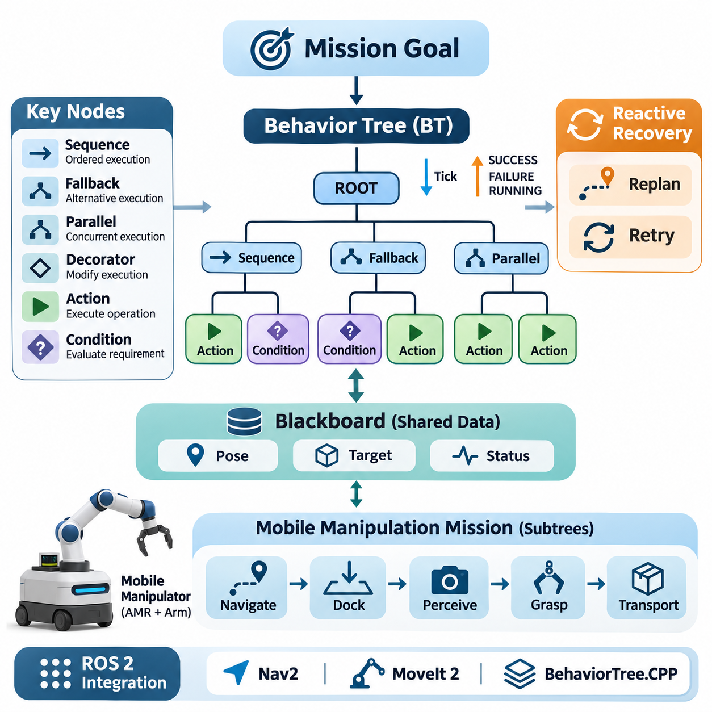
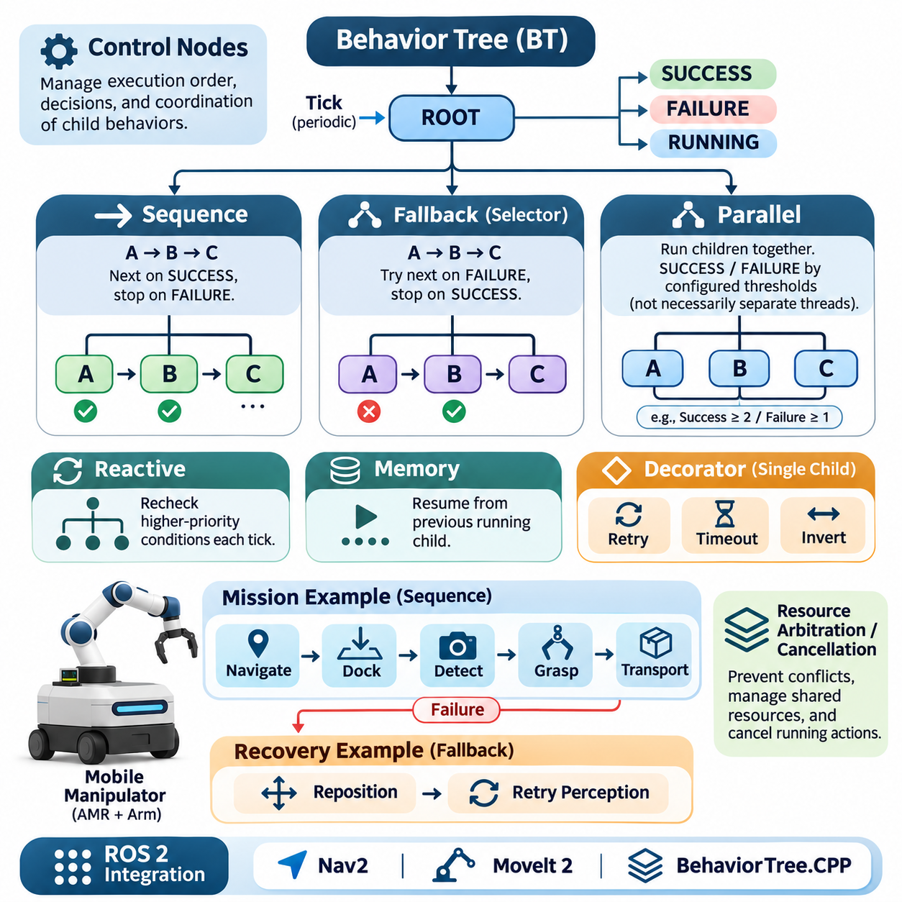
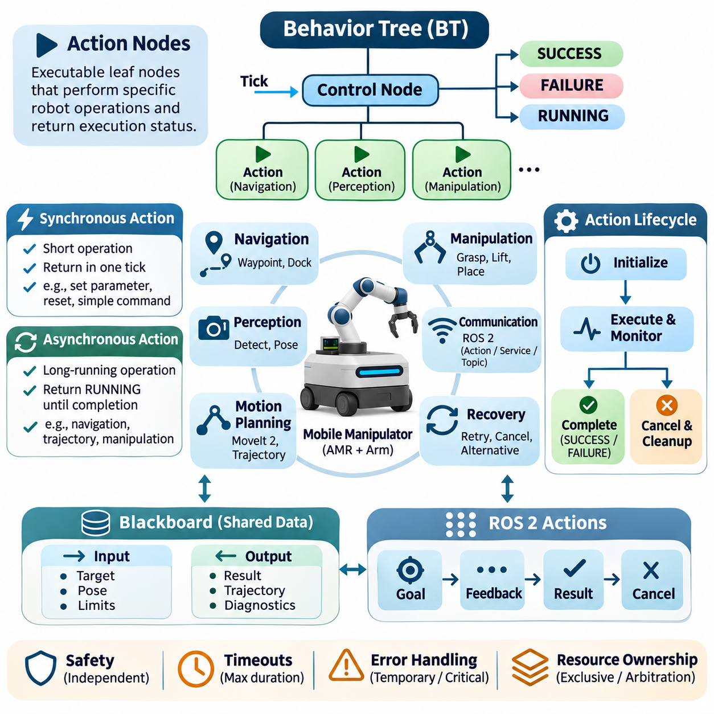
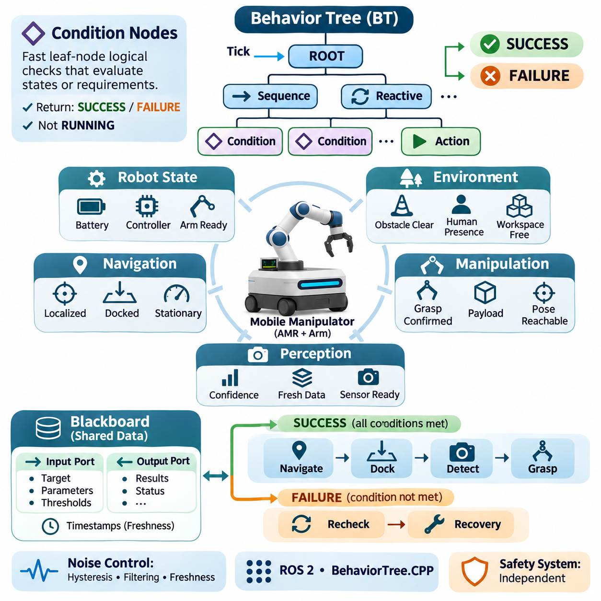
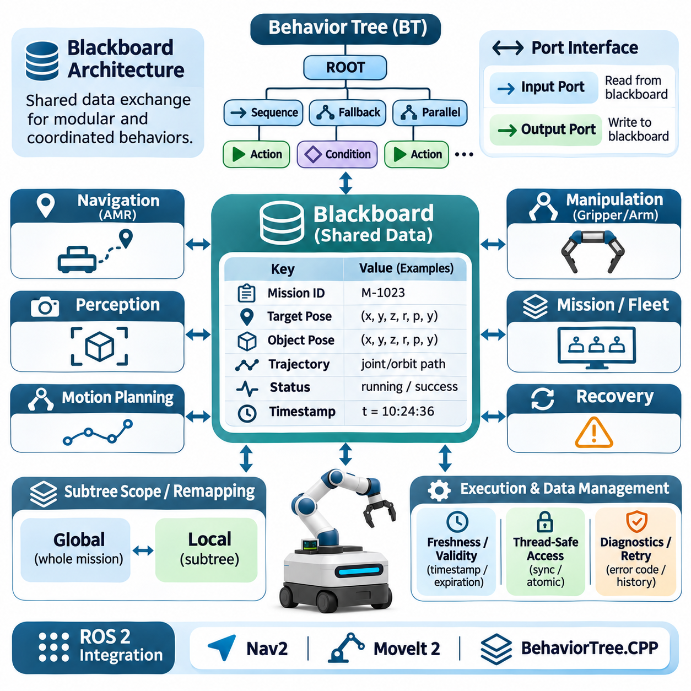
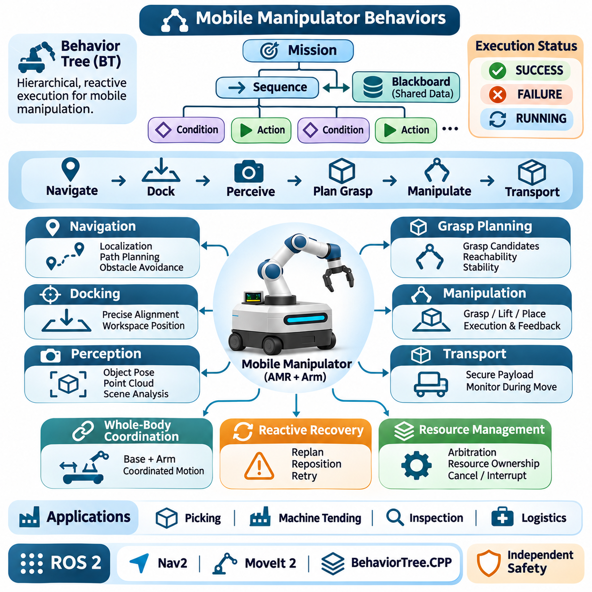
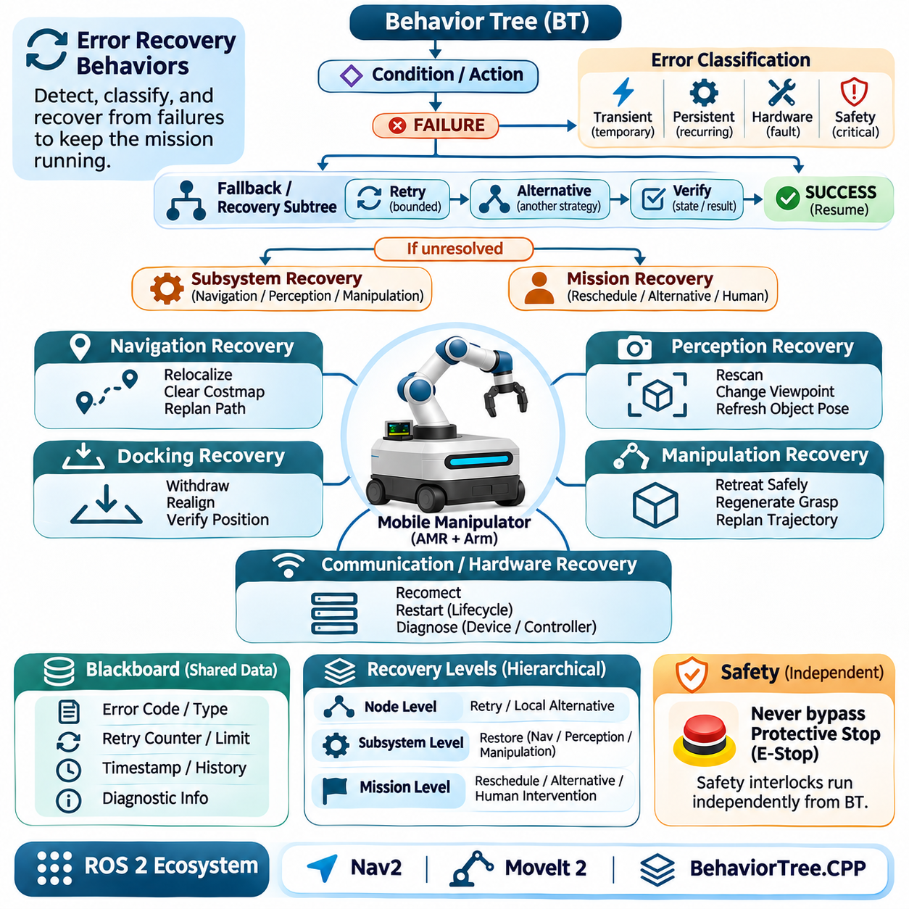
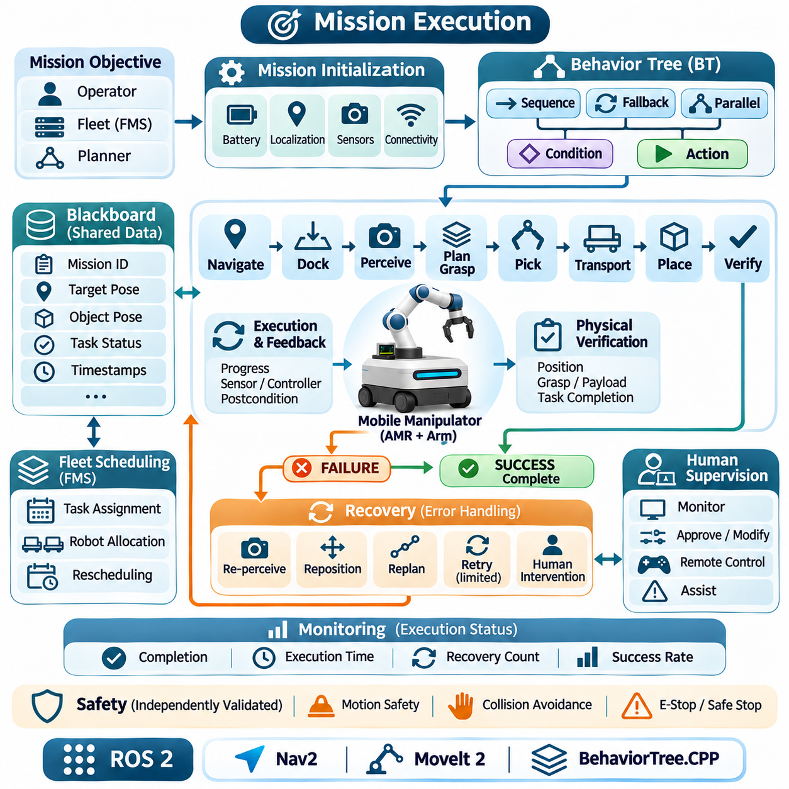
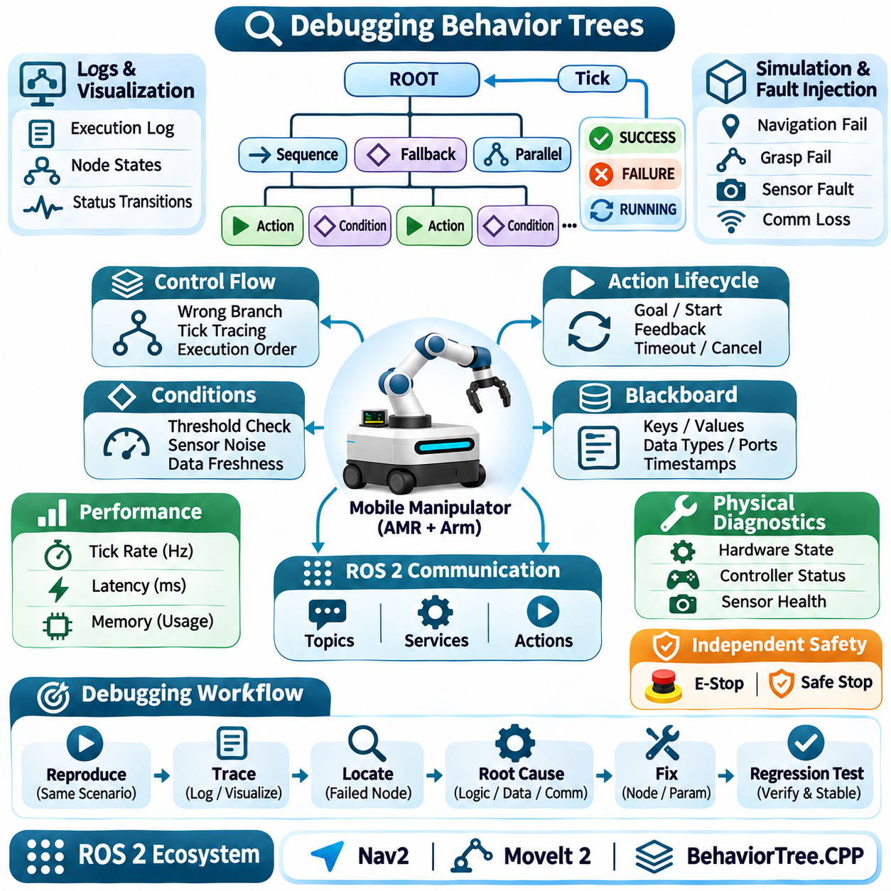

# Chapter 04. Behavior Trees

## 01 Behavior Tree Overview

{width="7.268055555555556in" height="7.268055555555556in"}

행동 트리(Behavior Tree, BT)는 동적인 환경에서 복잡한 로봇 행동을 구성하고 조정하며 실행하기 위해 사용되는 계층적 의사결정 아키텍처(Hierarchical Decision-Making Architecture)이다. 모바일 매니퓰레이션 시스템(Mobile Manipulation System)에서 행동 트리는 자율주행, 환경 인식, 객체 조작, 작업 실행 및 오류 복구를 통합하기 위한 구조화된 메커니즘을 제공한다. 이를 통해 상위 수준의 임무 목표(Mission Objective)와 실행 가능한 로봇 기능을 연결한다.

기존의 순차적 프로그래밍(Sequential Programming)과 달리 행동 트리는 로봇이 환경 조건을 지속적으로 평가하고, 운영 상황의 변화에 따라 자신의 행동을 수정할 수 있도록 한다. 이러한 반응형 아키텍처(Reactive Architecture)는 장애물의 위치, 객체의 가용성 및 인간의 활동이 임무 실행 중 빈번하게 변화하는 물류창고, 공장, 병원 및 서비스 환경에서 운영되는 모바일 매니퓰레이터(Mobile Manipulator)에 특히 중요하다.

행동 트리는 계층적 트리 구조(Hierarchical Tree Structure)로 배열된 상호 연결 노드(Node)들로 구성된다. 루트 노드(Root Node)는 실행의 시작점 역할을 수행하며, 중간 노드(Intermediate Node)는 하위 행동 간의 의사결정 및 제어 관계를 정의한다. 리프 노드(Leaf Node)는 실행 가능한 행동이나 로봇 또는 환경의 특정 상태를 평가하는 조건을 나타낸다. 이러한 계층 구조를 통해 복잡한 운영 목표를 관리 가능한 기능 단위(Functional Unit)로 분해할 수 있다.

행동 트리의 실행은 틱(Tick)이라고 하는 주기적인 신호에 의해 이루어진다. 각 틱은 루트 노드에서 시작하여 제어 노드(Control Node)에 구현된 논리에 따라 선택된 하위 분기(Branch)로 전파된다. 개별 노드는 일반적으로 성공(SUCCESS), 실패(FAILURE), 실행 중(RUNNING)으로 분류되는 실행 상태(Execution Status)를 반환한다. 이러한 상태는 실행 과정에서 후속 행동이 활성화되거나 중단되고, 지속되거나 다른 행동으로 대체되는 방식을 결정한다.

제어 노드(Control Node)는 자식 노드(Child Node) 간의 실행 순서와 관계를 결정한다. 시퀀스 노드(Sequence Node)는 정해진 순서에 따라 행동을 실행하며, 폴백 노드(Fallback Node)는 적절한 대안 행동이 성공하거나 실행 중 상태를 유지할 때까지 여러 대안을 평가한다. 병렬 노드(Parallel Node)는 사전에 정의된 완료 기준에 따라 여러 행동을 조정한다. 데코레이터 노드(Decorator Node)는 반복(Repeat), 반전(Inversion), 시간 초과(Timeout) 등의 메커니즘을 통해 개별 자식 노드의 실행 방식을 변경한다.

행동 노드(Action Node)는 물리적 로봇과 직접적 또는 간접적으로 상호작용하는 운영 기능(Operational Capability)을 나타낸다. 대표적인 예로는 목적지까지의 자율주행, 객체 검출, 파지 자세 계산, 매니퓰레이터 궤적 계획, 그리퍼 닫기 및 충전 스테이션으로의 복귀 등이 있다. 장시간 실행되는 행동은 일반적으로 비동기 방식(Asynchronous Method)으로 구현되며, 이를 통해 행동 트리는 다른 의사결정을 불필요하게 차단하지 않고 실행 진행 상황을 평가할 수 있다.

조건 노드(Condition Node)는 로봇과 환경 및 현재 임무에 관련된 논리적 요구사항(Logical Requirement)을 평가한다. 이러한 요구사항에는 충분한 배터리 용량, 객체 검출 신뢰도, 위치 추정 정확도, 매니퓰레이터 준비 상태 및 장애물과의 이격 거리 등이 포함될 수 있다. 행동 노드와 달리 조건 노드는 일반적으로 물리적 환경을 직접 변경하지 않고 신속한 평가를 수행함으로써 자율 운영 전반에서 반응형 의사결정(Reactive Decision-Making)을 가능하게 한다.

블랙보드 아키텍처(Blackboard Architecture)는 행동 트리 노드 간의 공유 데이터 교환 메커니즘(Shared Data Exchange Mechanism)을 제공한다. 자율주행 목표, 객체 좌표, 인식 결과, 파지 후보, 임무 식별자 및 진단 정보는 정의된 인터페이스(Interface)를 통해 저장하고 접근할 수 있다. 구조화된 블랙보드 데이터 관리는 개별 행동 간의 직접적인 의존성을 줄이고, 모듈형 소프트웨어 개발(Modular Software Development), 구성요소 재사용 및 협조적인 정보 처리를 지원한다.

모바일 매니퓰레이션 응용 분야에서 행동 트리는 자율이동로봇(Autonomous Mobile Robot, AMR)과 로봇 매니퓰레이터(Robotic Manipulator)를 통합 운영 시스템(Integrated Operational System)의 구성요소로 조정한다. 일반적인 임무는 작업 스테이션으로의 이동, 적절한 모바일 베이스 위치 확보, 목표 객체 검출, 파지 구성 계산, 객체 조작 실행 및 목적지까지의 객체 운반으로 구성된다. 각 단계는 재사용 가능한 행동 서브트리(Behavior Subtree)로 표현할 수 있다.

행동 트리의 주요 장점 중 하나는 반응형 오류 복구(Reactive Error Recovery)를 지원할 수 있다는 점이다. 자율주행이 실패하거나 객체 검출의 신뢰성이 저하되거나 파지 시도가 실패하면 실행 메커니즘은 대안 행동(Alternative Behavior)을 활성화할 수 있다. 복구 전략(Recovery Strategy)에는 자율주행 경로 재계산, 모바일 베이스 위치 조정, 환경 인식 재수행, 다른 파지 후보 선택 및 인간 작업자에 대한 지원 요청 등이 포함될 수 있다.

행동 트리는 인공지능(Artificial Intelligence, AI)과 기존 로봇 소프트웨어를 통합하기 위한 실행 프레임워크(Execution Framework)도 제공한다. 비전-언어 모델(Vision-Language Model, VLM), 기호 기반 계획기(Symbolic Planner) 및 지능형 로봇 에이전트(Intelligent Robotic Agent)는 임무 목표를 생성하거나 작업 시퀀스를 제안할 수 있으며, 행동 트리는 사전에 정의된 기능을 통해 이를 실행하도록 조정한다. 이러한 분리 구조를 통해 물리적 행동이 시작되기 전에 AI가 생성한 의사결정을 운영 제약조건(Operational Constraint)에 따라 평가할 수 있다.

ROS 2 생태계(ROS 2 Ecosystem)에서 행동 트리는 토픽(Topic), 서비스(Service) 및 액션(Action)을 통해 분산형 로봇 소프트웨어(Distributed Robotic Software)와 상호작용할 수 있다. Navigation2(Nav2)는 자율주행 및 복구 작업을 조정하기 위해 행동 트리를 사용하며, MoveIt 2는 특화된 행동 노드를 통해 통합할 수 있는 모션 플래닝(Motion Planning) 및 객체 조작 기능을 제공한다. BehaviorTree.CPP는 C++ 기반의 모듈형 행동 트리를 구성하고 실행하며 모니터링하기 위한 실용적인 프레임워크를 제공한다.

행동 트리는 사전에 정의된 상태 간의 명시적인 전이(Explicit Transition)에 주로 의존하는 대신, 조합 가능한 계층 구조(Composable Hierarchical Structure)를 통해 의사결정 논리를 구성한다는 점에서 유한 상태 기계(Finite State Machine, FSM)와 차이가 있다. 이러한 구성 방식은 로봇의 기능이 확장됨에 따라 발생하는 상태 전이 복잡성(Transition Complexity)을 줄일 수 있다. 그러나 효과적인 구현을 위해서는 실행 상태, 비동기 작업, 공유 데이터, 자원 충돌 및 행동 중단에 대한 체계적인 관리가 필요하다.

산업용 행동 트리(Industrial Behavior Tree)의 구현에서는 임무 수준의 의사결정(Mission-Level Decision-Making)과 안전 필수 제어(Safety-Critical Control)를 명확하게 구분해야 한다. 행동 노드는 안전 관련 피드백에 대응하여 임무를 일시 중단하거나 복구 절차를 시작할 수 있지만, 독립적으로 검증된 안전 메커니즘(Safety Mechanism)을 대체할 수는 없다. 실행 로깅(Execution Logging), 시간 초과 관리(Timeout Management), 시뮬레이션 기반 시험(Simulation-Based Testing) 및 체계적인 오류 주입(Failure Injection)은 운영 신뢰성, 유지보수성 및 추적성을 더욱 향상시킨다.

궁극적으로 행동 트리는 작업 계획(Task Planning), 환경 인식(Perception), 자율주행(Navigation), 객체 조작(Manipulation) 및 자율 복구(Autonomous Recovery)를 연결하는 모듈형 실행 계층(Modular Execution Layer)을 구축한다. 이러한 계층적 구성은 개발자가 전체 임무 실행 아키텍처(Mission Execution Architecture)를 재설계하지 않고도 로봇의 기능을 확장할 수 있도록 한다. 따라서 행동 트리는 확장성(Scalability), 적응성(Adaptability), 유지보수성(Maintainability) 및 지능성을 갖춘 모바일 매니퓰레이션 시스템을 구현하기 위한 중요한 소프트웨어 기반이다.

첨부된 문서는 상세한 기술 사양(Technical Specification)이 아닌 장의 구성 구조를 정의하고 있다. 따라서 본 개요는 제공된 구조를 기반으로 일반적인 로봇공학 원리(Robotics Engineering Principle)를 적용하여 내용을 확장하였으며, 세부적인 구현 방법(Implementation Method)은 후속 절에서 다루도록 구성하였다.

## 02 Control Nodes

{width="7.268055555555556in" height="7.268055555555556in"}

제어 노드(Control Node)는 하위 행동 간의 실행 순서, 의사결정 관계 및 조정 메커니즘을 결정하는 행동 트리(Behavior Tree, BT)의 핵심 구성요소이다. 모바일 매니퓰레이션 시스템(Mobile Manipulation System)에서 제어 노드는 자율주행(Navigation), 환경 인식(Perception), 객체 조작(Manipulation) 및 오류 복구(Recovery) 작업을 구조화된 실행 워크플로(Execution Workflow)로 구성한다. 이를 통해 복잡한 로봇 임무를 계층적이고 재사용 가능한 의사결정 구조로 표현할 수 있다.

특정 로봇 기능을 실행하는 행동 노드(Action Node)와 달리 제어 노드는 주로 자식 노드(Child Node)의 실행 논리(Execution Logic)를 관리한다. 제어 노드가 부모 노드(Parent Node)로부터 틱(Tick)을 수신하면 사전에 정의된 실행 규칙에 따라 자식 노드를 평가한다. 자식 노드가 반환하는 성공(SUCCESS), 실패(FAILURE) 및 실행 중(RUNNING) 등의 상태는 후속 실행 흐름(Execution Flow)과 부모 노드에 반환되는 전체 실행 상태를 결정한다.

시퀀스 노드(Sequence Node)는 행동 트리 아키텍처(Behavior Tree Architecture)에서 가장 널리 사용되는 제어 노드 중 하나이다. 시퀀스 노드는 사전에 정의된 순서에 따라 자식 노드를 실행하며, 현재 자식 노드가 성공(SUCCESS)을 반환하면 다음 자식 노드로 진행한다. 자식 노드가 실패(FAILURE)를 반환하면 시퀀스는 일반적으로 실패 상태로 종료된다. 자식 노드가 실행 중(RUNNING)을 반환하면 시퀀스는 활성 상태를 유지하며, 이후의 실행 방식은 해당 시퀀스의 구체적인 구현에 따라 결정된다.

모바일 매니퓰레이션에서 시퀀스 노드는 작업 스테이션으로의 자율주행, 정밀 도킹(Precise Docking), 객체 검출(Object Detection), 파지 계획(Grasp Planning), 파지 실행(Grasp Execution) 및 객체 운반(Object Transportation)으로 구성된 객체 처리 워크플로(Object-Handling Workflow)를 표현할 수 있다. 각 작업은 후속 작업이 시작되기 전에 해당 작업의 완료 요구사항을 충족해야 한다. 이러한 순차적 실행 구조(Sequential Execution Structure)는 작업 간 의존성과 물리적 제약조건이 체계적으로 유지되도록 한다.

선택 노드(Selector Node)라고도 불리는 폴백 노드(Fallback Node)는 대안 행동(Alternative Behavior)을 평가하기 위한 실행 메커니즘(Execution Mechanism)을 제공한다. 일반적으로 자식 노드 중 하나가 성공(SUCCESS) 또는 실행 중(RUNNING)을 반환할 때까지 우선순위에 따라 자식 노드를 평가한다. 자식 노드가 실패(FAILURE)를 반환하면 폴백 노드는 다음으로 사용 가능한 대안으로 진행한다. 모든 자식 노드가 실패를 반환하면 폴백 노드 자체도 실패를 반환하며, 이는 사용 가능한 실행 전략 중 어느 것도 성공하지 못했음을 의미한다.

폴백 노드는 불확실한 환경에서 적응형 로봇 행동(Adaptive Robot Behavior)을 구현하는 데 특히 유용하다. 모바일 매니퓰레이터(Mobile Manipulator)가 현재 위치에서 객체 검출에 실패할 경우, 카메라 방향 조정, 모바일 베이스(Mobile Base)의 위치 변경, 다른 인식 알고리즘(Perception Algorithm)의 적용 또는 운영자에 대한 지원 요청 등이 대안 행동에 포함될 수 있다. 이러한 계층적 대안 구조(Hierarchical Alternative Structure)는 복잡한 조건부 프로그래밍(Conditional Programming) 없이도 임무 복원력(Mission Resilience)을 향상시킨다.

반응형 제어 노드(Reactive Control Node)는 연속적인 실행 틱(Execution Tick)에서 우선순위가 높은 자식 노드를 재평가함으로써 기존의 시퀀스 및 폴백 메커니즘을 확장한다. 이러한 접근 방식은 특정 작업이 활성 상태로 유지되는 동안에도 로봇이 변화하는 환경 조건에 대응할 수 있도록 한다. 예를 들어 반응형 시퀀스(Reactive Sequence)는 객체 조작을 계속하기 전에 작업 준비 상태(Operational Readiness)를 반복적으로 평가하고, 필요한 사전조건(Precondition)이 더 이상 충족되지 않으면 실행 중인 행동을 중단할 수 있다.

메모리 기반 제어 노드(Memory-Based Control Node)는 이전에 평가된 자식 노드에 관한 정보를 유지함으로써 매 틱마다 전체 실행 시퀀스를 다시 시작하지 않고 적절한 위치에서 실행을 계속할 수 있도록 한다. 이러한 메커니즘은 불필요한 연산과 반복적인 물리적 작업을 줄일 수 있다. 그러나 개발자는 지속적으로 재평가해야 하는 조건과 완료된 실행 상태를 유지해야 하는 작업을 신중하게 구분해야 한다.

병렬 노드(Parallel Node)는 동일한 실행 주기(Execution Cycle) 내에서 여러 자식 행동을 조정하고, 설정된 성공 및 실패 임계값(Success and Failure Threshold)에 따라 전체 실행 상태를 결정한다. 모바일 매니퓰레이션에서 병렬 실행(Parallel Execution)은 다른 작업이 활성 상태로 유지되는 동안 환경 모니터링(Environmental Monitoring), 진단 평가(Diagnostic Evaluation), 통신(Communication) 및 임무 진행 상황 추적(Mission Progress Tracking)을 지원할 수 있다. 병렬 행동(Parallel Behavior)이 반드시 독립적인 처리 스레드(Processing Thread)에서 동시에 실행되는 것을 의미하지는 않는다.

효과적인 병렬 실행을 위해서는 공유 로봇 구성요소에 상충하는 명령이 전달되는 것을 방지하기 위한 체계적인 자원 관리(Resource Management)가 필요하다. 자율주행 및 객체 조작 행동은 모바일 베이스, 로봇 팔, 인식 센서 또는 컴퓨팅 자원에 대한 접근 권한을 두고 경쟁할 수 있다. 자원 잠금(Resource Locking), 명령 중재(Command Arbitration), 실행 제약조건(Execution Constraint) 및 명시적 취소 메커니즘(Explicit Cancellation Mechanism)은 시스템의 일관성을 유지하고 의도하지 않은 물리적 상호작용을 방지하는 데 도움이 된다.

데코레이터 노드(Decorator Node)는 개별 자식 행동의 실행 의미 체계(Execution Semantics)를 변경함으로써 제어 노드의 기능을 보완한다. 일반적인 데코레이터 메커니즘에는 상태 반전(Status Inversion), 제한적 반복(Bounded Repetition), 재시도 정책(Retry Policy), 실행 시간 초과(Execution Timeout) 및 조건부 활성화(Conditional Activation) 등이 포함된다. 데코레이터 노드는 일반적으로 여러 자식 노드를 갖는 제어 노드(Multi-Child Control Node)와 별도로 분류되지만, 이들을 결합하여 사용하면 더욱 유연한 실행 정책(Execution Policy)과 정밀한 운영 제약조건 관리가 가능해진다.

계층적 제어 노드 구성(Hierarchical Control Node Composition)은 개발자가 독립적으로 재사용할 수 있는 서브트리(Subtree)를 기반으로 고도화된 임무 실행 아키텍처(Mission Execution Architecture)를 구축할 수 있도록 한다. 물류창고 피킹 임무(Warehouse Picking Mission)는 자재 처리를 위한 시퀀스 노드, 대안 파지 전략(Alternative Grasp Strategy)을 위한 폴백 노드 및 운영 모니터링(Operational Monitoring)을 위한 병렬 노드를 결합하여 구성할 수 있다. 각 서브트리는 특정 기능적 책임(Functional Responsibility)을 캡슐화(Encapsulation)함으로써 소프트웨어 복잡성을 줄이고 다양한 로봇 응용 분야에서 유지보수성(Maintainability)을 향상시킨다.

ROS 2 생태계(ROS 2 Ecosystem)에서 제어 노드는 비동기 인터페이스(Asynchronous Interface)를 통해 분산된 자율주행, 객체 조작 및 환경 인식 기능을 조정할 수 있다. Navigation2(Nav2)는 자율주행 및 오류 복구 워크플로를 구성하기 위해 행동 트리를 사용하며, BehaviorTree.CPP는 재사용 가능한 제어 노드 구현과 사용자 정의 실행 논리(Custom Execution Logic)를 개발하기 위한 메커니즘을 제공한다. MoveIt 2의 작업 역시 전용 행동 노드(Dedicated Action Node)를 통해 유사한 방식으로 조정할 수 있다.

산업용 제어 노드 설계(Industrial Control Node Design)에서는 실행 지연시간(Execution Latency), 틱 주파수(Tick Frequency), 행동 중단(Behavior Interruption), 취소 처리(Cancellation Handling) 및 결정론적 자원 소유권(Deterministic Resource Ownership)을 고려해야 한다. 개발자는 중단된 작업이 자원을 적절하게 해제하는지, 복구 루프(Recovery Loop)가 무한정 지속되지 않는지를 검증해야 한다. 안전 관련 조건(Safety-Related Condition)은 임무 실행에 영향을 줄 수 있지만, 행동 트리의 제어 노드가 독립적으로 검증된 안전 필수 제어 메커니즘(Safety-Critical Control Mechanism)을 대체해서는 안 된다.

제어 노드의 성능은 시뮬레이션(Simulation), 체계적인 오류 주입(Failure Injection), 실행 추적(Execution Tracing) 및 실제 로봇 시험(Physical Robot Testing)을 통해 평가해야 한다. 주요 평가 기준에는 임무 완료율(Mission Completion Rate), 오류 복구 성공률(Recovery Success Rate), 의사결정 지연시간(Decision-Making Latency), 불필요한 행동 반복(Unnecessary Behavior Repetition) 및 자원 활용률(Resource Utilization) 등이 포함된다. 궁극적으로 적절하게 설계된 제어 노드는 신뢰성(Reliability), 반응성(Reactivity), 확장성(Scalability) 및 유지보수성을 갖춘 모바일 매니퓰레이션 소프트웨어의 구조적 기반을 확립한다.

첨부된 문서는 상세한 제어 노드 구현(Control Node Implementation)이 아닌 장의 구성 구조를 명시하고 있다. 따라서 본 절은 제공된 구조를 기반으로 확립된 행동 트리 및 로봇공학 원리(Robotics Engineering Principle)를 적용하여 내용을 확장하였으며, 프레임워크별 세부 구현 방법(Framework-Specific Implementation Detail)은 후속 절에서 다루도록 구성하였다.

## 03 Action Nodes

{width="7.268055555555556in" height="7.268055555555556in"}

행동 노드(Action Node)는 로봇 시스템 내에서 특정 운영 기능(Operational Capability)을 나타내는 행동 트리(Behavior Tree, BT)의 실행 가능한 구성요소이다. 모바일 매니퓰레이션(Mobile Manipulation)에서 행동 노드는 상위 수준의 의사결정 구조와 자율주행(Autonomous Navigation), 환경 인식(Environmental Perception), 모션 플래닝(Motion Planning), 객체 파지(Object Grasping) 및 자재 운반(Material Transportation) 등의 물리적 로봇 작업을 연결한다. 행동 노드는 임무 목표(Mission Objective)와 하위 로봇 서브시스템(Robotic Subsystem) 사이의 실행 인터페이스(Execution Interface) 역할을 수행한다.

행동 노드는 일반적으로 행동 트리의 계층적 구조(Hierarchical Structure) 내에서 리프 노드(Leaf Node)로 구현된다. 실행 흐름(Execution Flow)을 결정하는 제어 노드(Control Node)와 달리 행동 노드는 특정 작업을 수행하고 실행 결과를 부모 노드(Parent Node)에 보고한다. 각 행동 노드는 일반적으로 성공(SUCCESS), 실패(FAILURE), 실행 중(RUNNING)이라는 세 가지 기본 실행 상태(Execution Status) 중 하나를 반환한다. 이러한 상태를 통해 행동 트리는 후속 작업을 조정하고 실행 결과에 동적으로 대응할 수 있다.

동기식 행동 노드(Synchronous Action Node)는 비교적 짧은 작업을 수행하고 단일 실행 틱(Execution Tick) 내에서 결과를 반환한다. 대표적인 예로는 구성 매개변수(Configuration Parameter) 갱신, 내부 변수(Internal Variable) 초기화, 경량 명령(Lightweight Command) 발행 및 즉시 사용 가능한 데이터 처리 등이 있다. 동기식 실행(Synchronous Execution)은 작업이 완료될 때까지 행동 트리의 실행을 차단할 수 있으므로, 연산 집약적 프로세스(Computationally Intensive Process) 또는 장시간 지속되는 물리적 로봇 움직임에는 사용하지 않는 것이 바람직하다.

비동기식 행동 노드(Asynchronous Action Node)는 물리적 작업을 완료하는 데 수 초 이상의 시간이 필요한 경우가 많기 때문에 모바일 매니퓰레이션에서 특히 중요하다. 자율주행, 궤적 실행(Trajectory Execution), 객체 조작(Object Manipulation) 및 도킹(Docking)이 대표적인 예이다. 비동기식 행동 노드는 작업을 시작하고 실행이 지속되는 동안 실행 중(RUNNING)을 반환하며, 이후 작업이 종료 상태(Terminal State)에 도달하면 성공(SUCCESS) 또는 실패(FAILURE)를 보고한다.

비동기식 행동 노드의 수명주기(Lifecycle)는 일반적으로 초기화(Initialization), 실행 모니터링(Execution Monitoring), 완료(Completion) 및 중단 처리(Interruption Handling)로 구성된다. 실행이 시작되면 노드는 입력 매개변수(Input Parameter)의 유효성을 검증하고 해당 작업을 시작한다. 후속 틱(Tick)에서는 실행 진행 상황을 평가하고 관련 피드백(Feedback)을 모니터링한다. 작업이 중단되면 노드는 제어권을 반환하기 전에 적절한 취소(Cancellation) 및 정리 절차(Cleanup Procedure)를 시작해야 한다.

자율주행 행동 노드(Navigation Action Node)는 운영 환경 내에서 자율이동로봇(Autonomous Mobile Robot, AMR)의 움직임을 제어하기 위한 인터페이스를 제공한다. 이러한 노드는 경유점 주행(Waypoint Navigation), 정밀 도킹(Precise Docking), 위치 조정(Position Adjustment) 또는 지정된 작업 스테이션(Workstation)으로의 이동을 시작할 수 있다. 위치 추정 피드백(Localization Feedback), 자율주행 진행 상황(Navigation Progress) 및 실행 결과를 통합함으로써 자율주행 행동 노드는 행동 트리가 모바일 베이스(Mobile Base)의 움직임과 후속 객체 조작 작업을 조정할 수 있도록 한다.

인식 행동 노드(Perception Action Node)는 자율적 의사결정(Autonomous Decision-Making)에 필요한 환경 정보를 획득하고 처리한다. 대표적인 작업에는 객체 검출(Object Detection), 의미론적 분할(Semantic Segmentation), 6차원 객체 자세 추정(6D Object Pose Estimation), 포인트 클라우드 처리(Point Cloud Processing) 및 파지 후보 생성(Grasp Candidate Generation) 등이 포함된다. 인식 결과(Perception Result)는 일반적으로 행동 트리의 블랙보드(Blackboard)로 전달되며, 이를 통해 후속 계획 및 객체 조작 노드가 구조화된 인터페이스(Structured Interface)를 통해 관련 환경 정보에 접근할 수 있다.

모션 플래닝 행동 노드(Motion Planning Action Node)는 목표 자세(Target Pose), 기구학적 제약조건(Kinematic Constraint), 충돌 조건(Collision Condition) 및 환경의 기하학적 구조(Environmental Geometry)에 따라 로봇 매니퓰레이터(Robotic Manipulator)의 실행 가능한 움직임을 계산한다. 이러한 노드는 MoveIt 2와 같은 계획 프레임워크(Planning Framework)와 상호작용하여 충돌 없는 궤적(Collision-Free Trajectory)을 생성할 수 있다. 계획 및 궤적 실행은 종종 독립적인 행동 노드로 구현되며, 이를 통해 독립적 검증(Independent Validation), 대안 계획 전략(Alternative Planning Strategy) 및 더욱 유연한 오류 복구 메커니즘(Recovery Mechanism)을 구현할 수 있다.

객체 조작 행동 노드(Manipulation Action Node)는 로봇 매니퓰레이터와 목표 객체(Target Object) 사이의 물리적 상호작용(Physical Interaction)을 실행한다. 대표적인 작업에는 객체 접근(Object Approaching), 그리퍼(Gripper) 열기 및 닫기, 파지 실행(Grasp Execution), 객체 들어 올리기(Object Lifting) 및 지정된 위치에 객체 배치(Object Placement) 등이 포함된다. 이러한 노드는 의도한 물리적 작업이 성공적으로 수행되었는지를 판단하기 위해 관절 위치(Joint Position), 파지력(Gripping Force), 촉각 측정값(Tactile Measurement) 및 제어기 실행 결과(Controller Result) 등의 관련 피드백을 평가해야 한다.

행동 노드는 명시적으로 정의된 입출력 인터페이스(Input and Output Interface)를 통해 운영 데이터(Operational Data)를 교환한다. 입력 매개변수에는 목표 좌표(Target Coordinate), 목표 속도(Desired Velocity), 객체 식별자(Object Identifier), 파지 구성(Grasp Configuration) 및 실행 시간 제한(Execution Time Limit) 등이 포함될 수 있다. 출력 매개변수에는 계산된 궤적(Calculated Trajectory), 인식 결과, 실행 소요시간(Execution Duration) 및 진단 정보(Diagnostic Information) 등이 포함될 수 있다. 블랙보드 기반 데이터 교환(Blackboard-Based Data Exchange)은 독립적으로 개발된 행동 노드 간의 직접적인 소프트웨어 의존성을 줄이면서 모듈성(Modularity)을 지원한다.

ROS 2 생태계(ROS 2 Ecosystem)에서 행동 노드는 일반적으로 ROS 2 액션(Action), 서비스(Service) 및 토픽(Topic)을 통해 분산형 로봇 서브시스템(Distributed Robotic Subsystem)과 통신한다. ROS 2 액션은 목표 제출(Goal Submission), 피드백 전송(Feedback Transmission), 결과 보고(Result Reporting) 및 취소 메커니즘(Cancellation Mechanism)을 제공하기 때문에 장시간 실행되는 작업에 특히 적합하다. BehaviorTree.CPP는 이러한 통신 인터페이스(Communication Interface)를 재사용 가능한 행동 트리 구성요소 내에 캡슐화(Encapsulation)하는 사용자 정의 행동 노드(Custom Action Node)의 개발을 지원한다.

신뢰성 높은 행동 노드 설계(Action Node Design)를 위해서는 실행 실패(Execution Failure), 통신 중단(Communication Interruption), 시간 초과(Timeout) 및 유효하지 않은 입력 조건(Invalid Input Condition)에 대한 체계적인 관리가 필요하다. 충분한 진단 정보를 사용할 수 있는 경우 노드는 일시적인 운영 실패(Temporary Operational Failure)와 심각한 결함(Critical Fault)을 구분해야 한다. 상세한 오류 정보(Error Information)는 블랙보드에 저장하거나 진단 서브시스템(Diagnostic Subsystem)에 보고할 수 있다. 이를 통해 모든 행동 노드에 복잡한 복구 논리(Recovery Logic)를 내장하지 않고도 상위 수준의 복구 행동이 적절한 대응 방식을 선택할 수 있다.

행동 노드 중단(Action Node Interruption)은 반응형 모바일 매니퓰레이션 시스템(Reactive Mobile Manipulation System)을 구현하는 데 필수적이다. 우선순위가 높은 행동이 활성화되면 진행 중인 자율주행 또는 객체 조작 작업을 취소해야 할 수 있다. 개발자는 취소 요청(Cancellation Request)이 적절하게 처리되고, 물리적 움직임이 적절한 상태에 도달하며, 할당된 자원(Allocated Resource)이 해제되도록 보장해야 한다. 취소된 행동은 새롭게 활성화된 행동과 충돌하는 명령을 지속적으로 발행해서는 안 된다.

산업용 행동 노드 개발(Industrial Action Node Development)에서는 결정론적 인터페이스(Deterministic Interface), 제한된 실행 시간(Bounded Execution Time), 자원 소유권(Resource Ownership) 및 운영 추적성(Operational Traceability)을 중요하게 고려해야 한다. 시뮬레이션 기반 시험(Simulation-Based Testing), 하드웨어 인 더 루프 검증(Hardware-in-the-Loop Validation, HIL Validation) 및 체계적인 오류 주입(Failure Injection)은 현장 배포(Field Deployment) 이전에 예상하지 못한 실행 행동을 발견하는 데 도움이 된다. 또한 임무 수준의 실행 소프트웨어(Mission-Level Execution Software)는 검증된 안전 필수 제어 시스템(Safety-Critical Control System)을 대체할 수 없으므로, 행동 노드는 독립적으로 구현된 안전 메커니즘(Safety Mechanism)을 준수해야 한다.

궁극적으로 행동 노드는 행동 트리 기반 모바일 매니퓰레이션 아키텍처(Behavior Tree-Based Mobile Manipulation Architecture)의 기능적 실행 기반(Functional Execution Foundation)을 구축한다. 자율주행, 환경 인식, 계획(Planning), 객체 조작, 통신(Communication) 및 오류 복구 기능을 독립적으로 재사용할 수 있는 구성요소로 캡슐화함으로써 개발자는 소프트웨어 모듈성(Software Modularity), 운영 신뢰성(Operational Reliability), 시스템 확장성(System Scalability) 및 장기적인 유지보수성(Long-Term Maintainability)을 유지하면서 더욱 고도화된 로봇 임무를 구성할 수 있다.

첨부된 문서는 상세한 행동 노드 구현(Action Node Implementation)이 아닌 장의 구성 구조를 정의하고 있다. 따라서 본 절은 제공된 구조를 기반으로 확립된 행동 트리 및 로봇공학 원리(Robotics Engineering Principle)를 적용하여 내용을 확장하였으며, 블랙보드 아키텍처(Blackboard Architecture), 임무 실행(Mission Execution) 및 프레임워크별 세부 구현 방법(Framework-Specific Implementation Detail)은 후속 절에서 다루도록 구성하였다.

## 04 Condition Nodes

{width="7.268055555555556in" height="7.268055555555556in"}

조건 노드(Condition Node)는 로봇 작업 실행 전이나 실행 중에 특정 상태, 환경 상황 및 운영 요구사항을 평가하는 행동 트리(Behavior Tree, BT)의 핵심 구성요소이다. 모바일 매니퓰레이션 시스템(Mobile Manipulation System)에서 조건 노드는 자율주행(Navigation), 환경 인식(Perception), 객체 조작(Manipulation) 또는 오류 복구(Recovery) 작업의 진행 여부를 결정하는 논리적 의사결정 지점(Logical Decision Point)을 제공한다. 이를 통해 실시간 정보(Real-Time Information)와 계층적 의사결정 메커니즘(Hierarchical Decision-Making Mechanism)을 연결한다.

특정 작업을 실행하는 행동 노드(Action Node)와 달리 조건 노드는 주로 사전에 정의된 논리적 요구사항(Logical Requirement)의 충족 여부를 평가한다. 조건 노드는 일반적으로 평가 기준(Evaluation Criteria)이 충족되면 성공(SUCCESS)을 반환하고, 충족되지 않으면 실패(FAILURE)를 반환한다. 일반적인 조건 노드는 장시간 지속되는 물리적 작업을 시작하거나 실행 흐름(Execution Flow)을 차단하지 않고 신속하게 평가를 완료하도록 설계되므로 실행 중(RUNNING) 상태를 반환하지 않는다.

조건 노드는 일반적으로 리프 노드(Leaf Node)로 구현되며, 부모 제어 노드(Parent Control Node)로부터 틱(Tick)을 수신할 때마다 평가된다. 조건 노드의 실행 결과는 시퀀스(Sequence), 폴백(Fallback) 및 반응형 제어 노드(Reactive Control Node)의 행동에 영향을 미친다. 개발자는 계층적 의사결정 구조(Hierarchical Decision-Making Structure) 내에서 여러 조건을 결합함으로써 개별 로봇 행동의 구현에 복잡한 조건문(Conditional Statement)을 직접 포함하지 않고도 복합적인 운영 요구사항을 정의할 수 있다.

사전조건 평가(Precondition Evaluation)는 모바일 매니퓰레이션에서 조건 노드의 가장 중요한 응용 분야 중 하나이다. 물리적 작업을 시작하기 전에 행동 트리는 필요한 운영 사전조건(Operational Prerequisite)이 충족되었는지를 평가할 수 있다. 예를 들어 객체 조작 시퀀스(Manipulation Sequence)는 모바일 베이스(Mobile Base)가 정지 상태인지, 로봇 팔(Robotic Arm)이 정상적으로 작동할 수 있는지, 목표 객체(Target Object)가 존재하는지, 의도한 작업공간(Workspace)에 접근할 수 있는지에 대한 확인을 요구할 수 있다.

로봇 상태 조건 노드(Robot State Condition Node)는 로봇 구성요소의 내부 운영 상태(Internal Operational Status)와 관련된 정보를 평가한다. 대표적인 조건에는 배터리 충전 상태(State of Charge, SoC), 모터 온도(Motor Temperature), 액추에이터 가용성(Actuator Availability), 매니퓰레이터 준비 상태(Manipulator Readiness), 통신 연결 상태(Communication Connectivity) 및 제어기 건전성(Controller Health) 등이 포함된다. 이러한 평가를 통해 행동 트리는 운영상의 제한사항(Operational Limitation)을 식별하고, 필수 로봇 기능을 사용할 수 없는 상황에서 부적절한 임무 실행을 방지할 수 있다.

환경 조건 노드(Environmental Condition Node)는 환경 인식 및 위치 추정 시스템(Localization System)에서 획득한 정보를 사용하여 외부 환경 상황을 평가한다. 대표적인 조건에는 장애물 이격 거리(Obstacle Clearance), 인간 존재 여부(Human Presence), 객체 가용성(Object Availability), 작업 스테이션 접근성(Workstation Accessibility) 및 환경 점유 상태(Environmental Occupancy) 등이 포함된다. 환경 조건은 지속적으로 변화할 수 있으므로 이러한 노드는 자율 로봇 임무의 실행 과정에서 갱신된 정보를 제공함으로써 적응형 의사결정(Adaptive Decision-Making)을 지원한다.

자율주행 조건 노드(Navigation Condition Node)는 모바일 베이스가 자율 이동 및 위치 결정(Positioning)과 관련된 요구사항을 충족하는지를 판단한다. 대표적인 평가 항목에는 위치 추정 신뢰도(Localization Confidence), 목표 지점 근접성(Goal Proximity), 도킹 정렬 상태(Docking Alignment), 속도 임계값(Velocity Threshold) 및 자율주행 시스템 준비 상태(Navigation System Readiness) 등이 포함된다. 객체 조작 작업을 활성화하기 전에 조건 노드는 모바일 플랫폼(Mobile Platform)이 허용 가능한 위치에 도달했으며 의도한 물리적 상호작용을 수행하기에 충분한 안정성을 유지하고 있는지를 검증할 수 있다.

객체 조작 조건 노드(Manipulation Condition Node)는 로봇 팔, 그리퍼(Gripper) 및 목표 객체와 관련된 운영 상태를 평가한다. 대표적인 예로는 관절 구성 유효성(Joint Configuration Validity), 그리퍼 개방 상태(Gripper Opening Status), 객체 파지 확인(Object Grasp Confirmation), 적재물 검출(Payload Detection) 및 목표 자세 접근성(Target Pose Accessibility) 등이 있다. 이러한 평가를 통해 행동 트리는 성공적인 명령 실행(Command Execution)과 실제 물리적 작업 완료(Physical Task Completion)를 구분할 수 있으며, 특히 객체 조작 결과가 불확실한 접촉 상호작용(Contact Interaction)에 의존하는 경우에 중요하다.

인식 조건 노드(Perception Condition Node)는 환경 정보가 후속 로봇 작업에 필요한 품질 요구사항(Quality Requirement)을 충족하는지를 판단한다. 이러한 조건은 객체 검출 신뢰도(Object Detection Confidence), 6차원 자세 추정 정확도(6D Pose Estimation Accuracy), 센서 가용성(Sensor Availability), 데이터 최신성(Data Freshness) 및 측정 불확실성(Measurement Uncertainty) 등을 평가할 수 있다. 인식 품질(Perception Quality)이 충분하지 않은 경우 행동 트리는 임무 실행을 계속하기 전에 추가 센싱 작업(Additional Sensing Operation), 대안 관측 시점(Alternative Viewpoint) 또는 오류 복구 행동(Recovery Behavior)을 활성화할 수 있다.

조건 노드는 공유 데이터 교환 메커니즘(Shared Data Exchange Mechanism)의 역할을 수행하는 행동 트리의 블랙보드(Blackboard)로부터 운영 정보를 빈번하게 획득한다. 센서 측정값(Sensor Measurement), 자율주행 결과(Navigation Result), 객체 좌표(Object Coordinate), 진단 정보(Diagnostic Information) 및 임무 매개변수(Mission Parameter)는 명시적으로 정의된 입력 포트(Input Port)를 통해 접근할 수 있다. 오래된 정보는 잘못된 평가와 부적절한 행동 전이(Behavioral Transition)를 유발할 수 있으므로 타임스탬프 검증(Timestamp Validation)과 일관된 데이터 관리(Consistent Data Management)가 특히 중요하다.

반응형 행동 트리(Reactive Behavior Tree)는 다른 작업이 활성 상태로 유지되는 동안 선택된 조건 노드를 반복적으로 평가한다. 예를 들어 반응형 시퀀스(Reactive Sequence)는 객체 조작 행동의 지속을 허용하기 전에 작업공간 가용성(Workspace Availability)을 지속적으로 평가할 수 있다. 필수 조건이 더 이상 유효하지 않으면 제어 구조(Control Structure)는 실행 중인 작업을 중단하고 적절한 대안 행동(Alternative Behavior)을 활성화할 수 있다. 이러한 메커니즘은 운영 상황이 빈번하게 변화하는 환경에서 로봇의 반응성(Responsiveness)을 지원한다.

임계값 기반 조건 평가(Threshold-Based Condition Evaluation)는 센서 노이즈(Sensor Noise), 측정 불확실성 및 일시적인 환경 교란(Temporary Environmental Disturbance)을 고려해야 한다. 적절한 필터링(Filtering)이 적용되지 않으면 조건 노드가 성공(SUCCESS)과 실패(FAILURE) 사이에서 반복적으로 전환되어 불안정한 행동 전이(Unstable Behavioral Transition)가 발생할 수 있다. 히스테리시스(Hysteresis), 시간적 필터링(Temporal Filtering), 최소 상태 지속시간(Minimum Persistence Duration) 및 신뢰도 임계값(Confidence Threshold)은 허용할 수 없는 응답 지연(Response Delay)을 발생시키지 않는 범위에서 평가 안정성(Evaluation Stability)을 향상시킬 수 있다.

ROS 2 생태계(ROS 2 Ecosystem)에서 조건 노드는 토픽(Topic), 서비스(Service), 진단 메시지(Diagnostic Message) 및 이전에 완료된 액션 결과(Action Result)를 통해 수신한 정보를 평가할 수 있다. BehaviorTree.CPP는 구조화된 입력 포트(Structured Input Port)와 표준화된 실행 상태(Standardized Execution Status)를 갖춘 재사용 가능한 조건 노드를 구현하기 위한 메커니즘을 제공한다. 효율적인 구현에서는 일반적으로 행동 트리의 각 틱에서 차단형 통신 작업(Blocking Communication Operation)이 완료되기를 기다리는 대신 캐시된 정보(Cached Information) 또는 즉시 사용 가능한 정보를 평가한다.

산업용 조건 노드 설계(Industrial Condition Node Design)에서는 운영 모니터링(Operational Monitoring)과 독립적으로 검증된 안전 필수 기능(Safety-Critical Function)을 명확하게 구분해야 한다. 조건 노드는 안전 시스템 피드백(Safety System Feedback)을 평가하거나 제한된 운영 상태(Restricted Operating State)를 보고하고 임무 진행을 방지할 수 있지만, 일반적인 행동 트리 논리가 인증된 안전 메커니즘(Certified Safety Mechanism)을 대체할 수는 없다. 예측 가능한 평가 행동을 검증하기 위해 시험에는 유효하지 않은 측정값(Invalid Measurement), 데이터 누락(Missing Data), 통신 장애(Communication Failure), 임계값 변동(Threshold Fluctuation) 및 예상하지 못한 환경 변화 등이 포함되어야 한다.

궁극적으로 조건 노드는 행동 트리 기반 모바일 매니퓰레이션 아키텍처(Behavior Tree-Based Mobile Manipulation Architecture)의 논리적 평가 기반(Logical Evaluation Foundation)을 구축한다. 제어 노드(Control Node), 행동 노드 및 공유 블랙보드 정보(Shared Blackboard Information)와의 통합을 통해 로봇은 내부 상태(Internal State)와 외부 환경 상황에 따라 작업 실행을 조절할 수 있다. 적절하게 설계된 조건 노드는 운영 신뢰성(Operational Reliability), 행동 적응성(Behavioral Adaptability), 소프트웨어 모듈성(Software Modularity) 및 임무 실행 일관성(Mission Execution Consistency)을 향상시킨다.

첨부된 문서는 상세한 조건 노드 구현(Condition Node Implementation)이 아닌 장의 구성 구조를 정의하고 있다. 따라서 본 절은 제공된 구조를 기반으로 확립된 행동 트리 및 로봇공학 원리(Robotics Engineering Principle)를 적용하여 내용을 확장하였으며, 세부적인 블랙보드 아키텍처(Blackboard Architecture), 모바일 매니퓰레이터 행동(Mobile Manipulator Behavior) 및 프레임워크별 구현 방법(Framework-Specific Implementation Method)은 후속 절에서 다루도록 구성하였다.

## 05 Blackboard Architecture

{width="7.268055555555556in" height="7.268055555555556in"}

블랙보드 아키텍처(Blackboard Architecture)는 행동 트리(Behavior Tree, BT) 내의 노드 간 정보 교환을 가능하게 하는 공유 데이터 관리 메커니즘(Shared Data Management Mechanism)이다. 모바일 매니퓰레이션 시스템(Mobile Manipulation System)에서 블랙보드는 구조화된 데이터 인터페이스(Structured Data Interface)를 통해 자율주행(Navigation), 환경 인식(Perception), 모션 플래닝(Motion Planning), 객체 조작(Manipulation) 및 임무 실행(Mission Execution) 구성요소를 연결한다. 이를 통해 독립적으로 개발된 행동들이 직접적인 통신 없이 운영 정보를 교환할 수 있는 공통 정보 공간(Common Information Space)을 제공한다.

소프트웨어 구성요소 간의 강한 결합 통신(Tightly Coupled Communication)에 의존하는 아키텍처와 달리 블랙보드 아키텍처는 정보 생산(Information Production)과 정보 소비(Information Consumption)를 분리한다. 개별 노드는 실행 결과(Execution Result), 환경 관측 정보(Environmental Observation) 또는 운영 매개변수(Operational Parameter)를 블랙보드에 기록할 수 있으며, 다른 노드는 각자의 작업에 필요한 정보를 획득할 수 있다. 이러한 분리 구조는 소프트웨어 모듈성(Software Modularity), 유연성(Flexibility) 및 구성요소 재사용성(Component Reusability)을 향상시킨다.

블랙보드는 일반적으로 키-값 쌍(Key-Value Pair)을 통해 정보를 구성하며, 각각의 고유한 키(Key)는 특정 데이터 요소(Data Element)를 식별한다. 값(Value)은 기본 데이터 유형(Primitive Data Type), 구조화된 객체(Structured Object), 기하학적 좌표(Geometric Coordinate), 변환 행렬(Transformation Matrix), 모션 궤적(Motion Trajectory) 또는 진단 정보(Diagnostic Information)를 나타낼 수 있다. 명시적인 키 정의(Key Definition), 데이터 유형(Data Type) 및 접근 규칙(Access Convention)은 행동 트리의 계층적 구조 전반에서 일관된 정보 교환을 확립하는 데 도움이 된다.

입출력 포트(Input and Output Port)는 개별 행동 트리 노드와 블랙보드 사이에서 구조화된 인터페이스를 제공한다. 입력 포트(Input Port)는 노드 실행에 필요한 정보를 획득하며, 출력 포트(Output Port)는 생성된 결과나 갱신된 운영 상태(Operational State)를 전달한다. 양방향 포트(Bidirectional Port)는 데이터 읽기(Read)와 쓰기(Write)를 모두 지원할 수 있다. 이러한 인터페이스를 통해 개발자는 내부 구현이 특정 블랙보드 키 이름에 의존하지 않는 재사용 가능한 노드(Reusable Node)를 구성할 수 있다.

블랙보드 범위(Blackboard Scope)는 행동 트리 내에서 공유 정보의 가시성(Visibility)과 접근성(Accessibility)을 결정한다. 전역 블랙보드(Global Blackboard)는 여러 임무 구성요소에서 공통적으로 필요한 정보를 제공할 수 있으며, 지역 블랙보드(Local Blackboard)는 개별 서브트리(Subtree)와 관련된 데이터를 분리할 수 있다. 계층적 범위 설정(Hierarchical Scoping)과 명시적 포트 재매핑(Explicit Port Remapping)은 이름 충돌(Naming Conflict)을 줄이고, 의도하지 않은 데이터 의존성(Data Dependency)을 방지하며, 독립적으로 개발된 로봇 행동의 통합을 지원한다.

모바일 매니퓰레이션에서 자율주행 관련 블랙보드 정보에는 목적지 좌표(Destination Coordinate), 현재 로봇 자세(Current Robot Pose), 도킹 목표(Docking Target), 위치 추정 신뢰도(Localization Confidence) 및 자율주행 실행 결과(Navigation Execution Result) 등이 포함될 수 있다. 자율주행 행동 노드(Navigation Action Node)는 운영 이벤트(Operational Event)가 발생한 이후 관련 정보를 갱신하며, 조건 노드(Condition Node)는 위치 결정 요구사항(Positioning Requirement)이 충족되었는지를 평가한다. 이후 객체 조작 행동은 모바일 플랫폼(Mobile Platform)이 적절한 위치에 배치되었는지를 판단할 수 있다.

인식 서브시스템(Perception Subsystem)은 자율 객체 조작(Autonomous Manipulation)에 필요한 환경 관측 정보를 전달하기 위해 블랙보드를 사용한다. 대표적인 정보에는 객체 식별자(Object Identifier), 검출 신뢰도(Detection Confidence), 6차원 객체 자세(6D Object Pose), 파지 후보(Grasp Candidate), 장애물 위치(Obstacle Location) 및 측정 타임스탬프(Measurement Timestamp) 등이 포함된다. 인식 결과의 구조화된 표현(Structured Representation)을 통해 계획 및 객체 조작 노드는 특정 센서나 인식 알고리즘(Perception Algorithm)에 직접적으로 의존하지 않고 관련 정보에 접근할 수 있다.

모션 플래닝 및 객체 조작 노드는 목표 자세(Target Pose), 역기구학 해(Inverse Kinematics Solution), 궤적 식별자(Trajectory Identifier), 그리퍼 구성(Gripper Configuration) 및 실행 피드백(Execution Feedback)과 관련된 정보를 교환한다. 예를 들어 인식 노드(Perception Node)는 객체 자세(Object Pose)를 생성하고, 계획 노드(Planning Node)는 실행 가능한 궤적(Feasible Trajectory)을 계산하며, 실행 노드(Execution Node)는 검증된 궤적(Validated Trajectory)을 획득할 수 있다. 이러한 정보 흐름(Information Flow)은 여러 로봇 서브시스템에 걸쳐 조정된 물리적 작업을 지원한다.

시간적 일관성(Temporal Consistency)은 동적인 환경에서 블랙보드 정보를 관리할 때 반드시 고려해야 하는 중요한 요소이다. 객체 위치(Object Position), 위치 추정값(Localization Estimate) 및 장애물 측정값(Obstacle Measurement)은 로봇이나 주변 환경이 변화함에 따라 유효성을 상실할 수 있다. 타임스탬프(Timestamp), 데이터 최신성 요구사항(Data Freshness Requirement), 만료 정책(Expiration Policy) 및 유효성 지표(Validity Indicator)는 후속 행동이 오래되거나 일관성이 없는 정보를 사용하여 물리적 작업을 실행하는 것을 방지하는 데 도움이 된다.

여러 비동기 행동(Asynchronous Behavior)이 공유 정보를 읽거나 수정하는 경우 블랙보드의 동시 접근(Concurrent Access)을 신중하게 관리해야 한다. 스레드 안전 접근 메커니즘(Thread-Safe Access Mechanism), 동기화 정책(Synchronization Policy), 원자적 갱신(Atomic Update) 및 명확하게 정의된 데이터 소유권(Data Ownership)은 경쟁 상태(Race Condition)와 일관성이 없는 관측 결과(Inconsistent Observation)를 줄일 수 있다. 여러 관련 데이터 값이 일관성을 유지해야 하는 경우 개발자는 개별적인 데이터 수정 대신 동기화된 스냅샷(Synchronized Snapshot) 또는 구조화된 갱신(Structured Update)을 사용해야 한다.

블랙보드 아키텍처는 체계적인 오류 보고(Error Reporting)와 자율 복구(Autonomous Recovery)도 지원한다. 행동 노드(Action Node)는 오류 코드(Failure Code), 진단 메시지(Diagnostic Message), 재시도 카운터(Retry Counter) 및 복구 이력(Recovery History)을 기록할 수 있으며, 이를 통해 상위 수준의 제어 노드(Control Node)가 적절한 대안 행동(Alternative Behavior)을 선택할 수 있다. 기본 실행 상태(Execution Status)와 진단 정보를 분리함으로써 모든 개별 행동에 복잡한 오류 처리 논리(Error-Handling Logic)를 포함하지 않고도 더욱 고도화된 복구 전략(Recovery Strategy)을 구현할 수 있다.

블랙보드에 저장되는 임무 수준 정보(Mission-Level Information)에는 임무 식별자(Mission Identifier), 할당된 작업(Assigned Task), 운영 우선순위(Operational Priority), 목적지 위치(Destination Location) 및 작업 완료 상태(Task Completion State) 등이 포함될 수 있다. 플릿 관리 시스템(Fleet Management System, FMS)과의 통합을 통해 외부에서 할당된 임무를 로봇 내부에서 실행할 수 있는 행동 매개변수(Behavior Parameter)로 변환할 수 있다. 그러나 블랙보드는 협조적인 다중 로봇 운영(Multi-Robot Operation)에 필요한 영속적 임무 데이터베이스(Persistent Mission Database)나 분산 통신 인프라(Distributed Communication Infrastructure)를 대체해서는 안 된다.

ROS 2 생태계(ROS 2 Ecosystem)에서 블랙보드 정보는 토픽(Topic), 서비스(Service), 액션(Action) 및 진단 인터페이스(Diagnostic Interface)를 통해 입력될 수 있다. BehaviorTree.CPP는 모듈형 행동 개발(Modular Behavior Development)을 지원하는 블랙보드 관리(Blackboard Management), 타입 지정 포트(Typed Port), 서브트리 범위 설정(Subtree Scoping) 및 데이터 재매핑(Data Remapping) 메커니즘을 제공한다. Navigation2(Nav2)와 MoveIt 2의 기능은 통신 결과를 구조화된 블랙보드 정보로 변환하는 특화된 노드(Specialized Node)를 통해 통합할 수 있다.

산업용 블랙보드 구현(Industrial Blackboard Implementation)에서는 데이터 검증(Data Validation), 제한된 메모리 사용량(Bounded Memory Consumption), 접근 제어(Access Control) 및 운영 추적성(Operational Traceability)을 중요하게 고려해야 한다. 대용량 이미지, 포인트 클라우드(Point Cloud) 또는 중복된 궤적(Redundant Trajectory)을 불필요하게 저장하면 연산 오버헤드(Computational Overhead)가 증가할 수 있으므로, 일부 응용 분야에서는 외부에서 관리되는 데이터에 대한 참조(Data Reference)를 사용하는 것이 바람직하다. 또한 블랙보드 정보는 운영 데이터(Operational Data)로 취급해야 하며, 독립적으로 검증된 안전 필수 제어 메커니즘(Safety-Critical Control Mechanism)을 대체하는 수단으로 사용해서는 안 된다.

궁극적으로 블랙보드 아키텍처는 행동 트리 기반 모바일 매니퓰레이션 시스템(Behavior Tree-Based Mobile Manipulation System)의 정보 공유 기반(Information-Sharing Foundation)을 구축한다. 독립적으로 개발된 제어 노드, 행동 노드 및 조건 노드를 일관된 데이터 인터페이스(Consistent Data Interface)를 통해 연결함으로써 협조적인 임무 실행(Coordinated Mission Execution), 적응형 의사결정(Adaptive Decision-Making) 및 체계적인 오류 복구(Systematic Recovery)를 가능하게 한다. 적절한 블랙보드 설계는 소프트웨어 확장성(Software Scalability), 운영 신뢰성(Operational Reliability), 통합 효율성(Integration Efficiency) 및 장기적인 유지보수성(Long-Term Maintainability)을 향상시킨다.

첨부된 문서는 상세한 블랙보드 구현 사양(Blackboard Implementation Specification)이 아닌 장의 구성 구조를 정의하고 있다. 따라서 본 절은 제공된 구조를 기반으로 확립된 행동 트리 및 로봇공학 원리(Robotics Engineering Principle)를 적용하여 내용을 확장하였으며, 응용 분야별 행동(Application-Specific Behavior), 임무 실행(Mission Execution) 및 BehaviorTree.CPP의 세부 구현 방법(Implementation Method)은 후속 절에서 다루도록 구성하였다.

## 06 Mobile Manipulator Behaviors

{width="7.268055555555556in" height="7.268055555555556in"}

모바일 매니퓰레이터 행동(Mobile Manipulator Behavior)은 자율 이동성(Autonomous Mobility)과 로봇 객체 조작(Robotic Manipulation)을 통합된 임무 실행 아키텍처(Unified Mission Execution Architecture) 내에서 결합하는 운영 기능(Operational Capability)을 나타낸다. 행동 트리(Behavior Tree, BT) 시스템에서 이러한 행동은 자율주행(Navigation), 환경 인식(Environmental Perception), 객체 처리(Object Handling) 및 운영 모니터링(Operational Monitoring)을 조정하는 재사용 가능한 기능적 구성요소(Reusable Functional Component)로 구성된다. 이러한 기능의 통합을 통해 로봇은 동적인 환경에서 복잡한 물리적 작업을 수행할 수 있다.

기존의 고정형 산업용 매니퓰레이터(Stationary Industrial Manipulator)와 달리 모바일 매니퓰레이터는 모바일 베이스 위치(Base Position), 환경의 기하학적 구조(Environmental Geometry), 작업공간 접근성(Workspace Accessibility) 및 객체 위치(Object Location)의 변화를 지속적으로 고려해야 한다. 행동 트리는 이러한 운영 의존성(Operational Dependency)을 조정하기 위한 계층적 메커니즘(Hierarchical Mechanism)을 제공한다. 개별 행동은 실행 결과(Execution Result), 환경 조건(Environmental Condition) 및 사전에 정의된 임무 요구사항(Mission Requirement)에 따라 활성화되거나 일시 중단되고 다른 행동으로 대체될 수 있다.

자율주행 행동(Navigation Behavior)은 모바일 플랫폼(Mobile Platform)이 작업 스테이션(Workstation), 보관 위치(Storage Location), 충전 스테이션(Charging Station) 및 지정된 운영 영역(Operational Area) 사이를 이동할 수 있도록 한다. 이러한 행동은 일반적으로 위치 추정(Localization), 전역 경로 계획(Global Path Planning), 지역 궤적 생성(Local Trajectory Generation) 및 장애물 회피(Obstacle Avoidance) 기능을 통합한다. 또한 자율주행 행동은 실행 진행 상황을 모니터링하고 로봇이 후속 객체 조작 작업에 적합한 위치에 도달했는지를 판단해야 한다.

도킹 및 위치 결정 행동(Docking and Positioning Behavior)은 모바일 매니퓰레이터와 목표 작업 스테이션 사이의 공간적 관계(Spatial Relationship)를 확립한다. 모바일 베이스의 위치 추정 오차(Localization Error)는 객체 조작 정확도(Manipulation Accuracy)에 상당한 영향을 미칠 수 있으므로 정확한 위치 결정(Accurate Positioning)이 특히 중요하다. 이러한 행동은 신뢰성 높은 물리적 상호작용(Physical Interaction)에 필요한 정렬 및 안정성을 확보하기 위해 시각적 마커(Visual Marker), LiDAR 측정(LiDAR Measurement), 기하학적 정합(Geometric Registration) 및 폐루프 위치 보정(Closed-Loop Position Correction)을 결합할 수 있다.

인식 행동(Perception Behavior)은 자율 객체 조작(Autonomous Manipulation)에 필요한 환경 정보를 획득한다. 이러한 행동에는 객체 검출(Object Detection), 의미론적 분할(Semantic Segmentation), 6차원 객체 자세 추정(6D Object Pose Estimation), 포인트 클라우드 처리(Point Cloud Processing) 및 작업공간 분석(Workspace Analysis) 등이 포함될 수 있다. 인식 결과(Perception Result)는 행동 트리의 블랙보드(Blackboard)로 전달되며, 이를 통해 후속 행동은 객체 접근성(Object Accessibility), 파지 실현 가능성(Grasp Feasibility), 환경 불확실성(Environmental Uncertainty) 및 잠재적 장애물(Potential Obstacle)을 평가할 수 있다.

파지 계획 행동(Grasp Planning Behavior)은 엔드 이펙터(End Effector)와 목표 객체(Target Object) 사이에 신뢰성 높은 물리적 접촉(Physical Contact)을 형성하기 위한 적절한 구성을 결정한다. 이러한 행동은 객체의 기하학적 구조(Object Geometry), 방향(Orientation), 표면 특성(Surface Property), 그리퍼 특성(Gripper Characteristic) 및 매니퓰레이터 도달 가능성(Manipulator Reachability)을 평가한다. 적절한 파지 구성을 선택하기 전에 여러 파지 후보(Grasp Candidate)를 생성하고 예측된 안정성(Predicted Stability), 충돌 제약조건(Collision Constraint) 및 작업 요구사항(Task Requirement)에 따라 순위를 결정할 수 있다.

객체 조작 행동(Manipulation Behavior)은 로봇 팔(Robotic Arm)과 엔드 이펙터 작업의 물리적 실행(Physical Execution)을 조정한다. 대표적인 기능에는 목표 객체 접근(Target Object Approaching), 그리퍼 열기 및 닫기(Gripper Opening and Closing), 자재 들어 올리기(Material Lifting), 부품 삽입(Component Insertion) 및 지정된 위치에 객체 배치(Object Placement) 등이 포함된다. 이러한 행동은 의도한 물리적 작업이 성공적으로 완료되었는지를 검증하기 위해 제어기 피드백(Controller Feedback)과 관련 센서 측정값(Sensor Measurement)을 평가해야 한다.

전신 협조 행동(Whole-Body Coordination Behavior)은 독립적인 객체 조작만으로 작업을 수행하기 어려운 경우 모바일 베이스의 움직임과 로봇 팔의 운동을 통합한다. 이러한 협조 제어(Coordination Control)는 도달 가능한 작업공간(Reachable Workspace)을 확장하고 제한된 환경(Constrained Environment)에서 접근성을 향상시킬 수 있다. 행동 트리는 정지형 객체 조작 모드(Stationary Manipulation Mode)와 협조형 객체 조작 모드(Coordinated Manipulation Mode) 사이의 전환을 감독하며, 하위 모션 플래너(Motion Planner)와 제어기(Controller)는 기구학적 제약조건(Kinematic Constraint), 안정성(Stability) 및 궤적 실행(Trajectory Execution)을 관리한다.

객체 운반 행동(Object Transportation Behavior)은 운영 위치 간에 자재를 운반하기 위해 자율주행과 객체 조작 기능을 결합한다. 이동을 시작하기 전에 행동 트리는 객체가 안정적으로 파지되었으며 매니퓰레이터가 적절한 운반 구성(Transportation Configuration)에 도달했는지를 확인해야 한다. 운반 중에는 모니터링 행동(Monitoring Behavior)을 통해 적재물 안정성(Payload Stability), 그리퍼 상태(Gripper Status), 장애물 이격 거리(Obstacle Clearance) 및 예상하지 못한 로봇 움직임의 변화(Unexpected Robot Motion Change)를 평가할 수 있다.

작업 특화 행동(Task-Specific Behavior)은 모바일 매니퓰레이터가 물류창고 피킹(Warehouse Picking), 공작기계 로딩 및 언로딩(Machine Tending), 자동 검사(Automated Inspection), 부품 조립(Component Assembly) 및 병원 물류(Hospital Logistics)와 같은 산업 응용 분야에 대응할 수 있도록 한다. 각 응용 분야는 공통적인 자율주행, 환경 인식 및 객체 조작 기능을 조합한 특화 서브트리(Specialized Subtree)를 통해 표현할 수 있다. 이러한 모듈형 접근 방식(Modular Approach)은 응용 분야별 운영 요구사항(Application-Specific Operational Requirement)을 충족하면서 개발 소요 노력(Development Effort)을 줄인다.

반응형 행동(Reactive Behavior)은 모바일 매니퓰레이터가 임무 실행 중 변화하는 환경 조건에 대응할 수 있도록 한다. 객체가 이동하거나 작업 스테이션을 사용할 수 없게 되거나 자율주행 경로(Navigation Route)가 차단되면 행동 트리는 영향을 받는 작업을 중단하고 대안 전략(Alternative Strategy)을 활성화할 수 있다. 반응형 제어 구조(Reactive Control Structure)와 조건 노드(Condition Node)는 운영 제약조건(Operational Constraint)과의 일관성을 유지하면서 이러한 적응성(Adaptability)을 지원한다.

자원 관리 행동(Resource Management Behavior)은 모바일 베이스, 로봇 팔, 그리퍼(Gripper), 인식 센서(Perception Sensor) 및 컴퓨팅 자원(Computational Resource)과 같은 공유 구성요소(Shared Component)에 대한 접근을 조정한다. 여러 행동이 활성 상태를 유지하는 경우 명시적 자원 소유권(Explicit Resource Ownership)과 명령 중재(Command Arbitration)가 특히 중요하다. 물리적 작업이 수행되는 동안에도 운영 모니터링은 지속될 수 있지만, 서로 양립할 수 없는 운동 명령(Incompatible Motion Command)은 협조적 실행 정책(Coordinated Execution Policy)을 통해 방지해야 한다.

ROS 2 생태계(ROS 2 Ecosystem)에서 모바일 매니퓰레이터 행동은 재사용 가능한 행동 트리 노드를 통해 Navigation2(Nav2), MoveIt 2, 인식 파이프라인(Perception Pipeline) 및 하드웨어 제어 인터페이스(Hardware Control Interface)를 통합할 수 있다. BehaviorTree.CPP는 이러한 기능을 계층적 실행 구조(Hierarchical Execution Structure)로 구성하기 위한 메커니즘을 제공한다. 산업용 구현(Industrial Implementation)에서는 취소 처리(Cancellation Handling), 진단 보고(Diagnostic Reporting), 실행 추적(Execution Tracing) 및 독립적으로 검증된 안전 메커니즘(Independently Validated Safety Mechanism)을 포함해야 한다.

궁극적으로 모바일 매니퓰레이터 행동은 자율 이동성, 환경 지능(Environmental Intelligence) 및 물리적 객체 조작(Physical Manipulation)을 조정하기 위한 재사용 가능한 운영 기반(Reusable Operational Foundation)을 구축한다. 이러한 행동의 계층적 구성(Hierarchical Composition)은 개별 로봇 서브시스템(Robotic Subsystem)을 광범위하게 재설계하지 않고도 더욱 고도화된 임무를 구현할 수 있도록 한다. 적절하게 설계된 행동은 임무 신뢰성(Mission Reliability), 운영 적응성(Operational Adaptability), 소프트웨어 확장성(Software Scalability) 및 장기적인 유지보수성(Long-Term Maintainability)을 향상시킨다.

첨부된 문서는 상세한 행동 구현 사양(Behavior Implementation Specification)이 아닌 장의 구성 구조를 정의하고 있다. 따라서 본 절은 제공된 구조를 기반으로 확립된 행동 트리 및 모바일 로봇공학 원리(Mobile Robotics Engineering Principle)를 적용하여 내용을 확장하였으며, 세부적인 오류 복구 전략(Error Recovery Strategy), 임무 실행 아키텍처(Mission Execution Architecture) 및 BehaviorTree.CPP 구현 방법(Implementation Method)은 후속 절에서 다루도록 구성하였다.

## 07 Error Recovery Behaviors

{width="7.268055555555556in" height="7.268055555555556in"}

오류 복구 행동(Error Recovery Behavior)은 모바일 매니퓰레이터가 실행 실패를 감지하고, 비정상 상태를 평가하며, 허용 가능한 운영 상태(Operating State)를 복원할 수 있도록 하는 필수적인 운영 메커니즘(Operational Mechanism)이다. 행동 트리(Behavior Tree, BT) 아키텍처에서 복구 행동은 자율주행 실패(Navigation Failure), 인식 불확실성(Perception Uncertainty), 객체 조작 오류(Manipulation Error), 통신 중단(Communication Interruption) 및 예상하지 못한 환경 변화에 대응하는 재사용 가능한 기능적 구성요소(Reusable Functional Component)로 구성된다.

오류가 발생하면 전체 작업을 종료할 수 있는 기존의 순차적 제어 아키텍처(Sequential Control Architecture)와 달리 행동 트리는 계층적이고 상황 의존적인 복구 전략(Context-Dependent Recovery Strategy)을 지원한다. 개별적인 실패는 전체 임무를 불필요하게 중단하지 않고 지역적으로 처리할 수 있다. 지역적 복구(Local Recovery)가 성공하지 못하면 실패 상태는 상위 수준의 제어 노드(Control Node)로 전파될 수 있으며, 이를 통해 대안적인 운영 전략(Alternative Operational Strategy)을 활성화할 수 있다.

오류 감지(Error Detection)는 자율 복구(Autonomous Recovery)의 기반을 구축한다. 조건 노드(Condition Node)와 행동 노드(Action Node)는 센서 측정값(Sensor Measurement), 제어기 피드백(Controller Feedback), 실행 상태(Execution Status), 통신 가용성(Communication Availability) 및 환경 조건(Environmental Condition)을 모니터링한다. 비정상적인 상황이 식별되면 해당 노드는 실패(FAILURE)를 반환하고 블랙보드(Blackboard)에 진단 정보(Diagnostic Information)를 기록할 수 있으며, 이를 통해 행동 트리는 적절한 복구 대응(Recovery Response)을 결정할 수 있다.

오류 분류(Error Classification)는 모바일 매니퓰레이터가 일시적 실패(Transient Failure), 지속적인 운영 문제(Persistent Operational Problem), 하드웨어 결함(Hardware Fault) 및 안전 필수 이벤트(Safety-Critical Event)를 구분할 수 있도록 한다. 일시적인 통신 중단이나 불확실한 인식 결과는 제한된 재시도(Bounded Retry)를 통해 해결할 수 있지만, 기계적 고장(Mechanical Failure)은 유지보수(Maintenance) 또는 운영자 개입(Operator Intervention)이 필요할 수 있다. 적절한 오류 분류는 비효율적인 복구 시도와 불필요한 임무 중단(Mission Interruption)을 방지한다.

폴백 노드(Fallback Node)는 행동 트리 내에서 대안적인 복구 행동(Alternative Recovery Behavior)을 구성하기 위한 기본적인 메커니즘을 제공한다. 기본 작업(Primary Operation)이 실패(FAILURE)를 반환하면 폴백 구조(Fallback Structure)는 보조 작업(Secondary Operation) 또는 전용 복구 서브트리(Dedicated Recovery Subtree)를 활성화할 수 있다. 여러 복구 대안(Recovery Alternative)은 예상 효과(Expected Effectiveness), 실행 비용(Execution Cost), 운영 위험(Operational Risk) 및 요구되는 상태를 성공적으로 복원할 확률에 따라 배치할 수 있다.

재시도 메커니즘(Retry Mechanism)은 근본적인 실패 원인이 일시적일 가능성이 있는 경우 로봇 시스템이 실패한 작업을 반복할 수 있도록 한다. 예를 들어 센서 노출(Sensor Exposure)을 조정하거나 관측 시점(Observation Viewpoint)을 변경한 후 객체 검출(Object Detection) 작업을 다시 수행할 수 있다. 무한 복구 루프(Infinite Recovery Loop)와 과도한 컴퓨팅 자원(Computational Resource)의 소비를 방지하기 위해 재시도 한도(Retry Limit), 대기 간격(Waiting Interval), 실행 시간 초과(Execution Timeout) 및 실패 카운터(Failure Counter)를 설정해야 한다.

자율주행 복구 행동(Navigation Recovery Behavior)은 위치 추정 불확실성(Localization Uncertainty), 차단된 이동 경로(Blocked Pathway), 접근할 수 없는 목적지(Inaccessible Destination) 및 궤적 실행 오류(Trajectory Execution Error)와 관련된 실패를 처리한다. 대표적인 복구 전략에는 위치 추정 재초기화(Localization Reinitialization), 비용 지도 초기화(Costmap Clearing), 경로 재계획(Path Replanning), 제어된 위치 재조정(Controlled Repositioning) 및 대안 경로 선택(Alternative Route Selection) 등이 포함된다. 각각의 복구 작업은 현재 환경 조건과 독립적으로 적용되는 운동 안전 제약조건(Motion Safety Constraint)을 고려해야 한다.

도킹 복구 행동(Docking Recovery Behavior)은 위치 결정 오차(Positioning Error)가 객체 조작 정확도(Manipulation Accuracy)와 작업 스테이션 접근성(Workstation Accessibility)에 직접적인 영향을 미치기 때문에 특히 중요하다. 도킹 정렬(Docking Alignment)이 허용 오차(Acceptable Tolerance)를 초과하는 경우 모바일 매니퓰레이터는 검증된 위치(Validated Position)로 후퇴하고, 기준 특징(Reference Feature)을 다시 획득한 후 새로운 정렬 작업(Alignment Operation)을 시작할 수 있다. 복구 시도에는 객체 조작을 재개하기 전에 위치 검증(Position Verification)과 안정성 평가(Stability Assessment)가 포함되어야 한다.

인식 복구 행동(Perception Recovery Behavior)은 불충분한 검출 신뢰도(Detection Confidence), 센서 가림(Sensor Occlusion), 부정확한 객체 자세 추정(Object Pose Estimation) 및 불완전한 환경 관측(Environmental Observation)을 처리한다. 로봇은 추가 측정값을 획득하거나 센서 구성(Sensor Configuration)을 변경하고, 관측 플랫폼(Observation Platform)의 위치를 재조정하거나 대안적인 인식 알고리즘(Alternative Perception Algorithm)을 활성화할 수 있다. 후속 계획 또는 객체 조작 행동이 실행되기 전에 갱신된 결과로 유효하지 않은 블랙보드 정보를 대체해야 한다.

객체 조작 복구 행동(Manipulation Recovery Behavior)은 파지 실패(Grasping Failure), 도달 불가능한 목표 자세(Unreachable Target Pose), 궤적 계획 실패(Trajectory Planning Failure), 예상하지 못한 접촉(Unexpected Contact) 및 객체 위치 변화(Object Displacement)를 처리한다. 실패 조건에 따라 로봇은 검증된 궤적(Validated Trajectory)을 따라 후퇴하거나, 대안적인 파지 후보(Alternative Grasp Candidate)를 생성하고, 계획 장면(Planning Scene)을 갱신하거나 새로운 접근 구성(Approach Configuration)을 계산할 수 있다. 복구 의사결정(Recovery Decision)은 적재물 유지 상태(Payload Retention)와 매니퓰레이터의 현재 물리적 상태(Physical State)를 고려해야 한다.

통신 및 하드웨어 복구 행동(Communication and Hardware Recovery Behavior)은 연결이 끊어진 장치(Disconnected Device), 사용할 수 없는 소프트웨어 구성요소(Unavailable Software Component), 제어기 통신 오류(Controller Communication Error) 및 비정상적인 서브시스템 상태(Abnormal Subsystem State)를 관리한다. 안전한 취소(Safe Cancellation), 통신 재초기화(Communication Reinitialization), 수명주기 상태 전이(Lifecycle Transition) 및 제어된 서브시스템 재시작(Controlled Subsystem Restart)을 통해 운영 기능을 복원할 수 있다. 반복적인 소프트웨어 재설정(Software Reset)으로는 근본적인 기계적 손상(Mechanical Damage)을 해결할 수 없으므로 하드웨어 결함과 소프트웨어 실패(Software Failure)를 구분해야 한다.

블랙보드 기반 복구 관리(Blackboard-Based Recovery Management)는 여러 행동 트리 노드가 실패 코드(Failure Code), 재시도 카운터(Retry Counter), 진단 메시지(Diagnostic Message), 복구 우선순위(Recovery Priority) 및 이전 실행 결과(Previous Execution Result)를 교환할 수 있도록 한다. 이러한 공유 정보(Shared Information)는 상황 의존적 복구 의사결정을 지원하고 효과가 없는 전략이 반복적으로 활성화되는 것을 방지한다. 또한 임무 식별자(Mission Identifier)와 타임스탬프(Timestamp)는 현재의 실패와 이전 작업에서 남아 있는 잔류 정보(Residual Information)를 구분하는 데 도움이 된다.

계층적 복구 아키텍처(Hierarchical Recovery Architecture)는 일반적으로 노드 수준 복구(Node-Level Recovery), 서브시스템 수준 복구(Subsystem-Level Recovery) 및 임무 수준 복구(Mission-Level Recovery) 메커니즘을 결합한다. 노드 수준 복구는 개별 작업의 실패를 처리하며, 서브시스템 수준 복구는 자율주행, 환경 인식 또는 객체 조작 기능을 복원한다. 하위 수준의 전략으로 문제를 해결할 수 없는 경우 임무 수준 복구는 작업 재스케줄링(Task Rescheduling), 대안 작업 스테이션 선택(Alternative Workstation Selection), 현재 임무의 일시 중단(Mission Suspension) 또는 지원 요청(Assistance Request)을 수행할 수 있다.

안전 필수 복구(Safety-Critical Recovery)는 일반적인 행동 트리 실행 논리(Behavior Tree Execution Logic)와 분리되어야 한다. 비상 정지(Emergency Stop), 보호 정지(Protective Stop), 충돌 보호(Collision Protection) 및 안전 관련 속도 제한(Safety-Related Speed Limitation)은 시스템의 위험성 평가(Risk Assessment)에 적합한 독립적으로 검증된 메커니즘을 통해 적용되어야 한다. 복구 행동은 활성화된 안전 제한조건(Safety Restriction)을 무효화하거나 적용 가능한 재시작 조건(Restart Condition)을 충족하지 않은 상태에서 위험한 운동(Hazardous Motion)을 자동으로 재개해서는 안 된다.

ROS 2 생태계(ROS 2 Ecosystem)에서 오류 복구 행동은 Navigation2(Nav2), MoveIt 2, 진단 인터페이스(Diagnostic Interface), 수명주기 관리(Lifecycle Management) 및 BehaviorTree.CPP 실행 구조(Execution Structure)를 통합할 수 있다. 산업용 검증(Industrial Validation)에는 체계적인 결함 주입(Fault Injection), 복구 시간 측정(Recovery Time Measurement), 반복적인 실패 시나리오(Repeated Failure Scenario) 및 물리적 사후조건(Physical Postcondition)의 검증이 포함되어야 한다. 이러한 평가는 복구 성공률(Recovery Success Rate), 운영 가용성(Operational Availability) 및 임무 신뢰성(Mission Reliability)을 향상시키는 데 도움이 된다.

첨부된 장의 구성 구조에서는 오류 복구 행동을 모바일 매니퓰레이터 행동(Mobile Manipulator Behavior)과 임무 실행(Mission Execution)을 연결하는 요소로 정의하고 있지만, 세부적인 복구 구현 방법(Recovery Implementation Method)은 명시하고 있지 않다. 따라서 본 절은 제공된 구조를 기반으로 확립된 행동 트리 및 로봇공학 원리(Robotics Engineering Principle)를 적용하여 내용을 확장하였으며, 상세한 임무 오케스트레이션(Mission Orchestration)과 프레임워크별 구현 방법(Framework-Specific Implementation Method)은 후속 절에서 다루도록 구성하였다.

## 08 Mission Execution

{width="7.268055555555556in" height="7.268055555555556in"}

임무 실행(Mission Execution)은 모바일 매니퓰레이터가 상위 수준의 작업 목표(High-Level Task Objective)를 조정된 물리적 행동(Coordinated Physical Action)으로 변환하는 운영 프로세스(Operational Process)이다. 행동 트리(Behavior Tree, BT) 아키텍처에서 임무 실행은 작업 계획(Task Planning), 자율주행(Navigation), 환경 인식(Perception), 객체 조작(Manipulation), 조건 평가(Condition Evaluation) 및 오류 복구(Error Recovery)를 통합된 워크플로(Unified Workflow)로 구성한다. 이를 통해 임무 설명(Mission Description)을 신뢰성 있고 모니터링 가능한 로봇 작업으로 변환하는 실행 시점 조정 메커니즘(Runtime Coordination Mechanism)을 제공한다.

임무는 일반적으로 작업자(Operator), 플릿 관리 시스템(Fleet Management System) 또는 자율 작업 계획기(Autonomous Task Planner)로부터 상위 수준의 목표를 전달받으면서 시작된다. 목표에는 객체 수집, 자재 운반, 장비 검사 또는 작업 스테이션으로의 부품 전달과 같은 활동이 포함될 수 있다. 임무 실행 시스템(Mission Execution System)은 목표를 해석하고, 필요한 자원을 식별하며, 실행 매개변수(Execution Parameter)를 설정하고, 해당 행동 트리(Behavior Tree)를 초기화한다.

임무 분해(Mission Decomposition)는 복잡한 운영 목표를 명확한 의존성(Dependency)을 갖는 소규모 실행 가능 작업(Executable Task)으로 변환한다. 예를 들어 자재 운반 임무(Material Transportation Mission)는 목적지 선택, 자율주행, 작업 스테이션 도킹, 객체 검출, 파지 계획, 객체 픽업, 운반 및 최종 배치 작업을 필요로 할 수 있다. 각 작업은 재사용 가능한 행동 트리 노드(Reusable Behavior Tree Node) 또는 서브트리(Subtree)를 통해 표현되며, 이를 통해 임무 논리(Mission Logic)를 모듈화하고 유지보수하기 쉽게 구성할 수 있다.

임무 초기화(Mission Initialization)는 성공적인 실행에 필요한 운영 환경(Operational Context)을 설정한다. 시스템은 로봇 가용성(Robot Availability), 배터리 용량(Battery Capacity), 위치 추정 상태(Localization Status), 센서 준비 상태(Sensor Readiness), 매니퓰레이터 구성(Manipulator Configuration) 및 통신 연결 상태(Communication Connectivity)를 검증한다. 목표 좌표(Target Coordinate), 객체 식별자(Object Identifier), 적재물 제약조건(Payload Constraint) 및 실행 우선순위(Execution Priority)를 포함한 필수 임무 매개변수(Mission Parameter)는 블랙보드(Blackboard)에 저장된다. 필수 운영 사전조건(Operational Prerequisite)이 충족된 이후에만 실행을 시작해야 한다.

임무 실행 엔진(Mission Execution Engine)은 계층적 제어 노드(Hierarchical Control Node)와 비동기 행동 노드(Asynchronous Action Node)를 통해 개별 작업을 조정한다. 시퀀스 노드(Sequence Node)는 상호 의존적인 작업을 순서대로 구성하며, 폴백 노드(Fallback Node)는 기본 작업이 실패할 때 대안적인 실행 전략(Alternative Execution Strategy)을 제공한다. 병렬 노드(Parallel Node)는 작업 실행 중 모니터링 및 조정 활동을 지원할 수 있다. 이러한 구조를 통해 임무는 고정된 명령 시퀀스에만 의존하지 않고 실제 실행 결과에 따라 진행될 수 있다.

일반적으로 객체 조작 작업을 시작하기 전에 자율주행과 위치 결정(Positioning)이 수행된다. 모바일 플랫폼(Mobile Platform)은 위치 추정 정확도(Localization Accuracy), 장애물 이격 거리(Obstacle Clearance) 및 자율주행 진행 상황(Navigation Progress)을 모니터링하면서 지정된 운영 위치로 이동한다. 목표 영역에 도달하면 도킹 행동(Docking Behavior)을 통해 필요한 공간적 정렬(Spatial Alignment)과 플랫폼 안정성(Platform Stability)을 확보한다. 실행 시스템은 불필요한 움직임과 부정확한 객체 상호작용(Object Interaction)을 방지하기 위해 매니퓰레이터를 활성화하기 전에 위치 결정 조건(Positioning Condition)을 검증한다.

인식 작업(Perception Task)과 객체 조작 작업(Manipulation Task)은 각 임무의 운영 요구사항(Operational Requirement)에 따라 조정된다. 모바일 플랫폼이 적절한 위치에 도달하면 인식 행동(Perception Behavior)이 목표 객체를 식별하고 공간적 구성(Spatial Configuration)을 추정한다. 계획 행동(Planning Behavior)은 실행 가능한 파지 구성(Grasp Configuration)과 매니퓰레이터 궤적(Manipulator Trajectory)을 계산하며, 행동 노드(Action Node)는 해당 물리적 작업을 실행한다. 센서와 제어기의 피드백을 사용하여 의도한 객체 조작 작업이 성공적으로 완료되었는지를 검증한다.

임무 실행은 계획된 작업과 실제 물리적 시스템 상태(Physical System State) 사이의 일관성을 유지해야 한다. 자율주행 명령이 완료되었다고 해서 반드시 정확한 도킹이 이루어졌음을 의미하지는 않으며, 그리퍼 명령이 실행되었다고 해서 반드시 객체 파지가 성공했음을 의미하지도 않는다. 따라서 조건 노드(Condition Node)는 센서 측정값(Sensor Measurement), 제어기 피드백(Controller Feedback) 및 갱신된 블랙보드 정보를 사용하여 물리적 사후조건(Physical Postcondition)을 평가한 후 임무가 후속 작업으로 진행되도록 해야 한다.

동적 임무 실행(Dynamic Mission Execution)을 위해서는 변화하는 환경 조건과 운영 우선순위(Operational Priority)에 적응할 수 있는 능력이 필요하다. 객체를 더 이상 사용할 수 없거나, 작업 스테이션이 점유되거나, 자율주행 경로가 장애물로 차단되거나, 추가 작업이 할당될 수 있다. 반응형 행동 트리(Reactive Behavior Tree)는 실행 시스템이 관련 조건을 재평가하고 전체 임무를 불필요하게 처음부터 다시 시작하지 않으면서 대안 행동(Alternative Behavior)을 선택할 수 있도록 한다.

오류 복구(Error Recovery)는 임무가 종료된 이후에만 수행되는 독립적인 작업이 아니라 임무 실행에 통합된 필수 요소이다. 작업이 실패하면 행동 트리는 실패 상태(Failure Status)를 평가하고 적절한 복구 전략(Recovery Strategy)을 활성화한다. 복구 작업에는 환경 인식 반복, 모바일 베이스 위치 조정, 대안 파지 방식 선택, 궤적 재계산 또는 작업자 개입 요청 등이 포함될 수 있다. 필요한 운영 조건(Operational Condition)이 복원되면 임무를 재개할 수 있다.

임무 상태 관리(Mission State Management)는 전체 운영 수명주기(Operational Lifecycle)에서 실행 진행 상황을 일관되게 표현한다. 관련 정보에는 임무 식별자(Mission Identifier), 현재 작업 상태(Current Task State), 완료된 작업(Completed Operation), 활성 행동(Active Behavior), 재시도 카운터(Retry Counter), 실행 타임스탬프(Execution Timestamp) 및 실패 이력(Failure History) 등이 포함된다. 블랙보드 메커니즘(Blackboard Mechanism)은 행동 노드 간의 정보 교환을 지원하며, 영속적 임무 기록(Persistent Mission Record)은 소프트웨어 재시작 및 운영 세션 전반에 걸쳐 실행 이력을 보존할 수 있다.

자율 실행 중 사전에 정의된 복구 전략으로 해결할 수 없는 상황이 발생하면 인간의 감독(Human Supervision)이 필요할 수 있다. 작업자는 진단 정보를 검토하고, 대안 실행 계획(Alternative Execution Plan)을 승인하며, 임무 매개변수를 수정하거나 원격 개입(Remote Intervention)을 수행할 수 있다. 휴먼 인 더 루프(Human-in-the-Loop) 아키텍처는 자동 실행(Automatic Execution), 감독 기반 의사결정(Supervised Decision-Making) 및 수동 제어(Manual Control)를 명확하게 구분하여 명령 충돌과 불분명한 운영 책임을 방지해야 한다.

여러 모바일 매니퓰레이터가 동일한 시설에서 작동하는 경우 임무 실행은 플릿 관리 시스템(Fleet Management System)과의 조정도 필요하다. 임무 할당(Mission Assignment), 자원 가용성(Resource Availability), 작업 스테이션 예약(Workstation Reservation), 교통 제한(Traffic Restriction) 및 충전 요구사항(Charging Requirement)은 개별 로봇의 실행에 영향을 미친다. 플릿 수준의 일정 계획(Fleet-Level Scheduling) 및 자원 할당(Resource Allocation)과 통합하면 개별 행동 트리는 시설 전체의 운영 제약조건을 준수하면서 할당된 임무를 수행할 수 있다.

ROS 2 생태계(ROS 2 Ecosystem)에서 임무 실행은 Navigation2(Nav2), MoveIt 2, 인식 파이프라인(Perception Pipeline), 하드웨어 제어기(Hardware Controller) 및 BehaviorTree.CPP를 통합할 수 있다. ROS 2 액션(Action)은 장시간 실행되는 작업을 위한 인터페이스를 제공하며, 토픽(Topic)과 서비스(Service)는 상태 모니터링 및 정보 교환을 지원한다. BehaviorTree.CPP를 사용하면 재사용 가능한 제어 노드(Control Node), 행동 노드(Action Node) 및 조건 노드(Condition Node)를 기반으로 임무 워크플로를 구성할 수 있으며, 모듈형 실행(Modular Execution)과 프레임워크 수준의 확장성(Framework-Level Extensibility)을 지원한다.

산업용 임무 실행(Industrial Mission Execution)에는 실행 모니터링(Execution Monitoring), 이벤트 로깅(Event Logging), 시간 초과 관리(Timeout Management), 취소 처리(Cancellation Handling) 및 체계적인 성능 평가(Systematic Performance Evaluation)가 포함되어야 한다. 주요 운영 지표(Operational Metric)에는 임무 완료율(Mission Completion Rate), 평균 실행 시간(Average Execution Duration), 복구 빈도(Recovery Frequency), 작업 성공률(Task Success Rate), 위치 결정 정확도(Positioning Accuracy) 및 시스템 가용성(System Availability)이 포함된다. 시뮬레이션과 실제 로봇 시험에서는 성공적인 임무 완료뿐만 아니라 통신 장애, 센서 성능 저하, 예상하지 못한 장애물 및 작업 중단 상황에서의 동작도 검증해야 한다.

임무 수명주기(Mission Lifecycle) 전반에서 안전 관리(Safety Management)는 필수적이다. 행동 트리는 안전 관련 조건(Safety-Related Condition)에 대한 운영 대응을 조정할 수 있지만, 비상 정지(Emergency Stop), 보호 모니터링(Protective Monitoring), 충돌 보호(Collision Protection) 및 기타 안전 필수 기능(Safety-Critical Function)은 독립적으로 검증된 메커니즘을 통해 구현되어야 한다. 임무 실행은 활성화된 안전 제한조건(Safety Restriction)을 준수해야 하며, 중단된 물리적 작업을 재개하기 전에 적절한 승인과 조건 검증(Condition Verification)을 요구해야 한다.

궁극적으로 임무 실행은 상위 수준의 목표를 조정된 로봇 행동 및 운영 피드백(Operational Feedback)과 연결하는 통합 계층(Integration Layer)을 제공한다. 계층적 행동 트리, 공유 블랙보드 정보, 재사용 가능한 행동 구성요소(Reusable Action Component) 및 체계적인 복구 메커니즘을 결합함으로써 모바일 매니퓰레이터는 복잡한 임무를 더욱 높은 신뢰성(Reliability), 적응성(Adaptability) 및 운영 일관성(Operational Consistency)을 갖추어 수행할 수 있다. 잘 설계된 임무 실행 아키텍처는 확장 가능한 배포(Scalable Deployment), 플릿 통합(Fleet Integration) 및 장기적인 자율 운영(Long-Term Autonomous Operation)을 위한 기반도 제공한다.

첨부된 문서는 행동 트리(Behavior Trees) 장 내에 임무 실행(Mission Execution)을 독립적인 절로 구성하고 있지만, 상세한 구현 요구사항(Implementation Requirement)은 명시하고 있지 않다. 따라서 본 절은 제공된 구조를 기반으로 확립된 행동 트리 및 모바일 로봇공학 원리(Mobile Robotics Engineering Principle)를 적용하여 내용을 확장하였으며, 프레임워크별 세부 구현 방법(Framework-Specific Implementation Method)과 디버깅 절차(Debugging Procedure)는 후속 절에서 다루도록 구성하였다.

## 09 BehaviorTreeCPP

{width="7.268055555555556in" height="7.268055555555556in"}

BehaviorTree.CPP(BehaviorTree.CPP)는 복잡한 로봇 응용 분야에서 행동 트리(Behavior Tree, BT)를 개발하고 실행하며 관리하기 위해 설계된 C++ 프레임워크(C++ Framework)이다. 이 프레임워크는 계층적 의사결정 논리(Hierarchical Decision-Making Logic)를 표현하고, 비동기 작업(Asynchronous Operation)을 조정하며, 재사용 가능한 행동 구성요소(Reusable Behavioral Component)를 통합하기 위한 모듈형 소프트웨어 아키텍처(Modular Software Architecture)를 제공한다. 모바일 매니퓰레이션 시스템(Mobile Manipulation System)에서 자율주행, 환경 인식, 모션 플래닝, 객체 조작 및 임무 관리(Mission Management)를 연결하는 실행 프레임워크 역할을 수행한다.

이 프레임워크는 행동 트리 구조(Behavior Tree Structure)와 개별 노드 구현(Node Implementation)을 분리하여 개발자가 독립적으로 개발된 구성요소를 사용해 복잡한 실행 워크플로(Execution Workflow)를 구성할 수 있도록 한다. 이러한 분리는 동일한 행동, 조건 또는 제어 노드를 서로 다른 임무에서 재사용할 수 있으므로 소프트웨어 모듈성(Software Modularity)과 유지보수성(Maintainability)을 향상시킨다. 개별 로봇 기능을 변경하더라도 전체 행동 트리 아키텍처를 반드시 수정할 필요는 없다.

BehaviorTree.CPP는 제어 노드(Control Node), 데코레이터 노드(Decorator Node), 행동 노드(Action Node) 및 조건 노드(Condition Node)를 포함하는 기본적인 행동 트리 노드 유형을 지원한다. 제어 노드는 자식 행동의 실행 방식을 결정하며, 데코레이터 노드는 개별 자식 노드의 실행 의미 체계(Execution Semantics)를 변경한다. 행동 노드는 운영 작업을 수행하고, 조건 노드는 논리적 요구사항(Logical Requirement)을 평가한다. 이러한 구성요소는 복잡한 로봇 행동을 표현하는 계층적 구조로 결합할 수 있다.

이 프레임워크는 주기적인 틱(Tick)과 실행 상태(Execution Status)를 기반으로 표준화된 노드 실행 모델(Node Execution Model)을 제공한다. 노드는 일반적으로 성공(SUCCESS), 실패(FAILURE) 또는 실행 중(RUNNING)을 반환하여 현재 실행 상태를 전달한다. 이러한 메커니즘을 통해 부모 노드는 자식 노드의 실행 결과에 따라 후속 작업을 조정할 수 있다. 비동기 행동 구현(Asynchronous Action Implementation)은 전체 행동 트리의 실행을 차단하지 않고 여러 틱에 걸쳐 활성 상태를 유지할 수 있다.

사용자 정의 노드 개발(Custom Node Development)은 BehaviorTree.CPP의 중요한 기능이다. 개발자는 로봇 하드웨어, 자율주행 시스템, 인식 알고리즘 및 모션 플래닝 프레임워크와 연동하는 특화된 노드를 구현할 수 있다. 예를 들어 자율주행 행동 노드(Navigation Action Node)는 자율주행 목표를 제출하고, 실행 피드백을 모니터링하며, 완료 또는 실패 상태를 행동 트리에 보고할 수 있다. 이러한 캡슐화(Encapsulation)를 통해 하드웨어별 통신 세부사항을 임무 수준 논리(Mission-Level Logic)와 분리할 수 있다.

블랙보드 메커니즘(Blackboard Mechanism)은 행동 트리 노드 간의 공유 정보 저장 기능을 제공한다. BehaviorTree.CPP는 입력 및 출력 포트(Input and Output Port)를 통한 타입 지정 데이터 접근(Typed Data Access)을 지원하며, 이를 통해 노드는 목표 좌표(Target Coordinate), 객체 자세(Object Pose), 궤적 정보(Trajectory Information), 실행 결과 및 진단 데이터를 교환할 수 있다. 블랙보드 재매핑(Blackboard Remapping)과 서브트리 구성(Subtree Organization)은 모듈형 데이터 관리와 서로 다른 운영 환경에서의 행동 구성요소 재사용을 더욱 지원한다.

XML 기반 행동 트리 설명(XML-Based Behavior Tree Description)을 사용하면 개발자는 컴파일된 C++ 노드 구현과 별도로 실행 구조(Execution Structure)를 정의할 수 있다. 이러한 접근 방식은 행동 트리 구조가 변경될 때마다 전체 소프트웨어 애플리케이션을 다시 빌드하지 않고도 임무 논리를 쉽게 확인하고 수정하며 유지보수할 수 있도록 한다. XML 설명은 등록된 노드 유형(Node Type)을 참조하고 재사용 가능한 서브트리 정의(Reusable Subtree Definition)를 통해 복잡한 임무를 구성할 수 있다.

서브트리 구성(Subtree Composition)을 통해 대규모 로봇 응용 프로그램을 더 작은 기능적 구조(Functional Structure)로 분할할 수 있다. 자율주행, 도킹, 객체 검출, 파지 계획 및 객체 조작은 각각 독립적인 서브트리로 표현할 수 있다. 이러한 구조를 상위 수준의 임무 워크플로로 결합할 수 있다. 이 계층적 구성(Hierarchical Organization)은 가독성을 향상시키고 개발팀이 개별 기능을 독립적으로 유지보수할 수 있도록 한다.

BehaviorTree.CPP는 물리적 로봇 시스템에서 특히 중요한 비동기 실행(Asynchronous Execution)과 행동 중단 메커니즘(Action Interruption Mechanism)을 지원한다. 자율주행과 궤적 실행과 같은 장시간 작업은 행동 트리가 주기적으로 진행 상황을 평가하는 동안 계속 실행될 수 있다. 우선순위가 높은 조건으로 인해 작업을 중단해야 하는 경우 해당 행동 노드는 취소 요청(Cancellation Request)을 처리하고 관련 자원을 적절하게 해제해야 한다.

ROS 2와의 통합을 통해 BehaviorTree.CPP는 토픽(Topic), 서비스(Service) 및 액션(Action)을 통해 분산형 로봇 소프트웨어 구성요소(Distributed Robotic Software Component)를 조정할 수 있다. ROS 2 액션 인터페이스(Action Interface)는 목표 제출(Goal Submission), 실행 피드백(Execution Feedback), 결과 보고(Result Reporting) 및 취소(Cancellation)를 지원하므로 장시간 실행되는 작업에 특히 적합하다. Navigation2(Nav2)는 행동 트리 기반의 자율주행 및 복구 워크플로를 통해 이러한 통합을 보여준다.

MoveIt 2 역시 모션 플래닝과 궤적 실행을 관리하는 특화된 행동 노드(Specialized Action Node)를 통해 BehaviorTree.CPP와 통합할 수 있다. 객체 조작 서브트리(Manipulation Subtree)는 목표 자세 획득(Target Pose Acquisition), 역기구학 계산(Inverse Kinematics Calculation), 충돌 검사(Collision Checking), 궤적 계획(Trajectory Planning) 및 물리적 실행(Physical Execution)을 조정할 수 있다. 이러한 통합은 의사결정과 모션 제어(Motion Control)를 분리하면서 모바일 매니퓰레이션 작업을 체계적으로 조정하는 메커니즘을 제공한다.

플러그인 기반 노드 등록(Plugin-Based Node Registration)과 재사용 가능한 소프트웨어 구성요소(Reusable Software Component)는 다양한 로봇 응용 분야에서 확장성을 지원한다. 개발자는 사용자 정의 노드 구현을 라이브러리로 구성하고 행동 트리 팩토리(Behavior Tree Factory)에 등록할 수 있다. 이러한 접근 방식은 서로 다른 로봇 플랫폼과 응용 모듈이 공통 실행 구성요소를 공유하면서 필요한 경우 플랫폼별 기능(Platform-Specific Functionality)을 추가할 수 있도록 한다.

신뢰성 높은 구현을 위해서는 노드 수명주기(Node Lifecycle), 비동기 작업, 블랙보드 데이터 유형(Blackboard Data Type), 실행 시간 초과(Execution Timeout) 및 취소 동작(Cancellation Behavior)을 신중하게 관리해야 한다. 여러 행동이 공유 로봇 하드웨어와 상호작용하는 경우 자원 소유권(Resource Ownership)도 고려해야 한다. 적절한 오류 처리(Error Handling)는 불완전한 작업, 자원 충돌 및 예상하지 못한 실행 상태가 전체 임무 아키텍처로 전파되는 것을 방지한다.

BehaviorTree.CPP 애플리케이션은 단위 시험(Unit Testing), 시뮬레이션(Simulation), 실행 추적(Execution Tracing) 및 실제 로봇 검증(Physical Robot Validation)을 통해 평가해야 한다. 시험에는 정상적인 실행, 노드 실패, 시간 초과 조건, 중단된 행동, 유효하지 않은 입력 데이터 및 복구 상태 전이(Recovery Transition)가 포함되어야 한다. 실행 모니터링(Execution Monitoring)은 개발자가 잘못된 트리 구조, 예상하지 못한 노드 활성화, 과도한 재시도 동작 및 성능 병목(Performance Bottleneck)을 식별하는 데 도움이 된다.

산업용 모바일 매니퓰레이션 시스템(Industrial Mobile Manipulation System)에서 BehaviorTree.CPP는 모듈형, 반응형 및 유지보수 가능한 임무 실행 소프트웨어(Mission Execution Software)를 구현하기 위한 효과적인 기반을 제공한다. 그러나 행동 트리 실행 논리(Behavior Tree Execution Logic)는 독립적으로 검증된 안전 필수 메커니즘(Safety-Critical Mechanism)과 분리되어야 한다. 비상 정지(Emergency Stop), 보호 모니터링(Protective Monitoring) 및 기타 안전 기능(Safety Function)은 적절한 전용 구현과 검증 절차를 필요로 한다.

궁극적으로 BehaviorTree.CPP는 행동 트리 개념을 실제 실행 가능한 로봇 애플리케이션(Executable Robotic Application)으로 변환하는 데 필요한 소프트웨어 인프라(Software Infrastructure)를 제공한다. 계층적 구성(Hierarchical Composition), 재사용 가능한 노드(Reusable Node), 비동기 실행(Asynchronous Execution), 블랙보드 통신(Blackboard Communication) 및 ROS 2 통합을 지원하므로 점점 더 복잡해지는 모바일 매니퓰레이션 시스템을 조정하는 데 적합하다. 프레임워크를 적절하게 통합하면 개발 효율성(Development Efficiency), 운영 일관성(Operational Consistency), 소프트웨어 확장성(Software Scalability) 및 장기적인 시스템 유지보수성(Long-Term System Maintainability)을 향상시킬 수 있다.

첨부된 장의 구성 구조에서는 BehaviorTree.CPP를 독립적인 구현 주제로 정의하고 있지만, 특정 프레임워크 버전, API 또는 코딩 요구사항(Coding Requirement)은 명시하고 있지 않다. 따라서 본 절은 확립된 프레임워크 및 로봇공학 원리(Robotics Engineering Principle)를 기반으로 주요 역할과 아키텍처 기능을 설명하였으며, 상세한 디버깅 및 검증 절차(Debugging and Validation Procedure)는 후속 절에서 다루도록 구성하였다.

## 10 Debugging Behavior Trees

{width="7.268055555555556in" height="7.268055555555556in"}

행동 트리 디버깅(Behavior Tree Debugging)은 로봇 임무 실행(Robotic Mission Execution)의 정확성, 신뢰성 및 유지보수성(Maintainability)을 보장하기 위한 필수적인 엔지니어링 활동이다. 모바일 매니퓰레이션 시스템(Mobile Manipulation System)에서 행동 트리는 자율주행(Navigation), 환경 인식(Perception), 모션 플래닝(Motion Planning), 객체 조작(Manipulation) 및 오류 복구(Recovery) 작업을 조정한다. 따라서 노드 실행(Node Execution), 제어 흐름(Control Flow), 공유 데이터(Shared Data) 또는 비동기 통신(Asynchronous Communication)의 오류는 전체 로봇 임무에 영향을 미칠 수 있다. 체계적인 디버깅은 이러한 문제를 식별하고 예측 가능한 실행 동작을 복원하는 데 도움이 된다.

행동 트리 디버깅은 계층적 실행 구조(Hierarchical Execution Structure)와 개별 노드 간의 관계를 이해하는 것에서 시작한다. 개발자는 루트 노드(Root Node), 제어 노드(Control Node), 행동 노드(Action Node), 조건 노드(Condition Node), 데코레이터(Decorator) 및 서브트리 연결(Subtree Connection)을 검토해야 한다. 틱(Tick)이 트리 전체에 전파되는 방식과 실행 상태(Execution Status)가 반환되는 방식을 이해하면 예상하지 못한 노드 활성화 순서와 잘못된 행동 전이(Behavioral Transition)를 식별할 수 있다.

실행 상태 모니터링(Execution Status Monitoring)은 가장 중요한 디버깅 기법 중 하나이다. 각 노드는 일반적으로 성공(SUCCESS), 실패(FAILURE) 또는 실행 중(RUNNING)을 반환하며, 이러한 상태는 부모 제어 노드의 후속 실행 방식을 결정한다. 개발자는 예상하지 못한 상태를 반환한 노드를 식별하고, 해당 결과를 발생시킨 조건을 조사하며, 반환된 상태가 실제 로봇 작업의 결과를 정확하게 나타내는지 판단해야 한다.

틱 실행 추적(Tick Execution Tracing)은 행동 트리 실행의 진행 상황에 관한 상세한 정보를 제공한다. 노드 활성화(Node Activation), 실행 타임스탬프(Execution Timestamp), 반환 상태(Returned Status) 및 상태 전이 이벤트(Transition Event)를 기록하면 개발자는 실패와 관련된 작업 순서를 재구성할 수 있다. 이러한 정보는 반응형 시퀀스(Reactive Sequence), 폴백 분기(Fallback Branch), 반복 실행(Repeated Execution) 및 비동기 작업 완료(Asynchronous Action Completion)와 관련된 문제를 진단하는 데 특히 유용하다.

제어 노드 디버깅(Control Node Debugging)은 시퀀스(Sequence), 폴백(Fallback), 병렬(Parallel) 및 반응형(Reactive) 제어 구조가 예상대로 실행되는지 검증하는 데 중점을 둔다. 시퀀스 노드는 자식 노드가 실패를 반환하면 예상보다 일찍 종료될 수 있으며, 폴백 노드는 의도하지 않은 대안 분기(Alternative Branch)를 활성화할 수 있다. 병렬 노드는 여러 행동이 공유 자원과 상호작용하거나 예상하지 못한 실행 의존성(Execution Dependency)을 발생시킬 수 있으므로 추가적인 주의가 필요하다.

행동 노드 디버깅(Action Node Debugging)은 개별 작업의 전체 수명주기(Lifecycle)를 조사해야 한다. 개발자는 초기화(Initialization), 목표 제출(Goal Submission), 실행 피드백(Execution Feedback), 완료 처리(Completion Handling), 취소(Cancellation) 및 자원 정리(Resource Cleanup)를 검증해야 한다. 비동기 행동의 경우 노드가 적절하게 RUNNING 상태를 유지하는지, 최종적으로 SUCCESS 또는 FAILURE를 반환하는지 확인하는 것이 중요하다. 잘못된 수명주기 관리는 실행 차단(Blocked Execution)이나 완료되지 않은 로봇 작업을 유발할 수 있다.

조건 노드 디버깅(Condition Node Debugging)은 평가에 사용되는 논리식(Logical Expression), 센서 값(Sensor Value), 임계값(Threshold) 및 데이터 최신성 요구사항(Data Freshness Requirement)을 확인하는 작업을 포함한다. 성공(SUCCESS)과 실패(FAILURE) 사이에서 조건이 반복적으로 전환되는 경우 불안정한 측정값, 불충분한 필터링(Filtering) 또는 부적절하게 설정된 임계값이 원인일 수 있다. 개발자는 조건 노드가 의도한 정보를 평가하는지, 평가 결과가 부모 제어 구조에 올바르게 반영되는지도 검증해야 한다.

블랙보드 디버깅(Blackboard Debugging)은 행동 트리 노드 간의 잘못된 데이터 교환(Data Exchange)을 식별하는 데 중점을 둔다. 일반적인 문제에는 누락된 키(Missing Key), 호환되지 않는 데이터 유형(Incompatible Data Type), 유효하지 않은 값(Invalid Value), 잘못된 포트 매핑(Port Mapping) 및 예상하지 못한 데이터 덮어쓰기(Data Overwriting)가 포함된다. 개발자는 주요 변수의 데이터 출처와 목적지를 확인하고, 갱신 타임스탬프(Update Timestamp)를 검증하며, 서브트리 재매핑(Subtree Remapping)이 의도한 정보 관계를 유지하는지 확인해야 한다.

비동기 실행(Asynchronous Execution)은 행동 트리 노드가 장시간 외부 로봇 프로세스와 상호작용할 수 있기 때문에 추가적인 디버깅 과제를 발생시킨다. 자율주행, 객체 조작 및 모션 플래닝 작업은 트리가 계속해서 틱을 수신하는 동안 활성 상태를 유지할 수 있다. 따라서 디버깅 과정에서는 액션 피드백(Action Feedback), 시간 초과 조건(Timeout Condition), 취소 요청(Cancellation Request), 통신 지연(Communication Delay) 및 외부 실행 상태와 행동 트리 상태 사이의 관계를 조사해야 한다.

ROS 2 통합 디버깅(ROS 2 Integration Debugging)은 BehaviorTree.CPP 노드와 분산형 로봇 서브시스템(Distributed Robotic Subsystem) 사이의 통신을 조사해야 한다. 개발자는 토픽 가용성(Topic Availability), 서비스 응답(Service Response), 액션 서버 상태(Action Server State), 메시지 내용(Message Content) 및 통신 타이밍(Communication Timing)을 검증해야 한다. ROS 2 명령줄 도구(Command-Line Utility), 토픽 검사(Topic Inspection), 액션 모니터링(Action Monitoring) 및 진단 메시지(Diagnostic Message)와 같은 도구는 통신 실패를 식별하고 미들웨어 문제(Middleware Problem)와 행동 트리 논리 오류(Behavior Tree Logic Error)를 구분하는 데 도움이 된다.

시뮬레이션(Simulation)은 실제 로봇에서 시험하기 전에 행동 트리 실행을 조사할 수 있는 통제된 환경(Controlled Environment)을 제공한다. 개발자는 하드웨어를 불필요한 위험에 노출하지 않고 자율주행 실패, 객체 검출 오류, 파지 실패 및 환경 교란(Environmental Disturbance)을 재현할 수 있다. 반복적인 시뮬레이션 시나리오(Repeated Simulation Scenario)를 사용하면 실행 결과를 비교하고 수정 사항이 복구 행동과 임무 신뢰성을 향상시키는지 평가할 수 있다.

로깅(Logging)과 시각화(Visualization)는 복잡한 행동 트리 실행을 더욱 쉽게 이해할 수 있도록 한다. 실행 로그(Execution Log)는 노드 이름, 타임스탬프, 상태 전이, 오류 코드(Error Code) 및 관련 블랙보드 값을 기록할 수 있다. 그래픽 트리 시각화(Graphical Tree Visualization)를 사용하면 개발자는 어떤 분기가 활성화되었는지, 어떤 조건이 실행을 방해하는지, 임무가 어느 지점에서 중단되는지를 관찰할 수 있다. 시각적 검사(Visual Inspection)와 구조화된 로그(Structured Log)를 결합하면 시스템 동작을 더욱 완전하게 이해할 수 있다.

BehaviorTree.CPP는 트리 실행과 노드 상태를 검사하는 데 사용할 수 있는 디버깅 및 모니터링 기능을 제공한다. 로깅 및 시각화 생태계(Logging and Visualization Ecosystem)는 개발자가 실행 추적을 분석하고 행동 전이(Behavioral Transition)를 이해하는 데 도움을 줄 수 있다. ROS 2와 통합하면 외부 진단 및 모니터링 도구(External Diagnostic and Monitoring Tool)를 추가로 활용하여 로봇 애플리케이션을 더욱 폭넓게 관찰할 수 있다.

오류 주입(Failure Injection)은 행동 트리 구현의 견고성(Robustness)을 평가하기 위한 중요한 기법이다. 개발자는 통신 중단(Communication Interruption), 센서 고장(Sensor Failure), 자율주행 시간 초과(Navigation Timeout), 유효하지 않은 블랙보드 데이터 및 객체 조작 실패를 의도적으로 발생시킬 수 있다. 이러한 상황에서 나타나는 실행 동작을 통해 시스템이 오류를 정확하게 감지하는지, 적절한 복구 분기(Recovery Branch)를 활성화하는지, 유효한 운영 상태(Operational State)로 복귀하는지를 확인할 수 있다.

성능 디버깅(Performance Debugging)에서는 틱 주파수(Tick Frequency), 연산 오버헤드(Computational Overhead), 실행 지연시간(Execution Latency), 메모리 사용량(Memory Consumption) 및 불필요한 노드 활성화(Unnecessary Node Activation)도 고려해야 한다. 과도한 트리 평가나 연산 비용이 큰 인식 작업의 반복 실행은 전체 시스템의 반응성을 저하시킬 수 있다. 프로파일링(Profiling)과 실행 추적을 통해 병목 현상(Bottleneck)을 식별하고 임무 행동의 정확성을 저해하지 않으면서 최적화를 수행할 수 있다.

산업용 디버깅(Industrial Debugging)에서는 소프트웨어 실행 실패(Software Execution Failure), 물리적 하드웨어 문제(Physical Hardware Problem) 및 안전 관련 이벤트(Safety-Related Event)를 구분해야 한다. 실제 원인이 기계적 결함(Mechanical Fault), 센서 성능 저하(Sensor Degradation) 또는 독립적으로 활성화된 보호 정지(Protective Stop)인 경우에도 행동 트리는 작업 실패를 올바르게 보고할 수 있다. 따라서 진단 절차(Diagnostic Procedure)는 소프트웨어 로그, 제어기 피드백, 센서 측정값 및 하드웨어 상태 정보를 결합해야 한다.

체계적인 디버깅 프로세스(Systematic Debugging Process)는 문제 재현(Problem Reproduction), 실행 추적 수집(Execution Trace Collection), 실패 위치 식별(Failure Localization), 근본 원인 분석(Root Cause Analysis), 수정 사항 적용(Corrective Modification) 및 회귀 시험(Regression Testing)을 포함해야 한다. 문제를 수정한 후에는 영향을 받은 노드뿐만 아니라 연결된 서브트리와 전체 임무 워크플로의 동작도 검증해야 한다. 이를 통해 특정 영역의 개선이 실행 아키텍처의 다른 부분에서 예상하지 못한 실패를 유발하는 것을 방지할 수 있다.

궁극적으로 행동 트리 디버깅은 신뢰성과 확장성을 갖춘 모바일 매니퓰레이션 소프트웨어(Mobile Manipulation Software)를 개발하는 데 필수적이다. 개발자는 실행 추적, 상태 모니터링, 블랙보드 검사, ROS 2 진단, 시뮬레이션 및 체계적인 오류 시험을 결합하여 행동의 불일치를 식별하고 운영 신뢰성을 향상시킬 수 있다. 체계적인 디버깅 프로세스는 소프트웨어 유지보수성, 예측 가능한 오류 복구 및 산업 환경에서의 안정적인 배포(Dependable Deployment)도 지원한다.

첨부된 장의 구성 구조에서는 행동 트리 디버깅(Debugging Behavior Trees)을 행동 트리 장의 마지막 절로 정의하고 있지만, 상세한 디버깅 사양(Debugging Specification)이나 프레임워크별 절차(Framework-Specific Procedure)는 제공하지 않는다. 따라서 본 절은 확립된 행동 트리 및 로봇 소프트웨어 엔지니어링 원리(Robotics Software Engineering Principle)를 기반으로 모바일 매니퓰레이션 시스템에 적용할 수 있는 실용적인 디버깅 방법을 중심으로 내용을 구성하였다.
