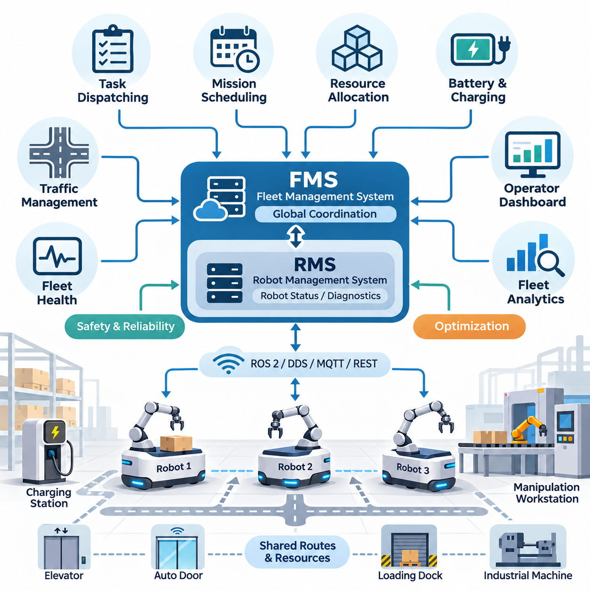
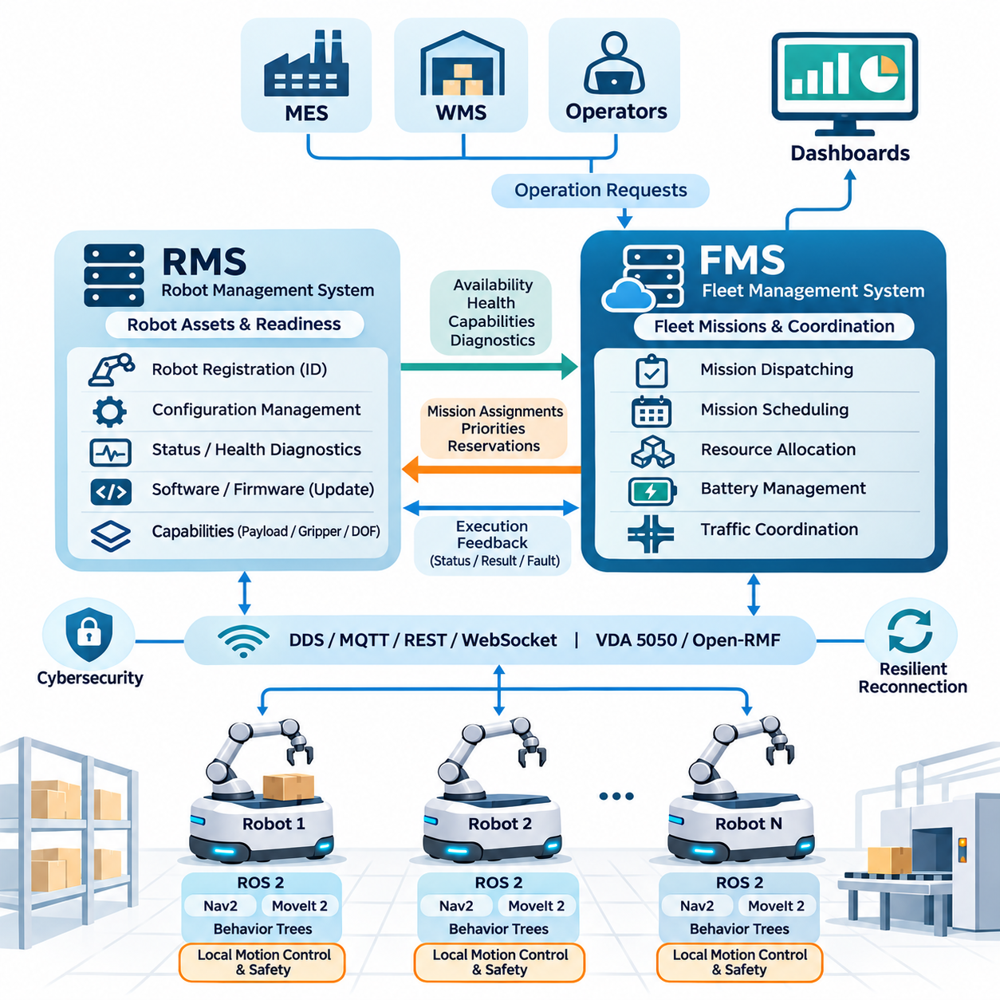
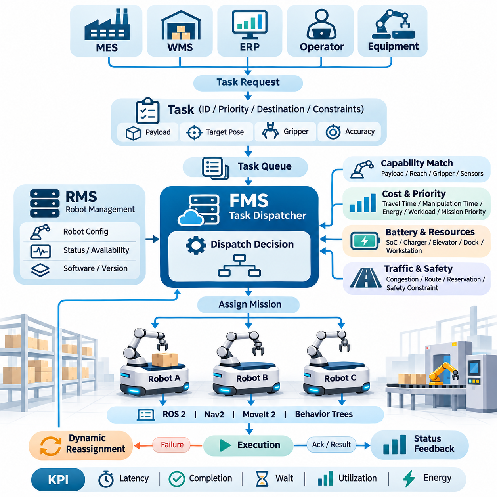
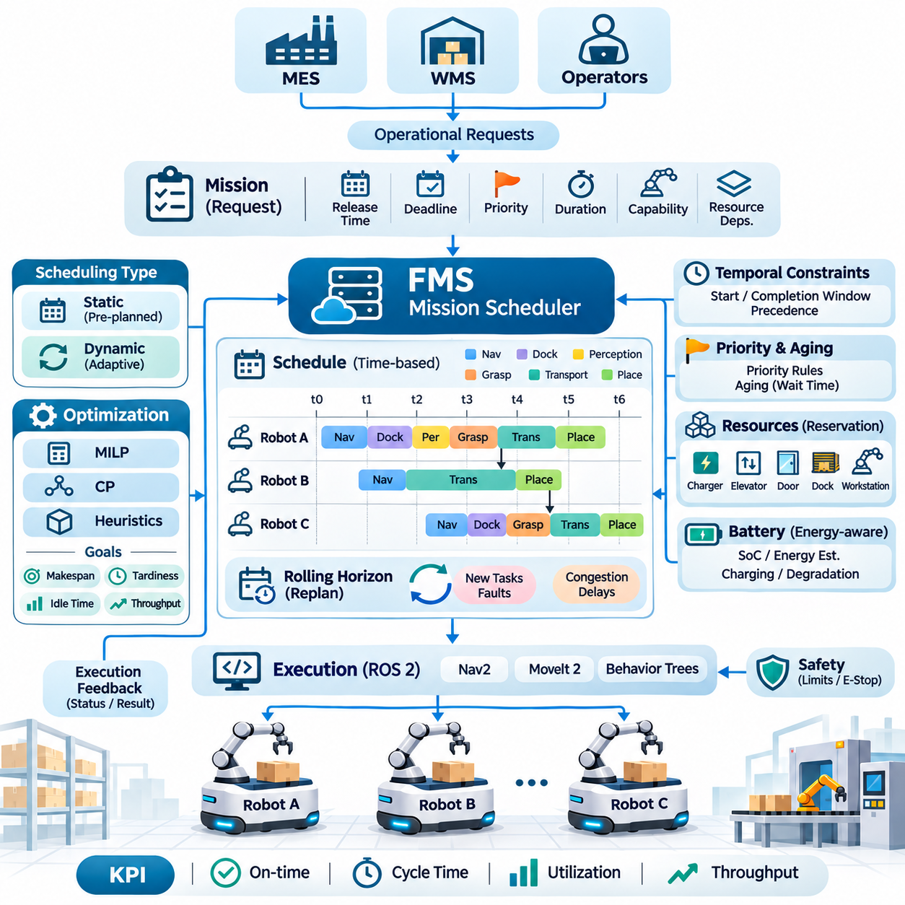
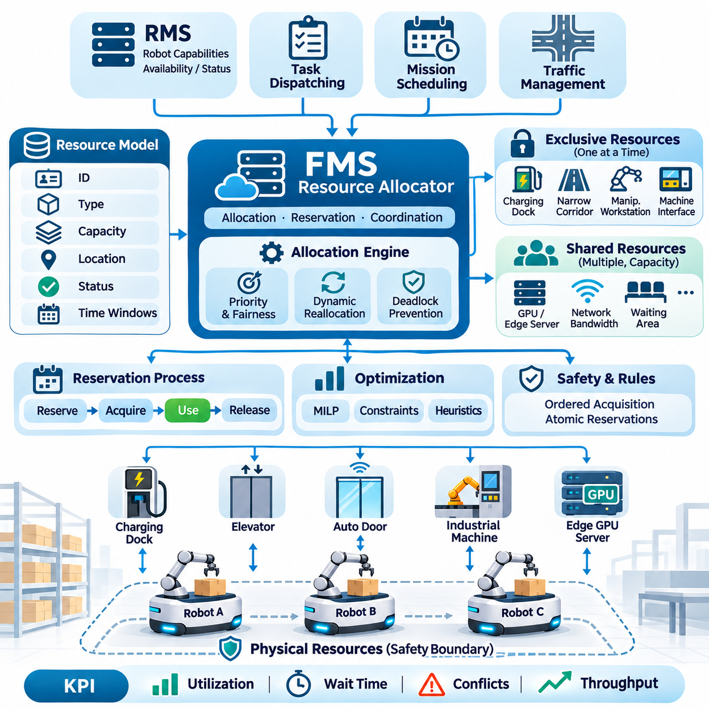
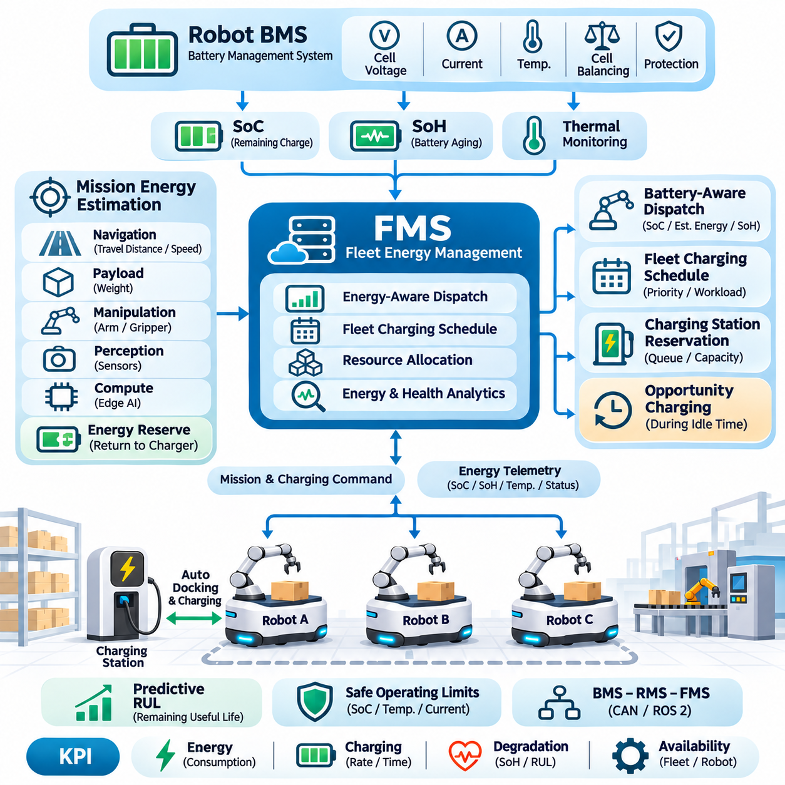
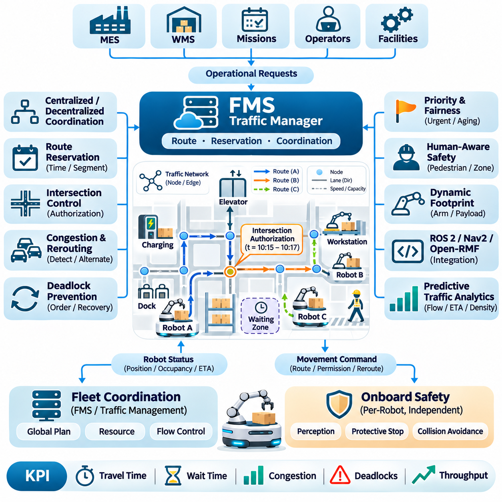
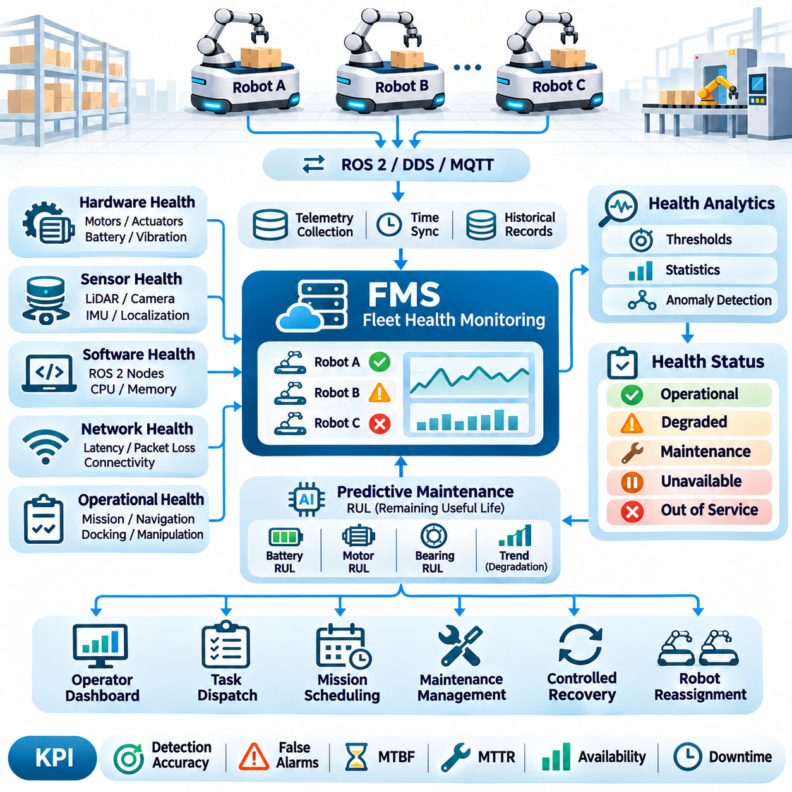
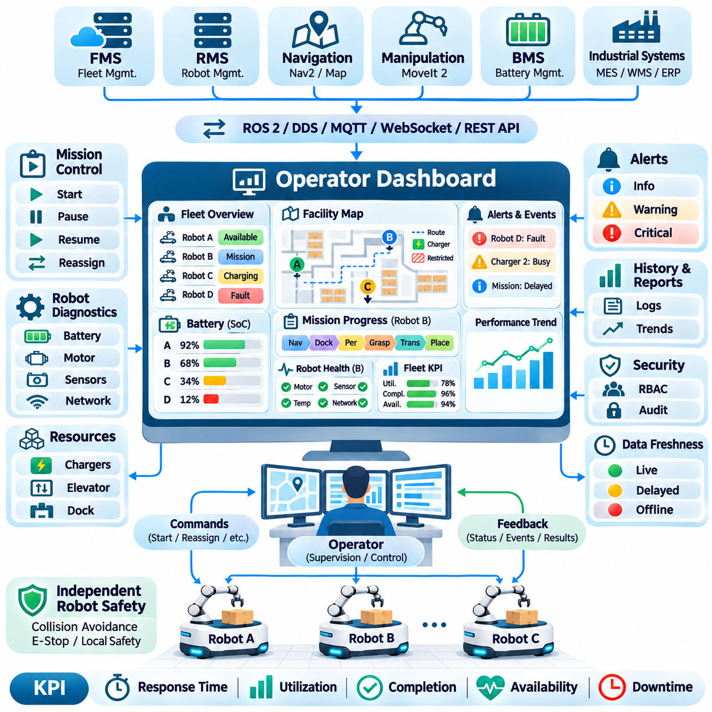
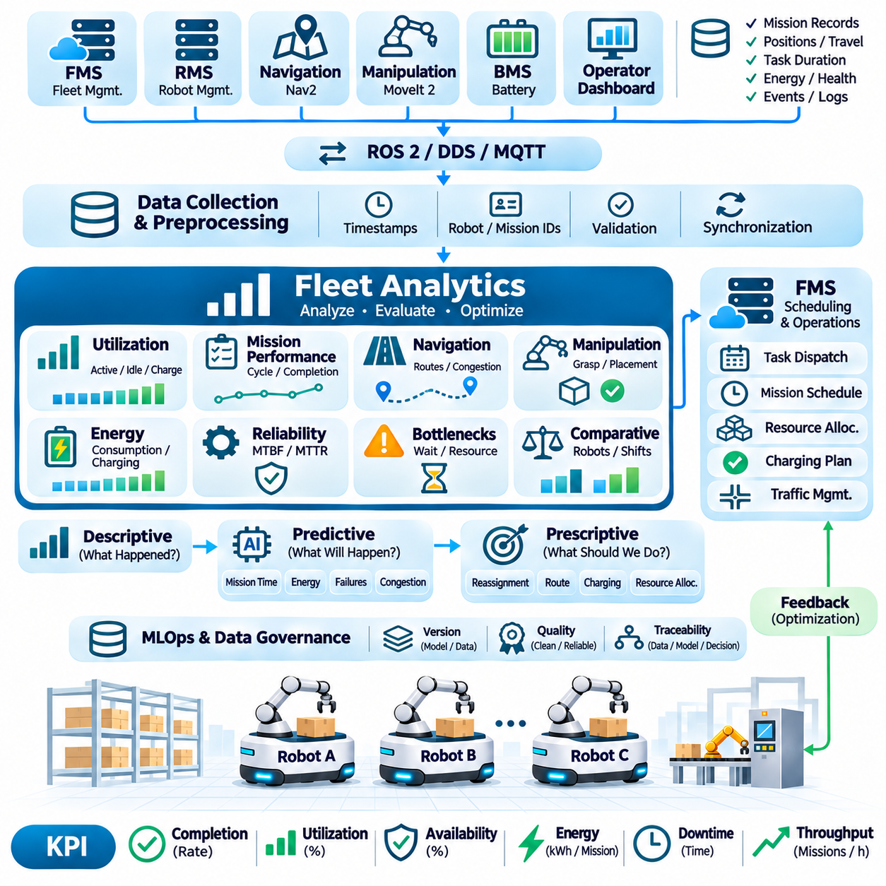

**Volume 04. Mobile Manipulation Software and Operations**

# Chapter 05. Fleet Management

## 01 Fleet Management Overview

{width="7.268055555555556in" height="7.268055555555556in"}

Fleet management is a fundamental component of mobile manipulation systems that enables multiple autonomous robots to operate as an integrated and coordinated workforce. While individual robots perform navigation, perception, and manipulation tasks, fleet management supervises their collective activities to achieve operational objectives. It transforms independent robotic platforms into a scalable automation infrastructure capable of supporting complex industrial workflows.

The primary objective of fleet management is to maximize operational productivity while maintaining safety, reliability, and resource efficiency. In environments containing multiple mobile manipulators, robots must share transportation routes, charging stations, manipulation workspaces, and production resources. Without systematic coordination, competition for these resources may result in congestion, operational delays, resource conflicts, and reduced system availability.

A Fleet Management System (FMS) typically operates above the individual robot control architecture. Low-level controllers manage actuators, sensors, navigation, and manipulation, while the fleet management layer supervises mission execution across multiple robots. This separation of responsibilities allows individual robots to maintain local autonomy while contributing to centralized or distributed operational objectives defined by the organization.

Fleet management architectures may incorporate both a Robot Management System (RMS) and a Fleet Management System (FMS). Although their functional boundaries vary among implementations, an RMS generally focuses on robot configuration, operational status, diagnostics, and lifecycle administration. An FMS emphasizes mission allocation, scheduling, traffic coordination, and collective resource optimization across the robotic workforce.

Task dispatching is one of the central functions of fleet management. When a transportation, inspection, picking, or assembly request is received, the system identifies suitable robots according to their operational availability, physical location, battery condition, payload capacity, and manipulation capabilities. Advanced dispatching algorithms also consider estimated completion times and the potential impact of assignments on subsequent missions.

Mission scheduling extends task dispatching by determining when and in what sequence assigned activities should be performed. Mobile manipulators frequently execute missions involving navigation, docking, object recognition, grasping, transportation, and placement. The scheduling system must consider task dependencies, production deadlines, processing durations, and environmental constraints while responding dynamically to changing operational conditions.

Resource allocation ensures that shared infrastructure is distributed effectively among competing robots. Resources may include charging stations, elevators, automatic doors, loading docks, manipulation stations, industrial machines, and restricted workspaces. Reservation mechanisms and priority policies help prevent simultaneous access conflicts, resource starvation, and deadlock conditions that could otherwise interrupt automated production processes.

Battery management is particularly important because mobile manipulators consume electrical energy through both locomotion and manipulation. Fleet management continuously monitors the State of Charge (SoC), estimates mission-specific energy requirements, and schedules charging activities according to operational demand. Intelligent charging strategies balance robot availability against battery degradation and reduce unnecessary interruptions during critical production periods.

Traffic management coordinates robot movement throughout shared operational environments. The fleet management system may maintain a global representation of facility layouts, navigation routes, intersections, restricted zones, and robot positions. Route reservations, intersection priorities, congestion prediction, and dynamic rerouting help improve transportation efficiency while independent onboard safety functions remain responsible for immediate hazard responses.

Fleet health monitoring provides continuous visibility into the technical condition of individual robots and the overall automation system. Operational telemetry may include motor temperatures, actuator currents, battery voltage, communication quality, localization confidence, sensor availability, and manipulation success rates. Abnormal patterns can trigger diagnostic procedures, maintenance requests, mission reassignment, or controlled withdrawal from active service.

Communication infrastructure connects fleet management services with individual robotic platforms and external operational systems. ROS 2, Data Distribution Service (DDS), MQTT, REST APIs, and standardized interoperability interfaces can support information exchange across heterogeneous components. Reliable communication requires appropriate latency management, message authentication, network resilience, and predefined strategies for handling communication interruptions.

Operator dashboards provide a unified interface for monitoring and supervising robotic operations. Through these interfaces, operators can visualize robot locations, mission progress, battery conditions, resource utilization, active alarms, and historical events. Authorized personnel may also initiate missions, modify operational priorities, request recovery procedures, and coordinate human intervention when autonomous execution encounters unexpected conditions.

Fleet analytics converts accumulated operational data into actionable information for continuous improvement. Key performance indicators may include mission completion rates, average cycle times, fleet availability, robot utilization, energy consumption, charging frequency, and operational downtime. Historical analysis helps identify bottlenecks, evaluate scheduling strategies, estimate required fleet capacity, and improve the economic performance of automation investments.

Modern fleet management increasingly incorporates artificial intelligence, mathematical optimization, and predictive analytics. Learning-based approaches can estimate mission durations, anticipate congestion, predict energy consumption, and recommend resource allocation strategies. However, intelligent optimization must remain constrained by operational rules, verified safety requirements, and deterministic fallback mechanisms appropriate for physical robotic systems.

An effective fleet management architecture ultimately enables mobile manipulators to function as a coordinated industrial workforce rather than a collection of isolated machines. By integrating task dispatching, mission scheduling, resource allocation, battery management, traffic management, health monitoring, operator dashboards, and fleet analytics, organizations can establish scalable, resilient, and continuously improving robotic operations.

## 02 RMS and FMS

{width="7.268055555555556in" height="7.268055555555556in"}

A Robot Management System (RMS) and a Fleet Management System (FMS) represent two complementary supervisory layers within mobile manipulation software architecture. Although their functional boundaries differ among robotic platforms and solution providers, both systems contribute to reliable and scalable robot operations. The RMS primarily manages individual robotic assets, while the FMS coordinates collective activities across an entire robotic fleet.

The Robot Management System provides centralized capabilities for registering, configuring, monitoring, and administering individual robots throughout their operational lifecycles. Each mobile manipulator may be associated with a unique identifier, hardware configuration, software version, network address, sensor configuration, and operational profile. This information establishes a structured foundation for managing heterogeneous robotic platforms within a common operational environment.

The Fleet Management System focuses on coordinating multiple robots to accomplish shared operational objectives. Its principal responsibilities include task dispatching, mission scheduling, resource allocation, battery management, and traffic coordination. Rather than managing individual actuator movements, the FMS evaluates the overall operational environment and determines how available robotic resources should be utilized to maximize productivity and minimize conflicts.

The architectural distinction between RMS and FMS can be understood through their respective management scopes. The RMS maintains information regarding what each robot is, how it is configured, and whether it is operating correctly. The FMS determines what each robot should accomplish, when missions should be executed, and how activities should be coordinated with other robots. These complementary responsibilities support modularity and operational scalability.

Robot registration and configuration management constitute essential RMS functions. When a new mobile manipulator enters an operational environment, the RMS establishes its identity, communication parameters, hardware capabilities, software dependencies, and supported mission types. Configuration information may also include payload limitations, manipulator degrees of freedom, end-effector specifications, operating zones, and available navigation and manipulation interfaces.

Robot status management enables the RMS to maintain an updated representation of each robotic platform. Status information may include operational modes, battery conditions, localization confidence, actuator health, network connectivity, and active fault codes. By collecting and processing telemetry continuously, the RMS provides a reliable assessment of robot readiness and makes relevant information available to fleet-level decision-making services.

Software and firmware lifecycle management is another important responsibility commonly associated with the RMS. Mobile manipulators contain numerous software components, including operating systems, ROS 2 packages, navigation modules, manipulation controllers, perception models, and embedded firmware. The RMS may coordinate version tracking, compatibility verification, configuration deployment, controlled software updates, and rollback procedures when failures occur.

Within the FMS architecture, mission management transforms external operational requests into executable robot assignments. Requests may originate from manufacturing execution systems, warehouse management systems, enterprise applications, or human operators. The FMS evaluates mission requirements against available robot capabilities, operational conditions, task priorities, and resource constraints before selecting an appropriate robotic platform for execution.

Mobile manipulation introduces additional complexity because mission assignments must consider both mobility and manipulation capabilities. A robot capable of transporting materials may not possess the appropriate gripper, payload capacity, workspace reach, or perception functionality required for a particular task. Consequently, the FMS must incorporate capability-aware dispatching mechanisms that match mission requirements with verified robot configurations maintained by the RMS.

Information exchange between the RMS and FMS establishes a continuous operational feedback loop. The RMS provides robot availability, health information, configuration parameters, and diagnostic results, while the FMS communicates mission assignments, operational priorities, and resource reservations. Execution outcomes and fault notifications are subsequently returned to supervisory services, enabling dynamic scheduling, mission recovery, and system-wide operational optimization.

Integration with ROS 2 allows individual mobile manipulators to expose navigation, manipulation, and diagnostic capabilities through standardized communication mechanisms. Navigation actions may be executed through Nav2, while manipulation workflows can utilize MoveIt 2 and behavior trees. The RMS and FMS interact with these components through appropriate interfaces without replacing onboard motion planning, real-time control, or independent safety mechanisms.

Communication architectures may incorporate DDS, MQTT, REST APIs, WebSocket connections, and interoperability frameworks such as VDA 5050 or Open-RMF, depending on system requirements. These mechanisms facilitate information exchange among robotic platforms, supervisory services, and industrial infrastructure. Additional application-specific interfaces may be necessary to represent complex manipulation capabilities that standard mobile robot interfaces do not fully describe.

Operational resilience requires explicit strategies for communication failures, server interruptions, and inconsistent system states. Robots should retain sufficient onboard autonomy to enter predefined safe conditions when supervisory communication becomes unavailable. Mission identifiers, acknowledgment mechanisms, heartbeat messages, persistent state storage, and reconnection procedures help prevent duplicate assignments and maintain consistency across distributed components.

Cybersecurity and access control are fundamental considerations because RMS and FMS platforms can influence physical robotic operations. Authentication, encrypted communication, role-based access control, network segmentation, and audit logging help protect supervisory services against unauthorized access. Administrative configuration changes and fleet-level commands should be subject to appropriate authorization, validation, and operational safety constraints.

Operators benefit from integrated RMS and FMS dashboards that combine technical diagnostics with operational information. The RMS presents robot-specific health conditions, configuration records, maintenance requirements, and software versions, while the FMS visualizes mission queues, resource utilization, traffic conditions, and fleet performance. Together, these management systems establish a foundation for scalable, secure, and reliable mobile manipulation operations.

## 03 Task Dispatching

{width="7.268055555555556in" height="7.268055555555556in"}

Task dispatching is a core function of a Fleet Management System (FMS) that assigns operational tasks to suitable mobile manipulators according to mission requirements and current fleet conditions. Unlike individual robot task planning, which determines how a specific objective should be accomplished, task dispatching determines which robot should execute an incoming task. Effective dispatching improves productivity, resource utilization, and operational responsiveness.

The task dispatching process begins when an operational request enters the fleet management environment. Requests may originate from a Manufacturing Execution System (MES), Warehouse Management System (WMS), Enterprise Resource Planning (ERP) system, human operator, or automated production equipment. Each request is converted into a structured task description containing an identifier, execution objective, priority, destination, and operational constraints.

Task descriptions for mobile manipulators must represent both transportation and manipulation requirements. A task may specify object characteristics, payload weight, target pose, required end-effector type, manipulation accuracy, and environmental restrictions. These parameters enable the dispatching system to distinguish simple transportation missions from complex operations involving object recognition, grasping, machine tending, inspection, or precision assembly.

Robot capability matching is an essential component of task dispatching. The FMS evaluates available robots against the technical requirements of each task using configuration information maintained by the Robot Management System (RMS). Relevant attributes include payload capacity, manipulator reach, degrees of freedom, gripper compatibility, sensor availability, navigation capabilities, localization accuracy, and supported software functions.

Availability-based dispatching identifies robots that are operationally ready to accept new assignments. A robot may be unavailable because it is executing another mission, charging its battery, undergoing maintenance, experiencing a communication failure, or operating within a restricted zone. The dispatching system continuously evaluates robot states to prevent inappropriate assignments and ensure that selected platforms can complete requested activities.

Distance-based dispatching is a widely used strategy that assigns tasks to suitable robots located near the required execution site. Although selecting the nearest robot can reduce unnecessary travel, geographical distance alone does not accurately represent actual mission execution costs. Navigation obstacles, traffic congestion, route restrictions, docking requirements, and manipulation preparation times must also be considered when estimating assignment efficiency.

Cost-based dispatching evaluates candidate robots through a mathematical cost function representing multiple operational factors. The function may combine estimated travel time, manipulation duration, energy consumption, existing workload, resource availability, and mission priority. Appropriate weighting coefficients allow organizations to adapt dispatching decisions to specific production objectives, such as maximizing throughput or minimizing energy consumption.

Priority-based dispatching ensures that critical operational requests receive appropriate attention. Emergency logistics, urgent material replenishment, production bottleneck recovery, and time-sensitive inspection tasks may receive higher execution priorities than routine transportation requests. Priority management should also incorporate waiting-time adjustments and controlled preemption mechanisms to prevent indefinite delays or unsafe interruptions of active manipulation tasks.

Dynamic task dispatching continuously adapts assignment decisions to changing environmental and operational conditions. When a robot encounters an unexpected obstacle, experiences a mechanical fault, or fails to complete a manipulation task, the FMS may reassign pending activities to alternative robots. Dynamic reassignment requires accurate mission state tracking to prevent duplicated execution, inconsistent inventory records, and conflicting resource reservations.

Battery-aware dispatching incorporates energy availability into the robot selection process. The FMS evaluates the State of Charge (SoC), estimated mission energy consumption, battery health, and accessibility of charging stations before issuing assignments. Mobile manipulators require particular attention because robotic arm movements, perception processing, and end-effector operation may introduce additional energy demands beyond those associated with navigation.

Resource-aware dispatching considers infrastructure shared by multiple robots, including elevators, charging stations, loading docks, machine interfaces, and manipulation workspaces. Assigning multiple robots to tasks requiring the same unavailable resource can create unnecessary waiting and congestion. Integration with resource reservation and traffic management services enables the dispatching system to evaluate assignment feasibility before issuing mission commands.

Advanced dispatching architectures may employ centralized optimization, distributed decision-making, or market-based allocation strategies. Centralized approaches evaluate fleet-wide conditions to optimize task assignments, while distributed mechanisms allow robots or local agents to participate in allocation decisions. Auction-based algorithms, combinatorial optimization, and heuristic search provide alternative methods for balancing computational complexity and operational efficiency.

Artificial intelligence can enhance task dispatching through predictive models that estimate travel durations, manipulation success probabilities, congestion levels, and mission completion times. Reinforcement learning may also support adaptive allocation policies under changing workloads. However, learning-based dispatching should operate within verified capability constraints, explicit safety boundaries, and deterministic fallback mechanisms to maintain predictable physical operations.

Successful task dispatching requires reliable communication and consistent mission state management. Each assignment should include a unique task identifier, acknowledgment procedures, execution status updates, timeout conditions, and failure recovery mechanisms. Integration with ROS 2, Nav2, MoveIt 2, and behavior trees enables fleet-level assignments to be translated into robot-level execution workflows without replacing local motion control or independent safety functions.

Task dispatching performance can be evaluated through assignment latency, mission completion rate, average waiting time, empty travel distance, robot utilization, energy efficiency, and reassignment frequency. Continuous analysis of these indicators supports algorithm refinement and fleet capacity optimization. An effective dispatching architecture balances operational priorities, robot capabilities, resource constraints, and system resilience to establish scalable and reliable mobile manipulation operations.

## 04 Mission Scheduling

{width="7.268055555555556in" height="7.268055555555556in"}

Mission scheduling is a fundamental function of fleet management that determines when, in what sequence, and under which operational conditions mobile manipulators should execute assigned missions. While task dispatching primarily identifies suitable robots for incoming requests, mission scheduling organizes their activities over time. Effective scheduling coordinates transportation, manipulation, charging, and infrastructure access to maximize overall operational efficiency.

Mobile manipulation missions generally consist of multiple interconnected execution stages, including navigation, docking, environmental perception, object recognition, grasping, transportation, and placement. Each stage may have different processing durations, resource requirements, and completion conditions. The scheduling system must represent these relationships accurately to ensure that individual activities are executed in a logically consistent and operationally feasible sequence.

Mission scheduling begins with the collection and classification of operational requests received from manufacturing systems, warehouse management platforms, enterprise applications, or human operators. Each mission is characterized by its release time, execution deadline, priority, estimated duration, required robot capabilities, and resource dependencies. These parameters establish the information necessary for constructing feasible schedules across multiple robotic platforms.

Temporal constraints play an essential role in mission scheduling because industrial operations frequently depend on synchronized production activities. A mobile manipulator may need to deliver components before an assembly process begins or remove completed products before a machine becomes unavailable. The scheduling system must consider earliest start times, latest completion times, processing windows, and precedence relationships between dependent activities.

Static mission scheduling establishes execution plans in advance using predefined operational requirements and estimated resource availability. This approach is suitable for repetitive manufacturing processes with relatively stable production schedules and predictable mission durations. Although static scheduling simplifies operational planning and computational requirements, its effectiveness decreases when unexpected events significantly alter the original operating conditions.

Dynamic mission scheduling continuously adjusts execution plans according to changes in the operational environment. New mission requests, robot failures, traffic congestion, charging delays, and unexpected manipulation difficulties may require modifications to existing schedules. Dynamic scheduling enables the Fleet Management System (FMS) to reorganize pending activities while respecting completed actions, committed resources, and ongoing safety-critical operations.

Priority-based scheduling determines mission execution sequences according to their operational importance and urgency. Time-sensitive material replenishment, production recovery, emergency logistics, and critical inspection activities may receive higher priorities than routine transportation missions. Aging mechanisms can gradually increase the priority of waiting missions to prevent starvation, while controlled preemption limits interruptions to appropriate execution stages.

Resource-constrained mission scheduling considers the availability of infrastructure shared among multiple robotic platforms. Charging stations, elevators, automatic doors, loading docks, industrial machines, and manipulation workspaces may accommodate only a limited number of robots simultaneously. Scheduling algorithms must coordinate resource reservation windows with mission execution times to minimize waiting periods, resource conflicts, and potential deadlock conditions.

Energy-aware mission scheduling integrates battery conditions and charging requirements into operational planning. Each robot must maintain sufficient energy to complete assigned activities and reach an appropriate charging station when necessary. Scheduling decisions should consider the State of Charge (SoC), predicted energy consumption, charging duration, battery degradation, and anticipated workloads to maintain fleet availability throughout extended operating periods.

Mathematical optimization provides systematic methods for constructing mission schedules under multiple operational constraints. Mixed-Integer Linear Programming (MILP), Constraint Programming (CP), heuristic algorithms, and metaheuristic optimization can address different scheduling problem characteristics. Typical optimization objectives include minimizing total completion time, mission tardiness, robot idle time, resource contention, and energy consumption.

Rolling horizon scheduling provides a practical approach for managing continuously changing robotic operations. Instead of optimizing an entire operating period at once, the system repeatedly generates schedules within a limited future planning window. As new information becomes available, the planning horizon advances and pending missions are rescheduled. This approach balances computational efficiency, operational adaptability, and schedule stability in large robotic fleets.

Artificial intelligence can improve mission scheduling by predicting mission durations, manipulation success probabilities, resource availability, and future workload distributions. Machine learning models trained on historical operational data may provide more accurate estimates than fixed scheduling parameters. Reinforcement learning can also support adaptive scheduling policies, provided that their decisions remain within verified operational and safety constraints.

Integration with robot-level execution frameworks enables fleet schedules to be translated into executable operational workflows. ROS 2, Nav2, MoveIt 2, and behavior trees support navigation, manipulation, and mission execution on individual robotic platforms. The FMS receives execution feedback and updates scheduled activities without replacing onboard motion planning, real-time control, collision avoidance, or independent safety functions.

Exception handling is essential for maintaining schedule consistency when mission execution deviates from expected conditions. Delayed operations, failed grasping attempts, communication interruptions, and unavailable resources may trigger schedule revision or mission reassignment. Persistent mission records, execution checkpoints, resource reservation updates, and validated recovery procedures help prevent duplicated operations and cascading scheduling failures.

Mission scheduling performance can be evaluated through on-time completion rates, average mission cycle time, makespan, scheduling latency, resource utilization, robot idle time, and production throughput. Continuous evaluation supports improvements in scheduling algorithms and operational policies. An effective scheduling architecture balances productivity, energy efficiency, temporal constraints, resource availability, and operational resilience across the robotic fleet.

## 05 Resource Allocation

{width="7.268055555555556in" height="7.268055555555556in"}

Resource allocation is a fundamental function of fleet management that determines how available physical, computational, and operational resources are distributed among multiple mobile manipulators. While task dispatching identifies suitable robots and mission scheduling determines execution sequences, resource allocation ensures that the infrastructure and capabilities required for mission execution are available at the appropriate time.

In mobile manipulation environments, resources extend beyond individual robotic platforms to include charging stations, transportation routes, elevators, automatic doors, manipulation workspaces, industrial equipment, communication networks, and computing infrastructure. Because these resources are frequently shared among multiple robots, effective allocation mechanisms are necessary to prevent conflicts, reduce waiting times, and maintain continuous operations.

Resource modeling establishes a structured representation of the infrastructure and capabilities available within the operational environment. Each resource may be characterized by a unique identifier, resource type, capacity, physical location, availability status, access restrictions, and operating time windows. The Fleet Management System (FMS) maintains this information to support allocation decisions and coordinate resource consumption across active missions.

Robot allocation involves assigning appropriate mobile manipulators to operational activities according to their technical capabilities and current availability. Relevant factors include payload capacity, manipulator reach, end-effector compatibility, battery condition, navigation performance, and supported software functions. Capability-aware allocation prevents unsuitable robots from consuming resources while attempting tasks that exceed their operational limitations.

Exclusive resource allocation applies to infrastructure that can accommodate only one robot or operation at a given time. Examples include individual charging docks, narrow transportation corridors, dedicated manipulation stations, and machine loading interfaces. The allocation system must establish exclusive access permissions and release resources only after confirmed completion or validated recovery of the associated operation.

Shared resource allocation applies to infrastructure that can support multiple robots simultaneously within defined capacity limits. Communication networks, computational servers, storage systems, and designated waiting areas are common examples. Capacity-aware allocation distributes available resources according to operational demand while preventing overload conditions that could degrade robot performance or interrupt critical production activities.

Resource reservation mechanisms enable the FMS to allocate infrastructure in advance according to planned mission schedules. A mobile manipulator approaching an industrial workstation may reserve the docking position, manipulation workspace, and machine interface before arrival. Coordinating these reservations with predicted execution times reduces unnecessary waiting and improves synchronization between robotic activities and external production processes.

Dynamic resource allocation continuously adjusts resource assignments in response to changing operational conditions. Robot failures, unexpected processing delays, unavailable charging stations, and modifications to production schedules may invalidate existing reservations. The FMS must update allocation decisions while maintaining consistent resource ownership records and preventing conflicts with activities that are already in progress.

Deadlock prevention is particularly important when multiple robots require simultaneous or sequential access to shared resources. A deadlock may occur when robots occupy resources while waiting indefinitely for additional resources held by others. Consistent resource acquisition orders, atomic reservations, dependency analysis, and validated recovery procedures help prevent circular waiting and maintain operational continuity across the fleet.

Priority-based resource allocation distributes limited infrastructure according to mission urgency, production importance, and operational requirements. Critical manufacturing activities may receive preferential access to manipulation stations or transportation routes. However, allocation policies should incorporate fairness mechanisms that prevent lower-priority missions from experiencing indefinite delays while protecting active safety-critical operations.

Energy resource allocation coordinates battery charging infrastructure with fleet-wide operational demand. When charging stations are limited, the FMS must determine which robots should receive charging access according to battery conditions, pending missions, predicted energy consumption, and expected charging durations. Coordinated charging allocation reduces competition for charging infrastructure and improves overall fleet availability.

Computational resource allocation is increasingly important in mobile manipulation systems incorporating artificial intelligence and advanced perception. Multiple robots may share edge computing servers, GPU accelerators, inference services, databases, and communication bandwidth. Allocation policies must consider processing latency, computational demand, network capacity, and application priorities without compromising time-critical onboard control functions.

Mathematical optimization provides systematic approaches for solving resource allocation problems involving multiple constraints and competing objectives. Mixed-Integer Linear Programming (MILP), constraint programming, graph-based algorithms, and heuristic optimization can identify feasible resource assignments. Optimization objectives commonly include minimizing resource contention, waiting times, operational costs, and energy consumption while maximizing production throughput.

Effective resource allocation requires integration with the Robot Management System (RMS), mission scheduling services, traffic management systems, and robot-level execution frameworks. Resource identifiers, ownership records, reservation time windows, acknowledgment messages, and release confirmations maintain consistency across distributed components. Independent safety mechanisms must remain responsible for enforcing physical access and immediate hazard responses.

Resource allocation performance can be evaluated through resource utilization rates, average waiting times, reservation success rates, conflict frequency, deadlock incidence, and production throughput. Historical operational data supports infrastructure expansion planning and allocation policy refinement. An effective resource allocation architecture ultimately balances resource availability, operational priorities, fairness, scalability, and system resilience across mobile manipulation fleets.

## 06 Battery Management

{width="7.268055555555556in" height="7.268055555555556in"}

Battery management is a critical function of fleet management that ensures mobile manipulators maintain sufficient electrical energy to perform assigned missions safely and efficiently. Unlike conventional autonomous mobile robots, mobile manipulators consume energy through locomotion, robotic arm movements, perception systems, computing devices, and end-effectors. Effective battery management therefore requires coordination between energy consumption, mission scheduling, and charging infrastructure.

A Battery Management System (BMS) operates at the individual robot level and monitors the electrical and thermal conditions of the battery pack. Its principal functions include cell voltage monitoring, current measurement, temperature monitoring, cell balancing, and protection against abnormal operating conditions. The Fleet Management System (FMS) utilizes information provided by the BMS to coordinate energy-related decisions across multiple robotic platforms.

The State of Charge (SoC) represents the estimated remaining charge relative to the available capacity of a battery. Accurate SoC estimation is essential for determining whether a mobile manipulator possesses sufficient energy to complete an operational mission. Common estimation techniques include Coulomb counting, open-circuit voltage estimation, equivalent circuit modeling, and Kalman filtering, which may be combined to improve estimation reliability.

The State of Health (SoH) represents the degradation of a battery relative to its original performance characteristics. Repeated charging cycles, elevated operating temperatures, calendar aging, and high discharge currents gradually reduce battery capacity and increase internal resistance. Monitoring SoH enables fleet management systems to account for differences between batteries, estimate usable energy more accurately, and establish appropriate maintenance or replacement schedules.

Energy consumption in mobile manipulators varies significantly according to mission characteristics. Navigation consumes energy through traction motors, steering actuators, and associated control systems, while manipulation introduces additional demands from robotic arm actuators and end-effectors. Perception sensors, edge computing devices, communication modules, and auxiliary equipment also contribute to the total energy consumption during continuous operation.

Mission-specific energy estimation predicts the electrical energy required to complete transportation, manipulation, and auxiliary activities. Relevant parameters include travel distance, payload weight, driving speed, acceleration profiles, floor conditions, manipulator trajectories, and estimated execution duration. The FMS should also incorporate an energy reserve to accommodate unexpected delays, additional movements, and travel to an available charging station.

Battery-aware task dispatching prevents mobile manipulators from receiving assignments that exceed their available energy capacity. Before issuing a mission, the FMS evaluates the current SoC, predicted energy consumption, battery health, and charging station accessibility. A robot with insufficient energy may be directed toward a charging station, while another technically suitable robot is selected to maintain operational continuity.

Automatic charging management enables mobile manipulators to replenish their batteries without continuous human intervention. Robots navigate toward designated charging stations, perform docking procedures, establish electrical connections, and initiate charging through appropriate communication interfaces. The charging process requires coordinated verification of docking accuracy, electrical compatibility, charging authorization, and battery protection conditions.

Opportunity charging replenishes battery energy during short periods of operational inactivity rather than waiting until the battery reaches a critically low charge level. This strategy can improve robot availability in facilities where missions are distributed unevenly throughout the operating period. However, charging frequency, power levels, temperature conditions, and battery chemistry must be considered to avoid accelerating battery degradation.

Fleet-wide charging scheduling coordinates charging activities to prevent excessive numbers of robots from becoming unavailable simultaneously. When charging stations are limited, the FMS prioritizes robots according to remaining energy, mission urgency, predicted workload, and charging duration. Dynamic scheduling can distribute charging activities across low-demand periods while maintaining sufficient operational capacity during critical production intervals.

Charging station resource allocation ensures that charging infrastructure is distributed efficiently among competing robots. Each station may be represented as a reservable resource with defined electrical capacity, compatibility requirements, availability status, and access restrictions. Reservation mechanisms and queue management help reduce unnecessary travel, charging congestion, and operational interruptions caused by unavailable charging resources.

Battery thermal management is essential for maintaining electrical performance, operational reliability, and battery service life. Excessive temperatures may accelerate chemical degradation, while low temperatures can reduce available capacity and charging efficiency. Temperature sensors, cooling mechanisms, charging current limitations, and BMS protection functions help maintain battery operation within manufacturer-defined temperature boundaries.

Advanced battery management can incorporate artificial intelligence and predictive analytics to estimate energy consumption, charging requirements, and battery Remaining Useful Life (RUL). Machine learning models trained on historical telemetry may identify relationships between mission characteristics and energy demand. Predictive models can support fleet-level optimization, but they must not override independent electrical protection or validated battery operating limits.

Battery management requires reliable integration between the BMS, Robot Management System (RMS), FMS, and charging infrastructure. Communication interfaces such as CAN bus, CANopen, Ethernet, and ROS 2 can facilitate the exchange of battery telemetry and charging status. Communication failures, abnormal temperatures, electrical faults, and unsuccessful docking attempts must be addressed through predefined protection and recovery procedures.

Battery management performance can be evaluated through energy consumption per mission, charging efficiency, battery degradation rate, charging station utilization, energy-related downtime, and fleet availability. Historical analysis supports battery capacity selection, charging infrastructure expansion, and operational policy refinement. Effective battery management balances productivity, energy efficiency, battery longevity, and operational safety.

## 07 Traffic Management

{width="7.268055555555556in" height="7.268055555555556in"}

Traffic management is a fundamental function of fleet management that coordinates the movement of multiple mobile manipulators within shared operational environments. As the number of robotic platforms increases, independent navigation decisions may result in congestion, conflicting trajectories, and operational delays. Effective traffic management ensures that robots move safely and efficiently while maintaining predictable transportation and manipulation operations.

Mobile manipulation environments typically contain transportation corridors, intersections, docking stations, elevators, automatic doors, industrial workstations, and areas occupied by human workers. Unlike conventional automated transportation systems, mobile manipulators require additional operational space for robotic arm movements and object handling. Traffic management must therefore consider both mobile platform dimensions and the spatial requirements of manipulation activities.

Traffic network modeling establishes a structured representation of the operational environment using navigation graphs, nodes, edges, intersections, and restricted areas. Each transportation segment may be characterized by its physical dimensions, permitted travel directions, speed limitations, occupancy capacity, and accessibility conditions. The Fleet Management System (FMS) utilizes this representation to coordinate robot movements across shared infrastructure.

Centralized traffic management enables the FMS to coordinate robot movements using a global representation of fleet positions, planned routes, scheduled missions, and infrastructure availability. The central system evaluates potential conflicts and determines appropriate movement permissions before robots enter shared transportation segments. This approach provides consistent coordination but requires reliable communication and scalable computational resources.

Decentralized traffic management distributes coordination responsibilities among individual robotic platforms. Robots exchange relevant information concerning their positions, intended trajectories, movement priorities, and local environmental conditions. Decentralized approaches can improve scalability and reduce dependence on centralized infrastructure, although maintaining consistent decisions becomes more challenging when communication delays or failures occur.

Route reservation mechanisms prevent multiple robots from occupying incompatible transportation segments simultaneously. The FMS may assign temporary access permissions to navigation nodes, corridor segments, intersections, or docking areas according to predicted occupancy times. Reservation records must reflect actual robot movements, and occupied resources must not be released solely because their originally scheduled reservation periods have expired.

Intersection management is particularly important in facilities where multiple transportation routes converge. Robots approaching an intersection may request movement authorization based on traffic conditions, mission priorities, and existing reservations. Controlled intersection access reduces the probability of conflicting movements, while appropriate waiting positions prevent stationary robots from obstructing adjacent transportation routes.

Traffic congestion management identifies transportation areas where robot density, waiting times, or movement restrictions reduce operational efficiency. Congestion may occur near charging stations, production workstations, elevators, and frequently accessed storage areas. Dynamic route adjustment, alternative corridor selection, controlled entry rates, and distributed waiting locations can reduce congestion and improve overall fleet throughput.

Deadlock prevention addresses situations in which multiple robots block one another while competing for transportation resources. Such conditions frequently arise in narrow corridors, bidirectional pathways, and interconnected intersections. Resource acquisition ordering, graph-based dependency analysis, coordinated movement permissions, and validated recovery procedures help prevent circular waiting and restore traffic flow when disruptions occur.

Priority-based traffic management establishes movement preferences according to mission urgency, production requirements, and operational constraints. Robots performing critical material deliveries or time-sensitive manufacturing activities may receive preferential access to shared transportation routes. However, priority policies should incorporate fairness mechanisms to prevent indefinite delays for lower-priority robots without compromising established safety requirements.

Human-aware traffic management considers the presence and unpredictable movements of human workers within shared operational environments. Pedestrian crossings, collaborative workspaces, restricted access zones, and designated robot pathways must be represented in traffic policies. Fleet-level movement coordination complements onboard perception, protective stopping, collision avoidance, and independent safety functions rather than replacing them.

Mobile manipulator traffic management must account for changes in the effective footprint of the robotic platform during manipulation and transportation. Extended robotic arms, oversized payloads, and specialized end-effectors may increase the occupied space beyond the nominal vehicle dimensions. Dynamic footprint representation and configuration-dependent movement restrictions help maintain adequate clearance from surrounding infrastructure and other robots.

Integration with robot-level navigation frameworks enables fleet-wide traffic decisions to be translated into executable movement commands. ROS 2, Nav2, and Open-RMF can support different aspects of navigation, fleet interoperability, and traffic coordination. Traffic management interfaces should exchange route intentions, movement authorization, occupancy updates, and execution feedback while preserving the autonomy of local motion controllers.

Artificial intelligence and predictive analytics can enhance traffic management by estimating future congestion levels, transportation demand, route completion times, and potential resource conflicts. Machine learning models trained on historical fleet telemetry may support proactive route adjustment and adaptive traffic policies. Such predictions should remain subject to verified movement constraints, resource reservations, and independent safety mechanisms.

Traffic management performance can be evaluated through average travel time, intersection waiting time, congestion frequency, route utilization, deadlock incidence, and fleet throughput. Historical traffic data supports improvements in facility layouts, transportation policies, and fleet configuration. Effective traffic management ultimately balances transportation efficiency, operational predictability, scalability, human safety, and system resilience.

## 08 Fleet Health Monitoring

{width="7.268055555555556in" height="7.268055555555556in"}

Fleet health monitoring is a fundamental function of fleet management that continuously evaluates the operational condition, technical reliability, and performance of multiple mobile manipulators. It provides centralized visibility into the health of individual robotic platforms and the overall fleet. By collecting and analyzing operational data, fleet management systems can identify abnormal conditions, detect emerging failures, and maintain reliable robotic operations across industrial environments.

A comprehensive fleet health monitoring architecture collects information from multiple hardware and software components. Relevant sources include battery management systems, motor controllers, steering actuators, robotic arm controllers, LiDAR sensors, cameras, IMUs, computing devices, and communication interfaces. Integrating these sources enables the Fleet Management System (FMS) to maintain a consistent representation of robot health and identify problems affecting individual components or entire robotic platforms.

Robot health indicators provide measurable information about the operational condition of each mobile manipulator. Typical indicators include motor temperature, actuator current, battery voltage, charging cycles, sensor availability, localization confidence, communication latency, CPU utilization, memory consumption, and controller status. Monitoring these indicators against predefined operating limits helps identify abnormal behavior before it develops into a serious operational failure.

Hardware health monitoring focuses on detecting degradation and abnormal behavior in physical components. Motor overheating, excessive vibration, abnormal current consumption, steering deviations, bearing wear, and battery degradation may indicate developing mechanical or electrical problems. Continuous monitoring of these parameters enables maintenance teams to investigate potential failures and reduce unexpected equipment downtime.

Sensor health monitoring ensures that perception and localization systems provide reliable information for autonomous operation. LiDAR, cameras, IMUs, encoders, and other sensors may experience communication interruptions, measurement noise, calibration drift, contamination, or hardware degradation. The monitoring system evaluates sensor availability, data freshness, signal quality, and consistency between different sensing modalities to identify unreliable perception inputs.

Software health monitoring evaluates the stability and responsiveness of the computational components responsible for robot operation. Relevant parameters include ROS 2 node availability, process execution status, message communication rates, callback delays, memory usage, CPU load, and software exceptions. Monitoring these indicators helps identify software failures, resource exhaustion, communication problems, and unexpected changes in application behavior.

Communication health monitoring evaluates connectivity between individual robots, fleet management servers, edge computing infrastructure, and external operational systems. Network latency, packet loss, connection stability, message delivery rates, and wireless signal quality are important indicators. Communication degradation can affect mission execution, remote supervision, and fleet coordination, making continuous network monitoring essential for distributed robotic operations.

Operational health monitoring evaluates how effectively each robot performs its assigned missions. Relevant indicators include mission completion rates, navigation success rates, docking accuracy, manipulation success rates, recovery frequency, average task duration, and unexpected mission interruptions. Combining technical health information with operational performance helps distinguish hardware degradation from software problems, environmental difficulties, or inefficient mission assignments.

Health monitoring systems generally use threshold-based detection, statistical analysis, and anomaly detection to identify abnormal conditions. Threshold-based monitoring compares sensor measurements against predefined operating limits, while statistical methods identify unusual deviations from historical operating patterns. Machine learning models can detect more complex relationships between multiple indicators, supporting early identification of failures that may not be visible through individual thresholds.

Health status classification provides a standardized representation of robot operating conditions. A fleet may classify robots as operational, degraded, requiring maintenance, temporarily unavailable, or out of service. These classifications allow the FMS to make appropriate task dispatching and mission scheduling decisions. For example, a robot with reduced battery capacity or unreliable localization may be restricted to specific tasks rather than completely removed from operation.

Fleet health monitoring must integrate with task dispatching, mission scheduling, resource allocation, and maintenance management. When a robot reports a critical fault, the FMS may suspend new assignments, identify an alternative robot, and initiate a controlled recovery procedure. Health information can also influence charging schedules, workload distribution, and the allocation of limited operational resources across the fleet.

Predictive health monitoring extends conventional condition monitoring by estimating the probability of future component failures. Historical telemetry, maintenance records, operating hours, temperature profiles, and actuator behavior can be analyzed to identify degradation patterns. Predictive models may estimate the Remaining Useful Life (RUL) of batteries, motors, bearings, and other components, enabling maintenance activities to be planned before failures occur.

Effective fleet health monitoring requires reliable data collection, storage, and communication infrastructure. Robot telemetry may be transmitted through ROS 2, DDS, MQTT, or other communication interfaces to centralized monitoring services. Time synchronization, consistent data formats, robot identification, and historical data retention are important for correlating events across multiple platforms and reconstructing the sequence of operational failures.

Operator dashboards provide an integrated view of fleet health and operational status. Operators should be able to identify abnormal robots, inspect component-level diagnostics, review historical trends, and examine active alarms. Alert management should distinguish informational messages, warnings, and critical faults according to their operational impact. Appropriate notification mechanisms help maintenance personnel respond quickly without generating excessive alarm notifications.

Fleet health monitoring performance can be evaluated through fault detection accuracy, false alarm rates, failure prediction lead time, mean time between failures (MTBF), mean time to repair (MTTR), system availability, and unplanned downtime. Historical analysis helps identify recurring problems, compare robot reliability, improve maintenance strategies, and evaluate hardware or software modifications. Effective fleet health monitoring ultimately supports predictive maintenance, operational continuity, higher fleet availability, and long-term reliability of mobile manipulation systems.

## 09 Operator Dashboards

{width="7.268055555555556in" height="7.268055555555556in"}

Operator dashboards are essential components of fleet management systems that provide human operators with centralized visibility and control over multiple mobile manipulators. They transform complex operational data into understandable information that supports monitoring, supervision, and decision-making. Through a unified interface, operators can observe robot locations, mission progress, battery conditions, equipment health, and operational alarms while maintaining awareness of the overall robotic environment.

A fleet operator dashboard typically integrates information from the Fleet Management System (FMS), Robot Management System (RMS), navigation services, manipulation controllers, battery management systems, and industrial infrastructure. This integration allows operators to access operational and technical information without switching between independent applications. The dashboard should present consistent information across different robotic platforms and provide an accurate representation of the current fleet condition.

Fleet overview visualization provides a high-level representation of all registered robots and their operational states. Each mobile manipulator may be displayed with its identifier, current location, operating mode, assigned mission, battery level, and communication status. Visual indicators help operators distinguish available robots from those executing missions, charging, experiencing faults, or undergoing maintenance. This overview supports rapid identification of operational changes and abnormal conditions.

Map-based visualization is particularly important for facilities containing multiple autonomous mobile manipulators. The dashboard can display facility layouts, navigation maps, robot positions, planned trajectories, restricted areas, charging stations, and shared workspaces. Real-time position updates allow operators to observe traffic conditions and identify potential congestion or route conflicts. Historical movement information can also support investigation of navigation failures and operational inefficiencies.

Mission monitoring enables operators to understand the progress of individual tasks and the overall production workflow. A mission interface may display task identifiers, assigned robots, execution stages, target locations, estimated completion times, and current status. For mobile manipulation operations, monitoring should distinguish navigation, docking, perception, grasping, transportation, and placement stages. This visibility helps operators identify delays and determine whether intervention is necessary.

Robot-level dashboards provide detailed technical information about individual robotic platforms. Operators and maintenance personnel may inspect battery voltage, State of Charge (SoC), motor temperature, actuator status, sensor availability, localization confidence, and communication quality. These details help distinguish temporary operational interruptions from persistent hardware or software problems. Access to historical measurements also supports troubleshooting and maintenance planning.

Alarm and event management organizes system notifications according to their severity, operational impact, and required response. Informational messages, warnings, and critical faults should be visually distinguishable to prevent important events from being overlooked. Each alarm should provide relevant context, including the affected robot, event timestamp, fault description, and recommended response. Alarm acknowledgment and resolution tracking improve communication between operators and maintenance teams.

Interactive mission control allows authorized operators to initiate, pause, resume, cancel, or reassign missions according to operational policies. The interface should clearly communicate the consequences of each command and display its execution status. Commands affecting robots in active manipulation processes require additional safeguards to prevent unsafe interruptions. Authorization mechanisms and command confirmation procedures help ensure that operational control remains predictable and accountable.

Fleet resource monitoring provides visibility into shared infrastructure and resource utilization. Charging stations, elevators, docking locations, manipulation workspaces, and industrial machine interfaces may be represented with their current availability and reservation status. Operators can identify resource bottlenecks, inspect waiting queues, and understand why particular robots cannot proceed with their assigned missions. This information supports more effective coordination and resource allocation.

Battery and charging dashboards help operators monitor fleet-wide energy conditions. Important information includes battery SoC, battery health, estimated remaining operating time, charging progress, and charging station availability. Visualizing charging schedules alongside mission assignments enables operators to anticipate reductions in fleet capacity. Energy monitoring also helps identify robots that require charging before accepting additional assignments.

Performance dashboards present operational Key Performance Indicators (KPIs) that describe the efficiency and reliability of robotic operations. Typical metrics include mission completion rate, average task duration, robot utilization, fleet availability, navigation success rate, manipulation success rate, energy consumption, and unplanned downtime. Comparing current performance with historical trends helps organizations identify bottlenecks, evaluate operational policies, and measure improvements after system modifications.

Historical event visualization and reporting support operational analysis and incident investigation. Dashboards may provide searchable event logs, mission execution histories, robot fault records, charging histories, and performance trends. Correlating these records enables engineers to reconstruct the sequence of events preceding a failure or delayed mission. Historical information also provides valuable evidence for maintenance planning, system optimization, and operational audits.

Human-machine interface design is a critical consideration in operator dashboard development. Information should be organized according to operational importance, with frequently required functions accessible through consistent navigation and interaction patterns. Clear visual hierarchy, readable typography, meaningful status indicators, and appropriate color usage reduce cognitive workload. The interface should support different user roles, including fleet operators, maintenance engineers, production supervisors, and system administrators.

Reliable dashboard operation depends on continuous data integration and communication between distributed robotic components. ROS 2, DDS, MQTT, WebSocket connections, and REST APIs may support information exchange between robots, fleet servers, databases, and operator applications. Data freshness, timestamp synchronization, communication status, and error handling must be considered to prevent misleading visualizations based on outdated or incomplete information.

Security and access control are necessary because operator dashboards expose interfaces capable of influencing physical robotic operations. Role-Based Access Control (RBAC) can restrict sensitive functions according to user responsibilities. Authentication, encrypted communication, audit logging, and session management help protect operational information and prevent unauthorized commands. Safety-critical actions should remain subject to independent robot-level safety mechanisms regardless of dashboard permissions.

Operator dashboards should also support degraded communication conditions and partial system failures. If a robot temporarily loses connectivity, the interface should distinguish its last reported position from its confirmed current position. Missing telemetry, delayed updates, and unavailable services should be explicitly identified rather than presented as normal operating conditions. These mechanisms help operators make informed decisions without assuming that displayed information is always current.

Operator dashboard effectiveness can be evaluated through alarm response time, mission intervention frequency, information retrieval time, operator workload, command execution reliability, and monitoring coverage. User feedback and operational data can guide continuous interface improvements. An effective dashboard ultimately connects human supervision with automated fleet operations, improving situational awareness, operational transparency, decision-making efficiency, and the reliability of mobile manipulation systems.

## 10 Fleet Analytics

{width="7.268055555555556in" height="7.268055555555556in"}

Fleet analytics is a fundamental capability of fleet management that transforms operational data generated by multiple mobile manipulators into actionable information for performance evaluation and continuous improvement. While fleet monitoring focuses on observing current operating conditions, fleet analytics examines historical and real-time data to identify trends, inefficiencies, and opportunities for optimization. It enables organizations to understand how effectively their robotic fleets perform and how operational strategies can be improved.

A comprehensive fleet analytics architecture collects data from the Fleet Management System (FMS), Robot Management System (RMS), navigation modules, manipulation controllers, battery management systems, and operator dashboards. Relevant information includes mission execution records, robot positions, travel distances, task durations, energy consumption, equipment health, communication conditions, and operational events. Integrating these sources provides a consistent dataset for analyzing individual robots and overall fleet performance.

Data collection and preprocessing establish the foundation for reliable fleet analytics. Operational information may originate from ROS 2 topics, DDS messages, MQTT communication, databases, and industrial management systems. The analytics platform must organize these heterogeneous data sources using consistent timestamps, robot identifiers, mission identifiers, and standardized data formats. Data validation, filtering, synchronization, and missing-value handling improve the quality of subsequent analysis.

Key Performance Indicators (KPIs) provide measurable criteria for evaluating fleet performance. Common indicators include mission completion rate, average task duration, fleet availability, robot utilization, energy consumption, navigation success rate, manipulation success rate, and operational downtime. Selecting appropriate KPIs requires understanding the intended production objectives and ensuring that each metric represents a meaningful aspect of robotic operations.

Fleet utilization analysis evaluates how effectively available robots contribute to operational activities. Important measurements include active operating time, idle time, charging time, maintenance time, and unavailable periods. Comparing utilization across individual robots helps identify workload imbalances and underused platforms. These findings can support improved task dispatching, mission scheduling, and fleet capacity planning.

Mission performance analytics examines the efficiency and reliability of individual mission types and execution workflows. Transportation, inspection, picking, docking, and assembly missions may have different cycle times and completion characteristics. By comparing planned execution times with actual results, organizations can identify recurring delays, unsuccessful operations, excessive recovery activities, and opportunities to optimize mission workflows.

Navigation analytics evaluates the performance of autonomous movement throughout the operational environment. Relevant measurements include travel distance, average velocity, route completion time, localization failures, obstacle encounters, navigation recovery frequency, and traffic waiting time. Analyzing these indicators helps identify inefficient routes, congested intersections, localization problems, and environmental conditions that negatively affect transportation performance.

Manipulation analytics focuses on the reliability and productivity of robotic arm operations. Important indicators include grasp success rate, object recognition accuracy, manipulation cycle time, placement accuracy, failed grasp frequency, and recovery duration. Combining manipulation data with navigation information provides an end-to-end view of mobile manipulation performance. This approach helps determine whether production delays originate from transportation, perception, motion planning, or physical manipulation.

Energy analytics examines electrical consumption and charging behavior across the robotic fleet. Measurements may include energy consumed per mission, energy per meter traveled, charging frequency, battery utilization, charging efficiency, and battery degradation. Comparing energy consumption under different payloads, routes, operating speeds, and manipulation workloads helps identify opportunities for reducing energy demand and extending battery service life.

Reliability analytics evaluates the operational stability of individual robots and the overall fleet. Historical fault records, maintenance events, communication interruptions, component degradation, and unexpected mission failures provide evidence for reliability assessment. Metrics such as Mean Time Between Failures (MTBF), Mean Time To Repair (MTTR), and system availability help organizations compare robotic platforms and identify components that require engineering improvements.

Bottleneck analysis identifies operational constraints that limit overall fleet productivity. Common bottlenecks include insufficient charging capacity, congested transportation corridors, unavailable manipulation stations, inefficient mission assignments, and excessive waiting for shared resources. Correlating mission records, resource utilization, and robot movement data helps determine the underlying causes of reduced throughput and supports targeted operational improvements.

Comparative analytics evaluates differences in performance across robots, mission categories, operating shifts, and production environments. Organizations can compare different robot configurations, navigation algorithms, manipulation strategies, and scheduling policies using consistent measurement criteria. Fair comparisons require equivalent operating conditions and clearly defined measurement periods. This approach supports evidence-based decisions regarding hardware upgrades, software modifications, and fleet expansion.

Predictive analytics extends historical analysis by estimating future operational conditions and potential performance problems. Machine learning models can predict mission completion times, energy requirements, equipment failures, traffic congestion, and maintenance demand. These predictions allow the FMS to anticipate operational constraints and adjust resource allocation or mission schedules before significant disruptions occur. Predictive results should be evaluated against actual operational outcomes to maintain model reliability.

Prescriptive analytics goes beyond predicting future conditions by recommending actions that improve operational performance. Optimization algorithms may suggest alternative robot assignments, revised transportation routes, improved charging schedules, or different resource allocation strategies. These recommendations should consider production priorities, equipment limitations, operational costs, and safety requirements. Human operators may review proposed changes before they are applied to critical production workflows.

Fleet analytics dashboards provide accessible visual representations of operational indicators, historical trends, and analytical results. Operators and managers can examine fleet-wide KPIs, compare individual robot performance, identify abnormal patterns, and investigate operational bottlenecks. Interactive filtering by robot, mission type, time period, and production area helps users explore detailed information without losing visibility into overall fleet performance.

Data governance is essential for maintaining trustworthy fleet analytics. Operational datasets should have clearly defined ownership, retention policies, access permissions, and data quality requirements. Consistent metric definitions are particularly important when comparing results across different robot platforms or software versions. Data traceability and version management also help ensure that analytical conclusions can be reproduced and audited.

Integration with MLOps and fleet management infrastructure enables analytical models to evolve alongside robotic operations. Historical datasets can support model training, validation, deployment, and performance monitoring. Model versions, training data, prediction accuracy, and operational impact should be tracked systematically. Continuous evaluation helps identify model degradation when production conditions, robot configurations, or mission characteristics change.

Fleet analytics performance can be evaluated through data completeness, metric accuracy, reporting latency, prediction accuracy, optimization effectiveness, and measurable improvements in operational KPIs. Analytical results should ultimately lead to practical changes in scheduling, resource allocation, maintenance, and system configuration. Effective fleet analytics transforms operational experience into measurable knowledge, enabling more productive, reliable, scalable, and continuously improving mobile manipulation operations.
