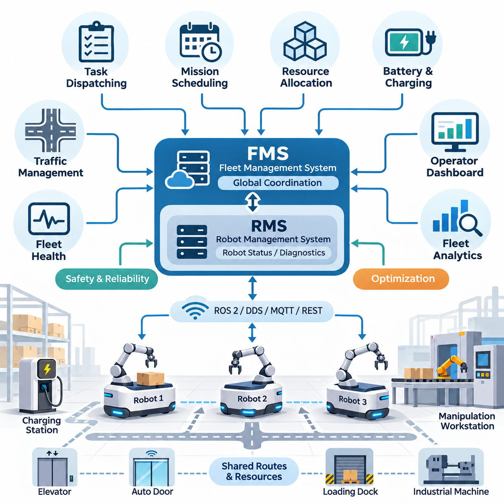
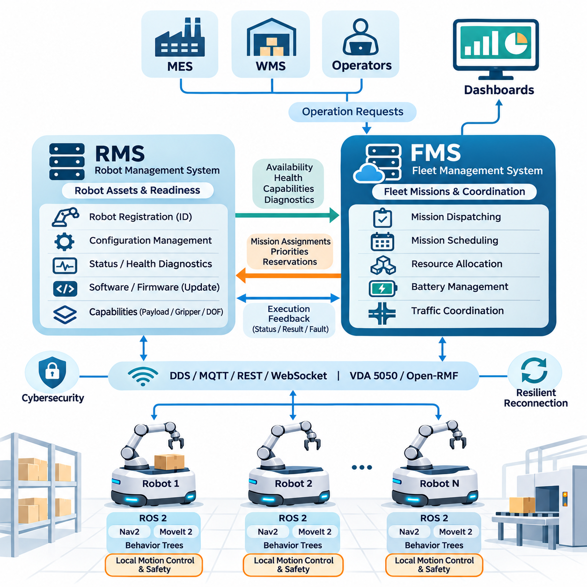
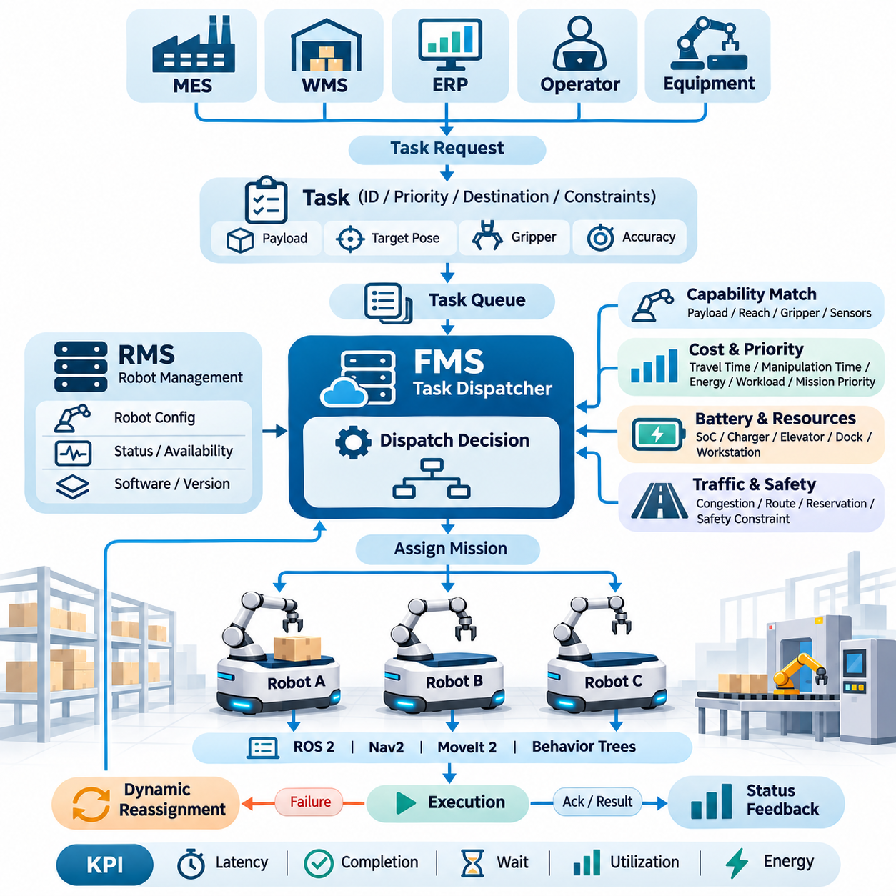
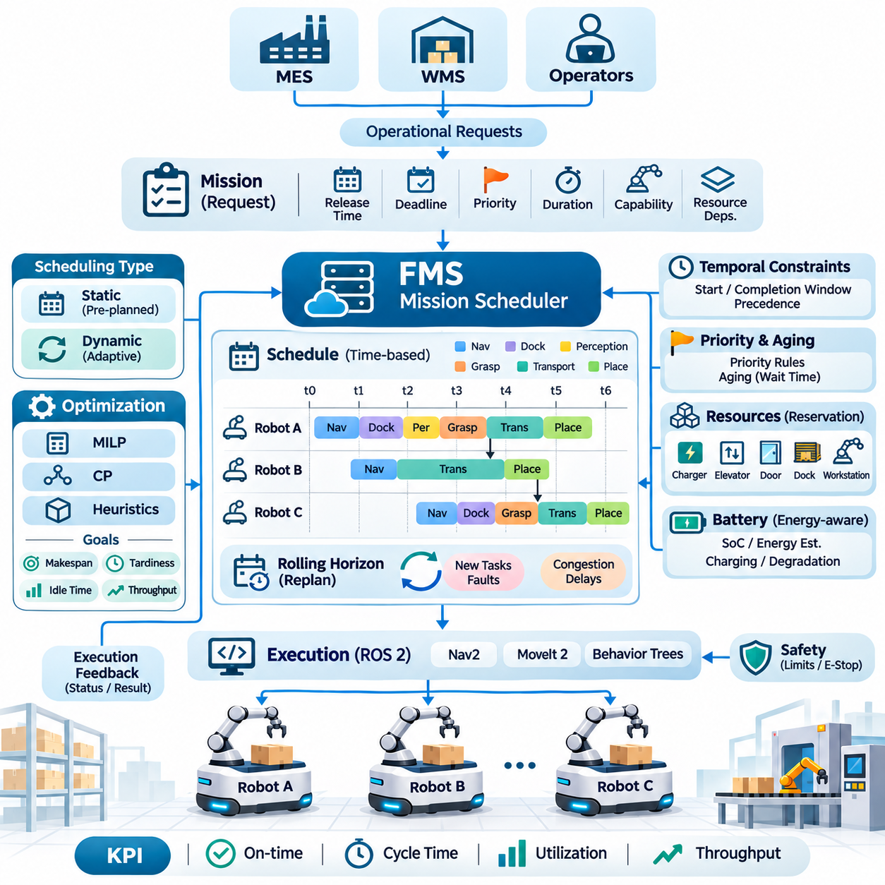
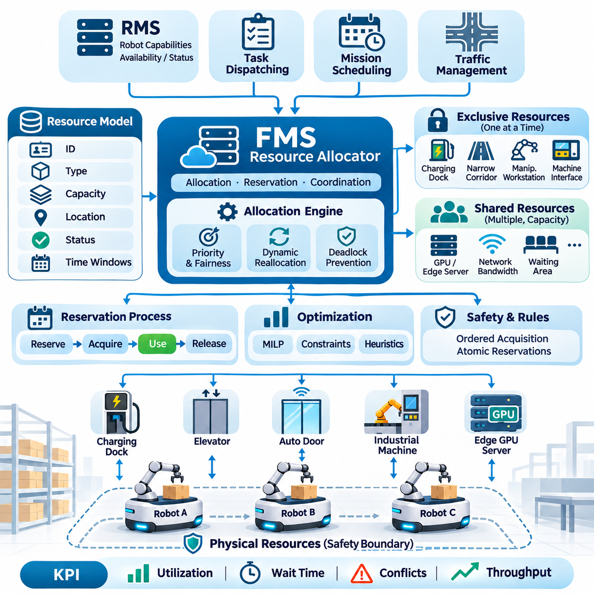
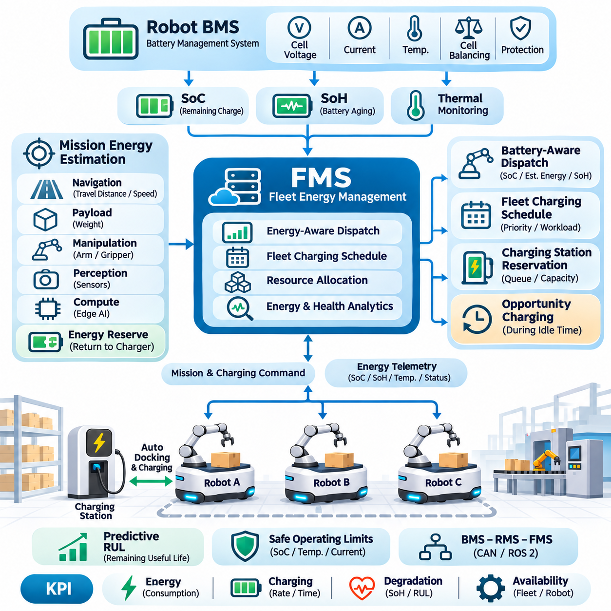
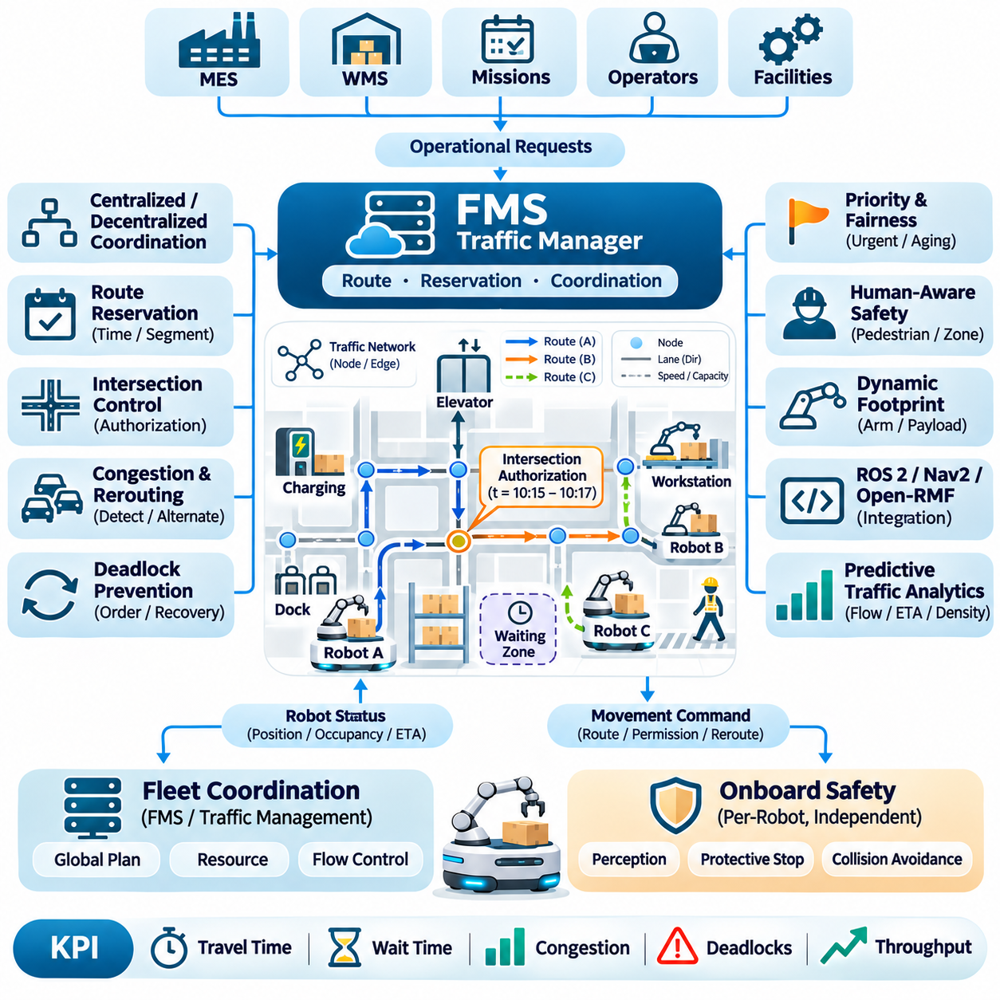
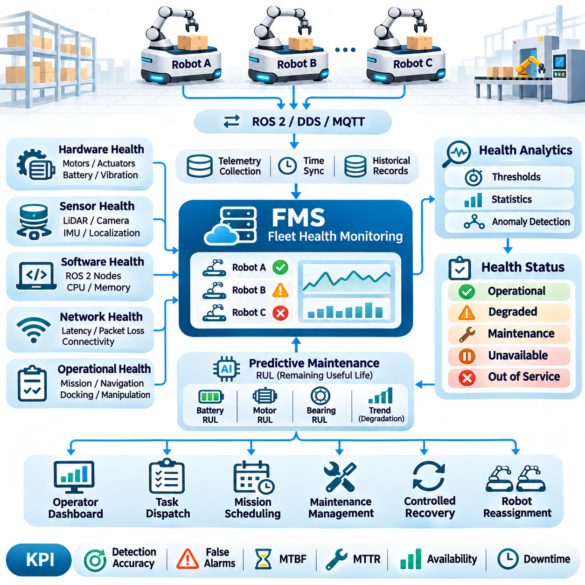
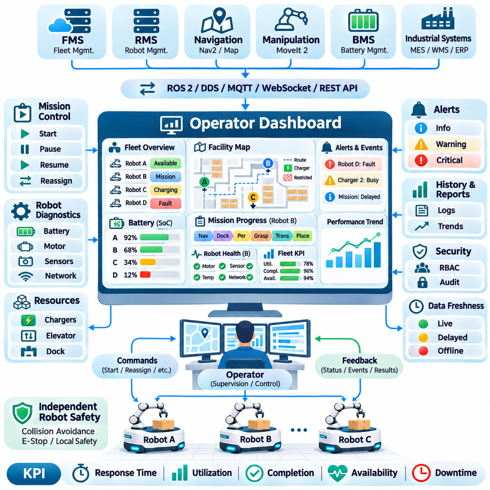
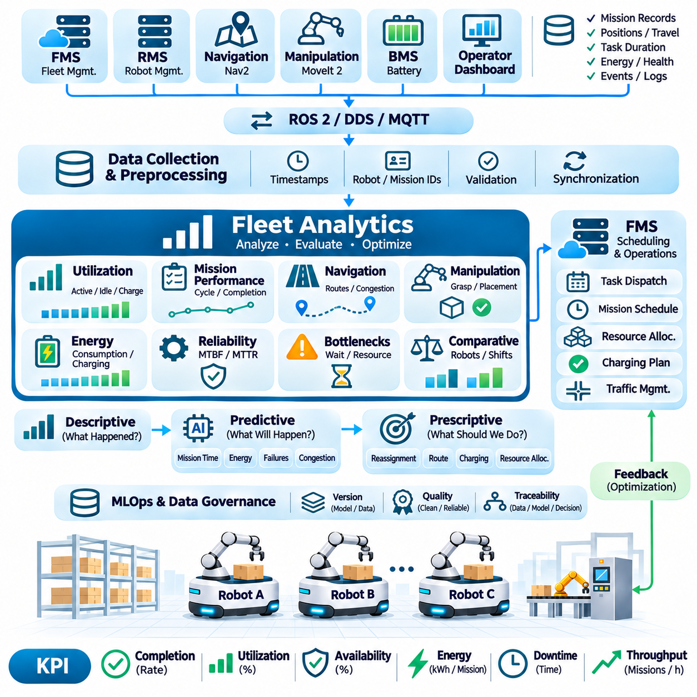

# Chapter 05. Fleet Management

## 01 Fleet Management Overview

{width="7.268055555555556in" height="7.268055555555556in"}

플릿 관리(Fleet Management)는 여러 자율 로봇(Autonomous Robots)이 통합되고 조정된 작업 집단으로 운영될 수 있도록 하는 모바일 매니퓰레이션 시스템(Mobile Manipulation System)의 핵심 구성 요소이다. 개별 로봇이 자율주행(Navigation), 인식(Perception), 조작(Manipulation) 작업을 수행하는 동안 플릿 관리는 운영 목표를 달성하기 위해 로봇들의 집단적 활동을 감독한다. 이를 통해 독립적인 로봇 플랫폼(Robot Platform)을 복잡한 산업 작업 흐름(Industrial Workflow)을 지원할 수 있는 확장 가능한 자동화 인프라(Automation Infrastructure)로 전환한다.

플릿 관리의 주요 목적은 안전성(Safety), 신뢰성(Reliability), 자원 효율성(Resource Efficiency)을 유지하면서 운영 생산성(Operational Productivity)을 극대화하는 것이다. 여러 모바일 매니퓰레이터(Mobile Manipulator)가 존재하는 환경에서는 로봇들이 이동 경로, 충전 스테이션(Charging Station), 조작 작업 공간(Manipulation Workspace), 생산 자원(Production Resource)을 공유해야 한다. 체계적인 조정(Coordination)이 이루어지지 않으면 이러한 자원에 대한 경쟁으로 인해 혼잡, 운영 지연, 자원 충돌 및 시스템 가용성(System Availability)의 저하가 발생할 수 있다.

플릿 관리 시스템(Fleet Management System, FMS)은 일반적으로 개별 로봇 제어 아키텍처(Robot Control Architecture)의 상위 계층에서 동작한다. 하위 수준 제어기(Low-Level Controller)는 액추에이터(Actuator), 센서(Sensor), 자율주행 및 조작을 관리하는 반면, 플릿 관리 계층(Fleet Management Layer)은 여러 로봇의 임무 실행(Mission Execution)을 감독한다. 이러한 역할 분리(Separation of Responsibilities)를 통해 개별 로봇은 지역적 자율성(Local Autonomy)을 유지하면서 조직이 정의한 중앙집중형 또는 분산형 운영 목표에 기여할 수 있다.

플릿 관리 아키텍처(Fleet Management Architecture)는 로봇 관리 시스템(Robot Management System, RMS)과 플릿 관리 시스템(Fleet Management System, FMS)을 모두 포함할 수 있다. 구현 방식에 따라 기능적 경계는 달라질 수 있지만, 일반적으로 RMS는 로봇 구성(Configuration), 운영 상태(Operational Status), 진단(Diagnostics), 수명 주기 관리(Lifecycle Administration)에 중점을 둔다. 반면 FMS는 전체 로봇 작업 집단의 임무 할당(Mission Allocation), 일정 관리(Scheduling), 교통 조정(Traffic Coordination), 집단적 자원 최적화(Resource Optimization)에 중점을 둔다.

작업 배정(Task Dispatching)은 플릿 관리의 핵심 기능 중 하나이다. 운송(Transportation), 검사(Inspection), 피킹(Picking) 또는 조립(Assembly) 요청이 접수되면 시스템은 로봇의 운영 가용성(Operational Availability), 물리적 위치, 배터리 상태, 적재 용량(Payload Capacity), 조작 능력(Manipulation Capability)을 기준으로 적합한 로봇을 식별한다. 고도화된 작업 배정 알고리즘(Dispatching Algorithm)은 예상 작업 완료 시간(Estimated Completion Time)과 해당 작업의 할당이 후속 임무에 미칠 잠재적 영향도 함께 고려한다.

임무 스케줄링(Mission Scheduling)은 할당된 작업을 언제, 어떤 순서로 수행할 것인지 결정함으로써 작업 배정의 기능을 확장한다. 모바일 매니퓰레이터는 자율주행, 도킹(Docking), 객체 인식(Object Recognition), 파지(Grasping), 운송 및 배치(Placement)를 포함하는 복합적인 임무를 빈번하게 수행한다. 스케줄링 시스템(Scheduling System)은 작업 의존성(Task Dependency), 생산 마감 기한(Production Deadline), 처리 시간(Processing Duration), 환경적 제약 조건(Environmental Constraint)을 고려하면서 변화하는 운영 조건에 동적으로 대응해야 한다.

자원 할당(Resource Allocation)은 공유 인프라(Shared Infrastructure)가 경쟁 관계에 있는 여러 로봇에 효율적으로 분배되도록 보장한다. 이러한 자원에는 충전 스테이션, 엘리베이터(Elevator), 자동문(Automatic Door), 상하차 도크(Loading Dock), 조작 스테이션(Manipulation Station), 산업용 기계(Industrial Machine), 제한된 작업 공간(Restricted Workspace) 등이 포함될 수 있다. 예약 메커니즘(Reservation Mechanism)과 우선순위 정책(Priority Policy)은 자동화 생산 공정을 중단시킬 수 있는 동시 접근 충돌, 자원 고갈(Resource Starvation), 교착 상태(Deadlock)를 방지하는 데 기여한다.

배터리 관리(Battery Management)는 모바일 매니퓰레이터가 이동(Locomotion)과 조작(Manipulation) 모두에서 전기 에너지를 소비하기 때문에 특히 중요하다. 플릿 관리 시스템은 배터리 충전 상태(State of Charge, SoC)를 지속적으로 모니터링하고, 임무별 에너지 요구량(Mission-Specific Energy Requirement)을 추정하며, 운영 수요에 따라 충전 일정을 수립한다. 지능형 충전 전략(Intelligent Charging Strategy)은 로봇의 가용성과 배터리 열화(Battery Degradation) 사이의 균형을 유지하고 중요한 생산 기간에 발생하는 불필요한 운영 중단을 감소시킨다.

교통 관리(Traffic Management)는 공유 운영 환경(Shared Operational Environment)에서 로봇들의 이동을 조정한다. 플릿 관리 시스템은 시설 배치(Facility Layout), 자율주행 경로(Navigation Route), 교차로(Intersection), 제한 구역(Restricted Zone), 로봇 위치에 대한 전역 표현(Global Representation)을 유지할 수 있다. 경로 예약(Route Reservation), 교차로 우선순위(Intersection Priority), 혼잡 예측(Congestion Prediction), 동적 경로 재설정(Dynamic Rerouting)은 운송 효율성을 향상시키며, 즉각적인 위험 대응은 독립적인 온보드 안전 기능(Onboard Safety Function)이 담당한다.

플릿 상태 모니터링(Fleet Health Monitoring)은 개별 로봇과 전체 자동화 시스템의 기술적 상태를 지속적으로 파악할 수 있도록 한다. 운영 원격 측정 데이터(Operational Telemetry)에는 모터 온도(Motor Temperature), 액추에이터 전류(Actuator Current), 배터리 전압(Battery Voltage), 통신 품질(Communication Quality), 위치 추정 신뢰도(Localization Confidence), 센서 가용성(Sensor Availability), 조작 성공률(Manipulation Success Rate) 등이 포함될 수 있다. 비정상적인 패턴(Abnormal Pattern)이 감지되면 진단 절차, 유지보수 요청, 임무 재할당 또는 통제된 운영 제외(Controlled Withdrawal from Active Service)가 수행될 수 있다.

통신 인프라(Communication Infrastructure)는 플릿 관리 서비스와 개별 로봇 플랫폼 및 외부 운영 시스템(External Operational System)을 연결한다. ROS 2, 데이터 분산 서비스(Data Distribution Service, DDS), MQTT, REST API 및 표준화된 상호운용성 인터페이스(Standardized Interoperability Interface)는 이기종 구성 요소(Heterogeneous Component) 사이의 정보 교환을 지원할 수 있다. 신뢰성 높은 통신을 구현하기 위해서는 적절한 지연 시간 관리(Latency Management), 메시지 인증(Message Authentication), 네트워크 복원력(Network Resilience), 통신 중단에 대응하기 위한 사전 정의된 전략이 필요하다.

운영자 대시보드(Operator Dashboard)는 로봇 운영을 모니터링하고 감독하기 위한 통합 인터페이스(Unified Interface)를 제공한다. 운영자는 이러한 인터페이스를 통해 로봇의 위치, 임무 진행 상황(Mission Progress), 배터리 상태, 자원 활용률(Resource Utilization), 활성 경보(Active Alarm), 과거 이벤트(Historical Event)를 시각적으로 확인할 수 있다. 또한 권한을 부여받은 인력은 임무를 시작하고, 운영 우선순위를 변경하며, 복구 절차(Recovery Procedure)를 요청하고, 자율 실행 과정에서 예기치 못한 상황이 발생할 경우 인간 개입(Human Intervention)을 조정할 수 있다.

플릿 분석(Fleet Analytics)은 축적된 운영 데이터(Operational Data)를 지속적인 개선(Continuous Improvement)에 활용할 수 있는 실행 가능한 정보(Actionable Information)로 변환한다. 핵심 성과 지표(Key Performance Indicator, KPI)에는 임무 완료율(Mission Completion Rate), 평균 사이클 시간(Average Cycle Time), 플릿 가용성(Fleet Availability), 로봇 활용률(Robot Utilization), 에너지 소비량(Energy Consumption), 충전 빈도(Charging Frequency), 운영 중단 시간(Operational Downtime) 등이 포함될 수 있다. 이력 분석(Historical Analysis)은 병목 현상(Bottleneck)을 식별하고, 스케줄링 전략을 평가하며, 필요한 플릿 규모를 추정하고, 자동화 투자의 경제적 성과를 개선하는 데 기여한다.

현대적인 플릿 관리는 인공지능(Artificial Intelligence, AI), 수학적 최적화(Mathematical Optimization), 예측 분석(Predictive Analytics)을 점차 적극적으로 통합하고 있다. 학습 기반 접근 방식(Learning-Based Approach)은 임무 수행 시간을 추정하고, 혼잡을 사전에 예측하며, 에너지 소비량을 예측하고, 자원 할당 전략을 추천할 수 있다. 그러나 지능형 최적화(Intelligent Optimization)는 물리적 로봇 시스템(Physical Robotic System)에 적합한 운영 규칙(Operational Rule), 검증된 안전 요구사항(Verified Safety Requirement), 결정론적 대체 동작 메커니즘(Deterministic Fallback Mechanism)의 제약 범위 내에서 수행되어야 한다.

효과적인 플릿 관리 아키텍처는 궁극적으로 모바일 매니퓰레이터가 개별적으로 고립된 기계의 집합이 아니라 조정된 산업용 로봇 작업 집단(Coordinated Industrial Workforce)으로 기능할 수 있도록 한다. 작업 배정, 임무 스케줄링, 자원 할당, 배터리 관리, 교통 관리, 플릿 상태 모니터링, 운영자 대시보드 및 플릿 분석을 통합함으로써 조직은 확장성(Scalability), 복원력(Resilience), 지속적인 개선 능력(Continuous Improvement Capability)을 갖춘 로봇 운영 체계(Robotic Operations)를 구축할 수 있다.

## 02 RMS and FMS

{width="7.268055555555556in" height="7.268055555555556in"}

로봇 관리 시스템(Robot Management System, RMS)과 플릿 관리 시스템(Fleet Management System, FMS)은 모바일 매니퓰레이션 소프트웨어 아키텍처(Mobile Manipulation Software Architecture) 내에서 상호 보완적인 두 개의 감독 계층(Supervisory Layer)을 구성한다. 로봇 플랫폼과 솔루션 공급업체에 따라 기능적 경계는 달라질 수 있지만, 두 시스템 모두 신뢰성 있고 확장 가능한 로봇 운영에 기여한다. RMS는 주로 개별 로봇 자산(Robotic Asset)을 관리하며, FMS는 전체 로봇 플릿의 집단적 활동을 조정한다.

로봇 관리 시스템은 개별 로봇의 전체 운영 수명 주기(Operational Lifecycle)에 걸쳐 등록(Registration), 구성(Configuration), 모니터링(Monitoring), 관리(Administration)를 수행하기 위한 중앙집중형 기능(Centralized Capability)을 제공한다. 각각의 모바일 매니퓰레이터에는 고유 식별자(Unique Identifier), 하드웨어 구성(Hardware Configuration), 소프트웨어 버전(Software Version), 네트워크 주소(Network Address), 센서 구성(Sensor Configuration), 운영 프로파일(Operational Profile)이 할당될 수 있다. 이러한 정보는 공통 운영 환경에서 이기종 로봇 플랫폼(Heterogeneous Robotic Platform)을 관리하기 위한 구조화된 기반을 형성한다.

플릿 관리 시스템은 여러 로봇이 공통의 운영 목표(Operational Objective)를 달성할 수 있도록 조정하는 데 중점을 둔다. 주요 책임에는 작업 배정(Task Dispatching), 임무 스케줄링(Mission Scheduling), 자원 할당(Resource Allocation), 배터리 관리(Battery Management), 교통 조정(Traffic Coordination)이 포함된다. FMS는 개별 액추에이터(Actuator)의 움직임을 직접 관리하는 대신 전체 운영 환경을 평가하고, 생산성을 극대화하며 충돌을 최소화하기 위해 가용 로봇 자원(Available Robotic Resource)을 어떻게 활용할 것인지 결정한다.

RMS와 FMS의 아키텍처적 차이(Architectural Distinction)는 각각의 관리 범위(Management Scope)를 통해 이해할 수 있다. RMS는 각각의 로봇이 어떤 종류의 로봇인지, 어떻게 구성되어 있는지, 정상적으로 작동하고 있는지에 관한 정보를 유지한다. FMS는 각각의 로봇이 어떤 작업을 수행해야 하는지, 임무를 언제 실행해야 하는지, 다른 로봇과의 활동을 어떻게 조정해야 하는지 결정한다. 이러한 상호 보완적인 책임은 시스템의 모듈성(Modularity)과 운영 확장성(Operational Scalability)을 지원한다.

로봇 등록(Robot Registration)과 구성 관리(Configuration Management)는 RMS의 필수 기능이다. 새로운 모바일 매니퓰레이터가 운영 환경에 도입되면 RMS는 해당 로봇의 식별 정보(Identity), 통신 매개변수(Communication Parameter), 하드웨어 기능(Hardware Capability), 소프트웨어 의존성(Software Dependency), 지원 가능한 임무 유형(Supported Mission Type)을 설정한다. 구성 정보에는 적재 용량 제한(Payload Limitation), 매니퓰레이터 자유도(Degrees of Freedom, DoF), 엔드 이펙터 사양(End-Effector Specification), 운영 구역(Operating Zone), 사용 가능한 자율주행 및 조작 인터페이스도 포함될 수 있다.

로봇 상태 관리(Robot Status Management)는 RMS가 각각의 로봇 플랫폼에 대한 최신 상태 정보를 유지할 수 있도록 한다. 상태 정보에는 운영 모드(Operational Mode), 배터리 상태(Battery Condition), 위치 추정 신뢰도(Localization Confidence), 액추에이터 건전성(Actuator Health), 네트워크 연결성(Network Connectivity), 활성 고장 코드(Active Fault Code)가 포함될 수 있다. RMS는 원격 측정 데이터(Telemetry Data)를 지속적으로 수집하고 처리함으로써 로봇의 운영 준비 상태(Robot Readiness)를 신뢰성 있게 평가하고 관련 정보를 플릿 수준 의사결정 서비스(Fleet-Level Decision-Making Service)에 제공한다.

소프트웨어 및 펌웨어 수명 주기 관리(Software and Firmware Lifecycle Management)는 일반적으로 RMS와 관련된 또 다른 중요한 책임이다. 모바일 매니퓰레이터에는 운영체제(Operating System), ROS 2 패키지(ROS 2 Package), 자율주행 모듈(Navigation Module), 조작 제어기(Manipulation Controller), 인식 모델(Perception Model), 임베디드 펌웨어(Embedded Firmware)를 비롯한 다양한 소프트웨어 구성 요소가 포함된다. RMS는 버전 추적(Version Tracking), 호환성 검증(Compatibility Verification), 구성 배포(Configuration Deployment), 통제된 소프트웨어 업데이트(Controlled Software Update), 장애 발생 시 롤백 절차(Rollback Procedure)를 조정할 수 있다.

FMS 아키텍처 내에서 임무 관리(Mission Management)는 외부 운영 요청(External Operational Request)을 실행 가능한 로봇 할당(Robot Assignment)으로 변환한다. 이러한 요청은 제조 실행 시스템(Manufacturing Execution System, MES), 창고 관리 시스템(Warehouse Management System, WMS), 기업용 애플리케이션(Enterprise Application) 또는 인간 운영자(Human Operator)로부터 발생할 수 있다. FMS는 임무 요구사항(Mission Requirement)을 가용 로봇의 기능, 운영 조건, 작업 우선순위(Task Priority), 자원 제약 조건(Resource Constraint)과 비교하여 평가한 후 임무 실행에 적합한 로봇 플랫폼을 선택한다.

모바일 매니퓰레이션은 임무 할당 과정에서 이동 능력(Mobility Capability)과 조작 능력(Manipulation Capability)을 모두 고려해야 하므로 추가적인 복잡성이 발생한다. 물자 운송이 가능한 로봇이라도 특정 작업에 필요한 적절한 그리퍼(Gripper), 적재 용량(Payload Capacity), 작업 공간 도달 범위(Workspace Reach), 인식 기능(Perception Functionality)을 갖추지 못할 수 있다. 따라서 FMS는 임무 요구사항과 RMS에서 유지하는 검증된 로봇 구성 정보를 일치시키는 기능 인식 기반 작업 배정 메커니즘(Capability-Aware Dispatching Mechanism)을 통합해야 한다.

RMS와 FMS 사이의 정보 교환(Information Exchange)은 지속적인 운영 피드백 루프(Operational Feedback Loop)를 형성한다. RMS는 로봇 가용성(Robot Availability), 상태 정보(Health Information), 구성 매개변수(Configuration Parameter), 진단 결과(Diagnostic Result)를 제공하며, FMS는 임무 할당(Mission Assignment), 운영 우선순위(Operational Priority), 자원 예약(Resource Reservation) 정보를 전달한다. 이후 실행 결과(Execution Outcome)와 고장 알림(Fault Notification)이 감독 서비스(Supervisory Service)로 반환되어 동적 스케줄링(Dynamic Scheduling), 임무 복구(Mission Recovery), 시스템 전체의 운영 최적화(Operational Optimization)를 가능하게 한다.

ROS 2와의 통합(Integration)은 개별 모바일 매니퓰레이터가 표준화된 통신 메커니즘(Standardized Communication Mechanism)을 통해 자율주행, 조작 및 진단 기능을 외부에 제공할 수 있도록 한다. 자율주행 액션(Navigation Action)은 Nav2를 통해 실행될 수 있으며, 조작 작업 흐름(Manipulation Workflow)은 MoveIt 2와 행동 트리(Behavior Tree)를 활용할 수 있다. RMS와 FMS는 온보드 모션 플래닝(Onboard Motion Planning), 실시간 제어(Real-Time Control), 독립적인 안전 메커니즘(Independent Safety Mechanism)을 대체하지 않고 적절한 인터페이스를 통해 이러한 구성 요소와 상호작용한다.

통신 아키텍처(Communication Architecture)는 시스템 요구사항에 따라 데이터 분산 서비스(Data Distribution Service, DDS), MQTT, REST API, 웹소켓 연결(WebSocket Connection), VDA 5050 또는 Open-RMF와 같은 상호운용성 프레임워크(Interoperability Framework)를 통합할 수 있다. 이러한 메커니즘은 로봇 플랫폼, 감독 서비스, 산업 인프라(Industrial Infrastructure) 사이의 정보 교환을 지원한다. 표준 모바일 로봇 인터페이스에서 충분히 표현하지 못하는 복잡한 조작 기능을 나타내기 위해서는 추가적인 애플리케이션별 인터페이스(Application-Specific Interface)가 필요할 수 있다.

운영 복원력(Operational Resilience)을 확보하기 위해서는 통신 장애(Communication Failure), 서버 중단(Server Interruption), 시스템 상태 불일치(Inconsistent System State)에 대응하는 명시적인 전략이 필요하다. 로봇은 감독 시스템과의 통신이 불가능해질 경우 사전에 정의된 안전 상태(Predefined Safe Condition)로 전환할 수 있도록 충분한 온보드 자율성(Onboard Autonomy)을 유지해야 한다. 임무 식별자(Mission Identifier), 수신 확인 메커니즘(Acknowledgment Mechanism), 하트비트 메시지(Heartbeat Message), 영속적 상태 저장(Persistent State Storage), 재연결 절차(Reconnection Procedure)는 중복 할당을 방지하고 분산 구성 요소(Distributed Component) 간의 일관성을 유지하는 데 기여한다.

사이버 보안(Cybersecurity)과 접근 제어(Access Control)는 RMS 및 FMS 플랫폼이 물리적 로봇 운영에 영향을 미칠 수 있기 때문에 핵심적인 고려사항이다. 인증(Authentication), 암호화 통신(Encrypted Communication), 역할 기반 접근 제어(Role-Based Access Control, RBAC), 네트워크 분할(Network Segmentation), 감사 로그 기록(Audit Logging)은 비인가 접근(Unauthorized Access)으로부터 감독 서비스를 보호하는 데 기여한다. 관리 수준의 구성 변경(Administrative Configuration Change)과 플릿 수준 명령(Fleet-Level Command)은 적절한 권한 부여(Authorization), 검증(Validation), 운영 안전 제약 조건(Operational Safety Constraint)의 적용을 받아야 한다.

운영자는 기술적 진단 정보와 운영 정보를 결합한 통합 RMS 및 FMS 대시보드(Integrated RMS and FMS Dashboard)를 통해 효율적인 로봇 운영을 수행할 수 있다. RMS는 개별 로봇의 건전성 상태(Health Condition), 구성 기록(Configuration Record), 유지보수 요구사항(Maintenance Requirement), 소프트웨어 버전을 제공하며, FMS는 임무 대기열(Mission Queue), 자원 활용률(Resource Utilization), 교통 상황(Traffic Condition), 플릿 성능(Fleet Performance)을 시각화한다. 이러한 두 관리 시스템은 상호 보완적으로 작동하면서 확장성(Scalability), 보안성(Security), 신뢰성(Reliability)을 갖춘 모바일 매니퓰레이션 운영 체계(Mobile Manipulation Operations)의 기반을 형성한다.

## 03 Task Dispatching

{width="7.268055555555556in" height="7.268055555555556in"}

작업 배정(Task Dispatching)은 임무 요구사항(Mission Requirement)과 현재 플릿 상태(Fleet Condition)에 따라 적합한 모바일 매니퓰레이터(Mobile Manipulator)에 운영 작업을 할당하는 플릿 관리 시스템(Fleet Management System, FMS)의 핵심 기능이다. 특정 목표를 어떻게 달성할 것인지 결정하는 개별 로봇의 작업 계획(Task Planning)과 달리, 작업 배정은 접수된 작업을 어떤 로봇이 수행할 것인지 결정한다. 효과적인 작업 배정은 생산성(Productivity), 자원 활용률(Resource Utilization), 운영 대응력(Operational Responsiveness)을 향상시킨다.

작업 배정 프로세스(Task Dispatching Process)는 운영 요청(Operational Request)이 플릿 관리 환경(Fleet Management Environment)에 입력될 때 시작된다. 이러한 요청은 제조 실행 시스템(Manufacturing Execution System, MES), 창고 관리 시스템(Warehouse Management System, WMS), 전사적 자원 관리 시스템(Enterprise Resource Planning, ERP), 인간 운영자(Human Operator) 또는 자동화 생산 장비(Automated Production Equipment)로부터 발생할 수 있다. 각각의 요청은 식별자(Identifier), 실행 목표(Execution Objective), 우선순위(Priority), 목적지(Destination), 운영 제약 조건(Operational Constraint)을 포함하는 구조화된 작업 명세(Structured Task Description)로 변환된다.

모바일 매니퓰레이터의 작업 명세(Task Description)는 운송 요구사항(Transportation Requirement)과 조작 요구사항(Manipulation Requirement)을 모두 표현해야 한다. 작업에는 객체 특성(Object Characteristic), 적재 중량(Payload Weight), 목표 자세(Target Pose), 요구되는 엔드 이펙터 유형(End-Effector Type), 조작 정확도(Manipulation Accuracy), 환경적 제한사항(Environmental Restriction)이 명시될 수 있다. 이러한 매개변수를 통해 작업 배정 시스템은 단순 운송 임무와 객체 인식(Object Recognition), 파지(Grasping), 기계 관리(Machine Tending), 검사(Inspection), 정밀 조립(Precision Assembly)을 포함하는 복합적인 작업을 구분할 수 있다.

로봇 역량 매칭(Robot Capability Matching)은 작업 배정의 필수 구성 요소이다. FMS는 로봇 관리 시스템(Robot Management System, RMS)에서 관리하는 구성 정보(Configuration Information)를 활용하여 각 작업의 기술적 요구사항과 가용 로봇의 역량을 비교 평가한다. 관련 속성에는 적재 용량(Payload Capacity), 매니퓰레이터 도달 범위(Manipulator Reach), 자유도(Degrees of Freedom, DoF), 그리퍼 호환성(Gripper Compatibility), 센서 가용성(Sensor Availability), 자율주행 능력(Navigation Capability), 위치 추정 정확도(Localization Accuracy), 지원 가능한 소프트웨어 기능(Supported Software Function)이 포함된다.

가용성 기반 작업 배정(Availability-Based Dispatching)은 새로운 작업 할당을 수락할 수 있는 운영 준비 상태의 로봇을 식별한다. 로봇은 다른 임무를 수행하거나, 배터리를 충전하거나, 유지보수를 진행하거나, 통신 장애(Communication Failure)를 경험하거나, 제한 구역(Restricted Zone)에서 동작하고 있기 때문에 사용 불가능한 상태일 수 있다. 작업 배정 시스템은 로봇 상태(Robot State)를 지속적으로 평가하여 부적절한 작업 할당을 방지하고 선택된 로봇 플랫폼이 요청된 작업을 완료할 수 있도록 보장한다.

거리 기반 작업 배정(Distance-Based Dispatching)은 작업 수행 장소와 가까운 위치에 있는 적합한 로봇에 작업을 할당하는 널리 사용되는 전략이다. 가장 가까운 로봇을 선택하면 불필요한 이동을 줄일 수 있지만, 지리적 거리(Geographical Distance)만으로는 실제 임무 실행 비용(Mission Execution Cost)을 정확하게 표현할 수 없다. 작업 할당 효율성(Assignment Efficiency)을 추정할 때는 자율주행 장애물(Navigation Obstacle), 교통 혼잡(Traffic Congestion), 경로 제한(Route Restriction), 도킹 요구사항(Docking Requirement), 조작 준비 시간(Manipulation Preparation Time)도 함께 고려해야 한다.

비용 기반 작업 배정(Cost-Based Dispatching)은 여러 운영 요소를 표현하는 수학적 비용 함수(Mathematical Cost Function)를 통해 후보 로봇을 평가한다. 비용 함수에는 예상 이동 시간(Estimated Travel Time), 조작 소요 시간(Manipulation Duration), 에너지 소비량(Energy Consumption), 기존 작업 부하(Existing Workload), 자원 가용성(Resource Availability), 임무 우선순위(Mission Priority)가 결합될 수 있다. 적절한 가중치 계수(Weighting Coefficient)를 적용하면 조직은 처리량(Throughput) 극대화 또는 에너지 소비 최소화와 같은 특정 생산 목표에 맞추어 작업 배정 의사결정을 조정할 수 있다.

우선순위 기반 작업 배정(Priority-Based Dispatching)은 중요도가 높은 운영 요청이 적절하게 처리되도록 보장한다. 긴급 물류(Emergency Logistics), 긴급 자재 보충(Urgent Material Replenishment), 생산 병목 복구(Production Bottleneck Recovery), 시간 제약이 있는 검사 작업(Time-Sensitive Inspection Task)은 일반적인 운송 요청보다 높은 실행 우선순위(Execution Priority)를 부여받을 수 있다. 우선순위 관리(Priority Management)는 무기한 작업 지연이나 실행 중인 조작 작업의 위험한 중단을 방지하기 위해 대기 시간 조정(Waiting-Time Adjustment)과 통제된 선점 메커니즘(Controlled Preemption Mechanism)도 통합해야 한다.

동적 작업 배정(Dynamic Task Dispatching)은 변화하는 환경 및 운영 조건에 따라 작업 할당 의사결정을 지속적으로 조정한다. 로봇이 예상치 못한 장애물에 직면하거나, 기계적 고장(Mechanical Fault)이 발생하거나, 조작 작업을 완료하지 못하면 FMS는 대기 중인 작업을 다른 로봇에 재할당할 수 있다. 동적 재할당(Dynamic Reassignment)은 중복 실행(Duplicated Execution), 재고 기록 불일치(Inconsistent Inventory Record), 자원 예약 충돌(Conflicting Resource Reservation)을 방지하기 위해 정확한 임무 상태 추적(Mission State Tracking)을 필요로 한다.

배터리 인식 기반 작업 배정(Battery-Aware Dispatching)은 로봇 선택 과정에 에너지 가용성(Energy Availability)을 반영한다. FMS는 작업 할당을 발행하기 전에 배터리 충전 상태(State of Charge, SoC), 예상 임무 에너지 소비량(Estimated Mission Energy Consumption), 배터리 건전성(Battery Health), 충전 스테이션 접근성(Charging Station Accessibility)을 평가한다. 모바일 매니퓰레이터는 로봇 팔 움직임(Robotic Arm Movement), 인식 데이터 처리(Perception Processing), 엔드 이펙터 작동(End-Effector Operation)으로 인해 자율주행에 필요한 에너지 이외의 추가적인 에너지 요구량이 발생할 수 있으므로 특별한 고려가 필요하다.

자원 인식 기반 작업 배정(Resource-Aware Dispatching)은 엘리베이터(Elevator), 충전 스테이션(Charging Station), 상하차 도크(Loading Dock), 기계 인터페이스(Machine Interface), 조작 작업 공간(Manipulation Workspace)과 같이 여러 로봇이 공유하는 인프라를 고려한다. 동일한 사용 불가능 자원을 필요로 하는 작업에 여러 로봇을 할당하면 불필요한 대기와 혼잡이 발생할 수 있다. 자원 예약(Resource Reservation) 및 교통 관리 서비스(Traffic Management Service)와의 통합을 통해 작업 배정 시스템은 임무 명령(Mission Command)을 발행하기 전에 작업 할당의 실행 가능성(Assignment Feasibility)을 평가할 수 있다.

고도화된 작업 배정 아키텍처(Advanced Dispatching Architecture)는 중앙집중형 최적화(Centralized Optimization), 분산형 의사결정(Distributed Decision-Making) 또는 시장 기반 할당 전략(Market-Based Allocation Strategy)을 활용할 수 있다. 중앙집중형 접근 방식은 전체 플릿의 상태를 평가하여 작업 할당을 최적화하는 반면, 분산형 메커니즘은 개별 로봇 또는 지역 에이전트(Local Agent)가 할당 의사결정에 참여할 수 있도록 한다. 경매 기반 알고리즘(Auction-Based Algorithm), 조합 최적화(Combinatorial Optimization), 휴리스틱 탐색(Heuristic Search)은 계산 복잡도(Computational Complexity)와 운영 효율성(Operational Efficiency) 사이의 균형을 확보하기 위한 대안적 방법을 제공한다.

인공지능(Artificial Intelligence, AI)은 이동 소요 시간(Travel Duration), 조작 성공 확률(Manipulation Success Probability), 혼잡 수준(Congestion Level), 임무 완료 시간(Mission Completion Time)을 추정하는 예측 모델(Predictive Model)을 통해 작업 배정 성능을 향상시킬 수 있다. 강화학습(Reinforcement Learning, RL)은 변화하는 작업 부하(Workload)에 대응하는 적응형 할당 정책(Adaptive Allocation Policy)을 지원할 수도 있다. 그러나 학습 기반 작업 배정(Learning-Based Dispatching)은 예측 가능한 물리적 운영을 유지하기 위해 검증된 로봇 역량 제약 조건(Verified Capability Constraint), 명시적인 안전 경계(Explicit Safety Boundary), 결정론적 대체 동작 메커니즘(Deterministic Fallback Mechanism)의 범위 내에서 수행되어야 한다.

성공적인 작업 배정을 위해서는 신뢰성 높은 통신(Reliable Communication)과 일관된 임무 상태 관리(Mission State Management)가 필요하다. 각각의 작업 할당에는 고유 작업 식별자(Unique Task Identifier), 수신 확인 절차(Acknowledgment Procedure), 실행 상태 업데이트(Execution Status Update), 시간 초과 조건(Timeout Condition), 장애 복구 메커니즘(Failure Recovery Mechanism)이 포함되어야 한다. ROS 2, Nav2, MoveIt 2 및 행동 트리(Behavior Tree)와의 통합은 지역 모션 제어(Local Motion Control) 또는 독립적인 안전 기능(Independent Safety Function)을 대체하지 않으면서 플릿 수준 작업 할당을 로봇 수준 실행 작업 흐름(Robot-Level Execution Workflow)으로 변환할 수 있도록 한다.

작업 배정 성능(Task Dispatching Performance)은 작업 할당 지연 시간(Assignment Latency), 임무 완료율(Mission Completion Rate), 평균 대기 시간(Average Waiting Time), 공차 이동 거리(Empty Travel Distance), 로봇 활용률(Robot Utilization), 에너지 효율성(Energy Efficiency), 작업 재할당 빈도(Reassignment Frequency)를 통해 평가할 수 있다. 이러한 지표에 대한 지속적인 분석은 알고리즘 개선(Algorithm Refinement)과 플릿 용량 최적화(Fleet Capacity Optimization)를 지원한다. 효과적인 작업 배정 아키텍처는 운영 우선순위, 로봇 역량, 자원 제약 조건, 시스템 복원력(System Resilience) 사이의 균형을 유지함으로써 확장성과 신뢰성을 갖춘 모바일 매니퓰레이션 운영 체계(Mobile Manipulation Operations)를 구축한다.

## 04 Mission Scheduling

{width="7.268055555555556in" height="7.268055555555556in"}

임무 스케줄링(Mission Scheduling)은 모바일 매니퓰레이터(Mobile Manipulator)가 할당된 임무를 언제, 어떤 순서로, 어떠한 운영 조건에서 수행해야 하는지를 결정하는 플릿 관리(Fleet Management)의 핵심 기능이다. 작업 배정(Task Dispatching)이 주로 접수된 요청에 적합한 로봇을 식별하는 데 중점을 두는 반면, 임무 스케줄링은 시간적 관점에서 로봇의 활동을 조직한다. 효과적인 스케줄링은 전체 운영 효율성(Operational Efficiency)을 극대화하기 위해 운송, 조작, 충전 및 인프라 접근을 조정한다.

모바일 매니퓰레이션 임무(Mobile Manipulation Mission)는 일반적으로 자율주행(Navigation), 도킹(Docking), 환경 인식(Environmental Perception), 객체 인식(Object Recognition), 파지(Grasping), 운송(Transportation), 배치(Placement)를 포함하는 여러 상호 연결된 실행 단계(Execution Stage)로 구성된다. 각각의 단계는 서로 다른 처리 시간(Processing Duration), 자원 요구사항(Resource Requirement), 완료 조건(Completion Condition)을 가질 수 있다. 스케줄링 시스템은 개별 활동이 논리적으로 일관되고 운영상 실행 가능한 순서로 수행되도록 이러한 관계를 정확하게 표현해야 한다.

임무 스케줄링은 제조 시스템(Manufacturing System), 창고 관리 플랫폼(Warehouse Management Platform), 기업용 애플리케이션(Enterprise Application) 또는 인간 운영자(Human Operator)로부터 전달되는 운영 요청(Operational Request)을 수집하고 분류하는 과정에서 시작된다. 각각의 임무는 실행 가능 시점(Release Time), 실행 마감 기한(Execution Deadline), 우선순위(Priority), 예상 소요 시간(Estimated Duration), 요구되는 로봇 역량(Robot Capability), 자원 의존성(Resource Dependency)에 의해 특성화된다. 이러한 매개변수는 여러 로봇 플랫폼에 걸쳐 실행 가능한 일정(Feasible Schedule)을 구성하는 데 필요한 정보 기반을 형성한다.

시간적 제약 조건(Temporal Constraint)은 산업 운영이 동기화된 생산 활동(Synchronized Production Activity)에 의존하는 경우가 많기 때문에 임무 스케줄링에서 필수적인 역할을 한다. 모바일 매니퓰레이터는 조립 공정(Assembly Process)이 시작되기 전에 부품을 공급하거나, 기계를 사용할 수 없는 상태가 되기 전에 완성된 제품을 반출해야 할 수 있다. 스케줄링 시스템은 가장 빠른 시작 시간(Earliest Start Time), 최종 완료 가능 시간(Latest Completion Time), 처리 가능 시간 구간(Processing Window), 의존 관계에 있는 활동 사이의 선후 관계(Precedence Relationship)를 고려해야 한다.

정적 임무 스케줄링(Static Mission Scheduling)은 사전에 정의된 운영 요구사항(Operational Requirement)과 예상 자원 가용성(Estimated Resource Availability)을 활용하여 실행 계획(Execution Plan)을 미리 수립한다. 이러한 접근 방식은 비교적 안정적인 생산 일정(Production Schedule)과 예측 가능한 임무 소요 시간(Mission Duration)을 가진 반복적인 제조 공정(Repetitive Manufacturing Process)에 적합하다. 정적 스케줄링은 운영 계획과 계산 요구사항(Computational Requirement)을 단순화하지만, 예상치 못한 이벤트로 인해 초기 운영 조건이 크게 변화하면 그 효과가 감소한다.

동적 임무 스케줄링(Dynamic Mission Scheduling)은 운영 환경(Operational Environment)의 변화에 따라 실행 계획을 지속적으로 조정한다. 새로운 임무 요청(New Mission Request), 로봇 고장(Robot Failure), 교통 혼잡(Traffic Congestion), 충전 지연(Charging Delay), 예상치 못한 조작 작업의 어려움(Manipulation Difficulty)으로 인해 기존 일정의 수정이 필요할 수 있다. 동적 스케줄링은 플릿 관리 시스템(Fleet Management System, FMS)이 이미 완료된 작업, 사용이 확정된 자원(Committed Resource), 진행 중인 안전 필수 작업(Safety-Critical Operation)을 고려하면서 대기 중인 활동을 재구성할 수 있도록 한다.

우선순위 기반 스케줄링(Priority-Based Scheduling)은 임무의 운영 중요도(Operational Importance)와 긴급성(Urgency)에 따라 실행 순서를 결정한다. 시간 제약이 있는 자재 보충(Time-Sensitive Material Replenishment), 생산 복구(Production Recovery), 긴급 물류(Emergency Logistics), 중요 검사 작업(Critical Inspection Activity)은 일반적인 운송 임무보다 높은 우선순위를 부여받을 수 있다. 에이징 메커니즘(Aging Mechanism)은 대기 중인 임무의 우선순위를 점진적으로 높여 작업 기아 상태(Starvation)를 방지하며, 통제된 선점(Controlled Preemption)은 적절한 실행 단계에서만 작업 중단이 발생하도록 제한한다.

자원 제약 기반 임무 스케줄링(Resource-Constrained Mission Scheduling)은 여러 로봇 플랫폼이 공유하는 인프라의 가용성(Infrastructure Availability)을 고려한다. 충전 스테이션(Charging Station), 엘리베이터(Elevator), 자동문(Automatic Door), 상하차 도크(Loading Dock), 산업용 기계(Industrial Machine), 조작 작업 공간(Manipulation Workspace)은 동시에 제한된 수의 로봇만 수용할 수 있다. 스케줄링 알고리즘(Scheduling Algorithm)은 대기 시간(Waiting Period), 자원 충돌(Resource Conflict), 잠재적인 교착 상태(Deadlock Condition)를 최소화하기 위해 자원 예약 시간 구간(Resource Reservation Window)과 임무 실행 시간(Mission Execution Time)을 조정해야 한다.

에너지 인식 기반 임무 스케줄링(Energy-Aware Mission Scheduling)은 배터리 상태(Battery Condition)와 충전 요구사항(Charging Requirement)을 운영 계획(Operational Planning)에 통합한다. 각각의 로봇은 할당된 활동을 완료하고 필요한 경우 적절한 충전 스테이션에 도달할 수 있는 충분한 에너지를 유지해야 한다. 스케줄링 의사결정은 장시간 운영 기간 동안 플릿 가용성(Fleet Availability)을 유지하기 위해 배터리 충전 상태(State of Charge, SoC), 예측 에너지 소비량(Predicted Energy Consumption), 충전 소요 시간(Charging Duration), 배터리 열화(Battery Degradation), 예상 작업 부하(Anticipated Workload)를 고려해야 한다.

수학적 최적화(Mathematical Optimization)는 여러 운영 제약 조건에서 임무 일정을 구성하기 위한 체계적인 방법을 제공한다. 혼합 정수 선형 계획법(Mixed-Integer Linear Programming, MILP), 제약 프로그래밍(Constraint Programming, CP), 휴리스틱 알고리즘(Heuristic Algorithm), 메타휴리스틱 최적화(Metaheuristic Optimization)는 서로 다른 스케줄링 문제의 특성에 대응할 수 있다. 일반적인 최적화 목표(Optimization Objective)에는 전체 완료 시간(Total Completion Time), 임무 마감 지연(Mission Tardiness), 로봇 유휴 시간(Robot Idle Time), 자원 경합(Resource Contention), 에너지 소비량(Energy Consumption)의 최소화가 포함된다.

이동 계획 구간 스케줄링(Rolling Horizon Scheduling)은 지속적으로 변화하는 로봇 운영을 관리하기 위한 실용적인 접근 방식을 제공한다. 전체 운영 기간을 한 번에 최적화하는 대신 시스템은 제한된 미래 계획 시간 구간(Future Planning Window) 내에서 반복적으로 일정을 생성한다. 새로운 정보가 확보되면 계획 구간(Planning Horizon)이 앞으로 이동하고 대기 중인 임무의 일정이 재조정된다. 이러한 접근 방식은 대규모 로봇 플릿(Large Robotic Fleet)에서 계산 효율성(Computational Efficiency), 운영 적응성(Operational Adaptability), 일정 안정성(Schedule Stability) 사이의 균형을 유지한다.

인공지능(Artificial Intelligence, AI)은 임무 소요 시간, 조작 성공 확률(Manipulation Success Probability), 자원 가용성(Resource Availability), 미래 작업 부하 분포(Future Workload Distribution)를 예측함으로써 임무 스케줄링 성능을 향상시킬 수 있다. 과거 운영 데이터(Historical Operational Data)를 기반으로 학습된 머신러닝 모델(Machine Learning Model)은 고정된 스케줄링 매개변수(Fixed Scheduling Parameter)보다 더욱 정확한 추정값을 제공할 수 있다. 강화학습(Reinforcement Learning, RL) 역시 의사결정이 검증된 운영 및 안전 제약 조건(Verified Operational and Safety Constraint)의 범위 내에서 이루어진다는 전제하에 적응형 스케줄링 정책(Adaptive Scheduling Policy)을 지원할 수 있다.

로봇 수준 실행 프레임워크(Robot-Level Execution Framework)와의 통합은 플릿 수준에서 수립된 일정을 실행 가능한 운영 작업 흐름(Executable Operational Workflow)으로 변환할 수 있도록 한다. ROS 2, Nav2, MoveIt 2, 행동 트리(Behavior Tree)는 개별 로봇 플랫폼에서 자율주행, 조작 및 임무 실행(Mission Execution)을 지원한다. FMS는 실행 피드백(Execution Feedback)을 수신하고 예정된 활동을 업데이트하지만, 온보드 모션 플래닝(Onboard Motion Planning), 실시간 제어(Real-Time Control), 충돌 회피(Collision Avoidance), 독립적인 안전 기능(Independent Safety Function)을 대체하지 않는다.

예외 처리(Exception Handling)는 임무 실행이 예상된 조건에서 벗어날 때 일정 일관성(Schedule Consistency)을 유지하기 위한 필수 요소이다. 작업 지연(Delayed Operation), 파지 실패(Failed Grasping Attempt), 통신 중단(Communication Interruption), 자원 사용 불가(Unavailable Resource)는 일정 수정(Schedule Revision) 또는 임무 재할당(Mission Reassignment)을 유발할 수 있다. 영속적 임무 기록(Persistent Mission Record), 실행 체크포인트(Execution Checkpoint), 자원 예약 업데이트(Resource Reservation Update), 검증된 복구 절차(Validated Recovery Procedure)는 중복 작업(Duplicated Operation)과 연쇄적인 스케줄링 장애(Cascading Scheduling Failure)를 방지하는 데 기여한다.

임무 스케줄링 성능(Mission Scheduling Performance)은 정시 완료율(On-Time Completion Rate), 평균 임무 사이클 시간(Average Mission Cycle Time), 전체 작업 완료 소요 시간(Makespan), 스케줄링 지연 시간(Scheduling Latency), 자원 활용률(Resource Utilization), 로봇 유휴 시간(Robot Idle Time), 생산 처리량(Production Throughput)을 통해 평가할 수 있다. 지속적인 평가(Continuous Evaluation)는 스케줄링 알고리즘과 운영 정책(Operational Policy)의 개선을 지원한다. 효과적인 스케줄링 아키텍처(Scheduling Architecture)는 전체 로봇 플릿에 걸쳐 생산성(Productivity), 에너지 효율성(Energy Efficiency), 시간적 제약 조건, 자원 가용성, 운영 복원력(Operational Resilience) 사이의 균형을 유지한다.

## 05 Resource Allocation

{width="7.268055555555556in" height="7.268055555555556in"}

자원 할당(Resource Allocation)은 가용한 물리적 자원(Physical Resource), 컴퓨팅 자원(Computational Resource), 운영 자원(Operational Resource)을 여러 모바일 매니퓰레이터(Mobile Manipulator) 사이에 어떻게 분배할 것인지 결정하는 플릿 관리(Fleet Management)의 핵심 기능이다. 작업 배정(Task Dispatching)이 적합한 로봇을 식별하고 임무 스케줄링(Mission Scheduling)이 실행 순서를 결정하는 반면, 자원 할당은 임무 실행(Mission Execution)에 필요한 인프라와 기능을 적절한 시점에 사용할 수 있도록 보장한다.

모바일 매니퓰레이션 환경(Mobile Manipulation Environment)에서 자원은 개별 로봇 플랫폼뿐만 아니라 충전 스테이션(Charging Station), 운송 경로(Transportation Route), 엘리베이터(Elevator), 자동문(Automatic Door), 조작 작업 공간(Manipulation Workspace), 산업 장비(Industrial Equipment), 통신 네트워크(Communication Network), 컴퓨팅 인프라(Computing Infrastructure)까지 포함한다. 이러한 자원은 여러 로봇에 의해 빈번하게 공유되므로 자원 충돌(Resource Conflict)을 방지하고 대기 시간을 감소시키며 지속적인 운영(Continuous Operation)을 유지하기 위한 효과적인 할당 메커니즘(Allocation Mechanism)이 필요하다.

자원 모델링(Resource Modeling)은 운영 환경에서 사용 가능한 인프라와 기능에 대한 구조화된 표현(Structured Representation)을 수립한다. 각각의 자원은 고유 식별자(Unique Identifier), 자원 유형(Resource Type), 수용 용량(Capacity), 물리적 위치(Physical Location), 가용 상태(Availability Status), 접근 제한(Access Restriction), 운영 가능 시간 구간(Operating Time Window)으로 특성화될 수 있다. 플릿 관리 시스템(Fleet Management System, FMS)은 자원 할당 의사결정(Allocation Decision)을 지원하고 진행 중인 임무 전반의 자원 소비(Resource Consumption)를 조정하기 위해 이러한 정보를 유지한다.

로봇 할당(Robot Allocation)은 모바일 매니퓰레이터의 기술적 역량(Technical Capability)과 현재 가용성(Current Availability)에 따라 적절한 로봇을 운영 작업에 배정하는 과정이다. 관련 요소에는 적재 용량(Payload Capacity), 매니퓰레이터 도달 범위(Manipulator Reach), 엔드 이펙터 호환성(End-Effector Compatibility), 배터리 상태(Battery Condition), 자율주행 성능(Navigation Performance), 지원 가능한 소프트웨어 기능(Supported Software Function)이 포함된다. 역량 인식 기반 자원 할당(Capability-Aware Allocation)은 부적합한 로봇이 자신의 운영 한계(Operational Limitation)를 초과하는 작업을 시도하면서 자원을 소비하는 것을 방지한다.

독점적 자원 할당(Exclusive Resource Allocation)은 특정 시점에 하나의 로봇 또는 작업만 수용할 수 있는 인프라에 적용된다. 대표적인 예로는 개별 충전 도크(Charging Dock), 좁은 운송 통로(Narrow Transportation Corridor), 전용 조작 스테이션(Dedicated Manipulation Station), 기계 적재 인터페이스(Machine Loading Interface) 등이 있다. 자원 할당 시스템(Resource Allocation System)은 독점적 접근 권한(Exclusive Access Permission)을 설정하고 관련 작업의 완료가 확인되거나 검증된 복구(Validated Recovery)가 수행된 이후에만 해당 자원을 해제해야 한다.

공유 자원 할당(Shared Resource Allocation)은 정의된 수용 용량 제한(Capacity Limit) 내에서 여러 로봇을 동시에 지원할 수 있는 인프라에 적용된다. 통신 네트워크(Communication Network), 컴퓨팅 서버(Computational Server), 저장 시스템(Storage System), 지정된 대기 구역(Designated Waiting Area)이 대표적인 사례이다. 용량 인식 기반 자원 할당(Capacity-Aware Allocation)은 운영 수요(Operational Demand)에 따라 가용 자원을 분배하면서 로봇 성능을 저하시키거나 중요한 생산 활동을 중단시킬 수 있는 과부하 상태(Overload Condition)를 방지한다.

자원 예약 메커니즘(Resource Reservation Mechanism)은 FMS가 계획된 임무 일정(Mission Schedule)에 따라 인프라를 사전에 할당할 수 있도록 한다. 산업용 작업 스테이션(Industrial Workstation)으로 접근하는 모바일 매니퓰레이터는 도착하기 전에 도킹 위치(Docking Position), 조작 작업 공간(Manipulation Workspace), 기계 인터페이스(Machine Interface)를 예약할 수 있다. 이러한 자원 예약을 예측 실행 시간(Predicted Execution Time)과 연계하여 조정하면 불필요한 대기 시간을 줄이고 로봇 활동과 외부 생산 공정(External Production Process) 사이의 동기화(Synchronization)를 향상시킬 수 있다.

동적 자원 할당(Dynamic Resource Allocation)은 변화하는 운영 조건(Operational Condition)에 대응하여 자원 할당 상태를 지속적으로 조정한다. 로봇 고장(Robot Failure), 예상치 못한 처리 지연(Processing Delay), 충전 스테이션 사용 불가(Unavailable Charging Station), 생산 일정 변경(Production Schedule Modification)은 기존 자원 예약을 무효화할 수 있다. FMS는 일관된 자원 점유권 기록(Resource Ownership Record)을 유지하고 이미 진행 중인 작업과의 충돌을 방지하면서 자원 할당 의사결정을 업데이트해야 한다.

교착 상태 방지(Deadlock Prevention)는 여러 로봇이 공유 자원에 대해 동시적 또는 순차적 접근(Simultaneous or Sequential Access)을 요구하는 경우 특히 중요하다. 로봇이 특정 자원을 점유한 상태에서 다른 로봇이 보유한 추가 자원을 무기한 기다리면 교착 상태(Deadlock)가 발생할 수 있다. 일관된 자원 획득 순서(Resource Acquisition Order), 원자적 자원 예약(Atomic Reservation), 의존성 분석(Dependency Analysis), 검증된 복구 절차(Validated Recovery Procedure)는 순환 대기(Circular Waiting)를 방지하고 전체 플릿의 운영 연속성(Operational Continuity)을 유지하는 데 기여한다.

우선순위 기반 자원 할당(Priority-Based Resource Allocation)은 임무의 긴급성(Mission Urgency), 생산 중요도(Production Importance), 운영 요구사항(Operational Requirement)에 따라 제한된 인프라를 분배한다. 중요한 제조 활동(Critical Manufacturing Activity)은 조작 스테이션이나 운송 경로에 대한 우선 접근 권한(Preferential Access)을 부여받을 수 있다. 그러나 자원 할당 정책(Allocation Policy)은 진행 중인 안전 필수 작업(Safety-Critical Operation)을 보호하면서 낮은 우선순위의 임무가 무기한 지연되는 것을 방지하기 위한 공정성 메커니즘(Fairness Mechanism)을 통합해야 한다.

에너지 자원 할당(Energy Resource Allocation)은 배터리 충전 인프라(Battery Charging Infrastructure)를 전체 플릿의 운영 수요(Fleet-Wide Operational Demand)와 연계하여 조정한다. 충전 스테이션의 수가 제한된 경우 FMS는 배터리 상태, 대기 중인 임무(Pending Mission), 예측 에너지 소비량(Predicted Energy Consumption), 예상 충전 소요 시간(Expected Charging Duration)에 따라 어떤 로봇에 충전 접근 권한(Charging Access)을 부여할 것인지 결정해야 한다. 체계적인 충전 자원 할당(Coordinated Charging Allocation)은 충전 인프라에 대한 경쟁을 감소시키고 전체 플릿 가용성(Fleet Availability)을 향상시킨다.

컴퓨팅 자원 할당(Computational Resource Allocation)은 인공지능(Artificial Intelligence, AI)과 고도화된 인식 기능(Advanced Perception)을 통합하는 모바일 매니퓰레이션 시스템에서 점차 중요해지고 있다. 여러 로봇은 엣지 컴퓨팅 서버(Edge Computing Server), GPU 가속기(GPU Accelerator), 추론 서비스(Inference Service), 데이터베이스(Database), 통신 대역폭(Communication Bandwidth)을 공유할 수 있다. 자원 할당 정책은 시간에 민감한 온보드 제어 기능(Time-Critical Onboard Control Function)을 저해하지 않으면서 처리 지연 시간(Processing Latency), 연산 수요(Computational Demand), 네트워크 용량(Network Capacity), 애플리케이션 우선순위(Application Priority)를 고려해야 한다.

수학적 최적화(Mathematical Optimization)는 여러 제약 조건과 상충하는 목표(Competing Objective)를 포함하는 자원 할당 문제(Resource Allocation Problem)를 해결하기 위한 체계적인 접근 방식을 제공한다. 혼합 정수 선형 계획법(Mixed-Integer Linear Programming, MILP), 제약 프로그래밍(Constraint Programming, CP), 그래프 기반 알고리즘(Graph-Based Algorithm), 휴리스틱 최적화(Heuristic Optimization)는 실행 가능한 자원 할당(Feasible Resource Assignment)을 식별할 수 있다. 일반적인 최적화 목표(Optimization Objective)에는 생산 처리량(Production Throughput)을 극대화하면서 자원 경합(Resource Contention), 대기 시간(Waiting Time), 운영 비용(Operational Cost), 에너지 소비량(Energy Consumption)을 최소화하는 것이 포함된다.

효과적인 자원 할당을 위해서는 로봇 관리 시스템(Robot Management System, RMS), 임무 스케줄링 서비스(Mission Scheduling Service), 교통 관리 시스템(Traffic Management System), 로봇 수준 실행 프레임워크(Robot-Level Execution Framework)와의 통합이 필요하다. 자원 식별자(Resource Identifier), 점유권 기록(Ownership Record), 자원 예약 시간 구간(Reservation Time Window), 수신 확인 메시지(Acknowledgment Message), 자원 해제 확인(Release Confirmation)은 분산 구성 요소(Distributed Component) 사이의 일관성(Consistency)을 유지한다. 독립적인 안전 메커니즘(Independent Safety Mechanism)은 물리적 접근 제한의 강제 적용과 즉각적인 위험 대응(Immediate Hazard Response)을 지속적으로 담당해야 한다.

자원 할당 성능(Resource Allocation Performance)은 자원 활용률(Resource Utilization Rate), 평균 대기 시간(Average Waiting Time), 예약 성공률(Reservation Success Rate), 충돌 발생 빈도(Conflict Frequency), 교착 상태 발생 건수(Deadlock Incidence), 생산 처리량(Production Throughput)을 통해 평가할 수 있다. 과거 운영 데이터(Historical Operational Data)는 인프라 확장 계획(Infrastructure Expansion Planning)과 자원 할당 정책 개선(Allocation Policy Refinement)을 지원한다. 효과적인 자원 할당 아키텍처(Resource Allocation Architecture)는 궁극적으로 전체 모바일 매니퓰레이션 플릿에 걸쳐 자원 가용성(Resource Availability), 운영 우선순위(Operational Priority), 공정성(Fairness), 확장성(Scalability), 시스템 복원력(System Resilience) 사이의 균형을 유지한다.

## 06 Battery Management

{width="7.268055555555556in" height="7.268055555555556in"}

배터리 관리(Battery Management)는 모바일 매니퓰레이터(Mobile Manipulator)가 할당된 임무를 안전하고 효율적으로 수행하기 위해 충분한 전기 에너지(Electrical Energy)를 유지하도록 보장하는 플릿 관리(Fleet Management)의 핵심 기능이다. 기존의 자율 이동 로봇(Autonomous Mobile Robot, AMR)과 달리 모바일 매니퓰레이터는 이동(Locomotion), 로봇 팔 움직임(Robotic Arm Movement), 인식 시스템(Perception System), 컴퓨팅 장치(Computing Device), 엔드 이펙터(End-Effector)를 통해 에너지를 소비한다. 따라서 효과적인 배터리 관리를 위해서는 에너지 소비, 임무 스케줄링(Mission Scheduling), 충전 인프라(Charging Infrastructure) 사이의 조정이 필요하다.

배터리 관리 시스템(Battery Management System, BMS)은 개별 로봇 수준에서 동작하며 배터리 팩(Battery Pack)의 전기적 및 열적 상태(Electrical and Thermal Condition)를 모니터링한다. 주요 기능에는 셀 전압 모니터링(Cell Voltage Monitoring), 전류 측정(Current Measurement), 온도 모니터링(Temperature Monitoring), 셀 밸런싱(Cell Balancing), 비정상적인 운영 조건(Abnormal Operating Condition)에 대한 보호가 포함된다. 플릿 관리 시스템(Fleet Management System, FMS)은 BMS에서 제공하는 정보를 활용하여 여러 로봇 플랫폼에 걸쳐 에너지 관련 의사결정(Energy-Related Decision-Making)을 조정한다.

배터리 충전 상태(State of Charge, SoC)는 배터리의 가용 용량(Available Capacity)에 대한 추정 잔여 충전량(Estimated Remaining Charge)을 나타낸다. 정확한 SoC 추정은 모바일 매니퓰레이터가 운영 임무를 완료하기 위해 충분한 에너지를 보유하고 있는지 판단하는 데 필수적이다. 일반적인 추정 기법(Estimation Technique)에는 전류 적산법(Coulomb Counting), 개방 회로 전압 추정(Open-Circuit Voltage Estimation), 등가 회로 모델링(Equivalent Circuit Modeling), 칼만 필터링(Kalman Filtering)이 포함되며, 추정 신뢰성(Estimation Reliability)을 향상시키기 위해 이러한 기법을 결합할 수 있다.

배터리 건전성 상태(State of Health, SoH)는 배터리의 초기 성능 특성(Original Performance Characteristic) 대비 열화(Degradation) 정도를 나타낸다. 반복적인 충전 사이클(Charging Cycle), 높은 동작 온도(Operating Temperature), 시간 경과에 따른 노화(Calendar Aging), 높은 방전 전류(Discharge Current)는 배터리 용량(Battery Capacity)을 점진적으로 감소시키고 내부 저항(Internal Resistance)을 증가시킨다. SoH 모니터링을 통해 플릿 관리 시스템은 배터리 간의 성능 차이를 반영하고, 사용 가능한 에너지(Usable Energy)를 더욱 정확하게 추정하며, 적절한 유지보수 또는 교체 일정(Replacement Schedule)을 수립할 수 있다.

모바일 매니퓰레이터의 에너지 소비량(Energy Consumption)은 임무 특성(Mission Characteristic)에 따라 상당한 차이를 보인다. 자율주행(Navigation)은 견인 모터(Traction Motor), 조향 액추에이터(Steering Actuator), 관련 제어 시스템(Control System)을 통해 에너지를 소비하는 반면, 조작(Manipulation)은 로봇 팔 액추에이터(Robotic Arm Actuator)와 엔드 이펙터에서 추가적인 에너지 수요를 발생시킨다. 인식 센서(Perception Sensor), 엣지 컴퓨팅 장치(Edge Computing Device), 통신 모듈(Communication Module), 보조 장비(Auxiliary Equipment) 역시 연속 운영(Continuous Operation) 중 전체 에너지 소비량에 영향을 미친다.

임무별 에너지 추정(Mission-Specific Energy Estimation)은 운송(Transportation), 조작 및 보조 활동(Auxiliary Activity)을 완료하는 데 필요한 전기 에너지를 예측한다. 관련 매개변수에는 이동 거리(Travel Distance), 적재 중량(Payload Weight), 주행 속도(Driving Speed), 가속도 프로파일(Acceleration Profile), 바닥 상태(Floor Condition), 매니퓰레이터 궤적(Manipulator Trajectory), 예상 실행 시간(Estimated Execution Duration)이 포함된다. FMS는 예상치 못한 지연, 추가적인 움직임, 사용 가능한 충전 스테이션까지의 이동에 대응하기 위해 에너지 예비량(Energy Reserve)도 반영해야 한다.

배터리 인식 기반 작업 배정(Battery-Aware Task Dispatching)은 모바일 매니퓰레이터가 가용 에너지 용량(Available Energy Capacity)을 초과하는 작업을 할당받는 것을 방지한다. 임무를 할당하기 전에 FMS는 현재 SoC, 예측 에너지 소비량(Predicted Energy Consumption), 배터리 건전성(Battery Health), 충전 스테이션 접근성(Charging Station Accessibility)을 평가한다. 에너지가 부족한 로봇은 충전 스테이션으로 이동하도록 지시할 수 있으며, 운영 연속성(Operational Continuity)을 유지하기 위해 기술적으로 적합한 다른 로봇을 선택한다.

자동 충전 관리(Automatic Charging Management)는 모바일 매니퓰레이터가 지속적인 인간 개입(Human Intervention) 없이 배터리 에너지를 보충할 수 있도록 한다. 로봇은 지정된 충전 스테이션(Designated Charging Station)으로 이동하고, 도킹 절차(Docking Procedure)를 수행하며, 전기적 연결(Electrical Connection)을 설정하고 적절한 통신 인터페이스(Communication Interface)를 통해 충전을 시작한다. 충전 프로세스(Charging Process)에서는 도킹 정확도(Docking Accuracy), 전기적 호환성(Electrical Compatibility), 충전 승인(Charging Authorization), 배터리 보호 조건(Battery Protection Condition)에 대한 연계된 검증이 필요하다.

기회 충전(Opportunity Charging)은 배터리의 충전 상태가 임계 수준까지 감소하기를 기다리는 대신 짧은 운영 유휴 시간(Operational Idle Time) 동안 배터리 에너지를 보충하는 방식이다. 이러한 전략은 전체 운영 기간에 걸쳐 임무가 불균등하게 분포하는 시설에서 로봇 가용성(Robot Availability)을 향상시킬 수 있다. 그러나 배터리 열화(Battery Degradation)가 가속화되는 것을 방지하기 위해 충전 빈도(Charging Frequency), 충전 전력 수준(Charging Power Level), 온도 조건(Temperature Condition), 배터리 화학적 특성(Battery Chemistry)을 고려해야 한다.

플릿 전체 충전 스케줄링(Fleet-Wide Charging Scheduling)은 지나치게 많은 로봇이 동시에 사용 불가능한 상태가 되는 것을 방지하기 위해 충전 활동을 조정한다. 충전 스테이션의 수가 제한된 경우 FMS는 잔여 에너지(Remaining Energy), 임무 긴급성(Mission Urgency), 예측 작업 부하(Predicted Workload), 충전 소요 시간(Charging Duration)에 따라 로봇의 충전 우선순위를 결정한다. 동적 스케줄링(Dynamic Scheduling)은 중요한 생산 시간 구간(Critical Production Interval)에 충분한 운영 용량(Operational Capacity)을 유지하면서 수요가 낮은 시간대에 충전 활동을 분산시킬 수 있다.

충전 스테이션 자원 할당(Charging Station Resource Allocation)은 충전 인프라가 경쟁 관계에 있는 여러 로봇 사이에서 효율적으로 분배되도록 보장한다. 각각의 충전 스테이션은 전기적 수용 용량(Electrical Capacity), 호환성 요구사항(Compatibility Requirement), 가용 상태(Availability Status), 접근 제한(Access Restriction)이 정의된 예약 가능한 자원(Reservable Resource)으로 표현될 수 있다. 예약 메커니즘(Reservation Mechanism)과 대기열 관리(Queue Management)는 충전 자원의 사용 불가로 인해 발생하는 불필요한 이동, 충전 혼잡(Charging Congestion), 운영 중단(Operational Interruption)을 감소시키는 데 기여한다.

배터리 열 관리(Battery Thermal Management)는 전기적 성능(Electrical Performance), 운영 신뢰성(Operational Reliability), 배터리 사용 수명(Battery Service Life)을 유지하기 위한 필수 요소이다. 과도하게 높은 온도는 화학적 열화(Chemical Degradation)를 가속화할 수 있으며, 낮은 온도는 가용 용량과 충전 효율성(Charging Efficiency)을 감소시킬 수 있다. 온도 센서(Temperature Sensor), 냉각 메커니즘(Cooling Mechanism), 충전 전류 제한(Charging Current Limitation), BMS 보호 기능(Protection Function)은 제조업체에서 정의한 온도 경계(Manufacturer-Defined Temperature Boundary) 내에서 배터리 작동 상태를 유지하는 데 기여한다.

고도화된 배터리 관리(Advanced Battery Management)는 에너지 소비량, 충전 요구사항(Charging Requirement), 배터리 잔여 유효 수명(Remaining Useful Life, RUL)을 추정하기 위해 인공지능(Artificial Intelligence, AI)과 예측 분석(Predictive Analytics)을 통합할 수 있다. 과거 원격 측정 데이터(Historical Telemetry)를 기반으로 학습된 머신러닝 모델(Machine Learning Model)은 임무 특성과 에너지 수요(Energy Demand) 사이의 관계를 식별할 수 있다. 예측 모델(Predictive Model)은 플릿 수준 최적화(Fleet-Level Optimization)를 지원할 수 있지만, 독립적인 전기적 보호 기능(Independent Electrical Protection)이나 검증된 배터리 운영 한계(Validated Battery Operating Limit)보다 우선해서는 안 된다.

배터리 관리를 위해서는 BMS, 로봇 관리 시스템(Robot Management System, RMS), FMS 및 충전 인프라 사이의 신뢰성 높은 통합(Reliable Integration)이 필요하다. CAN 버스(CAN Bus), CANopen, 이더넷(Ethernet), ROS 2와 같은 통신 인터페이스는 배터리 원격 측정 데이터(Battery Telemetry)와 충전 상태(Charging Status)의 교환을 지원할 수 있다. 통신 장애(Communication Failure), 비정상적인 온도(Abnormal Temperature), 전기적 고장(Electrical Fault), 도킹 실패(Unsuccessful Docking Attempt)는 사전에 정의된 보호 및 복구 절차(Predefined Protection and Recovery Procedure)를 통해 처리되어야 한다.

배터리 관리 성능(Battery Management Performance)은 임무당 에너지 소비량(Energy Consumption per Mission), 충전 효율성(Charging Efficiency), 배터리 열화율(Battery Degradation Rate), 충전 스테이션 활용률(Charging Station Utilization), 에너지 관련 운영 중단 시간(Energy-Related Downtime), 플릿 가용성(Fleet Availability)을 통해 평가할 수 있다. 이력 분석(Historical Analysis)은 배터리 용량 선정(Battery Capacity Selection), 충전 인프라 확장(Charging Infrastructure Expansion), 운영 정책 개선(Operational Policy Refinement)을 지원한다. 효과적인 배터리 관리는 생산성(Productivity), 에너지 효율성(Energy Efficiency), 배터리 수명(Battery Longevity), 운영 안전성(Operational Safety) 사이의 균형을 유지한다.

## 07 Traffic Management

{width="7.268055555555556in" height="7.268055555555556in"}

교통 관리(Traffic Management)는 공유 운영 환경(Shared Operational Environment) 내에서 여러 모바일 매니퓰레이터(Mobile Manipulator)의 움직임을 조정하는 플릿 관리(Fleet Management)의 핵심 기능이다. 로봇 플랫폼의 수가 증가함에 따라 독립적인 자율주행 의사결정(Navigation Decision)은 교통 혼잡(Congestion), 충돌 가능성이 있는 궤적(Conflicting Trajectory), 운영 지연(Operational Delay)을 초래할 수 있다. 효과적인 교통 관리는 예측 가능한 운송 및 조작 작업(Transportation and Manipulation Operation)을 유지하면서 로봇이 안전하고 효율적으로 이동할 수 있도록 보장한다.

모바일 매니퓰레이션 환경(Mobile Manipulation Environment)은 일반적으로 운송 통로(Transportation Corridor), 교차로(Intersection), 도킹 스테이션(Docking Station), 엘리베이터(Elevator), 자동문(Automatic Door), 산업용 작업 스테이션(Industrial Workstation), 인간 작업자가 점유하는 구역을 포함한다. 기존의 자동화 운송 시스템(Automated Transportation System)과 달리 모바일 매니퓰레이터는 로봇 팔의 움직임(Robotic Arm Movement)과 객체 취급(Object Handling)을 위한 추가적인 작업 공간(Operational Space)이 필요하다. 따라서 교통 관리는 이동 플랫폼의 물리적 크기와 조작 활동의 공간적 요구사항(Spatial Requirement)을 모두 고려해야 한다.

교통 네트워크 모델링(Traffic Network Modeling)은 자율주행 그래프(Navigation Graph), 노드(Node), 에지(Edge), 교차로(Intersection), 제한 구역(Restricted Area)을 활용하여 운영 환경에 대한 구조화된 표현(Structured Representation)을 수립한다. 각각의 운송 구간(Transportation Segment)은 물리적 크기(Physical Dimension), 허용 주행 방향(Permitted Travel Direction), 속도 제한(Speed Limitation), 점유 수용 용량(Occupancy Capacity), 접근 가능 조건(Accessibility Condition)으로 특성화될 수 있다. 플릿 관리 시스템(Fleet Management System, FMS)은 이러한 표현을 활용하여 공유 인프라(Shared Infrastructure) 전반에서 로봇의 움직임을 조정한다.

중앙집중형 교통 관리(Centralized Traffic Management)는 FMS가 플릿 내 로봇의 위치(Fleet Position), 계획된 경로(Planned Route), 예정된 임무(Scheduled Mission), 인프라 가용성(Infrastructure Availability)에 대한 전역적 표현(Global Representation)을 활용하여 로봇의 움직임을 조정할 수 있도록 한다. 중앙 시스템(Central System)은 잠재적인 충돌(Potential Conflict)을 평가하고 로봇이 공유 운송 구간에 진입하기 전에 적절한 이동 권한(Movement Permission)을 결정한다. 이러한 접근 방식은 일관된 조정(Consistent Coordination)을 제공하지만, 신뢰성 높은 통신(Reliable Communication)과 확장 가능한 컴퓨팅 자원(Scalable Computational Resource)을 필요로 한다.

분산형 교통 관리(Decentralized Traffic Management)는 개별 로봇 플랫폼 사이에 교통 조정 책임(Coordination Responsibility)을 분산한다. 각각의 로봇은 자신의 위치(Position), 예정된 이동 궤적(Intended Trajectory), 이동 우선순위(Movement Priority), 지역 환경 조건(Local Environmental Condition)과 관련된 정보를 교환한다. 분산형 접근 방식(Decentralized Approach)은 확장성(Scalability)을 향상시키고 중앙집중형 인프라(Centralized Infrastructure)에 대한 의존성을 감소시킬 수 있지만, 통신 지연(Communication Delay)이나 통신 장애(Communication Failure)가 발생하면 일관된 의사결정(Consistent Decision-Making)을 유지하기가 더욱 어려워진다.

경로 예약 메커니즘(Route Reservation Mechanism)은 여러 로봇이 서로 충돌할 수 있는 운송 구간을 동시에 점유하는 것을 방지한다. FMS는 예측 점유 시간(Predicted Occupancy Time)에 따라 자율주행 노드(Navigation Node), 통로 구간(Corridor Segment), 교차로 또는 도킹 구역(Docking Area)에 대한 임시 접근 권한(Temporary Access Permission)을 할당할 수 있다. 자원 예약 기록(Reservation Record)은 실제 로봇의 움직임을 반영해야 하며, 최초에 예정된 예약 기간(Reservation Period)이 만료되었다는 이유만으로 현재 점유 중인 자원(Occupied Resource)을 해제해서는 안 된다.

교차로 관리(Intersection Management)는 여러 운송 경로가 합류하는 시설에서 특히 중요하다. 교차로에 접근하는 로봇은 교통 상황(Traffic Condition), 임무 우선순위(Mission Priority), 기존 자원 예약(Existing Reservation)에 따라 이동 승인(Movement Authorization)을 요청할 수 있다. 통제된 교차로 접근(Controlled Intersection Access)은 상충하는 움직임(Conflicting Movement)의 발생 확률을 감소시키며, 적절하게 지정된 대기 위치(Waiting Position)는 정지 상태의 로봇(Stationary Robot)이 인접한 운송 경로를 방해하는 것을 방지한다.

교통 혼잡 관리(Traffic Congestion Management)는 로봇 밀도(Robot Density), 대기 시간(Waiting Time), 이동 제한(Movement Restriction)으로 인해 운영 효율성(Operational Efficiency)이 감소하는 운송 구역을 식별한다. 교통 혼잡은 충전 스테이션(Charging Station), 생산 작업 스테이션(Production Workstation), 엘리베이터, 접근 빈도가 높은 저장 구역(Storage Area) 주변에서 발생할 수 있다. 동적 경로 조정(Dynamic Route Adjustment), 대체 통로 선택(Alternative Corridor Selection), 진입율 제어(Controlled Entry Rate), 분산형 대기 위치(Distributed Waiting Location)는 교통 혼잡을 감소시키고 전체 플릿 처리량(Fleet Throughput)을 향상시킬 수 있다.

교착 상태 방지(Deadlock Prevention)는 여러 로봇이 운송 자원(Transportation Resource)을 확보하기 위해 경쟁하면서 서로의 이동을 차단하는 상황을 다룬다. 이러한 상황은 좁은 통로(Narrow Corridor), 양방향 주행 경로(Bidirectional Pathway), 상호 연결된 교차로(Interconnected Intersection)에서 빈번하게 발생한다. 자원 획득 순서 지정(Resource Acquisition Ordering), 그래프 기반 의존성 분석(Graph-Based Dependency Analysis), 조정된 이동 권한(Coordinated Movement Permission), 검증된 복구 절차(Validated Recovery Procedure)는 순환 대기(Circular Waiting)를 방지하고 운영 장애가 발생했을 때 교통 흐름(Traffic Flow)을 복구하는 데 기여한다.

우선순위 기반 교통 관리(Priority-Based Traffic Management)는 임무 긴급성(Mission Urgency), 생산 요구사항(Production Requirement), 운영 제약 조건(Operational Constraint)에 따라 이동 우선권(Movement Preference)을 설정한다. 중요한 자재 공급(Critical Material Delivery)이나 시간에 민감한 제조 활동(Time-Sensitive Manufacturing Activity)을 수행하는 로봇은 공유 운송 경로에 대한 우선 접근 권한(Preferential Access)을 부여받을 수 있다. 그러나 우선순위 정책(Priority Policy)은 설정된 안전 요구사항(Safety Requirement)을 저해하지 않으면서 낮은 우선순위의 로봇이 무기한 지연되는 것을 방지하기 위한 공정성 메커니즘(Fairness Mechanism)을 포함해야 한다.

인간 인식 기반 교통 관리(Human-Aware Traffic Management)는 공유 운영 환경 내에서 인간 작업자(Human Worker)의 존재와 예측하기 어려운 움직임(Unpredictable Movement)을 고려한다. 보행자 횡단 구역(Pedestrian Crossing), 협업 작업 공간(Collaborative Workspace), 접근 제한 구역(Restricted Access Zone), 지정된 로봇 주행 경로(Designated Robot Pathway)는 교통 관리 정책(Traffic Policy)에 반영되어야 한다. 플릿 수준 이동 조정(Fleet-Level Movement Coordination)은 온보드 인식(Onboard Perception), 보호 정지(Protective Stop), 충돌 회피(Collision Avoidance), 독립적인 안전 기능(Independent Safety Function)을 대체하는 것이 아니라 보완하는 역할을 한다.

모바일 매니퓰레이터 교통 관리(Mobile Manipulator Traffic Management)는 조작 및 운송 과정에서 로봇 플랫폼의 유효 점유 영역(Effective Footprint)이 변화하는 특성을 고려해야 한다. 확장된 로봇 팔(Extended Robotic Arm), 대형 적재물(Oversized Payload), 특수 엔드 이펙터(Specialized End-Effector)는 실제 점유 공간(Occupied Space)을 차량의 공칭 크기(Nominal Vehicle Dimension) 이상으로 증가시킬 수 있다. 동적 점유 영역 표현(Dynamic Footprint Representation)과 구성 의존적 이동 제한(Configuration-Dependent Movement Restriction)은 주변 인프라 및 다른 로봇과의 충분한 이격 거리(Clearance)를 유지하는 데 기여한다.

로봇 수준 자율주행 프레임워크(Robot-Level Navigation Framework)와의 통합은 플릿 전체의 교통 관리 의사결정(Fleet-Wide Traffic Decision)을 실행 가능한 이동 명령(Executable Movement Command)으로 변환할 수 있도록 한다. ROS 2, Nav2, Open-RMF는 자율주행(Navigation), 플릿 상호운용성(Fleet Interoperability), 교통 조정(Traffic Coordination)의 다양한 측면을 지원할 수 있다. 교통 관리 인터페이스(Traffic Management Interface)는 지역 모션 제어기(Local Motion Controller)의 자율성을 유지하면서 예정된 이동 경로(Route Intention), 이동 승인(Movement Authorization), 점유 상태 업데이트(Occupancy Update), 실행 피드백(Execution Feedback)을 교환해야 한다.

인공지능(Artificial Intelligence, AI)과 예측 분석(Predictive Analytics)은 미래의 교통 혼잡 수준(Future Congestion Level), 운송 수요(Transportation Demand), 경로 이동 완료 시간(Route Completion Time), 잠재적인 자원 충돌(Potential Resource Conflict)을 추정하여 교통 관리 성능을 향상시킬 수 있다. 과거 플릿 원격 측정 데이터(Historical Fleet Telemetry)를 기반으로 학습된 머신러닝 모델(Machine Learning Model)은 선제적 경로 조정(Proactive Route Adjustment)과 적응형 교통 정책(Adaptive Traffic Policy)을 지원할 수 있다. 이러한 예측은 검증된 이동 제약 조건(Verified Movement Constraint), 자원 예약(Resource Reservation), 독립적인 안전 메커니즘(Independent Safety Mechanism)의 적용 범위 내에서 활용되어야 한다.

교통 관리 성능(Traffic Management Performance)은 평균 이동 시간(Average Travel Time), 교차로 대기 시간(Intersection Waiting Time), 교통 혼잡 발생 빈도(Congestion Frequency), 경로 활용률(Route Utilization), 교착 상태 발생 건수(Deadlock Incidence), 플릿 처리량(Fleet Throughput)을 통해 평가할 수 있다. 과거 교통 데이터(Historical Traffic Data)는 시설 배치(Facility Layout), 운송 정책(Transportation Policy), 플릿 구성(Fleet Configuration)의 개선을 지원한다. 효과적인 교통 관리는 궁극적으로 운송 효율성(Transportation Efficiency), 운영 예측 가능성(Operational Predictability), 확장성(Scalability), 인간 안전성(Human Safety), 시스템 복원력(System Resilience) 사이의 균형을 유지한다.

## 08 Fleet Health Monitoring

{width="7.268055555555556in" height="7.268055555555556in"}

플릿 상태 모니터링(Fleet Health Monitoring)은 여러 모바일 매니퓰레이터(Mobile Manipulator)의 운영 상태(Operational Condition), 기술적 신뢰성(Technical Reliability), 성능(Performance)을 지속적으로 평가하는 플릿 관리(Fleet Management)의 핵심 기능이다. 개별 로봇 플랫폼과 전체 플릿의 상태를 중앙에서 파악할 수 있도록 한다. 플릿 관리 시스템(Fleet Management System, FMS)은 운영 데이터를 수집하고 분석함으로써 비정상적인 상태를 식별하고, 잠재적인 고장을 조기에 감지하며, 산업 환경 전반에서 신뢰성 높은 로봇 운영을 유지할 수 있다.

종합적인 플릿 상태 모니터링 아키텍처(Fleet Health Monitoring Architecture)는 여러 하드웨어 및 소프트웨어 구성 요소로부터 정보를 수집한다. 주요 데이터 소스에는 배터리 관리 시스템(Battery Management System), 모터 제어기(Motor Controller), 조향 액추에이터(Steering Actuator), 로봇 팔 제어기(Robotic Arm Controller), LiDAR 센서, 카메라(Camera), IMU, 컴퓨팅 장치(Computing Device), 통신 인터페이스(Communication Interface)가 포함된다. 이러한 데이터 소스를 통합하면 FMS는 로봇 상태에 대한 일관된 표현을 유지하고 개별 구성 요소 또는 전체 로봇 플랫폼에 영향을 미치는 문제를 식별할 수 있다.

로봇 상태 지표(Robot Health Indicator)는 각 모바일 매니퓰레이터의 운영 상태에 대한 정량적인 정보를 제공한다. 일반적인 지표에는 모터 온도(Motor Temperature), 액추에이터 전류(Actuator Current), 배터리 전압(Battery Voltage), 충전 사이클(Charging Cycle), 센서 가용성(Sensor Availability), 위치 추정 신뢰도(Localization Confidence), 통신 지연 시간(Communication Latency), CPU 사용률(CPU Utilization), 메모리 사용량(Memory Consumption), 제어기 상태(Controller Status)가 포함된다. 이러한 지표를 사전에 정의된 운영 한계(Operating Limit)와 비교하여 모니터링하면 비정상적인 동작이 심각한 운영 장애로 발전하기 전에 식별할 수 있다.

하드웨어 상태 모니터링(Hardware Health Monitoring)은 물리적 구성 요소의 성능 저하와 비정상적인 동작을 감지하는 데 중점을 둔다. 모터 과열(Motor Overheating), 과도한 진동(Excessive Vibration), 비정상적인 전류 소비(Abnormal Current Consumption), 조향 편차(Steering Deviation), 베어링 마모(Bearing Wear), 배터리 열화(Battery Degradation)는 잠재적인 기계적 또는 전기적 문제의 징후일 수 있다. 이러한 매개변수를 지속적으로 모니터링하면 유지보수 담당자가 잠재적인 고장을 조사하고 예기치 않은 장비 가동 중단(Equipment Downtime)을 줄일 수 있다.

센서 상태 모니터링(Sensor Health Monitoring)은 인식 및 위치 추정 시스템(Perception and Localization System)이 자율 운영에 신뢰할 수 있는 정보를 제공하도록 보장한다. LiDAR, 카메라, IMU, 엔코더(Encoder) 및 기타 센서는 통신 중단(Communication Interruption), 측정 잡음(Measurement Noise), 보정 드리프트(Calibration Drift), 오염(Contamination), 하드웨어 성능 저하(Hardware Degradation)를 경험할 수 있다. 모니터링 시스템은 센서 가용성, 데이터 최신성(Data Freshness), 신호 품질(Signal Quality), 서로 다른 감지 방식(Sensing Modality) 사이의 일관성을 평가하여 신뢰할 수 없는 인식 입력(Perception Input)을 식별한다.

소프트웨어 상태 모니터링(Software Health Monitoring)은 로봇 운영을 담당하는 컴퓨팅 구성 요소의 안정성과 응답성을 평가한다. 관련 매개변수에는 ROS 2 노드 가용성(ROS 2 Node Availability), 프로세스 실행 상태(Process Execution Status), 메시지 통신률(Message Communication Rate), 콜백 지연(Callback Delay), 메모리 사용량, CPU 부하(CPU Load), 소프트웨어 예외(Software Exception)가 포함된다. 이러한 지표를 모니터링하면 소프트웨어 고장, 자원 고갈(Resource Exhaustion), 통신 문제, 애플리케이션 동작의 예상치 못한 변화를 식별할 수 있다.

통신 상태 모니터링(Communication Health Monitoring)은 개별 로봇, 플릿 관리 서버(Fleet Management Server), 엣지 컴퓨팅 인프라(Edge Computing Infrastructure), 외부 운영 시스템(External Operational System) 사이의 연결 상태를 평가한다. 네트워크 지연 시간(Network Latency), 패킷 손실(Packet Loss), 연결 안정성(Connection Stability), 메시지 전달률(Message Delivery Rate), 무선 신호 품질(Wireless Signal Quality)은 중요한 상태 지표이다. 통신 품질 저하는 임무 실행, 원격 감독(Remote Supervision), 플릿 조정(Fleet Coordination)에 영향을 미칠 수 있으므로 분산형 로봇 운영(Distributed Robotic Operation)에서는 지속적인 네트워크 모니터링이 필수적이다.

운영 상태 모니터링(Operational Health Monitoring)은 각 로봇이 할당된 임무를 얼마나 효과적으로 수행하는지 평가한다. 관련 지표에는 임무 완료율(Mission Completion Rate), 자율주행 성공률(Navigation Success Rate), 도킹 정확도(Docking Accuracy), 조작 성공률(Manipulation Success Rate), 복구 빈도(Recovery Frequency), 평균 작업 소요 시간(Average Task Duration), 예기치 않은 임무 중단(Unexpected Mission Interruption)이 포함된다. 기술적 상태 정보와 운영 성능을 결합하면 하드웨어 열화, 소프트웨어 문제, 환경적 어려움, 비효율적인 임무 할당을 구분할 수 있다.

상태 모니터링 시스템(Health Monitoring System)은 일반적으로 임계값 기반 감지(Threshold-Based Detection), 통계 분석(Statistical Analysis), 이상 탐지(Anomaly Detection)를 활용하여 비정상적인 상태를 식별한다. 임계값 기반 모니터링은 센서 측정값을 사전에 정의된 운영 한계와 비교하며, 통계적 방법은 과거 운영 패턴에서 벗어나는 비정상적인 변화를 식별한다. 머신러닝 모델(Machine Learning Model)은 여러 지표 사이의 더욱 복잡한 관계를 감지하여 개별 임계값만으로는 확인하기 어려운 고장을 조기에 식별할 수 있도록 지원한다.

상태 분류(Health Status Classification)는 로봇의 운영 조건을 표준화된 방식으로 표현한다. 플릿은 로봇 상태를 정상 운영(Operational), 성능 저하(Degraded), 유지보수 필요(Requires Maintenance), 일시적 사용 불가(Temporarily Unavailable), 운행 중단(Out of Service) 등으로 분류할 수 있다. 이러한 분류를 통해 FMS는 적절한 작업 배정(Task Dispatching)과 임무 스케줄링(Mission Scheduling)을 수행할 수 있다. 예를 들어 배터리 용량이 감소했거나 위치 추정의 신뢰성이 낮아진 로봇은 완전히 운영에서 제외하는 대신 특정 작업으로 운용 범위를 제한할 수 있다.

플릿 상태 모니터링(Fleet Health Monitoring)은 작업 배정, 임무 스케줄링, 자원 할당(Resource Allocation), 유지보수 관리(Maintenance Management)와 통합되어야 한다. 로봇에서 심각한 고장(Critical Fault)이 보고되면 FMS는 새로운 작업 할당을 중단하고, 대체 로봇을 식별하며, 통제된 복구 절차(Controlled Recovery Procedure)를 시작할 수 있다. 상태 정보는 충전 일정(Charging Schedule), 작업 부하 분배(Workload Distribution), 플릿 전체의 제한된 운영 자원 할당에도 영향을 미칠 수 있다.

예측 상태 모니터링(Predictive Health Monitoring)은 기존의 상태 모니터링(Condition Monitoring)을 확장하여 미래의 구성 요소 고장(Component Failure) 발생 가능성을 추정한다. 과거 원격 측정 데이터(Historical Telemetry), 유지보수 기록(Maintenance Record), 운영 시간(Operating Hours), 온도 프로파일(Temperature Profile), 액추에이터 동작(Actuator Behavior)을 분석하여 성능 저하 패턴(Degradation Pattern)을 식별할 수 있다. 예측 모델(Predictive Model)은 배터리, 모터, 베어링 및 기타 구성 요소의 잔여 유효 수명(Remaining Useful Life, RUL)을 추정하여 실제 고장이 발생하기 전에 유지보수 활동을 계획할 수 있도록 한다.

효과적인 플릿 상태 모니터링을 위해서는 신뢰성 높은 데이터 수집(Data Collection), 저장(Storage), 통신 인프라(Communication Infrastructure)가 필요하다. 로봇 원격 측정 데이터(Robot Telemetry)는 ROS 2, DDS, MQTT 또는 기타 통신 인터페이스를 통해 중앙집중형 모니터링 서비스(Centralized Monitoring Service)로 전송될 수 있다. 여러 플랫폼에 걸쳐 이벤트를 연관 분석하고 운영 장애의 발생 순서를 재구성하기 위해서는 시간 동기화(Time Synchronization), 일관된 데이터 형식(Consistent Data Format), 로봇 식별(Robot Identification), 과거 데이터 보존(Historical Data Retention)이 중요하다.

운영자 대시보드(Operator Dashboard)는 플릿 상태와 운영 현황을 통합적으로 보여준다. 운영자는 비정상적인 로봇을 식별하고, 구성 요소 수준의 진단 정보(Component-Level Diagnostics)를 확인하며, 과거 추세(Historical Trend)를 검토하고, 활성 경보(Active Alarm)를 확인할 수 있어야 한다. 경보 관리(Alert Management)는 운영 영향도(Operational Impact)에 따라 정보 메시지(Informational Message), 경고(Warning), 심각한 고장(Critical Fault)을 구분해야 한다. 적절한 알림 메커니즘(Notification Mechanism)은 과도한 경보 발생을 방지하면서 유지보수 담당자가 신속하게 대응할 수 있도록 지원한다.

플릿 상태 모니터링 성능(Fleet Health Monitoring Performance)은 고장 감지 정확도(Fault Detection Accuracy), 오경보율(False Alarm Rate), 고장 예측 선행 시간(Failure Prediction Lead Time), 평균 고장 간격(Mean Time Between Failures, MTBF), 평균 수리 시간(Mean Time To Repair, MTTR), 시스템 가용성(System Availability), 비계획 가동 중단 시간(Unplanned Downtime)을 통해 평가할 수 있다. 이력 분석(Historical Analysis)은 반복적인 문제를 식별하고, 로봇의 신뢰성을 비교하며, 유지보수 전략을 개선하고, 하드웨어 또는 소프트웨어 변경 사항을 평가하는 데 기여한다. 효과적인 플릿 상태 모니터링은 궁극적으로 예측 유지보수(Predictive Maintenance), 운영 연속성(Operational Continuity), 높은 플릿 가용성(Fleet Availability), 모바일 매니퓰레이션 시스템(Mobile Manipulation System)의 장기적인 신뢰성(Long-Term Reliability)을 지원한다.

## 09 Operator Dashboards

{width="7.268055555555556in" height="7.268055555555556in"}

운영자 대시보드(Operator Dashboard)는 여러 모바일 매니퓰레이터(Mobile Manipulator)에 대한 통합적인 가시성과 제어 기능을 인간 운영자(Human Operator)에게 제공하는 플릿 관리 시스템(Fleet Management System)의 핵심 구성 요소이다. 복잡한 운영 데이터를 이해하기 쉬운 정보로 변환하여 모니터링(Monitoring), 감독(Supervision), 의사결정(Decision-Making)을 지원한다. 통합 인터페이스(Unified Interface)를 통해 운영자는 전체 로봇 환경에 대한 상황 인식(Situational Awareness)을 유지하면서 로봇 위치, 임무 진행 상황, 배터리 상태, 장비 건전성, 운영 경보를 확인할 수 있다.

플릿 운영자 대시보드(Fleet Operator Dashboard)는 일반적으로 플릿 관리 시스템(Fleet Management System, FMS), 로봇 관리 시스템(Robot Management System, RMS), 자율주행 서비스(Navigation Service), 조작 제어기(Manipulation Controller), 배터리 관리 시스템(Battery Management System), 산업 인프라(Industrial Infrastructure)의 정보를 통합한다. 이러한 통합을 통해 운영자는 서로 독립적인 여러 애플리케이션 사이를 전환하지 않고도 운영 및 기술 정보를 확인할 수 있다. 대시보드는 서로 다른 로봇 플랫폼에 걸쳐 일관된 정보를 제공하고 현재 플릿 상태(Fleet Condition)를 정확하게 표현해야 한다.

플릿 개요 시각화(Fleet Overview Visualization)는 등록된 모든 로봇과 각 로봇의 운영 상태를 상위 수준에서 표현한다. 각각의 모바일 매니퓰레이터에는 식별자(Identifier), 현재 위치(Current Location), 운영 모드(Operating Mode), 할당된 임무(Assigned Mission), 배터리 수준(Battery Level), 통신 상태(Communication Status)가 표시될 수 있다. 시각적 상태 표시기(Visual Indicator)는 사용 가능한 로봇, 임무 수행 중인 로봇, 충전 중인 로봇, 고장이 발생한 로봇, 유지보수 중인 로봇을 구분할 수 있도록 한다. 이러한 개요 화면은 운영자가 운영상의 변화를 신속하게 파악하고 비정상적인 상태를 식별하는 데 도움을 준다.

지도 기반 시각화(Map-Based Visualization)는 여러 자율 이동 매니퓰레이터(Autonomous Mobile Manipulator)가 운영되는 시설에서 특히 중요하다. 대시보드는 시설 배치도(Facility Layout), 자율주행 지도(Navigation Map), 로봇 위치, 계획된 궤적(Planned Trajectory), 제한 구역(Restricted Area), 충전 스테이션(Charging Station), 공유 작업 공간(Shared Workspace)을 표시할 수 있다. 실시간 위치 업데이트(Real-Time Position Update)를 통해 운영자는 교통 상황(Traffic Condition)을 관찰하고 잠재적인 혼잡이나 경로 충돌을 식별할 수 있다. 과거 이동 정보(Historical Movement Information)는 자율주행 실패와 운영 비효율성을 조사하는 데에도 활용할 수 있다.

임무 모니터링(Mission Monitoring)은 운영자가 개별 작업과 전체 생산 작업 흐름(Production Workflow)의 진행 상황을 파악할 수 있도록 한다. 임무 인터페이스(Mission Interface)에는 작업 식별자(Task Identifier), 할당된 로봇, 실행 단계(Execution Stage), 목표 위치(Target Location), 예상 완료 시간(Estimated Completion Time), 현재 상태(Current Status)가 표시될 수 있다. 모바일 매니퓰레이션 운영에서는 자율주행, 도킹(Docking), 인식(Perception), 파지(Grasping), 운송(Transportation), 배치(Placement) 단계를 구분하여 모니터링해야 한다. 이러한 가시성은 운영자가 지연을 식별하고 개입이 필요한지 판단하는 데 도움을 준다.

로봇 수준 대시보드(Robot-Level Dashboard)는 개별 로봇 플랫폼에 대한 상세한 기술 정보를 제공한다. 운영자와 유지보수 담당자는 배터리 전압(Battery Voltage), 충전 상태(State of Charge, SoC), 모터 온도(Motor Temperature), 액추에이터 상태(Actuator Status), 센서 가용성(Sensor Availability), 위치 추정 신뢰도(Localization Confidence), 통신 품질(Communication Quality)을 확인할 수 있다. 이러한 세부 정보는 일시적인 운영 중단과 지속적인 하드웨어 또는 소프트웨어 문제를 구분하는 데 도움을 준다. 과거 측정값에 접근할 수 있으면 문제 해결(Troubleshooting)과 유지보수 계획(Maintenance Planning)에도 활용할 수 있다.

경보 및 이벤트 관리(Alarm and Event Management)는 시스템 알림(System Notification)을 심각도(Severity), 운영 영향도(Operational Impact), 필요한 대응 조치(Required Response)에 따라 구성한다. 정보 메시지(Informational Message), 경고(Warning), 심각한 고장(Critical Fault)은 중요한 이벤트가 간과되지 않도록 시각적으로 구분되어야 한다. 각 경보에는 영향을 받는 로봇, 이벤트 발생 시각(Event Timestamp), 고장 설명(Fault Description), 권장 대응 조치(Recommended Response)와 같은 관련 정보가 포함되어야 한다. 경보 확인(Alarm Acknowledgment)과 해결 상태 추적(Resolution Tracking)은 운영자와 유지보수 팀 사이의 원활한 의사소통을 향상시킨다.

대화형 임무 제어(Interactive Mission Control)는 권한을 부여받은 운영자가 운영 정책(Operational Policy)에 따라 임무를 시작하거나, 일시 정지하거나, 재개하거나, 취소하거나, 재할당할 수 있도록 한다. 인터페이스는 각 명령의 결과를 명확하게 전달하고 실행 상태(Execution Status)를 표시해야 한다. 진행 중인 조작 프로세스(Manipulation Process)에 영향을 미치는 명령에는 위험한 작업 중단을 방지하기 위한 추가적인 안전장치(Safeguard)가 필요하다. 권한 부여 메커니즘(Authorization Mechanism)과 명령 확인 절차(Command Confirmation Procedure)는 운영 제어가 예측 가능하고 책임성 있게 유지되도록 한다.

플릿 자원 모니터링(Fleet Resource Monitoring)은 공유 인프라(Shared Infrastructure)와 자원 활용 현황(Resource Utilization)에 대한 가시성을 제공한다. 충전 스테이션, 엘리베이터, 도킹 위치(Docking Location), 조작 작업 공간(Manipulation Workspace), 산업용 기계 인터페이스(Industrial Machine Interface)는 현재 가용 상태와 예약 상태(Reservation Status)를 표시할 수 있다. 운영자는 자원 병목(Resource Bottleneck)을 식별하고, 대기열(Waiting Queue)을 확인하며, 특정 로봇이 할당된 임무를 진행할 수 없는 이유를 파악할 수 있다. 이러한 정보는 더욱 효과적인 조정과 자원 할당(Resource Allocation)을 지원한다.

배터리 및 충전 대시보드(Battery and Charging Dashboard)는 플릿 전체의 에너지 상태를 모니터링하는 데 도움을 준다. 주요 정보에는 배터리 SoC, 배터리 건전성(Battery Health), 예상 잔여 운영 시간(Estimated Remaining Operating Time), 충전 진행 상황(Charging Progress), 충전 스테이션 가용성이 포함된다. 충전 일정을 임무 할당과 함께 시각화하면 운영자는 플릿 운영 용량(Fleet Capacity)의 감소를 사전에 예측할 수 있다. 에너지 모니터링(Energy Monitoring)은 추가 작업을 할당하기 전에 충전이 필요한 로봇을 식별하는 데에도 도움을 준다.

성능 대시보드(Performance Dashboard)는 로봇 운영의 효율성과 신뢰성을 나타내는 운영 핵심 성과 지표(Key Performance Indicator, KPI)를 제공한다. 일반적인 지표에는 임무 완료율(Mission Completion Rate), 평균 작업 소요 시간(Average Task Duration), 로봇 활용률(Robot Utilization), 플릿 가용성(Fleet Availability), 자율주행 성공률(Navigation Success Rate), 조작 성공률(Manipulation Success Rate), 에너지 소비량(Energy Consumption), 비계획 가동 중단 시간(Unplanned Downtime)이 포함된다. 현재 성능을 과거 추세(Historical Trend)와 비교하면 조직은 병목 현상을 식별하고, 운영 정책을 평가하며, 시스템 변경 이후의 개선 효과를 측정할 수 있다.

과거 이벤트 시각화 및 보고(Historical Event Visualization and Reporting)는 운영 분석(Operational Analysis)과 사고 조사(Incident Investigation)를 지원한다. 대시보드는 검색 가능한 이벤트 로그(Event Log), 임무 실행 이력(Mission Execution History), 로봇 고장 기록(Robot Fault Record), 충전 이력(Charging History), 성능 추세(Performance Trend)를 제공할 수 있다. 이러한 기록을 연관 분석하면 엔지니어는 고장이나 임무 지연이 발생하기 이전의 이벤트 순서를 재구성할 수 있다. 과거 정보는 유지보수 계획, 시스템 최적화(System Optimization), 운영 감사(Operational Audit)에도 중요한 근거를 제공한다.

인간-기계 인터페이스(Human-Machine Interface, HMI) 설계는 운영자 대시보드 개발에서 중요한 고려사항이다. 정보는 운영상 중요도(Operational Importance)에 따라 구성되어야 하며, 자주 사용하는 기능은 일관된 탐색 및 상호작용 방식(Navigation and Interaction Pattern)을 통해 쉽게 접근할 수 있어야 한다. 명확한 시각적 계층 구조(Visual Hierarchy), 가독성 높은 글꼴(Typography), 의미 있는 상태 표시기(Status Indicator), 적절한 색상 사용(Color Usage)은 인지적 작업 부하(Cognitive Workload)를 감소시킨다. 인터페이스는 플릿 운영자(Fleet Operator), 유지보수 엔지니어(Maintenance Engineer), 생산 관리자(Production Supervisor), 시스템 관리자(System Administrator)를 포함한 다양한 사용자 역할(User Role)을 지원해야 한다.

신뢰성 높은 대시보드 운영을 위해서는 분산된 로봇 구성 요소(Distributed Robotic Component) 사이의 지속적인 데이터 통합(Data Integration)과 통신이 필요하다. ROS 2, DDS, MQTT, 웹소켓 연결(WebSocket Connection), REST API는 로봇, 플릿 서버(Fleet Server), 데이터베이스(Database), 운영자 애플리케이션(Operator Application) 사이의 정보 교환을 지원할 수 있다. 오래되거나 불완전한 정보를 기반으로 잘못된 시각화가 발생하지 않도록 데이터 최신성(Data Freshness), 타임스탬프 동기화(Timestamp Synchronization), 통신 상태(Communication Status), 오류 처리(Error Handling)를 고려해야 한다.

운영자 대시보드는 물리적 로봇 운영에 영향을 미칠 수 있는 인터페이스를 제공하므로 보안 및 접근 제어(Security and Access Control)가 필요하다. 역할 기반 접근 제어(Role-Based Access Control, RBAC)는 사용자의 책임에 따라 민감한 기능에 대한 접근을 제한할 수 있다. 인증(Authentication), 암호화 통신(Encrypted Communication), 감사 로그(Audit Logging), 세션 관리(Session Management)는 운영 정보를 보호하고 비인가 명령(Unauthorized Command)을 방지하는 데 기여한다. 대시보드의 권한 설정과 관계없이 안전 필수 동작(Safety-Critical Action)은 독립적인 로봇 수준 안전 메커니즘(Robot-Level Safety Mechanism)의 적용을 받아야 한다.

운영자 대시보드는 통신 품질 저하 상태(Degraded Communication Condition)와 부분적인 시스템 장애(Partial System Failure)에도 대응할 수 있어야 한다. 로봇이 일시적으로 연결을 상실하면 인터페이스는 마지막으로 보고된 위치(Last Reported Position)와 확인된 현재 위치(Confirmed Current Position)를 명확하게 구분해야 한다. 누락된 원격 측정 데이터(Missing Telemetry), 지연된 업데이트(Delayed Update), 사용할 수 없는 서비스(Unavailable Service)는 정상적인 운영 상태처럼 표시하지 말고 명시적으로 식별해야 한다. 이러한 메커니즘은 화면에 표시된 정보가 항상 최신 상태라고 가정하지 않고 운영자가 합리적인 의사결정을 내릴 수 있도록 지원한다.

운영자 대시보드의 효과성(Operator Dashboard Effectiveness)은 경보 대응 시간(Alarm Response Time), 임무 개입 빈도(Mission Intervention Frequency), 정보 검색 시간(Information Retrieval Time), 운영자 작업 부하(Operator Workload), 명령 실행 신뢰성(Command Execution Reliability), 모니터링 범위(Monitoring Coverage)를 통해 평가할 수 있다. 사용자 피드백(User Feedback)과 운영 데이터(Operational Data)는 인터페이스의 지속적인 개선(Continuous Interface Improvement)을 위한 지침을 제공한다. 효과적인 대시보드는 궁극적으로 인간의 감독(Human Supervision)과 자동화된 플릿 운영(Automated Fleet Operations)을 연결하여 상황 인식, 운영 투명성(Operational Transparency), 의사결정 효율성(Decision-Making Efficiency), 모바일 매니퓰레이션 시스템(Mobile Manipulation System)의 신뢰성을 향상시킨다.

## 10 Fleet Analytics

{width="7.268055555555556in" height="7.268055555555556in"}

플릿 분석(Fleet Analytics)은 여러 모바일 매니퓰레이터(Mobile Manipulator)에서 생성되는 운영 데이터를 성과 평가(Performance Evaluation)와 지속적인 개선(Continuous Improvement)을 위한 실행 가능한 정보(Actionable Information)로 변환하는 플릿 관리(Fleet Management)의 핵심 기능이다. 플릿 모니터링(Fleet Monitoring)이 현재의 운영 상태를 관찰하는 데 중점을 두는 반면, 플릿 분석은 과거 및 실시간 데이터를 조사하여 추세(Trend), 비효율성(Inefficiency), 최적화 기회(Optimization Opportunity)를 식별한다. 이를 통해 조직은 로봇 플릿이 얼마나 효과적으로 운영되고 있는지 이해하고 운영 전략(Operational Strategy)을 개선할 수 있다.

종합적인 플릿 분석 아키텍처(Fleet Analytics Architecture)는 플릿 관리 시스템(Fleet Management System, FMS), 로봇 관리 시스템(Robot Management System, RMS), 자율주행 모듈(Navigation Module), 조작 제어기(Manipulation Controller), 배터리 관리 시스템(Battery Management System), 운영자 대시보드(Operator Dashboard)로부터 데이터를 수집한다. 관련 정보에는 임무 실행 기록(Mission Execution Record), 로봇 위치(Robot Position), 이동 거리(Travel Distance), 작업 소요 시간(Task Duration), 에너지 소비량(Energy Consumption), 장비 상태(Equipment Health), 통신 상태(Communication Condition), 운영 이벤트(Operational Event)가 포함된다. 이러한 데이터 소스를 통합하면 개별 로봇과 전체 플릿의 성능을 분석하기 위한 일관된 데이터셋(Consistent Dataset)을 확보할 수 있다.

데이터 수집 및 전처리(Data Collection and Preprocessing)는 신뢰성 높은 플릿 분석을 위한 기반을 형성한다. 운영 정보는 ROS 2 토픽(ROS 2 Topic), DDS 메시지(DDS Message), MQTT 통신, 데이터베이스(Database), 산업 관리 시스템(Industrial Management System)에서 생성될 수 있다. 분석 플랫폼(Analytics Platform)은 타임스탬프(Timestamp), 로봇 식별자(Robot Identifier), 임무 식별자(Mission Identifier), 표준화된 데이터 형식(Standardized Data Format)을 활용하여 서로 다른 데이터 소스를 체계적으로 구성해야 한다. 데이터 검증(Data Validation), 필터링(Filtering), 동기화(Synchronization), 결측값 처리(Missing-Value Handling)는 이후 분석의 데이터 품질(Data Quality)을 향상시킨다.

핵심 성과 지표(Key Performance Indicator, KPI)는 플릿 성능을 평가하기 위한 정량적인 기준을 제공한다. 일반적인 지표에는 임무 완료율(Mission Completion Rate), 평균 작업 소요 시간(Average Task Duration), 플릿 가용성(Fleet Availability), 로봇 활용률(Robot Utilization), 에너지 소비량(Energy Consumption), 자율주행 성공률(Navigation Success Rate), 조작 성공률(Manipulation Success Rate), 운영 중단 시간(Operational Downtime)이 포함된다. 적절한 KPI를 선정하려면 의도된 생산 목표(Production Objective)를 이해하고 각 지표가 로봇 운영의 의미 있는 측면을 나타내도록 해야 한다.

플릿 활용률 분석(Fleet Utilization Analysis)은 가용한 로봇이 운영 활동에 얼마나 효과적으로 기여하는지 평가한다. 주요 측정 항목에는 실제 가동 시간(Active Operating Time), 유휴 시간(Idle Time), 충전 시간(Charging Time), 유지보수 시간(Maintenance Time), 사용 불가 시간(Unavailable Period)이 포함된다. 개별 로봇의 활용률을 비교하면 작업 부하 불균형(Workload Imbalance)과 활용도가 낮은 로봇을 식별할 수 있다. 이러한 분석 결과는 작업 배정(Task Dispatching), 임무 스케줄링(Mission Scheduling), 플릿 용량 계획(Fleet Capacity Planning)의 개선에 활용될 수 있다.

임무 성능 분석(Mission Performance Analytics)은 개별 임무 유형과 실행 작업 흐름(Execution Workflow)의 효율성 및 신뢰성을 조사한다. 운송(Transportation), 검사(Inspection), 피킹(Picking), 도킹(Docking), 조립(Assembly) 임무는 서로 다른 사이클 시간(Cycle Time)과 완료 특성을 가질 수 있다. 계획된 실행 시간(Planned Execution Time)과 실제 결과를 비교하면 조직은 반복적인 지연, 실패한 작업, 과도한 복구 활동(Recovery Activity), 임무 작업 흐름을 최적화할 기회를 식별할 수 있다.

자율주행 분석(Navigation Analytics)은 운영 환경 전반에서 자율 이동 성능을 평가한다. 관련 측정 항목에는 이동 거리, 평균 속도(Average Velocity), 경로 완료 시간(Route Completion Time), 위치 추정 실패(Localization Failure), 장애물 조우 횟수(Obstacle Encounter), 자율주행 복구 빈도(Navigation Recovery Frequency), 교통 대기 시간(Traffic Waiting Time)이 포함된다. 이러한 지표를 분석하면 비효율적인 경로, 혼잡한 교차로, 위치 추정 문제, 운송 성능에 부정적인 영향을 미치는 환경 조건을 식별할 수 있다.

조작 분석(Manipulation Analytics)은 로봇 팔 작업의 신뢰성과 생산성에 중점을 둔다. 중요한 지표에는 파지 성공률(Grasp Success Rate), 객체 인식 정확도(Object Recognition Accuracy), 조작 사이클 시간(Manipulation Cycle Time), 배치 정확도(Placement Accuracy), 파지 실패 빈도(Failed Grasp Frequency), 복구 소요 시간(Recovery Duration)이 포함된다. 조작 데이터와 자율주행 정보를 결합하면 모바일 매니퓰레이션 성능을 처음부터 끝까지 평가할 수 있다. 이러한 접근 방식은 생산 지연이 운송, 인식, 모션 플래닝(Motion Planning), 물리적 조작 중 어느 단계에서 발생하는지 파악하는 데 도움을 준다.

에너지 분석(Energy Analytics)은 로봇 플릿 전체의 전력 소비량과 충전 동작을 조사한다. 측정 항목에는 임무당 에너지 소비량(Energy Consumed per Mission), 이동 거리당 에너지(Energy per Meter Traveled), 충전 빈도(Charging Frequency), 배터리 활용률(Battery Utilization), 충전 효율성(Charging Efficiency), 배터리 열화(Battery Degradation)가 포함될 수 있다. 서로 다른 적재 중량(Payload), 경로, 운영 속도(Operating Speed), 조작 작업 부하(Manipulation Workload)에서의 에너지 소비량을 비교하면 에너지 수요를 줄이고 배터리 사용 수명(Battery Service Life)을 연장할 기회를 식별할 수 있다.

신뢰성 분석(Reliability Analytics)은 개별 로봇과 전체 플릿의 운영 안정성을 평가한다. 과거 고장 기록(Historical Fault Record), 유지보수 이벤트(Maintenance Event), 통신 중단(Communication Interruption), 구성 요소 열화(Component Degradation), 예기치 않은 임무 실패(Unexpected Mission Failure)는 신뢰성 평가를 위한 근거를 제공한다. 평균 고장 간격(Mean Time Between Failures, MTBF), 평균 수리 시간(Mean Time To Repair, MTTR), 시스템 가용성(System Availability)과 같은 지표는 조직이 로봇 플랫폼의 성능을 비교하고 엔지니어링 개선이 필요한 구성 요소를 식별하는 데 도움을 준다.

병목 분석(Bottleneck Analysis)은 전체 플릿의 생산성을 제한하는 운영상의 제약 조건을 식별한다. 일반적인 병목 요인에는 부족한 충전 용량(Charging Capacity), 혼잡한 운송 통로(Transportation Corridor), 사용 불가능한 조작 스테이션(Manipulation Station), 비효율적인 임무 할당(Mission Assignment), 공유 자원에 대한 과도한 대기가 포함된다. 임무 기록, 자원 활용률, 로봇 이동 데이터를 연관 분석하면 처리량(Throughput) 감소의 근본 원인을 파악하고 목표 지향적인 운영 개선(Targeted Operational Improvement)을 추진할 수 있다.

비교 분석(Comparative Analytics)은 로봇, 임무 유형(Mission Category), 운영 교대 시간(Operating Shift), 생산 환경(Production Environment)에 따른 성능 차이를 평가한다. 조직은 일관된 측정 기준을 활용하여 서로 다른 로봇 구성(Robot Configuration), 자율주행 알고리즘(Navigation Algorithm), 조작 전략(Manipulation Strategy), 스케줄링 정책(Scheduling Policy)을 비교할 수 있다. 공정한 비교를 위해서는 동등한 운영 조건(Equivalent Operating Condition)과 명확하게 정의된 측정 기간(Measurement Period)이 필요하다. 이러한 접근 방식은 하드웨어 업그레이드, 소프트웨어 변경, 플릿 확장에 대한 근거 기반 의사결정(Evidence-Based Decision-Making)을 지원한다.

예측 분석(Predictive Analytics)은 과거 데이터 분석을 확장하여 미래의 운영 조건과 잠재적인 성능 문제를 추정한다. 머신러닝 모델(Machine Learning Model)은 임무 완료 시간(Mission Completion Time), 에너지 요구량(Energy Requirement), 장비 고장(Equipment Failure), 교통 혼잡(Traffic Congestion), 유지보수 수요(Maintenance Demand)를 예측할 수 있다. 이러한 예측을 통해 FMS는 운영상의 제약을 사전에 파악하고 심각한 운영 중단이 발생하기 전에 자원 할당(Resource Allocation)이나 임무 일정(Mission Schedule)을 조정할 수 있다. 예측 결과의 신뢰성을 유지하려면 실제 운영 결과와 비교하여 지속적으로 평가해야 한다.

처방적 분석(Prescriptive Analytics)은 미래의 상태를 예측하는 수준을 넘어 운영 성능을 향상시키기 위한 실행 방안을 권고한다. 최적화 알고리즘(Optimization Algorithm)은 대체 로봇 할당(Alternative Robot Assignment), 수정된 운송 경로(Revised Transportation Route), 개선된 충전 일정(Charging Schedule), 서로 다른 자원 할당 전략(Resource Allocation Strategy)을 제안할 수 있다. 이러한 권고사항은 생산 우선순위(Production Priority), 장비 제한사항(Equipment Limitation), 운영 비용(Operational Cost), 안전 요구사항(Safety Requirement)을 고려해야 한다. 인간 운영자는 중요한 생산 작업 흐름에 적용하기 전에 제안된 변경 사항을 검토할 수 있다.

플릿 분석 대시보드(Fleet Analytics Dashboard)는 운영 지표, 과거 추세, 분석 결과를 이해하기 쉬운 시각적 형태로 제공한다. 운영자와 관리자는 플릿 전체의 KPI를 확인하고, 개별 로봇의 성능을 비교하며, 비정상적인 패턴을 식별하고, 운영 병목을 조사할 수 있다. 로봇, 임무 유형, 시간 구간(Time Period), 생산 구역(Production Area)에 따른 대화형 필터링(Interactive Filtering)은 전체 플릿 성능에 대한 가시성을 유지하면서 사용자가 세부 정보를 탐색할 수 있도록 한다.

데이터 거버넌스(Data Governance)는 신뢰할 수 있는 플릿 분석을 유지하기 위한 필수 요소이다. 운영 데이터셋(Operational Dataset)은 명확하게 정의된 소유권(Ownership), 보존 정책(Retention Policy), 접근 권한(Access Permission), 데이터 품질 요구사항(Data Quality Requirement)을 갖추어야 한다. 특히 서로 다른 로봇 플랫폼이나 소프트웨어 버전에 걸쳐 결과를 비교할 때는 일관된 지표 정의(Consistent Metric Definition)가 중요하다. 데이터 추적성(Data Traceability)과 버전 관리(Version Management)는 분석 결과의 재현성과 감사 가능성(Auditability)을 보장하는 데에도 기여한다.

MLOps 및 플릿 관리 인프라와의 통합(Integration)은 로봇 운영 환경의 변화에 따라 분석 모델을 지속적으로 발전시킬 수 있도록 한다. 과거 데이터셋(Historical Dataset)은 모델 학습(Model Training), 검증(Validation), 배포(Deployment), 성능 모니터링(Performance Monitoring)에 활용될 수 있다. 모델 버전(Model Version), 학습 데이터(Training Data), 예측 정확도(Prediction Accuracy), 운영 영향도(Operational Impact)는 체계적으로 추적해야 한다. 지속적인 평가(Continuous Evaluation)는 생산 조건, 로봇 구성, 임무 특성이 변화할 때 발생하는 모델 성능 저하(Model Degradation)를 식별하는 데 도움을 준다.

플릿 분석 성능(Fleet Analytics Performance)은 데이터 완전성(Data Completeness), 지표 정확도(Metric Accuracy), 보고 지연 시간(Reporting Latency), 예측 정확도(Prediction Accuracy), 최적화 효과(Optimization Effectiveness), 운영 KPI의 측정 가능한 개선을 통해 평가할 수 있다. 분석 결과는 궁극적으로 스케줄링, 자원 할당, 유지보수, 시스템 구성(System Configuration)의 실질적인 변화로 이어져야 한다. 효과적인 플릿 분석은 운영 경험(Operational Experience)을 측정 가능한 지식(Measurable Knowledge)으로 전환하여 더욱 생산적이고 신뢰성 있으며 확장 가능하고 지속적으로 개선되는 모바일 매니퓰레이션 운영(Mobile Manipulation Operations)을 가능하게 한다.
