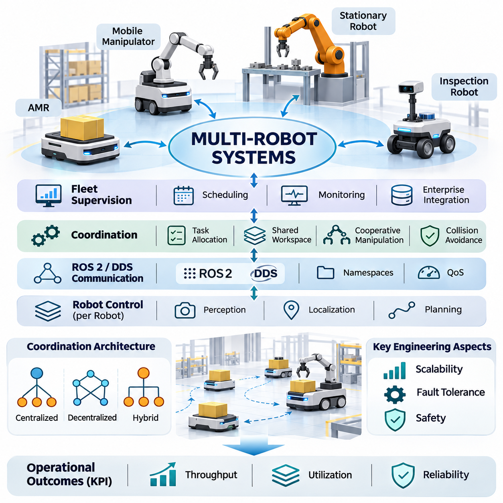
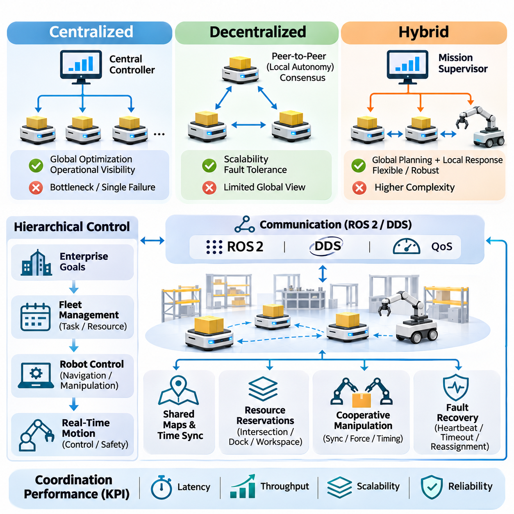
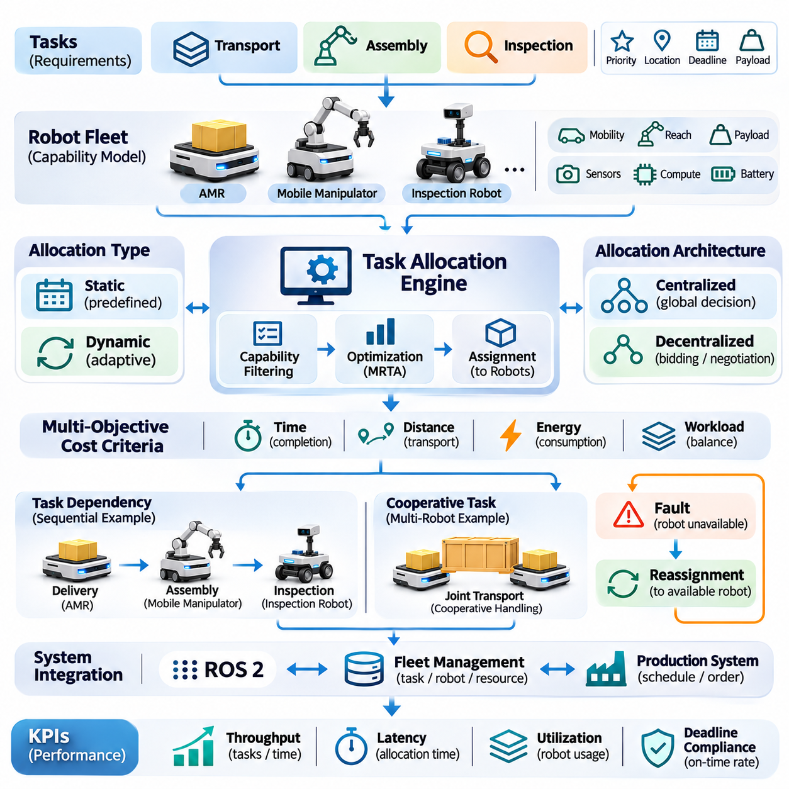
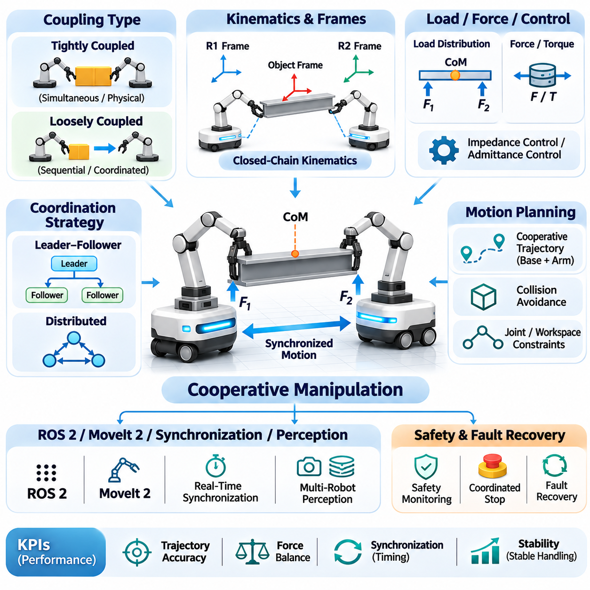
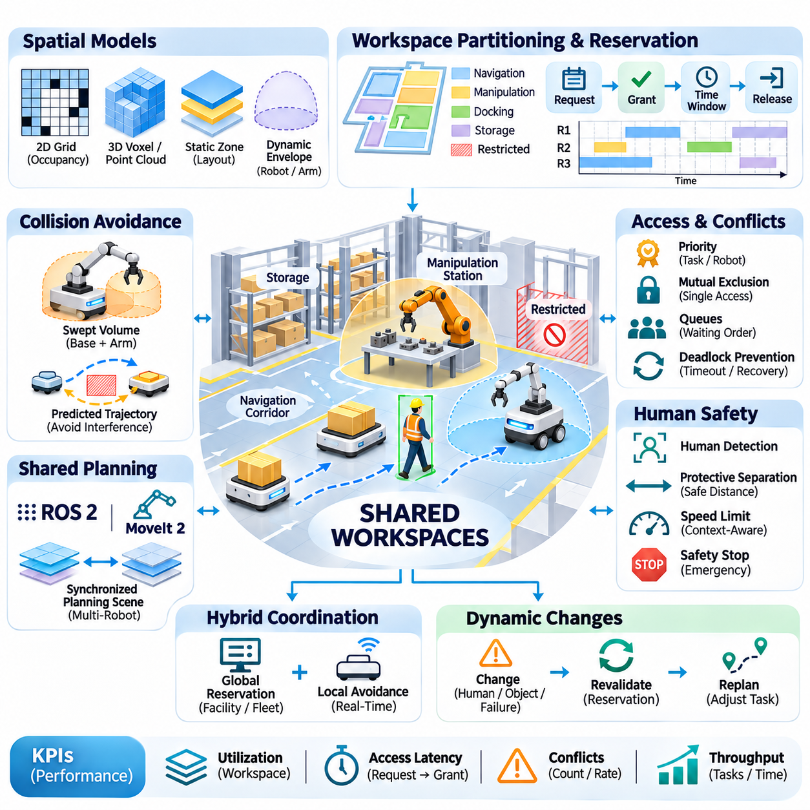
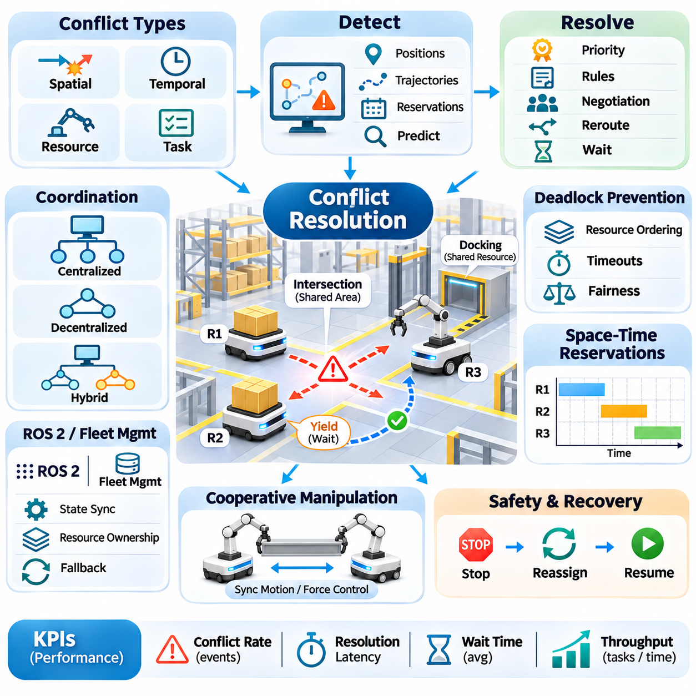
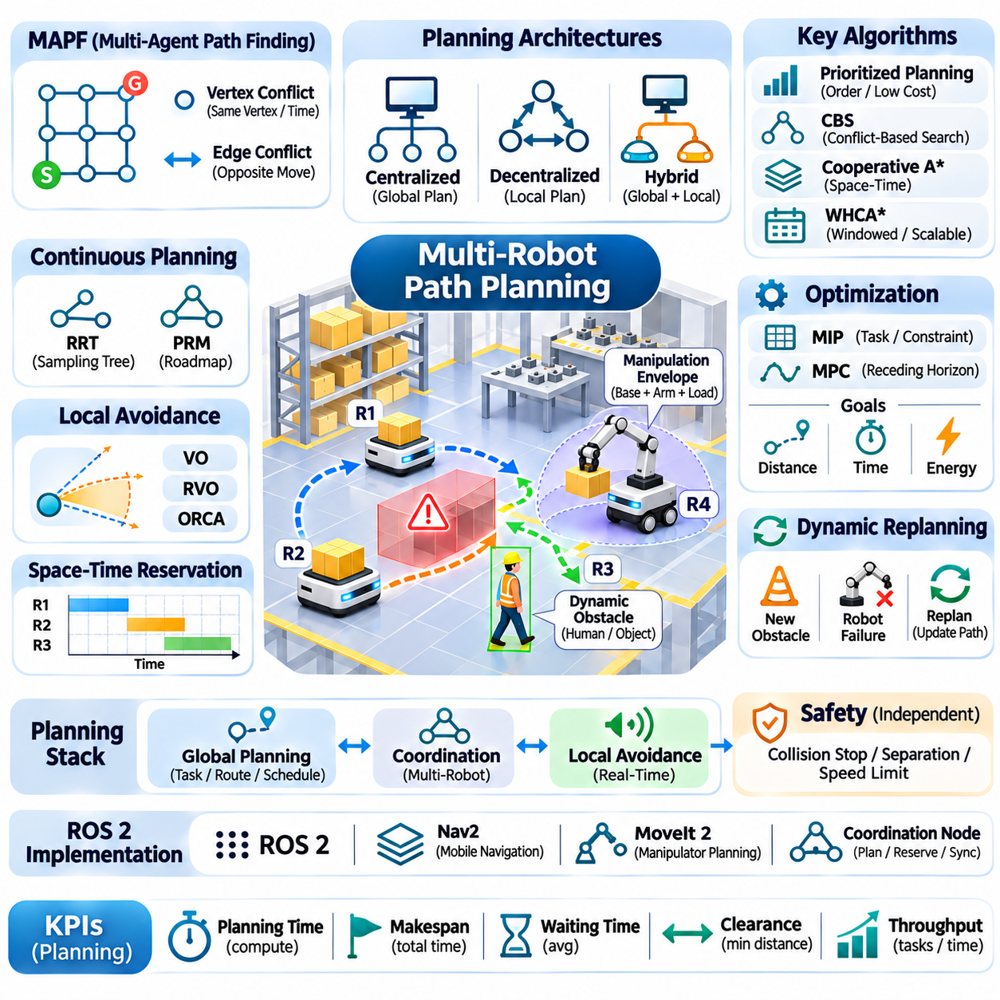
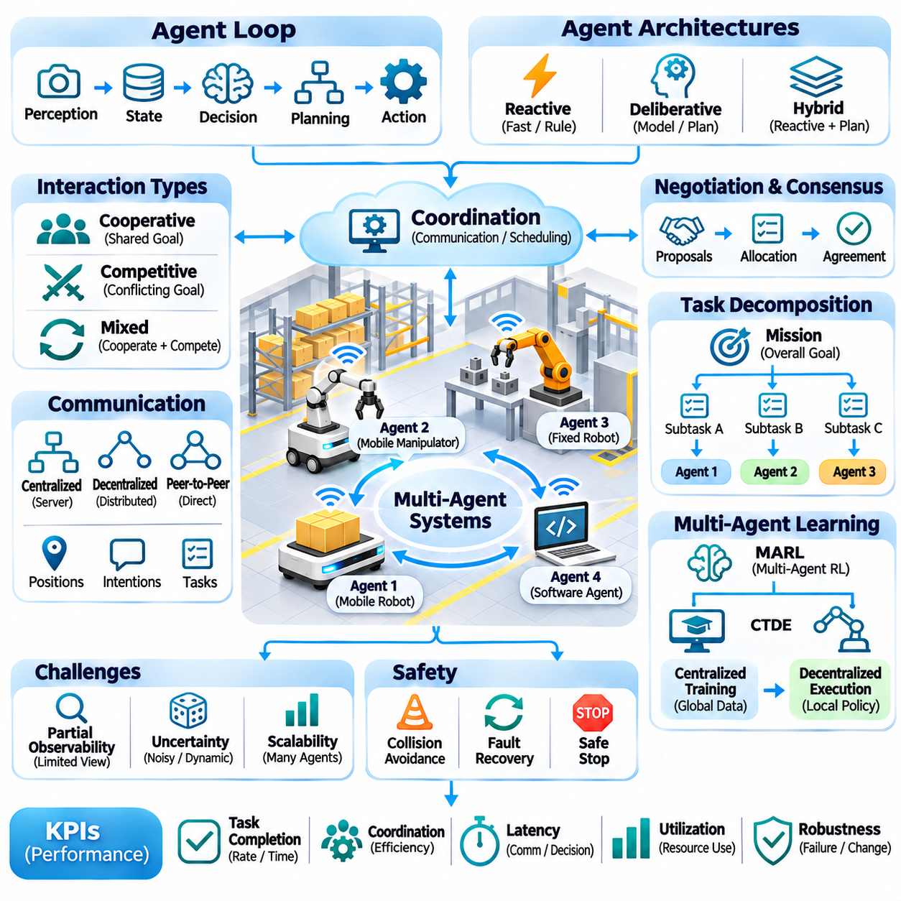
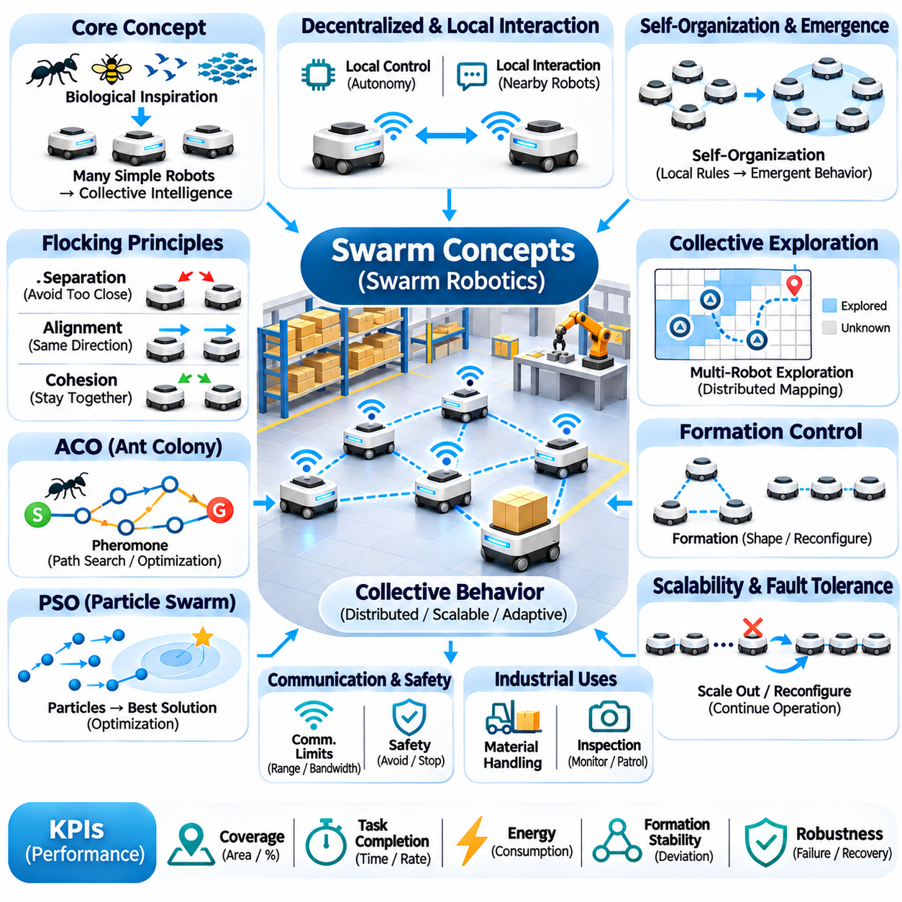
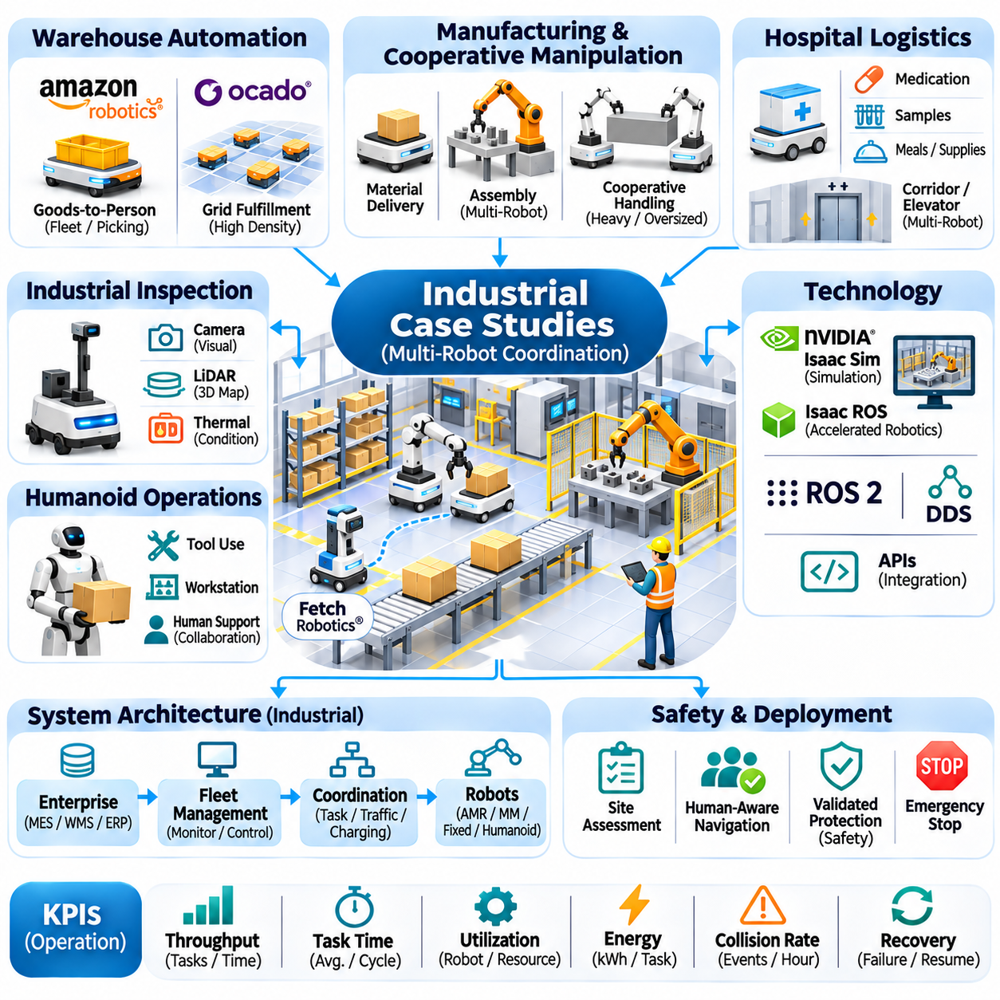

**Volume 04. Mobile Manipulation Software and Operations**

# Chapter 06. Multi Robot Coordination

## 01 Multi Robot Systems

{width="7.268055555555556in" height="7.268055555555556in"}

Multi-robot systems (MRS) consist of multiple autonomous or semi-autonomous robots that operate within a common environment to accomplish individual or collective objectives. Unlike standalone robotic systems, multi-robot systems distribute operational responsibilities across several robotic platforms, enabling parallel task execution, resource sharing, cooperative decision-making, and improved operational flexibility in complex industrial environments.

In mobile manipulation, multi-robot systems integrate autonomous mobile robots (AMRs), mobile manipulators, stationary robotic arms, and other automated equipment into a unified operational ecosystem. Each robot may possess different mobility characteristics, manipulation capabilities, sensing configurations, and computational resources. These heterogeneous capabilities allow the overall system to execute complex workflows that exceed the capabilities of individual robots.

Multi-robot systems can be classified into homogeneous and heterogeneous configurations. Homogeneous systems consist of robots with similar hardware, software, and operational capabilities, simplifying deployment, maintenance, and task allocation. Heterogeneous systems combine specialized robotic platforms with complementary capabilities, providing greater flexibility for complex industrial processes involving transportation, manipulation, inspection, and assembly.

The fundamental principle of multi-robot systems is the distribution of intelligence, perception, and execution across multiple robotic entities. Each robot maintains a certain degree of autonomy while participating in system-level coordination. Individual robots perform localization, perception, motion planning, and control, whereas collective intelligence emerges through information exchange, resource allocation, and coordinated task execution.

The software architecture of a multi-robot system typically consists of individual robot control layers, communication infrastructure, coordination mechanisms, and supervisory management services. Local control layers handle robot-specific operations, while coordination layers manage interactions among robots. Supervisory systems connect robotic operations with enterprise-level applications, production schedules, and broader business objectives.

ROS 2 provides a distributed middleware foundation for developing multi-robot systems through its node-based architecture and Data Distribution Service (DDS). Individual robots can operate independent ROS 2 networks or participate in a shared communication environment. Robot namespaces, unique identifiers, coordinate frame management, and Quality of Service (QoS) policies enable structured communication while reducing interference between robotic platforms.

Communication is essential for maintaining operational awareness across multiple robots. Robots exchange information regarding their current positions, velocities, task status, battery conditions, planned trajectories, and environmental observations. Communication architectures must consider network latency, bandwidth limitations, packet loss, and temporary disconnections to maintain reliable coordination in dynamic industrial environments.

Multi-robot systems may employ centralized, decentralized, or hybrid coordination architectures. Centralized architectures use a supervisory controller to manage global decisions, while decentralized architectures distribute decision-making among individual robots. Hybrid architectures combine global supervision with local autonomy, balancing system-wide optimization, operational responsiveness, scalability, and resilience against communication failures.

Task allocation determines how operational responsibilities are distributed among available robots. Allocation mechanisms evaluate robot capabilities, task requirements, spatial distances, energy consumption, workload, and execution priorities. Dynamic task allocation enables the system to respond to changing conditions, including equipment failures, unexpected production demands, temporary obstacles, and variations in robot availability.

Cooperative manipulation extends multi-robot coordination beyond independent task execution by enabling multiple robots to physically interact with a common object. Robots may jointly transport large components, stabilize workpieces, or perform coordinated assembly operations. Such activities require synchronized motion, consistent reference frames, force distribution, and precise control to prevent excessive mechanical stress and unintended object movement.

Shared workspace management becomes increasingly important as multiple mobile manipulators operate within overlapping physical environments. Robots must account for both mobile base trajectories and the spatial movement of articulated manipulators. Workspace reservations, dynamic collision avoidance, motion synchronization, and access control mechanisms help prevent interference while maintaining efficient utilization of industrial facilities.

Scalability is a primary engineering objective in multi-robot systems. Increasing the number of robots can improve operational capacity, but it also introduces additional communication traffic, computational complexity, resource contention, and collision risks. Scalable architectures employ modular software components, distributed processing, hierarchical coordination, and efficient information exchange to maintain acceptable performance as robotic fleets expand.

Fault tolerance and safety are closely related to the operational reliability of multi-robot systems. Individual robot failures should not unnecessarily interrupt the entire fleet. Task reassignment, health monitoring, controlled recovery, and local protective functions support continued operation where safe and feasible. System-level coordination must complement independently validated safety functions rather than replace them.

Performance evaluation considers both individual robot capabilities and collective system efficiency. Important metrics include fleet throughput, task completion rate, resource utilization, coordination latency, energy consumption, and recovery time. Ultimately, multi-robot systems provide the technological foundation for intelligent factories, automated warehouses, hospital logistics, and increasingly autonomous industrial ecosystems.

The attached materials provide the chapter structure rather than detailed technical manuscripts. Accordingly, this explanation follows that structure and expands its introductory concepts using general robotics engineering principles, leaving detailed coordination algorithms and industrial case studies for subsequent sections.

## 02 Coordination Architectures

{width="7.268055555555556in" height="7.268055555555556in"}

Coordination architectures define how multiple robots exchange information, distribute responsibilities, make decisions, and synchronize their activities within a shared operational environment. In mobile manipulation systems, these architectures establish the organizational foundation for integrating autonomous navigation, manipulation, task execution, resource management, and collective decision-making across multiple robotic platforms.

A centralized coordination architecture utilizes a central controller or supervisory server to manage the activities of multiple robots. The central system collects operational information from individual robots, maintains a global representation of the environment, and determines appropriate task assignments, execution priorities, and movement schedules. Individual robots execute assigned commands while maintaining local control capabilities.

Centralized architectures provide advantages in global optimization, operational visibility, and predictable decision-making. Since the central controller receives information from multiple robotic platforms, it can evaluate system-wide conditions and optimize resource utilization accordingly. This approach is particularly suitable for structured industrial environments with reliable communication infrastructure and clearly defined operational workflows.

However, centralized coordination introduces potential limitations related to computational bottlenecks, communication dependency, and single points of failure. As the number of robots increases, the central controller must process larger quantities of operational information and resolve increasingly complex interactions. Redundant servers, distributed computational resources, and local fallback mechanisms can reduce these architectural risks.

A decentralized coordination architecture distributes decision-making responsibilities among individual robots rather than relying on a single supervisory controller. Each robot evaluates local environmental conditions, operational objectives, and information received from neighboring robots. Collective behavior develops through distributed negotiation, information exchange, and predefined interaction protocols that regulate robot cooperation.

Decentralized architectures offer advantages in scalability, adaptability, and fault tolerance. Individual robots can maintain certain operational capabilities even when communication with other robots becomes unavailable. However, limited global awareness may result in suboptimal resource allocation or conflicting decisions. Distributed consensus mechanisms and conflict resolution protocols help address these limitations while preserving local autonomy.

Hybrid coordination architectures combine centralized supervision with decentralized decision-making to balance global optimization and local operational responsiveness. A central management system establishes mission objectives, production priorities, and resource allocation policies, while individual robots independently manage navigation, manipulation, obstacle avoidance, and local recovery within predefined operational constraints.

Hierarchical coordination organizes decision-making into multiple functional layers. Enterprise systems establish business objectives, fleet management systems coordinate mission execution, robot-level controllers manage task sequences, and real-time controllers execute physical movements. This separation of responsibilities allows different operational decisions to be processed at appropriate computational frequencies and levels of abstraction.

Communication architecture influences the effectiveness of every coordination strategy. ROS 2 and Data Distribution Service (DDS) support distributed communication through publish-subscribe mechanisms, services, and actions. Quality of Service (QoS) policies, robot namespaces, unique identifiers, message timestamps, and network segmentation help maintain reliable information exchange while controlling communication overhead across robotic platforms.

Shared environmental representations provide another essential foundation for coordination. Individual robots may maintain local maps and planning scenes while exchanging relevant spatial and operational information with other robots or supervisory systems. Consistent coordinate transformations, synchronized timestamps, object identifiers, and workspace definitions enable multiple robots to interpret shared environmental conditions accurately.

Coordination architectures must explicitly define decision-making authority and ownership of shared resources. Intersections, docking stations, elevators, assembly stations, and manipulation workspaces may require exclusive or synchronized access. Resource reservations, execution permissions, and controlled release mechanisms prevent conflicting operations and reduce the probability of deadlocks, collisions, and unnecessary waiting.

Time-sensitive coordination becomes particularly important when multiple mobile manipulators cooperate on a common physical task. Supervisory communication may be sufficient for mission scheduling, but synchronized manipulation requires more predictable timing and feedback. Dedicated communication channels and local real-time control loops can support coordinated trajectories, force regulation, and stable physical interactions between robots.

Fault management must be incorporated directly into the coordination architecture. Communication interruptions, localization errors, actuator failures, and inconsistent environmental information can disrupt collective operations. Heartbeat monitoring, execution timeouts, state reconciliation, task reassignment, and predefined degraded operating modes allow the system to respond systematically without compromising independently validated safety functions.

The selection of a coordination architecture depends on fleet size, robot heterogeneity, operational complexity, network reliability, computational resources, and safety requirements. Centralized architectures are often appropriate for predictable workflows, whereas decentralized approaches support greater operational independence. Hybrid and hierarchical architectures are particularly attractive for industrial systems requiring both global supervision and autonomous local execution.

Architectural performance should be evaluated through measurable indicators such as coordination latency, communication overhead, task throughput, resource utilization, failure recovery time, and scalability. Effective coordination architectures provide the structural foundation for task allocation, cooperative manipulation, shared workspace management, conflict resolution, multi-robot path planning, multi-agent systems, and swarm-based robotic operations.

The attached materials establish the organizational scope of this section rather than prescribing a specific technical architecture. Accordingly, the explanation expands the chapter structure using general robotics engineering principles without assuming a particular commercial platform or implementation. Detailed coordination algorithms and application-specific mechanisms are addressed in subsequent sections.

## 03 Task Allocation

{width="7.268055555555556in" height="7.268055555555556in"}

Task allocation is a fundamental component of multi-robot coordination that determines how operational responsibilities are distributed among available robotic platforms. In mobile manipulation systems, task allocation ensures that transportation, object handling, inspection, assembly, and material delivery operations are assigned to suitable robots while satisfying operational objectives, resource limitations, and environmental constraints.

Multi-robot task allocation (MRTA) differs from conventional task scheduling because robotic platforms possess physical capabilities, spatial dependencies, energy limitations, and varying degrees of autonomy. An assigned task must be evaluated not only according to its completion requirements but also according to the robot\'s current position, manipulation capabilities, payload capacity, available tools, and operational readiness.

Task representation establishes the informational foundation for effective allocation. Each task may be described using a unique identifier, required capabilities, target location, estimated execution duration, priority, deadline, and resource dependencies. More complex manipulation tasks may include object properties, grasping requirements, positioning tolerances, environmental conditions, and dependencies on preceding or subsequent operations.

Robot capability modeling enables the allocation system to determine whether a particular robot is suitable for an assigned operation. A capability model may describe mobility characteristics, manipulator reach, payload capacity, end-effector configuration, sensor availability, computational resources, and positioning accuracy. Capability-based filtering eliminates incompatible robot candidates before evaluating their operational efficiency.

Static task allocation assigns tasks according to predefined operational rules or schedules established before execution. This approach is suitable for repetitive industrial workflows with predictable production requirements and relatively stable environmental conditions. Although static allocation reduces computational complexity and simplifies system implementation, it provides limited adaptability when equipment failures, unexpected obstacles, or production changes occur.

Dynamic task allocation continuously evaluates operational conditions and adjusts assignments according to current system states. Robots may receive new responsibilities based on changing priorities, task completion events, battery conditions, or unexpected operational interruptions. Dynamic allocation improves fleet adaptability and resource utilization but requires reliable state monitoring, communication, and decision-making mechanisms.

Centralized task allocation uses a supervisory controller or fleet management system to evaluate available robots and determine appropriate assignments. The allocation algorithm maintains a global representation of pending tasks, resource availability, and robot operating conditions. Optimization techniques can minimize total execution time, transportation distance, energy consumption, or operational costs while satisfying predefined constraints.

Decentralized task allocation distributes assignment decisions among individual robots through negotiation, bidding, or distributed consensus mechanisms. Market-based approaches allow robots to calculate bids according to their estimated execution costs and operational capabilities. Tasks are assigned according to established selection criteria, reducing dependence on a central controller while supporting flexible participation in changing environments.

Mathematical optimization provides a systematic foundation for solving task allocation problems. The Hungarian algorithm supports classical one-to-one assignment, while mixed-integer linear programming accommodates more complex constraints and scheduling requirements. Heuristic algorithms, genetic algorithms, and metaheuristic optimization can provide practical solutions when large problem sizes make exact optimization computationally expensive.

Multi-objective task allocation considers several operational criteria simultaneously rather than minimizing a single performance metric. Relevant objectives include mission completion time, energy efficiency, workload balance, transportation distance, and resource utilization. Weighted cost functions or Pareto-based optimization methods can represent trade-offs among competing objectives according to industrial production requirements.

Task dependencies introduce additional complexity when multiple robots participate in sequential or cooperative operations. For example, an AMR may deliver a component before a mobile manipulator performs assembly, while an inspection robot subsequently verifies the completed operation. Dependency graphs, precedence constraints, and synchronized execution conditions help maintain correct operational sequences across the robotic fleet.

Cooperative task allocation assigns multiple robots to operations that cannot be completed by a single robotic platform. Joint transportation, cooperative assembly, and shared object manipulation require complementary capabilities and synchronized availability. Allocation mechanisms must evaluate suitable robot combinations, communication requirements, workspace compatibility, and physical interaction constraints before initiating execution.

Failure-aware task allocation enables robotic fleets to respond to unexpected equipment failures, communication interruptions, and incomplete operations. When a robot becomes unavailable, the coordination system evaluates the remaining task state and determines whether reassignment is feasible. Checkpoint management, resource release, and safe recovery procedures help prevent duplicated execution and inconsistent physical operations.

Practical implementation can integrate task allocation with ROS 2, fleet management services, behavior trees, and enterprise manufacturing systems. Task requests are transmitted through standardized interfaces, while robot state information supports assignment decisions and execution monitoring. The coordination layer should maintain consistent task ownership and status reporting without interfering with local motion control or validated safety functions.

Task allocation performance is evaluated through task completion rate, assignment latency, fleet throughput, workload distribution, energy consumption, deadline compliance, and reassignment efficiency. Effective allocation balances individual robot capabilities with collective operational objectives, providing an essential foundation for scalable multi-robot coordination in automated warehouses, intelligent factories, and industrial mobile manipulation.

The attached materials define the chapter structure rather than specific allocation algorithms or implementation requirements. Accordingly, this section expands the designated topic using general multi-robot engineering principles, without assuming a particular commercial platform, optimization framework, or industrial deployment configuration.

## 04 Cooperative Manipulation

{width="7.268055555555556in" height="7.268055555555556in"}

Cooperative manipulation refers to the coordinated interaction of multiple robotic platforms to manipulate, transport, position, or assemble physical objects within a shared environment. Unlike independent manipulation, cooperative manipulation requires multiple robots to synchronize their movements, distribute mechanical loads, exchange operational information, and maintain consistent physical relationships throughout task execution.

In mobile manipulation systems, cooperative manipulation combines the mobility of autonomous mobile platforms with the dexterity of robotic manipulators. Multiple mobile manipulators can jointly transport large industrial components, handle irregularly shaped objects, stabilize workpieces, or perform complex assembly operations. This approach extends operational capabilities beyond the physical limitations of individual robotic platforms.

Cooperative manipulation can involve tightly coupled or loosely coupled robotic interactions. Tightly coupled manipulation occurs when multiple robots simultaneously maintain physical contact with a common object, creating mechanical dependencies between their movements. Loosely coupled manipulation involves coordinated operations without continuous physical coupling, such as sequential object handling, component transfer, and collaborative assembly.

The kinematic foundation of cooperative manipulation requires consistent geometric relationships among participating robots, end effectors, and manipulated objects. Each robot maintains its own coordinate frames while referencing a common object-centered or global coordinate system. Forward kinematics, inverse kinematics, and coordinate transformations enable the calculation of compatible robot configurations and coordinated end-effector trajectories.

Closed-chain kinematics arise when multiple manipulators establish simultaneous rigid contact with a shared object. The resulting mechanical structure imposes additional geometric constraints on individual robot movements. Inconsistent trajectories may generate excessive internal forces, mechanical deformation, or unstable interactions. Constraint-based motion planning helps maintain compatible configurations throughout cooperative operations.

Load distribution is a critical consideration when multiple robots jointly manipulate heavy or oversized objects. The total mechanical load must be distributed according to individual manipulator capabilities, grasp locations, object geometry, and center-of-mass characteristics. Uneven load distribution may cause actuator overload, reduced positioning accuracy, grasp instability, or excessive mechanical stress within the robotic system.

Force and torque control enable participating robots to regulate physical interactions during cooperative manipulation. Force-torque sensors, joint torque feedback, and estimated contact forces provide information about external loads and internal mechanical interactions. Impedance control and admittance control can introduce controlled compliance, allowing robots to accommodate small positioning errors while maintaining stable object handling.

Leader-follower control represents a common coordination strategy in cooperative manipulation. A designated leader determines the desired object trajectory, while follower robots adjust their movements according to shared motion references and measured interaction forces. Alternative distributed control strategies allow participating robots to contribute to collective motion decisions without depending exclusively on a designated leader.

Cooperative motion planning must consider the combined configuration space of participating mobile bases, robotic arms, and manipulated objects. The planner evaluates joint limits, collision constraints, grasp stability, workspace boundaries, and object motion requirements. Coordinated trajectories must remain physically feasible for every participating robot while satisfying the desired movement of the shared object.

Mobile base coordination introduces additional complexity because manipulator reference frames change as robotic platforms move. Localization errors, wheel slippage, uneven surfaces, and variations in platform dynamics can affect cooperative positioning accuracy. Whole-body coordination integrates mobile base movement with manipulator joint motion to maintain compatible configurations and stable object trajectories during transportation.

Communication and synchronization are essential for maintaining consistent cooperative behavior. Participating robots exchange motion references, estimated object poses, force measurements, execution states, and fault information. Communication delays, clock synchronization errors, and packet loss can degrade coordination performance, particularly when robots establish rigid physical connections through a common manipulated object.

ROS 2 can provide the distributed communication infrastructure for cooperative manipulation by connecting robot-specific control systems, shared planning services, and coordination nodes. MoveIt 2 can support multi-arm modeling, collision checking, and coordinated planning when appropriately configured. Dedicated real-time controllers and communication mechanisms may be required for tightly synchronized physical interaction.

Perception systems support cooperative manipulation by estimating object geometry, grasp locations, relative robot poses, and surrounding obstacles. Cameras, depth sensors, LiDAR, and force-torque sensors provide complementary environmental and interaction information. Multi-robot sensor fusion can improve operational awareness when individual robots experience occlusions or limited visibility during object transportation and assembly.

Safety and fault recovery mechanisms must account for the physical dependencies between cooperating robots. Unexpected actuator failures, communication interruptions, grasp losses, or emergency stops may destabilize a shared object. Coordinated stopping procedures, load retention mechanisms, fault detection, and independently validated safety functions are necessary to reduce risks during abnormal operating conditions.

Performance evaluation considers object trajectory accuracy, synchronization error, load distribution uniformity, internal force magnitude, grasp stability, task completion time, and energy consumption. Effective cooperative manipulation expands the application potential of mobile robotic systems in large-component assembly, industrial material handling, manufacturing automation, and intelligent production environments.

The attached materials define the chapter structure rather than specific cooperative manipulation algorithms or implementation requirements. Accordingly, this section expands the designated topic using general robotics engineering principles without assuming a particular commercial platform, mechanical configuration, control framework, or industrial deployment scenario.

## 05 Shared Workspaces

{width="7.268055555555556in" height="7.268055555555556in"}

Shared workspaces are physical or operational environments in which multiple robots, automated systems, and human operators perform activities within overlapping spatial boundaries. In mobile manipulation systems, shared workspace management establishes the mechanisms required to coordinate navigation, manipulation, resource access, and physical interactions while maintaining operational efficiency and safety.

Unlike conventional industrial robots operating within fixed and isolated workcells, mobile manipulators continuously change their positions, orientations, and manipulation ranges. Consequently, their operational workspaces vary according to mobile base movement, manipulator configuration, and task requirements. This dynamic behavior requires workspace management mechanisms that continuously evaluate spatial occupancy and potential interference.

Workspace representation provides the geometric foundation for coordinating multiple robots within shared environments. Two-dimensional occupancy grids can represent navigable areas, while three-dimensional voxel maps, point clouds, and geometric models describe manipulation spaces. Integrated spatial representations enable coordination systems to evaluate robot footprints, manipulator reach, object dimensions, and environmental obstacles.

Static workspaces define predetermined operational boundaries based on facility layouts, equipment locations, and designated robot activity zones. Dynamic workspaces change according to robot configurations, planned trajectories, manipulated objects, and environmental conditions. Combining static and dynamic workspace representations enables robotic systems to maintain spatial awareness while adapting to changing operational requirements.

Workspace partitioning divides industrial environments into operational zones with different access permissions and functional responsibilities. Navigation corridors, manipulation stations, docking areas, storage locations, and restricted regions can be represented as individually managed zones. Such partitioning reduces coordination complexity by establishing explicit spatial boundaries and access conditions for different robotic activities.

Workspace reservation mechanisms temporarily allocate specific spatial regions to individual robots or coordinated robot groups. A robot requests access before entering a shared area or initiating a manipulation operation, and the coordination system evaluates whether the requested region is available. Reservations may include spatial boundaries, expected occupancy duration, execution priority, and controlled release conditions.

Spatiotemporal workspace management extends conventional spatial allocation by incorporating time into resource reservation and collision avoidance decisions. Multiple robots may access the same physical region at different times without creating operational conflicts. Time-dependent occupancy models and trajectory predictions enable coordination systems to schedule workspace access while reducing unnecessary waiting and movement restrictions.

Dynamic collision avoidance requires robots to evaluate potential interference involving mobile bases, articulated manipulators, end effectors, and carried objects. Collision checking should consider the complete geometric representation of participating robots rather than relying exclusively on mobile base footprints. Swept volume analysis and predictive trajectory evaluation help identify potential conflicts before physical contact occurs.

Shared planning scenes enable multiple robotic platforms to maintain consistent representations of relevant environmental conditions. ROS 2 supports the exchange of robot states, coordinate transformations, and environmental observations, while MoveIt 2 provides planning scene management and collision checking capabilities. Additional synchronization mechanisms are necessary to maintain consistency across distributed planning systems.

Human-robot shared workspaces introduce additional operational and safety requirements because human movements are generally less predictable than programmed robotic trajectories. Human detection, protective separation monitoring, speed limitation, and safety-rated stopping functions may be required according to risk assessments. Operational coordination software must remain separate from independently validated protective functions where required.

Resource contention occurs when multiple robots simultaneously require access to the same physical location, equipment, or manipulation station. Priority-based access control, mutual exclusion mechanisms, and reservation queues help regulate competing requests. Workspace management must also prevent deadlocks and starvation by establishing resource acquisition rules, appropriate timeouts, and controlled recovery procedures.

Distributed workspace management enables individual robots to maintain local environmental representations and exchange relevant occupancy information with neighboring robots. Centralized management provides broader visibility of facility conditions, whereas distributed approaches improve local responsiveness. Hybrid architectures combine global workspace reservations with local collision avoidance and autonomous execution within permitted regions.

Unexpected environmental changes may invalidate existing workspace reservations or planned trajectories. Human entry, displaced objects, equipment failures, and localization errors can alter previously available operational regions. Continuous monitoring, reservation revalidation, dynamic replanning, and controlled suspension of affected tasks allow robotic systems to adapt without assuming that previously approved movements remain safe.

Shared workspace performance depends on spatial utilization, robot density, access latency, reservation conflicts, collision avoidance interventions, and task throughput. Excessively conservative spatial restrictions reduce operational productivity, while insufficient coordination increases interference and safety risks. Effective workspace management balances operational efficiency with physical constraints and validated safety requirements.

Industrial applications of shared workspace management include automated warehouses, flexible manufacturing cells, cooperative assembly stations, hospital logistics, and material handling environments. Multiple mobile manipulators can operate within common facilities when spatial access, manipulation envelopes, resource dependencies, and execution priorities are coordinated through consistent architectural and operational mechanisms.

The attached materials establish the chapter structure rather than detailed workspace management specifications. Accordingly, this section expands the designated topic using general robotics engineering principles without assuming a particular facility layout, commercial platform, or implementation framework. Detailed conflict resolution and multi-robot path planning mechanisms are addressed in subsequent sections.

## 06 Conflict Resolution

{width="7.268055555555556in" height="7.268055555555556in"}

Conflict resolution is a fundamental component of multi-robot coordination that addresses competing operational requirements, overlapping trajectories, shared resource demands, and incompatible robot decisions. In mobile manipulation systems, conflict resolution mechanisms enable multiple robots to operate within common environments while maintaining task continuity, operational efficiency, and acceptable levels of safety.

Conflicts in multi-robot systems can arise from spatial, temporal, resource-related, and task-dependent interactions. Spatial conflicts occur when robots attempt to occupy overlapping physical regions, while temporal conflicts involve incompatible execution schedules. Resource conflicts emerge when multiple robots require simultaneous access to shared equipment, and task conflicts result from inconsistent operational objectives or dependencies.

Conflict detection establishes the foundation for effective resolution by identifying incompatible robot activities before they develop into operational failures. Coordination systems continuously monitor robot positions, planned trajectories, workspace reservations, resource availability, and execution states. Predictive detection mechanisms can identify potential interference by evaluating anticipated robot movements and future resource demands.

Priority-based conflict resolution assigns different levels of operational importance to competing robots or tasks. Priorities may depend on production deadlines, mission urgency, task dependencies, battery conditions, and operational requirements. Higher-priority robots may receive preferential access to shared resources, while lower-priority robots temporarily wait, modify their trajectories, or select alternative execution strategies.

Rule-based conflict resolution employs predefined operational policies to regulate interactions among robots. Traffic rules, intersection access policies, workspace permissions, and resource acquisition sequences provide deterministic mechanisms for resolving common conflicts. Although rule-based approaches simplify implementation and improve predictability, complex or unexpected operating conditions may require additional adaptive decision-making capabilities.

Negotiation-based conflict resolution enables robots to exchange alternative execution proposals and establish mutually acceptable operational decisions. Participating robots may communicate estimated arrival times, task priorities, resource requirements, and alternative trajectories. Distributed negotiation can reduce dependence on centralized controllers while allowing robotic systems to adapt to changing environmental and operational conditions.

Deadlock occurs when multiple robots remain indefinitely blocked because each robot requires a resource currently controlled by another robot. In industrial environments, deadlocks may develop within narrow corridors, shared intersections, docking stations, or manipulation workspaces. Resource ordering, dependency analysis, wait-for graphs, and controlled resource release mechanisms help prevent or resolve circular waiting conditions.

Livelock and starvation represent additional challenges in multi-robot conflict resolution. Livelock occurs when robots continuously modify their behavior without achieving meaningful operational progress, whereas starvation occurs when certain robots repeatedly fail to obtain required resources. Execution timeouts, priority aging, fairness policies, and coordinated recovery mechanisms help maintain progress across the robotic fleet.

Trajectory-based conflict resolution evaluates predicted robot movements and modifies planned trajectories when potential interference is detected. Robots may adjust their movement speeds, introduce temporary waiting periods, or calculate alternative routes. For mobile manipulators, trajectory evaluation must account for mobile base footprints, articulated arm movements, end-effector positions, and the geometric dimensions of transported objects.

Space-time reservation mechanisms resolve conflicts by allocating shared operational regions during specified time intervals. Robots request reservations for navigation corridors, intersections, docking locations, and manipulation workspaces before initiating relevant operations. Reservation management must account for execution delays, localization uncertainty, and unexpected environmental changes that may invalidate previously approved schedules.

Cooperative manipulation requires specialized conflict resolution mechanisms because multiple robots may be physically connected through a shared object. Incompatible motion commands can generate excessive internal forces, mechanical stress, or object instability. Coordinated trajectory modification, force regulation, constraint-based control, and synchronized stopping procedures help resolve physical conflicts without disrupting object stability.

Centralized conflict resolution uses a supervisory controller to evaluate interactions across the robotic fleet and determine appropriate corrective actions. Decentralized approaches distribute conflict detection and resolution among individual robots. Hybrid architectures combine system-wide coordination with local autonomous responses, balancing global operational optimization with rapid reactions to unexpected environmental disturbances.

Communication reliability influences the effectiveness of conflict resolution mechanisms. Robots must exchange sufficiently current information regarding their positions, intentions, resource ownership, and execution states. Communication delays, inconsistent timestamps, and outdated reservations can create conflicting decisions. State synchronization, message validation, and predefined fallback behaviors help reduce these coordination risks.

ROS 2 can support conflict resolution through distributed state exchange, coordination nodes, action interfaces, and event-driven communication. Fleet management services can manage shared resource reservations, while local navigation and manipulation systems respond to immediate environmental changes. Coordination software must complement independently validated safety functions rather than assume responsibility for safety-critical protection without appropriate validation.

Conflict resolution performance can be evaluated through conflict frequency, resolution latency, deadlock recovery time, waiting duration, resource utilization, and fleet throughput. Effective mechanisms minimize unnecessary operational interruptions while maintaining predictable behavior and physical safety. These capabilities support scalable multi-robot operations in automated warehouses, flexible manufacturing facilities, and intelligent industrial environments.

The attached materials define the chapter structure rather than specific conflict resolution algorithms or implementation requirements. Accordingly, this section expands the designated topic using general multi-robot engineering principles without assuming a particular commercial platform or deployment configuration. Detailed multi-robot path planning algorithms and multi-agent coordination strategies are addressed in subsequent sections.

## 07 Multi Robot Path Planning

{width="7.268055555555556in" height="7.268055555555556in"}

Multi-robot path planning is the process of determining coordinated movement paths for multiple robots operating within a common environment. Unlike single-robot path planning, which primarily considers individual robot objectives and environmental obstacles, multi-robot path planning must address interactions among robots, shared spatial resources, temporal constraints, and potential trajectory conflicts throughout mission execution.

In mobile manipulation systems, path planning must consider both mobile base navigation and manipulator motion. The operational geometry of a mobile manipulator changes according to arm configuration, end-effector position, and transported objects. Consequently, coordinated path planning requires integrated representations of robot footprints, manipulation envelopes, kinematic constraints, and dynamic environmental conditions.

Multi-Agent Path Finding (MAPF) provides a mathematical framework for generating collision-free paths for multiple agents traveling from designated initial positions to target destinations. Classical MAPF represents the environment as a graph consisting of vertices and edges. Agents move between connected vertices over discrete time steps while avoiding simultaneous occupancy of the same vertex and conflicting edge traversal.

Centralized path planning generates coordinated paths for multiple robots through a common planning system. A centralized planner evaluates robot states, environmental constraints, target destinations, and potential interactions collectively. Although this approach can achieve globally optimized solutions, computational complexity and communication requirements generally increase as the number of participating robots grows.

Decentralized path planning allows individual robots to calculate their own movement paths using local observations and information exchanged with neighboring robots. Each robot independently evaluates environmental obstacles and potential interactions. This approach improves scalability and local responsiveness, although limited global information may lead to suboptimal routing, congestion, or unresolved coordination conflicts.

Prioritized planning assigns an execution order to participating robots according to predefined or dynamically determined priorities. Higher-priority robots calculate their paths first, while lower-priority robots treat previously planned trajectories as time-dependent constraints. Prioritized planning offers relatively low computational complexity but may fail to identify feasible solutions when the selected priority order is unsuitable.

Conflict-Based Search (CBS) is a widely studied algorithm for solving multi-agent path finding problems. CBS uses a hierarchical search structure in which a high-level search identifies conflicts between individual robot paths and introduces corresponding constraints. A low-level search subsequently recalculates affected paths. Under classical MAPF assumptions, standard CBS can generate optimal solutions for a specified cost objective.

Cooperative A\\\* extends conventional A\\\* search by incorporating space-time reservations into the planning process. Each robot searches for a feasible path while considering spatial regions reserved by other robots during particular time intervals. Windowed Hierarchical Cooperative A\\\* (WHCA\\\*) limits the planning horizon to reduce computational requirements, making repeated planning more practical in dynamically changing environments.

Sampling-based motion planning approaches, including Rapidly-exploring Random Trees (RRT) and Probabilistic Roadmaps (PRM), can support multi-robot planning in continuous and high-dimensional configuration spaces. These methods are particularly relevant when articulated manipulators and complex robot geometries must be considered. Coordinated collision checking and trajectory synchronization remain essential for successful execution.

Velocity-based collision avoidance methods provide local coordination capabilities during online path execution. Velocity Obstacles (VO), Reciprocal Velocity Obstacles (RVO), and Optimal Reciprocal Collision Avoidance (ORCA) evaluate relative positions and velocities to determine suitable movement commands. Their effectiveness depends on motion assumptions, sensing accuracy, and the physical capabilities of participating robots.

Spatiotemporal planning integrates spatial path geometry with movement timing, velocity profiles, and resource occupancy schedules. Two robots may follow intersecting geometric paths without colliding when their traversal times are appropriately separated. Space-time constraints allow coordination systems to manage intersections, narrow corridors, docking stations, and shared manipulation areas more efficiently.

Optimization-based path planning formulates multi-robot coordination as a mathematical optimization problem involving objective functions and operational constraints. Common objectives include minimizing total travel distance, mission completion time, energy consumption, and congestion. Mixed-Integer Programming (MIP), Model Predictive Control (MPC), and trajectory optimization can support different levels of coordinated decision-making.

Dynamic replanning is necessary when unexpected obstacles, human movements, robot failures, or mission changes invalidate existing paths. Robots must continuously evaluate execution conditions and update affected trajectories without introducing additional conflicts. Incremental search, rolling-horizon planning, and event-driven replanning help maintain operational continuity while limiting unnecessary computational overhead.

ROS 2 provides communication infrastructure for exchanging robot states, environmental information, planned paths, and execution feedback. Nav2 supports individual mobile robot navigation, while MoveIt 2 supports manipulator motion planning and collision checking. Multi-robot path planning typically requires additional coordination components to manage shared reservations, synchronize trajectories, and resolve inter-robot conflicts.

Performance evaluation considers planning computation time, solution feasibility, total path cost, mission makespan, robot waiting time, minimum separation distance, and fleet throughput. The selection of planning algorithms depends on fleet size, environmental complexity, robot kinematics, communication reliability, and operational requirements. Independently validated safety functions remain necessary for physical deployment.

The attached materials define the chapter structure rather than specific multi-robot path planning algorithms or implementation requirements. Accordingly, this section expands the designated topic using general robotics engineering principles without assuming a particular commercial platform or deployment configuration. Multi-agent decision-making and swarm coordination are addressed in subsequent sections.

## 08 Multi Agent Systems

{width="7.268055555555556in" height="7.268055555555556in"}

Multi-agent systems provide a computational and organizational framework in which multiple autonomous agents interact, communicate, and cooperate to achieve individual or collective objectives. In robotics, an agent may represent a mobile robot, mobile manipulator, stationary robotic platform, or software-based decision-making entity. Each agent maintains its own operational state, objectives, and decision-making capabilities while participating in a larger coordinated system.

In multi-robot environments, agents perceive their surroundings, evaluate available information, select actions, and interact with other agents to accomplish assigned missions. An agent may independently perform navigation, object manipulation, inspection, or transportation while coordinating its activities with other robotic platforms. This distributed intelligence enables complex operational workflows that would be difficult to execute using a single autonomous system.

An autonomous agent typically consists of perception, internal state representation, decision-making, planning, and action execution components. Perception provides information about the environment, while the internal state represents the agent\'s current position, resources, objectives, and operational conditions. Decision-making evaluates available actions, and planning determines suitable action sequences before execution through the robot\'s control system.

Agent architectures can be classified into reactive, deliberative, and hybrid approaches. Reactive agents select actions according to current observations and predefined behavioral rules, enabling rapid responses to environmental changes. Deliberative agents maintain internal representations and evaluate future consequences before selecting actions. Hybrid agents combine reactive responses with higher-level planning to balance operational responsiveness and intelligent decision-making.

Multi-agent coordination requires mechanisms that regulate interactions among autonomous agents. Agents may exchange information, negotiate task assignments, coordinate movement, and resolve conflicting objectives. Coordination mechanisms establish shared operational rules and communication protocols that allow individual agents to maintain autonomy while contributing to collective system performance.

Communication is essential for maintaining cooperation among distributed agents. Agents exchange information about their positions, intentions, task progress, available resources, and environmental observations. Communication may follow centralized, decentralized, or peer-to-peer architectures depending on system requirements. Message reliability, communication latency, information consistency, and network availability directly influence coordination effectiveness.

Agent interaction can be cooperative, competitive, or mixed. Cooperative agents share objectives and coordinate their actions to maximize collective performance. Competitive agents independently pursue objectives that may conflict with those of other agents. Mixed interactions combine cooperation and competition, particularly when multiple robots share limited resources while performing different operational missions.

Negotiation provides a mechanism for agents to resolve differences and establish mutually acceptable decisions. Agents may exchange proposals, evaluate alternative assignments, and agree on resource allocation or execution schedules. Negotiation protocols can incorporate task priorities, estimated execution costs, resource availability, and operational constraints. These mechanisms support distributed decision-making without requiring every decision to pass through a central controller.

Distributed decision-making allows individual agents to select actions using local information while considering information received from other agents. Consensus algorithms can help agents establish agreement on shared estimates, operational states, or coordination decisions. Distributed consensus is particularly useful when multiple robots must maintain consistent environmental information or coordinate actions without continuous centralized supervision.

Multi-agent task execution involves dividing complex missions into smaller activities that can be performed independently or cooperatively. Agents may negotiate responsibilities, execute assigned subtasks, and report completion status to other participants. Hierarchical task decomposition and dependency management ensure that individual activities are executed in an appropriate sequence while preserving overall mission objectives.

Learning-based multi-agent systems extend conventional agent architectures through artificial intelligence and adaptive decision-making. Multi-Agent Reinforcement Learning (MARL) enables agents to learn policies through interaction with environments and other agents. Cooperative learning seeks to maximize shared rewards, while independent learning allows agents to optimize their individual objectives. Centralized training with decentralized execution (CTDE) is a common approach for combining global training information with autonomous operational behavior.

Multi-agent systems must address partial observability, uncertainty, and incomplete information. Individual robots may observe different portions of an environment or maintain inconsistent estimates of shared conditions. Sensor fusion, information sharing, state estimation, and uncertainty modeling help agents construct more reliable representations of their operating environment. Robust decision-making should account for situations in which information is delayed, missing, or inaccurate.

Scalability is an important consideration when designing multi-agent architectures. As the number of agents increases, communication traffic, coordination complexity, computational requirements, and interaction possibilities also increase. Hierarchical organization, distributed processing, selective communication, and modular agent interfaces help maintain manageable coordination overhead while supporting larger robotic populations.

Safety and reliability must be incorporated into multi-agent decision-making. Individual agents should respect operational boundaries, collision avoidance requirements, resource ownership rules, and validated safety constraints. Unexpected communication failures, inconsistent decisions, or agent malfunction should not create uncontrolled system behavior. Fault detection, recovery policies, controlled stopping, and independent protective mechanisms support reliable collective operation.

In mobile manipulation applications, multi-agent systems can coordinate transportation, inspection, object handling, and assembly activities across multiple robotic platforms. For example, an autonomous mobile robot may transport a component to a workstation, a mobile manipulator may perform the required assembly, and another robot may inspect the completed operation. Agent coordination enables these activities to form an integrated production workflow.

Performance evaluation considers task completion rate, coordination efficiency, communication overhead, decision-making latency, resource utilization, learning convergence, and system robustness. Effective multi-agent architectures balance individual autonomy with collective objectives, providing a foundation for intelligent factories, automated warehouses, cooperative mobile manipulation, and distributed robotic operations.

The attached volume structure identifies Multi-Agent Systems as a dedicated topic within Multi-Robot Coordination but does not prescribe specific agent architectures, algorithms, or implementation frameworks. Accordingly, this explanation develops the topic using general multi-agent systems and robotics engineering principles. Specific swarm intelligence mechanisms and industrial applications are treated as separate topics in the subsequent sections.

## 09 Swarm Concepts

{width="7.268055555555556in" height="7.268055555555556in"}

Swarm robotics is an approach to multi-robot coordination in which a large number of relatively simple autonomous robots cooperate to achieve collective objectives through local interactions and distributed behaviors. Inspired by biological systems such as ant colonies, bee swarms, bird flocks, and fish schools, swarm robotics emphasizes decentralized control, collective intelligence, adaptability, and scalability rather than relying on a single central controller.

The fundamental principle of swarm systems is that complex collective behavior can emerge from relatively simple individual rules. Each robot follows a limited set of behavioral policies based on local observations and information received from nearby robots. Through repeated interactions, individual decisions produce coordinated group behavior without requiring every robot to maintain a complete representation of the entire system.

Swarm intelligence describes the collective problem-solving capabilities that emerge through interactions among multiple autonomous agents. Unlike centralized optimization, swarm intelligence does not require a single entity to calculate every movement or decision. Instead, individual agents contribute local information and actions, allowing the overall system to respond to environmental changes and operational requirements.

Decentralization is a defining characteristic of swarm robotic systems. Each robot independently processes sensor information, evaluates nearby conditions, and selects actions according to predefined or learned behavioral rules. This architecture reduces dependence on centralized infrastructure and allows individual robots to continue operating when communication with a supervisory system becomes unavailable.

Local interaction provides the communication foundation for collective swarm behavior. Robots exchange information with nearby agents through direct wireless communication, environmental sensing, or indirect signals. The interaction range may be limited, but repeated local exchanges allow information to propagate throughout the swarm and support coordinated movement, resource discovery, and collective task execution.

Self-organization enables a swarm to establish coordinated structures and behaviors without explicit global instructions. Individual robots respond to neighboring agents and environmental conditions, producing organized patterns such as group movement, spatial distribution, formation maintenance, and cooperative exploration. These patterns emerge from repeated local interactions rather than predetermined global trajectories.

Emergent behavior is an important characteristic of swarm intelligence. A group of robots may collectively perform complex operations even when individual robots possess relatively limited capabilities. For example, simple obstacle avoidance and neighbor-distance regulation can generate coordinated group movement, while local resource discovery and information exchange can support distributed exploration of an unknown environment.

Three fundamental behavioral principles commonly associated with swarm robotics are separation, alignment, and cohesion. Separation prevents robots from approaching neighboring agents too closely, alignment encourages neighboring robots to maintain compatible movement directions, and cohesion keeps individual robots within the overall group. Combining these behaviors enables coordinated movement while maintaining distributed autonomy.

Ant Colony Optimization (ACO) provides a computational model inspired by the foraging behavior of ants. Artificial agents construct candidate solutions and update virtual pheromone information according to solution quality. Subsequent agents use this information to favor promising paths or decisions. ACO can support routing, task scheduling, resource allocation, and optimization problems involving multiple robotic agents.

Particle Swarm Optimization (PSO) is another swarm intelligence technique inspired by collective movement in biological populations. Individual particles explore a search space while updating their positions according to personal experience and information about successful neighboring solutions. PSO can be applied to robot trajectory optimization, parameter tuning, formation control, and distributed optimization problems.

Collective exploration enables multiple robots to investigate unknown or partially observed environments simultaneously. Individual robots explore different regions, share discovered information, and reduce unnecessary overlap in exploration activities. Distributed mapping and coordinated information exchange can improve environmental coverage and reduce the time required to identify relevant locations or objects.

Swarm formation control regulates the spatial relationships among robots during collective movement. Robots may maintain geometric formations, dynamically change group configurations, or distribute themselves across designated operational regions. Formation behavior is useful for cooperative transportation, environmental monitoring, area coverage, and coordinated inspection, particularly when centralized trajectory control is impractical.

Communication limitations are an important consideration in practical swarm systems. Large robot populations can generate substantial network traffic, while wireless interference, packet loss, and limited communication range may prevent reliable information exchange. Communication-efficient algorithms therefore emphasize local interaction, selective information sharing, distributed state estimation, and autonomous behavior during temporary network disconnections.

Scalability and fault tolerance are major advantages of swarm robotics. Adding more robots can increase collective coverage, parallel processing capacity, and operational throughput without requiring a complete redesign of the control architecture. Individual robot failures may have limited impact on overall mission execution when remaining agents can redistribute responsibilities and maintain collective behavior.

Safety and reliability must remain essential design considerations even when swarm behavior is decentralized. Local collision avoidance, operational boundaries, speed limitations, and emergency stopping mechanisms must be integrated into individual robot controllers. Collective intelligence does not automatically guarantee safe behavior, so swarm-level performance must be evaluated together with individual robot protection and system-level risk management.

In mobile manipulation applications, swarm concepts can support distributed material handling, cooperative inspection, warehouse transportation, and multi-robot exploration. Multiple autonomous mobile robots may independently transport materials, coordinate access to shared workspaces, or distribute inspection responsibilities across a facility. More advanced systems can integrate mobile manipulators to perform coordinated object handling and assembly operations.

Swarm performance is evaluated through collective task completion, coverage efficiency, convergence behavior, communication overhead, energy consumption, formation stability, and resilience to individual robot failures. These metrics help determine whether decentralized collective behavior provides practical advantages over conventional centralized fleet management. Effective swarm architectures balance local autonomy, collective coordination, operational efficiency, and safety requirements.

The attached volume structure identifies Swarm Concepts as a dedicated topic following Multi-Agent Systems and Multi-Robot Path Planning within the Multi-Robot Coordination chapter. Accordingly, this section focuses on the fundamental principles of swarm intelligence, decentralized behavior, self-organization, emergent coordination, and collective optimization. Detailed industrial applications and implementation-specific architectures are addressed in the subsequent sections.

## 10 Industrial Case Studies

{width="7.268055555555556in" height="7.268055555555556in"}

Industrial multi-robot coordination enables multiple autonomous robotic platforms to cooperate in complex production and service environments. By distributing transportation, manipulation, inspection, and material handling activities across specialized robots, organizations can improve operational throughput, flexibility, and resource utilization. Successful industrial deployments require coordinated task allocation, reliable communication, shared workspace management, collision avoidance, and integrated fleet supervision.

Automated warehouses represent one of the most established application areas for multi-robot coordination. Multiple autonomous mobile robots transport materials between storage locations, picking stations, packing areas, and shipping zones. Fleet management systems coordinate task assignments, traffic flow, charging schedules, and resource availability. Efficient coordination reduces unnecessary travel, minimizes congestion, and supports continuous material movement across large facilities.

Amazon Robotics demonstrates how large-scale mobile robot fleets can support warehouse automation. Mobile robots transport storage units to designated picking stations, allowing human operators to retrieve products without manually navigating extensive storage areas. Coordinating large numbers of robots requires centralized traffic management, optimized task dispatching, localization, and continuous monitoring of operational conditions.

Ocado\'s automated warehouse systems illustrate another approach to large-scale robotic coordination. Their fulfillment environments use fleets of robots operating across structured storage grids to retrieve and transport customer orders. Robot movements, storage access, inventory organization, and order processing must be coordinated within a tightly integrated system. This demonstrates the importance of combining robotic mobility with scheduling, resource allocation, and system-wide optimization.

Industrial manufacturing facilities use multi-robot systems to coordinate material delivery, component handling, assembly, and quality inspection. Autonomous mobile robots can transport components between production stations while stationary industrial robots perform specialized operations. Integrating mobile and fixed robotic platforms enables flexible manufacturing workflows in which transportation and production activities are coordinated according to changing production requirements.

Cooperative mobile manipulation provides additional capabilities in manufacturing environments. Multiple mobile manipulators can jointly transport oversized components, position heavy workpieces, or support complex assembly operations. Such applications require coordinated motion planning, accurate localization, synchronized manipulation, and controlled force distribution. Mechanical constraints and communication delays must be considered to maintain stable object handling throughout collaborative operations.

Hospital logistics provides another important application of multi-robot coordination. Autonomous mobile robots can transport medications, laboratory samples, medical supplies, meals, and other materials between hospital departments. Multiple robots must navigate shared corridors, elevators, patient areas, and service stations while avoiding interference with healthcare personnel and visitors. Reliable task scheduling, traffic management, and human-aware navigation are essential for continuous hospital operations.

Fetch Robotics introduced collaborative autonomous mobile robot solutions for material handling and warehouse operations. Its approach illustrates how mobile robot fleets can be integrated into existing facilities without requiring extensive changes to conventional workflows. Robots perform transportation tasks while communicating with fleet management systems and operational software. These applications demonstrate the value of modular deployment, flexible task assignment, and integration with existing warehouse processes.

Industrial inspection represents another important application area for multi-robot systems. Different robots can inspect separate production areas, equipment installations, pipelines, or infrastructure components. Mobile platforms equipped with cameras, LiDAR, thermal sensors, and other inspection instruments can collect complementary information. Coordinated mission planning improves inspection coverage, reduces duplicated activities, and supports more efficient monitoring of large industrial facilities.

NVIDIA Isaac provides software and simulation technologies that support the development of advanced robotic systems. Isaac Sim enables virtual testing of robot behavior, sensor configurations, and operational environments, while Isaac ROS provides accelerated perception and robotics capabilities. These technologies can support multi-robot development by facilitating simulation-based validation, perception integration, and evaluation of coordinated robotic operations before physical deployment.

Humanoid robots introduce additional opportunities and challenges for multi-robot coordination. Their ability to interact with human-oriented tools, workstations, and environments may complement conventional mobile robots and industrial manipulators. However, differences in locomotion, manipulation capabilities, balance control, and operational reliability require specialized coordination mechanisms. Industrial deployment should prioritize clearly defined tasks, repeatable performance, and validated safety requirements.

A practical industrial architecture typically integrates robot-level controllers, fleet management systems, coordination services, and enterprise applications. Individual robots execute navigation and manipulation tasks, while fleet management systems distribute missions and monitor operational conditions. Manufacturing execution systems and warehouse management systems provide production requirements and material movement requests. Standardized interfaces allow these components to exchange task information and execution status.

Communication and interoperability are critical to successful multi-robot deployment. Different robotic platforms may use different operating systems, middleware, control interfaces, and sensor configurations. ROS 2, DDS-based communication, standardized APIs, and appropriate gateway services can support information exchange across heterogeneous systems. Robot identifiers, coordinate frames, message definitions, and operational state models should be consistently managed throughout the deployment.

Industrial performance evaluation must consider the complete robotic operation rather than measuring individual robot speed alone. Important indicators include throughput, task completion time, fleet utilization, transportation efficiency, equipment availability, energy consumption, collision frequency, and recovery time. System-level measurements reveal whether additional robots genuinely improve productivity or introduce excessive communication overhead, traffic congestion, and coordination complexity.

Successful deployment also requires systematic safety validation and operational preparation. Site surveys, workspace assessment, traffic analysis, emergency procedures, and human-robot interaction testing should be completed before production operation. Robot-level protective functions must remain independently validated, while fleet coordination software manages operational scheduling and traffic. Continuous monitoring and incident analysis support reliable long-term operation.

The industrial cases demonstrate that multi-robot coordination is not simply the simultaneous operation of multiple autonomous machines. It requires an integrated operational architecture connecting task allocation, communication, navigation, manipulation, resource management, and safety. The most effective deployment strategy selects robot capabilities according to actual process requirements and introduces coordination mechanisms that can scale with operational complexity.

The chapter structure identifies Industrial Case Studies as the concluding topic of Multi-Robot Coordination. Accordingly, this section examines representative applications in warehouse automation, manufacturing, hospital logistics, industrial inspection, and emerging humanoid operations. The examples illustrate different coordination requirements and deployment approaches rather than establishing that all systems use identical architectures or algorithms.
