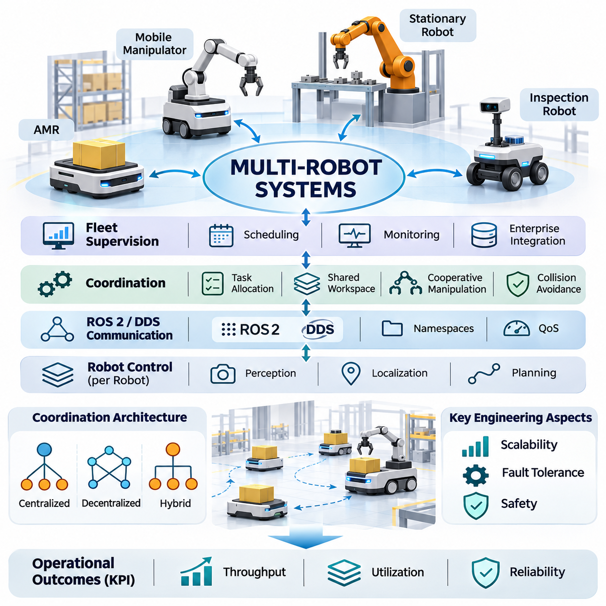
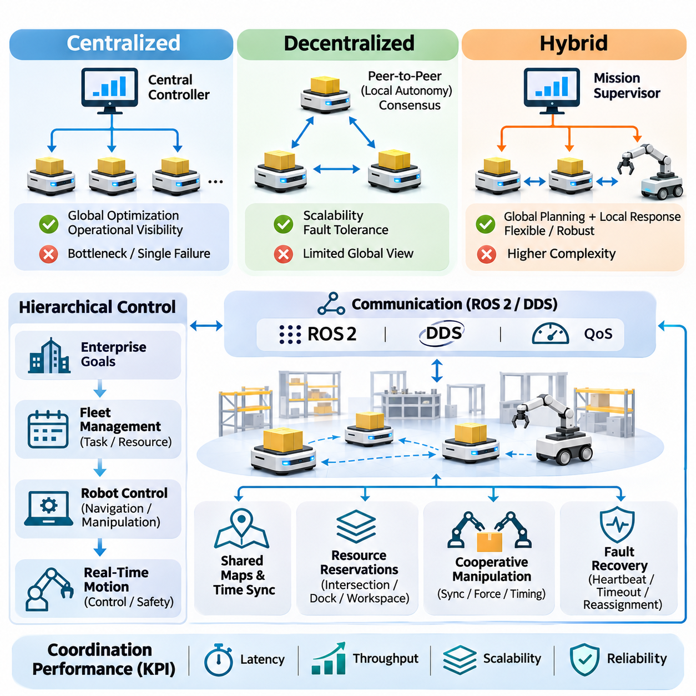
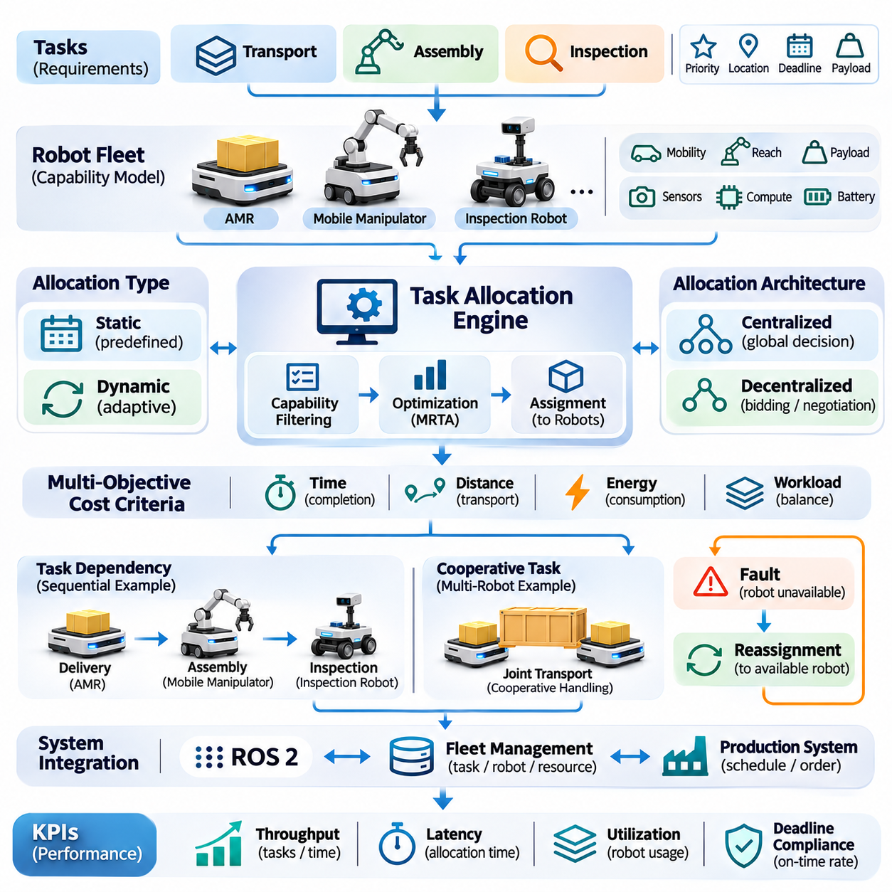
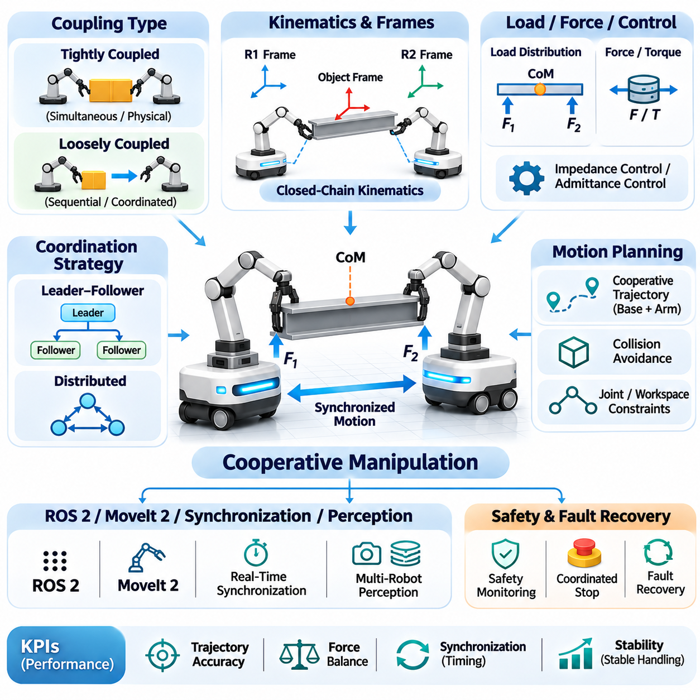
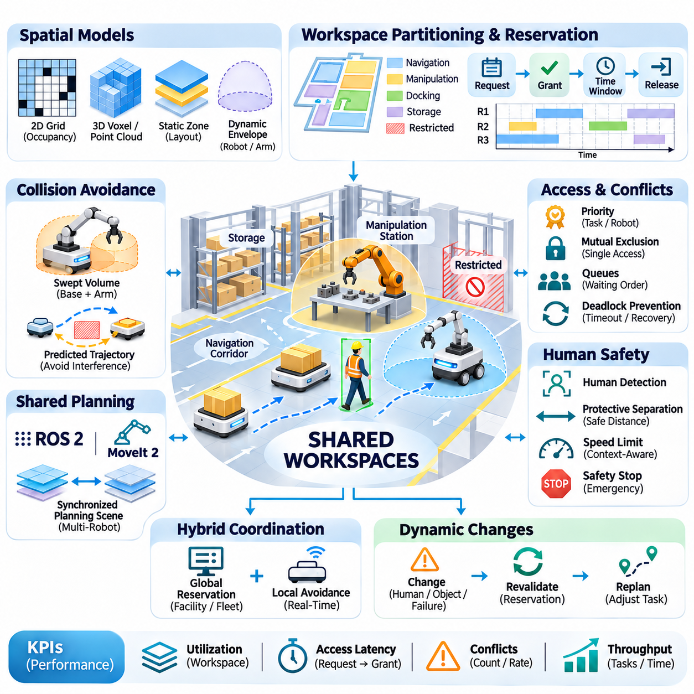
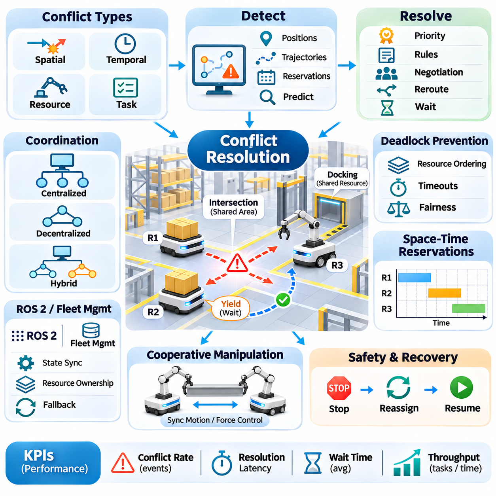
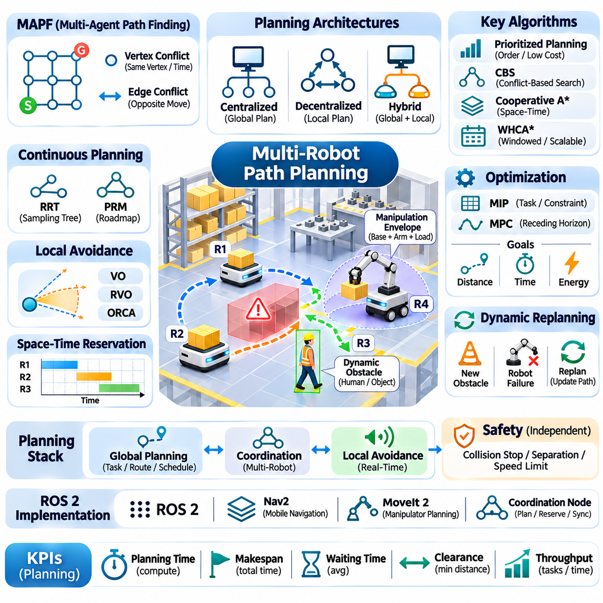
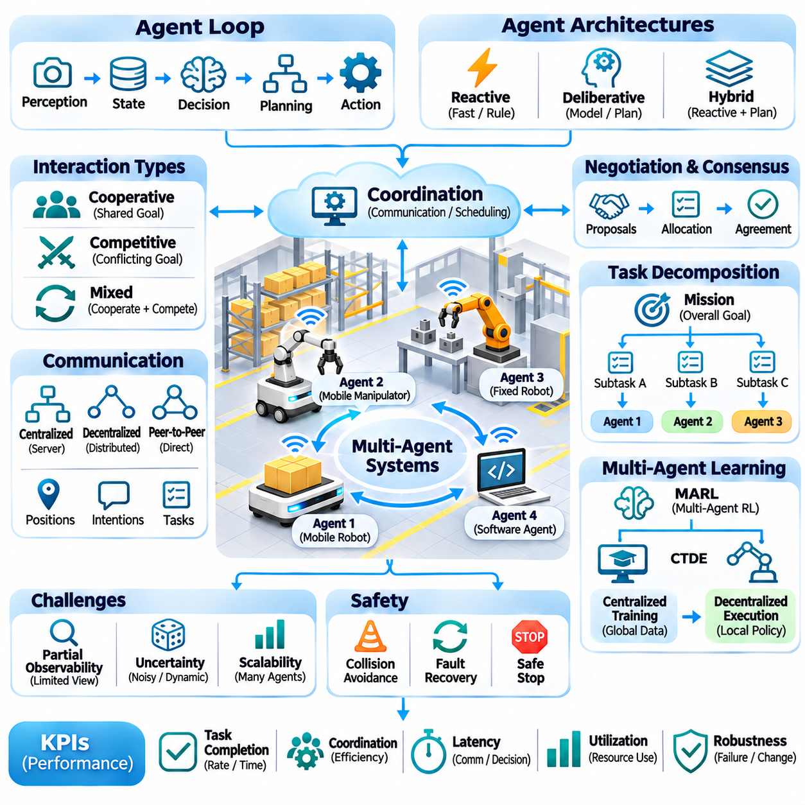
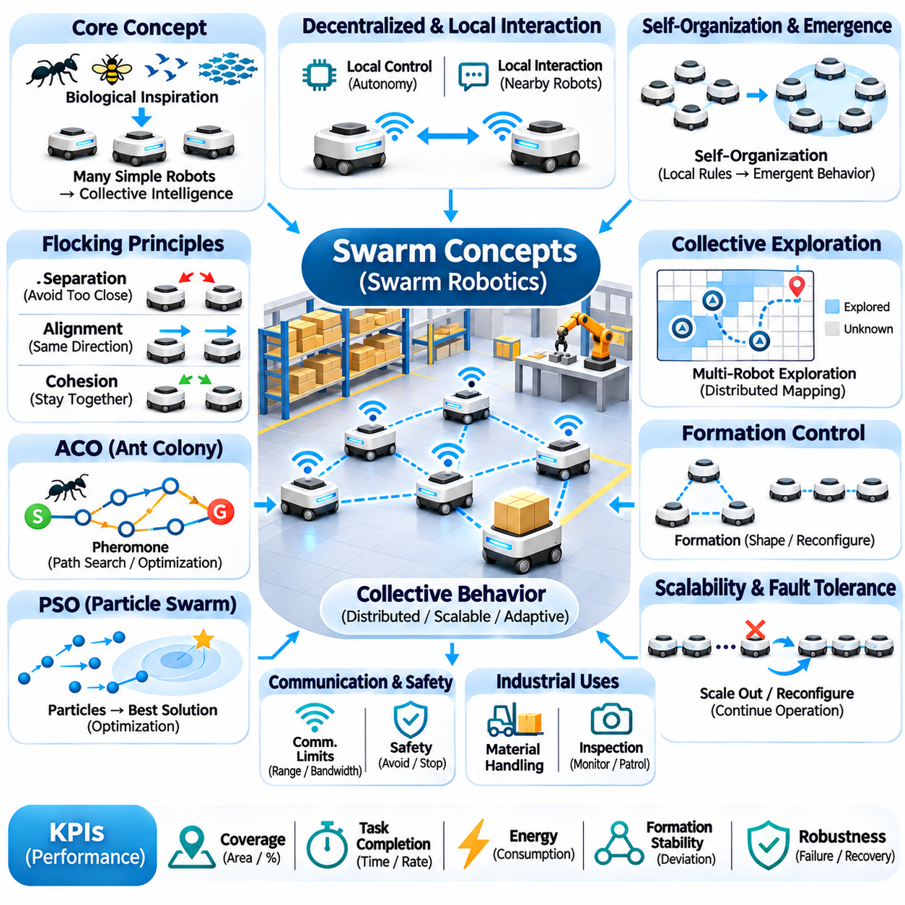
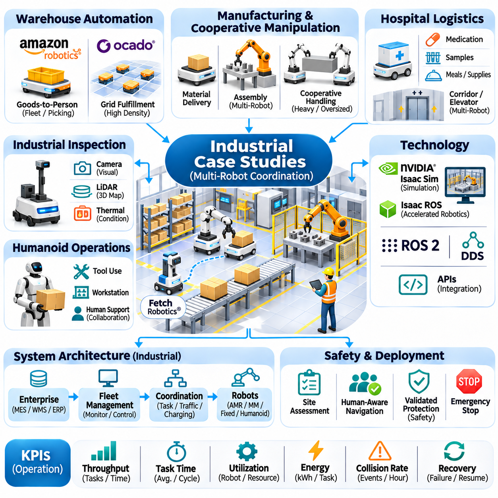

# Chapter 06. Multi Robot Coordination

## 01 Multi Robot Systems

{width="7.268055555555556in" height="7.268055555555556in"}

다중 로봇 시스템(Multi-Robot Systems, MRS)은 개별적 또는 집단적 목표를 달성하기 위해 공통 환경에서 작동하는 여러 대의 자율 또는 반자율 로봇으로 구성된다. 독립형 로봇 시스템(Standalone Robotic Systems)과 달리 다중 로봇 시스템은 여러 로봇 플랫폼에 운영 책임을 분산함으로써 복잡한 산업 환경에서 병렬 작업 실행(Parallel Task Execution), 자원 공유(Resource Sharing), 협력적 의사결정(Cooperative Decision-Making) 및 향상된 운영 유연성(Operational Flexibility)을 제공한다.

이동형 매니퓰레이션(Mobile Manipulation)에서 다중 로봇 시스템은 자율 이동 로봇(Autonomous Mobile Robot, AMR), 이동형 매니퓰레이터(Mobile Manipulator), 고정형 로봇 팔(Stationary Robotic Arm) 및 기타 자동화 장비를 하나의 통합 운영 생태계(Operational Ecosystem)로 구성한다. 각 로봇은 서로 다른 이동 특성, 매니퓰레이션 능력, 센서 구성 및 컴퓨팅 자원을 보유할 수 있다. 이러한 이기종 역량(Heterogeneous Capabilities)을 통해 전체 시스템은 개별 로봇의 능력을 넘어서는 복잡한 작업 흐름(Workflow)을 실행할 수 있다.

다중 로봇 시스템은 동종 구성(Homogeneous Configuration)과 이기종 구성(Heterogeneous Configuration)으로 분류할 수 있다. 동종 시스템은 유사한 하드웨어, 소프트웨어 및 운영 능력을 갖춘 로봇으로 구성되어 배포, 유지보수 및 작업 할당을 간소화한다. 이기종 시스템은 상호 보완적인 능력을 가진 특화 로봇 플랫폼을 결합하여 운송(Transportation), 매니퓰레이션(Manipulation), 검사(Inspection) 및 조립(Assembly)을 포함하는 복잡한 산업 공정에서 더욱 높은 유연성을 제공한다.

다중 로봇 시스템의 기본 원리는 여러 로봇 개체에 지능(Intelligence), 인식(Perception) 및 실행(Execution)을 분산하는 것이다. 각 로봇은 일정 수준의 자율성(Autonomy)을 유지하면서 시스템 수준의 협조 제어(System-Level Coordination)에 참여한다. 개별 로봇은 위치 추정(Localization), 환경 인식, 모션 계획(Motion Planning) 및 제어(Control)를 수행하며, 정보 교환(Information Exchange), 자원 할당(Resource Allocation) 및 협조적 작업 실행을 통해 집단 지능(Collective Intelligence)이 형성된다.

다중 로봇 시스템의 소프트웨어 아키텍처(Software Architecture)는 일반적으로 개별 로봇 제어 계층(Robot Control Layer), 통신 인프라(Communication Infrastructure), 협조 제어 메커니즘(Coordination Mechanism) 및 상위 관리 서비스(Supervisory Management Service)로 구성된다. 로컬 제어 계층(Local Control Layer)은 로봇별 동작을 처리하고, 협조 제어 계층(Coordination Layer)은 로봇 간 상호작용을 관리한다. 상위 관리 시스템은 로봇 운영을 기업 수준의 애플리케이션, 생산 일정 및 전반적인 비즈니스 목표와 연결한다.

ROS 2는 노드 기반 아키텍처(Node-Based Architecture)와 데이터 분산 서비스(Data Distribution Service, DDS)를 통해 다중 로봇 시스템을 개발하기 위한 분산 미들웨어(Distributed Middleware) 기반을 제공한다. 개별 로봇은 독립적인 ROS 2 네트워크에서 작동하거나 공유 통신 환경에 참여할 수 있다. 로봇 네임스페이스(Robot Namespace), 고유 식별자(Unique Identifier), 좌표계 관리(Coordinate Frame Management) 및 서비스 품질(Quality of Service, QoS) 정책은 로봇 플랫폼 간 간섭을 줄이면서 체계적인 통신을 가능하게 한다.

통신(Communication)은 여러 로봇의 운영 상황 인식(Operational Awareness)을 유지하기 위한 핵심 요소이다. 로봇은 현재 위치, 속도, 작업 상태, 배터리 상태, 계획된 궤적(Planned Trajectory) 및 환경 관측 정보(Environmental Observation)를 상호 교환한다. 통신 아키텍처는 동적인 산업 환경에서 신뢰성 높은 협조 제어를 유지하기 위해 네트워크 지연시간(Network Latency), 대역폭 제한(Bandwidth Limitation), 패킷 손실(Packet Loss) 및 일시적인 연결 중단(Temporary Disconnection)을 고려해야 한다.

다중 로봇 시스템은 중앙집중형(Centralized), 분산형(Decentralized) 또는 하이브리드형(Hybrid) 협조 제어 아키텍처(Coordination Architecture)를 적용할 수 있다. 중앙집중형 아키텍처는 상위 제어기(Supervisory Controller)를 사용하여 전역 의사결정(Global Decision-Making)을 관리하는 반면, 분산형 아키텍처는 개별 로봇에 의사결정 권한을 분산한다. 하이브리드형 아키텍처는 전역 감독(Global Supervision)과 로컬 자율성(Local Autonomy)을 결합하여 시스템 전체 최적화, 운영 응답성, 확장성 및 통신 장애에 대한 복원력(Resilience) 사이의 균형을 유지한다.

작업 할당(Task Allocation)은 가용 로봇 사이에 운영 책임을 어떻게 분배할 것인지를 결정하는 과정이다. 작업 할당 메커니즘은 로봇의 능력, 작업 요구사항, 공간적 거리, 에너지 소비량, 작업 부하(Workload) 및 실행 우선순위(Execution Priority)를 평가한다. 동적 작업 할당(Dynamic Task Allocation)은 장비 고장, 예상하지 못한 생산 수요, 일시적인 장애물 및 로봇 가용성(Robot Availability)의 변화와 같은 다양한 운영 조건에 시스템이 능동적으로 대응할 수 있도록 한다.

협력 매니퓰레이션(Cooperative Manipulation)은 여러 로봇이 공통 물체와 물리적으로 상호작용할 수 있도록 함으로써 다중 로봇 협조 제어의 범위를 독립적인 작업 실행 이상으로 확장한다. 여러 로봇은 대형 부품을 공동으로 운송하거나, 작업물(Workpiece)을 안정적으로 지지하거나, 협조적 조립 작업(Coordinated Assembly)을 수행할 수 있다. 이러한 활동에는 과도한 기계적 응력(Mechanical Stress)과 의도하지 않은 물체 움직임을 방지하기 위한 모션 동기화(Motion Synchronization), 일관된 기준 좌표계(Reference Frame), 힘 분배(Force Distribution) 및 정밀 제어(Precision Control)가 요구된다.

공유 작업공간 관리(Shared Workspace Management)는 여러 이동형 매니퓰레이터가 중첩된 물리적 환경에서 작동할수록 더욱 중요해진다. 로봇은 이동 베이스(Mobile Base)의 이동 궤적뿐만 아니라 관절형 매니퓰레이터(Articulated Manipulator)의 공간적 움직임까지 고려해야 한다. 작업공간 예약(Workspace Reservation), 동적 충돌 회피(Dynamic Collision Avoidance), 모션 동기화(Motion Synchronization) 및 접근 제어(Access Control) 메커니즘은 산업 시설의 효율적인 활용을 유지하면서 로봇 간 물리적 간섭을 방지하는 데 기여한다.

확장성(Scalability)은 다중 로봇 시스템의 주요 공학적 설계 목표이다. 로봇의 수를 증가시키면 운영 처리 용량(Operational Capacity)을 향상시킬 수 있지만, 추가적인 통신 트래픽(Communication Traffic), 연산 복잡도(Computational Complexity), 자원 경합(Resource Contention) 및 충돌 위험(Collision Risk)도 발생한다. 확장 가능한 아키텍처는 로봇 플릿(Robot Fleet)의 규모가 확대되더라도 적절한 성능을 유지하기 위해 모듈형 소프트웨어 구성요소(Modular Software Component), 분산 처리(Distributed Processing), 계층적 협조 제어(Hierarchical Coordination) 및 효율적인 정보 교환 방식을 적용한다.

내결함성(Fault Tolerance)과 안전성(Safety)은 다중 로봇 시스템의 운영 신뢰성(Operational Reliability)과 밀접하게 관련된다. 개별 로봇의 고장이 전체 로봇 플릿의 운영을 불필요하게 중단시켜서는 안 된다. 작업 재할당(Task Reassignment), 상태 모니터링(Health Monitoring), 통제된 복구(Controlled Recovery) 및 로컬 보호 기능(Local Protective Function)은 안전성과 실행 가능성이 확보된 조건에서 지속적인 운영을 지원한다. 시스템 수준의 협조 제어는 독립적으로 검증된 안전 기능(Safety Function)을 대체하는 것이 아니라 상호 보완해야 한다.

성능 평가(Performance Evaluation)는 개별 로봇의 능력과 집단적 시스템 효율성(Collective System Efficiency)을 모두 고려한다. 주요 성능 지표(Performance Metrics)에는 플릿 처리량(Fleet Throughput), 작업 완료율(Task Completion Rate), 자원 활용률(Resource Utilization), 협조 제어 지연시간(Coordination Latency), 에너지 소비량(Energy Consumption) 및 복구 시간(Recovery Time) 등이 포함된다. 궁극적으로 다중 로봇 시스템은 지능형 공장(Intelligent Factory), 자동화 물류창고(Automated Warehouse), 병원 물류(Hospital Logistics) 및 점차 자율화되는 산업 생태계(Autonomous Industrial Ecosystem)를 구현하기 위한 핵심 기술적 기반을 제공한다.

첨부 자료는 상세한 기술 원고가 아닌 장별 구성 체계(Chapter Structure)를 제공한다. 따라서 본 설명은 해당 구성 체계를 따르면서 일반적인 로봇공학 원리(Robotics Engineering Principles)를 기반으로 입문 개념을 확장하였으며, 세부 협조 제어 알고리즘(Coordination Algorithm)과 산업 적용 사례(Industrial Case Study)는 후속 절에서 다루도록 구성하였다.

## 02 Coordination Architectures

{width="7.268055555555556in" height="7.268055555555556in"}

협조 제어 아키텍처(Coordination Architecture)는 여러 로봇이 공유 운영 환경(Shared Operational Environment)에서 정보를 교환하고, 책임을 분배하며, 의사결정을 수행하고, 활동을 동기화하는 방식을 정의한다. 이동형 매니퓰레이션 시스템(Mobile Manipulation System)에서 이러한 아키텍처는 여러 로봇 플랫폼의 자율 주행(Autonomous Navigation), 매니퓰레이션(Manipulation), 작업 실행(Task Execution), 자원 관리(Resource Management) 및 집단 의사결정(Collective Decision-Making)을 통합하기 위한 조직적 기반을 구축한다.

중앙집중형 협조 제어 아키텍처(Centralized Coordination Architecture)는 중앙 제어기(Central Controller) 또는 상위 관리 서버(Supervisory Server)를 활용하여 여러 로봇의 활동을 관리한다. 중앙 시스템(Central System)은 개별 로봇으로부터 운영 정보를 수집하고, 환경에 대한 전역 표현(Global Representation)을 유지하며, 적절한 작업 할당(Task Assignment), 실행 우선순위(Execution Priority) 및 이동 일정(Movement Schedule)을 결정한다. 개별 로봇은 로컬 제어 능력(Local Control Capability)을 유지하면서 할당된 명령을 실행한다.

중앙집중형 아키텍처(Centralized Architecture)는 전역 최적화(Global Optimization), 운영 가시성(Operational Visibility) 및 예측 가능한 의사결정(Predictable Decision-Making) 측면에서 장점을 제공한다. 중앙 제어기는 여러 로봇 플랫폼으로부터 정보를 수신하기 때문에 시스템 전체의 운영 조건을 평가하고 이에 따라 자원 활용률(Resource Utilization)을 최적화할 수 있다. 이러한 접근 방식은 신뢰성 높은 통신 인프라(Communication Infrastructure)와 명확하게 정의된 운영 작업 흐름(Operational Workflow)을 갖춘 구조화된 산업 환경에 특히 적합하다.

그러나 중앙집중형 협조 제어(Centralized Coordination)는 연산 병목현상(Computational Bottleneck), 통신 의존성(Communication Dependency) 및 단일 장애점(Single Point of Failure)과 관련된 잠재적 한계를 가진다. 로봇의 수가 증가함에 따라 중앙 제어기는 더욱 많은 운영 정보를 처리하고 복잡해지는 상호작용을 해결해야 한다. 이중화 서버(Redundant Server), 분산 컴퓨팅 자원(Distributed Computational Resources) 및 로컬 대체 동작 메커니즘(Local Fallback Mechanism)은 이러한 아키텍처의 위험을 줄일 수 있다.

분산형 협조 제어 아키텍처(Decentralized Coordination Architecture)는 단일 상위 제어기에 의존하는 대신 개별 로봇에 의사결정 책임을 분산한다. 각 로봇은 로컬 환경 조건(Local Environmental Condition), 운영 목표(Operational Objective) 및 인접 로봇(Neighboring Robot)으로부터 수신한 정보를 평가한다. 집단 행동(Collective Behavior)은 로봇 간 협력을 규정하는 분산 협상(Distributed Negotiation), 정보 교환(Information Exchange) 및 사전 정의된 상호작용 프로토콜(Interaction Protocol)을 통해 형성된다.

분산형 아키텍처(Decentralized Architecture)는 확장성(Scalability), 적응성(Adaptability) 및 내결함성(Fault Tolerance) 측면에서 장점을 제공한다. 개별 로봇은 다른 로봇과의 통신이 불가능한 상황에서도 일정 수준의 운영 능력을 유지할 수 있다. 그러나 제한적인 전역 상황 인식(Global Awareness)은 차선의 자원 할당(Suboptimal Resource Allocation)이나 상충하는 의사결정(Conflicting Decision)을 초래할 수 있다. 분산 합의 메커니즘(Distributed Consensus Mechanism)과 충돌 해결 프로토콜(Conflict Resolution Protocol)은 로컬 자율성(Local Autonomy)을 유지하면서 이러한 한계를 극복하는 데 기여한다.

하이브리드 협조 제어 아키텍처(Hybrid Coordination Architecture)는 전역 최적화와 로컬 운영 응답성(Local Operational Responsiveness) 사이의 균형을 유지하기 위해 중앙집중형 감독(Centralized Supervision)과 분산형 의사결정(Decentralized Decision-Making)을 결합한다. 중앙 관리 시스템(Central Management System)은 임무 목표(Mission Objective), 생산 우선순위(Production Priority) 및 자원 할당 정책(Resource Allocation Policy)을 설정하며, 개별 로봇은 사전 정의된 운영 제약조건(Operational Constraint) 내에서 자율 주행, 매니퓰레이션, 장애물 회피(Obstacle Avoidance) 및 로컬 복구(Local Recovery)를 독립적으로 관리한다.

계층적 협조 제어(Hierarchical Coordination)는 의사결정 구조를 여러 기능 계층(Functional Layer)으로 구성한다. 기업 시스템(Enterprise System)은 비즈니스 목표를 설정하고, 플릿 관리 시스템(Fleet Management System, FMS)은 임무 실행(Mission Execution)을 조율하며, 로봇 수준 제어기(Robot-Level Controller)는 작업 시퀀스(Task Sequence)를 관리한다. 실시간 제어기(Real-Time Controller)는 물리적 움직임을 실행한다. 이러한 책임 분리(Separation of Responsibilities)는 서로 다른 운영 의사결정이 적절한 연산 주기(Computational Frequency)와 추상화 수준(Level of Abstraction)에서 처리될 수 있도록 한다.

통신 아키텍처(Communication Architecture)는 모든 협조 제어 전략(Coordination Strategy)의 효과에 영향을 미친다. ROS 2와 데이터 분산 서비스(Data Distribution Service, DDS)는 발행-구독 메커니즘(Publish-Subscribe Mechanism), 서비스(Service) 및 액션(Action)을 통해 분산 통신(Distributed Communication)을 지원한다. 서비스 품질(Quality of Service, QoS) 정책, 로봇 네임스페이스(Robot Namespace), 고유 식별자(Unique Identifier), 메시지 타임스탬프(Message Timestamp) 및 네트워크 분할(Network Segmentation)은 로봇 플랫폼 간 통신 오버헤드(Communication Overhead)를 제어하면서 신뢰성 높은 정보 교환을 유지하는 데 기여한다.

공유 환경 표현(Shared Environmental Representation)은 협조 제어를 위한 또 다른 핵심 기반을 제공한다. 개별 로봇은 로컬 지도(Local Map)와 계획 장면(Planning Scene)을 유지하면서 관련 공간 정보(Spatial Information) 및 운영 정보를 다른 로봇이나 상위 관리 시스템과 교환할 수 있다. 일관된 좌표 변환(Coordinate Transformation), 동기화된 타임스탬프(Synchronized Timestamp), 객체 식별자(Object Identifier) 및 작업공간 정의(Workspace Definition)는 여러 로봇이 공유 환경의 상태를 정확하게 해석할 수 있도록 한다.

협조 제어 아키텍처는 의사결정 권한(Decision-Making Authority)과 공유 자원의 소유권(Shared Resource Ownership)을 명확하게 정의해야 한다. 교차로(Intersection), 도킹 스테이션(Docking Station), 엘리베이터(Elevator), 조립 스테이션(Assembly Station) 및 매니퓰레이션 작업공간(Manipulation Workspace)은 배타적 접근(Exclusive Access) 또는 동기화된 접근(Synchronized Access)을 요구할 수 있다. 자원 예약(Resource Reservation), 실행 권한(Execution Permission) 및 통제된 자원 해제 메커니즘(Controlled Release Mechanism)은 상충하는 동작을 방지하고 교착상태(Deadlock), 물리적 충돌(Collision) 및 불필요한 대기 발생 가능성을 줄인다.

시간 민감형 협조 제어(Time-Sensitive Coordination)는 여러 이동형 매니퓰레이터가 공통의 물리적 작업을 협력하여 수행할 때 특히 중요하다. 상위 관리 통신(Supervisory Communication)은 임무 스케줄링(Mission Scheduling)에 충분할 수 있지만, 동기화된 매니퓰레이션(Synchronized Manipulation)은 더욱 예측 가능한 타이밍(Timing)과 피드백(Feedback)을 요구한다. 전용 통신 채널(Dedicated Communication Channel)과 로컬 실시간 제어 루프(Local Real-Time Control Loop)는 로봇 간 협조 궤적(Coordinated Trajectory), 힘 조절(Force Regulation) 및 안정적인 물리적 상호작용(Physical Interaction)을 지원할 수 있다.

장애 관리(Fault Management)는 협조 제어 아키텍처에 직접 통합되어야 한다. 통신 중단(Communication Interruption), 위치 추정 오류(Localization Error), 액추에이터 고장(Actuator Failure) 및 일관되지 않은 환경 정보는 집단 운영(Collective Operation)을 방해할 수 있다. 하트비트 모니터링(Heartbeat Monitoring), 실행 시간 초과(Execution Timeout), 상태 정합(State Reconciliation), 작업 재할당(Task Reassignment) 및 사전 정의된 성능 저하 운영 모드(Degraded Operating Mode)는 독립적으로 검증된 안전 기능(Safety Function)을 저해하지 않으면서 시스템이 체계적으로 대응할 수 있도록 한다.

협조 제어 아키텍처의 선정은 플릿 규모(Fleet Size), 로봇의 이기종성(Robot Heterogeneity), 운영 복잡도(Operational Complexity), 네트워크 신뢰성(Network Reliability), 컴퓨팅 자원(Computational Resources) 및 안전 요구사항(Safety Requirements)에 따라 결정된다. 중앙집중형 아키텍처는 일반적으로 예측 가능한 작업 흐름에 적합하며, 분산형 접근 방식은 더욱 높은 운영 독립성(Operational Independence)을 지원한다. 하이브리드형 및 계층적 아키텍처는 전역 감독과 자율적인 로컬 실행(Autonomous Local Execution)을 동시에 요구하는 산업 시스템에 특히 적합하다.

아키텍처 성능(Architectural Performance)은 협조 제어 지연시간(Coordination Latency), 통신 오버헤드(Communication Overhead), 작업 처리량(Task Throughput), 자원 활용률(Resource Utilization), 장애 복구 시간(Failure Recovery Time) 및 확장성(Scalability)과 같은 정량적으로 측정 가능한 지표를 통해 평가해야 한다. 효과적인 협조 제어 아키텍처는 작업 할당(Task Allocation), 협력 매니퓰레이션(Cooperative Manipulation), 공유 작업공간 관리(Shared Workspace Management), 충돌 해결(Conflict Resolution), 다중 로봇 경로 계획(Multi-Robot Path Planning), 다중 에이전트 시스템(Multi-Agent System) 및 군집 기반 로봇 운영(Swarm-Based Robotic Operation)을 구현하기 위한 구조적 기반을 제공한다.

첨부 자료는 특정 기술 아키텍처(Technical Architecture)를 규정하기보다는 본 절의 구성 범위(Organizational Scope)를 제시한다. 따라서 본 설명은 특정 상용 플랫폼(Commercial Platform)이나 구현 방식(Implementation)을 전제로 하지 않고, 일반적인 로봇공학 원리(Robotics Engineering Principles)를 기반으로 장별 구성 체계를 확장하였다. 세부 협조 제어 알고리즘(Coordination Algorithm)과 응용 분야별 메커니즘(Application-Specific Mechanism)은 후속 절에서 다루도록 구성하였다.

## 03 Task Allocation

{width="7.268055555555556in" height="7.268055555555556in"}

작업 할당(Task Allocation)은 가용 로봇 플랫폼 사이에 운영 책임을 어떻게 분배할 것인지를 결정하는 다중 로봇 협조 제어(Multi-Robot Coordination)의 핵심 구성요소이다. 이동형 매니퓰레이션 시스템(Mobile Manipulation System)에서 작업 할당은 운영 목표(Operational Objective), 자원 제한(Resource Limitation) 및 환경 제약조건(Environmental Constraint)을 충족하면서 운송(Transportation), 물체 취급(Object Handling), 검사(Inspection), 조립(Assembly) 및 자재 배송(Material Delivery) 작업이 적합한 로봇에 할당되도록 한다.

다중 로봇 작업 할당(Multi-Robot Task Allocation, MRTA)은 로봇 플랫폼이 물리적 능력(Physical Capability), 공간적 의존성(Spatial Dependency), 에너지 제한(Energy Limitation) 및 서로 다른 수준의 자율성(Autonomy)을 보유한다는 점에서 기존 작업 스케줄링(Task Scheduling)과 차이가 있다. 할당되는 작업은 작업 완료 요구사항뿐만 아니라 로봇의 현재 위치, 매니퓰레이션 능력(Manipulation Capability), 가반하중(Payload Capacity), 가용 도구(Available Tool) 및 운영 준비 상태(Operational Readiness)를 기반으로 평가되어야 한다.

작업 표현(Task Representation)은 효과적인 작업 할당을 위한 정보적 기반을 구축한다. 각 작업은 고유 식별자(Unique Identifier), 요구 능력(Required Capability), 목표 위치(Target Location), 예상 실행 시간(Estimated Execution Duration), 우선순위(Priority), 완료 기한(Deadline) 및 자원 의존성(Resource Dependency)을 사용하여 표현할 수 있다. 더욱 복잡한 매니퓰레이션 작업에는 객체 특성(Object Property), 파지 요구사항(Grasping Requirement), 위치 정밀도 허용오차(Positioning Tolerance), 환경 조건(Environmental Condition) 및 선행 또는 후속 작업에 대한 의존성이 포함될 수 있다.

로봇 능력 모델링(Robot Capability Modeling)은 작업 할당 시스템이 특정 로봇의 작업 적합성을 판단할 수 있도록 한다. 능력 모델(Capability Model)은 이동 특성(Mobility Characteristic), 매니퓰레이터 도달 범위(Manipulator Reach), 가반하중(Payload Capacity), 엔드 이펙터 구성(End-Effector Configuration), 센서 가용성(Sensor Availability), 컴퓨팅 자원(Computational Resources) 및 위치 정밀도(Positioning Accuracy)를 표현할 수 있다. 능력 기반 필터링(Capability-Based Filtering)은 운영 효율성을 평가하기 전에 해당 작업에 적합하지 않은 로봇 후보를 제거한다.

정적 작업 할당(Static Task Allocation)은 작업 실행 전에 설정된 사전 정의 운영 규칙(Predefined Operational Rule) 또는 일정(Schedule)에 따라 작업을 할당한다. 이러한 접근 방식은 예측 가능한 생산 요구사항(Production Requirement)과 비교적 안정적인 환경 조건을 갖춘 반복적 산업 작업 흐름(Industrial Workflow)에 적합하다. 정적 작업 할당은 연산 복잡도(Computational Complexity)를 줄이고 시스템 구현(System Implementation)을 간소화하지만, 장비 고장(Equipment Failure), 예상하지 못한 장애물 또는 생산 조건의 변화가 발생하는 경우 제한적인 적응성(Adaptability)을 제공한다.

동적 작업 할당(Dynamic Task Allocation)은 운영 조건을 지속적으로 평가하고 현재 시스템 상태(System State)에 따라 작업 할당을 조정한다. 로봇은 변화하는 우선순위, 작업 완료 이벤트(Task Completion Event), 배터리 상태(Battery Condition) 또는 예상하지 못한 운영 중단(Operational Interruption)에 따라 새로운 작업을 할당받을 수 있다. 동적 작업 할당은 플릿 적응성(Fleet Adaptability)과 자원 활용률(Resource Utilization)을 향상시키지만, 신뢰성 높은 상태 모니터링(State Monitoring), 통신(Communication) 및 의사결정 메커니즘(Decision-Making Mechanism)을 요구한다.

중앙집중형 작업 할당(Centralized Task Allocation)은 상위 제어기(Supervisory Controller) 또는 플릿 관리 시스템(Fleet Management System, FMS)을 사용하여 가용 로봇을 평가하고 적절한 작업 할당을 결정한다. 작업 할당 알고리즘(Allocation Algorithm)은 대기 중인 작업(Pending Task), 자원 가용성(Resource Availability) 및 로봇 운영 상태(Robot Operating Condition)에 대한 전역 표현(Global Representation)을 유지한다. 최적화 기법(Optimization Technique)은 사전 정의된 제약조건을 충족하면서 전체 실행 시간(Total Execution Time), 운송 거리(Transportation Distance), 에너지 소비량(Energy Consumption) 또는 운영 비용(Operational Cost)을 최소화할 수 있다.

분산형 작업 할당(Decentralized Task Allocation)은 협상(Negotiation), 입찰(Bidding) 또는 분산 합의 메커니즘(Distributed Consensus Mechanism)을 통해 개별 로봇에 작업 할당의 의사결정 권한을 분산한다. 시장 기반 접근 방식(Market-Based Approach)은 로봇이 예상 실행 비용(Estimated Execution Cost)과 운영 능력(Operational Capability)에 따라 입찰값(Bid)을 산출할 수 있도록 한다. 작업은 사전에 설정된 선정 기준(Selection Criteria)에 따라 할당되며, 이를 통해 중앙 제어기에 대한 의존성을 줄이면서 변화하는 환경에서 유연한 작업 참여를 지원한다.

수학적 최적화(Mathematical Optimization)는 작업 할당 문제(Task Allocation Problem)를 해결하기 위한 체계적인 기반을 제공한다. 헝가리안 알고리즘(Hungarian Algorithm)은 전통적인 일대일 할당(One-to-One Assignment)을 지원하는 반면, 혼합정수 선형계획법(Mixed-Integer Linear Programming, MILP)은 더욱 복잡한 제약조건과 스케줄링 요구사항(Scheduling Requirement)을 처리할 수 있다. 휴리스틱 알고리즘(Heuristic Algorithm), 유전 알고리즘(Genetic Algorithm) 및 메타휴리스틱 최적화(Metaheuristic Optimization)는 문제 규모가 증가하여 정확 최적화(Exact Optimization)의 연산 비용이 높아지는 경우 실용적인 해법을 제공할 수 있다.

다목적 작업 할당(Multi-Objective Task Allocation)은 단일 성능 지표(Performance Metric)를 최소화하는 대신 여러 운영 평가 기준(Operational Criteria)을 동시에 고려한다. 주요 최적화 목표에는 임무 완료 시간(Mission Completion Time), 에너지 효율성(Energy Efficiency), 작업 부하 균형(Workload Balance), 운송 거리(Transportation Distance) 및 자원 활용률(Resource Utilization)이 포함된다. 가중 비용 함수(Weighted Cost Function) 또는 파레토 기반 최적화(Pareto-Based Optimization)는 산업 생산 요구사항에 따라 서로 상충하는 목표 간의 절충 관계(Trade-Off)를 표현할 수 있다.

작업 의존성(Task Dependency)은 여러 로봇이 순차적 작업(Sequential Operation) 또는 협력 작업(Cooperative Operation)에 참여할 때 추가적인 복잡성을 발생시킨다. 예를 들어, 자율 이동 로봇(Autonomous Mobile Robot, AMR)이 부품을 배송한 후 이동형 매니퓰레이터(Mobile Manipulator)가 조립 작업을 수행하고, 이후 검사 로봇(Inspection Robot)이 완료된 작업을 검증할 수 있다. 의존성 그래프(Dependency Graph), 선후행 제약조건(Precedence Constraint) 및 동기화된 실행 조건(Synchronized Execution Condition)은 로봇 플릿 전체에서 올바른 작업 실행 순서(Operational Sequence)를 유지하는 데 기여한다.

협력 작업 할당(Cooperative Task Allocation)은 단일 로봇 플랫폼으로 완료할 수 없는 작업에 여러 로봇을 할당한다. 공동 운송(Joint Transportation), 협력 조립(Cooperative Assembly) 및 공유 객체 매니퓰레이션(Shared Object Manipulation)은 상호 보완적인 능력(Complementary Capability)과 동기화된 가용성(Synchronized Availability)을 요구한다. 작업 할당 메커니즘은 실행을 시작하기 전에 적절한 로봇 조합(Robot Combination), 통신 요구사항(Communication Requirement), 작업공간 호환성(Workspace Compatibility) 및 물리적 상호작용 제약조건(Physical Interaction Constraint)을 평가해야 한다.

장애 인지형 작업 할당(Failure-Aware Task Allocation)은 로봇 플릿이 예상하지 못한 장비 고장, 통신 중단(Communication Interruption) 및 미완료 작업(Incomplete Operation)에 대응할 수 있도록 한다. 특정 로봇을 더 이상 사용할 수 없는 경우 협조 제어 시스템(Coordination System)은 남아 있는 작업의 상태를 평가하고 작업 재할당(Task Reassignment)의 실행 가능성을 판단한다. 체크포인트 관리(Checkpoint Management), 자원 해제(Resource Release) 및 안전 복구 절차(Safe Recovery Procedure)는 중복 실행(Duplicated Execution)과 일관되지 않은 물리적 작업(Inconsistent Physical Operation)을 방지하는 데 기여한다.

실제 시스템 구현(Practical Implementation)에서는 작업 할당을 ROS 2, 플릿 관리 서비스(Fleet Management Service), 행동 트리(Behavior Tree, BT) 및 기업 제조 시스템(Enterprise Manufacturing System)과 통합할 수 있다. 작업 요청(Task Request)은 표준화된 인터페이스(Standardized Interface)를 통해 전달되며, 로봇 상태 정보(Robot State Information)는 작업 할당 의사결정과 실행 모니터링(Execution Monitoring)을 지원한다. 협조 제어 계층(Coordination Layer)은 로컬 모션 제어(Local Motion Control) 또는 검증된 안전 기능(Validated Safety Function)을 방해하지 않으면서 일관된 작업 소유권(Task Ownership)과 상태 보고(Status Reporting)를 유지해야 한다.

작업 할당 성능(Task Allocation Performance)은 작업 완료율(Task Completion Rate), 할당 지연시간(Assignment Latency), 플릿 처리량(Fleet Throughput), 작업 부하 분포(Workload Distribution), 에너지 소비량(Energy Consumption), 완료 기한 준수율(Deadline Compliance) 및 재할당 효율성(Reassignment Efficiency)을 통해 평가된다. 효과적인 작업 할당은 개별 로봇의 능력과 집단적 운영 목표(Collective Operational Objective) 사이의 균형을 유지하며, 자동화 물류창고(Automated Warehouse), 지능형 공장(Intelligent Factory) 및 산업용 이동형 매니퓰레이션(Industrial Mobile Manipulation)에서 확장 가능한 다중 로봇 협조 제어(Scalable Multi-Robot Coordination)를 구현하기 위한 핵심 기반을 제공한다.

첨부 자료는 특정 작업 할당 알고리즘(Allocation Algorithm)이나 구현 요구사항(Implementation Requirement)이 아닌 장별 구성 체계(Chapter Structure)를 정의한다. 따라서 본 절에서는 특정 상용 플랫폼(Commercial Platform), 최적화 프레임워크(Optimization Framework) 또는 산업 현장 배포 구성(Industrial Deployment Configuration)을 전제로 하지 않고, 일반적인 다중 로봇 공학 원리(Multi-Robot Engineering Principles)를 기반으로 지정된 주제를 확장하여 설명하였다.

## 04 Cooperative Manipulation

{width="7.268055555555556in" height="7.268055555555556in"}

협력 매니퓰레이션(Cooperative Manipulation)은 여러 로봇 플랫폼이 공유 환경(Shared Environment)에서 물리적 객체를 조작, 운송, 위치 정렬 또는 조립하기 위해 협조적으로 상호작용하는 것을 의미한다. 독립적 매니퓰레이션(Independent Manipulation)과 달리 협력 매니퓰레이션은 여러 로봇이 작업 실행 과정에서 움직임을 동기화하고, 기계적 하중(Mechanical Load)을 분배하며, 운영 정보를 교환하고, 일관된 물리적 관계(Physical Relationship)를 유지해야 한다.

이동형 매니퓰레이션 시스템(Mobile Manipulation System)에서 협력 매니퓰레이션은 자율 이동 플랫폼(Autonomous Mobile Platform)의 이동성(Mobility)과 로봇 매니퓰레이터(Robotic Manipulator)의 조작 능력(Dexterity)을 결합한다. 여러 이동형 매니퓰레이터(Mobile Manipulator)는 대형 산업 부품을 공동으로 운송하거나, 비정형 객체(Irregularly Shaped Object)를 취급하고, 작업물(Workpiece)을 안정적으로 지지하거나, 복잡한 조립 작업(Assembly Operation)을 수행할 수 있다. 이러한 접근 방식은 개별 로봇 플랫폼의 물리적 한계를 넘어 운영 능력을 확장한다.

협력 매니퓰레이션은 강결합(Tightly Coupled) 또는 약결합(Loosely Coupled) 로봇 상호작용으로 구성될 수 있다. 강결합 매니퓰레이션(Tightly Coupled Manipulation)은 여러 로봇이 공통 객체에 동시에 물리적 접촉(Physical Contact)을 유지함으로써 로봇의 움직임 사이에 기계적 의존성(Mechanical Dependency)이 형성될 때 발생한다. 약결합 매니퓰레이션(Loosely Coupled Manipulation)은 순차적 객체 취급(Sequential Object Handling), 부품 전달(Component Transfer) 및 협업 조립(Collaborative Assembly)과 같이 지속적인 물리적 결합 없이 수행되는 협조적 작업을 포함한다.

협력 매니퓰레이션의 기구학적 기반(Kinematic Foundation)은 참여 로봇, 엔드 이펙터(End-Effector) 및 조작 대상 객체(Manipulated Object) 사이에 일관된 기하학적 관계(Geometric Relationship)를 요구한다. 각 로봇은 자체 좌표계(Coordinate Frame)를 유지하면서 공통 객체 중심 좌표계(Object-Centered Coordinate System) 또는 전역 좌표계(Global Coordinate System)를 참조한다. 순기구학(Forward Kinematics), 역기구학(Inverse Kinematics) 및 좌표 변환(Coordinate Transformation)은 상호 호환되는 로봇 자세 구성(Robot Configuration)과 협조적인 엔드 이펙터 궤적(End-Effector Trajectory)을 계산할 수 있도록 한다.

폐쇄사슬 기구학(Closed-Chain Kinematics)은 여러 매니퓰레이터가 공유 객체에 동시에 강체 접촉(Rigid Contact)을 형성할 때 발생한다. 이로 인해 형성된 기계적 구조(Mechanical Structure)는 개별 로봇의 움직임에 추가적인 기하학적 제약조건(Geometric Constraint)을 부과한다. 일관되지 않은 궤적(Trajectory)은 과도한 내부 힘(Internal Force), 기계적 변형(Mechanical Deformation) 또는 불안정한 상호작용(Unstable Interaction)을 발생시킬 수 있다. 제약조건 기반 모션 계획(Constraint-Based Motion Planning)은 협력 작업 전반에서 상호 호환되는 로봇 자세 구성을 유지하는 데 기여한다.

하중 분배(Load Distribution)는 여러 로봇이 무겁거나 대형인 객체를 공동으로 조작할 때 고려해야 하는 핵심 요소이다. 전체 기계적 하중은 개별 매니퓰레이터의 능력(Manipulator Capability), 파지 위치(Grasp Location), 객체 형상(Object Geometry) 및 질량 중심 특성(Center-of-Mass Characteristic)에 따라 분배되어야 한다. 불균등한 하중 분배(Uneven Load Distribution)는 액추에이터 과부하(Actuator Overload), 위치 정밀도 저하(Reduced Positioning Accuracy), 파지 불안정성(Grasp Instability) 또는 로봇 시스템 내부의 과도한 기계적 응력(Mechanical Stress)을 초래할 수 있다.

힘 및 토크 제어(Force and Torque Control)는 참여 로봇이 협력 매니퓰레이션 과정에서 물리적 상호작용(Physical Interaction)을 조절할 수 있도록 한다. 힘-토크 센서(Force-Torque Sensor), 관절 토크 피드백(Joint Torque Feedback) 및 추정 접촉력(Estimated Contact Force)은 외부 하중(External Load)과 내부 기계적 상호작용(Internal Mechanical Interaction)에 대한 정보를 제공한다. 임피던스 제어(Impedance Control)와 어드미턴스 제어(Admittance Control)는 제어된 유연성(Controlled Compliance)을 제공하여 안정적인 객체 취급을 유지하면서 작은 위치 정렬 오차(Positioning Error)를 수용할 수 있도록 한다.

리더-팔로워 제어(Leader-Follower Control)는 협력 매니퓰레이션에서 일반적으로 사용되는 협조 제어 전략(Coordination Strategy)이다. 지정된 리더 로봇(Leader Robot)은 목표 객체 궤적(Desired Object Trajectory)을 결정하며, 팔로워 로봇(Follower Robot)은 공유 모션 기준값(Shared Motion Reference)과 측정된 상호작용 힘(Interaction Force)에 따라 자신의 움직임을 조정한다. 대안적인 분산 제어 전략(Distributed Control Strategy)은 참여 로봇이 지정된 리더에게 전적으로 의존하지 않고 집단적 모션 의사결정(Collective Motion Decision)에 기여할 수 있도록 한다.

협력 모션 계획(Cooperative Motion Planning)은 참여 이동 베이스(Mobile Base), 로봇 팔(Robotic Arm) 및 조작 대상 객체의 결합 구성공간(Combined Configuration Space)을 고려해야 한다. 모션 계획기(Motion Planner)는 관절 한계(Joint Limit), 충돌 제약조건(Collision Constraint), 파지 안정성(Grasp Stability), 작업공간 경계(Workspace Boundary) 및 객체 움직임 요구사항(Object Motion Requirement)을 평가한다. 협조 궤적(Coordinated Trajectory)은 공유 객체의 목표 움직임을 충족하면서 모든 참여 로봇에서 물리적으로 실행 가능한 상태(Physical Feasibility)를 유지해야 한다.

이동 베이스 협조 제어(Mobile Base Coordination)는 로봇 플랫폼이 이동함에 따라 매니퓰레이터의 기준 좌표계(Manipulator Reference Frame)가 변화하기 때문에 추가적인 복잡성을 발생시킨다. 위치 추정 오류(Localization Error), 바퀴 미끄러짐(Wheel Slippage), 불균일한 지면(Uneven Surface) 및 플랫폼 동역학(Platform Dynamics)의 변화는 협력 위치 정렬 정밀도(Cooperative Positioning Accuracy)에 영향을 미칠 수 있다. 전신 협조 제어(Whole-Body Coordination)는 운송 과정에서 상호 호환되는 자세 구성과 안정적인 객체 궤적을 유지하기 위해 이동 베이스의 움직임과 매니퓰레이터 관절 움직임(Joint Motion)을 통합한다.

통신 및 동기화(Communication and Synchronization)는 일관된 협력 행동(Cooperative Behavior)을 유지하기 위한 핵심 요소이다. 참여 로봇은 모션 기준값(Motion Reference), 추정 객체 자세(Estimated Object Pose), 힘 측정값(Force Measurement), 실행 상태(Execution State) 및 장애 정보(Fault Information)를 상호 교환한다. 통신 지연(Communication Delay), 시계 동기화 오차(Clock Synchronization Error) 및 패킷 손실(Packet Loss)은 협조 제어 성능(Coordination Performance)을 저하시킬 수 있으며, 특히 여러 로봇이 공통 조작 대상 객체를 통해 강체 물리적 연결(Rigid Physical Connection)을 형성하는 경우 더욱 큰 영향을 미친다.

ROS 2는 로봇별 제어 시스템(Robot-Specific Control System), 공유 계획 서비스(Shared Planning Service) 및 협조 제어 노드(Coordination Node)를 연결함으로써 협력 매니퓰레이션을 위한 분산 통신 인프라(Distributed Communication Infrastructure)를 제공할 수 있다. MoveIt 2는 적절하게 구성될 경우 다중 로봇 팔 모델링(Multi-Arm Modeling), 충돌 검사(Collision Checking) 및 협조 계획(Coordinated Planning)을 지원할 수 있다. 긴밀하게 동기화된 물리적 상호작용을 위해서는 전용 실시간 제어기(Dedicated Real-Time Controller)와 통신 메커니즘(Communication Mechanism)이 필요할 수 있다.

인식 시스템(Perception System)은 객체 형상(Object Geometry), 파지 위치(Grasp Location), 로봇 간 상대 자세(Relative Robot Pose) 및 주변 장애물(Surrounding Obstacle)을 추정함으로써 협력 매니퓰레이션을 지원한다. 카메라(Camera), 깊이 센서(Depth Sensor), 라이다(LiDAR) 및 힘-토크 센서(Force-Torque Sensor)는 상호 보완적인 환경 정보(Environmental Information)와 상호작용 정보(Interaction Information)를 제공한다. 다중 로봇 센서 융합(Multi-Robot Sensor Fusion)은 객체 운송 및 조립 과정에서 개별 로봇에 가림 현상(Occlusion)이나 제한된 가시성(Limited Visibility)이 발생하는 경우 운영 상황 인식(Operational Awareness)을 향상시킬 수 있다.

안전 및 장애 복구 메커니즘(Safety and Fault Recovery Mechanism)은 협력하는 로봇 사이의 물리적 의존성(Physical Dependency)을 고려해야 한다. 예상하지 못한 액추에이터 고장(Actuator Failure), 통신 중단(Communication Interruption), 파지 손실(Grasp Loss) 또는 비상 정지(Emergency Stop)는 공유 객체의 안정성을 저해할 수 있다. 비정상 운영 조건(Abnormal Operating Condition)에서 발생하는 위험을 줄이기 위해서는 협조 정지 절차(Coordinated Stopping Procedure), 하중 유지 메커니즘(Load Retention Mechanism), 장애 감지(Fault Detection) 및 독립적으로 검증된 안전 기능(Independently Validated Safety Function)이 필요하다.

성능 평가(Performance Evaluation)는 객체 궤적 정확도(Object Trajectory Accuracy), 동기화 오차(Synchronization Error), 하중 분배 균일성(Load Distribution Uniformity), 내부 힘의 크기(Internal Force Magnitude), 파지 안정성(Grasp Stability), 작업 완료 시간(Task Completion Time) 및 에너지 소비량(Energy Consumption)을 고려한다. 효과적인 협력 매니퓰레이션은 대형 부품 조립(Large-Component Assembly), 산업용 자재 취급(Industrial Material Handling), 제조 자동화(Manufacturing Automation) 및 지능형 생산 환경(Intelligent Production Environment)에서 이동형 로봇 시스템(Mobile Robotic System)의 응용 가능성을 확장한다.

첨부 자료는 특정 협력 매니퓰레이션 알고리즘(Cooperative Manipulation Algorithm)이나 구현 요구사항(Implementation Requirement)이 아닌 장별 구성 체계(Chapter Structure)를 정의한다. 따라서 본 절에서는 특정 상용 플랫폼(Commercial Platform), 기계적 구성(Mechanical Configuration), 제어 프레임워크(Control Framework) 또는 산업 현장 배포 시나리오(Industrial Deployment Scenario)를 전제로 하지 않고 일반적인 로봇공학 원리(Robotics Engineering Principles)를 기반으로 지정된 주제를 확장하여 설명하였다.

## 05 Shared Workspaces

{width="7.268055555555556in" height="7.268055555555556in"}

공유 작업공간(Shared Workspace)은 여러 로봇, 자동화 시스템(Automated System) 및 인간 작업자(Human Operator)가 중첩된 공간적 경계(Spatial Boundary) 내에서 활동을 수행하는 물리적 또는 운영 환경을 의미한다. 이동형 매니퓰레이션 시스템(Mobile Manipulation System)에서 공유 작업공간 관리(Shared Workspace Management)는 운영 효율성(Operational Efficiency)과 안전성(Safety)을 유지하면서 자율 주행(Navigation), 매니퓰레이션(Manipulation), 자원 접근(Resource Access) 및 물리적 상호작용(Physical Interaction)을 조율하기 위한 메커니즘을 구축한다.

고정되고 독립된 작업 셀(Workcell) 내에서 작동하는 기존 산업용 로봇(Industrial Robot)과 달리 이동형 매니퓰레이터(Mobile Manipulator)는 위치(Position), 방향(Orientation) 및 매니퓰레이션 범위(Manipulation Range)를 지속적으로 변화시킨다. 따라서 운영 작업공간(Operational Workspace)은 이동 베이스(Mobile Base)의 움직임, 매니퓰레이터 자세 구성(Manipulator Configuration) 및 작업 요구사항(Task Requirement)에 따라 달라진다. 이러한 동적 행동(Dynamic Behavior)은 공간 점유(Spatial Occupancy)와 잠재적 간섭(Potential Interference)을 지속적으로 평가하는 작업공간 관리 메커니즘을 요구한다.

작업공간 표현(Workspace Representation)은 공유 환경(Shared Environment) 내에서 여러 로봇을 협조 제어하기 위한 기하학적 기반(Geometric Foundation)을 제공한다. 2차원 점유 격자 지도(Two-Dimensional Occupancy Grid Map)는 주행 가능 영역(Navigable Area)을 표현할 수 있으며, 3차원 복셀 지도(Three-Dimensional Voxel Map), 포인트 클라우드(Point Cloud) 및 기하학적 모델(Geometric Model)은 매니퓰레이션 공간(Manipulation Space)을 표현한다. 통합 공간 표현(Integrated Spatial Representation)은 협조 제어 시스템이 로봇 점유 영역(Robot Footprint), 매니퓰레이터 도달 범위(Manipulator Reach), 객체 크기(Object Dimension) 및 환경 장애물(Environmental Obstacle)을 평가할 수 있도록 한다.

정적 작업공간(Static Workspace)은 시설 배치(Facility Layout), 장비 위치(Equipment Location) 및 지정된 로봇 활동 구역(Robot Activity Zone)을 기반으로 사전에 결정된 운영 경계(Operational Boundary)를 정의한다. 동적 작업공간(Dynamic Workspace)은 로봇 자세 구성(Robot Configuration), 계획된 궤적(Planned Trajectory), 조작 대상 객체(Manipulated Object) 및 환경 조건(Environmental Condition)에 따라 변화한다. 정적 및 동적 작업공간 표현을 결합하면 로봇 시스템이 변화하는 운영 요구사항에 적응하면서 공간 인식(Spatial Awareness)을 유지할 수 있다.

작업공간 분할(Workspace Partitioning)은 산업 환경을 서로 다른 접근 권한(Access Permission)과 기능적 책임(Functional Responsibility)을 가진 운영 구역(Operational Zone)으로 구분한다. 주행 통로(Navigation Corridor), 매니퓰레이션 스테이션(Manipulation Station), 도킹 구역(Docking Area), 저장 위치(Storage Location) 및 접근 제한 구역(Restricted Region)은 개별적으로 관리되는 구역으로 표현할 수 있다. 이러한 작업공간 분할은 다양한 로봇 활동에 대한 명확한 공간적 경계와 접근 조건(Access Condition)을 설정함으로써 협조 제어 복잡도(Coordination Complexity)를 감소시킨다.

작업공간 예약 메커니즘(Workspace Reservation Mechanism)은 특정 공간 영역(Spatial Region)을 개별 로봇 또는 협조 로봇 그룹(Coordinated Robot Group)에 일시적으로 할당한다. 로봇은 공유 영역에 진입하거나 매니퓰레이션 작업을 시작하기 전에 접근을 요청하며, 협조 제어 시스템(Coordination System)은 요청된 영역의 가용성(Availability)을 평가한다. 작업공간 예약(Workspace Reservation)에는 공간적 경계, 예상 점유 시간(Expected Occupancy Duration), 실행 우선순위(Execution Priority) 및 통제된 예약 해제 조건(Controlled Release Condition)이 포함될 수 있다.

시공간 작업공간 관리(Spatiotemporal Workspace Management)는 자원 예약(Resource Reservation)과 충돌 회피(Collision Avoidance) 의사결정에 시간 요소를 통합함으로써 기존 공간 할당(Spatial Allocation)의 개념을 확장한다. 여러 로봇은 운영상 충돌(Operational Conflict)을 발생시키지 않으면서 서로 다른 시간에 동일한 물리적 영역에 접근할 수 있다. 시간 의존적 점유 모델(Time-Dependent Occupancy Model)과 궤적 예측(Trajectory Prediction)은 협조 제어 시스템이 불필요한 대기 시간과 이동 제한(Movement Restriction)을 줄이면서 작업공간 접근 일정을 관리할 수 있도록 한다.

동적 충돌 회피(Dynamic Collision Avoidance)는 로봇이 이동 베이스(Mobile Base), 관절형 매니퓰레이터(Articulated Manipulator), 엔드 이펙터(End-Effector) 및 운반 중인 객체(Carried Object)와 관련된 잠재적 간섭을 평가하도록 요구한다. 충돌 검사(Collision Checking)는 이동 베이스의 점유 영역에만 의존하는 것이 아니라 참여 로봇의 전체 기하학적 표현(Complete Geometric Representation)을 고려해야 한다. 이동 점유 체적 분석(Swept Volume Analysis)과 예측 기반 궤적 평가(Predictive Trajectory Evaluation)는 실제 물리적 접촉(Physical Contact)이 발생하기 전에 잠재적 충돌을 식별하는 데 기여한다.

공유 계획 장면(Shared Planning Scene)은 여러 로봇 플랫폼이 관련 환경 조건에 대해 일관된 표현을 유지할 수 있도록 한다. ROS 2는 로봇 상태(Robot State), 좌표 변환(Coordinate Transformation) 및 환경 관측 정보(Environmental Observation)의 교환을 지원하며, MoveIt 2는 계획 장면 관리(Planning Scene Management)와 충돌 검사(Collision Checking) 기능을 제공한다. 분산 계획 시스템(Distributed Planning System) 전체에서 정보의 일관성(Consistency)을 유지하기 위해서는 추가적인 동기화 메커니즘(Synchronization Mechanism)이 필요하다.

인간-로봇 공유 작업공간(Human-Robot Shared Workspace)은 인간의 움직임이 일반적으로 프로그래밍된 로봇 궤적보다 예측하기 어렵기 때문에 추가적인 운영 및 안전 요구사항(Safety Requirement)을 발생시킨다. 위험성 평가(Risk Assessment)에 따라 인간 감지(Human Detection), 보호 이격거리 모니터링(Protective Separation Monitoring), 속도 제한(Speed Limitation) 및 안전 등급 정지 기능(Safety-Rated Stopping Function)이 요구될 수 있다. 운영 협조 제어 소프트웨어(Operational Coordination Software)는 필요한 경우 독립적으로 검증된 보호 기능(Independently Validated Protective Function)과 분리되어야 한다.

자원 경합(Resource Contention)은 여러 로봇이 동일한 물리적 위치, 장비 또는 매니퓰레이션 스테이션에 동시에 접근해야 할 때 발생한다. 우선순위 기반 접근 제어(Priority-Based Access Control), 상호 배제 메커니즘(Mutual Exclusion Mechanism) 및 예약 대기열(Reservation Queue)은 서로 경쟁하는 접근 요청을 조절하는 데 기여한다. 작업공간 관리는 자원 획득 규칙(Resource Acquisition Rule), 적절한 시간 초과 설정(Timeout) 및 통제된 복구 절차(Controlled Recovery Procedure)를 통해 교착상태(Deadlock)와 자원 할당 기아 상태(Starvation)도 방지해야 한다.

분산형 작업공간 관리(Distributed Workspace Management)는 개별 로봇이 로컬 환경 표현(Local Environmental Representation)을 유지하면서 관련 점유 정보(Occupancy Information)를 인접 로봇(Neighboring Robot)과 교환할 수 있도록 한다. 중앙집중형 관리(Centralized Management)는 시설 전체의 운영 상태에 대한 폭넓은 가시성(Visibility)을 제공하는 반면, 분산형 접근 방식(Distributed Approach)은 로컬 응답성(Local Responsiveness)을 향상시킨다. 하이브리드 아키텍처(Hybrid Architecture)는 전역 작업공간 예약(Global Workspace Reservation)과 로컬 충돌 회피(Local Collision Avoidance), 그리고 허용된 영역 내에서의 자율 실행(Autonomous Execution)을 결합한다.

예상하지 못한 환경 변화(Environmental Change)는 기존 작업공간 예약이나 계획된 궤적을 무효화할 수 있다. 인간의 작업공간 진입(Human Entry), 위치가 변경된 객체(Displaced Object), 장비 고장(Equipment Failure) 및 위치 추정 오류(Localization Error)는 이전에 사용 가능했던 운영 영역을 변화시킬 수 있다. 지속적인 모니터링(Continuous Monitoring), 예약 재검증(Reservation Revalidation), 동적 재계획(Dynamic Replanning) 및 영향을 받는 작업의 통제된 일시 중단(Controlled Suspension)은 이전에 승인된 움직임이 여전히 안전하다고 가정하지 않으면서 로봇 시스템이 변화하는 환경에 적응할 수 있도록 한다.

공유 작업공간 성능(Shared Workspace Performance)은 공간 활용률(Spatial Utilization), 로봇 밀도(Robot Density), 접근 지연시간(Access Latency), 예약 충돌(Reservation Conflict), 충돌 회피 개입(Collision Avoidance Intervention) 및 작업 처리량(Task Throughput)에 의해 결정된다. 지나치게 보수적인 공간 제한(Spatial Restriction)은 운영 생산성(Operational Productivity)을 저하시키는 반면, 불충분한 협조 제어는 물리적 간섭과 안전 위험(Safety Risk)을 증가시킨다. 효과적인 작업공간 관리는 운영 효율성, 물리적 제약조건(Physical Constraint) 및 검증된 안전 요구사항(Validated Safety Requirement) 사이의 균형을 유지한다.

공유 작업공간 관리의 산업 응용 분야(Industrial Application)에는 자동화 물류창고(Automated Warehouse), 유연 제조 셀(Flexible Manufacturing Cell), 협력 조립 스테이션(Cooperative Assembly Station), 병원 물류(Hospital Logistics) 및 자재 취급 환경(Material Handling Environment)이 포함된다. 공간 접근(Spatial Access), 매니퓰레이션 동작 범위(Manipulation Envelope), 자원 의존성(Resource Dependency) 및 실행 우선순위(Execution Priority)가 일관된 아키텍처 및 운영 메커니즘(Architectural and Operational Mechanism)을 통해 조율되면 여러 이동형 매니퓰레이터가 공통 시설 내에서 효율적으로 작동할 수 있다.

첨부 자료는 상세한 작업공간 관리 사양(Workspace Management Specification)이 아닌 장별 구성 체계(Chapter Structure)를 정의한다. 따라서 본 절에서는 특정 시설 배치(Facility Layout), 상용 플랫폼(Commercial Platform) 또는 구현 프레임워크(Implementation Framework)를 전제로 하지 않고 일반적인 로봇공학 원리(Robotics Engineering Principles)를 기반으로 지정된 주제를 확장하여 설명하였다. 세부 충돌 해결(Conflict Resolution) 및 다중 로봇 경로 계획(Multi-Robot Path Planning) 메커니즘은 후속 절에서 다루도록 구성하였다.

## 06 Conflict Resolution

{width="7.268055555555556in" height="7.268055555555556in"}

충돌 해결(Conflict Resolution)은 상충하는 운영 요구사항(Operational Requirement), 중첩된 궤적(Overlapping Trajectory), 공유 자원 요구(Shared Resource Demand) 및 양립할 수 없는 로봇 의사결정(Incompatible Robot Decision)을 처리하는 다중 로봇 협조 제어(Multi-Robot Coordination)의 핵심 구성요소이다. 이동형 매니퓰레이션 시스템(Mobile Manipulation System)에서 충돌 해결 메커니즘은 작업 연속성(Task Continuity), 운영 효율성(Operational Efficiency) 및 허용 가능한 수준의 안전성(Safety)을 유지하면서 여러 로봇이 공통 환경에서 작동할 수 있도록 한다.

다중 로봇 시스템(Multi-Robot System)에서 충돌은 공간적(Spatial), 시간적(Temporal), 자원 관련(Resource-Related) 및 작업 의존적(Task-Dependent) 상호작용으로 인해 발생할 수 있다. 공간적 충돌(Spatial Conflict)은 여러 로봇이 중첩된 물리적 영역을 점유하려고 할 때 발생하며, 시간적 충돌(Temporal Conflict)은 양립할 수 없는 실행 일정(Execution Schedule)과 관련된다. 자원 충돌(Resource Conflict)은 여러 로봇이 공유 장비에 동시에 접근해야 할 때 발생하며, 작업 충돌(Task Conflict)은 일관되지 않은 운영 목표(Operational Objective) 또는 작업 의존성(Task Dependency)으로 인해 발생한다.

충돌 감지(Conflict Detection)는 서로 양립할 수 없는 로봇 활동이 운영 장애(Operational Failure)로 발전하기 전에 이를 식별함으로써 효과적인 충돌 해결의 기반을 구축한다. 협조 제어 시스템(Coordination System)은 로봇 위치(Robot Position), 계획된 궤적(Planned Trajectory), 작업공간 예약(Workspace Reservation), 자원 가용성(Resource Availability) 및 실행 상태(Execution State)를 지속적으로 모니터링한다. 예측 기반 감지 메커니즘(Predictive Detection Mechanism)은 예상되는 로봇 움직임과 미래 자원 요구량(Future Resource Demand)을 평가하여 잠재적 간섭(Potential Interference)을 식별할 수 있다.

우선순위 기반 충돌 해결(Priority-Based Conflict Resolution)은 서로 경쟁하는 로봇 또는 작업에 서로 다른 수준의 운영 중요도(Operational Importance)를 부여한다. 우선순위(Priority)는 생산 완료 기한(Production Deadline), 임무 긴급성(Mission Urgency), 작업 의존성(Task Dependency), 배터리 상태(Battery Condition) 및 운영 요구사항에 따라 결정될 수 있다. 높은 우선순위를 가진 로봇은 공유 자원(Shared Resource)에 대한 우선 접근 권한(Preferential Access)을 부여받을 수 있으며, 낮은 우선순위를 가진 로봇은 일시적으로 대기하거나 궤적을 수정하고 대체 실행 전략(Alternative Execution Strategy)을 선택할 수 있다.

규칙 기반 충돌 해결(Rule-Based Conflict Resolution)은 로봇 간 상호작용을 규제하기 위해 사전 정의된 운영 정책(Predefined Operational Policy)을 활용한다. 교통 규칙(Traffic Rule), 교차로 접근 정책(Intersection Access Policy), 작업공간 접근 권한(Workspace Permission) 및 자원 획득 순서(Resource Acquisition Sequence)는 일반적인 충돌을 해결하기 위한 결정론적 메커니즘(Deterministic Mechanism)을 제공한다. 규칙 기반 접근 방식은 시스템 구현을 간소화하고 예측 가능성(Predictability)을 향상시키지만, 복잡하거나 예상하지 못한 운영 조건에서는 추가적인 적응형 의사결정 능력(Adaptive Decision-Making Capability)이 요구될 수 있다.

협상 기반 충돌 해결(Negotiation-Based Conflict Resolution)은 로봇이 대체 실행 제안(Alternative Execution Proposal)을 상호 교환하고 서로 수용 가능한 운영 의사결정(Operational Decision)을 수립할 수 있도록 한다. 참여 로봇은 예상 도착 시간(Estimated Arrival Time), 작업 우선순위(Task Priority), 자원 요구사항(Resource Requirement) 및 대체 궤적(Alternative Trajectory)에 관한 정보를 교환할 수 있다. 분산 협상(Distributed Negotiation)은 중앙집중형 제어기(Centralized Controller)에 대한 의존성을 줄이면서 로봇 시스템이 변화하는 환경 및 운영 조건에 적응할 수 있도록 한다.

교착상태(Deadlock)는 각각의 로봇이 다른 로봇에 의해 점유된 자원을 필요로 하기 때문에 여러 로봇이 무기한 차단된 상태로 유지될 때 발생한다. 산업 환경에서 교착상태는 좁은 통로(Narrow Corridor), 공유 교차로(Shared Intersection), 도킹 스테이션(Docking Station) 또는 매니퓰레이션 작업공간(Manipulation Workspace)에서 발생할 수 있다. 자원 획득 순서 지정(Resource Ordering), 의존성 분석(Dependency Analysis), 대기 관계 그래프(Wait-for Graph) 및 통제된 자원 해제 메커니즘(Controlled Resource Release Mechanism)은 순환 대기 상태(Circular Waiting Condition)를 예방하거나 해결하는 데 기여한다.

라이브락(Livelock)과 기아 상태(Starvation)는 다중 로봇 충돌 해결에서 추가적으로 고려해야 하는 문제이다. 라이브락은 로봇이 실질적인 운영 진전(Operational Progress)을 달성하지 못한 채 지속적으로 자신의 행동을 변경할 때 발생하며, 기아 상태는 특정 로봇이 필요한 자원을 반복적으로 획득하지 못할 때 발생한다. 실행 시간 초과(Execution Timeout), 우선순위 점진적 상향(Priority Aging), 공정성 정책(Fairness Policy) 및 협조 복구 메커니즘(Coordinated Recovery Mechanism)은 로봇 플릿(Robot Fleet) 전체에서 지속적인 작업 진행을 유지하는 데 기여한다.

궤적 기반 충돌 해결(Trajectory-Based Conflict Resolution)은 예측된 로봇 움직임(Predicted Robot Movement)을 평가하고 잠재적 간섭이 감지되면 계획된 궤적을 수정한다. 로봇은 이동 속도(Movement Speed)를 조정하거나, 일시적인 대기 시간(Temporary Waiting Period)을 설정하거나, 대체 경로(Alternative Route)를 계산할 수 있다. 이동형 매니퓰레이터(Mobile Manipulator)의 경우 궤적 평가(Trajectory Evaluation)는 이동 베이스 점유 영역(Mobile Base Footprint), 관절형 로봇 팔의 움직임(Articulated Arm Movement), 엔드 이펙터 위치(End-Effector Position) 및 운송 대상 객체의 기하학적 크기(Geometric Dimension)를 고려해야 한다.

시공간 예약 메커니즘(Space-Time Reservation Mechanism)은 지정된 시간 구간(Time Interval)에 공유 운영 영역(Shared Operational Region)을 할당함으로써 충돌을 해결한다. 로봇은 관련 작업을 시작하기 전에 주행 통로(Navigation Corridor), 교차로(Intersection), 도킹 위치(Docking Location) 및 매니퓰레이션 작업공간에 대한 예약을 요청한다. 예약 관리(Reservation Management)는 이전에 승인된 일정을 무효화할 수 있는 실행 지연(Execution Delay), 위치 추정 불확실성(Localization Uncertainty) 및 예상하지 못한 환경 변화(Environmental Change)를 고려해야 한다.

협력 매니퓰레이션(Cooperative Manipulation)은 여러 로봇이 공유 객체(Shared Object)를 통해 물리적으로 연결될 수 있기 때문에 특화된 충돌 해결 메커니즘을 요구한다. 서로 양립할 수 없는 모션 명령(Incompatible Motion Command)은 과도한 내부 힘(Internal Force), 기계적 응력(Mechanical Stress) 또는 객체 불안정성(Object Instability)을 발생시킬 수 있다. 협조 궤적 수정(Coordinated Trajectory Modification), 힘 조절(Force Regulation), 제약조건 기반 제어(Constraint-Based Control) 및 동기화된 정지 절차(Synchronized Stopping Procedure)는 객체의 안정성(Object Stability)을 저해하지 않으면서 물리적 충돌(Physical Conflict)을 해결하는 데 기여한다.

중앙집중형 충돌 해결(Centralized Conflict Resolution)은 상위 제어기(Supervisory Controller)를 사용하여 로봇 플릿 전체의 상호작용을 평가하고 적절한 시정 조치(Corrective Action)를 결정한다. 분산형 접근 방식(Decentralized Approach)은 충돌 감지와 해결에 대한 책임을 개별 로봇에 분산한다. 하이브리드 아키텍처(Hybrid Architecture)는 시스템 수준의 협조 제어(System-Wide Coordination)와 로컬 자율 응답(Local Autonomous Response)을 결합함으로써 전역 운영 최적화(Global Operational Optimization)와 예상하지 못한 환경 교란(Environmental Disturbance)에 대한 신속한 대응 사이의 균형을 유지한다.

통신 신뢰성(Communication Reliability)은 충돌 해결 메커니즘의 효과에 영향을 미친다. 로봇은 자신의 위치(Position), 행동 의도(Intention), 자원 소유권(Resource Ownership) 및 실행 상태에 관한 충분히 최신의 정보를 상호 교환해야 한다. 통신 지연(Communication Delay), 일관되지 않은 타임스탬프(Inconsistent Timestamp) 및 최신 상태를 반영하지 못하는 예약 정보(Outdated Reservation)는 상충하는 의사결정(Conflicting Decision)을 발생시킬 수 있다. 상태 동기화(State Synchronization), 메시지 검증(Message Validation) 및 사전 정의된 대체 동작(Predefined Fallback Behavior)은 이러한 협조 제어 위험을 감소시키는 데 기여한다.

ROS 2는 분산 상태 교환(Distributed State Exchange), 협조 제어 노드(Coordination Node), 액션 인터페이스(Action Interface) 및 이벤트 기반 통신(Event-Driven Communication)을 통해 충돌 해결을 지원할 수 있다. 플릿 관리 서비스(Fleet Management Service)는 공유 자원 예약을 관리할 수 있으며, 로컬 주행 및 매니퓰레이션 시스템(Local Navigation and Manipulation System)은 즉각적인 환경 변화에 대응한다. 협조 제어 소프트웨어(Coordination Software)는 적절한 검증 없이 안전 필수 보호 기능(Safety-Critical Protection)을 담당하는 것이 아니라 독립적으로 검증된 안전 기능(Independently Validated Safety Function)을 상호 보완해야 한다.

충돌 해결 성능(Conflict Resolution Performance)은 충돌 발생 빈도(Conflict Frequency), 해결 지연시간(Resolution Latency), 교착상태 복구 시간(Deadlock Recovery Time), 대기 시간(Waiting Duration), 자원 활용률(Resource Utilization) 및 플릿 처리량(Fleet Throughput)을 통해 평가할 수 있다. 효과적인 충돌 해결 메커니즘은 예측 가능한 행동(Predictable Behavior)과 물리적 안전성(Physical Safety)을 유지하면서 불필요한 운영 중단(Operational Interruption)을 최소화한다. 이러한 능력은 자동화 물류창고(Automated Warehouse), 유연 제조 시설(Flexible Manufacturing Facility) 및 지능형 산업 환경(Intelligent Industrial Environment)에서 확장 가능한 다중 로봇 운영(Scalable Multi-Robot Operation)을 지원한다.

첨부 자료는 특정 충돌 해결 알고리즘(Conflict Resolution Algorithm)이나 구현 요구사항(Implementation Requirement)이 아닌 장별 구성 체계(Chapter Structure)를 정의한다. 따라서 본 절에서는 특정 상용 플랫폼(Commercial Platform)이나 현장 배포 구성(Deployment Configuration)을 전제로 하지 않고 일반적인 다중 로봇 공학 원리(Multi-Robot Engineering Principles)를 기반으로 지정된 주제를 확장하여 설명하였다. 세부 다중 로봇 경로 계획 알고리즘(Multi-Robot Path Planning Algorithm)과 다중 에이전트 협조 제어 전략(Multi-Agent Coordination Strategy)은 후속 절에서 다루도록 구성하였다.

## 07 Multi Robot Path Planning

{width="7.268055555555556in" height="7.268055555555556in"}

다중 로봇 경로 계획(Multi-Robot Path Planning)은 공통 환경에서 작동하는 여러 로봇의 협조적인 이동 경로(Coordinated Movement Path)를 결정하는 과정이다. 개별 로봇의 목표와 환경 장애물(Environmental Obstacle)을 주로 고려하는 단일 로봇 경로 계획(Single-Robot Path Planning)과 달리 다중 로봇 경로 계획은 임무 실행(Mission Execution) 전반에 걸쳐 로봇 간 상호작용(Inter-Robot Interaction), 공유 공간 자원(Shared Spatial Resource), 시간적 제약조건(Temporal Constraint) 및 잠재적 궤적 충돌(Potential Trajectory Conflict)을 고려해야 한다.

이동형 매니퓰레이션 시스템(Mobile Manipulation System)에서 경로 계획은 이동 베이스 주행(Mobile Base Navigation)과 매니퓰레이터 모션(Manipulator Motion)을 모두 고려해야 한다. 이동형 매니퓰레이터(Mobile Manipulator)의 운영 기하학적 형상(Operational Geometry)은 로봇 팔의 자세 구성(Arm Configuration), 엔드 이펙터 위치(End-Effector Position) 및 운송 대상 객체(Transported Object)에 따라 변화한다. 따라서 협조 경로 계획(Coordinated Path Planning)은 로봇 점유 영역(Robot Footprint), 매니퓰레이션 동작 범위(Manipulation Envelope), 기구학적 제약조건(Kinematic Constraint) 및 동적 환경 조건(Dynamic Environmental Condition)에 대한 통합 표현(Integrated Representation)을 요구한다.

다중 에이전트 경로 탐색(Multi-Agent Path Finding, MAPF)은 지정된 초기 위치(Initial Position)에서 목표 목적지(Target Destination)까지 이동하는 여러 에이전트의 충돌 없는 경로(Collision-Free Path)를 생성하기 위한 수학적 프레임워크(Mathematical Framework)를 제공한다. 전통적인 MAPF는 환경을 정점(Vertex)과 간선(Edge)으로 구성된 그래프(Graph)로 표현한다. 에이전트는 동일한 정점의 동시 점유(Simultaneous Occupancy)와 상충하는 간선 통과(Conflicting Edge Traversal)를 회피하면서 이산 시간 단계(Discrete Time Step)에 따라 연결된 정점 사이를 이동한다.

중앙집중형 경로 계획(Centralized Path Planning)은 공통 계획 시스템(Common Planning System)을 통해 여러 로봇의 협조 경로를 생성한다. 중앙집중형 경로 계획기(Centralized Planner)는 로봇 상태(Robot State), 환경 제약조건(Environmental Constraint), 목표 목적지 및 잠재적 상호작용(Potential Interaction)을 종합적으로 평가한다. 이러한 접근 방식은 전역 최적화 솔루션(Globally Optimized Solution)을 도출할 수 있지만, 참여 로봇의 수가 증가함에 따라 일반적으로 계산 복잡도(Computational Complexity)와 통신 요구사항(Communication Requirement)이 증가한다.

분산형 경로 계획(Decentralized Path Planning)은 개별 로봇이 로컬 관측 정보(Local Observation)와 인접 로봇(Neighboring Robot)으로부터 교환된 정보를 활용하여 자체 이동 경로를 계산할 수 있도록 한다. 각 로봇은 환경 장애물과 잠재적 상호작용을 독립적으로 평가한다. 이러한 접근 방식은 확장성(Scalability)과 로컬 응답성(Local Responsiveness)을 향상시키지만, 제한된 전역 정보(Global Information)로 인해 준최적 경로 설정(Suboptimal Routing), 교통 혼잡(Congestion) 또는 해결되지 않은 협조 제어 충돌(Coordination Conflict)이 발생할 수 있다.

우선순위 기반 경로 계획(Prioritized Planning)은 사전에 정의되거나 동적으로 결정된 우선순위(Priority)에 따라 참여 로봇의 실행 순서(Execution Order)를 할당한다. 높은 우선순위를 가진 로봇은 자신의 경로를 먼저 계산하며, 낮은 우선순위를 가진 로봇은 이전에 계획된 궤적을 시간 의존적 제약조건(Time-Dependent Constraint)으로 처리한다. 우선순위 기반 경로 계획은 상대적으로 낮은 계산 복잡도를 제공하지만, 선택된 우선순위 순서(Priority Order)가 적절하지 않은 경우 실행 가능한 솔루션(Feasible Solution)을 찾지 못할 수 있다.

충돌 기반 탐색(Conflict-Based Search, CBS)은 다중 에이전트 경로 탐색 문제(Multi-Agent Path Finding Problem)를 해결하기 위해 널리 연구되는 알고리즘이다. CBS는 상위 수준 탐색(High-Level Search)이 개별 로봇 경로 사이의 충돌을 식별하고 이에 대응하는 제약조건을 추가하는 계층적 탐색 구조(Hierarchical Search Structure)를 사용한다. 이후 하위 수준 탐색(Low-Level Search)은 영향을 받는 경로를 다시 계산한다. 전통적인 MAPF의 가정(Assumption) 아래에서 표준 CBS는 지정된 비용 목적함수(Cost Objective)에 대한 최적 솔루션(Optimal Solution)을 생성할 수 있다.

협력 A\\\* 탐색(Cooperative A\\\*)은 경로 계획 과정에 시공간 예약(Space-Time Reservation)을 통합함으로써 기존 A\\\* 탐색(A\\\* Search)을 확장한다. 각 로봇은 특정 시간 구간(Time Interval) 동안 다른 로봇에 의해 예약된 공간 영역(Spatial Region)을 고려하면서 실행 가능한 경로(Feasible Path)를 탐색한다. 윈도우 기반 계층적 협력 A\\\* 탐색(Windowed Hierarchical Cooperative A\\\*, WHCA\\\*)은 계획 예측 구간(Planning Horizon)을 제한하여 계산 요구량(Computational Requirement)을 감소시키고, 동적으로 변화하는 환경에서 반복적인 경로 계획(Repeated Planning)을 보다 실용적으로 수행할 수 있도록 한다.

급속 확장 무작위 트리(Rapidly-exploring Random Trees, RRT)와 확률적 로드맵(Probabilistic Roadmaps, PRM)을 포함하는 샘플링 기반 모션 계획(Sampling-Based Motion Planning)은 연속적이고 고차원적인 구성공간(High-Dimensional Configuration Space)에서 다중 로봇 경로 계획을 지원할 수 있다. 이러한 기법은 관절형 매니퓰레이터(Articulated Manipulator)와 복잡한 로봇 기하학적 형상(Robot Geometry)을 고려해야 하는 경우 특히 유용하다. 협조 충돌 검사(Coordinated Collision Checking)와 궤적 동기화(Trajectory Synchronization)는 성공적인 실행을 위한 핵심 요소이다.

속도 기반 충돌 회피(Velocity-Based Collision Avoidance) 기법은 온라인 경로 실행(Online Path Execution) 과정에서 로컬 협조 제어(Local Coordination) 능력을 제공한다. 속도 장애물(Velocity Obstacles, VO), 상호 속도 장애물(Reciprocal Velocity Obstacles, RVO) 및 최적 상호 충돌 회피(Optimal Reciprocal Collision Avoidance, ORCA)는 상대 위치(Relative Position)와 상대 속도(Relative Velocity)를 평가하여 적절한 이동 명령(Movement Command)을 결정한다. 이러한 기법의 효과는 모션 가정(Motion Assumption), 센싱 정확도(Sensing Accuracy) 및 참여 로봇의 물리적 능력(Physical Capability)에 따라 달라진다.

시공간 경로 계획(Spatiotemporal Planning)은 공간적 경로 형상(Spatial Path Geometry)과 이동 타이밍(Movement Timing), 속도 프로파일(Velocity Profile) 및 자원 점유 일정(Resource Occupancy Schedule)을 통합한다. 두 로봇은 경로 통과 시간(Traversal Time)이 적절하게 분리되어 있다면 기하학적으로 교차하는 경로를 따라 이동하더라도 충돌하지 않을 수 있다. 시공간 제약조건(Space-Time Constraint)은 협조 제어 시스템(Coordination System)이 교차로(Intersection), 좁은 통로(Narrow Corridor), 도킹 스테이션(Docking Station) 및 공유 매니퓰레이션 구역(Shared Manipulation Area)을 더욱 효율적으로 관리할 수 있도록 한다.

최적화 기반 경로 계획(Optimization-Based Path Planning)은 다중 로봇 협조 제어(Multi-Robot Coordination)를 목적함수(Objective Function)와 운영 제약조건(Operational Constraint)을 포함하는 수학적 최적화 문제(Mathematical Optimization Problem)로 정식화한다. 일반적인 최적화 목표에는 전체 이동 거리(Total Travel Distance), 임무 완료 시간(Mission Completion Time), 에너지 소비량(Energy Consumption) 및 교통 혼잡의 최소화가 포함된다. 혼합정수계획법(Mixed-Integer Programming, MIP), 모델 예측 제어(Model Predictive Control, MPC) 및 궤적 최적화(Trajectory Optimization)는 다양한 수준의 협조 의사결정(Coordinated Decision-Making)을 지원할 수 있다.

동적 재계획(Dynamic Replanning)은 예상하지 못한 장애물(Unexpected Obstacle), 인간의 움직임(Human Movement), 로봇 고장(Robot Failure) 또는 임무 변경(Mission Change)으로 인해 기존 경로가 무효화되는 경우 필요하다. 로봇은 실행 조건(Execution Condition)을 지속적으로 평가하고 추가적인 충돌을 발생시키지 않으면서 영향을 받는 궤적을 갱신해야 한다. 증분 탐색(Incremental Search), 이동 예측 구간 계획(Rolling-Horizon Planning) 및 이벤트 기반 재계획(Event-Driven Replanning)은 불필요한 계산 오버헤드(Computational Overhead)를 제한하면서 운영 연속성(Operational Continuity)을 유지하는 데 기여한다.

ROS 2는 로봇 상태, 환경 정보(Environmental Information), 계획된 경로(Planned Path) 및 실행 피드백(Execution Feedback)을 교환하기 위한 통신 인프라(Communication Infrastructure)를 제공한다. Nav2는 개별 이동 로봇의 자율 주행(Mobile Robot Navigation)을 지원하며, MoveIt 2는 매니퓰레이터 모션 계획(Manipulator Motion Planning)과 충돌 검사(Collision Checking)를 지원한다. 다중 로봇 경로 계획은 일반적으로 공유 공간 예약(Shared Reservation)을 관리하고, 궤적을 동기화하며, 로봇 간 충돌(Inter-Robot Conflict)을 해결하기 위한 추가적인 협조 제어 구성요소(Coordination Component)를 요구한다.

성능 평가(Performance Evaluation)는 경로 계획 계산 시간(Planning Computation Time), 솔루션 실행 가능성(Solution Feasibility), 전체 경로 비용(Total Path Cost), 전체 임무 소요 시간(Mission Makespan), 로봇 대기 시간(Robot Waiting Time), 최소 이격거리(Minimum Separation Distance) 및 플릿 처리량(Fleet Throughput)을 고려한다. 경로 계획 알고리즘(Planning Algorithm)의 선택은 플릿 규모(Fleet Size), 환경 복잡도(Environmental Complexity), 로봇 기구학(Robot Kinematics), 통신 신뢰성(Communication Reliability) 및 운영 요구사항(Operational Requirement)에 따라 달라진다. 실제 물리적 환경에 시스템을 배포하기 위해서는 독립적으로 검증된 안전 기능(Independently Validated Safety Function)이 여전히 필요하다.

첨부 자료는 특정 다중 로봇 경로 계획 알고리즘(Multi-Robot Path Planning Algorithm)이나 구현 요구사항(Implementation Requirement)이 아닌 장별 구성 체계(Chapter Structure)를 정의한다. 따라서 본 절에서는 특정 상용 플랫폼(Commercial Platform)이나 현장 배포 구성(Deployment Configuration)을 전제로 하지 않고 일반적인 로봇공학 원리(Robotics Engineering Principles)를 기반으로 지정된 주제를 확장하여 설명하였다. 다중 에이전트 의사결정(Multi-Agent Decision-Making)과 군집 협조 제어(Swarm Coordination)는 후속 절에서 다루도록 구성하였다.

## 08 Multi Agent Systems

{width="7.268055555555556in" height="7.268055555555556in"}

다중 에이전트 시스템(Multi-Agent Systems)은 여러 자율 에이전트(Autonomous Agent)가 개별적 또는 집단적 목표를 달성하기 위해 상호작용하고, 통신하며, 협력하는 계산 및 조직 프레임워크(Computational and Organizational Framework)를 제공한다. 로봇공학(Robotics)에서 에이전트(Agent)는 이동 로봇(Mobile Robot), 이동형 매니퓰레이터(Mobile Manipulator), 고정형 로봇 플랫폼(Stationary Robotic Platform) 또는 소프트웨어 기반 의사결정 개체(Software-Based Decision-Making Entity)를 의미할 수 있다. 각 에이전트는 자체 운영 상태(Operational State), 목표(Objective) 및 의사결정 능력(Decision-Making Capability)을 유지하면서 더 큰 협조 시스템(Coordinated System)에 참여한다.

다중 로봇 환경(Multi-Robot Environment)에서 에이전트는 주변 환경을 인식하고, 가용 정보를 평가하며, 행동을 선택하고, 다른 에이전트와 상호작용하여 할당된 임무를 달성한다. 에이전트는 자율 주행(Navigation), 객체 매니퓰레이션(Object Manipulation), 검사(Inspection) 또는 운송(Transportation)을 독립적으로 수행하면서 다른 로봇 플랫폼과 자신의 활동을 협조할 수 있다. 이러한 분산 지능(Distributed Intelligence)은 단일 자율 시스템으로는 실행하기 어려운 복잡한 운영 작업 흐름(Operational Workflow)을 가능하게 한다.

자율 에이전트(Autonomous Agent)는 일반적으로 인식(Perception), 내부 상태 표현(Internal State Representation), 의사결정(Decision-Making), 계획(Planning) 및 행동 실행(Action Execution) 구성요소로 이루어진다. 인식은 환경에 대한 정보를 제공하며, 내부 상태는 에이전트의 현재 위치, 자원, 목표 및 운영 조건을 표현한다. 의사결정은 가용 행동을 평가하고, 계획은 적절한 행동 시퀀스(Action Sequence)를 결정하며, 최종적으로 로봇의 제어 시스템(Control System)을 통해 실행된다.

에이전트 아키텍처(Agent Architecture)는 반응형(Reactive), 심의형(Deliberative) 및 하이브리드형(Hybrid) 접근 방식으로 분류할 수 있다. 반응형 에이전트(Reactive Agent)는 현재 관측 정보(Current Observation)와 사전 정의된 행동 규칙(Predefined Behavioral Rule)에 따라 행동을 선택하므로 환경 변화에 신속하게 대응할 수 있다. 심의형 에이전트(Deliberative Agent)는 내부 표현을 유지하고 미래 결과를 평가한 후 행동을 선택한다. 하이브리드 에이전트(Hybrid Agent)는 반응형 대응과 상위 수준 계획(High-Level Planning)을 결합하여 운영 응답성과 지능적인 의사결정 사이의 균형을 유지한다.

다중 에이전트 협조 제어(Multi-Agent Coordination)는 자율 에이전트 사이의 상호작용을 조절하기 위한 메커니즘을 요구한다. 에이전트는 정보를 교환하고, 작업 할당을 협상하며, 이동을 조율하고, 상충하는 목표를 해결할 수 있다. 협조 제어 메커니즘(Coordination Mechanism)은 개별 에이전트가 자율성을 유지하면서 집단 시스템 성능(Collective System Performance)에 기여할 수 있도록 공통 운영 규칙(Shared Operational Rule)과 통신 프로토콜(Communication Protocol)을 설정한다.

통신(Communication)은 분산된 에이전트 사이의 협력을 유지하기 위한 핵심 요소이다. 에이전트는 자신의 위치, 행동 의도(Intention), 작업 진행 상황(Task Progress), 가용 자원(Available Resource) 및 환경 관측 정보(Environmental Observation)를 교환한다. 통신은 시스템 요구사항에 따라 중앙집중형(Centralized), 분산형(Decentralized) 또는 피어 투 피어(Peer-to-Peer) 아키텍처를 따를 수 있다. 메시지 신뢰성(Message Reliability), 통신 지연시간(Communication Latency), 정보 일관성(Information Consistency) 및 네트워크 가용성(Network Availability)은 협조 제어의 효과에 직접적인 영향을 미친다.

에이전트 간 상호작용(Agent Interaction)은 협력적(Cooperative), 경쟁적(Competitive) 또는 혼합형(Mixed)으로 구분할 수 있다. 협력적 에이전트(Cooperative Agent)는 공동 목표를 공유하고 집단 성능을 극대화하기 위해 행동을 조율한다. 경쟁적 에이전트(Competitive Agent)는 다른 에이전트의 목표와 충돌할 수 있는 자체 목표를 독립적으로 추구한다. 혼합형 상호작용(Mixed Interaction)은 여러 로봇이 제한된 자원을 공유하면서 서로 다른 운영 임무를 수행하는 경우와 같이 협력과 경쟁이 결합된 형태를 의미한다.

협상(Negotiation)은 에이전트 간 차이를 해결하고 상호 수용 가능한 의사결정을 수립하기 위한 메커니즘을 제공한다. 에이전트는 제안(Proposal)을 교환하고, 대체 작업 할당(Alternative Task Assignment)을 평가하며, 자원 할당(Resource Allocation) 또는 실행 일정(Execution Schedule)에 합의할 수 있다. 협상 프로토콜(Negotiation Protocol)은 작업 우선순위(Task Priority), 예상 실행 비용(Estimated Execution Cost), 자원 가용성(Resource Availability) 및 운영 제약조건(Operational Constraint)을 반영할 수 있다. 이러한 메커니즘은 모든 의사결정이 중앙 제어기를 거치지 않고도 분산형 의사결정(Distributed Decision-Making)을 지원한다.

분산형 의사결정(Distributed Decision-Making)은 개별 에이전트가 로컬 정보(Local Information)를 사용하면서 다른 에이전트로부터 수신한 정보도 고려하여 행동을 선택할 수 있도록 한다. 합의 알고리즘(Consensus Algorithm)은 에이전트가 공유 추정값(Shared Estimate), 운영 상태(Operational State) 또는 협조 제어 의사결정에 대한 합의를 형성하는 데 도움을 줄 수 있다. 분산 합의(Distributed Consensus)는 여러 로봇이 일관된 환경 정보를 유지하거나 지속적인 중앙 감독 없이 행동을 조율해야 하는 경우 특히 유용하다.

다중 에이전트 작업 실행(Multi-Agent Task Execution)은 복잡한 임무를 독립적 또는 협력적으로 수행할 수 있는 작은 작업으로 분할하는 과정을 포함한다. 에이전트는 책임을 협상하고, 할당된 하위 작업(Subtask)을 실행하며, 다른 참여 에이전트에 완료 상태(Completion Status)를 보고할 수 있다. 계층적 작업 분해(Hierarchical Task Decomposition)와 의존성 관리(Dependency Management)는 전체 임무 목표(Mission Objective)를 유지하면서 개별 활동이 적절한 순서로 실행되도록 한다.

학습 기반 다중 에이전트 시스템(Learning-Based Multi-Agent System)은 인공지능(Artificial Intelligence)과 적응형 의사결정(Adaptive Decision-Making)을 통해 기존 에이전트 아키텍처를 확장한다. 다중 에이전트 강화학습(Multi-Agent Reinforcement Learning, MARL)은 에이전트가 환경 및 다른 에이전트와 상호작용하면서 정책(Policy)을 학습할 수 있도록 한다. 협력 학습(Cooperative Learning)은 공유 보상(Shared Reward)을 극대화하는 것을 목표로 하며, 독립 학습(Independent Learning)은 에이전트가 개별 목표를 최적화하도록 한다. 분산 실행을 위한 중앙집중형 학습(Centralized Training with Decentralized Execution, CTDE)은 전역 학습 정보(Global Training Information)와 자율적인 운영 행동(Autonomous Operational Behavior)을 결합하기 위한 대표적인 접근 방식이다.

다중 에이전트 시스템은 부분 관측성(Partial Observability), 불확실성(Uncertainty) 및 불완전한 정보(Incomplete Information)를 고려해야 한다. 개별 로봇은 환경의 서로 다른 영역을 관측하거나 공유 환경 조건에 대해 일관되지 않은 추정값을 유지할 수 있다. 센서 융합(Sensor Fusion), 정보 공유(Information Sharing), 상태 추정(State Estimation) 및 불확실성 모델링(Uncertainty Modeling)은 에이전트가 운영 환경에 대해 더욱 신뢰성 높은 표현을 구성하도록 지원한다. 견고한 의사결정(Robust Decision-Making)은 정보가 지연되거나 누락되거나 부정확한 상황까지 고려해야 한다.

확장성(Scalability)은 다중 에이전트 아키텍처를 설계할 때 중요한 고려사항이다. 에이전트의 수가 증가하면 통신 트래픽(Communication Traffic), 협조 제어 복잡도(Coordination Complexity), 연산 요구사항(Computational Requirement) 및 상호작용 가능성이 함께 증가한다. 계층적 조직 구조(Hierarchical Organization), 분산 처리(Distributed Processing), 선택적 통신(Selective Communication) 및 모듈형 에이전트 인터페이스(Modular Agent Interface)는 더 많은 로봇을 지원하면서도 관리 가능한 협조 제어 오버헤드(Coordination Overhead)를 유지하는 데 기여한다.

안전성과 신뢰성(Safety and Reliability)은 다중 에이전트 의사결정에 반드시 통합되어야 한다. 개별 에이전트는 운영 경계(Operational Boundary), 충돌 회피 요구사항(Collision Avoidance Requirement), 자원 소유권 규칙(Resource Ownership Rule) 및 검증된 안전 제약조건(Validated Safety Constraint)을 준수해야 한다. 예상하지 못한 통신 장애(Communication Failure), 일관되지 않은 의사결정 또는 에이전트 오작동(Agent Malfunction)이 통제되지 않는 시스템 동작을 유발해서는 안 된다. 장애 감지(Fault Detection), 복구 정책(Recovery Policy), 통제된 정지(Controlled Stopping) 및 독립적인 보호 메커니즘(Independent Protective Mechanism)은 신뢰성 높은 집단 운영(Collective Operation)을 지원한다.

이동형 매니퓰레이션 응용 분야(Mobile Manipulation Application)에서 다중 에이전트 시스템은 여러 로봇 플랫폼에 걸쳐 운송(Transportation), 검사(Inspection), 객체 취급(Object Handling) 및 조립(Assembly) 작업을 협조적으로 수행할 수 있다. 예를 들어, 자율 이동 로봇(Autonomous Mobile Robot, AMR)이 부품을 작업 스테이션(Workstation)으로 운송하고, 이동형 매니퓰레이터(Mobile Manipulator)가 필요한 조립 작업을 수행하며, 다른 로봇이 완료된 작업을 검사할 수 있다. 에이전트 협조 제어(Agent Coordination)는 이러한 활동을 통합된 생산 작업 흐름(Integrated Production Workflow)으로 구성할 수 있도록 한다.

성능 평가(Performance Evaluation)는 작업 완료율(Task Completion Rate), 협조 효율성(Coordination Efficiency), 통신 오버헤드(Communication Overhead), 의사결정 지연시간(Decision-Making Latency), 자원 활용률(Resource Utilization), 학습 수렴(Learning Convergence) 및 시스템 견고성(System Robustness)을 고려한다. 효과적인 다중 에이전트 아키텍처(Multi-Agent Architecture)는 개별 자율성과 집단 목표 사이의 균형을 유지하며, 지능형 공장(Intelligent Factory), 자동화 물류창고(Automated Warehouse), 협력 이동형 매니퓰레이션(Cooperative Mobile Manipulation) 및 분산 로봇 운영(Distributed Robotic Operation)을 구현하기 위한 기반을 제공한다.

첨부된 도서의 구성 체계(Volume Structure)는 다중 에이전트 시스템(Multi-Agent Systems)을 다중 로봇 협조 제어(Multi-Robot Coordination) 내의 독립적인 주제로 정의하고 있지만, 특정 에이전트 아키텍처(Agent Architecture), 알고리즘(Algorithm) 또는 구현 프레임워크(Implementation Framework)를 지정하지는 않는다. 따라서 본 설명은 일반적인 다중 에이전트 시스템과 로봇공학 원리(Robotics Engineering Principles)를 기반으로 해당 주제를 확장하였다. 구체적인 군집 지능 메커니즘(Swarm Intelligence Mechanism)과 산업 응용 사례(Industrial Application)는 후속 절에서 별도의 주제로 다루도록 구성하였다.

## 09 Swarm Concepts

{width="7.268055555555556in" height="7.268055555555556in"}

군집 로봇공학(Swarm Robotics)은 비교적 단순한 자율 로봇(Autonomous Robot) 다수가 분산된 행동(Distributed Behavior)과 지역적 상호작용(Local Interaction)을 통해 집단 목표(Collective Objective)를 달성하기 위해 협력하는 다중 로봇 협조 제어(Multi-Robot Coordination) 접근 방식이다. 개미 군집(Ant Colony), 꿀벌 무리(Bee Swarm), 새 떼(Bird Flock), 물고기 떼(Fish School)와 같은 생물학적 시스템(Biological System)에서 영감을 얻은 군집 로봇공학은 단일 중앙 제어기에 의존하기보다는 분산 제어(Decentralized Control), 집단 지능(Collective Intelligence), 적응성(Adaptability) 및 확장성(Scalability)을 강조한다.

군집 시스템(Swarm System)의 기본 원리는 비교적 단순한 개별 규칙(Individual Rule)으로부터 복잡한 집단 행동(Collective Behavior)이 창발할 수 있다는 것이다. 각 로봇은 주변 관측 정보(Local Observation)와 인접 로봇으로부터 수신한 정보를 기반으로 제한된 행동 정책(Behavioral Policy)을 따른다. 반복적인 상호작용을 통해 개별적인 의사결정은 전체 시스템에 대한 완전한 표현을 모든 로봇이 유지하지 않더라도 협조적인 집단 행동을 만들어 낸다.

군집 지능(Swarm Intelligence)은 여러 자율 에이전트(Autonomous Agent) 사이의 상호작용을 통해 나타나는 집단적 문제 해결 능력(Collective Problem-Solving Capability)을 의미한다. 중앙집중형 최적화(Centralized Optimization)와 달리 군집 지능은 모든 이동이나 의사결정을 단일 개체가 계산하도록 요구하지 않는다. 대신 개별 에이전트가 지역 정보(Local Information)와 행동을 제공하며, 이를 통해 전체 시스템은 환경 변화와 운영 요구사항에 대응할 수 있다.

분산화(Decentralization)는 군집 로봇 시스템(Swarm Robotic System)의 핵심적인 특징이다. 각 로봇은 센서 정보를 독립적으로 처리하고, 주변 조건을 평가하며, 사전에 정의되거나 학습된 행동 규칙(Behavioral Rule)에 따라 행동을 선택한다. 이러한 아키텍처는 중앙집중형 인프라(Centralized Infrastructure)에 대한 의존성을 줄이며, 감독 시스템(Supervisory System)과의 통신이 불가능한 경우에도 개별 로봇이 작동을 지속할 수 있도록 한다.

지역적 상호작용(Local Interaction)은 집단 군집 행동(Collective Swarm Behavior)을 위한 통신 기반을 제공한다. 로봇은 직접적인 무선 통신(Direct Wireless Communication), 환경 감지(Environmental Sensing) 또는 간접 신호(Indirect Signal)를 통해 인접 에이전트와 정보를 교환한다. 상호작용 범위(Interaction Range)는 제한적일 수 있지만, 반복적인 지역 정보 교환을 통해 정보가 군집 전체로 전파되며 협조 이동(Coordinated Movement), 자원 탐색(Resource Discovery) 및 집단 작업 실행(Collective Task Execution)을 지원한다.

자기 조직화(Self-Organization)는 명시적인 전역 지시(Global Instruction) 없이 군집이 협조적인 구조와 행동을 형성할 수 있도록 한다. 개별 로봇은 주변 에이전트와 환경 조건에 반응하며, 집단 이동(Group Movement), 공간적 분산(Spatial Distribution), 대형 유지(Formation Maintenance) 및 협력적 탐색(Cooperative Exploration)과 같은 조직화된 패턴을 만들어 낸다. 이러한 패턴은 사전에 지정된 전역 궤적(Global Trajectory)이 아니라 반복적인 지역 상호작용을 통해 형성된다.

창발적 행동(Emergent Behavior)은 군집 지능의 중요한 특징이다. 개별 로봇이 상대적으로 제한된 능력을 보유하더라도 로봇 그룹 전체는 복잡한 작업을 수행할 수 있다. 예를 들어, 단순한 장애물 회피(Obstacle Avoidance)와 이웃 간 거리 조절(Neighbor-Distance Regulation)은 협조적인 집단 이동을 만들어 낼 수 있으며, 지역적 자원 탐색과 정보 교환은 미지 환경(Unknown Environment)에 대한 분산 탐색(Distributed Exploration)을 지원할 수 있다.

군집 로봇공학(Swarm Robotics)과 관련된 대표적인 세 가지 기본 행동 원리는 분리(Separation), 정렬(Alignment) 및 응집(Cohesion)이다. 분리는 로봇이 인접 에이전트에 지나치게 가까워지는 것을 방지하고, 정렬은 인접 로봇이 서로 호환되는 이동 방향을 유지하도록 유도하며, 응집은 개별 로봇이 전체 그룹의 범위 내에 머물도록 한다. 이러한 행동을 결합하면 분산된 자율성을 유지하면서 협조적인 이동을 수행할 수 있다.

개미 군집 최적화(Ant Colony Optimization, ACO)는 개미의 먹이 탐색 행동(Foraging Behavior)에서 영감을 얻은 계산 모델(Computational Model)을 제공한다. 인공 에이전트(Artificial Agent)는 후보 해법(Candidate Solution)을 구성하고 해법의 품질에 따라 가상 페로몬 정보(Virtual Pheromone Information)를 갱신한다. 이후 에이전트는 이러한 정보를 활용하여 유망한 경로나 의사결정을 선택할 가능성을 높인다. ACO는 경로 설정(Routing), 작업 일정 계획(Task Scheduling), 자원 할당(Resource Allocation) 및 다중 로봇 에이전트가 관련된 최적화 문제(Optimization Problem)에 적용할 수 있다.

입자 군집 최적화(Particle Swarm Optimization, PSO)는 생물학적 개체군(Biological Population)의 집단 이동에서 영감을 얻은 또 다른 군집 지능 기법이다. 개별 입자(Particle)는 탐색 공간(Search Space)을 탐색하면서 자신의 경험과 주변의 성공적인 해법에 관한 정보를 기반으로 위치를 갱신한다. PSO는 로봇 궤적 최적화(Robot Trajectory Optimization), 매개변수 조정(Parameter Tuning), 대형 제어(Formation Control) 및 분산 최적화 문제(Distributed Optimization Problem)에 적용할 수 있다.

집단 탐색(Collective Exploration)은 여러 로봇이 미지의 환경이나 부분적으로 관측된 환경을 동시에 조사할 수 있도록 한다. 개별 로봇은 서로 다른 영역을 탐색하고, 발견한 정보를 공유하며, 탐색 활동에서 불필요한 중복을 줄인다. 분산 지도 작성(Distributed Mapping)과 협조적인 정보 교환(Coordinated Information Exchange)은 환경 탐색 범위(Environmental Coverage)를 향상시키고 관련 위치나 객체를 식별하는 데 필요한 시간을 단축할 수 있다.

군집 대형 제어(Swarm Formation Control)는 집단 이동 과정에서 로봇 사이의 공간적 관계(Spatial Relationship)를 조절한다. 로봇은 기하학적 대형(Geometric Formation)을 유지하거나, 집단 구성을 동적으로 변경하거나, 지정된 운영 영역(Operational Region) 전체에 분산될 수 있다. 대형 행동(Formation Behavior)은 협력 운송(Cooperative Transportation), 환경 모니터링(Environmental Monitoring), 영역 탐색(Area Coverage) 및 협조 검사(Coordinated Inspection)에 유용하며, 특히 중앙집중형 궤적 제어(Centralized Trajectory Control)가 실용적이지 않은 경우 효과적이다.

통신 제약(Communication Limitation)은 실제 군집 시스템에서 중요한 고려사항이다. 대규모 로봇 집단은 상당한 네트워크 트래픽(Network Traffic)을 발생시킬 수 있으며, 무선 간섭(Wireless Interference), 패킷 손실(Packet Loss) 및 제한된 통신 범위(Communication Range)는 신뢰성 있는 정보 교환을 방해할 수 있다. 따라서 통신 효율적인 알고리즘(Communication-Efficient Algorithm)은 지역적 상호작용, 선택적 정보 공유(Selective Information Sharing), 분산 상태 추정(Distributed State Estimation) 및 일시적인 네트워크 단절(Network Disconnection) 상황에서의 자율 행동을 강조한다.

확장성과 장애 허용성(Scalability and Fault Tolerance)은 군집 로봇공학의 주요 장점이다. 로봇을 추가하면 제어 아키텍처(Control Architecture)를 완전히 재설계하지 않고도 집단 탐색 범위(Collective Coverage), 병렬 처리 능력(Parallel Processing Capacity) 및 운영 처리량(Operational Throughput)을 증가시킬 수 있다. 개별 로봇의 고장이 전체 임무 수행에 미치는 영향은 제한적일 수 있으며, 이는 나머지 에이전트가 책임을 재분배하고 집단 행동을 유지할 수 있을 때 더욱 효과적이다.

군집 행동이 분산되어 있더라도 안전성과 신뢰성(Safety and Reliability)은 반드시 핵심 설계 고려사항으로 유지되어야 한다. 로컬 충돌 회피(Local Collision Avoidance), 운영 경계(Operational Boundary), 속도 제한(Speed Limitation) 및 비상 정지 메커니즘(Emergency Stopping Mechanism)은 개별 로봇 제어기에 통합되어야 한다. 집단 지능(Collective Intelligence)이 자동으로 안전한 행동을 보장하는 것은 아니므로 군집 수준의 성능은 개별 로봇 보호와 시스템 수준의 위험 관리(System-Level Risk Management)를 함께 고려하여 평가해야 한다.

이동형 매니퓰레이션 응용 분야(Mobile Manipulation Application)에서 군집 개념(Swarm Concepts)은 분산 자재 취급(Distributed Material Handling), 협력 검사(Cooperative Inspection), 물류창고 운송(Warehouse Transportation) 및 다중 로봇 탐색(Multi-Robot Exploration)을 지원할 수 있다. 여러 자율 이동 로봇(Autonomous Mobile Robot)은 독립적으로 자재를 운송하고, 공유 작업공간(Shared Workspace)에 대한 접근을 조율하거나, 시설 전체에 걸쳐 검사 책임을 분산할 수 있다. 더욱 발전된 시스템은 이동형 매니퓰레이터(Mobile Manipulator)를 통합하여 협조적인 객체 취급과 조립 작업(Coordinated Object Handling and Assembly)을 수행할 수 있다.

군집 성능 평가(Swarm Performance Evaluation)는 집단 작업 완료율(Collective Task Completion), 탐색 효율성(Coverage Efficiency), 수렴 행동(Convergence Behavior), 통신 오버헤드(Communication Overhead), 에너지 소비량(Energy Consumption), 대형 안정성(Formation Stability) 및 개별 로봇 고장에 대한 복원력(Resilience)을 고려한다. 이러한 평가 지표는 분산된 집단 행동이 기존 중앙집중형 플릿 관리(Centralized Fleet Management)보다 실질적인 이점을 제공하는지 판단하는 데 도움을 준다. 효과적인 군집 아키텍처(Swarm Architecture)는 지역적 자율성(Local Autonomy), 집단 협조 제어(Collective Coordination), 운영 효율성(Operational Efficiency) 및 안전 요구사항(Safety Requirement) 사이의 균형을 유지한다.

첨부된 도서의 구성 체계(Volume Structure)는 다중 로봇 협조 제어(Multi-Robot Coordination) 장에서 다중 에이전트 시스템(Multi-Agent Systems)과 다중 로봇 경로 계획(Multi-Robot Path Planning)에 이어 군집 개념(Swarm Concepts)을 독립적인 주제로 정의하고 있다. 따라서 본 절에서는 군집 지능(Swarm Intelligence), 분산 행동(Decentralized Behavior), 자기 조직화(Self-Organization), 창발적 협조 제어(Emergent Coordination) 및 집단 최적화(Collective Optimization)의 기본 원리에 중점을 두었다. 구체적인 산업 응용 사례(Industrial Application)와 구현 중심 아키텍처(Implementation-Specific Architecture)는 후속 절에서 다루도록 구성하였다.

## 10 Industrial Case Studies

{width="7.268055555555556in" height="7.268055555555556in"}

산업용 다중 로봇 협조 제어(Industrial Multi-Robot Coordination)는 여러 자율 로봇 플랫폼(Autonomous Robotic Platform)이 복잡한 생산 및 서비스 환경에서 협력할 수 있도록 한다. 운송(Transportation), 매니퓰레이션(Manipulation), 검사(Inspection) 및 자재 취급(Material Handling) 활동을 전문화된 여러 로봇에 분산함으로써 조직은 운영 처리량(Operational Throughput), 유연성(Flexibility) 및 자원 활용률(Resource Utilization)을 향상시킬 수 있다. 성공적인 산업 현장 적용(Industrial Deployment)을 위해서는 협조적인 작업 할당(Task Allocation), 신뢰성 있는 통신(Reliable Communication), 공유 작업공간 관리(Shared Workspace Management), 충돌 회피(Collision Avoidance) 및 통합 플릿 감독(Integrated Fleet Supervision)이 필요하다.

자동화 물류창고(Automated Warehouse)는 다중 로봇 협조 제어가 가장 확립된 응용 분야 중 하나이다. 여러 자율 이동 로봇(Autonomous Mobile Robot)은 저장 위치(Storage Location), 피킹 스테이션(Picking Station), 포장 구역(Packing Area) 및 출하 구역(Shipping Zone) 사이에서 자재를 운송한다. 플릿 관리 시스템(Fleet Management System)은 작업 할당(Task Assignment), 교통 흐름(Traffic Flow), 충전 일정(Charging Schedule) 및 자원 가용성(Resource Availability)을 조율한다. 효율적인 협조 제어는 불필요한 이동을 줄이고, 혼잡을 최소화하며, 대규모 시설 전체에서 지속적인 자재 이동을 지원한다.

아마존 로보틱스(Amazon Robotics)는 대규모 이동 로봇 플릿이 물류창고 자동화를 지원하는 방식을 보여준다. 이동 로봇(Mobile Robot)은 보관 유닛(Storage Unit)을 지정된 피킹 스테이션으로 운송하므로 인간 작업자는 광범위한 저장 구역을 직접 이동하지 않고도 제품을 가져올 수 있다. 대규모 로봇을 조율하려면 중앙집중형 교통 관리(Centralized Traffic Management), 최적화된 작업 디스패칭(Optimized Task Dispatching), 위치 추정(Localization) 및 운영 조건에 대한 지속적인 모니터링(Continuous Monitoring)이 필요하다.

오카도(Ocado)의 자동화 물류창고 시스템은 대규모 로봇 협조 제어에 대한 또 다른 접근 방식을 보여준다. 이들의 주문 처리 환경(Fulfillment Environment)은 구조화된 보관 그리드(Storage Grid)에서 작동하는 로봇 플릿을 활용하여 고객 주문을 위한 상품을 검색하고 운송한다. 로봇 이동(Robot Movement), 저장 공간 접근(Storage Access), 재고 구성(Inventory Organization) 및 주문 처리는 긴밀하게 통합된 시스템 내에서 조율되어야 한다. 이는 로봇 이동성과 일정 계획(Scheduling), 자원 할당(Resource Allocation) 및 시스템 전체 최적화(System-Wide Optimization)를 결합하는 것이 중요하다는 점을 보여준다.

산업 제조 시설(Industrial Manufacturing Facility)은 자재 공급(Material Delivery), 부품 취급(Component Handling), 조립(Assembly) 및 품질 검사(Quality Inspection)를 조율하기 위해 다중 로봇 시스템(Multi-Robot System)을 활용한다. 자율 이동 로봇은 생산 스테이션 사이에서 부품을 운송하고, 고정형 산업용 로봇(Stationary Industrial Robot)은 전문화된 작업을 수행할 수 있다. 이동형 및 고정형 로봇 플랫폼을 통합하면 변화하는 생산 요구사항에 따라 운송과 생산 활동을 조율하는 유연 제조 작업 흐름(Flexible Manufacturing Workflow)을 구현할 수 있다.

협력 이동형 매니퓰레이션(Cooperative Mobile Manipulation)은 제조 환경에 추가적인 기능을 제공한다. 여러 이동형 매니퓰레이터(Mobile Manipulator)는 대형 부품을 공동으로 운송하고, 중량 작업물을 위치시키거나, 복잡한 조립 작업을 지원할 수 있다. 이러한 응용 분야에서는 협조 모션 계획(Coordinated Motion Planning), 정확한 위치 추정(Accurate Localization), 동기화된 매니퓰레이션(Synchronized Manipulation) 및 제어된 힘 분배(Controlled Force Distribution)가 필요하다. 협력 작업 전반에서 안정적인 객체 취급(Object Handling)을 유지하려면 기계적 제약조건(Mechanical Constraint)과 통신 지연(Communication Delay)을 고려해야 한다.

병원 물류(Hospital Logistics)는 다중 로봇 협조 제어의 또 다른 중요한 응용 분야이다. 자율 이동 로봇은 병원 부서 사이에서 의약품(Medication), 실험실 검체(Laboratory Sample), 의료용품(Medical Supply), 식사(Meal) 및 기타 물품을 운송할 수 있다. 여러 로봇은 의료진 및 방문객과의 간섭을 피하면서 공유 복도(Shared Corridor), 엘리베이터(Elevator), 환자 구역(Patient Area) 및 서비스 스테이션(Service Station)을 이동해야 한다. 지속적인 병원 운영을 위해서는 신뢰성 있는 작업 일정 계획(Task Scheduling), 교통 관리(Traffic Management) 및 인간 인식 기반 자율 주행(Human-Aware Navigation)이 필수적이다.

Fetch Robotics는 자재 취급(Material Handling)과 물류창고 운영을 위한 협업형 자율 이동 로봇(Collaborative Autonomous Mobile Robot) 솔루션을 선보였다. 이러한 접근 방식은 기존 작업 흐름(Conventional Workflow)을 대대적으로 변경하지 않고도 이동 로봇 플릿을 기존 시설에 통합할 수 있는 방법을 보여준다. 로봇은 운송 작업을 수행하면서 플릿 관리 시스템(Fleet Management System) 및 운영 소프트웨어(Operational Software)와 통신한다. 이러한 응용 사례는 모듈형 배포(Modular Deployment), 유연한 작업 할당(Flexible Task Assignment) 및 기존 물류창고 프로세스와의 통합이 갖는 가치를 보여준다.

산업 검사(Industrial Inspection)는 다중 로봇 시스템의 또 다른 중요한 응용 분야이다. 서로 다른 로봇은 별도의 생산 구역, 장비 설치 시설, 파이프라인(Pipeline) 또는 기반 시설 구성요소(Infrastructure Component)를 검사할 수 있다. 카메라(Camera), 라이다(LiDAR), 열 센서(Thermal Sensor) 및 기타 검사 장비를 탑재한 이동 플랫폼(Mobile Platform)은 상호 보완적인 정보를 수집할 수 있다. 협조 임무 계획(Coordinated Mission Planning)은 검사 범위(Inspection Coverage)를 향상시키고, 중복 작업을 줄이며, 대규모 산업 시설을 더욱 효율적으로 모니터링할 수 있도록 한다.

엔비디아 아이작(NVIDIA Isaac)은 첨단 로봇 시스템 개발을 지원하는 소프트웨어 및 시뮬레이션 기술을 제공한다. 아이작 심(Isaac Sim)은 로봇 행동(Robot Behavior), 센서 구성(Sensor Configuration) 및 운영 환경(Operational Environment)의 가상 테스트를 지원하며, 아이작 ROS(Isaac ROS)는 가속화된 인식(Accelerated Perception)과 로봇공학 기능을 제공한다. 이러한 기술은 물리적 배포 이전에 시뮬레이션 기반 검증(Simulation-Based Validation), 인식 기능 통합(Perception Integration) 및 협조 로봇 운영(Coordinated Robotic Operation)의 평가를 용이하게 함으로써 다중 로봇 개발을 지원할 수 있다.

휴머노이드 로봇(Humanoid Robot)은 다중 로봇 협조 제어에 새로운 기회와 과제를 제공한다. 인간 중심의 도구(Human-Oriented Tool), 작업대(Workstation) 및 환경과 상호작용할 수 있는 능력은 기존 이동 로봇 및 산업용 매니퓰레이터를 보완할 수 있다. 그러나 보행(Locomotion), 매니퓰레이션 능력(Manipulation Capability), 균형 제어(Balance Control) 및 운영 신뢰성(Operational Reliability)의 차이로 인해 특화된 협조 제어 메커니즘이 필요하다. 산업 현장 적용에서는 명확하게 정의된 작업, 반복 가능한 성능 및 검증된 안전 요구사항(Validated Safety Requirement)을 우선적으로 고려해야 한다.

실용적인 산업용 아키텍처(Industrial Architecture)는 일반적으로 로봇 수준 제어기(Robot-Level Controller), 플릿 관리 시스템(Fleet Management System), 협조 제어 서비스(Coordination Service) 및 기업용 애플리케이션(Enterprise Application)을 통합한다. 개별 로봇은 자율 주행과 매니퓰레이션 작업을 실행하고, 플릿 관리 시스템은 임무를 분배하며 운영 조건을 모니터링한다. 제조 실행 시스템(Manufacturing Execution System)과 창고 관리 시스템(Warehouse Management System)은 생산 요구사항과 자재 이동 요청을 제공한다. 표준화된 인터페이스(Standardized Interface)를 통해 이러한 구성요소는 작업 정보와 실행 상태를 교환할 수 있다.

통신과 상호운용성(Interoperability)은 성공적인 다중 로봇 배포에 매우 중요하다. 서로 다른 로봇 플랫폼은 각기 다른 운영체제(Operating System), 미들웨어(Middleware), 제어 인터페이스(Control Interface) 및 센서 구성을 사용할 수 있다. ROS 2, DDS 기반 통신(DDS-Based Communication), 표준화된 API 및 적절한 게이트웨이 서비스(Gateway Service)는 이기종 시스템(Heterogeneous System) 간의 정보 교환을 지원할 수 있다. 로봇 식별자(Robot Identifier), 좌표 프레임(Coordinate Frame), 메시지 정의(Message Definition) 및 운영 상태 모델(Operational State Model)은 배포 환경 전체에서 일관되게 관리되어야 한다.

산업 성능 평가(Industrial Performance Evaluation)는 개별 로봇의 속도만 측정하는 것이 아니라 전체 로봇 운영을 고려해야 한다. 중요한 성능 지표에는 처리량(Throughput), 작업 완료 시간(Task Completion Time), 플릿 활용률(Fleet Utilization), 운송 효율성(Transportation Efficiency), 장비 가용성(Equipment Availability), 에너지 소비량(Energy Consumption), 충돌 발생 빈도(Collision Frequency) 및 복구 시간(Recovery Time)이 포함된다. 시스템 수준의 측정(System-Level Measurement)은 추가적인 로봇이 실제로 생산성을 향상시키는지, 아니면 과도한 통신 오버헤드(Communication Overhead), 교통 혼잡(Traffic Congestion) 및 협조 제어 복잡도(Coordination Complexity)를 발생시키는지 판단하는 데 도움을 준다.

성공적인 배포를 위해서는 체계적인 안전성 검증(Safety Validation)과 운영 준비(Operational Preparation)도 필요하다. 생산 운영에 앞서 현장 조사(Site Survey), 작업공간 평가(Workspace Assessment), 교통 분석(Traffic Analysis), 비상 절차(Emergency Procedure) 및 인간-로봇 상호작용 테스트(Human-Robot Interaction Testing)를 완료해야 한다. 로봇 수준의 보호 기능(Robot-Level Protective Function)은 독립적으로 검증되어야 하며, 플릿 협조 제어 소프트웨어(Fleet Coordination Software)는 운영 일정 계획과 교통 관리를 담당해야 한다. 지속적인 모니터링과 사고 분석(Incident Analysis)은 장기적으로 신뢰성 있는 운영을 지원한다.

산업 적용 사례(Industrial Case Study)는 다중 로봇 협조 제어가 단순히 여러 자율 기계를 동시에 작동시키는 것이 아니라는 점을 보여준다. 다중 로봇 협조 제어는 작업 할당(Task Allocation), 통신(Communication), 자율 주행(Navigation), 매니퓰레이션(Manipulation), 자원 관리(Resource Management) 및 안전성(Safety)을 연결하는 통합 운영 아키텍처(Integrated Operational Architecture)를 요구한다. 가장 효과적인 배포 전략은 실제 공정 요구사항에 따라 로봇의 기능을 선택하고 운영 복잡도에 맞춰 확장 가능한 협조 제어 메커니즘을 도입하는 것이다.

본 장의 구성 체계(Chapter Structure)는 산업 사례 연구(Industrial Case Studies)를 다중 로봇 협조 제어(Multi-Robot Coordination)의 마지막 주제로 정의한다. 따라서 본 절에서는 물류창고 자동화(Warehouse Automation), 제조(Manufacturing), 병원 물류(Hospital Logistics), 산업 검사(Industrial Inspection) 및 초기 휴머노이드 운영(Emerging Humanoid Operations) 분야의 대표적인 응용 사례를 살펴보았다. 이러한 사례는 서로 다른 협조 제어 요구사항과 배포 접근 방식을 보여주며, 모든 시스템이 동일한 아키텍처나 알고리즘을 사용한다는 의미는 아니다.
