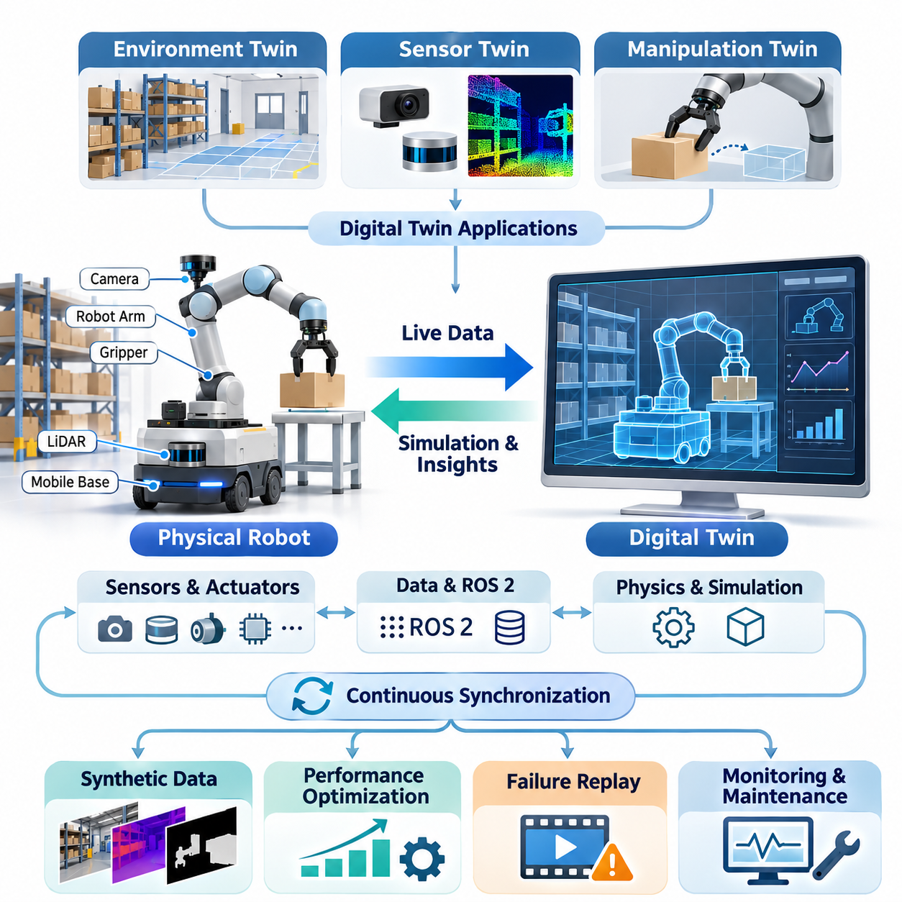
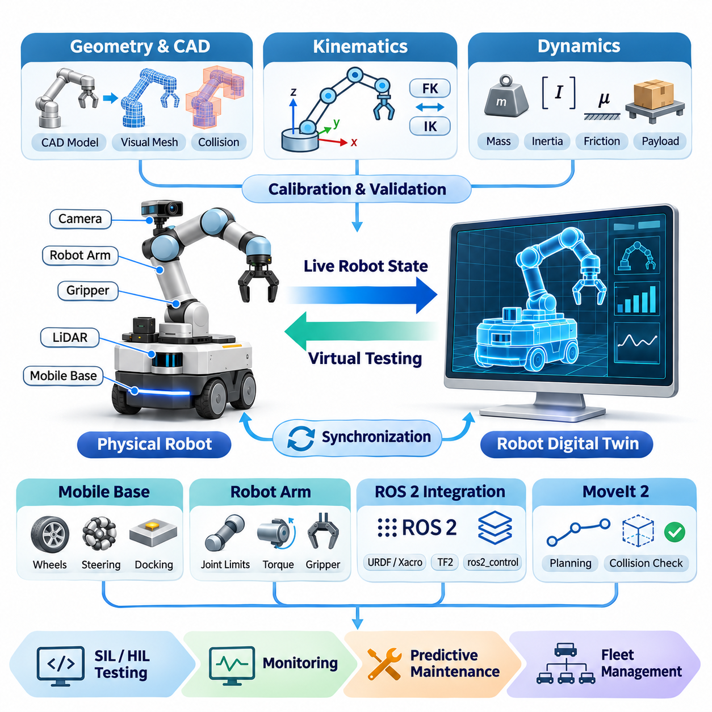
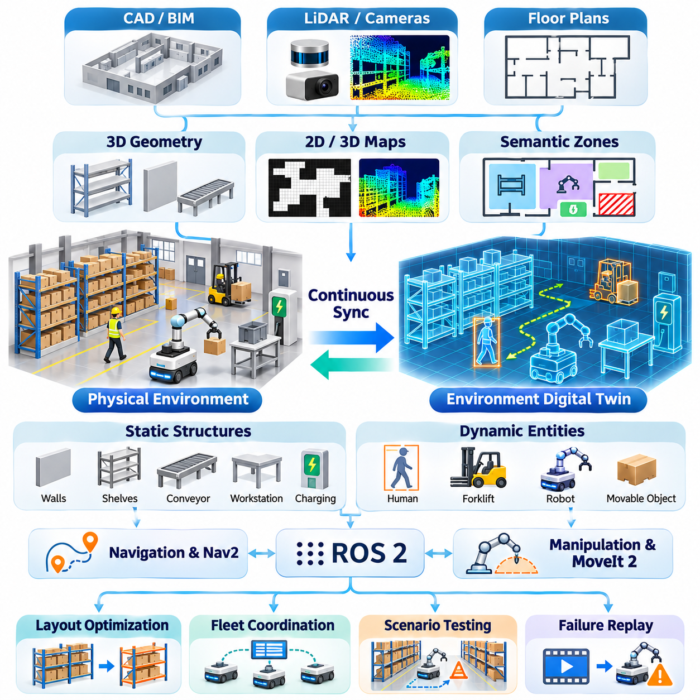
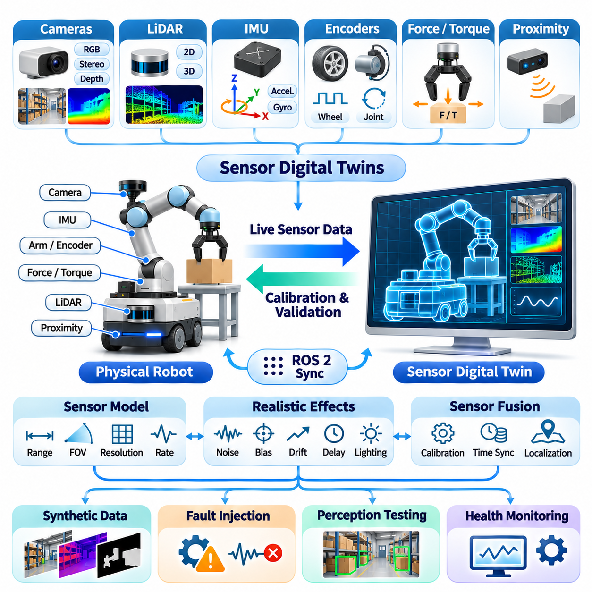
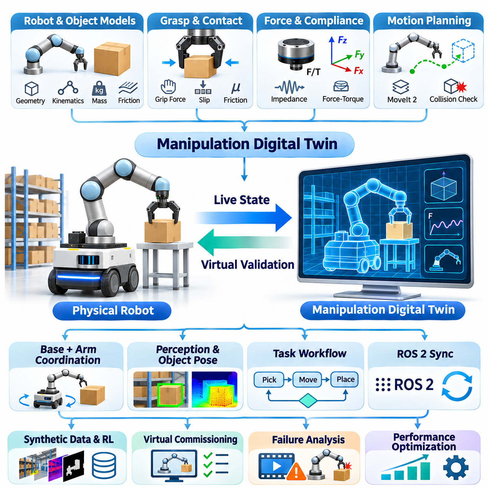
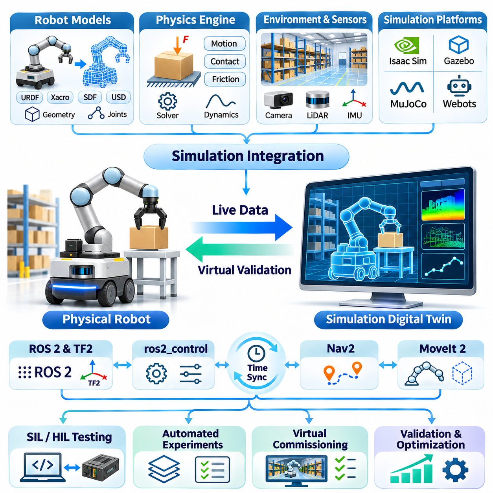
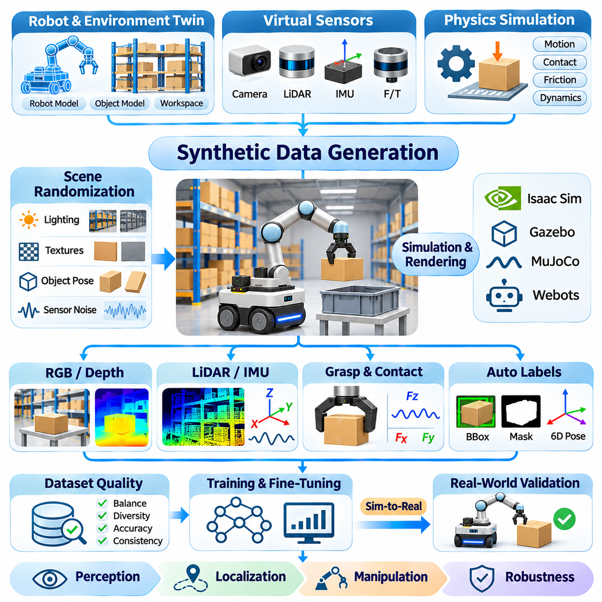
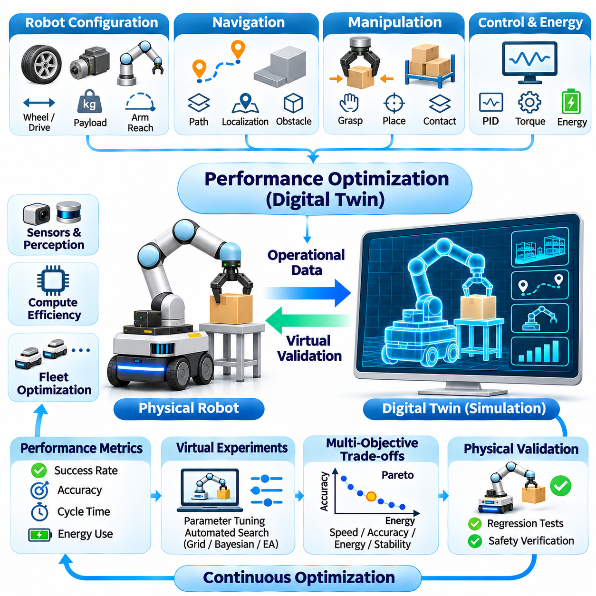
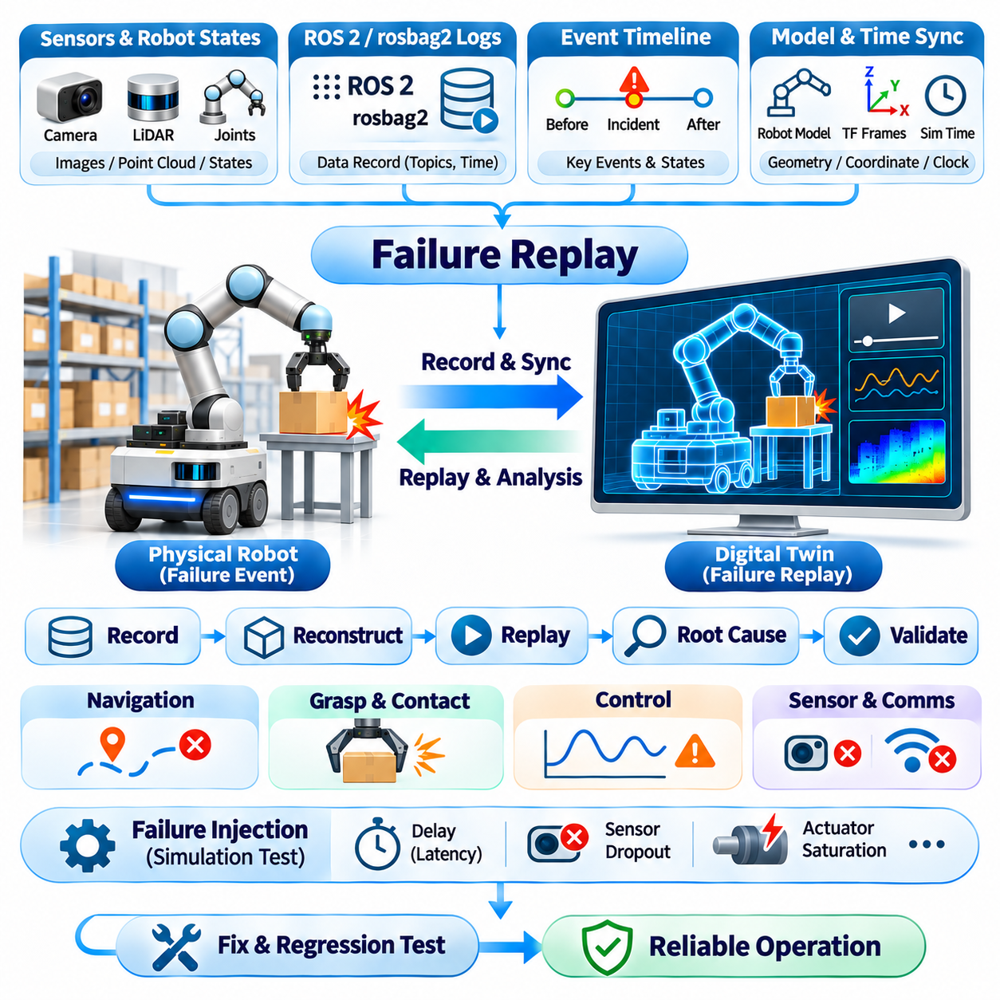
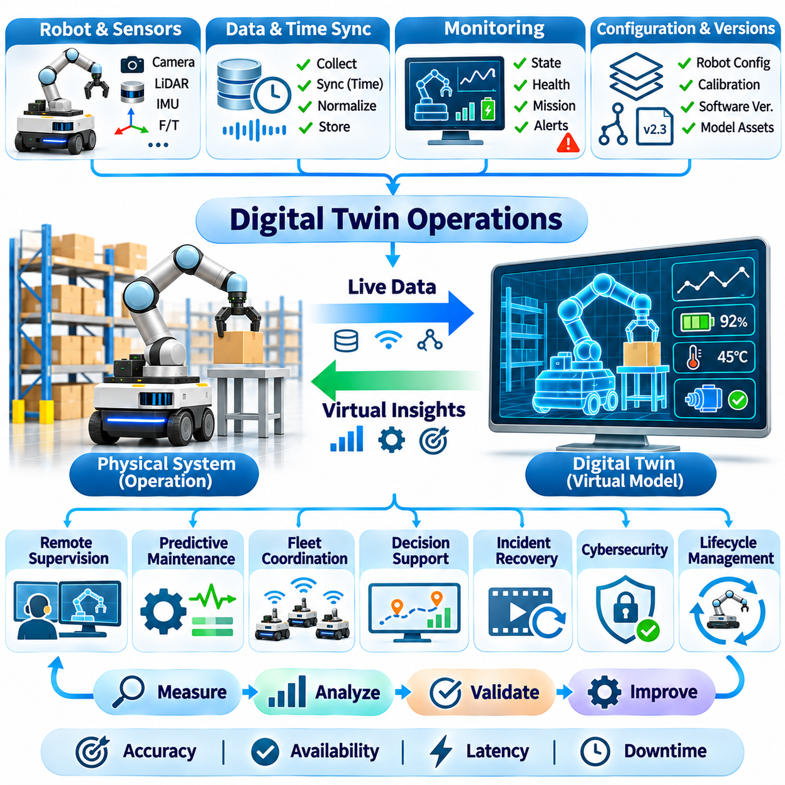

**Volume 04. Mobile Manipulation Software and Operations**

# Chapter 07. Digital Twins

## 01 Digital Twin Overview

{width="7.268055555555556in" height="7.268055555555556in"}

A digital twin is a dynamic virtual representation of a physical system that reflects its structure, behavior, operational state, and interactions with the surrounding environment. In mobile manipulation, a digital twin represents an autonomous mobile robot, robotic manipulator, sensors, control software, and operational workspace within an integrated digital environment. It establishes a continuous connection between physical assets and virtual models throughout the system lifecycle.

Unlike conventional three-dimensional models or standalone simulations, digital twins incorporate operational data from physical systems to maintain an updated representation of their actual conditions. Sensor measurements, actuator feedback, environmental observations, and mission execution records contribute to this synchronization. Depending on the application, information can flow from the physical system to the virtual model or bidirectionally between both environments.

The fundamental architecture of a digital twin consists of a physical entity, a virtual entity, a communication infrastructure, a data management system, and application services. The physical entity generates operational measurements, while the virtual entity reproduces relevant physical and functional characteristics. Communication infrastructure transfers information between these entities, allowing analytical applications to evaluate current behavior and predict potential future conditions.

For mobile manipulators, digital twins must represent the combined characteristics of mobile platforms and robotic arms. The virtual model incorporates mechanical dimensions, joint configurations, kinematic relationships, dynamic properties, actuator limitations, payload characteristics, and energy consumption. An accurate representation of these elements enables engineers to investigate the interactions between mobile navigation, manipulation accuracy, mechanical stability, and operational performance.

Environmental digital twins extend the virtual representation beyond individual robotic systems to include their surrounding workspaces. Warehouses, manufacturing facilities, hospitals, logistics centers, and industrial production lines can be represented using geometric models and spatial information. Environmental elements such as obstacles, shelves, conveyors, workstations, doors, and human movement patterns influence robot behavior and mission execution.

Sensor digital twins reproduce the measurement characteristics of cameras, LiDAR systems, inertial measurement units, force-torque sensors, encoders, and proximity sensors. These virtual sensors can incorporate measurement noise, resolution limitations, calibration errors, communication delays, and environmental disturbances. Such representations allow perception algorithms to be evaluated under diverse operational conditions without requiring continuous access to physical equipment.

Manipulation digital twins focus on the interactions between robotic arms, end effectors, target objects, and surrounding structures. They represent grasping configurations, contact forces, friction, collision conditions, object dynamics, and manipulation constraints. Engineers can use these representations to evaluate grasp stability, optimize motion trajectories, investigate alternative manipulation strategies, and identify operational limitations before physical execution.

Digital twins are closely integrated with robotics software frameworks such as ROS 2, MoveIt 2, and physics-based simulation platforms. Standardized communication interfaces enable virtual and physical systems to exchange robot states, sensor measurements, coordinate transformations, and mission information. Maintaining compatible software interfaces across virtual and physical environments reduces integration complexity and supports systematic software validation.

Simulation platforms provide the computational foundation for many digital twin applications. Physics engines reproduce mechanical movement, collisions, contact interactions, and environmental dynamics, while rendering engines generate virtual sensor observations. Platforms such as NVIDIA Isaac Sim, Gazebo, and MuJoCo offer different capabilities for constructing these environments according to computational requirements, simulation fidelity, and operational objectives.

Synthetic data generation represents another important application of digital twin technology. Virtual environments can produce annotated images, depth measurements, point clouds, object poses, segmentation masks, and manipulation trajectories. Environmental configurations, lighting conditions, object properties, and sensor parameters can be systematically modified to increase dataset diversity and improve the robustness of machine learning models deployed on physical robots.

Performance optimization becomes possible by evaluating alternative operational strategies within the digital twin before implementing them in physical systems. Engineers can investigate navigation routes, manipulation sequences, task allocation, energy consumption, charging schedules, and workspace configurations. Comparative experiments establish quantitative relationships between system parameters and operational metrics, supporting evidence-based engineering decisions.

Digital twins also provide valuable infrastructure for failure analysis and operational incident replay. Recorded sensor measurements, robot states, control commands, and mission events can be reconstructed within virtual environments to investigate the conditions leading to unexpected behavior. Engineers can reproduce failure scenarios, evaluate potential corrective actions, and conduct regression testing without repeatedly exposing physical robots to hazardous situations.

Continuous synchronization is essential for maintaining the operational relevance of digital twins. Physical robots generate large volumes of heterogeneous data at different sampling frequencies, requiring timestamp alignment, coordinate transformation, data filtering, and communication management. Synchronization accuracy must be balanced against network bandwidth, computational resources, storage requirements, and the latency tolerances of individual applications.

Digital twin fidelity must be selected according to the intended engineering and operational objectives. Excessively detailed models increase computational complexity without necessarily improving practical outcomes, while oversimplified representations may produce unreliable predictions. Model calibration, experimental validation, uncertainty estimation, and periodic updates help reduce discrepancies between virtual predictions and actual physical system behavior.

Throughout the mobile manipulator lifecycle, digital twins support system design, software development, virtual commissioning, deployment, remote supervision, predictive maintenance, and continuous improvement. However, virtual validation cannot independently guarantee physical safety or operational reliability. When combined with physical testing, secure communication, and controlled deployment procedures, digital twins establish an integrated foundation for scalable, intelligent, and reliable robotic operations.

## 02 Robot Digital Twins

{width="7.268055555555556in" height="7.268055555555556in"}

A robot digital twin is a virtual representation of a physical robotic system that reproduces its mechanical structure, functional characteristics, control behavior, and operational state. In mobile manipulation, it integrates the autonomous mobile base, robotic arm, end effector, sensors, actuators, and embedded computing infrastructure into a unified digital model. This representation supports engineering analysis, software validation, and continuous operational monitoring.

The construction of a robot digital twin begins with an accurate geometric representation of the physical robot. Computer-aided design models provide mechanical dimensions, component geometries, joint locations, and assembly relationships. These models are converted into simulation-compatible representations containing visual meshes and collision geometries. Simplified collision models are frequently employed to reduce computational overhead while preserving geometric accuracy.

Kinematic modeling defines the spatial relationships between the mobile platform, robotic arm, and end effector. Forward kinematics determines the position and orientation of individual components from joint configurations, while inverse kinematics calculates joint configurations required to achieve desired end-effector poses. The digital twin combines mobile base movement with manipulator motion to represent the complete reachable workspace and associated motion constraints.

Dynamic modeling extends the geometric and kinematic representation by incorporating component masses, centers of gravity, inertia tensors, friction coefficients, and external forces. These parameters enable the digital twin to reproduce acceleration, deceleration, vibration, and load-dependent mechanical behavior. Accurate dynamic modeling is particularly important when mobile manipulators transport heavy objects, operate on uneven surfaces, or execute coordinated whole-body movements.

The mobile base digital twin represents the locomotion characteristics of autonomous mobile robots using differential drive, omnidirectional wheels, or independent steering mechanisms. Wheel dimensions, motor characteristics, steering limitations, traction conditions, and suspension behavior influence the resulting motion. The virtual platform enables engineers to evaluate navigation accuracy, maneuverability, energy efficiency, docking performance, and stability under different payload conditions.

The robotic arm digital twin incorporates joint limits, velocity constraints, torque characteristics, transmission properties, and controller configurations. Virtual actuators reproduce relevant physical responses to position, velocity, and torque commands. Modeling actuator saturation, communication delays, mechanical backlash, and structural compliance helps engineers identify discrepancies between idealized motion planning results and realistic robotic execution.

Robot digital twins are commonly integrated with ROS 2 through standardized robot descriptions, communication interfaces, and coordinate transformation mechanisms. URDF and Xacro describe robot structures and configurable mechanical parameters, while TF2 maintains spatial relationships between coordinate frames. The ros2_control framework provides hardware abstraction and controller interfaces that support compatible control architectures across virtual and physical robotic systems.

Integration with MoveIt 2 enables robot digital twins to support motion planning, collision checking, trajectory generation, and manipulation task execution. The virtual robot maintains a representation of its current joint configuration and planning scene. Engineers can evaluate alternative trajectories, detect potential self-collisions, investigate singular configurations, and verify motion constraints before transferring validated commands to physical robotic hardware.

Real-time or near-real-time synchronization connects physical robots with their corresponding digital twins. Joint positions, wheel velocities, motor currents, battery conditions, temperatures, diagnostic messages, and mission states are transmitted to the virtual environment. Timestamp alignment and coordinate consistency are necessary to maintain an accurate representation, particularly when data originate from multiple controllers operating at different sampling frequencies.

Digital twins also support virtual commissioning by enabling robotic software to be evaluated before physical system integration is completed. Software-in-the-loop testing executes control algorithms against virtual robot models, while hardware-in-the-loop testing connects physical controllers to simulated components. These approaches help identify interface incompatibilities, controller configuration errors, timing problems, and unexpected interactions during early development stages.

Operational robot digital twins provide a foundation for condition monitoring and predictive maintenance. Differences between predicted and measured actuator behavior may indicate mechanical wear, increasing friction, thermal degradation, or abnormal energy consumption. Historical operating data can be combined with physical models and machine learning algorithms to estimate component health and remaining useful life, supporting maintenance decisions and reducing unexpected downtime.

At the fleet level, individual robot digital twins can be connected to fleet management systems to represent the operational conditions of multiple mobile manipulators. Each virtual robot maintains its identity, configuration, mission status, location, battery condition, and maintenance history. Fleet-level analysis supports resource allocation, mission scheduling, charging coordination, and comparative evaluation of robotic performance across different operating environments.

Model fidelity and synchronization quality determine the practical usefulness of robot digital twins. Calibration experiments compare virtual predictions with measured physical responses to identify modeling errors and uncertain parameters. Performance indicators such as trajectory deviation, positioning error, torque prediction error, and synchronization latency provide quantitative measures of model accuracy. Model versions must also remain consistent with physical hardware and software configurations.

Robot digital twins establish a continuous engineering connection between robotic design, simulation, deployment, and operational improvement. Their effectiveness depends on accurate modeling, reliable data communication, systematic validation, cybersecurity, and configuration management. Although virtual models cannot replace physical safety testing, properly maintained robot digital twins reduce development uncertainty and support scalable, reliable, and intelligent mobile manipulation throughout the robotic system lifecycle.

## 03 Environment Digital Twins

{width="7.268055555555556in" height="7.268055555555556in"}

An environment digital twin is a dynamic virtual representation of the physical workspace in which mobile manipulators operate. It incorporates geometric structures, spatial relationships, environmental conditions, operational resources, and dynamic entities into a unified digital environment. Unlike a conventional static map, an environment digital twin maintains relevant information about the changing conditions of the physical workspace through periodic or continuous synchronization.

The construction of an environment digital twin begins with the acquisition of spatial and structural information from physical facilities. Computer-aided design models, building information modeling data, LiDAR scans, camera observations, and architectural floor plans provide the foundation for virtual reconstruction. These heterogeneous data sources are transformed into consistent spatial representations that describe the dimensions, geometry, and organization of the operational environment.

Geometric modeling establishes the physical boundaries and structural characteristics of the virtual workspace. Walls, floors, ceilings, columns, shelves, workstations, conveyors, and industrial machinery are represented using three-dimensional meshes or simplified geometric primitives. Different levels of geometric detail can be assigned according to application requirements, allowing the digital twin to balance spatial accuracy, collision detection reliability, and computational efficiency.

Spatial maps provide essential information for autonomous navigation and manipulation planning. Two-dimensional occupancy grids represent traversable and occupied regions, while three-dimensional point clouds, voxel maps, and distance fields describe more complex spatial structures. Mobile manipulators can utilize these representations to calculate navigation paths, evaluate obstacle clearance, identify accessible targets, and determine appropriate positions for manipulation tasks.

Semantic modeling enhances geometric representations by assigning functional meaning to environmental objects and regions. Storage shelves, charging stations, loading areas, inspection zones, restricted regions, and manipulation workstations can be associated with semantic identifiers and operational attributes. This information enables robotic systems to interpret environmental structures according to mission requirements rather than relying exclusively on geometric characteristics.

Dynamic environmental modeling represents entities and conditions that change during robotic operations. Human workers, forklifts, automated guided vehicles, mobile robots, movable containers, and temporarily occupied workspaces influence navigation and manipulation behavior. Their positions, velocities, movement patterns, and predicted trajectories can be incorporated into the digital twin to support dynamic obstacle avoidance and coordinated operational planning.

Environmental digital twins are particularly important for manipulation workspace analysis because mobile manipulators must coordinate base positioning with robotic arm movement. The virtual environment represents object locations, workstation dimensions, approach directions, available clearance, and manipulation constraints. Engineers can evaluate docking positions, arm reachability, collision-free trajectories, and potential interference between robotic components and surrounding structures.

Environmental conditions also influence robotic perception and physical interaction. Lighting intensity, shadows, reflective surfaces, surface friction, floor irregularities, temperature, and airborne particles can affect sensor measurements and mechanical behavior. Appropriate environmental parameters can be incorporated into the digital twin to investigate operational limitations, evaluate perception robustness, and reproduce challenging conditions that may occur in physical facilities.

Integration with ROS 2, Nav2, and MoveIt 2 enables environment digital twins to support navigation, motion planning, and coordinated manipulation. Environmental models can provide occupancy maps, semantic information, obstacle representations, and planning scene updates through standardized interfaces. Consistent coordinate frames and transformation relationships ensure that virtual environmental information remains compatible with robot localization and control systems.

Environment digital twins can also support facility layout optimization and virtual commissioning before physical deployment. Engineers can evaluate alternative workstation arrangements, aisle widths, storage configurations, charging station locations, and robot traffic routes. Simulation-based experiments allow potential congestion, insufficient clearance, inaccessible manipulation targets, and inefficient material flow to be identified before expensive physical modifications are implemented.

At the fleet level, an environment digital twin provides a shared spatial and operational representation for multiple robotic systems. Fleet management platforms can use this information to coordinate mission assignments, traffic movement, resource reservations, and access to shared workspaces. Virtual evaluation of different fleet configurations helps determine appropriate robot quantities, operational priorities, charging strategies, and facility utilization under varying workload conditions.

Continuous environmental synchronization maintains consistency between virtual representations and physical operating conditions. Robot-mounted sensors, facility monitoring systems, and operational databases can provide updated information about obstacle locations, equipment status, and workspace modifications. Change detection, timestamp alignment, spatial registration, and map version management help prevent outdated environmental information from negatively affecting robotic decisions.

Environment digital twins also enable synthetic data generation, operational scenario testing, and failure replay. Virtual facilities can reproduce different lighting conditions, object distributions, traffic densities, unexpected obstacles, and equipment failures. Recorded operational events can be reconstructed when sufficient state information is available, allowing engineers to investigate navigation failures, manipulation interruptions, resource conflicts, and potential improvements to robotic control strategies.

The practical effectiveness of environment digital twins depends on spatial accuracy, semantic consistency, synchronization latency, and the reliability of environmental data. Excessive model complexity increases computational and maintenance requirements, while insufficient detail may conceal important operational constraints. When combined with physical validation and appropriate safety mechanisms, environment digital twins provide a scalable foundation for intelligent, adaptive, and reliable mobile manipulation in complex real-world facilities.

## 04 Sensor Digital Twins

{width="7.268055555555556in" height="7.268055555555556in"}

A sensor digital twin is a virtual representation of a physical sensing device that reproduces its measurement characteristics, operational behavior, environmental interactions, and performance limitations. In mobile manipulation, sensor digital twins represent cameras, LiDAR systems, inertial measurement units, encoders, force-torque sensors, and proximity sensors. These models support perception development, system validation, calibration, and operational diagnostics.

The construction of a sensor digital twin begins with identifying the physical and functional characteristics of the corresponding sensing device. Important parameters include measurement range, spatial resolution, sampling frequency, field of view, sensitivity, accuracy, and communication latency. Manufacturer specifications and experimental measurements provide the foundation for constructing virtual sensor models that approximate actual operational behavior.

Camera digital twins reproduce the imaging characteristics of RGB cameras, stereo cameras, depth cameras, and RGB-D sensing devices. Virtual camera models incorporate focal length, image resolution, lens distortion, exposure time, viewing angle, and optical properties. Rendering engines generate synthetic visual observations that enable engineers to evaluate object detection, segmentation, pose estimation, visual localization, and vision-based manipulation algorithms.

LiDAR digital twins reproduce the distance measurement principles and scanning characteristics of two-dimensional and three-dimensional laser scanning systems. Virtual laser rays interact with environmental geometry to generate range measurements and point clouds. Parameters such as angular resolution, scanning frequency, maximum detection distance, surface reflectivity, and measurement uncertainty influence the realism and reliability of simulated LiDAR observations.

Inertial measurement unit digital twins represent accelerometers and gyroscopes used to estimate robot orientation, acceleration, and angular velocity. Virtual inertial sensors reproduce measurement noise, bias instability, scale factor errors, axis misalignment, and temperature-dependent drift. These characteristics are particularly important when evaluating localization algorithms, sensor fusion strategies, motion estimation, and mobile platform stability.

Encoder digital twins reproduce the measurement behavior of rotary and linear position sensors installed in wheel drive systems, steering mechanisms, and robotic joints. Virtual encoders incorporate measurement resolution, quantization errors, sampling intervals, and communication delays. Combined with mechanical transmission models, they enable engineers to investigate positioning accuracy, velocity estimation, odometry errors, and closed-loop control performance.

Force-torque sensor digital twins represent the mechanical interaction measurements required for compliant manipulation, object handling, and contact-sensitive robotic operations. Virtual sensors calculate forces and moments from simulated contact interactions while incorporating measurement noise, bias, saturation, and cross-axis sensitivity. These representations support the development of force control, impedance control, grasp verification, and collision detection strategies.

Proximity sensor digital twins reproduce the detection characteristics of ultrasonic, infrared, capacitive, and other short-range sensing technologies. Detection distance, angular coverage, response time, surface characteristics, and environmental interference influence virtual sensor behavior. These models enable engineers to investigate obstacle detection, docking accuracy, object presence verification, and supplementary protective functions during mobile manipulation.

Sensor noise modeling is essential for reproducing realistic measurement behavior. Idealized sensor outputs often produce overly optimistic algorithm performance that cannot be achieved in physical environments. Gaussian noise, systematic bias, quantization, measurement drift, outliers, and intermittent signal loss can be incorporated according to experimentally observed characteristics, improving the practical relevance of virtual sensing environments.

Environmental interaction modeling further enhances sensor digital twin fidelity. Lighting variations, shadows, reflective surfaces, transparent materials, airborne particles, vibration, humidity, and temperature can influence physical sensor performance. By reproducing selected environmental disturbances, virtual sensing systems enable engineers to investigate perception limitations and evaluate algorithm robustness under diverse and challenging operational conditions.

Sensor digital twins also support multisensor calibration and sensor fusion development. Intrinsic parameters describe internal sensor characteristics, while extrinsic parameters define spatial relationships between sensors and robotic components. Virtual calibration experiments enable systematic investigation of transformation errors and temporal misalignment, supporting the integration of camera, LiDAR, inertial, and encoder measurements into consistent state estimates.

Integration with ROS 2 enables virtual and physical sensors to communicate through compatible message formats, topics, coordinate frames, and quality-of-service configurations. Simulation platforms can publish virtual images, laser scans, point clouds, inertial measurements, and force-torque data. Timestamp synchronization and realistic communication behavior allow perception and control software to operate across simulated and physical environments with minimal interface modifications.

Synthetic data generation and fault injection are important applications of sensor digital twins. Virtual sensors can generate annotated datasets under controlled environmental conditions, while intentional disturbances reproduce sensor failures, corrupted measurements, calibration deviations, and communication interruptions. These capabilities support machine learning development, regression testing, fault detection, and evaluation of robotic recovery strategies before physical deployment.

Operational sensor digital twins compare virtual predictions with measurements collected from physical sensing devices. Persistent discrepancies may indicate calibration drift, optical contamination, mechanical misalignment, electronic degradation, or abnormal environmental interference. Historical measurement records and diagnostic information support sensor health monitoring, predictive maintenance, performance evaluation, and systematic investigation of perception-related operational failures.

The effectiveness of sensor digital twins depends on model fidelity, calibration accuracy, computational efficiency, and synchronization quality. Virtual sensor behavior must be validated against representative physical measurements using application-specific performance metrics. Although simulated sensing cannot replace physical verification or safety validation, properly maintained sensor digital twins reduce development uncertainty and support reliable perception, adaptive control, and scalable mobile manipulation.

## 05 Manipulation Digital Twins

{width="7.268055555555556in" height="7.268055555555556in"}

A manipulation digital twin is a dynamic virtual representation of robotic manipulation processes that reproduces the interactions between robotic arms, end effectors, target objects, and surrounding environments. In mobile manipulation, it integrates mechanical characteristics, motion constraints, grasping behavior, contact dynamics, and control algorithms. This representation supports manipulation planning, virtual experimentation, performance optimization, and operational validation.

The construction of a manipulation digital twin begins with accurate geometric, kinematic, and dynamic models of the robotic manipulator and its end effector. Joint configurations, link dimensions, mass distributions, actuator characteristics, and mechanical constraints define the physical behavior of the virtual system. These models establish the computational foundation for evaluating manipulation capabilities and reproducing realistic interactions with physical objects.

Object modeling represents the geometric and physical characteristics of target objects involved in manipulation tasks. Object dimensions, mass, center of gravity, inertia, surface friction, material stiffness, and deformation properties influence manipulation behavior. Accurate object representations enable engineers to investigate grasp stability, object displacement, contact interactions, and the effects of payload variations during transportation and placement.

Grasping digital twins reproduce the interactions between robotic grippers and target objects during grasp acquisition, retention, transportation, and release. Virtual grippers represent finger geometry, opening width, gripping force, actuation dynamics, and contact surfaces. Simulation-based evaluation enables engineers to compare candidate grasp configurations, estimate grasp stability, identify potential slippage, and optimize gripping parameters.

Contact dynamics modeling is essential for reproducing realistic manipulation behavior. Physics engines calculate contact forces, frictional interactions, impact responses, and object motion resulting from interactions between robotic components and environmental surfaces. Contact stiffness, damping coefficients, friction models, and numerical solver settings significantly influence the accuracy and computational stability of virtual manipulation experiments.

Force and compliance modeling enables manipulation digital twins to reproduce contact-sensitive robotic operations. Virtual force-torque sensors and compliant actuator models provide feedback for evaluating force control, impedance control, and admittance control strategies. These capabilities are particularly important for assembly, insertion, surface inspection, polishing, and delicate object handling, where excessive contact forces may damage equipment or materials.

Motion planning integration allows manipulation digital twins to evaluate robotic trajectories before physical execution. Frameworks such as MoveIt 2 provide kinematic analysis, collision checking, trajectory generation, and constraint-based planning. Virtual experiments help identify unreachable targets, singular configurations, joint limit violations, unnecessary movements, and potential collisions between robotic components, objects, and environmental structures.

For mobile manipulators, digital twins must incorporate the relationship between mobile base positioning and robotic arm manipulation. Base orientation, docking accuracy, localization uncertainty, platform stability, and available workspace directly influence manipulation performance. Coordinated simulation enables engineers to optimize base placement, arm configurations, approach directions, and whole-body trajectories for complex manipulation tasks.

Perception integration connects manipulation digital twins with virtual cameras, LiDAR systems, depth sensors, and object pose estimation algorithms. Synthetic sensor observations allow robotic systems to identify target objects, estimate their six-dimensional poses, and generate appropriate grasping actions. Incorporating perception uncertainty enables engineers to evaluate the effects of detection errors, occlusion, and inaccurate spatial information.

Task-level digital twins extend individual manipulation actions into complete operational workflows. Picking, transporting, placing, sorting, assembling, and inspecting objects can be represented as sequences of interconnected actions. Integration with task planning frameworks and behavior trees enables engineers to evaluate execution dependencies, conditional decisions, task transitions, recovery behaviors, and overall mission completion performance.

Manipulation digital twins also support artificial intelligence development through synthetic data generation and reinforcement learning. Virtual environments can produce annotated grasp configurations, object poses, contact measurements, and successful or unsuccessful manipulation trajectories. Domain randomization introduces controlled variations in object properties, environmental conditions, and sensor behavior to improve policy generalization.

Virtual commissioning enables manipulation software and control systems to be evaluated before physical deployment. Software-in-the-loop testing connects manipulation algorithms with virtual robotic models, while hardware-in-the-loop testing incorporates physical controllers into simulated execution environments. These approaches help identify interface incompatibilities, timing errors, unstable control responses, and unexpected task execution behaviors.

Operational synchronization connects the manipulation digital twin with measurements obtained from physical robotic systems. Joint positions, actuator torques, gripper states, object poses, contact forces, and task execution events update the virtual representation. Comparing predicted and measured behavior enables engineers to identify modeling discrepancies, investigate manipulation failures, detect mechanical degradation, and refine control parameters.

Performance optimization uses manipulation digital twins to evaluate alternative mechanical configurations, grasping strategies, motion trajectories, and control settings. Quantitative metrics include grasp success rate, placement accuracy, cycle time, peak contact force, energy consumption, and task completion rate. Repeated virtual experiments support systematic parameter optimization while reducing physical equipment usage and experimental costs.

The practical effectiveness of manipulation digital twins depends on model fidelity, contact accuracy, synchronization quality, and experimental validation. Differences between simulated and physical interactions must be addressed through calibration, uncertainty estimation, and representative physical testing. When combined with appropriate safety mechanisms, manipulation digital twins support reliable, adaptive, and scalable robotic manipulation throughout the system lifecycle.

## 06 Simulation Integration

{width="7.268055555555556in" height="7.268055555555556in"}

Simulation integration connects digital twins with computational environments capable of reproducing robotic behavior, physical interactions, sensor measurements, and operational workflows. In mobile manipulation, this integration combines robot models, environmental representations, sensor models, and manipulation processes within a common execution framework. It enables engineers to develop, evaluate, and optimize robotic systems before and during physical deployment.

The architecture of simulation integration typically consists of a digital twin model, a simulation engine, a communication middleware layer, robotic control software, and operational data management services. The simulation engine calculates virtual system behavior, while communication interfaces exchange commands, measurements, and state information. Operational data continuously improves the consistency between simulated representations and physical robotic systems.

Robot model integration establishes the mechanical and functional representation of mobile manipulators within simulation environments. URDF, Xacro, SDF, and USD can describe robot geometry, joint configurations, collision structures, inertial properties, and sensor attachments. Appropriate conversion procedures preserve coordinate relationships, mechanical constraints, and physical parameters when transferring robot descriptions between different simulation platforms.

Physics engine integration enables digital twins to reproduce mechanical movement, force transmission, collision events, frictional interactions, and contact dynamics. Numerical solvers calculate the evolution of physical states according to simulation time steps and system constraints. Selecting appropriate solver configurations, contact parameters, and integration methods is essential for balancing physical accuracy, computational stability, and simulation performance.

Environmental integration connects robot digital twins with virtual representations of operational facilities. Warehouse layouts, manufacturing equipment, storage shelves, workstations, charging stations, and dynamic obstacles establish realistic operating conditions. Environmental models can incorporate semantic information, material properties, lighting configurations, and human movement patterns to support navigation, perception, and manipulation experiments.

Sensor simulation integration provides virtual measurements compatible with robotic perception and control software. Rendering engines generate camera images and depth measurements, while geometric and physical models produce LiDAR scans, inertial measurements, encoder feedback, and contact forces. Measurement noise, calibration deviations, sampling frequencies, and communication delays can be incorporated to reproduce realistic sensing conditions.

ROS 2 provides a communication foundation for integrating simulation environments with robotic software architectures. Virtual components exchange information through topics, services, actions, and standardized message formats. TF2 maintains coordinate transformations, while simulation clock mechanisms synchronize time-dependent processes. Compatible interfaces allow robotic applications to operate across virtual and physical environments with limited modifications.

The ros2_control framework supports simulation integration by providing standardized interfaces between robotic controllers and simulated hardware components. Virtual hardware interfaces expose joint positions, velocities, efforts, and command channels to control software. This abstraction enables engineers to evaluate controller configurations, actuator responses, coordinated movements, and feedback mechanisms using software architectures similar to physical implementations.

Integration with Nav2 and MoveIt 2 enables coordinated evaluation of autonomous navigation and robotic manipulation. Nav2 supports localization, path planning, obstacle avoidance, and navigation execution, while MoveIt 2 supports manipulator kinematics, collision checking, and trajectory planning. Combining these frameworks within a digital twin enables systematic evaluation of docking, mobile base placement, object handling, and whole-body coordination.

Simulation platforms such as NVIDIA Isaac Sim, Gazebo, MuJoCo, and Webots provide different capabilities for digital twin integration. Their capabilities vary according to physics modeling, rendering quality, sensor simulation, hardware acceleration, middleware compatibility, and computational efficiency. Platform selection should reflect the intended application, including navigation validation, contact-rich manipulation, synthetic data generation, or reinforcement learning.

Software-in-the-loop testing integrates robotic applications with simulated hardware and environmental models to evaluate software behavior under controlled conditions. Hardware-in-the-loop testing extends this architecture by connecting physical controllers with simulated mechanical systems and sensors. Both approaches support virtual commissioning, interface verification, timing analysis, fault injection, and systematic regression testing before physical integration.

Time synchronization is a critical requirement when simulation environments interact with operational digital twins. Simulation time may progress faster or slower than physical time, depending on computational workload and application requirements. Timestamp management, message buffering, deterministic execution, and communication latency monitoring help maintain temporal consistency between virtual components, control algorithms, and physical measurements.

Bidirectional data integration enables simulation models to receive operational information from physical robotic systems and return analytical results or proposed operational adjustments. Recorded joint states, sensor observations, mission events, and environmental changes can initialize or update virtual experiments. Any commands transferred to physical equipment must pass appropriate authorization, validation, and independent safety mechanisms before execution.

Simulation integration also supports automated experimentation through configurable scenarios, parameter variations, and repeatable execution procedures. Engineers can evaluate different payloads, object distributions, environmental disturbances, controller settings, and operational strategies. Automated experiment management records model versions, initial conditions, random seeds, and performance metrics, improving reproducibility and supporting evidence-based optimization.

The effectiveness of simulation integration depends on interface compatibility, model fidelity, synchronization accuracy, computational efficiency, and experimental validation. Differences between simulated and physical behavior must be quantified through representative physical tests and systematic calibration. Properly integrated simulation environments establish a scalable foundation for digital twin operations, continuous software validation, and reliable mobile manipulation throughout the system lifecycle.

## 07 Synthetic Data Generation

{width="7.268055555555556in" height="7.268055555555556in"}

Synthetic data generation is the process of producing artificial datasets through computational models, simulation environments, and digital twins to support robotic system development. In mobile manipulation, synthetic data reproduces visual observations, sensor measurements, object characteristics, manipulation trajectories, and operational scenarios. These datasets reduce dependence on physical data collection and enable systematic artificial intelligence development.

Digital twins provide a structured foundation for synthetic data generation by integrating virtual representations of robots, sensors, objects, and operational environments. Unlike isolated data generation techniques, digital twin-based approaches incorporate physical constraints, spatial relationships, and environmental interactions. This integration enables the creation of datasets that reflect the operating conditions and functional requirements of physical robotic systems.

Visual synthetic data generation involves rendering artificial images from virtual environments using simulated cameras and graphics engines. Object geometry, material properties, lighting conditions, camera positions, and background configurations influence the generated observations. These images support the development of object detection, semantic segmentation, instance segmentation, depth estimation, and six-dimensional object pose estimation algorithms.

Automatic annotation is a major advantage of digital twin-based synthetic data generation. Simulation environments maintain information about object identities, spatial coordinates, orientations, and geometric relationships. This information enables the automatic generation of bounding boxes, segmentation masks, depth maps, keypoints, and pose annotations, reducing manual labeling requirements and improving annotation consistency across large datasets.

Synthetic sensor data extends beyond visual observations to include LiDAR point clouds, inertial measurements, encoder feedback, proximity measurements, and force-torque signals. Virtual sensor models reproduce measurement characteristics, sampling frequencies, noise distributions, and operational limitations. Multimodal synthetic datasets support sensor fusion, localization, environmental perception, and coordinated navigation and manipulation algorithm development.

Domain randomization improves dataset diversity by systematically varying simulation parameters during synthetic data generation. Object positions, orientations, dimensions, textures, lighting conditions, surface friction, sensor noise, and camera viewpoints can be randomized within appropriate ranges. Exposure to diverse virtual conditions helps machine learning models generalize beyond specific training environments and reduces sensitivity to environmental variations.

Domain adaptation addresses differences between synthetic datasets and measurements collected from physical environments. Variations in image appearance, sensor characteristics, material properties, and physical interactions can create a simulation-to-reality gap. Feature alignment, image transformation, transfer learning, and fine-tuning with representative physical datasets help reduce these discrepancies and improve model performance in real-world applications.

Manipulation-specific synthetic data generation focuses on robotic grasping, object handling, contact interactions, and motion execution. Virtual experiments generate candidate grasp configurations, approach trajectories, contact forces, object movements, and task outcomes. Annotated examples of successful and unsuccessful manipulation attempts support grasp detection, grasp quality estimation, motion planning, and learning-based manipulation control.

Physics-based synthetic data generation incorporates mechanical properties and dynamic interactions into virtual experiments. Object mass, inertia, friction coefficients, contact stiffness, actuator characteristics, and gravitational effects influence generated trajectories and interaction measurements. Realistic physical modeling is particularly important for contact-rich manipulation, assembly operations, compliant control, and reinforcement learning applications.

Scenario-based data generation enables engineers to reproduce diverse operational conditions within a digital twin. Warehouse picking, bin picking, shelf replenishment, industrial assembly, and autonomous material handling can be represented through configurable scenarios. Rare events, unexpected obstacles, object displacement, sensor failures, and unsuccessful grasping attempts can also be introduced to improve dataset coverage and support robustness evaluation.

Simulation platforms such as NVIDIA Isaac Sim, Gazebo, MuJoCo, and Webots provide capabilities for generating synthetic robotic datasets. NVIDIA Isaac Replicator supports configurable scene randomization, sensor rendering, and automatic annotation within Isaac Sim. Platform selection depends on the required sensor modalities, rendering quality, physical accuracy, data generation throughput, and integration with existing robotic software architectures.

Dataset quality management ensures that synthetic observations and associated annotations meet application-specific requirements. Generated datasets should be evaluated for class balance, environmental diversity, annotation accuracy, physical consistency, and statistical similarity to representative operational data. Duplicate samples, unrealistic configurations, invalid annotations, and excessive distribution biases should be identified and removed before model training.

Synthetic data pipelines automate scene configuration, parameter sampling, simulation execution, data acquisition, annotation generation, and dataset export. Integration with machine learning operations enables dataset versioning, metadata management, experiment tracking, and reproducible training procedures. Recording simulation configurations, asset versions, sensor parameters, and random seeds allows engineers to reproduce and systematically refine generated datasets.

Hybrid learning strategies combine synthetic datasets with physical observations to improve machine learning performance. Large synthetic datasets can support initial model training, while smaller representative physical datasets provide domain-specific fine-tuning and performance validation. Independent real-world test datasets remain essential for assessing generalization, identifying simulation-related biases, and determining operational readiness before deployment.

The effectiveness of synthetic data generation depends on digital twin fidelity, dataset diversity, annotation reliability, computational efficiency, and simulation-to-reality transfer performance. Synthetic datasets cannot completely replace physical measurements or operational safety validation. When appropriately integrated into robotic development workflows, synthetic data generation reduces development costs and supports continuous improvement of mobile manipulation systems.

The supplied chapter outline establishes synthetic data generation within the digital twin framework; the technical explanations above expand that structure using general robotics and machine learning principles.

## 08 Performance Optimization

{width="7.268055555555556in" height="7.268055555555556in"}

Performance optimization in digital twin environments is the process of improving robotic system behavior through continuous analysis, virtual experimentation, and parameter refinement. In mobile manipulation, optimization considers navigation accuracy, manipulation precision, task execution time, energy consumption, computational resources, and system reliability. Digital twins provide a controlled environment for evaluating alternative configurations and identifying improvements before applying changes to physical robotic systems.

The optimization process begins with defining measurable performance objectives and establishing baseline operating conditions. Important indicators include navigation success rate, positioning error, grasp success rate, placement accuracy, cycle time, energy consumption, communication latency, and computational utilization. These metrics provide quantitative references for comparing different system configurations and determining whether proposed modifications produce meaningful improvements.

Robot configuration optimization focuses on mechanical and operational parameters that influence overall system performance. Wheel geometry, motor characteristics, steering configurations, manipulator joint limits, payload capacity, and sensor placement can be evaluated within the digital twin. Virtual experiments help identify configurations that improve maneuverability, mechanical stability, workspace accessibility, and manipulation performance under representative operating conditions.

Navigation optimization evaluates alternative paths, motion profiles, localization parameters, and obstacle avoidance strategies. Digital twins reproduce environmental geometry, dynamic obstacles, and robot movement constraints to compare navigation performance across different scenarios. Engineers can investigate path length, travel time, clearance, acceleration, and positioning accuracy to identify efficient navigation strategies without repeatedly conducting physical experiments.

Manipulation optimization focuses on improving grasping reliability, trajectory quality, placement precision, and contact behavior. Virtual experiments evaluate different grasp configurations, approach directions, joint trajectories, and force control parameters. Collision checking and contact simulation help identify unnecessary movements, unstable grasp conditions, and inefficient manipulation sequences, supporting improvements in task execution accuracy and repeatability.

Whole-body coordination optimization is particularly important for mobile manipulators because mobile base movement and robotic arm motion influence each other. The digital twin evaluates base positioning, docking accuracy, arm reachability, platform stability, and coordinated trajectories. Optimizing these relationships helps reduce unnecessary repositioning, improve workspace utilization, and increase manipulation success while maintaining appropriate mechanical and operational constraints.

Control parameter optimization uses digital twin experiments to investigate the effects of controller gains, motion constraints, acceleration limits, velocity profiles, and feedback configurations. PID controllers, impedance controllers, and other control strategies can be evaluated under different payloads and environmental conditions. Systematic parameter tuning helps reduce tracking errors, oscillations, overshoot, and settling time while maintaining stable and predictable robot behavior.

Energy optimization considers the relationship between robot movement, actuator loading, payload characteristics, and battery consumption. Digital twins estimate energy requirements for alternative navigation routes, manipulation sequences, acceleration profiles, and operational schedules. These evaluations support the selection of energy-efficient strategies, improved battery utilization, and longer operating periods between charging cycles.

Sensor and perception optimization improves the reliability and efficiency of environmental understanding. Camera placement, LiDAR configuration, sensor calibration, measurement frequency, and perception processing parameters can be evaluated through virtual experiments. Engineers can investigate the effects of sensor noise, occlusion, lighting variations, and measurement delays on localization and object detection performance, identifying configurations that provide sufficient accuracy with reasonable computational requirements.

Computational performance optimization addresses the resources required to execute digital twin models and robotic applications. Simulation fidelity, physics engine settings, rendering resolution, sensor update rates, and parallel execution configurations influence computational demand. Balancing model complexity and simulation accuracy enables efficient experimentation while maintaining sufficient physical realism for the intended engineering objectives.

Multi-objective optimization is necessary when improvements in one performance indicator negatively affect another. Increasing navigation speed, for example, may reduce positioning accuracy or increase energy consumption, while increasing manipulation force may improve grasp stability but create additional mechanical stress. Digital twins enable engineers to investigate these trade-offs and identify balanced configurations using weighted objectives, constraint-based optimization, and Pareto analysis.

Automated optimization methods can accelerate the evaluation of large parameter spaces. Grid search, random search, Bayesian optimization, evolutionary algorithms, and gradient-based methods can be applied according to the characteristics of the optimization problem. Automated experiments repeatedly modify selected parameters, execute virtual scenarios, collect performance metrics, and identify promising configurations for further evaluation.

Data-driven optimization combines operational measurements with analytical models and machine learning techniques. Historical robot performance, sensor observations, actuator feedback, and mission execution records provide information about actual system behavior. Predictive models can estimate the effects of parameter changes and recommend improvements, while continuous comparison between predicted and measured performance helps refine the digital twin.

Fleet-level optimization extends performance analysis from individual robots to multiple mobile manipulators operating within shared facilities. Digital twins can evaluate mission allocation, traffic coordination, charging schedules, workspace utilization, and resource availability. Comparative experiments help identify operational configurations that reduce congestion, balance workloads, minimize idle time, and improve overall fleet productivity.

Optimization results must be validated before being transferred to physical robotic systems. Engineers compare simulated improvements with representative physical experiments to identify differences caused by model inaccuracies, environmental uncertainty, actuator limitations, and sensor behavior. Configuration management, regression testing, and controlled deployment procedures ensure that performance improvements do not introduce unexpected failures or reduce operational safety.

The effectiveness of digital twin-based performance optimization depends on model accuracy, representative operating data, reliable performance metrics, and systematic experimental validation. Optimization should consider the complete robotic system rather than improving individual components in isolation. When integrated with continuous monitoring and operational feedback, digital twins provide a foundation for improving efficiency, precision, energy utilization, and reliability throughout the lifecycle of mobile manipulation systems.

## 09 Failure Replay

{width="7.268055555555556in" height="7.268055555555556in"}

The chapter structure identifies failure replay as a topic within the digital twin section, but does not provide a detailed subsection outline. The following explanation expands this topic using general robotics, simulation, and digital twin engineering principles.

Failure replay is a digital twin capability that reconstructs previously observed robotic failures within a virtual environment for systematic investigation and validation. In mobile manipulation, failures may involve navigation errors, localization instability, unexpected collisions, unsuccessful grasping, actuator abnormalities, communication interruptions, and incomplete task execution. Replaying these events allows engineers to examine the conditions leading to failures without repeatedly reproducing potentially dangerous situations using physical robotic systems.

The foundation of failure replay is the systematic collection of operational data from physical robotic systems. Relevant information includes sensor measurements, robot positions, joint states, actuator commands, controller outputs, environmental observations, mission events, and diagnostic messages. Accurate timestamps and consistent coordinate references are essential because failure analysis often requires reconstructing the precise sequence of events that occurred before, during, and after an incident.

Event logging provides a structured record of significant operational activities. Navigation commands, localization updates, obstacle detection events, manipulation requests, grasp confirmations, controller transitions, and emergency stops can be recorded together with their associated timestamps. Event-based logging helps engineers identify important moments within long operational recordings and establish relationships between software decisions, physical responses, and unexpected system behavior.

ROS 2 provides recording and playback capabilities through rosbag2, which can capture messages published across selected topics. Sensor data, robot states, control commands, and diagnostic information can subsequently be replayed for offline investigation. Appropriate topic selection, storage configuration, timestamp preservation, and metadata management are important for maintaining the completeness and usability of recorded operational data.

Digital twin synchronization enables recorded physical events to be reconstructed within a virtual robotic environment. The virtual robot must use compatible mechanical models, sensor configurations, coordinate transformations, and software parameters corresponding to the original physical system. Reproducing the environmental geometry and relevant object configurations is equally important because seemingly minor differences can change collision behavior, navigation outcomes, and manipulation results.

Deterministic replay aims to reproduce the same initial conditions and event sequence across repeated experiments. This requires controlling simulation time, initial robot states, random seeds, controller configurations, and relevant environmental parameters. However, exact reproduction may be limited by nondeterministic software execution, asynchronous communication, numerical solver differences, and variations in physical interactions. These limitations should be considered when interpreting replay results.

Failure reconstruction begins by identifying the initial conditions preceding the observed incident. Engineers restore the robot\'s position, orientation, joint configurations, battery state, sensor conditions, and environmental arrangement as accurately as available records permit. The recorded operational sequence is then executed within the digital twin to investigate whether the original failure can be reproduced and which system interactions contributed to its occurrence.

Navigation failure replay focuses on incidents such as localization loss, path tracking errors, unexpected obstacle encounters, oscillatory movement, and docking inaccuracies. Reconstructed sensor observations, localization estimates, navigation commands, and environmental conditions enable engineers to examine the relationship between perception, planning, and motion control. Alternative localization parameters, navigation algorithms, and obstacle avoidance strategies can then be evaluated under comparable conditions.

Manipulation failure replay investigates unsuccessful grasping, object dropping, inaccurate placement, unexpected contact forces, and collision events. Recorded joint positions, gripper states, object poses, and force measurements help reconstruct the physical interaction sequence. Engineers can evaluate whether failures originated from inaccurate object perception, unsuitable grasp configurations, trajectory planning errors, insufficient gripping force, or unexpected mechanical interactions.

Control system failure replay examines abnormal actuator responses, unstable movements, excessive vibration, unexpected torque variations, and communication-related control problems. Recorded reference commands, feedback measurements, controller states, and actuator diagnostics provide evidence for investigating the behavior of individual control components. Replaying these conditions enables engineers to evaluate alternative control gains, motion constraints, and recovery mechanisms without immediately modifying physical equipment.

Sensor failure replay focuses on inaccurate measurements, intermittent signal loss, calibration deviations, unexpected noise, and communication interruptions. Recorded camera images, LiDAR scans, inertial measurements, and encoder feedback can be examined alongside the corresponding perception and localization outputs. Engineers can investigate how sensor abnormalities propagated through the software architecture and influenced subsequent navigation or manipulation decisions.

Failure injection extends replay-based analysis by introducing controlled abnormalities into reconstructed scenarios. Engineers can simulate delayed messages, missing sensor measurements, incorrect localization estimates, actuator saturation, unexpected obstacles, and communication failures. These experiments reveal system vulnerabilities and help determine whether monitoring functions, error detection mechanisms, and recovery procedures respond appropriately to abnormal conditions.

Root cause analysis combines replay results with software logs, system diagnostics, physical models, and operational records to identify the underlying mechanisms responsible for failures. A visible symptom does not necessarily represent the original cause. For example, a failed grasp may result from inaccurate localization, incorrect coordinate transformations, mechanical compliance, or delayed sensor information. Examining the complete sequence of interactions helps distinguish direct causes from contributing conditions.

Failure replay also supports regression testing after software modifications and system upgrades. Previously recorded failure scenarios can be reused to determine whether corrective changes resolve identified problems without introducing new defects. Comparing system behavior before and after modifications provides evidence for evaluating improvements in navigation reliability, manipulation accuracy, fault detection, and recovery performance.

At the fleet level, failure replay enables engineers to investigate incidents involving multiple robots, shared workspaces, mission scheduling, and traffic coordination. Recorded robot states, task assignments, communication events, and environmental conditions can be reconstructed to examine conflicts and operational interruptions. This approach supports the development of improved fleet coordination strategies and more reliable resource allocation mechanisms.

Failure replay results should be documented using consistent records of incident descriptions, initial conditions, software versions, model configurations, reproduction procedures, observed behavior, and corrective actions. Maintaining this information creates a reusable engineering knowledge base that supports future debugging, system validation, operator training, and maintenance activities. Version control is particularly important because changes in robot models or simulation configurations may affect replay outcomes.

The effectiveness of failure replay depends on operational data completeness, timestamp accuracy, digital twin fidelity, model configuration consistency, and reproducibility. Virtual reconstruction cannot guarantee an exact reproduction of every physical incident, particularly when unrecorded environmental conditions or complex mechanical effects are involved. Nevertheless, integrating systematic recording, digital twin reconstruction, controlled failure injection, and regression testing establishes a valuable foundation for improving robotic reliability and reducing repeated operational failures.

## 10 Digital Twin Operations

{width="7.268055555555556in" height="7.268055555555556in"}

Digital twin operations encompass the continuous management, synchronization, monitoring, and maintenance of virtual representations throughout the lifecycle of robotic systems. In mobile manipulation, digital twin operations connect physical robots, sensors, software components, and operational environments with their corresponding virtual models. This integration enables engineers and operators to maintain system awareness, evaluate operational performance, investigate abnormalities, and support informed decisions during daily robotic operations.

The operational architecture of a digital twin combines physical robotic equipment, virtual models, communication infrastructure, data processing services, and monitoring applications. Physical robots continuously generate information about their movements, sensor observations, actuator conditions, and mission execution. These data are transmitted to the digital twin, where virtual representations are updated to reflect the latest operational conditions and provide a consistent view of the robotic system.

Continuous synchronization is a fundamental requirement for reliable digital twin operations. Robot positions, joint configurations, battery conditions, sensor measurements, environmental changes, and task execution states must be transferred and processed with appropriate timing accuracy. Timestamp management, communication monitoring, data validation, and coordinate consistency help maintain synchronization between physical and virtual systems while reducing discrepancies caused by communication delays or missing information.

Operational data management organizes information collected from multiple robotic components and software services. Sensor streams, controller feedback, diagnostic messages, mission records, and environmental observations may have different data formats and sampling frequencies. Data normalization, timestamp alignment, filtering, and storage management establish a consistent information foundation for digital twin applications. Historical records also support performance analysis, failure investigation, and long-term operational improvement.

Digital twin monitoring provides continuous visibility into the operational condition of robotic systems. Engineers can examine navigation status, manipulator configurations, actuator temperatures, battery levels, sensor availability, communication quality, and mission progress through integrated monitoring applications. Comparing measured physical conditions with expected virtual behavior helps identify abnormal patterns and potential equipment degradation before they develop into serious operational problems.

Remote supervision enables operators to observe and assess robotic systems through their digital twin representations. Virtual models provide spatial and operational information that complements conventional monitoring interfaces and sensor dashboards. Operators can investigate robot locations, workspace conditions, mission execution states, and equipment abnormalities without being physically present at the operating site. Remote supervision improves operational visibility, although safety-critical interventions must remain subject to independent control and authorization mechanisms.

Digital twin operations support predictive maintenance by analyzing historical measurements and current equipment conditions. Changes in actuator current, motor temperature, vibration, positioning accuracy, and mechanical response can indicate developing faults. Analytical models and machine learning techniques can estimate component degradation and remaining useful life. Maintenance activities can then be scheduled according to equipment condition, operational priorities, and expected service requirements rather than relying exclusively on fixed maintenance intervals.

Configuration management ensures that virtual models remain consistent with the physical robotic systems they represent. Robot descriptions, sensor calibration parameters, controller configurations, software versions, environmental maps, and simulation assets must be maintained under controlled version management. When physical hardware or software changes, the corresponding digital twin must be updated and validated. Configuration inconsistencies can produce misleading simulation results and unreliable operational assessments.

Digital twin lifecycle management includes model development, commissioning, operational deployment, periodic validation, updates, and eventual retirement. Initial models are established from engineering specifications and calibrated using physical measurements. During deployment, operational data continuously improve model accuracy. Changes in mechanical components, sensors, workspaces, and software architectures must be reflected in the virtual representation to preserve its relevance throughout the system lifecycle.

Fleet-level digital twin operations extend monitoring and management across multiple mobile manipulators. Each robot maintains its own virtual representation, while fleet-level services integrate mission assignments, battery conditions, operational locations, equipment health, and shared workspace information. This architecture supports coordinated supervision, resource allocation, charging management, traffic coordination, and comparative performance analysis across different robots and operating areas.

Operational decision support uses digital twin information to evaluate possible actions before implementing them in physical systems. Engineers can investigate alternative navigation routes, task assignments, docking positions, manipulation sequences, and maintenance schedules within the virtual environment. Comparing predicted outcomes with operational constraints helps identify appropriate decisions while reducing unnecessary physical experiments and minimizing disruption to ongoing robotic activities.

Digital twin operations also support incident management and operational recovery. When a robot encounters unexpected behavior, recorded sensor measurements, controller states, mission events, and environmental conditions can be examined through the virtual representation. Engineers can investigate the incident, reproduce relevant conditions, evaluate corrective strategies, and verify software modifications. Validated recovery procedures can subsequently be incorporated into operational workflows and maintenance documentation.

Cybersecurity and data governance are essential because digital twins exchange information between physical equipment, software infrastructure, and operational networks. Communication channels, access permissions, authentication mechanisms, software interfaces, and stored operational records must be protected against unauthorized access and manipulation. Clear ownership, data retention policies, audit records, and controlled update procedures help maintain the integrity and trustworthiness of digital twin operations.

Scalability and interoperability become increasingly important as robotic deployments expand across multiple facilities and heterogeneous hardware platforms. Digital twin architectures should support standardized interfaces, reusable robot models, consistent data formats, and modular software components. Integration with ROS 2, fleet management systems, simulation platforms, and enterprise information services enables digital twin applications to evolve without requiring complete reconstruction whenever individual system components change.

Operational performance evaluation determines whether digital twin applications provide measurable engineering and business value. Relevant indicators include synchronization latency, model accuracy, system availability, maintenance prediction accuracy, incident frequency, task completion rate, energy consumption, and operational downtime. Regular evaluation helps identify limitations in data quality, model fidelity, communication infrastructure, and monitoring procedures while establishing priorities for continuous improvement.

The effectiveness of digital twin operations depends on reliable data acquisition, accurate virtual models, continuous synchronization, controlled configuration management, cybersecurity, and systematic validation. A digital twin should not be treated as a static visualization or an independent simulation environment, but as a continuously maintained operational representation connected to physical robotic systems. When properly implemented, digital twin operations provide a foundation for intelligent supervision, predictive maintenance, operational optimization, and reliable mobile manipulation throughout the complete robotic system lifecycle.
