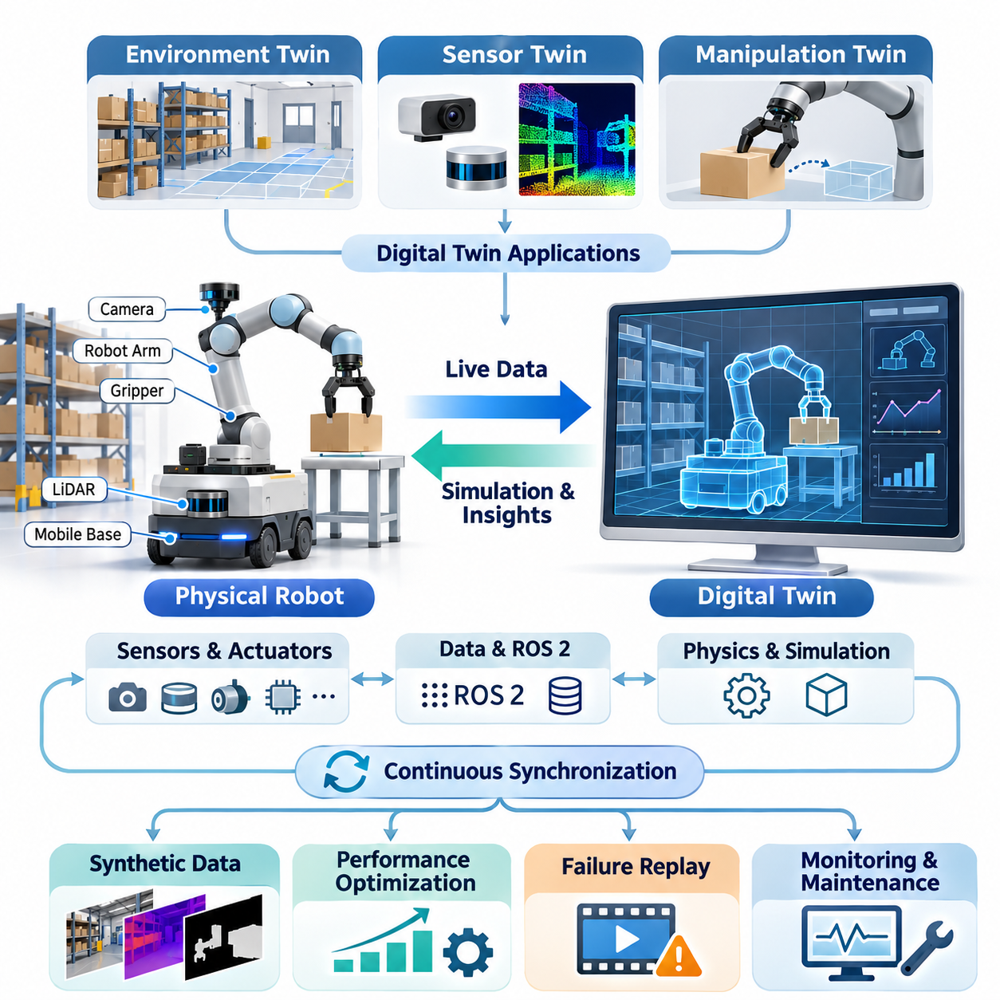
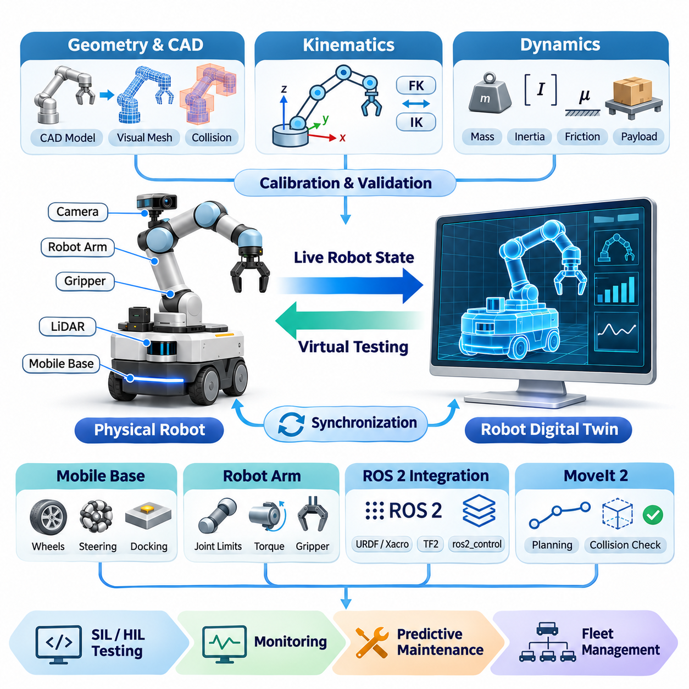
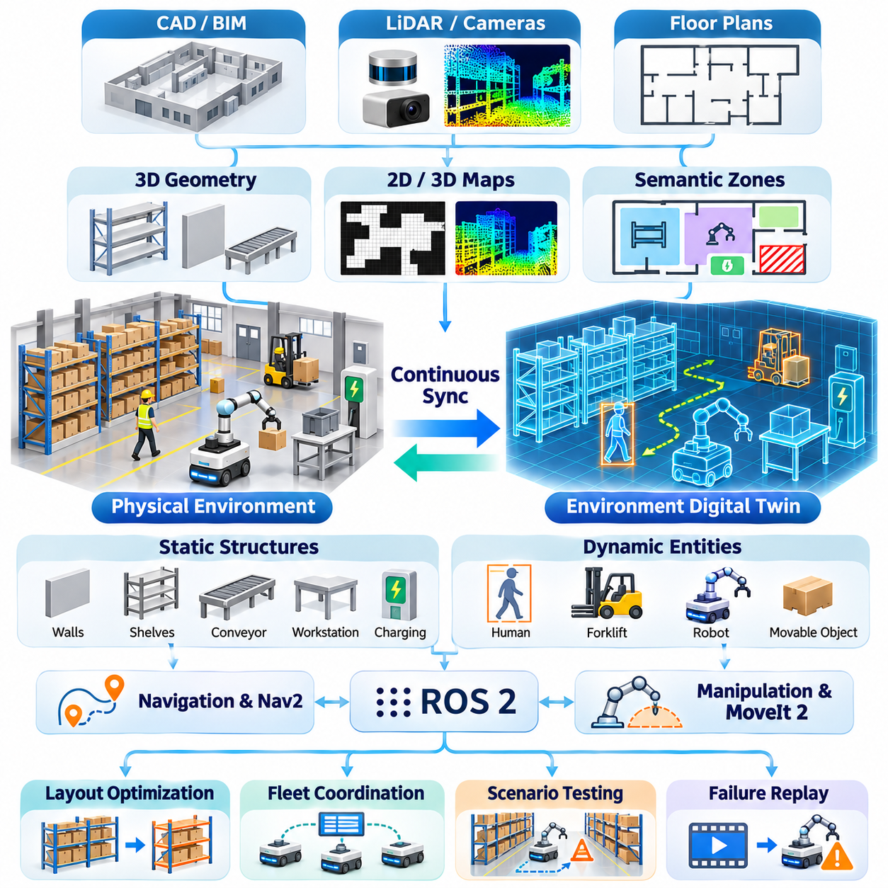
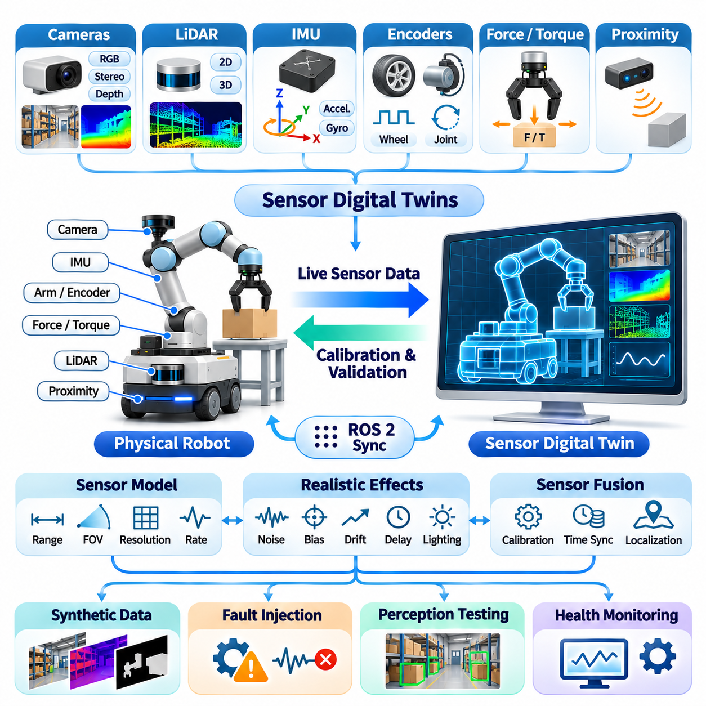
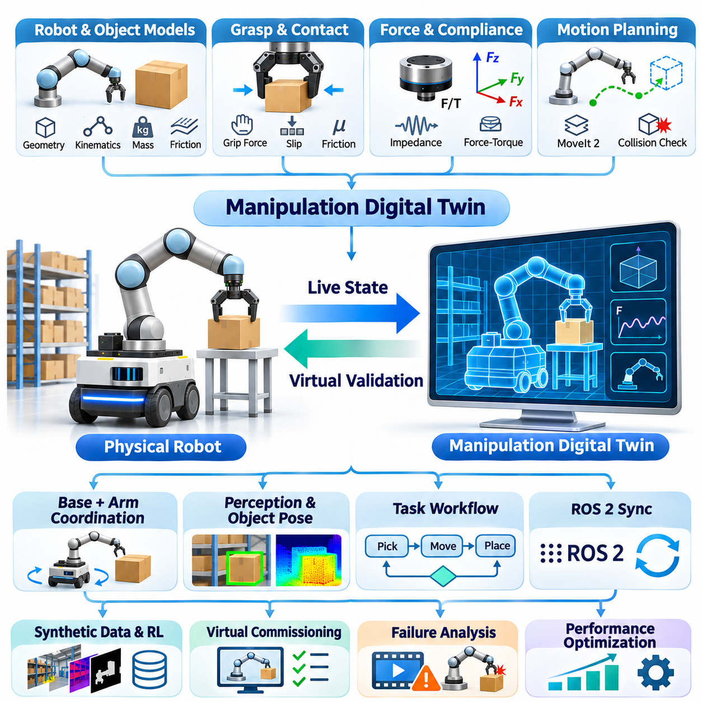
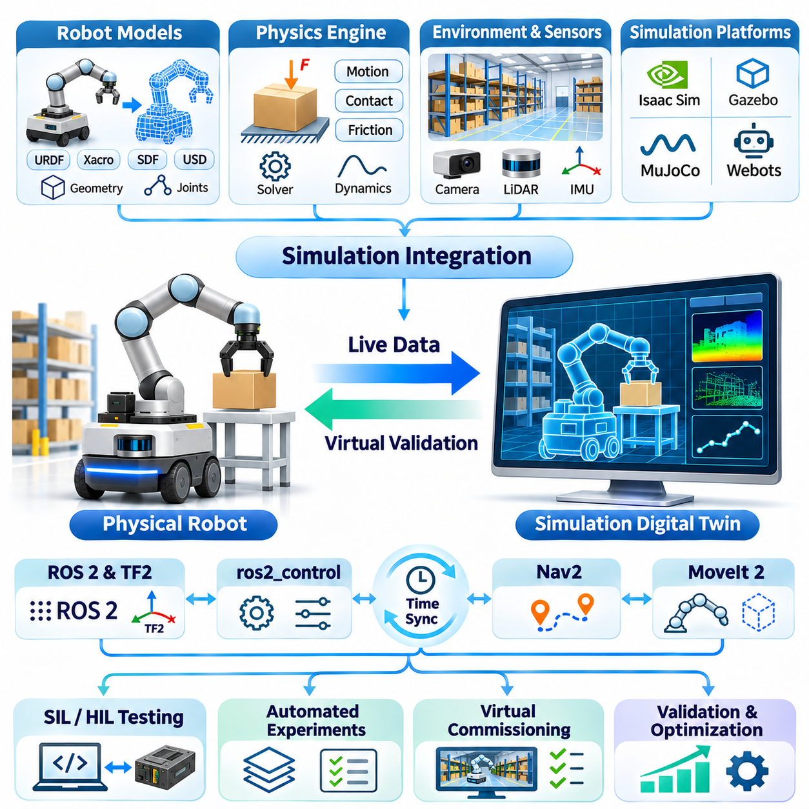
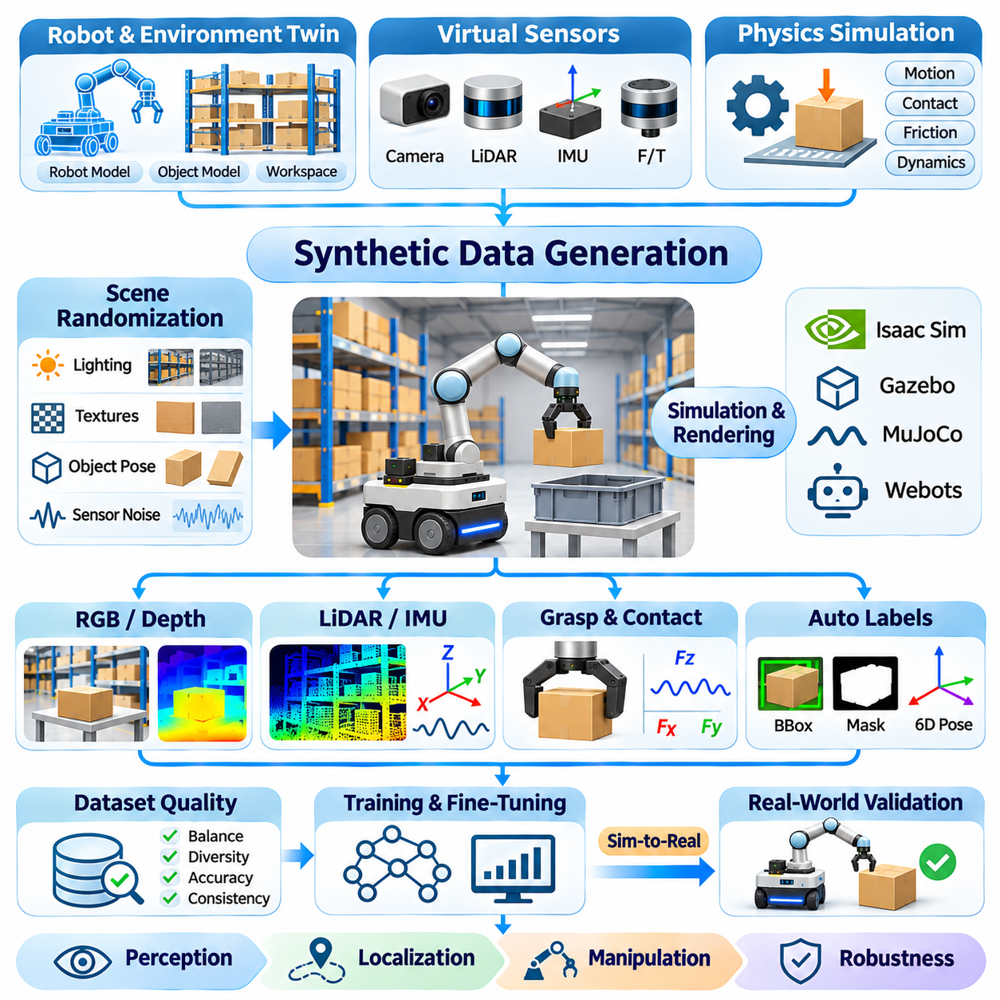
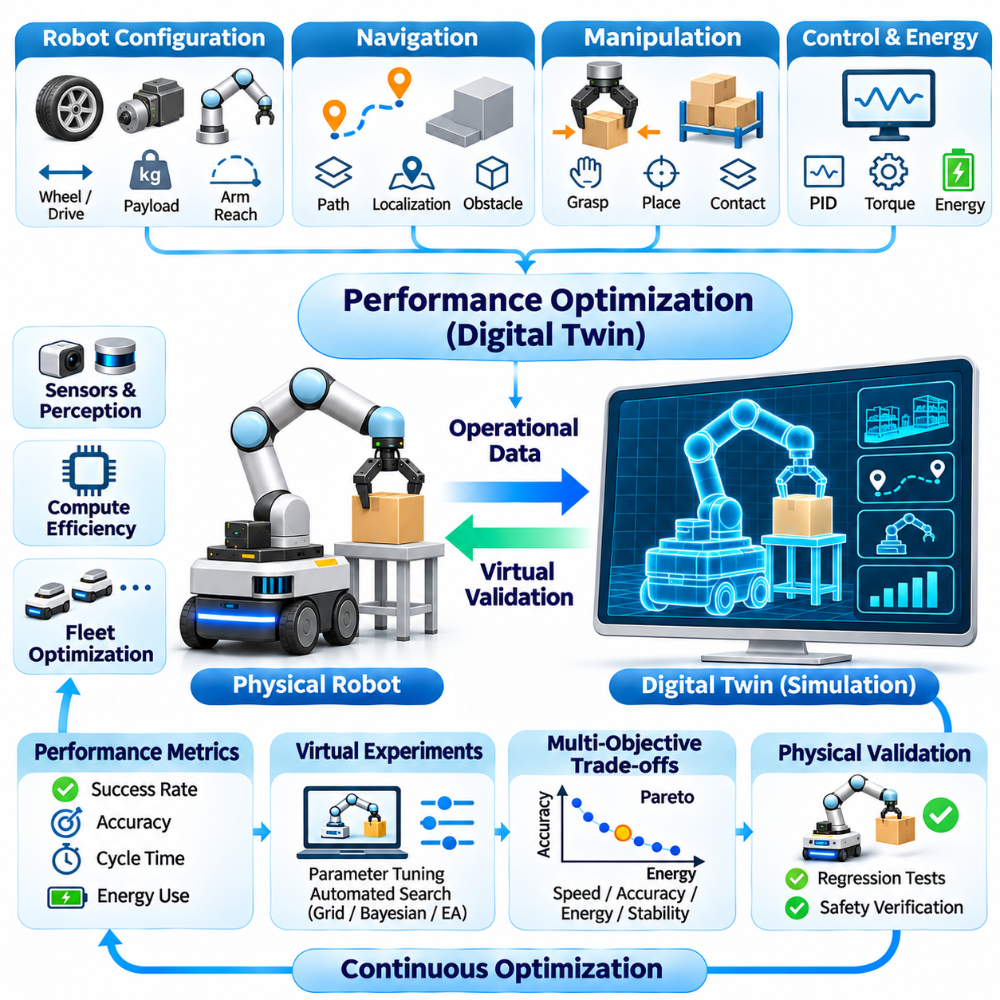
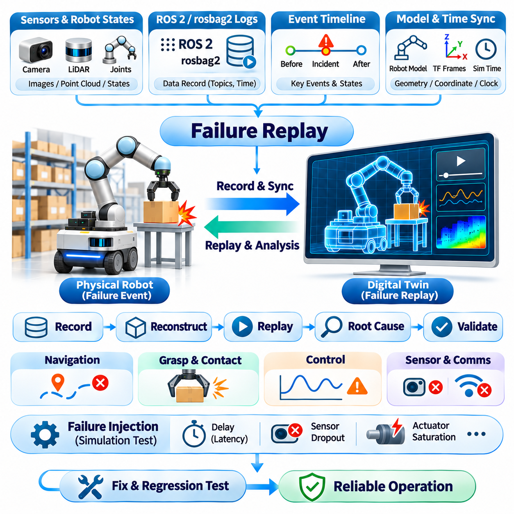
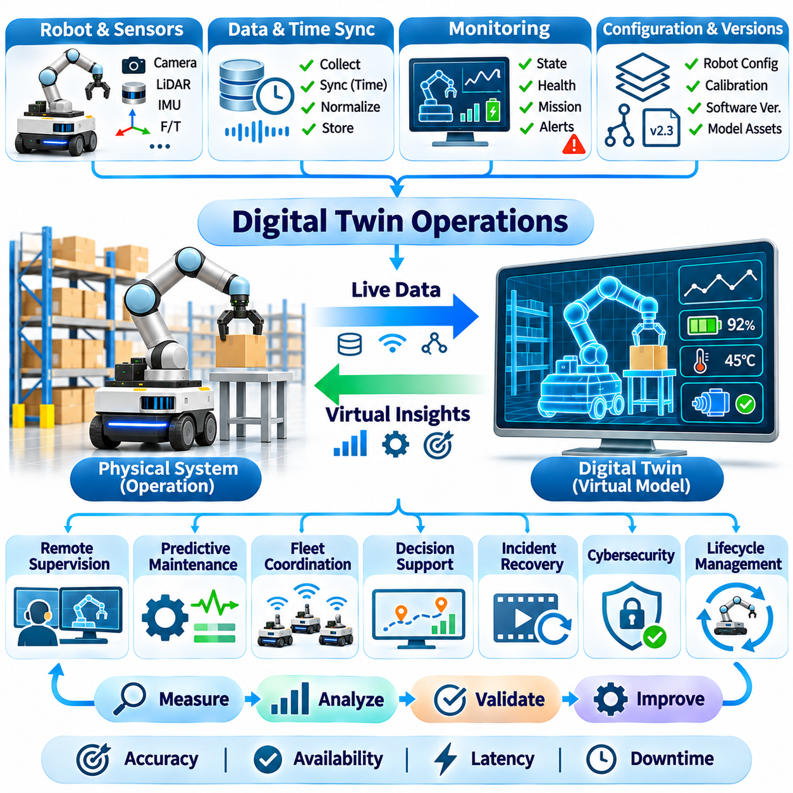

# Chapter 07. Digital Twins

## 01 Digital Twin Overview

{width="7.268055555555556in" height="7.268055555555556in"}

디지털 트윈(Digital Twin)은 물리적 시스템(Physical System)의 구조, 동작, 운영 상태 및 주변 환경과의 상호작용을 반영하는 동적인 가상 표현(Virtual Representation)이다. 모바일 매니퓰레이션(Mobile Manipulation)에서 디지털 트윈은 자율 이동 로봇(Autonomous Mobile Robot), 로봇 매니퓰레이터(Robotic Manipulator), 센서(Sensor), 제어 소프트웨어(Control Software) 및 운영 작업 공간(Operational Workspace)을 통합된 디지털 환경(Digital Environment)으로 표현한다. 이를 통해 시스템의 전체 수명 주기(System Lifecycle)에 걸쳐 물리적 자산과 가상 모델 사이의 지속적인 연결을 구축한다.

기존의 3차원 모델(3D Model)이나 독립형 시뮬레이션(Standalone Simulation)과 달리 디지털 트윈은 물리적 시스템의 실제 상태를 지속적으로 반영하기 위해 운영 데이터(Operational Data)를 통합한다. 센서 측정값(Sensor Measurement), 액추에이터 피드백(Actuator Feedback), 환경 관측(Environmental Observation) 및 임무 실행 기록(Mission Execution Record)은 이러한 동기화(Synchronization)에 기여한다. 응용 분야에 따라 정보는 물리적 시스템에서 가상 모델로 단방향으로 전달되거나 두 환경 사이에서 양방향(Bidirectional)으로 교환될 수 있다.

디지털 트윈의 기본 아키텍처(Architecture)는 물리적 개체(Physical Entity), 가상 개체(Virtual Entity), 통신 인프라(Communication Infrastructure), 데이터 관리 시스템(Data Management System) 및 응용 서비스(Application Service)로 구성된다. 물리적 개체는 운영 측정 데이터를 생성하며, 가상 개체는 관련 물리적 및 기능적 특성을 재현한다. 통신 인프라는 이러한 개체 사이에서 정보를 전달하며, 분석 애플리케이션(Analytical Application)이 현재의 동작을 평가하고 잠재적인 미래 상태를 예측할 수 있도록 지원한다.

모바일 매니퓰레이터(Mobile Manipulator)의 디지털 트윈은 이동 플랫폼(Mobile Platform)과 로봇 암(Robot Arm)이 결합된 특성을 표현해야 한다. 가상 모델(Virtual Model)은 기계적 치수(Mechanical Dimension), 관절 구성(Joint Configuration), 기구학적 관계(Kinematic Relationship), 동역학적 특성(Dynamic Property), 액추에이터 제한(Actuator Limitation), 페이로드 특성(Payload Characteristic) 및 에너지 소비(Energy Consumption)를 포함한다. 이러한 요소를 정확하게 표현하면 이동 내비게이션(Mobile Navigation), 매니퓰레이션 정밀도(Manipulation Accuracy), 기계적 안정성(Mechanical Stability) 및 운영 성능(Operational Performance) 사이의 상호작용을 분석할 수 있다.

환경 디지털 트윈(Environment Digital Twin)은 가상 표현의 범위를 개별 로봇 시스템에서 주변 작업 공간으로 확장한다. 물류 창고(Warehouse), 제조 시설(Manufacturing Facility), 병원(Hospital), 물류 센터(Logistics Center) 및 산업 생산 라인(Industrial Production Line)은 기하학적 모델(Geometric Model)과 공간 정보(Spatial Information)를 활용하여 표현할 수 있다. 장애물(Obstacle), 선반(Shelf), 컨베이어(Conveyor), 작업 스테이션(Workstation), 출입문(Door) 및 사람의 이동 패턴(Human Movement Pattern)과 같은 환경 요소는 로봇의 동작과 임무 실행에 영향을 미친다.

센서 디지털 트윈(Sensor Digital Twin)은 카메라(Camera), 라이다(LiDAR), 관성 측정 장치(Inertial Measurement Unit, IMU), 힘·토크 센서(Force-Torque Sensor), 엔코더(Encoder) 및 근접 센서(Proximity Sensor)의 측정 특성을 재현한다. 이러한 가상 센서(Virtual Sensor)는 측정 노이즈(Measurement Noise), 해상도 제한(Resolution Limitation), 보정 오차(Calibration Error), 통신 지연(Communication Delay) 및 환경 외란(Environmental Disturbance)을 반영할 수 있다. 이를 통해 물리적 장비에 지속적으로 접근하지 않고도 다양한 운영 조건에서 인지 알고리즘(Perception Algorithm)을 평가할 수 있다.

매니퓰레이션 디지털 트윈(Manipulation Digital Twin)은 로봇 암, 말단 장치(End Effector), 대상 객체(Target Object) 및 주변 구조물 사이의 상호작용에 중점을 둔다. 이는 파지 구성(Grasp Configuration), 접촉력(Contact Force), 마찰(Friction), 충돌 조건(Collision Condition), 객체 동역학(Object Dynamics) 및 매니퓰레이션 제약 조건(Manipulation Constraint)을 표현한다. 엔지니어는 이러한 가상 표현을 활용하여 파지 안정성(Grasp Stability)을 평가하고, 운동 궤적(Motion Trajectory)을 최적화하며, 대안적인 매니퓰레이션 전략을 분석하고, 물리적 실행 이전에 운영상의 한계를 식별할 수 있다.

디지털 트윈은 ROS 2, MoveIt 2 및 물리 기반 시뮬레이션 플랫폼(Physics-Based Simulation Platform)과 같은 로봇 소프트웨어 프레임워크(Robotics Software Framework)와 긴밀하게 통합된다. 표준화된 통신 인터페이스(Standardized Communication Interface)를 통해 가상 시스템과 물리적 시스템은 로봇 상태(Robot State), 센서 측정값, 좌표 변환(Coordinate Transformation) 및 임무 정보(Mission Information)를 교환할 수 있다. 가상 환경과 물리적 환경 사이에서 호환 가능한 소프트웨어 인터페이스를 유지하면 시스템 통합 복잡도(Integration Complexity)를 줄이고 체계적인 소프트웨어 검증(Software Validation)을 지원할 수 있다.

시뮬레이션 플랫폼(Simulation Platform)은 다양한 디지털 트윈 응용 분야의 연산 기반(Computational Foundation)을 제공한다. 물리 엔진(Physics Engine)은 기계적 움직임, 충돌, 접촉 상호작용(Contact Interaction) 및 환경 동역학(Environmental Dynamics)을 재현하며, 렌더링 엔진(Rendering Engine)은 가상 센서 관측 데이터를 생성한다. NVIDIA Isaac Sim, Gazebo 및 MuJoCo와 같은 플랫폼은 연산 요구사항(Computational Requirement), 시뮬레이션 충실도(Simulation Fidelity) 및 운영 목표(Operational Objective)에 따라 이러한 가상 환경을 구축할 수 있는 다양한 기능을 제공한다.

합성 데이터 생성(Synthetic Data Generation)은 디지털 트윈 기술의 또 다른 중요한 응용 분야이다. 가상 환경은 주석이 포함된 이미지(Annotated Image), 깊이 측정값(Depth Measurement), 포인트 클라우드(Point Cloud), 객체 자세(Object Pose), 분할 마스크(Segmentation Mask) 및 매니퓰레이션 궤적(Manipulation Trajectory)을 생성할 수 있다. 환경 구성(Environmental Configuration), 조명 조건(Lighting Condition), 객체 특성(Object Property) 및 센서 매개변수(Sensor Parameter)를 체계적으로 변경함으로써 데이터셋 다양성(Dataset Diversity)을 확대하고 물리적 로봇에 배포되는 기계학습 모델(Machine Learning Model)의 강건성(Robustness)을 향상시킬 수 있다.

성능 최적화(Performance Optimization)는 물리적 시스템에 새로운 운영 전략을 적용하기 전에 디지털 트윈 환경에서 대안적인 전략을 평가함으로써 실현될 수 있다. 엔지니어는 내비게이션 경로(Navigation Route), 매니퓰레이션 시퀀스(Manipulation Sequence), 작업 할당(Task Allocation), 에너지 소비, 충전 일정(Charging Schedule) 및 작업 공간 구성(Workspace Configuration)을 분석할 수 있다. 비교 실험(Comparative Experiment)은 시스템 매개변수와 운영 지표(Operational Metric) 사이의 정량적 관계를 확립하며, 증거 기반 엔지니어링 의사결정(Evidence-Based Engineering Decision-Making)을 지원한다.

디지털 트윈은 고장 분석(Failure Analysis)과 운영 사고 재현(Operational Incident Replay)을 위한 중요한 인프라도 제공한다. 기록된 센서 측정값, 로봇 상태, 제어 명령(Control Command) 및 임무 이벤트(Mission Event)는 예상하지 못한 동작을 유발한 조건을 분석하기 위해 가상 환경에서 재구성될 수 있다. 엔지니어는 물리적 로봇을 위험한 상황에 반복적으로 노출하지 않고도 고장 시나리오(Failure Scenario)를 재현하고, 잠재적인 시정 조치(Corrective Action)를 평가하며, 회귀 테스트(Regression Testing)를 수행할 수 있다.

지속적인 동기화(Continuous Synchronization)는 디지털 트윈의 운영 유효성(Operational Relevance)을 유지하는 데 필수적이다. 물리적 로봇은 서로 다른 샘플링 주파수(Sampling Frequency)에서 대량의 이종 데이터(Heterogeneous Data)를 생성하므로 타임스탬프 정렬(Timestamp Alignment), 좌표 변환, 데이터 필터링(Data Filtering) 및 통신 관리(Communication Management)가 필요하다. 동기화 정확도(Synchronization Accuracy)는 네트워크 대역폭(Network Bandwidth), 연산 자원(Computational Resource), 저장 공간 요구사항(Storage Requirement) 및 개별 응용 분야의 지연 시간 허용 범위(Latency Tolerance)를 고려하여 균형 있게 설계되어야 한다.

디지털 트윈 충실도(Digital Twin Fidelity)는 목표로 하는 엔지니어링 및 운영 목적에 따라 선택되어야 한다. 지나치게 상세한 모델은 실질적인 결과를 반드시 개선하지 않으면서 연산 복잡도(Computational Complexity)를 증가시키며, 과도하게 단순화된 모델은 신뢰하기 어려운 예측 결과를 생성할 수 있다. 모델 보정(Model Calibration), 실험적 검증(Experimental Validation), 불확실성 추정(Uncertainty Estimation) 및 주기적인 업데이트(Periodic Update)는 가상 환경에서의 예측과 실제 물리적 시스템의 동작 사이에 발생하는 불일치(Discrepancy)를 줄이는 데 기여한다.

모바일 매니퓰레이터의 전체 수명 주기에 걸쳐 디지털 트윈은 시스템 설계(System Design), 소프트웨어 개발(Software Development), 가상 시운전(Virtual Commissioning), 현장 배포(Deployment), 원격 감독(Remote Supervision), 예측 유지보수(Predictive Maintenance) 및 지속적인 개선(Continuous Improvement)을 지원한다. 그러나 가상 검증(Virtual Validation)만으로 물리적 안전성(Physical Safety)이나 운영 신뢰성(Operational Reliability)을 보장할 수는 없다. 디지털 트윈은 물리적 시험(Physical Testing), 보안 통신(Secure Communication) 및 통제된 배포 절차(Controlled Deployment Procedure)와 결합될 때 확장 가능하고 지능적이며 신뢰성 높은 로봇 운영(Robotic Operations)을 위한 통합 기반을 구축한다.

## 02 Robot Digital Twins

{width="7.268055555555556in" height="7.268055555555556in"}

로봇 디지털 트윈(Robot Digital Twin)은 물리적 로봇 시스템(Physical Robotic System)의 기계적 구조(Mechanical Structure), 기능적 특성(Functional Characteristic), 제어 동작(Control Behavior) 및 운영 상태(Operational State)를 재현하는 가상 표현(Virtual Representation)이다. 모바일 매니퓰레이션(Mobile Manipulation)에서는 자율 이동 베이스(Autonomous Mobile Base), 로봇 암(Robot Arm), 말단 장치(End Effector), 센서(Sensor), 액추에이터(Actuator) 및 임베디드 컴퓨팅 인프라(Embedded Computing Infrastructure)를 하나의 통합된 디지털 모델(Digital Model)로 구성한다. 이러한 가상 표현은 엔지니어링 분석(Engineering Analysis), 소프트웨어 검증(Software Validation) 및 지속적인 운영 모니터링(Operational Monitoring)을 지원한다.

로봇 디지털 트윈의 구축은 물리적 로봇의 정확한 기하학적 표현(Geometric Representation)에서 시작된다. 컴퓨터 지원 설계(Computer-Aided Design, CAD) 모델은 기계적 치수(Mechanical Dimension), 구성 요소의 형상(Component Geometry), 관절 위치(Joint Location) 및 조립 관계(Assembly Relationship)를 제공한다. 이러한 모델은 시각적 메시(Visual Mesh)와 충돌 형상(Collision Geometry)을 포함하는 시뮬레이션 호환 표현(Simulation-Compatible Representation)으로 변환된다. 기하학적 정확도(Geometric Accuracy)를 유지하면서 연산 오버헤드(Computational Overhead)를 줄이기 위해 단순화된 충돌 모델(Simplified Collision Model)이 자주 사용된다.

기구학적 모델링(Kinematic Modeling)은 이동 플랫폼(Mobile Platform), 로봇 암 및 말단 장치 사이의 공간적 관계(Spatial Relationship)를 정의한다. 순기구학(Forward Kinematics)은 관절 구성(Joint Configuration)으로부터 개별 구성 요소의 위치(Position)와 방향(Orientation)을 결정하며, 역기구학(Inverse Kinematics)은 목표 말단 장치 자세(End-Effector Pose)를 달성하는 데 필요한 관절 구성을 계산한다. 디지털 트윈은 이동 베이스의 움직임과 매니퓰레이터의 운동을 결합하여 전체 도달 가능 작업 공간(Reachable Workspace)과 관련 운동 제약 조건(Motion Constraint)을 표현한다.

동역학적 모델링(Dynamic Modeling)은 구성 요소의 질량(Mass), 무게 중심(Center of Gravity), 관성 텐서(Inertia Tensor), 마찰 계수(Friction Coefficient) 및 외력(External Force)을 통합하여 기하학적 및 기구학적 표현을 확장한다. 이러한 매개변수(Parameter)를 통해 디지털 트윈은 가속(Acceleration), 감속(Deceleration), 진동(Vibration) 및 하중 의존적 기계 동작(Load-Dependent Mechanical Behavior)을 재현할 수 있다. 정확한 동역학적 모델링은 모바일 매니퓰레이터(Mobile Manipulator)가 무거운 객체를 운반하거나 불균일한 지면에서 작동하거나 협조적 전신 운동(Coordinated Whole-Body Movement)을 수행할 때 특히 중요하다.

이동 베이스 디지털 트윈(Mobile Base Digital Twin)은 차동 구동(Differential Drive), 전방향 바퀴(Omnidirectional Wheel) 또는 독립 조향 메커니즘(Independent Steering Mechanism)을 사용하는 자율 이동 로봇(Autonomous Mobile Robot, AMR)의 이동 특성(Locomotion Characteristic)을 표현한다. 바퀴 치수(Wheel Dimension), 모터 특성(Motor Characteristic), 조향 제한(Steering Limitation), 견인 조건(Traction Condition) 및 현가장치 동작(Suspension Behavior)은 결과적인 운동에 영향을 미친다. 가상 플랫폼(Virtual Platform)을 통해 엔지니어는 다양한 페이로드(Payload) 조건에서 내비게이션 정확도(Navigation Accuracy), 기동성(Maneuverability), 에너지 효율(Energy Efficiency), 도킹 성능(Docking Performance) 및 안정성(Stability)을 평가할 수 있다.

로봇 암 디지털 트윈(Robotic Arm Digital Twin)은 관절 제한(Joint Limit), 속도 제약 조건(Velocity Constraint), 토크 특성(Torque Characteristic), 동력 전달 특성(Transmission Property) 및 제어기 구성(Controller Configuration)을 포함한다. 가상 액추에이터(Virtual Actuator)는 위치(Position), 속도(Velocity) 및 토크 명령(Torque Command)에 대한 관련 물리적 응답(Physical Response)을 재현한다. 액추에이터 포화(Actuator Saturation), 통신 지연(Communication Delay), 기계적 백래시(Mechanical Backlash) 및 구조적 유연성(Structural Compliance)을 모델링하면 이상적인 운동 계획(Motion Planning) 결과와 실제 로봇 실행(Realistic Robotic Execution) 사이의 불일치를 식별하는 데 도움이 된다.

로봇 디지털 트윈은 일반적으로 표준화된 로봇 기술 형식(Standardized Robot Description), 통신 인터페이스(Communication Interface) 및 좌표 변환 메커니즘(Coordinate Transformation Mechanism)을 통해 ROS 2와 통합된다. URDF(Unified Robot Description Format)와 Xacro(XML Macro)는 로봇 구조와 구성 가능한 기계적 매개변수를 기술하며, TF2는 좌표 프레임(Coordinate Frame) 사이의 공간적 관계를 유지한다. ros2_control 프레임워크(Framework)는 하드웨어 추상화(Hardware Abstraction)와 제어기 인터페이스(Controller Interface)를 제공하여 가상 로봇 시스템과 물리적 로봇 시스템 사이에서 호환 가능한 제어 아키텍처(Control Architecture)를 지원한다.

MoveIt 2와의 통합을 통해 로봇 디지털 트윈은 운동 계획(Motion Planning), 충돌 검사(Collision Checking), 궤적 생성(Trajectory Generation) 및 매니퓰레이션 작업 실행(Manipulation Task Execution)을 지원할 수 있다. 가상 로봇(Virtual Robot)은 현재의 관절 구성과 계획 장면(Planning Scene)에 대한 표현을 유지한다. 엔지니어는 검증된 명령을 물리적 로봇 하드웨어(Physical Robotic Hardware)로 전달하기 전에 대안적인 궤적(Alternative Trajectory)을 평가하고, 잠재적인 자체 충돌(Self-Collision)을 감지하며, 특이점 구성(Singular Configuration)을 분석하고, 운동 제약 조건을 검증할 수 있다.

실시간(Real-Time) 또는 준실시간(Near-Real-Time) 동기화(Synchronization)는 물리적 로봇과 이에 대응하는 디지털 트윈을 연결한다. 관절 위치(Joint Position), 바퀴 속도(Wheel Velocity), 모터 전류(Motor Current), 배터리 상태(Battery Condition), 온도(Temperature), 진단 메시지(Diagnostic Message) 및 임무 상태(Mission State)가 가상 환경(Virtual Environment)으로 전송된다. 특히 서로 다른 샘플링 주파수(Sampling Frequency)에서 작동하는 여러 제어기로부터 데이터가 생성되는 경우, 정확한 가상 표현을 유지하기 위해 타임스탬프 정렬(Timestamp Alignment)과 좌표 일관성(Coordinate Consistency)이 필요하다.

디지털 트윈은 물리적 시스템의 통합이 완료되기 전에 로봇 소프트웨어를 평가할 수 있도록 함으로써 가상 시운전(Virtual Commissioning)을 지원한다. 소프트웨어 인더루프 테스트(Software-in-the-Loop Testing, SIL)는 가상 로봇 모델을 대상으로 제어 알고리즘(Control Algorithm)을 실행하며, 하드웨어 인더루프 테스트(Hardware-in-the-Loop Testing, HIL)는 물리적 제어기를 시뮬레이션된 구성 요소와 연결한다. 이러한 접근 방식은 초기 개발 단계에서 인터페이스 비호환성(Interface Incompatibility), 제어기 구성 오류(Controller Configuration Error), 타이밍 문제(Timing Problem) 및 예상하지 못한 상호작용(Unexpected Interaction)을 식별하는 데 도움이 된다.

운영 로봇 디지털 트윈(Operational Robot Digital Twin)은 상태 모니터링(Condition Monitoring)과 예측 유지보수(Predictive Maintenance)를 위한 기반을 제공한다. 예측된 액추에이터 동작과 실제 측정된 동작 사이의 차이는 기계적 마모(Mechanical Wear), 마찰 증가(Increasing Friction), 열적 열화(Thermal Degradation) 또는 비정상적인 에너지 소비(Abnormal Energy Consumption)를 나타낼 수 있다. 과거 운영 데이터(Historical Operating Data)를 물리적 모델(Physical Model) 및 기계학습 알고리즘(Machine Learning Algorithm)과 결합하면 구성 요소의 건전성(Component Health)과 잔여 유효 수명(Remaining Useful Life, RUL)을 추정하여 유지보수 의사결정(Maintenance Decision)을 지원하고 예상하지 못한 가동 중단 시간(Downtime)을 줄일 수 있다.

플릿 수준(Fleet Level)에서는 개별 로봇 디지털 트윈을 플릿 관리 시스템(Fleet Management System, FMS)과 연결하여 여러 모바일 매니퓰레이터의 운영 상태를 표현할 수 있다. 각각의 가상 로봇은 고유 식별 정보(Identity), 구성(Configuration), 임무 상태(Mission Status), 위치(Location), 배터리 상태 및 유지보수 이력(Maintenance History)을 유지한다. 플릿 수준의 분석(Fleet-Level Analysis)은 자원 할당(Resource Allocation), 임무 스케줄링(Mission Scheduling), 충전 조정(Charging Coordination) 및 다양한 운영 환경(Operating Environment)에서의 로봇 성능 비교 평가(Comparative Performance Evaluation)를 지원한다.

모델 충실도(Model Fidelity)와 동기화 품질(Synchronization Quality)은 로봇 디지털 트윈의 실질적인 유용성을 결정한다. 보정 실험(Calibration Experiment)은 가상 환경에서의 예측 결과와 실제 물리적 응답 측정값을 비교하여 모델링 오차(Modeling Error)와 불확실한 매개변수(Uncertain Parameter)를 식별한다. 궤적 편차(Trajectory Deviation), 위치 결정 오차(Positioning Error), 토크 예측 오차(Torque Prediction Error) 및 동기화 지연 시간(Synchronization Latency)과 같은 성능 지표(Performance Indicator)는 모델 정확도(Model Accuracy)에 대한 정량적 측정 기준을 제공한다. 또한 모델 버전(Model Version)은 물리적 하드웨어 및 소프트웨어 구성과 일관성을 유지해야 한다.

로봇 디지털 트윈은 로봇 설계(Robotic Design), 시뮬레이션(Simulation), 배포(Deployment) 및 운영 개선(Operational Improvement) 사이에 지속적인 엔지니어링 연결(Engineering Connection)을 구축한다. 이러한 기술의 효과는 정확한 모델링(Accurate Modeling), 신뢰성 높은 데이터 통신(Reliable Data Communication), 체계적인 검증(Systematic Validation), 사이버 보안(Cybersecurity) 및 구성 관리(Configuration Management)에 의존한다. 가상 모델이 물리적 안전 시험(Physical Safety Testing)을 대체할 수는 없지만, 적절하게 유지관리되는 로봇 디지털 트윈은 개발 불확실성(Development Uncertainty)을 줄이고 로봇 시스템의 전체 수명 주기(Robotic System Lifecycle)에 걸쳐 확장 가능하고 신뢰성 높으며 지능적인 모바일 매니퓰레이션을 지원한다.

## 03 Environment Digital Twins

{width="7.268055555555556in" height="7.268055555555556in"}

환경 디지털 트윈(Environment Digital Twin)은 모바일 매니퓰레이터(Mobile Manipulator)가 작동하는 물리적 작업 공간(Physical Workspace)을 동적으로 표현하는 가상 모델(Virtual Model)이다. 이는 기하학적 구조(Geometric Structure), 공간적 관계(Spatial Relationship), 환경 조건(Environmental Condition), 운영 자원(Operational Resource) 및 동적 개체(Dynamic Entity)를 하나의 통합된 디지털 환경(Digital Environment)으로 구성한다. 기존의 정적 지도(Static Map)와 달리 환경 디지털 트윈은 주기적 또는 지속적인 동기화(Continuous Synchronization)를 통해 물리적 작업 공간의 변화하는 상태에 관한 정보를 유지한다.

환경 디지털 트윈의 구축은 물리적 시설(Physical Facility)로부터 공간 및 구조 정보(Spatial and Structural Information)를 획득하는 과정에서 시작된다. 컴퓨터 지원 설계(Computer-Aided Design, CAD) 모델, 건축 정보 모델링(Building Information Modeling, BIM) 데이터, 라이다 스캔(LiDAR Scan), 카메라 관측(Camera Observation) 및 건축 평면도(Architectural Floor Plan)는 가상 재구성(Virtual Reconstruction)의 기반을 제공한다. 이러한 이종 데이터 소스(Heterogeneous Data Source)는 운영 환경(Operational Environment)의 치수, 형상 및 공간 구성을 설명하는 일관된 공간 표현(Spatial Representation)으로 변환된다.

기하학적 모델링(Geometric Modeling)은 가상 작업 공간(Virtual Workspace)의 물리적 경계(Physical Boundary)와 구조적 특성(Structural Characteristic)을 정의한다. 벽(Wall), 바닥(Floor), 천장(Ceiling), 기둥(Column), 선반(Shelf), 작업 스테이션(Workstation), 컨베이어(Conveyor) 및 산업 기계(Industrial Machinery)는 3차원 메시(3D Mesh) 또는 단순화된 기하학적 기본 요소(Geometric Primitive)를 사용하여 표현된다. 응용 분야의 요구사항에 따라 서로 다른 상세 수준(Level of Detail, LOD)을 적용함으로써 디지털 트윈은 공간 정확도(Spatial Accuracy), 충돌 감지 신뢰성(Collision Detection Reliability) 및 연산 효율성(Computational Efficiency) 사이의 균형을 유지할 수 있다.

공간 지도(Spatial Map)는 자율 내비게이션(Autonomous Navigation)과 매니퓰레이션 계획(Manipulation Planning)에 필수적인 정보를 제공한다. 2차원 점유 격자(2D Occupancy Grid)는 이동 가능한 영역(Traversable Region)과 점유 영역(Occupied Region)을 표현하며, 3차원 포인트 클라우드(3D Point Cloud), 복셀 지도(Voxel Map) 및 거리 필드(Distance Field)는 더욱 복잡한 공간 구조를 표현한다. 모바일 매니퓰레이터는 이러한 표현을 활용하여 내비게이션 경로(Navigation Path)를 계산하고, 장애물 이격 거리(Obstacle Clearance)를 평가하며, 접근 가능한 대상(Accessible Target)을 식별하고, 매니퓰레이션 작업에 적합한 위치를 결정할 수 있다.

의미론적 모델링(Semantic Modeling)은 환경 내의 객체와 영역에 기능적 의미(Functional Meaning)를 부여함으로써 기하학적 표현(Geometric Representation)을 향상시킨다. 보관 선반(Storage Shelf), 충전 스테이션(Charging Station), 적재 구역(Loading Area), 검사 구역(Inspection Zone), 제한 구역(Restricted Region) 및 매니퓰레이션 작업 스테이션(Manipulation Workstation)은 의미론적 식별자(Semantic Identifier)와 운영 속성(Operational Attribute)에 연결될 수 있다. 이러한 정보는 로봇 시스템이 기하학적 특성에만 의존하지 않고 임무 요구사항(Mission Requirement)에 따라 환경 구조를 해석할 수 있도록 지원한다.

동적 환경 모델링(Dynamic Environmental Modeling)은 로봇 운영 중에 변화하는 개체와 환경 조건을 표현한다. 작업자(Human Worker), 지게차(Forklift), 무인 운반 차량(Automated Guided Vehicle, AGV), 이동 로봇(Mobile Robot), 이동 가능한 컨테이너(Movable Container) 및 일시적으로 점유된 작업 공간(Temporarily Occupied Workspace)은 내비게이션과 매니퓰레이션 동작에 영향을 미친다. 이러한 개체의 위치(Position), 속도(Velocity), 이동 패턴(Movement Pattern) 및 예측 궤적(Predicted Trajectory)을 디지털 트윈에 통합하여 동적 장애물 회피(Dynamic Obstacle Avoidance)와 협조적 운영 계획(Coordinated Operational Planning)을 지원할 수 있다.

환경 디지털 트윈은 모바일 매니퓰레이터가 이동 베이스의 위치 결정(Base Positioning)과 로봇 암의 운동(Robotic Arm Movement)을 조정해야 하므로 매니퓰레이션 작업 공간 분석(Manipulation Workspace Analysis)에서 특히 중요하다. 가상 환경(Virtual Environment)은 객체 위치(Object Location), 작업 스테이션 치수(Workstation Dimension), 접근 방향(Approach Direction), 사용 가능한 여유 공간(Available Clearance) 및 매니퓰레이션 제약 조건(Manipulation Constraint)을 표현한다. 엔지니어는 도킹 위치(Docking Position), 로봇 암 도달 가능성(Arm Reachability), 무충돌 궤적(Collision-Free Trajectory) 및 로봇 구성 요소와 주변 구조물 사이의 잠재적인 간섭(Potential Interference)을 평가할 수 있다.

환경 조건(Environmental Condition)은 로봇 인지(Robotic Perception)와 물리적 상호작용(Physical Interaction)에도 영향을 미친다. 조명 강도(Lighting Intensity), 그림자(Shadow), 반사 표면(Reflective Surface), 표면 마찰(Surface Friction), 바닥 불균일성(Floor Irregularity), 온도(Temperature) 및 공기 중 입자(Airborne Particle)는 센서 측정값(Sensor Measurement)과 기계적 동작(Mechanical Behavior)에 영향을 줄 수 있다. 적절한 환경 매개변수(Environmental Parameter)를 디지털 트윈에 통합함으로써 운영상의 한계(Operational Limitation)를 분석하고, 인지 강건성(Perception Robustness)을 평가하며, 실제 물리적 시설에서 발생할 수 있는 까다로운 환경 조건을 재현할 수 있다.

ROS 2, Nav2 및 MoveIt 2와의 통합을 통해 환경 디지털 트윈은 내비게이션(Navigation), 운동 계획(Motion Planning) 및 협조적 매니퓰레이션(Coordinated Manipulation)을 지원할 수 있다. 환경 모델(Environmental Model)은 표준화된 인터페이스(Standardized Interface)를 통해 점유 지도(Occupancy Map), 의미론적 정보(Semantic Information), 장애물 표현(Obstacle Representation) 및 계획 장면 업데이트(Planning Scene Update)를 제공할 수 있다. 일관된 좌표 프레임(Coordinate Frame)과 좌표 변환 관계(Transformation Relationship)는 가상 환경 정보가 로봇 위치 추정(Robot Localization) 및 제어 시스템(Control System)과 호환성을 유지하도록 보장한다.

환경 디지털 트윈은 물리적 배포(Physical Deployment) 이전에 시설 레이아웃 최적화(Facility Layout Optimization)와 가상 시운전(Virtual Commissioning)을 지원할 수도 있다. 엔지니어는 대안적인 작업 스테이션 배치(Workstation Arrangement), 통로 폭(Aisle Width), 보관 공간 구성(Storage Configuration), 충전 스테이션 위치(Charging Station Location) 및 로봇 교통 경로(Robot Traffic Route)를 평가할 수 있다. 시뮬레이션 기반 실험(Simulation-Based Experiment)을 통해 비용이 많이 드는 물리적 시설 변경을 수행하기 전에 잠재적인 교통 혼잡(Congestion), 불충분한 여유 공간(Insufficient Clearance), 접근 불가능한 매니퓰레이션 대상(Inaccessible Manipulation Target) 및 비효율적인 자재 흐름(Material Flow)을 식별할 수 있다.

플릿 수준(Fleet Level)에서 환경 디지털 트윈은 여러 로봇 시스템을 위한 공유 공간 및 운영 표현(Shared Spatial and Operational Representation)을 제공한다. 플릿 관리 플랫폼(Fleet Management Platform)은 이러한 정보를 활용하여 임무 할당(Mission Assignment), 교통 흐름(Traffic Movement), 자원 예약(Resource Reservation) 및 공유 작업 공간(Shared Workspace)에 대한 접근을 조정할 수 있다. 다양한 플릿 구성(Fleet Configuration)에 대한 가상 평가(Virtual Evaluation)는 변화하는 작업 부하 조건(Workload Condition)에서 적절한 로봇 수량(Robot Quantity), 운영 우선순위(Operational Priority), 충전 전략(Charging Strategy) 및 시설 활용도(Facility Utilization)를 결정하는 데 도움이 된다.

지속적인 환경 동기화(Continuous Environmental Synchronization)는 가상 표현과 물리적 운영 조건(Physical Operating Condition) 사이의 일관성을 유지한다. 로봇 탑재 센서(Robot-Mounted Sensor), 시설 모니터링 시스템(Facility Monitoring System) 및 운영 데이터베이스(Operational Database)는 장애물 위치(Obstacle Location), 장비 상태(Equipment Status) 및 작업 공간 변경(Workspace Modification)에 관한 최신 정보를 제공할 수 있다. 변화 감지(Change Detection), 타임스탬프 정렬(Timestamp Alignment), 공간 정합(Spatial Registration) 및 지도 버전 관리(Map Version Management)는 오래된 환경 정보(Outdated Environmental Information)가 로봇의 의사결정(Robotic Decision-Making)에 부정적인 영향을 미치는 것을 방지하는 데 기여한다.

환경 디지털 트윈은 합성 데이터 생성(Synthetic Data Generation), 운영 시나리오 테스트(Operational Scenario Testing) 및 고장 재현(Failure Replay)도 가능하게 한다. 가상 시설(Virtual Facility)은 다양한 조명 조건(Lighting Condition), 객체 분포(Object Distribution), 교통 밀도(Traffic Density), 예상하지 못한 장애물(Unexpected Obstacle) 및 장비 고장(Equipment Failure)을 재현할 수 있다. 충분한 상태 정보(State Information)가 확보된 경우 기록된 운영 이벤트(Recorded Operational Event)를 재구성할 수 있으며, 이를 통해 엔지니어는 내비게이션 실패(Navigation Failure), 매니퓰레이션 중단(Manipulation Interruption), 자원 충돌(Resource Conflict) 및 로봇 제어 전략(Robotic Control Strategy)의 잠재적인 개선 방안을 분석할 수 있다.

환경 디지털 트윈의 실질적인 효과(Practical Effectiveness)는 공간 정확도(Spatial Accuracy), 의미론적 일관성(Semantic Consistency), 동기화 지연 시간(Synchronization Latency) 및 환경 데이터(Environmental Data)의 신뢰성에 의존한다. 지나치게 높은 모델 복잡도(Model Complexity)는 연산 및 유지관리 요구사항(Computational and Maintenance Requirement)을 증가시키는 반면, 불충분한 상세 수준은 중요한 운영 제약 조건(Operational Constraint)을 드러내지 못할 수 있다. 물리적 검증(Physical Validation) 및 적절한 안전 메커니즘(Safety Mechanism)과 결합될 때 환경 디지털 트윈은 복잡한 실제 시설(Real-World Facility)에서 지능적이고 적응적이며 신뢰성 높은 모바일 매니퓰레이션을 구현하기 위한 확장 가능한 기반(Scalable Foundation)을 제공한다.

## 04 Sensor Digital Twins

{width="7.268055555555556in" height="7.268055555555556in"}

센서 디지털 트윈(Sensor Digital Twin)은 물리적 센싱 장치(Physical Sensing Device)의 측정 특성(Measurement Characteristic), 운영 동작(Operational Behavior), 환경적 상호작용(Environmental Interaction) 및 성능 한계(Performance Limitation)를 재현하는 가상 표현(Virtual Representation)이다. 모바일 매니퓰레이션(Mobile Manipulation)에서 센서 디지털 트윈은 카메라(Camera), 라이다(LiDAR), 관성 측정 장치(Inertial Measurement Unit, IMU), 엔코더(Encoder), 힘·토크 센서(Force-Torque Sensor) 및 근접 센서(Proximity Sensor)를 표현한다. 이러한 모델은 인지 시스템 개발(Perception Development), 시스템 검증(System Validation), 보정(Calibration) 및 운영 진단(Operational Diagnostics)을 지원한다.

센서 디지털 트윈의 구축은 해당 센싱 장치의 물리적 및 기능적 특성(Physical and Functional Characteristic)을 식별하는 과정에서 시작된다. 주요 매개변수(Parameter)에는 측정 범위(Measurement Range), 공간 해상도(Spatial Resolution), 샘플링 주파수(Sampling Frequency), 시야각(Field of View, FoV), 민감도(Sensitivity), 정확도(Accuracy) 및 통신 지연 시간(Communication Latency)이 포함된다. 제조업체 사양(Manufacturer Specification)과 실험적 측정값(Experimental Measurement)은 실제 운영 동작에 근접한 가상 센서 모델(Virtual Sensor Model)을 구축하기 위한 기반을 제공한다.

카메라 디지털 트윈(Camera Digital Twin)은 RGB 카메라(RGB Camera), 스테레오 카메라(Stereo Camera), 깊이 카메라(Depth Camera) 및 RGB-D 센싱 장치(RGB-D Sensing Device)의 영상 특성(Imaging Characteristic)을 재현한다. 가상 카메라 모델(Virtual Camera Model)은 초점 거리(Focal Length), 이미지 해상도(Image Resolution), 렌즈 왜곡(Lens Distortion), 노출 시간(Exposure Time), 관측 각도(Viewing Angle) 및 광학적 특성(Optical Property)을 포함한다. 렌더링 엔진(Rendering Engine)은 합성 시각 관측 데이터(Synthetic Visual Observation)를 생성하여 객체 검출(Object Detection), 분할(Segmentation), 자세 추정(Pose Estimation), 시각 기반 위치 추정(Visual Localization) 및 비전 기반 매니퓰레이션(Vision-Based Manipulation) 알고리즘을 평가할 수 있도록 지원한다.

라이다 디지털 트윈(LiDAR Digital Twin)은 2차원 및 3차원 레이저 스캐닝 시스템(Laser Scanning System)의 거리 측정 원리(Distance Measurement Principle)와 스캐닝 특성(Scanning Characteristic)을 재현한다. 가상 레이저 광선(Virtual Laser Ray)은 환경의 기하학적 구조(Environmental Geometry)와 상호작용하여 거리 측정값(Range Measurement)과 포인트 클라우드(Point Cloud)를 생성한다. 각도 해상도(Angular Resolution), 스캐닝 주파수(Scanning Frequency), 최대 검출 거리(Maximum Detection Distance), 표면 반사율(Surface Reflectivity) 및 측정 불확실성(Measurement Uncertainty)과 같은 매개변수는 시뮬레이션된 라이다 관측 데이터(Simulated LiDAR Observation)의 현실성과 신뢰성에 영향을 미친다.

관성 측정 장치 디지털 트윈(Inertial Measurement Unit Digital Twin)은 로봇의 방향(Orientation), 가속도(Acceleration) 및 각속도(Angular Velocity)를 추정하는 데 사용되는 가속도계(Accelerometer)와 자이로스코프(Gyroscope)를 표현한다. 가상 관성 센서(Virtual Inertial Sensor)는 측정 노이즈(Measurement Noise), 바이어스 불안정성(Bias Instability), 스케일 계수 오차(Scale Factor Error), 축 정렬 오차(Axis Misalignment) 및 온도 의존적 드리프트(Temperature-Dependent Drift)를 재현한다. 이러한 특성은 위치 추정 알고리즘(Localization Algorithm), 센서 융합 전략(Sensor Fusion Strategy), 운동 추정(Motion Estimation) 및 이동 플랫폼 안정성(Mobile Platform Stability)을 평가할 때 특히 중요하다.

엔코더 디지털 트윈(Encoder Digital Twin)은 바퀴 구동 시스템(Wheel Drive System), 조향 메커니즘(Steering Mechanism) 및 로봇 관절(Robotic Joint)에 설치된 회전 및 선형 위치 센서(Rotary and Linear Position Sensor)의 측정 동작(Measurement Behavior)을 재현한다. 가상 엔코더(Virtual Encoder)는 측정 해상도(Measurement Resolution), 양자화 오차(Quantization Error), 샘플링 간격(Sampling Interval) 및 통신 지연(Communication Delay)을 포함한다. 기계적 동력 전달 모델(Mechanical Transmission Model)과 결합하면 엔지니어는 위치 결정 정확도(Positioning Accuracy), 속도 추정(Velocity Estimation), 오도메트리 오차(Odometry Error) 및 폐루프 제어 성능(Closed-Loop Control Performance)을 분석할 수 있다.

힘·토크 센서 디지털 트윈(Force-Torque Sensor Digital Twin)은 순응형 매니퓰레이션(Compliant Manipulation), 객체 취급(Object Handling) 및 접촉 민감형 로봇 작업(Contact-Sensitive Robotic Operation)에 필요한 기계적 상호작용 측정값(Mechanical Interaction Measurement)을 표현한다. 가상 센서는 시뮬레이션된 접촉 상호작용(Simulated Contact Interaction)으로부터 힘(Force)과 모멘트(Moment)를 계산하는 동시에 측정 노이즈, 바이어스(Bias), 포화(Saturation) 및 교차축 민감도(Cross-Axis Sensitivity)를 반영한다. 이러한 표현은 힘 제어(Force Control), 임피던스 제어(Impedance Control), 파지 검증(Grasp Verification) 및 충돌 감지 전략(Collision Detection Strategy)의 개발을 지원한다.

근접 센서 디지털 트윈(Proximity Sensor Digital Twin)은 초음파(Ultrasonic), 적외선(Infrared), 정전용량(Capacitive) 및 기타 단거리 센싱 기술(Short-Range Sensing Technology)의 검출 특성(Detection Characteristic)을 재현한다. 검출 거리(Detection Distance), 각도 범위(Angular Coverage), 응답 시간(Response Time), 표면 특성(Surface Characteristic) 및 환경적 간섭(Environmental Interference)은 가상 센서의 동작에 영향을 미친다. 이러한 모델을 통해 엔지니어는 모바일 매니퓰레이션 과정에서 장애물 감지(Obstacle Detection), 도킹 정확도(Docking Accuracy), 객체 존재 여부 검증(Object Presence Verification) 및 보조 보호 기능(Supplementary Protective Function)을 분석할 수 있다.

센서 노이즈 모델링(Sensor Noise Modeling)은 현실적인 측정 동작을 재현하는 데 필수적이다. 이상적인 센서 출력(Idealized Sensor Output)은 실제 물리적 환경에서 달성할 수 없는 지나치게 낙관적인 알고리즘 성능(Algorithm Performance)을 나타내는 경우가 많다. 가우시안 노이즈(Gaussian Noise), 시스템적 바이어스(Systematic Bias), 양자화(Quantization), 측정 드리프트(Measurement Drift), 이상치(Outlier) 및 간헐적 신호 손실(Intermittent Signal Loss)을 실험적으로 관측된 특성에 따라 통합함으로써 가상 센싱 환경(Virtual Sensing Environment)의 실질적인 유효성을 향상시킬 수 있다.

환경 상호작용 모델링(Environmental Interaction Modeling)은 센서 디지털 트윈의 충실도(Fidelity)를 더욱 향상시킨다. 조명 변화(Lighting Variation), 그림자(Shadow), 반사 표면(Reflective Surface), 투명 소재(Transparent Material), 공기 중 입자(Airborne Particle), 진동(Vibration), 습도(Humidity) 및 온도(Temperature)는 물리적 센서의 성능에 영향을 미칠 수 있다. 선택된 환경 외란(Environmental Disturbance)을 재현함으로써 가상 센싱 시스템(Virtual Sensing System)은 엔지니어가 인지 시스템의 한계(Perception Limitation)를 분석하고 다양하고 까다로운 운영 조건에서 알고리즘의 강건성(Algorithm Robustness)을 평가할 수 있도록 지원한다.

센서 디지털 트윈은 다중 센서 보정(Multisensor Calibration)과 센서 융합(Sensor Fusion) 기술의 개발도 지원한다. 내부 매개변수(Intrinsic Parameter)는 센서의 내부 특성을 설명하며, 외부 매개변수(Extrinsic Parameter)는 센서와 로봇 구성 요소 사이의 공간적 관계(Spatial Relationship)를 정의한다. 가상 보정 실험(Virtual Calibration Experiment)을 통해 좌표 변환 오차(Transformation Error)와 시간적 정렬 오차(Temporal Misalignment)를 체계적으로 분석할 수 있으며, 카메라, 라이다, 관성 센서 및 엔코더의 측정값을 일관된 상태 추정값(State Estimate)으로 통합하는 과정을 지원한다.

ROS 2와의 통합을 통해 가상 센서와 물리적 센서는 호환 가능한 메시지 형식(Message Format), 토픽(Topic), 좌표 프레임(Coordinate Frame) 및 서비스 품질 구성(Quality-of-Service Configuration, QoS)을 활용하여 통신할 수 있다. 시뮬레이션 플랫폼(Simulation Platform)은 가상 이미지(Virtual Image), 레이저 스캔(Laser Scan), 포인트 클라우드, 관성 측정값(Inertial Measurement) 및 힘·토크 데이터(Force-Torque Data)를 발행(Publish)할 수 있다. 타임스탬프 동기화(Timestamp Synchronization)와 현실적인 통신 동작(Communication Behavior)은 인지 및 제어 소프트웨어(Perception and Control Software)가 최소한의 인터페이스 수정(Interface Modification)만으로 시뮬레이션 환경과 물리적 환경에서 작동할 수 있도록 지원한다.

합성 데이터 생성(Synthetic Data Generation)과 고장 주입(Fault Injection)은 센서 디지털 트윈의 중요한 응용 분야이다. 가상 센서는 통제된 환경 조건(Controlled Environmental Condition)에서 주석이 포함된 데이터셋(Annotated Dataset)을 생성할 수 있으며, 의도적으로 외란(Disturbance)을 적용하여 센서 고장(Sensor Failure), 손상된 측정값(Corrupted Measurement), 보정 편차(Calibration Deviation) 및 통신 중단(Communication Interruption)을 재현할 수 있다. 이러한 기능은 물리적 배포(Physical Deployment) 이전에 기계학습 개발(Machine Learning Development), 회귀 테스트(Regression Testing), 고장 감지(Fault Detection) 및 로봇 복구 전략(Robotic Recovery Strategy)의 평가를 지원한다.

운영 센서 디지털 트윈(Operational Sensor Digital Twin)은 가상 모델의 예측 결과(Virtual Prediction)와 물리적 센싱 장치에서 수집된 실제 측정값을 비교한다. 지속적인 불일치(Persistent Discrepancy)는 보정 드리프트(Calibration Drift), 광학적 오염(Optical Contamination), 기계적 정렬 오차(Mechanical Misalignment), 전자적 열화(Electronic Degradation) 또는 비정상적인 환경 간섭(Abnormal Environmental Interference)을 나타낼 수 있다. 과거 측정 기록(Historical Measurement Record)과 진단 정보(Diagnostic Information)는 센서 건전성 모니터링(Sensor Health Monitoring), 예측 유지보수(Predictive Maintenance), 성능 평가(Performance Evaluation) 및 인지 관련 운영 장애(Perception-Related Operational Failure)에 대한 체계적인 분석을 지원한다.

센서 디지털 트윈의 효과는 모델 충실도(Model Fidelity), 보정 정확도(Calibration Accuracy), 연산 효율성(Computational Efficiency) 및 동기화 품질(Synchronization Quality)에 의존한다. 가상 센서의 동작은 응용 분야별 성능 지표(Application-Specific Performance Metric)를 사용하여 대표적인 물리적 측정값(Representative Physical Measurement)과 비교 검증되어야 한다. 시뮬레이션 기반 센싱(Simulated Sensing)이 물리적 검증(Physical Verification)이나 안전성 검증(Safety Validation)을 대체할 수는 없지만, 적절하게 유지관리되는 센서 디지털 트윈은 개발 불확실성(Development Uncertainty)을 줄이고 신뢰성 높은 인지(Reliable Perception), 적응형 제어(Adaptive Control) 및 확장 가능한 모바일 매니퓰레이션(Scalable Mobile Manipulation)을 지원한다.

## 05 Manipulation Digital Twins

{width="7.268055555555556in" height="7.268055555555556in"}

매니퓰레이션 디지털 트윈(Manipulation Digital Twin)은 로봇 암(Robotic Arm), 말단 장치(End Effector), 대상 객체(Target Object) 및 주변 환경(Surrounding Environment) 사이의 상호작용을 재현하는 로봇 매니퓰레이션 프로세스(Robotic Manipulation Process)의 동적 가상 표현(Dynamic Virtual Representation)이다. 모바일 매니퓰레이션(Mobile Manipulation)에서는 기계적 특성(Mechanical Characteristic), 운동 제약 조건(Motion Constraint), 파지 동작(Grasping Behavior), 접촉 동역학(Contact Dynamics) 및 제어 알고리즘(Control Algorithm)을 통합한다. 이러한 가상 표현은 매니퓰레이션 계획(Manipulation Planning), 가상 실험(Virtual Experimentation), 성능 최적화(Performance Optimization) 및 운영 검증(Operational Validation)을 지원한다.

매니퓰레이션 디지털 트윈의 구축은 로봇 매니퓰레이터(Robotic Manipulator)와 말단 장치에 대한 정확한 기하학적 모델(Geometric Model), 기구학적 모델(Kinematic Model) 및 동역학적 모델(Dynamic Model)을 구성하는 과정에서 시작된다. 관절 구성(Joint Configuration), 링크 치수(Link Dimension), 질량 분포(Mass Distribution), 액추에이터 특성(Actuator Characteristic) 및 기계적 제약 조건(Mechanical Constraint)은 가상 시스템(Virtual System)의 물리적 동작(Physical Behavior)을 정의한다. 이러한 모델은 매니퓰레이션 능력(Manipulation Capability)을 평가하고 물리적 객체와의 현실적인 상호작용을 재현하기 위한 연산 기반(Computational Foundation)을 구축한다.

객체 모델링(Object Modeling)은 매니퓰레이션 작업(Manipulation Task)에 포함되는 대상 객체의 기하학적 및 물리적 특성(Geometric and Physical Characteristic)을 표현한다. 객체 치수(Object Dimension), 질량(Mass), 무게 중심(Center of Gravity), 관성(Inertia), 표면 마찰(Surface Friction), 재료 강성(Material Stiffness) 및 변형 특성(Deformation Property)은 매니퓰레이션 동작에 영향을 미친다. 정확한 객체 표현(Object Representation)을 통해 엔지니어는 파지 안정성(Grasp Stability), 객체 변위(Object Displacement), 접촉 상호작용(Contact Interaction) 및 운반(Transportation)과 배치(Placement) 과정에서 발생하는 페이로드 변화(Payload Variation)의 영향을 분석할 수 있다.

파지 디지털 트윈(Grasping Digital Twin)은 파지 획득(Grasp Acquisition), 파지 유지(Grasp Retention), 운반 및 해제(Release) 과정에서 로봇 그리퍼(Robotic Gripper)와 대상 객체 사이의 상호작용을 재현한다. 가상 그리퍼(Virtual Gripper)는 핑거 형상(Finger Geometry), 개방 폭(Opening Width), 파지력(Gripping Force), 구동 동역학(Actuation Dynamics) 및 접촉 표면(Contact Surface)을 표현한다. 시뮬레이션 기반 평가(Simulation-Based Evaluation)를 통해 엔지니어는 후보 파지 구성(Candidate Grasp Configuration)을 비교하고, 파지 안정성을 추정하며, 잠재적인 미끄러짐(Slippage)을 식별하고, 파지 매개변수(Gripping Parameter)를 최적화할 수 있다.

접촉 동역학 모델링(Contact Dynamics Modeling)은 현실적인 매니퓰레이션 동작을 재현하는 데 필수적이다. 물리 엔진(Physics Engine)은 로봇 구성 요소와 환경 표면(Environmental Surface) 사이의 상호작용으로 발생하는 접촉력(Contact Force), 마찰 상호작용(Frictional Interaction), 충격 응답(Impact Response) 및 객체 운동(Object Motion)을 계산한다. 접촉 강성(Contact Stiffness), 감쇠 계수(Damping Coefficient), 마찰 모델(Friction Model) 및 수치 해석 솔버 설정(Numerical Solver Setting)은 가상 매니퓰레이션 실험(Virtual Manipulation Experiment)의 정확도(Accuracy)와 연산 안정성(Computational Stability)에 상당한 영향을 미친다.

힘 및 순응성 모델링(Force and Compliance Modeling)을 통해 매니퓰레이션 디지털 트윈은 접촉 민감형 로봇 작업(Contact-Sensitive Robotic Operation)을 재현할 수 있다. 가상 힘·토크 센서(Virtual Force-Torque Sensor)와 순응형 액추에이터 모델(Compliant Actuator Model)은 힘 제어(Force Control), 임피던스 제어(Impedance Control) 및 어드미턴스 제어(Admittance Control) 전략을 평가하기 위한 피드백(Feedback)을 제공한다. 이러한 기능은 과도한 접촉력으로 인해 장비나 재료가 손상될 수 있는 조립(Assembly), 삽입(Insertion), 표면 검사(Surface Inspection), 연마(Polishing) 및 섬세한 객체 취급(Delicate Object Handling) 작업에서 특히 중요하다.

운동 계획 통합(Motion Planning Integration)을 통해 매니퓰레이션 디지털 트윈은 물리적 실행(Physical Execution) 이전에 로봇 궤적(Robotic Trajectory)을 평가할 수 있다. MoveIt 2와 같은 프레임워크(Framework)는 기구학적 분석(Kinematic Analysis), 충돌 검사(Collision Checking), 궤적 생성(Trajectory Generation) 및 제약 조건 기반 계획(Constraint-Based Planning)을 제공한다. 가상 실험을 통해 도달 불가능한 대상(Unreachable Target), 특이점 구성(Singular Configuration), 관절 제한 위반(Joint Limit Violation), 불필요한 움직임(Unnecessary Movement) 및 로봇 구성 요소, 객체, 환경 구조물 사이에서 발생할 수 있는 잠재적 충돌(Potential Collision)을 식별할 수 있다.

모바일 매니퓰레이터(Mobile Manipulator)의 경우 디지털 트윈은 이동 베이스의 위치 결정(Mobile Base Positioning)과 로봇 암 매니퓰레이션(Robotic Arm Manipulation) 사이의 관계를 통합해야 한다. 베이스 방향(Base Orientation), 도킹 정확도(Docking Accuracy), 위치 추정 불확실성(Localization Uncertainty), 플랫폼 안정성(Platform Stability) 및 사용 가능한 작업 공간(Available Workspace)은 매니퓰레이션 성능(Manipulation Performance)에 직접적인 영향을 미친다. 협조적 시뮬레이션(Coordinated Simulation)을 통해 엔지니어는 복잡한 매니퓰레이션 작업을 위한 베이스 배치(Base Placement), 로봇 암 구성(Arm Configuration), 접근 방향(Approach Direction) 및 전신 궤적(Whole-Body Trajectory)을 최적화할 수 있다.

인지 통합(Perception Integration)은 매니퓰레이션 디지털 트윈을 가상 카메라(Virtual Camera), 라이다 시스템(LiDAR System), 깊이 센서(Depth Sensor) 및 객체 자세 추정 알고리즘(Object Pose Estimation Algorithm)과 연결한다. 합성 센서 관측 데이터(Synthetic Sensor Observation)를 통해 로봇 시스템은 대상 객체를 식별하고, 객체의 6차원 자세(Six-Dimensional Pose)를 추정하며, 적절한 파지 동작(Grasping Action)을 생성할 수 있다. 인지 불확실성(Perception Uncertainty)을 통합함으로써 엔지니어는 검출 오차(Detection Error), 가려짐(Occlusion) 및 부정확한 공간 정보(Inaccurate Spatial Information)가 미치는 영향을 평가할 수 있다.

작업 수준 디지털 트윈(Task-Level Digital Twin)은 개별 매니퓰레이션 동작을 완전한 운영 워크플로(Operational Workflow)로 확장한다. 객체 집기(Picking), 운반(Transporting), 배치(Placing), 분류(Sorting), 조립(Assembling) 및 검사(Inspecting)는 상호 연결된 동작의 시퀀스(Sequence of Interconnected Actions)로 표현될 수 있다. 작업 계획 프레임워크(Task Planning Framework) 및 행동 트리(Behavior Tree)와의 통합을 통해 엔지니어는 실행 의존성(Execution Dependency), 조건부 의사결정(Conditional Decision), 작업 전환(Task Transition), 복구 동작(Recovery Behavior) 및 전체 임무 완료 성능(Mission Completion Performance)을 평가할 수 있다.

매니퓰레이션 디지털 트윈은 합성 데이터 생성(Synthetic Data Generation)과 강화학습(Reinforcement Learning)을 통한 인공지능 개발(Artificial Intelligence Development)도 지원한다. 가상 환경(Virtual Environment)은 주석이 포함된 파지 구성(Annotated Grasp Configuration), 객체 자세(Object Pose), 접촉 측정값(Contact Measurement) 및 성공하거나 실패한 매니퓰레이션 궤적(Manipulation Trajectory)을 생성할 수 있다. 도메인 무작위화(Domain Randomization)는 객체 특성(Object Property), 환경 조건(Environmental Condition) 및 센서 동작(Sensor Behavior)에 통제된 변화를 적용하여 정책 일반화(Policy Generalization) 성능을 향상시킨다.

가상 시운전(Virtual Commissioning)은 물리적 배포(Physical Deployment) 이전에 매니퓰레이션 소프트웨어(Manipulation Software)와 제어 시스템(Control System)을 평가할 수 있도록 지원한다. 소프트웨어 인더루프 테스트(Software-in-the-Loop Testing, SIL)는 매니퓰레이션 알고리즘(Manipulation Algorithm)을 가상 로봇 모델(Virtual Robotic Model)과 연결하며, 하드웨어 인더루프 테스트(Hardware-in-the-Loop Testing, HIL)는 물리적 제어기(Physical Controller)를 시뮬레이션 실행 환경(Simulated Execution Environment)에 통합한다. 이러한 접근 방식은 인터페이스 비호환성(Interface Incompatibility), 타이밍 오차(Timing Error), 불안정한 제어 응답(Unstable Control Response) 및 예상하지 못한 작업 실행 동작(Unexpected Task Execution Behavior)을 식별하는 데 도움이 된다.

운영 동기화(Operational Synchronization)는 매니퓰레이션 디지털 트윈을 물리적 로봇 시스템(Physical Robotic System)으로부터 획득한 측정값과 연결한다. 관절 위치(Joint Position), 액추에이터 토크(Actuator Torque), 그리퍼 상태(Gripper State), 객체 자세, 접촉력 및 작업 실행 이벤트(Task Execution Event)는 가상 표현을 업데이트하는 데 사용된다. 예측 동작(Predicted Behavior)과 실제 측정 동작(Measured Behavior)을 비교함으로써 엔지니어는 모델링 불일치(Modeling Discrepancy)를 식별하고, 매니퓰레이션 실패(Manipulation Failure)를 분석하며, 기계적 열화(Mechanical Degradation)를 감지하고, 제어 매개변수(Control Parameter)를 개선할 수 있다.

성능 최적화(Performance Optimization)는 매니퓰레이션 디지털 트윈을 활용하여 대안적인 기계적 구성(Mechanical Configuration), 파지 전략(Grasping Strategy), 운동 궤적(Motion Trajectory) 및 제어 설정(Control Setting)을 평가한다. 정량적 지표(Quantitative Metric)에는 파지 성공률(Grasp Success Rate), 배치 정확도(Placement Accuracy), 사이클 시간(Cycle Time), 최대 접촉력(Peak Contact Force), 에너지 소비(Energy Consumption) 및 작업 완료율(Task Completion Rate)이 포함된다. 반복적인 가상 실험(Repeated Virtual Experiment)은 물리적 장비의 사용량과 실험 비용(Experimental Cost)을 줄이는 동시에 체계적인 매개변수 최적화(Systematic Parameter Optimization)를 지원한다.

매니퓰레이션 디지털 트윈의 실질적인 효과(Practical Effectiveness)는 모델 충실도(Model Fidelity), 접촉 정확도(Contact Accuracy), 동기화 품질(Synchronization Quality) 및 실험적 검증(Experimental Validation)에 의존한다. 시뮬레이션된 상호작용(Simulated Interaction)과 실제 물리적 상호작용(Physical Interaction) 사이의 차이는 보정(Calibration), 불확실성 추정(Uncertainty Estimation) 및 대표적인 물리적 시험(Representative Physical Testing)을 통해 해결해야 한다. 적절한 안전 메커니즘(Safety Mechanism)과 결합될 때 매니퓰레이션 디지털 트윈은 시스템의 전체 수명 주기(System Lifecycle)에 걸쳐 신뢰성 높고 적응적이며 확장 가능한 로봇 매니퓰레이션(Scalable Robotic Manipulation)을 지원한다.

## 06 Simulation Integration

{width="7.268055555555556in" height="7.268055555555556in"}

시뮬레이션 통합(Simulation Integration)은 디지털 트윈(Digital Twin)을 로봇 동작(Robotic Behavior), 물리적 상호작용(Physical Interaction), 센서 측정값(Sensor Measurement) 및 운영 워크플로(Operational Workflow)를 재현할 수 있는 연산 환경(Computational Environment)과 연결한다. 모바일 매니퓰레이션(Mobile Manipulation)에서 이러한 통합은 로봇 모델(Robot Model), 환경 표현(Environmental Representation), 센서 모델(Sensor Model) 및 매니퓰레이션 프로세스(Manipulation Process)를 공통 실행 프레임워크(Common Execution Framework) 내에서 결합한다. 이를 통해 엔지니어는 물리적 배포(Physical Deployment) 이전과 배포 과정에서 로봇 시스템을 개발하고 평가하며 최적화할 수 있다.

시뮬레이션 통합 아키텍처(Simulation Integration Architecture)는 일반적으로 디지털 트윈 모델(Digital Twin Model), 시뮬레이션 엔진(Simulation Engine), 통신 미들웨어 계층(Communication Middleware Layer), 로봇 제어 소프트웨어(Robotic Control Software) 및 운영 데이터 관리 서비스(Operational Data Management Service)로 구성된다. 시뮬레이션 엔진은 가상 시스템의 동작(Virtual System Behavior)을 계산하며, 통신 인터페이스(Communication Interface)는 명령(Command), 측정값(Measurement) 및 상태 정보(State Information)를 교환한다. 운영 데이터(Operational Data)는 시뮬레이션된 표현과 물리적 로봇 시스템 사이의 일관성(Consistency)을 지속적으로 향상시킨다.

로봇 모델 통합(Robot Model Integration)은 시뮬레이션 환경(Simulation Environment) 내에서 모바일 매니퓰레이터(Mobile Manipulator)의 기계적 및 기능적 표현(Mechanical and Functional Representation)을 구축한다. URDF, Xacro, SDF 및 USD는 로봇 형상(Robot Geometry), 관절 구성(Joint Configuration), 충돌 구조(Collision Structure), 관성 특성(Inertial Property) 및 센서 장착 구조(Sensor Attachment)를 기술할 수 있다. 적절한 변환 절차(Conversion Procedure)를 통해 서로 다른 시뮬레이션 플랫폼(Simulation Platform) 사이에서 로봇 기술 정보(Robot Description)를 이전할 때 좌표 관계(Coordinate Relationship), 기계적 제약 조건(Mechanical Constraint) 및 물리적 매개변수(Physical Parameter)를 유지할 수 있다.

물리 엔진 통합(Physics Engine Integration)을 통해 디지털 트윈은 기계적 움직임(Mechanical Movement), 힘 전달(Force Transmission), 충돌 이벤트(Collision Event), 마찰 상호작용(Frictional Interaction) 및 접촉 동역학(Contact Dynamics)을 재현할 수 있다. 수치 해석 솔버(Numerical Solver)는 시뮬레이션 시간 간격(Simulation Time Step)과 시스템 제약 조건(System Constraint)에 따라 물리적 상태(Physical State)의 시간적 변화를 계산한다. 적절한 솔버 구성(Solver Configuration), 접촉 매개변수(Contact Parameter) 및 수치 적분 방법(Integration Method)을 선택하는 것은 물리적 정확도(Physical Accuracy), 연산 안정성(Computational Stability) 및 시뮬레이션 성능(Simulation Performance) 사이의 균형을 유지하는 데 필수적이다.

환경 통합(Environmental Integration)은 로봇 디지털 트윈(Robot Digital Twin)을 운영 시설(Operational Facility)의 가상 표현(Virtual Representation)과 연결한다. 물류 창고 레이아웃(Warehouse Layout), 제조 장비(Manufacturing Equipment), 보관 선반(Storage Shelf), 작업 스테이션(Workstation), 충전 스테이션(Charging Station) 및 동적 장애물(Dynamic Obstacle)은 현실적인 운영 조건(Realistic Operating Condition)을 구축한다. 환경 모델(Environmental Model)은 의미론적 정보(Semantic Information), 재료 특성(Material Property), 조명 구성(Lighting Configuration) 및 사람의 이동 패턴(Human Movement Pattern)을 통합하여 내비게이션(Navigation), 인지(Perception) 및 매니퓰레이션 실험(Manipulation Experiment)을 지원할 수 있다.

센서 시뮬레이션 통합(Sensor Simulation Integration)은 로봇 인지 및 제어 소프트웨어(Robotic Perception and Control Software)와 호환되는 가상 측정값(Virtual Measurement)을 제공한다. 렌더링 엔진(Rendering Engine)은 카메라 이미지(Camera Image)와 깊이 측정값(Depth Measurement)을 생성하며, 기하학적 및 물리적 모델(Geometric and Physical Model)은 라이다 스캔(LiDAR Scan), 관성 측정값(Inertial Measurement), 엔코더 피드백(Encoder Feedback) 및 접촉력(Contact Force)을 생성한다. 측정 노이즈(Measurement Noise), 보정 편차(Calibration Deviation), 샘플링 주파수(Sampling Frequency) 및 통신 지연(Communication Delay)을 통합하여 현실적인 센싱 조건(Realistic Sensing Condition)을 재현할 수 있다.

ROS 2는 시뮬레이션 환경과 로봇 소프트웨어 아키텍처(Robotic Software Architecture)를 통합하기 위한 통신 기반(Communication Foundation)을 제공한다. 가상 구성 요소(Virtual Component)는 토픽(Topic), 서비스(Service), 액션(Action) 및 표준화된 메시지 형식(Standardized Message Format)을 통해 정보를 교환한다. TF2는 좌표 변환(Coordinate Transformation)을 유지하며, 시뮬레이션 클록 메커니즘(Simulation Clock Mechanism)은 시간 의존적 프로세스(Time-Dependent Process)를 동기화한다. 호환 가능한 인터페이스(Compatible Interface)를 통해 로봇 애플리케이션(Robotic Application)은 제한적인 수정만으로 가상 환경(Virtual Environment)과 물리적 환경(Physical Environment)에서 작동할 수 있다.

ros2_control 프레임워크(ros2_control Framework)는 로봇 제어기(Robotic Controller)와 시뮬레이션된 하드웨어 구성 요소(Simulated Hardware Component) 사이에 표준화된 인터페이스(Standardized Interface)를 제공함으로써 시뮬레이션 통합을 지원한다. 가상 하드웨어 인터페이스(Virtual Hardware Interface)는 관절 위치(Joint Position), 속도(Velocity), 구동력 또는 토크(Effort) 및 명령 채널(Command Channel)을 제어 소프트웨어에 제공한다. 이러한 추상화(Abstraction)를 통해 엔지니어는 물리적 구현(Physical Implementation)과 유사한 소프트웨어 아키텍처를 활용하여 제어기 구성(Controller Configuration), 액추에이터 응답(Actuator Response), 협조 운동(Coordinated Movement) 및 피드백 메커니즘(Feedback Mechanism)을 평가할 수 있다.

Nav2 및 MoveIt 2와의 통합은 자율 내비게이션(Autonomous Navigation)과 로봇 매니퓰레이션(Robotic Manipulation)의 협조적 평가(Coordinated Evaluation)를 가능하게 한다. Nav2는 위치 추정(Localization), 경로 계획(Path Planning), 장애물 회피(Obstacle Avoidance) 및 내비게이션 실행(Navigation Execution)을 지원하며, MoveIt 2는 매니퓰레이터 기구학(Manipulator Kinematics), 충돌 검사(Collision Checking) 및 궤적 계획(Trajectory Planning)을 지원한다. 디지털 트윈 내에서 이러한 프레임워크를 결합함으로써 도킹(Docking), 이동 베이스 배치(Mobile Base Placement), 객체 취급(Object Handling) 및 전신 협조 제어(Whole-Body Coordination)를 체계적으로 평가할 수 있다.

NVIDIA Isaac Sim, Gazebo, MuJoCo 및 Webots와 같은 시뮬레이션 플랫폼은 디지털 트윈 통합(Digital Twin Integration)을 위한 다양한 기능을 제공한다. 각 플랫폼의 기능은 물리 모델링(Physics Modeling), 렌더링 품질(Rendering Quality), 센서 시뮬레이션(Sensor Simulation), 하드웨어 가속(Hardware Acceleration), 미들웨어 호환성(Middleware Compatibility) 및 연산 효율성(Computational Efficiency)에 따라 달라진다. 플랫폼 선정(Platform Selection)은 내비게이션 검증(Navigation Validation), 접촉 중심 매니퓰레이션(Contact-Rich Manipulation), 합성 데이터 생성(Synthetic Data Generation) 또는 강화학습(Reinforcement Learning)을 포함한 목표 응용 분야를 반영해야 한다.

소프트웨어 인더루프 테스트(Software-in-the-Loop Testing, SIL)는 로봇 애플리케이션을 시뮬레이션된 하드웨어 및 환경 모델과 통합하여 통제된 조건(Controlled Condition)에서 소프트웨어 동작(Software Behavior)을 평가한다. 하드웨어 인더루프 테스트(Hardware-in-the-Loop Testing, HIL)는 물리적 제어기(Physical Controller)를 시뮬레이션된 기계 시스템(Simulated Mechanical System) 및 센서와 연결함으로써 이러한 아키텍처를 확장한다. 두 접근 방식은 물리적 통합(Physical Integration) 이전에 가상 시운전(Virtual Commissioning), 인터페이스 검증(Interface Verification), 타이밍 분석(Timing Analysis), 고장 주입(Fault Injection) 및 체계적인 회귀 테스트(Systematic Regression Testing)를 지원한다.

시간 동기화(Time Synchronization)는 시뮬레이션 환경이 운영 디지털 트윈(Operational Digital Twin)과 상호작용할 때 중요한 요구사항이다. 시뮬레이션 시간(Simulation Time)은 연산 작업 부하(Computational Workload)와 응용 분야의 요구사항에 따라 물리적 시간(Physical Time)보다 빠르거나 느리게 진행될 수 있다. 타임스탬프 관리(Timestamp Management), 메시지 버퍼링(Message Buffering), 결정론적 실행(Deterministic Execution) 및 통신 지연 시간 모니터링(Communication Latency Monitoring)은 가상 구성 요소, 제어 알고리즘(Control Algorithm) 및 물리적 측정값 사이의 시간적 일관성(Temporal Consistency)을 유지하는 데 기여한다.

양방향 데이터 통합(Bidirectional Data Integration)을 통해 시뮬레이션 모델(Simulation Model)은 물리적 로봇 시스템으로부터 운영 정보(Operational Information)를 수신하고 분석 결과(Analytical Result) 또는 제안된 운영 조정 사항(Proposed Operational Adjustment)을 반환할 수 있다. 기록된 관절 상태(Joint State), 센서 관측 데이터(Sensor Observation), 임무 이벤트(Mission Event) 및 환경 변화(Environmental Change)는 가상 실험(Virtual Experiment)을 초기화하거나 업데이트하는 데 사용될 수 있다. 물리적 장비로 전달되는 모든 명령은 실행 이전에 적절한 권한 승인(Authorization), 검증(Validation) 및 독립적인 안전 메커니즘(Independent Safety Mechanism)을 거쳐야 한다.

시뮬레이션 통합은 구성 가능한 시나리오(Configurable Scenario), 매개변수 변화(Parameter Variation) 및 반복 가능한 실행 절차(Repeatable Execution Procedure)를 통한 자동화 실험(Automated Experimentation)도 지원한다. 엔지니어는 다양한 페이로드(Payload), 객체 분포(Object Distribution), 환경 외란(Environmental Disturbance), 제어기 설정(Controller Setting) 및 운영 전략(Operational Strategy)을 평가할 수 있다. 자동화 실험 관리(Automated Experiment Management)는 모델 버전(Model Version), 초기 조건(Initial Condition), 난수 시드(Random Seed) 및 성능 지표(Performance Metric)를 기록함으로써 재현성(Reproducibility)을 향상시키고 증거 기반 최적화(Evidence-Based Optimization)를 지원한다.

시뮬레이션 통합의 효과는 인터페이스 호환성(Interface Compatibility), 모델 충실도(Model Fidelity), 동기화 정확도(Synchronization Accuracy), 연산 효율성(Computational Efficiency) 및 실험적 검증(Experimental Validation)에 의존한다. 시뮬레이션 동작(Simulated Behavior)과 실제 물리적 동작(Physical Behavior) 사이의 차이는 대표적인 물리적 시험(Representative Physical Test)과 체계적인 보정(Systematic Calibration)을 통해 정량화되어야 한다. 적절하게 통합된 시뮬레이션 환경은 시스템의 전체 수명 주기(System Lifecycle)에 걸쳐 디지털 트윈 운영(Digital Twin Operations), 지속적인 소프트웨어 검증(Continuous Software Validation) 및 신뢰성 높은 모바일 매니퓰레이션(Reliable Mobile Manipulation)을 구현하기 위한 확장 가능한 기반(Scalable Foundation)을 구축한다.

## 07 Synthetic Data Generation

{width="7.268055555555556in" height="7.268055555555556in"}

합성 데이터 생성(Synthetic Data Generation)은 로봇 시스템 개발(Robotic System Development)을 지원하기 위해 연산 모델(Computational Model), 시뮬레이션 환경(Simulation Environment) 및 디지털 트윈(Digital Twin)을 활용하여 인공 데이터셋(Artificial Dataset)을 생성하는 과정이다. 모바일 매니퓰레이션(Mobile Manipulation)에서 합성 데이터는 시각 관측 데이터(Visual Observation), 센서 측정값(Sensor Measurement), 객체 특성(Object Characteristic), 매니퓰레이션 궤적(Manipulation Trajectory) 및 운영 시나리오(Operational Scenario)를 재현한다. 이러한 데이터셋은 물리적 데이터 수집(Physical Data Collection)에 대한 의존도를 줄이고 체계적인 인공지능 개발(Artificial Intelligence Development)을 가능하게 한다.

디지털 트윈은 로봇, 센서, 객체 및 운영 환경(Operational Environment)의 가상 표현(Virtual Representation)을 통합함으로써 합성 데이터 생성을 위한 구조화된 기반(Structured Foundation)을 제공한다. 독립적인 데이터 생성 기술(Isolated Data Generation Technique)과 달리 디지털 트윈 기반 접근 방식(Digital Twin-Based Approach)은 물리적 제약 조건(Physical Constraint), 공간적 관계(Spatial Relationship) 및 환경적 상호작용(Environmental Interaction)을 통합한다. 이러한 통합을 통해 물리적 로봇 시스템(Physical Robotic System)의 운영 조건(Operating Condition)과 기능적 요구사항(Functional Requirement)을 반영하는 데이터셋을 생성할 수 있다.

시각 합성 데이터 생성(Visual Synthetic Data Generation)은 시뮬레이션된 카메라(Simulated Camera)와 그래픽 엔진(Graphics Engine)을 사용하여 가상 환경(Virtual Environment)으로부터 인공 이미지(Artificial Image)를 렌더링하는 과정이다. 객체 형상(Object Geometry), 재료 특성(Material Property), 조명 조건(Lighting Condition), 카메라 위치(Camera Position) 및 배경 구성(Background Configuration)은 생성된 관측 데이터에 영향을 미친다. 이러한 이미지는 객체 검출(Object Detection), 의미론적 분할(Semantic Segmentation), 인스턴스 분할(Instance Segmentation), 깊이 추정(Depth Estimation) 및 6차원 객체 자세 추정(Six-Dimensional Object Pose Estimation) 알고리즘의 개발을 지원한다.

자동 주석 생성(Automatic Annotation)은 디지털 트윈 기반 합성 데이터 생성의 주요 장점이다. 시뮬레이션 환경은 객체 식별 정보(Object Identity), 공간 좌표(Spatial Coordinate), 방향(Orientation) 및 기하학적 관계(Geometric Relationship)에 대한 정보를 유지한다. 이러한 정보를 활용하여 경계 상자(Bounding Box), 분할 마스크(Segmentation Mask), 깊이 맵(Depth Map), 핵심점(Keypoint) 및 자세 주석(Pose Annotation)을 자동으로 생성할 수 있으며, 이를 통해 수동 레이블링(Manual Labeling) 요구사항을 줄이고 대규모 데이터셋(Large-Scale Dataset) 전반의 주석 일관성(Annotation Consistency)을 향상시킬 수 있다.

합성 센서 데이터(Synthetic Sensor Data)는 시각 관측 데이터를 넘어 라이다 포인트 클라우드(LiDAR Point Cloud), 관성 측정값(Inertial Measurement), 엔코더 피드백(Encoder Feedback), 근접 측정값(Proximity Measurement) 및 힘·토크 신호(Force-Torque Signal)를 포함한다. 가상 센서 모델(Virtual Sensor Model)은 측정 특성(Measurement Characteristic), 샘플링 주파수(Sampling Frequency), 노이즈 분포(Noise Distribution) 및 운영 한계(Operational Limitation)를 재현한다. 다중 모달 합성 데이터셋(Multimodal Synthetic Dataset)은 센서 융합(Sensor Fusion), 위치 추정(Localization), 환경 인지(Environmental Perception) 및 협조적 내비게이션과 매니퓰레이션(Coordinated Navigation and Manipulation) 알고리즘의 개발을 지원한다.

도메인 무작위화(Domain Randomization)는 합성 데이터 생성 과정에서 시뮬레이션 매개변수(Simulation Parameter)를 체계적으로 변화시킴으로써 데이터셋 다양성(Dataset Diversity)을 향상시킨다. 객체 위치(Object Position), 방향, 치수(Dimension), 텍스처(Texture), 조명 조건, 표면 마찰(Surface Friction), 센서 노이즈(Sensor Noise) 및 카메라 시점(Camera Viewpoint)은 적절한 범위 내에서 무작위화될 수 있다. 다양한 가상 조건(Virtual Condition)에 대한 노출은 기계학습 모델(Machine Learning Model)이 특정 학습 환경(Training Environment)을 넘어 일반화(Generalization)할 수 있도록 지원하며 환경 변화(Environmental Variation)에 대한 민감도(Sensitivity)를 감소시킨다.

도메인 적응(Domain Adaptation)은 합성 데이터셋과 물리적 환경(Physical Environment)에서 수집된 측정값 사이의 차이를 해결한다. 이미지 외형(Image Appearance), 센서 특성(Sensor Characteristic), 재료 특성 및 물리적 상호작용의 차이는 시뮬레이션과 현실 사이의 격차(Simulation-to-Reality Gap, Sim-to-Real Gap)를 발생시킬 수 있다. 특징 정렬(Feature Alignment), 이미지 변환(Image Transformation), 전이학습(Transfer Learning) 및 대표적인 물리적 데이터셋(Representative Physical Dataset)을 활용한 미세조정(Fine-Tuning)은 이러한 불일치를 줄이고 실제 환경 응용 분야(Real-World Application)에서 모델 성능(Model Performance)을 향상시키는 데 기여한다.

매니퓰레이션 특화 합성 데이터 생성(Manipulation-Specific Synthetic Data Generation)은 로봇 파지(Robotic Grasping), 객체 취급(Object Handling), 접촉 상호작용(Contact Interaction) 및 운동 실행(Motion Execution)에 중점을 둔다. 가상 실험(Virtual Experiment)은 후보 파지 구성(Candidate Grasp Configuration), 접근 궤적(Approach Trajectory), 접촉력(Contact Force), 객체 움직임(Object Movement) 및 작업 결과(Task Outcome)를 생성한다. 성공하거나 실패한 매니퓰레이션 시도(Manipulation Attempt)에 대한 주석이 포함된 사례는 파지 검출(Grasp Detection), 파지 품질 추정(Grasp Quality Estimation), 운동 계획(Motion Planning) 및 학습 기반 매니퓰레이션 제어(Learning-Based Manipulation Control)를 지원한다.

물리 기반 합성 데이터 생성(Physics-Based Synthetic Data Generation)은 기계적 특성(Mechanical Property)과 동적 상호작용(Dynamic Interaction)을 가상 실험에 통합한다. 객체 질량(Object Mass), 관성(Inertia), 마찰 계수(Friction Coefficient), 접촉 강성(Contact Stiffness), 액추에이터 특성(Actuator Characteristic) 및 중력 효과(Gravitational Effect)는 생성된 궤적과 상호작용 측정값(Interaction Measurement)에 영향을 미친다. 현실적인 물리 모델링(Realistic Physical Modeling)은 접촉 중심 매니퓰레이션(Contact-Rich Manipulation), 조립 작업(Assembly Operation), 순응 제어(Compliant Control) 및 강화학습(Reinforcement Learning) 응용 분야에서 특히 중요하다.

시나리오 기반 데이터 생성(Scenario-Based Data Generation)을 통해 엔지니어는 디지털 트윈 내에서 다양한 운영 조건을 재현할 수 있다. 물류 창고 피킹(Warehouse Picking), 빈 피킹(Bin Picking), 선반 재고 보충(Shelf Replenishment), 산업용 조립(Industrial Assembly) 및 자율 자재 취급(Autonomous Material Handling)은 구성 가능한 시나리오(Configurable Scenario)를 통해 표현될 수 있다. 희귀 이벤트(Rare Event), 예상하지 못한 장애물(Unexpected Obstacle), 객체 변위(Object Displacement), 센서 고장(Sensor Failure) 및 실패한 파지 시도(Unsuccessful Grasping Attempt)를 추가하여 데이터셋의 포괄 범위(Dataset Coverage)를 확대하고 강건성 평가(Robustness Evaluation)를 지원할 수 있다.

NVIDIA Isaac Sim, Gazebo, MuJoCo 및 Webots와 같은 시뮬레이션 플랫폼(Simulation Platform)은 로봇용 합성 데이터셋(Synthetic Robotic Dataset)을 생성하기 위한 기능을 제공한다. NVIDIA Isaac Replicator는 Isaac Sim 내에서 구성 가능한 장면 무작위화(Configurable Scene Randomization), 센서 렌더링(Sensor Rendering) 및 자동 주석 생성(Automatic Annotation)을 지원한다. 플랫폼 선정(Platform Selection)은 요구되는 센서 모달리티(Sensor Modality), 렌더링 품질(Rendering Quality), 물리적 정확도(Physical Accuracy), 데이터 생성 처리량(Data Generation Throughput) 및 기존 로봇 소프트웨어 아키텍처(Robotic Software Architecture)와의 통합 요구사항에 따라 결정된다.

데이터셋 품질 관리(Dataset Quality Management)는 합성 관측 데이터(Synthetic Observation)와 관련 주석이 응용 분야별 요구사항(Application-Specific Requirement)을 충족하도록 보장한다. 생성된 데이터셋은 클래스 균형(Class Balance), 환경 다양성(Environmental Diversity), 주석 정확도(Annotation Accuracy), 물리적 일관성(Physical Consistency) 및 대표적인 운영 데이터(Operational Data)와의 통계적 유사성(Statistical Similarity)을 기준으로 평가되어야 한다. 중복 샘플(Duplicate Sample), 비현실적인 구성(Unrealistic Configuration), 유효하지 않은 주석(Invalid Annotation) 및 과도한 분포 편향(Distribution Bias)은 모델 학습(Model Training) 이전에 식별하고 제거해야 한다.

합성 데이터 파이프라인(Synthetic Data Pipeline)은 장면 구성(Scene Configuration), 매개변수 샘플링(Parameter Sampling), 시뮬레이션 실행(Simulation Execution), 데이터 획득(Data Acquisition), 주석 생성(Annotation Generation) 및 데이터셋 내보내기(Dataset Export)를 자동화한다. 기계학습 운영(Machine Learning Operations, MLOps)과의 통합은 데이터셋 버전 관리(Dataset Versioning), 메타데이터 관리(Metadata Management), 실험 추적(Experiment Tracking) 및 재현 가능한 학습 절차(Reproducible Training Procedure)를 가능하게 한다. 시뮬레이션 구성(Simulation Configuration), 에셋 버전(Asset Version), 센서 매개변수(Sensor Parameter) 및 난수 시드(Random Seed)를 기록함으로써 엔지니어는 생성된 데이터셋을 재현하고 체계적으로 개선할 수 있다.

하이브리드 학습 전략(Hybrid Learning Strategy)은 합성 데이터셋과 물리적 관측 데이터(Physical Observation)를 결합하여 기계학습 성능(Machine Learning Performance)을 향상시킨다. 대규모 합성 데이터셋은 초기 모델 학습(Initial Model Training)을 지원할 수 있으며, 상대적으로 규모가 작은 대표적인 물리적 데이터셋은 도메인 특화 미세조정(Domain-Specific Fine-Tuning)과 성능 검증(Performance Validation)을 지원한다. 독립적인 실제 환경 테스트 데이터셋(Independent Real-World Test Dataset)은 일반화 성능(Generalization Performance)을 평가하고, 시뮬레이션 관련 편향(Simulation-Related Bias)을 식별하며, 배포 이전에 운영 준비 상태(Operational Readiness)를 판단하는 데 필수적이다.

합성 데이터 생성의 효과는 디지털 트윈 충실도(Digital Twin Fidelity), 데이터셋 다양성(Dataset Diversity), 주석 신뢰성(Annotation Reliability), 연산 효율성(Computational Efficiency) 및 시뮬레이션에서 현실로의 전이 성능(Simulation-to-Reality Transfer Performance)에 의존한다. 합성 데이터셋은 물리적 측정(Physical Measurement)이나 운영 안전성 검증(Operational Safety Validation)을 완전히 대체할 수 없다. 로봇 개발 워크플로(Robotic Development Workflow)에 적절하게 통합될 경우 합성 데이터 생성은 개발 비용(Development Cost)을 절감하고 모바일 매니퓰레이션 시스템의 지속적인 개선(Continuous Improvement)을 지원한다.

제공된 장 구성(Chapter Outline)은 합성 데이터 생성을 디지털 트윈 프레임워크(Digital Twin Framework) 내에 배치하고 있으며, 위의 기술적 설명은 일반적인 로봇공학(Robotics) 및 기계학습(Machine Learning) 원리를 활용하여 해당 구조를 확장한 것이다.

## 08 Performance Optimization

{width="7.268055555555556in" height="7.268055555555556in"}

디지털 트윈 환경에서 성능 최적화(Performance Optimization)는 지속적인 분석(Continuous Analysis), 가상 실험(Virtual Experimentation) 및 매개변수 개선(Parameter Refinement)을 통해 로봇 시스템(Robotic System)의 동작을 향상시키는 과정이다. 모바일 매니퓰레이션(Mobile Manipulation)에서는 내비게이션 정확도(Navigation Accuracy), 매니퓰레이션 정밀도(Manipulation Precision), 작업 실행 시간(Task Execution Time), 에너지 소비(Energy Consumption), 연산 자원(Computational Resources) 및 시스템 신뢰성(System Reliability)을 고려한다. 디지털 트윈은 대안적인 구성을 평가하고 물리적 로봇 시스템에 변경 사항을 적용하기 전에 개선 사항을 식별할 수 있는 통제된 환경(Controlled Environment)을 제공한다.

최적화 프로세스(Optimization Process)는 측정 가능한 성능 목표(Measurable Performance Objective)를 정의하고 기준 운영 조건(Baseline Operating Condition)을 설정하는 것에서 시작된다. 주요 지표에는 내비게이션 성공률(Navigation Success Rate), 위치 결정 오차(Positioning Error), 파지 성공률(Grasp Success Rate), 배치 정확도(Placement Accuracy), 사이클 시간(Cycle Time), 에너지 소비, 통신 지연 시간(Communication Latency) 및 연산 자원 활용률(Computational Utilization)이 포함된다. 이러한 지표는 서로 다른 시스템 구성을 비교하고 제안된 변경 사항이 실질적인 성능 향상을 가져오는지 판단하기 위한 정량적 기준(Quantitative Reference)을 제공한다.

로봇 구성 최적화(Robot Configuration Optimization)는 전체 시스템 성능에 영향을 미치는 기계적 및 운영적 매개변수(Mechanical and Operational Parameter)에 중점을 둔다. 바퀴 형상(Wheel Geometry), 모터 특성(Motor Characteristic), 조향 구성(Steering Configuration), 매니퓰레이터 관절 제한(Manipulator Joint Limit), 페이로드 용량(Payload Capacity) 및 센서 배치(Sensor Placement)를 디지털 트윈 내에서 평가할 수 있다. 가상 실험을 통해 대표적인 운영 조건(Representative Operating Condition)에서 기동성(Maneuverability), 기계적 안정성(Mechanical Stability), 작업 공간 접근성(Workspace Accessibility) 및 매니퓰레이션 성능(Manipulation Performance)을 향상시키는 구성을 식별할 수 있다.

내비게이션 최적화(Navigation Optimization)는 대안적인 경로(Alternative Path), 운동 프로파일(Motion Profile), 위치 추정 매개변수(Localization Parameter) 및 장애물 회피 전략(Obstacle Avoidance Strategy)을 평가한다. 디지털 트윈은 환경의 기하학적 구조(Environmental Geometry), 동적 장애물(Dynamic Obstacle) 및 로봇 이동 제약 조건(Robot Movement Constraint)을 재현하여 다양한 시나리오에서 내비게이션 성능을 비교한다. 엔지니어는 경로 길이(Path Length), 이동 시간(Travel Time), 장애물과의 이격 거리(Clearance), 가속도(Acceleration) 및 위치 결정 정확도(Positioning Accuracy)를 분석하여 물리적 실험을 반복하지 않고도 효율적인 내비게이션 전략을 도출할 수 있다.

매니퓰레이션 최적화(Manipulation Optimization)는 파지 신뢰성(Grasping Reliability), 궤적 품질(Trajectory Quality), 배치 정밀도(Placement Precision) 및 접촉 동작(Contact Behavior)의 개선에 중점을 둔다. 가상 실험을 통해 다양한 파지 구성(Grasp Configuration), 접근 방향(Approach Direction), 관절 궤적(Joint Trajectory) 및 힘 제어 매개변수(Force Control Parameter)를 평가한다. 충돌 검사(Collision Checking)와 접촉 시뮬레이션(Contact Simulation)은 불필요한 움직임(Unnecessary Movement), 불안정한 파지 조건(Unstable Grasp Condition) 및 비효율적인 매니퓰레이션 시퀀스(Manipulation Sequence)를 식별하여 작업 실행 정확도(Task Execution Accuracy)와 반복성(Repeatability)을 향상시키는 데 기여한다.

전신 협조 최적화(Whole-Body Coordination Optimization)는 이동 베이스의 움직임(Mobile Base Movement)과 로봇 암의 움직임(Robotic Arm Motion)이 서로 영향을 미치는 모바일 매니퓰레이터(Mobile Manipulator)에서 특히 중요하다. 디지털 트윈은 베이스 위치 결정(Base Positioning), 도킹 정확도(Docking Accuracy), 로봇 암 도달 가능성(Arm Reachability), 플랫폼 안정성(Platform Stability) 및 협조 궤적(Coordinated Trajectory)을 평가한다. 이러한 관계를 최적화하면 불필요한 위치 재조정(Repositioning)을 줄이고 작업 공간 활용도(Workspace Utilization)를 향상시키며 적절한 기계적 및 운영적 제약 조건(Mechanical and Operational Constraint)을 유지하면서 매니퓰레이션 성공률(Manipulation Success Rate)을 높일 수 있다.

제어 매개변수 최적화(Control Parameter Optimization)는 디지털 트윈 실험을 활용하여 제어기 이득(Controller Gain), 운동 제약 조건(Motion Constraint), 가속도 제한(Acceleration Limit), 속도 프로파일(Velocity Profile) 및 피드백 구성(Feedback Configuration)의 영향을 분석한다. PID 제어기(PID Controller), 임피던스 제어기(Impedance Controller) 및 기타 제어 전략(Control Strategy)은 서로 다른 페이로드와 환경 조건에서 평가할 수 있다. 체계적인 매개변수 조정(Systematic Parameter Tuning)은 안정적이고 예측 가능한 로봇 동작을 유지하면서 추종 오차(Tracking Error), 진동(Oscillation), 오버슈트(Overshoot) 및 정착 시간(Settling Time)을 줄이는 데 기여한다.

에너지 최적화(Energy Optimization)는 로봇 움직임(Robot Movement), 액추에이터 부하(Actuator Loading), 페이로드 특성(Payload Characteristic) 및 배터리 소비(Battery Consumption) 사이의 관계를 고려한다. 디지털 트윈은 대안적인 내비게이션 경로, 매니퓰레이션 시퀀스, 가속도 프로파일 및 운영 일정(Operational Schedule)에 필요한 에너지를 추정한다. 이러한 평가를 통해 에너지 효율적인 전략(Energy-Efficient Strategy)을 선택하고 배터리 활용도(Battery Utilization)를 개선하며 충전 주기(Charging Cycle) 사이의 운영 시간을 연장할 수 있다.

센서 및 인지 최적화(Sensor and Perception Optimization)는 환경 이해(Environmental Understanding)의 신뢰성과 효율성을 향상시킨다. 카메라 배치(Camera Placement), 라이다 구성(LiDAR Configuration), 센서 보정(Sensor Calibration), 측정 주파수(Measurement Frequency) 및 인지 처리 매개변수(Perception Processing Parameter)를 가상 실험을 통해 평가할 수 있다. 엔지니어는 센서 노이즈(Sensor Noise), 가려짐(Occlusion), 조명 변화(Lighting Variation) 및 측정 지연(Measurement Delay)이 위치 추정(Localization)과 객체 검출(Object Detection) 성능에 미치는 영향을 분석하여 합리적인 연산 요구사항(Computational Requirement)으로 충분한 정확도를 제공하는 구성을 식별할 수 있다.

연산 성능 최적화(Computational Performance Optimization)는 디지털 트윈 모델과 로봇 애플리케이션(Robotic Application)을 실행하는 데 필요한 연산 자원(Computational Resources)을 다룬다. 시뮬레이션 충실도(Simulation Fidelity), 물리 엔진 설정(Physics Engine Setting), 렌더링 해상도(Rendering Resolution), 센서 업데이트 주기(Sensor Update Rate) 및 병렬 실행 구성(Parallel Execution Configuration)은 연산 요구량에 영향을 미친다. 모델 복잡도(Model Complexity)와 시뮬레이션 정확도(Simulation Accuracy) 사이의 균형을 유지하면 의도한 엔지니어링 목표에 필요한 물리적 현실성(Physical Realism)을 확보하면서 효율적인 실험을 수행할 수 있다.

다목적 최적화(Multi-Objective Optimization)는 하나의 성능 지표를 개선하는 과정에서 다른 성능 지표가 저하될 수 있을 때 필요하다. 예를 들어 내비게이션 속도를 높이면 위치 결정 정확도가 낮아지거나 에너지 소비가 증가할 수 있으며, 매니퓰레이션 힘을 증가시키면 파지 안정성은 향상되지만 추가적인 기계적 응력(Mechanical Stress)이 발생할 수 있다. 디지털 트윈을 활용하면 이러한 상충 관계(Trade-off)를 분석하고 가중 목적 함수(Weighted Objective), 제약 조건 기반 최적화(Constraint-Based Optimization) 및 파레토 분석(Pareto Analysis)을 통해 균형 잡힌 구성을 도출할 수 있다.

자동화 최적화 방법(Automated Optimization Method)은 대규모 매개변수 공간(Parameter Space)의 평가를 가속화할 수 있다. 그리드 탐색(Grid Search), 무작위 탐색(Random Search), 베이지안 최적화(Bayesian Optimization), 진화 알고리즘(Evolutionary Algorithm) 및 기울기 기반 방법(Gradient-Based Method)은 최적화 문제의 특성에 따라 적용할 수 있다. 자동화 실험(Automated Experiment)은 선택된 매개변수를 반복적으로 변경하고 가상 시나리오를 실행하며 성능 지표를 수집하여 추가 평가에 적합한 유망한 구성을 식별한다.

데이터 기반 최적화(Data-Driven Optimization)는 운영 측정값(Operational Measurement)과 분석 모델(Analytical Model), 기계학습 기술(Machine Learning Technique)을 결합한다. 과거 로봇 성능(Historical Robot Performance), 센서 관측 데이터(Sensor Observation), 액추에이터 피드백(Actuator Feedback) 및 임무 실행 기록(Mission Execution Record)은 실제 시스템 동작에 관한 정보를 제공한다. 예측 모델(Predictive Model)은 매개변수 변경의 영향을 추정하고 개선 사항을 제안할 수 있으며, 예측 성능과 실제 측정 성능의 지속적인 비교를 통해 디지털 트윈을 개선할 수 있다.

플릿 수준 최적화(Fleet-Level Optimization)는 성능 분석을 개별 로봇에서 공유 시설(Shared Facility) 내에서 운영되는 여러 모바일 매니퓰레이터로 확장한다. 디지털 트윈은 임무 할당(Mission Allocation), 교통 협조(Traffic Coordination), 충전 일정(Charging Schedule), 작업 공간 활용도 및 자원 가용성(Resource Availability)을 평가할 수 있다. 비교 실험(Comparative Experiment)을 통해 혼잡을 줄이고 작업 부하(Workload)의 균형을 유지하며 유휴 시간을 최소화하고 전체 플릿 생산성(Fleet Productivity)을 향상시키는 운영 구성을 식별할 수 있다.

최적화 결과는 물리적 로봇 시스템에 적용하기 전에 검증되어야 한다. 엔지니어는 시뮬레이션에서 확인된 개선 사항을 대표적인 물리적 실험(Representative Physical Experiment)과 비교하여 모델 부정확성(Model Inaccuracy), 환경 불확실성(Environmental Uncertainty), 액추에이터 한계(Actuator Limitation) 및 센서 동작(Sensor Behavior)으로 인해 발생하는 차이를 식별한다. 구성 관리(Configuration Management), 회귀 테스트(Regression Testing) 및 통제된 배포 절차(Controlled Deployment Procedure)는 성능 개선이 예상하지 못한 고장을 유발하거나 운영 안전성(Operational Safety)을 저하시키지 않도록 보장한다.

디지털 트윈 기반 성능 최적화(Digital Twin-Based Performance Optimization)의 효과는 모델 정확도(Model Accuracy), 대표성 있는 운영 데이터(Representative Operational Data), 신뢰할 수 있는 성능 지표(Reliable Performance Metric) 및 체계적인 실험 검증(Systematic Experimental Validation)에 의존한다. 최적화는 개별 구성 요소를 독립적으로 개선하는 것이 아니라 전체 로봇 시스템(Complete Robotic System)을 고려해야 한다. 지속적인 모니터링(Continuous Monitoring) 및 운영 피드백(Operational Feedback)과 통합될 때 디지털 트윈은 모바일 매니퓰레이션 시스템의 전체 수명 주기(Entire Lifecycle)에 걸쳐 효율성(Efficiency), 정밀도(Precision), 에너지 활용도(Energy Utilization) 및 신뢰성(Reliability)을 향상시키기 위한 기반을 제공한다.

## 09 Failure Replay

{width="7.268055555555556in" height="7.268055555555556in"}

고장 재생(Failure Replay)은 디지털 트윈(Digital Twin)의 기능으로, 과거에 관측된 로봇 고장(Robotic Failure)을 가상 환경(Virtual Environment)에서 재구성하여 체계적으로 조사하고 검증하는 기술이다. 모바일 매니퓰레이션(Mobile Manipulation)에서 고장은 내비게이션 오류(Navigation Error), 위치 추정 불안정(Localization Instability), 예상하지 못한 충돌(Unexpected Collision), 파지 실패(Unsuccessful Grasping), 액추에이터 이상(Actuator Abnormality), 통신 중단(Communication Interruption) 및 작업 실행 미완료(Incomplete Task Execution) 등을 포함할 수 있다. 이러한 이벤트를 재생하면 물리적 로봇 시스템에서 잠재적으로 위험한 상황을 반복적으로 재현하지 않고도 엔지니어가 고장 발생 조건을 분석할 수 있다.

고장 재생의 기반은 물리적 로봇 시스템(Physical Robotic System)에서 운영 데이터(Operational Data)를 체계적으로 수집하는 것이다. 관련 정보에는 센서 측정값(Sensor Measurement), 로봇 위치(Robot Position), 관절 상태(Joint State), 액추에이터 명령(Actuator Command), 제어기 출력(Controller Output), 환경 관측 데이터(Environmental Observation), 임무 이벤트(Mission Event) 및 진단 메시지(Diagnostic Message)가 포함된다. 정확한 타임스탬프(Accurate Timestamp)와 일관된 좌표 기준(Coordinate Reference)은 고장 분석 과정에서 사고 발생 이전, 발생 중 및 발생 이후의 정확한 이벤트 순서를 재구성하는 데 필수적이다.

이벤트 로깅(Event Logging)은 주요 운영 활동에 대한 구조화된 기록을 제공한다. 내비게이션 명령(Navigation Command), 위치 추정 업데이트(Localization Update), 장애물 검출 이벤트(Obstacle Detection Event), 매니퓰레이션 요청(Manipulation Request), 파지 확인(Grasp Confirmation), 제어기 상태 전환(Controller Transition) 및 비상 정지(Emergency Stop)는 관련 타임스탬프와 함께 기록할 수 있다. 이벤트 기반 로깅(Event-Based Logging)은 장시간의 운영 기록에서 중요한 순간을 식별하고 소프트웨어 의사결정(Software Decision), 물리적 반응(Physical Response) 및 예상하지 못한 시스템 동작(System Behavior) 사이의 관계를 파악하는 데 도움을 준다.

ROS 2는 rosbag2를 통해 선택된 토픽(Topic)에 발행되는 메시지를 캡처하는 기록 및 재생 기능(Recording and Playback Capability)을 제공한다. 센서 데이터(Sensor Data), 로봇 상태(Robot State), 제어 명령(Control Command) 및 진단 정보를 이후 오프라인 조사(Offline Investigation)를 위해 재생할 수 있다. 기록된 운영 데이터의 완전성과 활용성을 유지하려면 적절한 토픽 선택(Topic Selection), 저장 구성(Storage Configuration), 타임스탬프 보존(Timestamp Preservation) 및 메타데이터 관리(Metadata Management)가 중요하다.

디지털 트윈 동기화(Digital Twin Synchronization)는 기록된 물리적 이벤트를 가상 로봇 환경(Virtual Robotic Environment)에서 재구성할 수 있도록 한다. 가상 로봇은 원래의 물리적 시스템과 호환되는 기계적 모델(Mechanical Model), 센서 구성(Sensor Configuration), 좌표 변환(Coordinate Transformation) 및 소프트웨어 매개변수(Software Parameter)를 사용해야 한다. 환경의 기하학적 구조(Environmental Geometry)와 관련 객체 구성(Object Configuration)을 재현하는 것 역시 중요하다. 사소해 보이는 차이도 충돌 동작(Collision Behavior), 내비게이션 결과(Navigation Outcome) 및 매니퓰레이션 결과(Manipulation Result)를 변화시킬 수 있기 때문이다.

결정론적 재생(Deterministic Replay)은 반복 실험(Repeated Experiment)에서 동일한 초기 조건(Initial Condition)과 이벤트 순서를 재현하는 것을 목표로 한다. 이를 위해 시뮬레이션 시간(Simulation Time), 초기 로봇 상태(Initial Robot State), 난수 시드(Random Seed), 제어기 구성(Controller Configuration) 및 관련 환경 매개변수(Environmental Parameter)를 통제해야 한다. 그러나 비결정론적 소프트웨어 실행(Nondeterministic Software Execution), 비동기 통신(Asynchronous Communication), 수치 해석 솔버의 차이(Numerical Solver Difference) 및 물리적 상호작용의 변동으로 인해 완벽한 재현이 제한될 수 있다. 재생 결과를 해석할 때 이러한 한계를 고려해야 한다.

고장 재구성(Failure Reconstruction)은 관측된 사고 이전의 초기 조건을 식별하는 것에서 시작된다. 엔지니어는 확보된 기록을 바탕으로 로봇의 위치(Position), 방향(Orientation), 관절 구성(Joint Configuration), 배터리 상태(Battery State), 센서 상태(Sensor Condition) 및 환경 배치(Environmental Arrangement)를 최대한 정확하게 복원한다. 이후 기록된 운영 시퀀스(Operational Sequence)를 디지털 트윈에서 실행하여 원래의 고장이 재현되는지, 어떤 시스템 상호작용(System Interaction)이 고장 발생에 기여했는지 조사한다.

내비게이션 고장 재생(Navigation Failure Replay)은 위치 추정 손실(Localization Loss), 경로 추종 오류(Path Tracking Error), 예상하지 못한 장애물 조우(Unexpected Obstacle Encounter), 진동성 움직임(Oscillatory Movement) 및 도킹 부정확성(Docking Inaccuracy)과 같은 사고에 중점을 둔다. 재구성된 센서 관측 데이터(Sensor Observation), 위치 추정값(Localization Estimate), 내비게이션 명령 및 환경 조건을 통해 엔지니어는 인지(Perception), 경로 계획(Planning) 및 운동 제어(Motion Control) 사이의 관계를 분석할 수 있다. 이후 유사한 조건에서 대안적인 위치 추정 매개변수(Localization Parameter), 내비게이션 알고리즘(Navigation Algorithm) 및 장애물 회피 전략(Obstacle Avoidance Strategy)을 평가할 수 있다.

매니퓰레이션 고장 재생(Manipulation Failure Replay)은 파지 실패(Unsuccessful Grasping), 객체 낙하(Object Dropping), 부정확한 배치(Inaccurate Placement), 예상하지 못한 접촉력(Unexpected Contact Force) 및 충돌 이벤트(Collision Event)를 조사한다. 기록된 관절 위치(Joint Position), 그리퍼 상태(Gripper State), 객체 자세(Object Pose) 및 힘 측정값(Force Measurement)은 물리적 상호작용 순서(Physical Interaction Sequence)를 재구성하는 데 도움을 준다. 엔지니어는 고장이 부정확한 객체 인지(Inaccurate Object Perception), 부적절한 파지 구성(Unsuitable Grasp Configuration), 궤적 계획 오류(Trajectory Planning Error), 불충분한 파지력(Insufficient Gripping Force) 또는 예상하지 못한 기계적 상호작용(Unexpected Mechanical Interaction)에서 비롯되었는지 평가할 수 있다.

제어 시스템 고장 재생(Control System Failure Replay)은 비정상적인 액추에이터 응답(Abnormal Actuator Response), 불안정한 움직임(Unstable Movement), 과도한 진동(Excessive Vibration), 예상하지 못한 토크 변화(Unexpected Torque Variation) 및 통신 관련 제어 문제(Communication-Related Control Problem)를 분석한다. 기록된 기준 명령(Reference Command), 피드백 측정값(Feedback Measurement), 제어기 상태(Controller State) 및 액추에이터 진단 정보(Actuator Diagnostics)는 개별 제어 구성 요소(Control Component)의 동작을 조사하기 위한 근거를 제공한다. 이러한 조건을 재생하면 물리적 장비를 즉시 변경하지 않고도 대안적인 제어기 이득(Controller Gain), 운동 제약 조건(Motion Constraint) 및 복구 메커니즘(Recovery Mechanism)을 평가할 수 있다.

센서 고장 재생(Sensor Failure Replay)은 부정확한 측정값(Inaccurate Measurement), 간헐적 신호 손실(Intermittent Signal Loss), 보정 편차(Calibration Deviation), 예상하지 못한 노이즈(Unexpected Noise) 및 통신 중단(Communication Interruption)에 중점을 둔다. 기록된 카메라 이미지(Camera Image), 라이다 스캔(LiDAR Scan), 관성 측정값(Inertial Measurement) 및 엔코더 피드백(Encoder Feedback)을 관련 인지 및 위치 추정 출력(Perception and Localization Output)과 함께 분석할 수 있다. 엔지니어는 센서 이상(Sensor Abnormality)이 소프트웨어 아키텍처(Software Architecture)를 통해 어떻게 전파되고 이후의 내비게이션 또는 매니퓰레이션 의사결정에 영향을 미쳤는지 조사할 수 있다.

고장 주입(Failure Injection)은 재구성된 시나리오(Reconstructed Scenario)에 통제된 비정상 상황(Controlled Abnormality)을 도입하여 재생 기반 분석을 확장한다. 엔지니어는 지연된 메시지(Delayed Message), 누락된 센서 측정값(Missing Sensor Measurement), 잘못된 위치 추정값(Incorrect Localization Estimate), 액추에이터 포화(Actuator Saturation), 예상하지 못한 장애물 및 통신 고장을 시뮬레이션할 수 있다. 이러한 실험은 시스템의 취약점(System Vulnerability)을 드러내고 모니터링 기능(Monitoring Function), 오류 감지 메커니즘(Error Detection Mechanism) 및 복구 절차(Recovery Procedure)가 비정상적인 조건에 적절하게 대응하는지 확인하는 데 도움을 준다.

근본 원인 분석(Root Cause Analysis)은 재생 결과(Replay Result), 소프트웨어 로그(Software Log), 시스템 진단(System Diagnostics), 물리 모델(Physical Model) 및 운영 기록(Operational Record)을 결합하여 고장의 근본적인 발생 메커니즘을 식별한다. 눈에 보이는 증상(Visible Symptom)이 반드시 최초의 원인을 의미하지는 않는다. 예를 들어 파지 실패는 부정확한 위치 추정, 잘못된 좌표 변환, 기계적 순응성(Mechanical Compliance) 또는 지연된 센서 정보에서 비롯될 수 있다. 전체 상호작용 순서(Complete Interaction Sequence)를 조사하면 직접적인 원인(Direct Cause)과 기여 조건(Contributing Condition)을 구분할 수 있다.

고장 재생은 소프트웨어 수정(Software Modification) 및 시스템 업그레이드(System Upgrade) 이후의 회귀 테스트(Regression Testing)도 지원한다. 이전에 기록된 고장 시나리오(Failure Scenario)를 재사용하여 수정 사항이 기존 문제를 해결했는지, 새로운 결함을 발생시키지는 않았는지 확인할 수 있다. 수정 전후의 시스템 동작을 비교하면 내비게이션 신뢰성(Navigation Reliability), 매니퓰레이션 정확도(Manipulation Accuracy), 고장 감지(Fault Detection) 및 복구 성능(Recovery Performance)의 개선 여부를 평가할 수 있는 근거를 확보할 수 있다.

플릿 수준( Fleet-Level )에서 고장 재생은 여러 로봇, 공유 작업 공간(Shared Workspace), 임무 스케줄링(Mission Scheduling) 및 교통 협조(Traffic Coordination)와 관련된 사고를 조사할 수 있도록 한다. 기록된 로봇 상태(Robot State), 작업 할당(Task Assignment), 통신 이벤트(Communication Event) 및 환경 조건(Environmental Condition)을 재구성하여 충돌과 운영 중단(Operational Interruption)을 분석할 수 있다. 이러한 접근 방식은 개선된 플릿 협조 전략(Fleet Coordination Strategy)과 더욱 신뢰성 높은 자원 할당 메커니즘(Resource Allocation Mechanism)의 개발을 지원한다.

고장 재생 결과는 사고 설명(Incident Description), 초기 조건, 소프트웨어 버전(Software Version), 모델 구성(Model Configuration), 재현 절차(Reproduction Procedure), 관측된 동작(Observed Behavior) 및 수정 조치(Corrective Action)를 일관된 형식으로 문서화해야 한다. 이러한 정보를 유지하면 향후 디버깅(Debugging), 시스템 검증(System Validation), 운영자 교육(Operator Training) 및 유지보수 활동(Maintenance Activity)을 지원하는 재사용 가능한 엔지니어링 지식 기반(Engineering Knowledge Base)을 구축할 수 있다. 특히 로봇 모델이나 시뮬레이션 구성의 변경은 재생 결과에 영향을 미칠 수 있으므로 버전 관리(Version Control)가 중요하다.

고장 재생의 효과는 운영 데이터의 완전성(Operational Data Completeness), 타임스탬프 정확도(Timestamp Accuracy), 디지털 트윈 충실도(Digital Twin Fidelity), 모델 구성의 일관성(Model Configuration Consistency) 및 재현성(Reproducibility)에 의존한다. 특히 기록되지 않은 환경 조건이나 복잡한 기계적 효과가 관련된 경우 가상 재구성(Virtual Reconstruction)이 모든 물리적 사고를 정확하게 재현한다고 보장할 수는 없다. 그럼에도 체계적인 기록(Systematic Recording), 디지털 트윈 재구성(Digital Twin Reconstruction), 통제된 고장 주입(Controlled Failure Injection) 및 회귀 테스트를 통합하면 로봇 신뢰성(Robotic Reliability)을 향상시키고 반복적인 운영 고장(Repeated Operational Failure)을 줄이기 위한 중요한 기반을 구축할 수 있다.

## 10 Digital Twin Operations

{width="7.268055555555556in" height="7.268055555555556in"}

디지털 트윈 운영(Digital Twin Operations)은 로봇 시스템(Robotic System)의 전체 수명 주기(Lifecycle)에 걸쳐 가상 표현(Virtual Representation)을 지속적으로 관리하고, 동기화하며, 모니터링하고 유지보수하는 활동을 포괄한다. 모바일 매니퓰레이션(Mobile Manipulation)에서 디지털 트윈 운영은 물리적 로봇(Physical Robot), 센서(Sensor), 소프트웨어 구성 요소(Software Component) 및 운영 환경(Operational Environment)을 이에 대응하는 가상 모델(Virtual Model)과 연결한다. 이러한 통합을 통해 엔지니어와 운영자는 시스템 상태를 파악하고 운영 성능(Operational Performance)을 평가하며 이상 현상(Abnormality)을 조사하고 일상적인 로봇 운영 과정에서 합리적인 의사결정을 지원할 수 있다.

디지털 트윈 운영 아키텍처(Digital Twin Operational Architecture)는 물리적 로봇 장비(Physical Robotic Equipment), 가상 모델(Virtual Model), 통신 인프라(Communication Infrastructure), 데이터 처리 서비스(Data Processing Service) 및 모니터링 애플리케이션(Monitoring Application)을 결합한다. 물리적 로봇은 움직임, 센서 관측 데이터(Sensor Observation), 액추에이터 상태(Actuator Condition) 및 임무 실행(Mission Execution)에 관한 정보를 지속적으로 생성한다. 이러한 데이터는 디지털 트윈으로 전송되며, 가상 표현은 최신 운영 조건(Operational Condition)을 반영하도록 업데이트되어 로봇 시스템에 대한 일관된 상태 정보를 제공한다.

지속적인 동기화(Continuous Synchronization)는 신뢰성 높은 디지털 트윈 운영을 위한 기본적인 요구사항이다. 로봇 위치(Robot Position), 관절 구성(Joint Configuration), 배터리 상태(Battery Condition), 센서 측정값(Sensor Measurement), 환경 변화(Environmental Change) 및 작업 실행 상태(Task Execution State)는 적절한 시간적 정확도(Timing Accuracy)를 유지하면서 전송되고 처리되어야 한다. 타임스탬프 관리(Timestamp Management), 통신 모니터링(Communication Monitoring), 데이터 검증(Data Validation) 및 좌표 일관성(Coordinate Consistency)은 물리적 시스템과 가상 시스템 사이의 동기화를 유지하고 통신 지연(Communication Delay)이나 정보 누락(Missing Information)으로 인해 발생하는 불일치를 줄이는 데 기여한다.

운영 데이터 관리(Operational Data Management)는 여러 로봇 구성 요소와 소프트웨어 서비스에서 수집된 정보를 체계적으로 관리한다. 센서 데이터 스트림(Sensor Stream), 제어기 피드백(Controller Feedback), 진단 메시지(Diagnostic Message), 임무 기록(Mission Record) 및 환경 관측 데이터(Environmental Observation)는 서로 다른 데이터 형식(Data Format)과 샘플링 주파수(Sampling Frequency)를 가질 수 있다. 데이터 정규화(Data Normalization), 타임스탬프 정렬(Timestamp Alignment), 필터링(Filtering) 및 저장소 관리는 디지털 트윈 애플리케이션을 위한 일관된 정보 기반을 구축한다. 과거 기록(Historical Record)은 성능 분석(Performance Analysis), 고장 조사(Failure Investigation) 및 장기적인 운영 개선(Long-Term Operational Improvement)도 지원한다.

디지털 트윈 모니터링(Digital Twin Monitoring)은 로봇 시스템의 운영 상태(Operational Condition)를 지속적으로 파악할 수 있도록 한다. 엔지니어는 통합 모니터링 애플리케이션(Integrated Monitoring Application)을 통해 내비게이션 상태(Navigation Status), 매니퓰레이터 구성(Manipulator Configuration), 액추에이터 온도(Actuator Temperature), 배터리 잔량(Battery Level), 센서 가용성(Sensor Availability), 통신 품질(Communication Quality) 및 임무 진행 상황(Mission Progress)을 확인할 수 있다. 측정된 물리적 상태(Measured Physical Condition)와 예상되는 가상 동작(Expected Virtual Behavior)을 비교하면 심각한 운영 문제로 발전하기 전에 비정상적인 패턴(Abnormal Pattern)과 잠재적인 장비 열화(Equipment Degradation)를 식별할 수 있다.

원격 감독(Remote Supervision)은 운영자가 디지털 트윈 표현(Digital Twin Representation)을 통해 로봇 시스템을 관찰하고 평가할 수 있도록 지원한다. 가상 모델(Virtual Model)은 기존 모니터링 인터페이스(Monitoring Interface)와 센서 대시보드(Sensor Dashboard)를 보완하는 공간적 및 운영적 정보를 제공한다. 운영자는 운영 현장에 직접 उपस्थित하지 않고도 로봇 위치, 작업 공간 상태(Workspace Condition), 임무 실행 상태 및 장비 이상 현상(Equipment Abnormality)을 조사할 수 있다. 원격 감독은 운영 가시성(Operational Visibility)을 향상시키지만, 안전에 중요한 개입(Safety-Critical Intervention)은 독립적인 제어 및 권한 승인 메커니즘(Authorization Mechanism)의 적용을 받아야 한다.

디지털 트윈 운영은 과거 측정값(Historical Measurement)과 현재 장비 상태(Current Equipment Condition)를 분석하여 예지보전(Predictive Maintenance)을 지원한다. 액추에이터 전류(Actuator Current), 모터 온도(Motor Temperature), 진동(Vibration), 위치 결정 정확도(Positioning Accuracy) 및 기계적 응답(Mechanical Response)의 변화는 잠재적인 고장이 진행되고 있음을 나타낼 수 있다. 분석 모델(Analytical Model)과 기계학습 기술(Machine Learning Technique)은 구성 요소의 열화(Component Degradation)와 잔여 유효 수명(Remaining Useful Life)을 추정할 수 있다. 이를 통해 유지보수 작업은 고정된 유지보수 주기(Fixed Maintenance Interval)에만 의존하지 않고 장비 상태, 운영 우선순위(Operational Priority) 및 예상 서비스 요구사항(Expected Service Requirement)에 따라 계획될 수 있다.

구성 관리(Configuration Management)는 가상 모델이 해당 물리적 로봇 시스템과 일관성을 유지하도록 보장한다. 로봇 기술 정보(Robot Description), 센서 보정 매개변수(Sensor Calibration Parameter), 제어기 구성(Controller Configuration), 소프트웨어 버전(Software Version), 환경 지도(Environmental Map) 및 시뮬레이션 에셋(Simulation Asset)은 통제된 버전 관리(Controlled Version Management) 체계로 유지되어야 한다. 물리적 하드웨어나 소프트웨어가 변경되면 이에 대응하는 디지털 트윈도 업데이트하고 검증해야 한다. 구성의 불일치(Configuration Inconsistency)는 잘못된 시뮬레이션 결과와 신뢰할 수 없는 운영 평가를 초래할 수 있다.

디지털 트윈 수명 주기 관리(Digital Twin Lifecycle Management)는 모델 개발(Model Development), 시운전(Commissioning), 운영 배포(Operational Deployment), 주기적인 검증(Periodic Validation), 업데이트(Update) 및 최종 폐기(Retirement)를 포함한다. 초기 모델(Initial Model)은 엔지니어링 사양(Engineering Specification)을 기반으로 구축하고 물리적 측정값을 사용하여 보정한다. 배포 이후에는 운영 데이터(Operational Data)를 통해 모델 정확도(Model Accuracy)를 지속적으로 개선한다. 기계적 구성 요소(Mechanical Component), 센서, 작업 공간 및 소프트웨어 아키텍처(Software Architecture)의 변경 사항은 가상 표현에 반영되어야 하며, 이를 통해 시스템 수명 주기 전체에 걸쳐 디지털 트윈의 유효성을 유지할 수 있다.

플릿 수준 디지털 트윈 운영(Fleet-Level Digital Twin Operations)은 여러 모바일 매니퓰레이터(Mobile Manipulator)에 대한 모니터링과 관리를 확장한다. 각 로봇은 자체적인 가상 표현(Virtual Representation)을 유지하며, 플릿 수준 서비스(Fleet-Level Service)는 임무 할당(Mission Assignment), 배터리 상태, 운영 위치(Operational Location), 장비 상태(Equipment Health) 및 공유 작업 공간(Shared Workspace) 정보를 통합한다. 이러한 아키텍처는 협조적 감독(Coordinated Supervision), 자원 할당(Resource Allocation), 충전 관리(Charging Management), 교통 협조(Traffic Coordination) 및 서로 다른 로봇과 운영 구역(Operating Area) 사이의 비교 성능 분석(Comparative Performance Analysis)을 지원한다.

운영 의사결정 지원(Operational Decision Support)은 디지털 트윈 정보를 활용하여 물리적 시스템에 적용하기 전에 가능한 조치(Possible Action)를 평가한다. 엔지니어는 가상 환경(Virtual Environment)에서 대안적인 내비게이션 경로(Alternative Navigation Route), 작업 할당(Task Assignment), 도킹 위치(Docking Position), 매니퓰레이션 시퀀스(Manipulation Sequence) 및 유지보수 일정(Maintenance Schedule)을 조사할 수 있다. 예측 결과(Predicted Outcome)를 운영 제약 조건(Operational Constraint)과 비교하면 적절한 의사결정을 도출할 수 있으며, 불필요한 물리적 실험을 줄이고 진행 중인 로봇 작업에 대한 간섭을 최소화할 수 있다.

디지털 트윈 운영은 사고 관리(Incident Management)와 운영 복구(Operational Recovery)도 지원한다. 로봇에서 예상하지 못한 동작이 발생하면 가상 표현을 통해 기록된 센서 측정값, 제어기 상태, 임무 이벤트 및 환경 조건을 조사할 수 있다. 엔지니어는 사고를 분석하고 관련 조건을 재현하며 수정 전략(Corrective Strategy)을 평가하고 소프트웨어 변경 사항을 검증할 수 있다. 이후 검증된 복구 절차(Recovery Procedure)는 운영 워크플로(Operational Workflow)와 유지보수 문서(Maintenance Documentation)에 반영할 수 있다.

디지털 트윈은 물리적 장비, 소프트웨어 인프라(Software Infrastructure) 및 운영 네트워크(Operational Network) 사이에서 정보를 교환하므로 사이버 보안(Cybersecurity)과 데이터 거버넌스(Data Governance)가 필수적이다. 통신 채널(Communication Channel), 접근 권한(Access Permission), 인증 메커니즘(Authentication Mechanism), 소프트웨어 인터페이스(Software Interface) 및 저장된 운영 기록(Operational Record)은 무단 접근과 정보 조작으로부터 보호되어야 한다. 명확한 소유권(Ownership), 데이터 보존 정책(Data Retention Policy), 감사 기록(Audit Record) 및 통제된 업데이트 절차(Controlled Update Procedure)는 디지털 트윈 운영의 무결성(Integrity)과 신뢰성을 유지하는 데 기여한다.

로봇 배포가 여러 시설과 이기종 하드웨어 플랫폼(Heterogeneous Hardware Platform)으로 확대됨에 따라 확장성(Scalability)과 상호운용성(Interoperability)이 더욱 중요해진다. 디지털 트윈 아키텍처는 표준화된 인터페이스(Standardized Interface), 재사용 가능한 로봇 모델(Reusable Robot Model), 일관된 데이터 형식(Consistent Data Format) 및 모듈형 소프트웨어 구성 요소(Modular Software Component)를 지원해야 한다. ROS 2, 플릿 관리 시스템(Fleet Management System), 시뮬레이션 플랫폼(Simulation Platform) 및 기업 정보 서비스(Enterprise Information Service)와의 통합을 통해 개별 시스템 구성 요소가 변경되더라도 전체 시스템을 다시 구축하지 않고 디지털 트윈 애플리케이션을 발전시킬 수 있다.

운영 성능 평가(Operational Performance Evaluation)는 디지털 트윈 애플리케이션이 측정 가능한 엔지니어링 및 비즈니스 가치를 제공하는지 판단한다. 관련 지표에는 동기화 지연 시간(Synchronization Latency), 모델 정확도(Model Accuracy), 시스템 가용성(System Availability), 유지보수 예측 정확도(Maintenance Prediction Accuracy), 사고 발생 빈도(Incident Frequency), 작업 완료율(Task Completion Rate), 에너지 소비(Energy Consumption) 및 운영 중단 시간(Operational Downtime)이 포함된다. 정기적인 평가는 데이터 품질(Data Quality), 모델 충실도(Model Fidelity), 통신 인프라 및 모니터링 절차(Monitoring Procedure)의 한계를 식별하고 지속적인 개선(Continuous Improvement)을 위한 우선순위를 설정하는 데 도움을 준다.

디지털 트윈 운영의 효과는 신뢰할 수 있는 데이터 획득(Reliable Data Acquisition), 정확한 가상 모델(Accurate Virtual Model), 지속적인 동기화(Continuous Synchronization), 통제된 구성 관리(Controlled Configuration Management), 사이버 보안 및 체계적인 검증(Systematic Validation)에 의존한다. 디지털 트윈은 정적인 시각화(Static Visualization)나 독립적인 시뮬레이션 환경(Independent Simulation Environment)으로 취급해서는 안 되며, 물리적 로봇 시스템과 연결되어 지속적으로 유지관리되는 운영 표현(Operational Representation)으로 이해해야 한다. 적절하게 구현된 디지털 트윈 운영은 전체 로봇 시스템 수명 주기(Complete Robotic System Lifecycle)에 걸쳐 지능형 감독(Intelligent Supervision), 예지보전, 운영 최적화(Operational Optimization) 및 신뢰성 높은 모바일 매니퓰레이션(Reliable Mobile Manipulation)을 구현하기 위한 기반을 제공한다.
