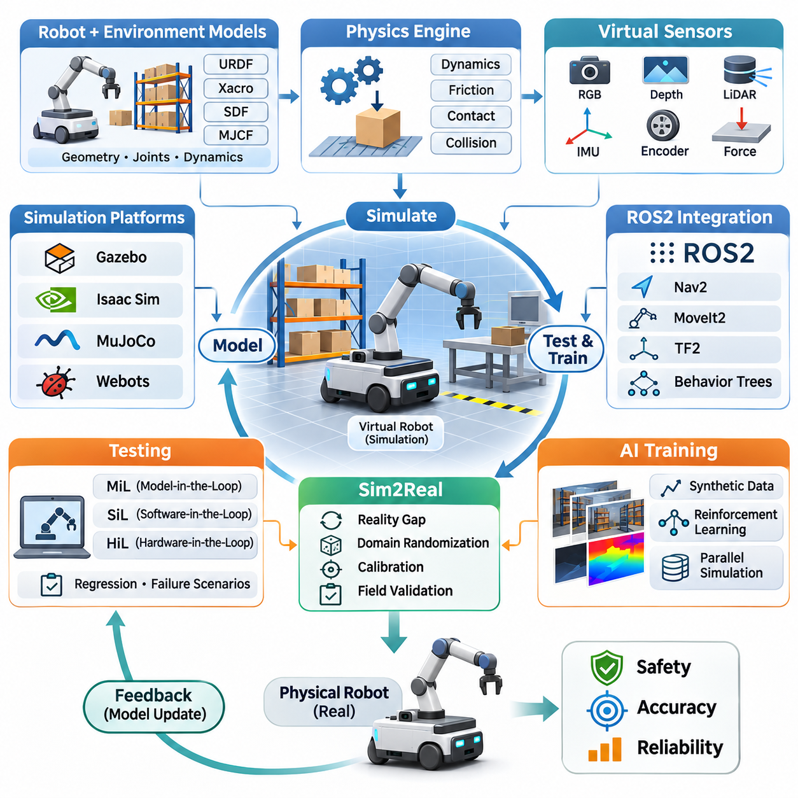
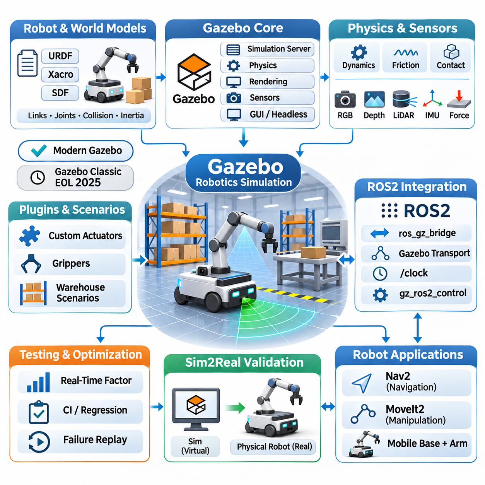
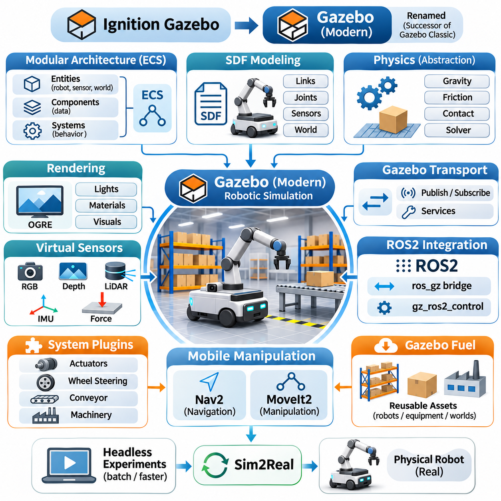
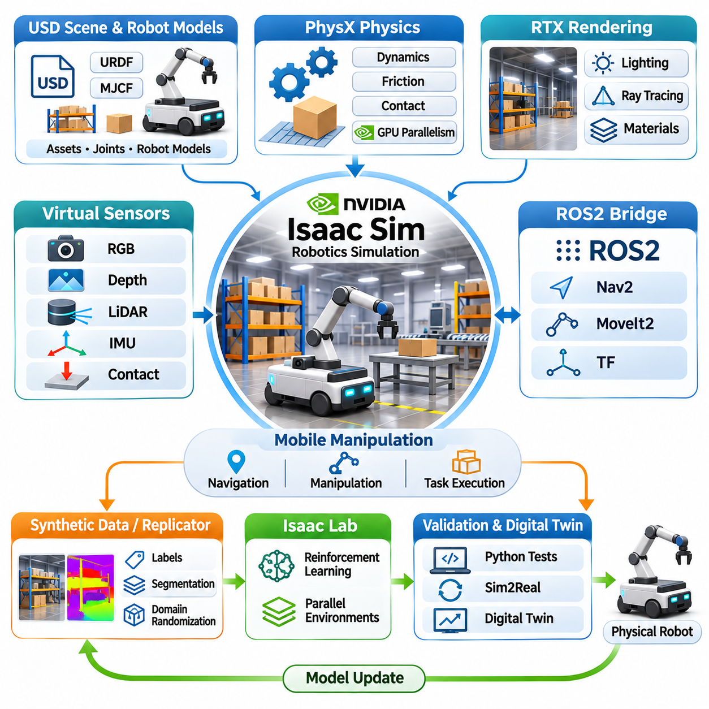
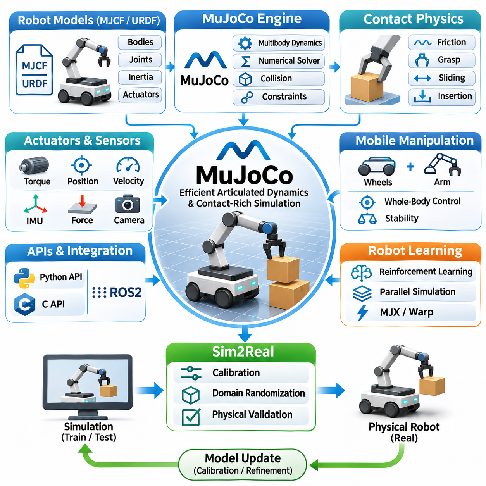
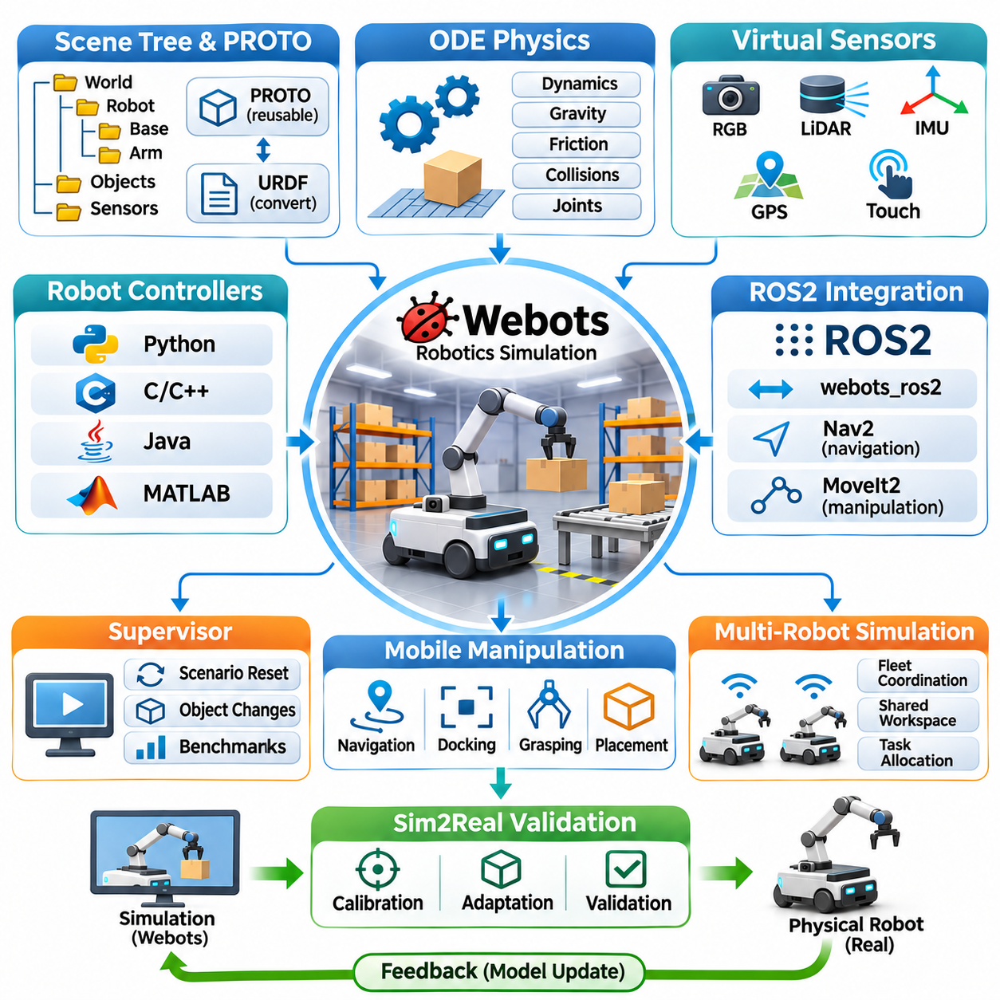
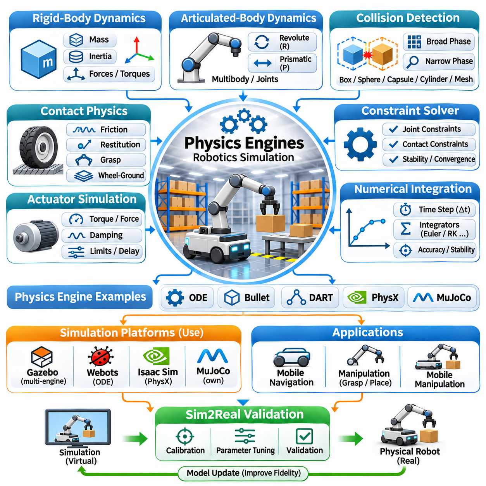
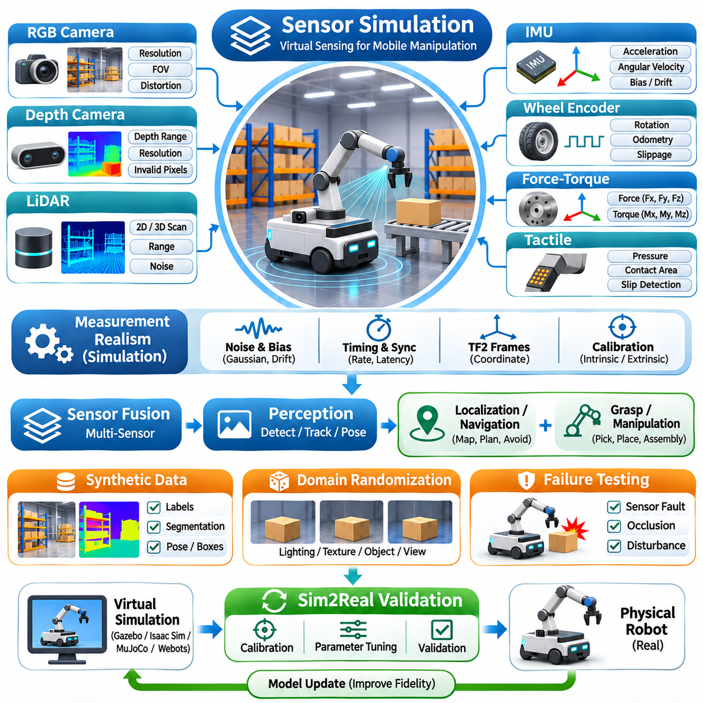
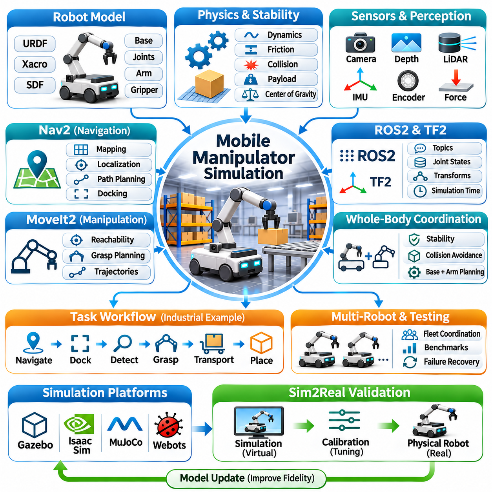
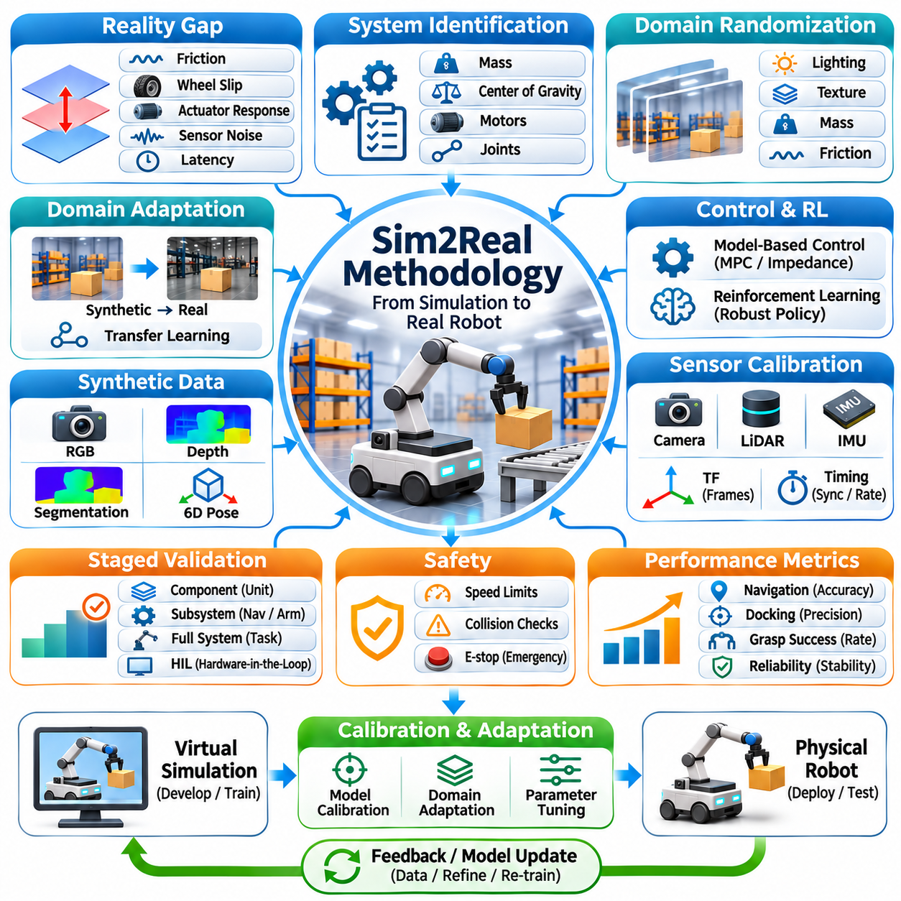

**Volume 04. Mobile Manipulation Software and Operations**

# Chapter 08. Simulation

## 01 Simulation Overview

{width="7.268055555555556in" height="7.268055555555556in"}

Simulation is a fundamental technology in the development, verification, and operation of mobile manipulation systems. It provides a virtual environment in which robot hardware, control software, perception algorithms, and operational workflows can be evaluated before physical deployment. By reproducing realistic operating conditions computationally, simulation reduces development costs, minimizes hardware damage, and accelerates engineering iterations.

Unlike conventional industrial robots operating within fixed workspaces, mobile manipulators combine autonomous navigation with robotic manipulation in frequently changing environments. Their operational complexity involves mobile base movement, articulated arm motion, object interaction, environmental perception, and task-level decision-making. Simulation enables these interconnected capabilities to be developed and validated within a unified computational environment.

A robotic simulation environment typically consists of robot models, environmental models, physics engines, virtual sensors, actuator interfaces, and software communication layers. Robot models describe mechanical geometry, joint configurations, mass distribution, and dynamic properties. Environmental models represent physical surroundings such as factory floors, warehouse shelves, workstations, obstacles, and human-operated equipment.

Physics engines calculate how virtual objects move and interact according to mathematical representations of physical laws. These calculations include gravitational forces, rigid-body dynamics, friction, collision response, joint constraints, and contact forces. For mobile manipulation, accurate physical modeling is particularly important because navigation stability and manipulation performance depend on interactions between multiple mechanical subsystems.

Robot description formats such as URDF, Xacro, SDF, and MJCF support the construction of simulation-ready robotic models. These formats represent structural relationships between robot components, coordinate frames, visual geometry, collision geometry, and inertial properties. Selecting appropriate modeling parameters improves simulation reliability and establishes consistency between virtual robot behavior and physical hardware configurations.

Sensor simulation reproduces the information that physical robots receive from their surroundings. Virtual cameras, depth sensors, LiDAR systems, inertial measurement units, wheel encoders, and force-torque sensors generate observations based on simulated environmental conditions. Sensor noise, measurement uncertainty, communication latency, and restricted fields of view can also be introduced to approximate realistic operational limitations.

Modern simulation platforms integrate with robotic middleware such as ROS2, allowing virtual robots to communicate through interfaces similar to those used by physical systems. Topics, services, actions, coordinate transformations, and hardware abstraction mechanisms support software portability. This architecture enables developers to evaluate navigation algorithms, MoveIt2 motion planning, perception pipelines, and behavior trees without requiring continuous access to physical robots.

Several robotic simulation platforms provide different capabilities for mobile manipulation development. Gazebo and its modern generation, formerly known as Ignition Gazebo, support general-purpose robotics simulation and ROS integration. NVIDIA Isaac Sim provides advanced rendering, GPU-accelerated simulation capabilities, and synthetic data generation. MuJoCo emphasizes articulated-body dynamics and contact modeling, while Webots provides an integrated robotics development environment.

Simulation fidelity describes the degree to which virtual behavior corresponds to physical reality. High-fidelity simulation incorporates detailed mechanical properties, realistic environmental geometry, sensor characteristics, and complex physical interactions. However, increasing fidelity generally introduces additional computational requirements. Engineers must balance physical accuracy, execution speed, resource consumption, and the specific objectives of each simulation experiment.

Simulation also supports different levels of system integration, including Model-in-the-Loop, Software-in-the-Loop, and Hardware-in-the-Loop testing. These approaches progressively incorporate mathematical models, production software, and physical hardware into controlled virtual experiments. Such incremental integration helps identify interface inconsistencies, timing problems, control instability, and communication failures before complete system deployment.

Mobile manipulator simulation must consider interactions between mobile base navigation and robotic arm movement. Changes in arm configuration can influence the system\'s center of gravity, stability, and collision boundaries. Coordinated simulation allows engineers to evaluate whole-body motion, workspace accessibility, trajectory feasibility, dynamic stability, and manipulation accuracy under different payload and environmental conditions.

Artificial intelligence development benefits from simulation through synthetic data generation, automated experimentation, and reinforcement learning. Virtual environments can produce labeled images, depth maps, segmentation masks, object poses, and interaction trajectories. Multiple simulation instances can execute experiments in parallel, increasing training efficiency and exposing learning-based systems to diverse operational conditions without excessive physical hardware usage.

A major challenge in robotic simulation is the reality gap, which represents discrepancies between simulated and physical environments. Differences in friction, actuator response, sensor noise, material properties, and environmental uncertainty can reduce the effectiveness of algorithms transferred to real robots. Simulation-to-Reality methodologies address these discrepancies through domain randomization, system identification, parameter calibration, and progressive physical validation.

Simulation contributes to operational reliability by enabling systematic scenario testing and automated regression testing. Engineers can reproduce navigation failures, unsuccessful grasping attempts, communication interruptions, unexpected obstacles, and sensor degradation under controlled conditions. Although simulation cannot independently establish physical safety compliance, it provides valuable evidence for risk assessment, failure analysis, and subsequent hardware-based safety validation.

Within industrial mobile manipulation, simulation establishes a continuous connection between software development, digital twins, AI training, system integration, and field operations. Performance indicators such as task completion rate, cycle time, collision frequency, positioning accuracy, and computational latency can be evaluated before deployment. Combined with physical testing and operational feedback, simulation becomes an essential engineering infrastructure throughout the robotic system lifecycle.

## 02 Gazebo

{width="7.268055555555556in" height="7.268055555555556in"}

Gazebo is an open-source robotics simulation platform designed to reproduce robot behavior, physical interactions, and sensor observations within three-dimensional virtual environments. It enables developers to design, test, and validate robotic systems without requiring continuous access to physical hardware. In mobile manipulation, Gazebo supports the integrated development of autonomous navigation, robotic arm control, perception, and task execution.

The Gazebo ecosystem includes Gazebo Classic and the modern Gazebo architecture, formerly known as Ignition Gazebo. Gazebo Classic established a widely adopted simulation environment for ROS-based robotics development, while modern Gazebo introduces a more modular architecture with independently developed software libraries. Since Gazebo Classic reached its end of life in January 2025, modern Gazebo is generally preferred for new robotics projects.

The fundamental architecture of Gazebo consists of a simulation server, graphical user interface, physics engine, rendering engine, sensor simulation components, and communication infrastructure. The simulation server manages virtual world states and physical interactions, while the graphical interface provides visualization and interactive control. Headless execution allows simulation experiments to operate without graphical visualization, reducing computational overhead.

Robot modeling in Gazebo typically employs the Unified Robot Description Format (URDF), Xacro, and Simulation Description Format (SDF). These formats define mechanical links, joint relationships, collision geometry, visual appearances, inertial properties, and sensor configurations. URDF and Xacro are commonly used within ROS-based development, while SDF provides more comprehensive descriptions of simulation environments and physical properties.

Gazebo uses physics engines to calculate rigid-body dynamics, gravitational acceleration, friction, collision response, joint motion, and contact interactions. Gazebo Classic supports engines such as ODE, Bullet, DART, and Simbody, whereas modern Gazebo provides physics engine integration through a modular abstraction layer. Appropriate physical parameter configuration is essential for reproducing realistic mobile platform movement and robotic manipulation behavior.

Virtual environments in Gazebo are defined through world descriptions containing robot models, static structures, movable objects, lighting conditions, and environmental parameters. Industrial operating environments can include warehouse shelves, manufacturing workstations, conveyor systems, charging stations, and dynamic obstacles. Reusable simulation assets allow engineers to construct multiple operational scenarios without repeatedly developing complete environments.

Sensor simulation is an important capability of Gazebo-based robotic development. Virtual RGB cameras, depth cameras, LiDAR sensors, inertial measurement units, GPS receivers, and force-torque sensors generate observations from simulated environments. Configurable measurement noise, update rates, sensing ranges, and sensor mounting positions allow developers to evaluate perception algorithms under conditions that approximate physical sensor limitations.

Gazebo integrates with ROS2 through communication bridges, control interfaces, and supporting software packages. Modern Gazebo commonly uses ros_gz_bridge to exchange supported message types between Gazebo Transport and ROS2. Simulation time can be distributed through the clock topic, enabling ROS2 nodes to operate according to virtual time. These mechanisms support consistent communication between simulation components and external robotic applications.

The ros2_control framework enables simulated actuators to operate through standardized hardware interfaces and controller configurations. Gazebo Classic historically used gazebo_ros2_control, while modern Gazebo supports integration through gz_ros2_control. Joint trajectory controllers, velocity controllers, and joint state broadcasters allow developers to evaluate robotic arm movement and mobile base control using software architectures similar to physical implementations.

For autonomous mobile robots, Gazebo provides an environment for developing localization, mapping, obstacle avoidance, and path planning algorithms. Integration with the ROS2 Navigation Stack, commonly known as Nav2, supports the evaluation of autonomous navigation through virtual industrial facilities. Developers can investigate route efficiency, localization drift, obstacle response, docking accuracy, and navigation recovery behavior before field deployment.

Robotic manipulation development in Gazebo frequently involves integration with MoveIt2 for kinematic analysis, collision checking, motion planning, and trajectory execution. Virtual robot arms and grippers can perform manipulation tasks involving object acquisition, transportation, placement, and interaction with workstations. Comparing planned trajectories with simulated execution helps identify joint limitations, controller configuration problems, and potential collisions.

Mobile manipulator simulation combines autonomous mobile platform behavior with articulated robotic arm operation within a shared virtual environment. Engineers can evaluate interactions between base positioning, arm reachability, payload distribution, and manipulation accuracy. Coordinated simulation also supports the investigation of whole-body motion, dynamic stability, collision avoidance, and task-level sequencing during complex industrial operations.

Gazebo supports simulation customization through plugins and system components that extend standard platform functionality. These extensions can implement specialized actuator behavior, sensor characteristics, environmental interactions, communication interfaces, and automated scenario execution. Custom simulation components are particularly useful when modeling proprietary mobile platforms, independent steering mechanisms, specialized grippers, or industrial equipment.

Simulation performance depends on physics time steps, solver configurations, sensor update frequencies, rendering complexity, and available computing resources. The real-time factor expresses the relationship between simulated time and elapsed physical time. Simplified collision geometry, headless execution, optimized sensor configurations, and parallel simulation instances can improve computational efficiency while preserving the fidelity required for individual experiments.

Gazebo also supports automated software verification, regression testing, and failure scenario reproduction within continuous integration pipelines. Recorded simulation events and ROS2 message data can assist in diagnosing navigation failures, manipulation errors, and communication inconsistencies. Nevertheless, simulation results must be complemented by physical testing because simplified contact models, sensor assumptions, and actuator dynamics can introduce a simulation-to-reality gap.

## 03 Ignition Gazebo

{width="7.268055555555556in" height="7.268055555555556in"}

Ignition Gazebo is a modular, open-source robotics simulation architecture developed as the successor to Gazebo Classic. It was designed to overcome limitations associated with tightly coupled simulation components and to support scalable robotic development environments. Although Ignition Gazebo has subsequently been renamed Gazebo, its architectural principles remain central to modern robotics simulation and mobile manipulation development.

Unlike Gazebo Classic, which historically maintained many simulation capabilities within a relatively integrated software architecture, Ignition Gazebo separates major functionalities into independently maintained libraries. Physics computation, rendering, sensor generation, mathematical operations, communication, and graphical visualization are organized as modular components. This separation improves maintainability, extensibility, and flexibility across diverse robotic applications.

The Entity Component System (ECS) is a fundamental architectural principle of Ignition Gazebo. Within this architecture, robots, sensors, joints, lights, and environmental objects are represented as entities associated with specialized data components. Independent systems operate on these components to implement simulation behavior. This approach reduces dependencies between software modules and supports efficient management of complex virtual environments.

Ignition Gazebo employs the Simulation Description Format (SDF) to represent robotic models and virtual environments. SDF defines mechanical links, joint relationships, inertial properties, collision geometry, sensor configurations, and environmental structures. Its hierarchical representation supports complex robotic systems containing mobile platforms, articulated manipulators, multiple sensors, and interacting mechanical assemblies within a shared simulation environment.

The physics architecture of Ignition Gazebo provides an abstraction layer between simulation functionality and underlying physics engines. This design allows supported physics engines to be integrated through standardized interfaces rather than tightly coupling the entire simulator to a single implementation. Engineers can configure gravity, friction, contact parameters, joint constraints, and solver characteristics according to specific experimental requirements.

Rendering functionality is independently managed through the Gazebo Rendering library, which was formerly known as Ignition Rendering. Supported rendering engines, including OGRE-based implementations, provide visual representations of virtual environments and generate observations for simulated optical sensors. Advanced lighting, shadows, material appearances, and environmental effects contribute to more realistic evaluations of vision-based robotic applications.

Sensor simulation is implemented through modular libraries that reproduce measurements generated by physical sensing devices. Virtual RGB cameras, depth cameras, LiDAR systems, inertial measurement units, and force-torque sensors can be associated with robotic entities. Configurable update frequencies, measurement noise, field-of-view restrictions, and sensing limitations allow engineers to investigate perception performance under diverse operational conditions.

The communication infrastructure of Ignition Gazebo relies on its native transport middleware, now known as Gazebo Transport. This middleware supports distributed communication through message publication, subscription, and service mechanisms. Simulation components and external applications can exchange robot states, sensor observations, actuator commands, and environmental information without requiring direct dependencies between individual software processes.

Integration with ROS2 enables Ignition Gazebo to function as a virtual execution environment for distributed robotic applications. Communication bridges, historically provided through ros_ign and subsequently renamed ros_gz, translate supported messages between Gazebo Transport and ROS2 interfaces. Developers can establish communication channels for sensor data, velocity commands, joint states, simulation clocks, and other robotic information.

Modern Gazebo integration with ros2_control allows simulated mobile platforms and robotic manipulators to operate through standardized controller interfaces. The gz_ros2_control package connects simulation-based hardware representations with ROS2 control components. This architecture supports joint trajectory execution, velocity regulation, and state feedback while promoting software reuse between virtual robotic systems and physical hardware implementations.

For mobile manipulation applications, Ignition Gazebo provides a unified environment for evaluating interactions between autonomous navigation and robotic arm movement. Engineers can integrate Nav2, MoveIt2, behavior trees, and perception algorithms to reproduce complete industrial workflows. These workflows may involve autonomous transportation, precision docking, object detection, grasp execution, material handling, and recovery from operational failures.

The modular system architecture allows developers to implement customized simulation behavior through system plugins. These plugins can reproduce specialized actuator dynamics, independent wheel steering, conveyor movement, industrial machinery, and environmental disturbances. Customized system components are particularly valuable when commercial robotic platforms or proprietary mechanical configurations cannot be represented adequately using standard simulation models.

Gazebo Fuel, formerly known as Ignition Fuel, provides access to reusable simulation assets such as robotic models, industrial equipment, environmental objects, and complete virtual worlds. Shared resources reduce the engineering effort required to construct representative operating environments. Nevertheless, downloaded simulation models must be evaluated for geometric accuracy, physical properties, software compatibility, and suitability for specific industrial applications.

Ignition Gazebo supports automated experimentation through headless execution, configurable simulation scenarios, and independently operated simulation instances. These capabilities enable repeated evaluations of navigation performance, manipulation reliability, controller stability, and communication behavior. Computational efficiency can be improved by adjusting physics time steps, rendering requirements, sensor update rates, and model complexity according to experimental objectives.

Within industrial mobile manipulation development, the Ignition Gazebo architecture establishes a foundation for digital twin integration, continuous software verification, and simulation-to-reality methodologies. Its modular design supports long-term software maintenance and progressive system integration. However, virtual experiments must be complemented by physical validation to address discrepancies in actuator behavior, contact dynamics, sensor uncertainty, and real-world operating conditions.

## 04 Isaac Sim

{width="7.268055555555556in" height="7.268055555555556in"}

NVIDIA Isaac Sim is a robotics simulation platform designed to support the development, training, testing, and validation of intelligent robotic systems within physically based virtual environments. Built on NVIDIA Omniverse technologies, Isaac Sim combines GPU-accelerated physics simulation, advanced rendering, sensor modeling, and artificial intelligence development capabilities to support complex robotic applications, including autonomous mobile manipulation.

The underlying architecture of Isaac Sim utilizes Universal Scene Description (USD) as a framework for representing robotic systems, environmental assets, materials, lighting conditions, and simulation properties. USD enables hierarchical scene composition, reusable asset management, and collaborative development. Complex industrial environments containing mobile robots, robotic arms, workstations, and material handling equipment can therefore be constructed within a unified simulation framework.

Isaac Sim employs NVIDIA PhysX to calculate rigid-body dynamics, articulated-body motion, collision interactions, friction, and contact forces. GPU-accelerated physics computation can improve simulation throughput, particularly when executing multiple robotic environments in parallel. Accurate configuration of mass distribution, joint constraints, actuator properties, and contact parameters remains essential for reproducing realistic robotic behavior.

Physically based rendering and ray-tracing technologies distinguish Isaac Sim from many conventional robotics simulation environments. These capabilities reproduce complex lighting conditions, material reflections, shadows, and optical interactions within virtual scenes. Such visual realism is particularly valuable for developing robotic perception systems that depend on RGB images, depth measurements, object recognition, and visually guided manipulation.

Robot models can be imported into Isaac Sim through supported formats such as URDF and MJCF or constructed directly within USD environments. Imported models require appropriate definitions of articulated joints, collision meshes, inertial properties, actuator configurations, and coordinate transformations. Engineers can establish simulation-ready representations of autonomous mobile robots, industrial manipulators, collaborative robots, and integrated mobile manipulation platforms.

Sensor simulation within Isaac Sim supports virtual RGB cameras, depth cameras, LiDAR sensors, inertial measurement units, contact sensors, and other robotic sensing mechanisms. Sensor configurations can reproduce mounting positions, measurement frequencies, optical characteristics, and sensing ranges. These capabilities enable developers to evaluate multimodal perception, sensor fusion, localization, object pose estimation, and environmental understanding.

Integration with ROS2 enables Isaac Sim to communicate with external robotic software through supported message interfaces. The ROS2 Bridge facilitates the exchange of sensor observations, actuator commands, joint states, coordinate transformations, and simulation time. Existing robotic applications can therefore interact with simulated platforms through communication architectures resembling those employed during physical deployment.

Autonomous navigation development within Isaac Sim can incorporate ROS2 Nav2, mapping algorithms, localization frameworks, and obstacle avoidance mechanisms. Engineers can construct representative warehouses, manufacturing facilities, hospitals, and logistics environments containing static and dynamic obstacles. Virtual experiments support the evaluation of navigation accuracy, docking performance, route efficiency, and recovery behavior under controlled operating conditions.

Robotic manipulation development can combine Isaac Sim with MoveIt2 or NVIDIA Isaac ROS components and other motion generation frameworks. Simulated robotic arms and grippers can execute object acquisition, pick-and-place operations, trajectory tracking, and collision avoidance. Contact-rich simulation also supports investigations of grasp stability, object displacement, manipulation constraints, and interactions between robotic mechanisms and environmental structures.

Mobile manipulator simulation requires coordinated modeling of autonomous mobile platforms and articulated robotic arms. Isaac Sim enables engineers to investigate base positioning accuracy, manipulator reachability, payload distribution, whole-body motion, and environmental collisions. Integrated simulation scenarios can reproduce complete industrial workflows involving navigation, precision docking, object identification, grasping, transportation, and placement.

Synthetic data generation is a major capability of Isaac Sim and its associated NVIDIA Replicator framework. Virtual environments can generate automatically annotated RGB images, depth maps, semantic segmentation masks, instance segmentation masks, bounding boxes, and object poses. Domain randomization can introduce variations in lighting, textures, object arrangements, and camera viewpoints, increasing the diversity of training datasets.

Isaac Sim also provides a simulation foundation for robot learning through Isaac Lab, a framework designed for reinforcement learning and other learning-based robotic development methodologies. Parallel simulation environments enable robotic agents to accumulate interaction experiences more efficiently. Learning applications may include locomotion, dexterous manipulation, object grasping, coordinated mobile manipulation, and adaptive control policy development.

Simulation performance depends on available CPU and GPU resources, physics configurations, rendering complexity, sensor update frequencies, and environmental scale. High-fidelity optical simulation and large-scale parallel learning can impose substantial GPU memory and computational requirements. Headless execution, simplified collision geometry, selective sensor activation, and optimized rendering configurations help balance simulation fidelity and execution efficiency.

Isaac Sim supports automated scenario execution, software regression testing, failure reproduction, and operational digital twin integration. Python scripting and programmable simulation interfaces enable engineers to modify environments, configure robotic systems, execute experiments, and collect performance measurements systematically. However, simulation accuracy remains dependent on the quality of physical models, sensor assumptions, and environmental representations.

Within industrial mobile manipulation, Isaac Sim establishes a development environment connecting robotics software, physical AI, synthetic data generation, digital twins, and simulation-to-reality methodologies. Its capabilities support progressive validation from individual robotic components to integrated operational workflows. Nevertheless, calibrated physical testing and field validation remain necessary to address the reality gap and establish dependable real-world performance.

## 05 MuJoCo

{width="7.268055555555556in" height="7.268055555555556in"}

MuJoCo, which stands for Multi-Joint dynamics with Contact, is an open-source physics simulation engine designed for efficient and accurate modeling of articulated mechanical systems. Originally developed for robotics and biomechanics research, MuJoCo has become an important platform for robotic control, reinforcement learning, and physical AI development, particularly in applications involving complex contact interactions and coordinated mechanical motion.

Unlike general-purpose robotics simulation platforms that emphasize environmental visualization and distributed software integration, MuJoCo primarily focuses on computational efficiency, multibody dynamics, and contact modeling. Its architecture supports rapid numerical computation of mechanical interactions, making it particularly suitable for repeated control experiments, trajectory optimization, and large-scale robot learning applications.

The fundamental architecture of MuJoCo consists of model representations, dynamic state variables, numerical solvers, collision detection mechanisms, actuator models, and simulation interfaces. Compiled model structures contain mechanical parameters and system configurations, while dynamic data structures maintain changing simulation states. This separation enables efficient computation, repeated simulation execution, and systematic experimental analysis.

MuJoCo primarily uses the MuJoCo XML Format (MJCF) to describe robotic mechanisms and simulation environments. MJCF defines hierarchical body structures, joints, geometric objects, inertial properties, actuators, sensors, and environmental constraints. MuJoCo also supports importing URDF models, although additional configuration may be necessary to represent specialized actuator behavior, contact properties, and simulation-specific parameters.

Multibody dynamics computation is a central capability of MuJoCo. The physics engine calculates generalized positions, velocities, accelerations, gravitational forces, inertial interactions, and actuator-generated forces within articulated mechanical systems. Efficient numerical algorithms enable the simulation of robotic arms, mobile platforms, dexterous robotic hands, legged robots, and other mechanisms containing multiple interconnected degrees of freedom.

Contact dynamics represents one of the distinguishing characteristics of MuJoCo. Its constraint-based contact modeling approach supports interactions involving friction, surface penetration, sliding, rolling, and mechanical collisions. Configurable contact parameters allow engineers to investigate grasp stability, object displacement, surface interaction, and manipulation reliability under different physical conditions and mechanical configurations.

Actuator modeling in MuJoCo supports force, torque, position, velocity, and other configurable actuation mechanisms. Developers can represent motor-driven joints, transmission relationships, control limits, and actuator dynamics according to specific robotic requirements. These capabilities facilitate investigations of joint control, torque control, impedance control, trajectory tracking, and coordinated motion across multiple robotic subsystems.

MuJoCo provides configurable sensor models for joint positions, joint velocities, accelerometers, gyroscopes, force measurements, tactile contact, and distance measurements. Virtual cameras can also generate visual observations for learning-based perception and manipulation. However, detailed optical realism and specialized industrial sensor simulation may require additional implementation or integration with complementary simulation platforms.

For mobile robot development, MuJoCo enables the simulation of wheeled platforms, steering mechanisms, wheel-ground interactions, and dynamic vehicle behavior. Differential-drive, omnidirectional, and independently steered mobile bases can be represented through appropriate mechanical configurations. Engineers can evaluate acceleration, braking, turning behavior, traction limitations, and mobility stability under varying environmental conditions.

Robotic manipulation applications benefit from MuJoCo\'s efficient simulation of articulated arms, end effectors, grippers, and dexterous robotic hands. Contact-rich manipulation tasks, including object grasping, insertion, pushing, sliding, and assembly, can be investigated through repeated virtual experiments. Such capabilities are particularly valuable when developing force-sensitive manipulation and adaptive robotic control strategies.

Mobile manipulator simulation in MuJoCo combines mobile base dynamics with robotic arm motion within a unified mechanical model. Interactions between base acceleration, manipulator configuration, payload distribution, and the system\'s center of gravity can be analyzed systematically. This approach supports whole-body control development, coordinated trajectory generation, dynamic stability evaluation, and simultaneous navigation and manipulation research.

MuJoCo provides programmable simulation interfaces through C APIs and official Python bindings. Developers can access simulation states, modify control inputs, calculate kinematic quantities, and execute custom control algorithms directly. Integration with ROS2, Nav2, and MoveIt2 is possible through external interfaces, although developers may need to implement communication bridges and hardware abstraction components for their specific systems.

Reinforcement learning is one of the major application areas of MuJoCo. Learning frameworks can use simulated robotic environments to generate observations, execute actions, calculate rewards, and collect interaction trajectories. CPU-based parallel execution and accelerator-oriented implementations such as MuJoCo MJX and MuJoCo Warp support scalable experimentation for robot learning, dexterous manipulation, and adaptive control policies.

Simulation performance depends on model complexity, contact constraints, numerical integration methods, solver settings, and computational resources. Appropriate simulation time steps and solver parameters are essential for maintaining numerical stability during contact-intensive operations. Simplified collision geometry, selective rendering, and parallel experimentation can improve computational throughput without unnecessarily sacrificing task-specific simulation fidelity.

MuJoCo contributes to simulation-to-reality methodologies through system identification, physical parameter calibration, domain randomization, and robust control policy development. Variations in mass, friction, actuator response, external disturbances, and sensor uncertainty can be introduced during virtual experiments. Nevertheless, physical testing remains necessary to validate contact behavior, mechanical performance, and operational safety under actual industrial conditions.

Within industrial mobile manipulation, MuJoCo provides a specialized simulation foundation for dynamic analysis, advanced robotic control, contact-rich manipulation, and physical AI development. Its computational efficiency complements platforms such as Gazebo and NVIDIA Isaac Sim, which emphasize broader system integration or high-fidelity visual simulation. Selecting an appropriate simulation environment requires balancing physical accuracy, computational efficiency, sensor fidelity, and operational requirements.

## 06 Webots

{width="7.268055555555556in" height="7.268055555555556in"}

Webots is an open-source robotics simulation platform developed by Cyberbotics to support the design, programming, testing, and validation of robotic systems within three-dimensional virtual environments. It combines physical simulation, graphical visualization, robot modeling, sensor simulation, and programmable control interfaces within an integrated development environment suitable for education, research, and industrial robotics applications.

Unlike simulation platforms that primarily emphasize high-fidelity rendering or computationally intensive robot learning, Webots provides a balanced approach combining accessibility, physical modeling, and software development. Its integrated architecture allows engineers to construct virtual environments, configure robotic mechanisms, implement control algorithms, and evaluate operational behavior without requiring extensive simulation infrastructure.

The fundamental architecture of Webots consists of a simulation engine, graphical user interface, scene tree, robot controllers, virtual sensors, actuator models, and programmable interfaces. The scene tree organizes environmental objects and robotic components through hierarchical structures. This representation enables developers to configure mechanical relationships, physical properties, sensor positions, and environmental conditions systematically.

Webots uses the Open Dynamics Engine (ODE) to calculate physical interactions within simulated environments. The physics engine supports rigid-body dynamics, gravitational acceleration, collision response, friction, joint constraints, and contact interactions. Engineers can configure mass, inertia, surface properties, and simulation time steps to reproduce mechanical behavior that approximates the characteristics of physical robotic systems.

Robot modeling in Webots is based on hierarchical scene descriptions that define mechanical structures, joints, sensors, actuators, and physical properties. The PROTO mechanism supports the creation of reusable and parameterized robotic components. Existing URDF descriptions can also be converted into Webots-compatible representations using appropriate tools, although simulation-specific physical and actuator parameters may require additional configuration.

Webots provides configurable virtual sensors, including RGB cameras, range finders, LiDAR sensors, accelerometers, gyroscopes, GPS receivers, distance sensors, and touch sensors. These devices generate measurements from simulated environments according to their individual configurations. Developers can adjust sensor resolution, sampling periods, measurement noise, detection ranges, and mounting positions to approximate realistic sensing conditions.

Robot controllers in Webots can be implemented using programming languages such as Python, C, C++, Java, and MATLAB. Controllers access simulated sensor measurements, execute decision-making algorithms, and transmit commands to robotic actuators through standardized programming interfaces. This architecture supports the development of feedback control, autonomous navigation, robotic manipulation, and adaptive task execution algorithms.

Integration with ROS2 is supported through the webots_ros2 software ecosystem, which establishes communication between Webots simulation components and external ROS2 applications. Developers can exchange sensor observations, joint states, actuator commands, coordinate transformations, and simulation timing information. Appropriate driver plugins and controller configurations promote software reuse between simulated robots and physical robotic platforms.

For autonomous mobile robot development, Webots supports the modeling of differential-drive, Ackermann-steered, omnidirectional, and independently steered mobile platforms. Virtual experiments can reproduce wheel-ground interactions, acceleration, braking, steering, and obstacle avoidance. Integration with ROS2 Nav2 enables engineers to investigate localization, mapping, path planning, docking behavior, and navigation recovery strategies.

Robotic manipulation development within Webots involves the simulation of articulated robotic arms, end effectors, grippers, and interacting objects. Joint motors, position sensors, and contact-related sensing mechanisms enable the implementation of motion control and manipulation algorithms. External frameworks such as MoveIt2 can be integrated through appropriate ROS2 interfaces to evaluate motion planning, collision checking, and trajectory execution.

Mobile manipulator simulation combines autonomous mobile base movement with robotic arm operation within a shared virtual environment. Engineers can investigate interactions between base positioning, manipulator reachability, payload distribution, and environmental constraints. Integrated scenarios support the evaluation of industrial workflows involving autonomous navigation, precision docking, object acquisition, transportation, placement, and operational recovery.

The Supervisor interface is a distinctive capability of Webots that provides privileged programmatic access to simulation environments. Supervisor controllers can modify object positions, inspect simulation states, introduce environmental changes, reset experiments, and collect performance measurements. This functionality supports automated scenario execution, repeatable benchmarking, reinforcement learning experiments, and systematic failure reproduction.

Webots also supports multi-robot simulation, allowing several autonomous robotic systems to operate within a common virtual environment. Individual robot controllers can execute independent behaviors while interacting through simulated environments or communication interfaces. Such configurations are useful for investigating fleet management, cooperative manipulation, shared workspace utilization, traffic coordination, and distributed task execution.

Simulation performance depends on mechanical complexity, collision geometry, physics time steps, sensor configurations, rendering requirements, and available computational resources. Fast simulation modes, reduced graphical rendering, and simplified physical models can improve experimental throughput. Developers should select simulation parameters according to the required balance between numerical stability, physical fidelity, and execution efficiency.

Webots supports simulation-to-reality methodologies by enabling developers to introduce variations in environmental conditions, physical parameters, sensor uncertainty, and control configurations. Automated experiments can evaluate algorithm robustness before deployment. However, differences in contact dynamics, actuator response, optical characteristics, and hardware timing require additional system calibration and physical validation to establish reliable real-world performance.

Within industrial mobile manipulation, Webots provides an accessible simulation environment connecting robotic software development, mechanical modeling, control engineering, and operational verification. Its integrated architecture complements platforms such as Gazebo, NVIDIA Isaac Sim, and MuJoCo. Platform selection should consider integration requirements, simulation fidelity, computational efficiency, development complexity, and the intended operational objectives.

## 07 Physics Engines

{width="7.268055555555556in" height="7.268055555555556in"}

Physics engines are computational systems designed to reproduce the physical behavior of objects, mechanical structures, and interacting robotic systems within simulated environments. They calculate motion, forces, torques, collisions, friction, and mechanical constraints according to mathematical representations of physical laws. In mobile manipulation, physics engines establish the fundamental computational infrastructure for realistic robotic simulation.

The primary architecture of a physics engine consists of mechanical models, collision detection algorithms, dynamic equations, constraint solvers, numerical integration methods, and simulation state management mechanisms. These components operate continuously to calculate the evolution of physical systems over discrete simulation time steps. Their computational accuracy and efficiency directly influence the reliability of robotic simulation experiments.

Rigid-body dynamics is a fundamental capability of robotics physics engines. Rigid bodies are represented through their mass, center of gravity, inertia tensor, position, orientation, linear velocity, and angular velocity. External forces and torques modify their dynamic states according to mechanical equations of motion. This representation enables the simulation of robot chassis structures, manipulator links, payloads, and surrounding industrial equipment.

Articulated-body dynamics extends rigid-body simulation by connecting multiple mechanical bodies through joints and structural constraints. Revolute, prismatic, spherical, and fixed joints define permissible relative motion between interconnected components. Efficient multibody dynamics algorithms calculate the interactions among robotic links, joint actuators, gravitational forces, and external loads within complex mechanical assemblies.

Collision detection determines whether simulated objects intersect or approach contact within a virtual environment. Broad-phase collision detection identifies potentially interacting objects, while narrow-phase algorithms calculate more detailed contact geometry. Simplified collision shapes, including boxes, spheres, capsules, cylinders, and convex meshes, are frequently employed to reduce computational complexity while maintaining adequate geometric accuracy.

Contact dynamics calculates the physical response occurring when mechanical bodies interact. Physics engines use mathematical contact models to approximate normal forces, tangential forces, restitution, surface penetration, and frictional behavior. These calculations are particularly important for wheel-ground interactions, object grasping, mechanical insertion, assembly operations, and force-sensitive manipulation involving sustained physical contact.

Constraint solvers enforce mechanical relationships among simulated bodies, joints, and contact surfaces. Depending on the physics engine, constraint processing may involve iterative numerical methods, optimization-based formulations, or direct solution techniques. Solver convergence, iteration limits, constraint stabilization, and contact parameters influence the accuracy, stability, and computational cost of complex robotic interactions.

Numerical integration determines how physical states evolve over successive simulation time steps. Different integration methods provide varying levels of numerical accuracy, computational efficiency, and stability. Smaller time steps generally improve the resolution of rapidly changing mechanical interactions but increase computational requirements. Appropriate integration configurations are essential for simulating high-speed motion and contact-intensive robotic operations.

Actuator simulation represents the mechanical effects generated by motors, hydraulic mechanisms, and other robotic drive systems. Physics engines can apply forces, torques, position targets, and velocity targets according to configured actuator models. Additional parameters such as torque limits, damping, transmission ratios, response delays, and joint friction help reproduce realistic mechanical behavior and support advanced robot control development.

Several physics engines are widely employed in robotics simulation, including the Open Dynamics Engine (ODE), Bullet Physics, Dynamic Animation and Robotics Toolkit (DART), NVIDIA PhysX, and MuJoCo. Each engine implements different approaches to multibody dynamics, collision processing, contact modeling, and numerical optimization. Their suitability depends on the physical characteristics and computational requirements of particular robotic applications.

ODE and Bullet provide established solutions for rigid-body dynamics, collision detection, and constraint-based simulation, while DART emphasizes articulated-body dynamics and robotics-oriented computational methods. NVIDIA PhysX supports advanced physical simulation and GPU acceleration for supported workloads. MuJoCo emphasizes efficient multibody dynamics and contact-rich simulation, making it particularly useful for robotic control and reinforcement learning.

Robotics simulation platforms employ physics engines according to their underlying architectures and development objectives. Gazebo has supported multiple physics engines through configurable interfaces, while Webots employs ODE for physical simulation. NVIDIA Isaac Sim utilizes PhysX, whereas MuJoCo integrates its own physics computation framework. Differences in engine architecture can produce different simulation results even when similar robotic models are employed.

For autonomous mobile robots, physics engines reproduce wheel-ground interactions, traction forces, steering behavior, acceleration, braking, and vehicle stability. Accurate configuration of wheel geometry, surface friction, mass distribution, suspension characteristics, and actuator limits is essential for evaluating mobility performance. These simulations support the development of motion controllers, navigation strategies, and precision docking mechanisms.

Robotic manipulation requires accurate modeling of articulated motion, contact forces, gripper behavior, and object interactions. Physics engines enable engineers to investigate grasp stability, object slippage, insertion forces, payload handling, and collisions during trajectory execution. Mobile manipulation further requires integrated dynamic modeling of the mobile base and robotic arm to evaluate coordinated motion, load transfer, and overall mechanical stability.

Simulation performance can be improved through simplified collision geometry, optimized solver configurations, parallel computation, adaptive modeling strategies, and GPU acceleration where supported. Nevertheless, computational efficiency should not be achieved at the expense of essential physical characteristics. Benchmarking against measured robotic behavior enables engineers to identify modeling errors, numerical instability, and limitations in simulation fidelity.

Within industrial mobile manipulation, physics engines provide the foundation for mechanical analysis, software validation, digital twin development, robot learning, and simulation-to-reality transfer. Engine selection should balance dynamic accuracy, contact fidelity, numerical stability, computational throughput, and software integration requirements. Physical parameter calibration and real-world validation remain essential for establishing dependable simulation results.

## 08 Sensor Simulation

{width="7.268055555555556in" height="7.268055555555556in"}

Sensor simulation is a fundamental component of robotic simulation environments, enabling virtual robots to reproduce the measurements and observations generated by physical sensing devices. It provides a controlled framework for evaluating perception algorithms, sensor integration, localization, object recognition, and autonomous decision-making before physical deployment. In mobile manipulation, sensor simulation connects virtual environments with the perception and control systems required for reliable robotic operation.

Modern robotic systems rely on multiple sensor technologies to understand their surroundings and estimate their internal states. RGB cameras, depth cameras, LiDAR sensors, inertial measurement units, wheel encoders, force-torque sensors, and tactile sensors provide complementary information. Sensor simulation reproduces these measurement mechanisms within virtual environments, allowing developers to evaluate individual sensors and integrated perception pipelines.

Virtual camera simulation generates images from three-dimensional environments according to camera position, orientation, optical characteristics, and rendering configurations. Important parameters include image resolution, focal length, field of view, exposure, frame rate, and lens distortion. These parameters determine the visual information available to perception algorithms and influence object detection, classification, tracking, and pose estimation performance.

Depth camera simulation generates distance measurements for visible surfaces using virtual depth sensing models. The resulting depth images or point clouds support three-dimensional object localization, obstacle detection, workspace reconstruction, and robotic grasp planning. Developers must consider depth range, measurement resolution, invalid pixels, reflective surfaces, and environmental occlusion when reproducing realistic depth sensing behavior.

LiDAR simulation reproduces laser-based distance measurements through virtual ray casting or equivalent sensing models. Simulated LiDAR systems generate two-dimensional scans or three-dimensional point clouds depending on their configuration. Important characteristics include angular resolution, vertical channels, measurement range, rotation frequency, beam divergence, and measurement noise. These properties directly influence mapping, localization, obstacle detection, and navigation performance.

Inertial measurement unit simulation models accelerometers and gyroscopes to reproduce linear acceleration and angular velocity measurements. These observations support robot orientation estimation, motion tracking, sensor fusion, and navigation state estimation. Realistic simulation should consider measurement noise, bias, drift, sampling frequency, axis alignment, and coordinate transformations because inertial errors accumulate over time and can affect localization accuracy.

Wheel encoder simulation generates measurements corresponding to wheel rotation and estimated travel distance. These measurements are commonly used for odometry and mobile robot motion estimation. Simulation models should account for wheel radius, encoder resolution, wheel separation, transmission characteristics, and possible wheel slippage. Combining encoder measurements with IMU and LiDAR observations enables developers to evaluate integrated localization systems.

Force-torque sensor simulation reproduces measurements of forces and moments applied to robotic joints, wrists, and end effectors. These sensors are particularly important for contact-sensitive manipulation, insertion, assembly, and compliant interaction with objects. Simulation parameters should represent sensor resolution, measurement noise, bias, coordinate alignment, and mechanical contact characteristics to support realistic force control experiments.

Tactile sensor simulation provides information about contact distribution, pressure, deformation, and potential object slippage during robotic grasping. Virtual tactile measurements can be used to develop grasp stability estimation, contact localization, and adaptive finger control. Although detailed tactile simulation may require specialized physical models, simplified contact representations can support initial development of learning-based grasping and manipulation algorithms.

Sensor noise and uncertainty are essential considerations in realistic sensor simulation. Physical sensors rarely produce perfectly accurate measurements because of electronic noise, environmental interference, manufacturing tolerances, and measurement limitations. Gaussian noise, systematic bias, random drift, quantization errors, and occasional measurement failures can be introduced into virtual sensors to evaluate algorithm robustness under imperfect observation conditions.

Sensor timing and synchronization influence the consistency of information collected from multiple sensing devices. Cameras, LiDAR sensors, IMUs, and encoders often operate at different sampling frequencies and may introduce different processing and communication delays. Simulation environments should reproduce timestamps, update rates, latency, and synchronization behavior to support reliable sensor fusion and time-dependent perception algorithms.

Coordinate transformations are necessary to interpret measurements from sensors installed at different locations and orientations on a robot. Camera frames, LiDAR frames, IMU frames, robot base frames, and end-effector frames must be represented consistently within a shared coordinate system. In ROS2-based applications, TF2 provides the transformation infrastructure required to manage these spatial relationships and support integrated perception and motion planning.

Sensor simulation is supported by multiple robotics platforms, including Gazebo, NVIDIA Isaac Sim, MuJoCo, and Webots. Gazebo provides configurable sensor models and integration with ROS2, while Isaac Sim offers advanced visual rendering and synthetic data generation. MuJoCo emphasizes efficient physical simulation and programmable sensing, whereas Webots provides an integrated environment for configuring virtual sensors and robotic controllers.

Synthetic data generation extends sensor simulation beyond conventional measurement reproduction. Virtual cameras and other sensors can produce automatically labeled images, depth maps, segmentation masks, bounding boxes, and object pose information. These datasets support supervised learning, object detection, semantic segmentation, pose estimation, and multimodal perception without requiring every training sample to be collected from physical robotic equipment.

Domain randomization improves the generalization of perception and control algorithms by introducing controlled variations into simulated sensing conditions. Changes in lighting, textures, camera viewpoints, sensor noise, object placement, and environmental appearance expose learning-based systems to diverse observations. This approach helps reduce dependence on specific simulation configurations and supports transfer to previously unseen physical environments.

In mobile manipulation, sensor simulation must support both autonomous navigation and precise robotic interaction. Mobile platforms depend on LiDAR, cameras, IMUs, and wheel encoders for localization and obstacle avoidance, while robotic arms require visual, force, and tactile information for object manipulation. Coordinated sensor simulation enables developers to evaluate the complete perception-to-action pipeline under consistent environmental conditions.

Sensor simulation also supports system-level testing through repeatable scenarios and controlled failure injection. Engineers can introduce sensor outages, delayed measurements, excessive noise, incorrect calibration, communication interruptions, and partial visibility. These experiments help identify weaknesses in sensor fusion, localization, perception, and recovery mechanisms before testing on physical robotic platforms.

The accuracy of sensor simulation depends on the quality of virtual sensor models, environmental representations, rendering configurations, and physical calibration parameters. Excessively simplified models may produce unrealistic observations, while highly detailed simulation can increase computational requirements. Engineers should select sensor fidelity according to the intended application, algorithm sensitivity, and available computing resources.

Within industrial mobile manipulation, sensor simulation establishes an essential connection between virtual environments, perception development, artificial intelligence training, digital twins, and physical robot validation. It enables systematic evaluation of sensing performance and reduces development risks before deployment. Nevertheless, simulated measurements cannot fully reproduce every characteristic of physical sensors, making real-world calibration, hardware testing, and simulation-to-reality validation necessary for dependable robotic operation.

## 09 Mobile Manipulator Simulation

{width="7.268055555555556in" height="7.268055555555556in"}

Mobile manipulator simulation combines autonomous mobile robot simulation with robotic arm and end-effector simulation within a unified virtual environment. It enables engineers to develop, test, and validate integrated robotic systems before deploying physical hardware. Unlike conventional mobile robot simulation, which primarily focuses on navigation and obstacle avoidance, mobile manipulator simulation must also reproduce mechanical interactions, manipulation accuracy, object handling, and coordinated motion between the mobile base and robotic arm.

A mobile manipulator consists of a mobile platform, an articulated robotic arm, an end effector, sensing devices, control systems, and computational hardware. Each component has independent mechanical and operational characteristics, but their behavior must be coordinated to accomplish complete tasks. Simulation environments represent these components as an integrated robotic system, allowing developers to investigate interactions between navigation, positioning, manipulation, and environmental constraints.

Robot modeling is the foundation of mobile manipulator simulation. The mobile base, robotic arm, joints, wheels, actuators, and end effectors must be represented using appropriate geometric and physical properties. Robot descriptions such as URDF, Xacro, and SDF define mechanical structures, joint relationships, mass distribution, inertia, and collision geometry. Accurate modeling is essential for reproducing the kinematic and dynamic behavior of the integrated platform.

The mechanical relationship between the mobile base and robotic arm introduces additional simulation requirements. Base movement changes the position and orientation of the manipulator relative to the environment, while arm movement can affect the overall center of gravity and mechanical stability. Engineers must consider payload distribution, manipulator extension, joint configurations, acceleration, and external forces when evaluating the behavior of the complete mobile manipulation system.

The simulation environment should reproduce representative industrial operating conditions, including warehouse aisles, manufacturing workstations, shelves, conveyors, charging stations, and movable objects. Static and dynamic obstacles can be introduced to evaluate autonomous navigation and manipulation under changing environmental conditions. Environmental models should provide sufficient geometric and physical accuracy to support collision checking, workspace evaluation, object interaction, and task execution.

Sensor integration is essential for reproducing the perception capabilities of physical mobile manipulators. Cameras, depth sensors, LiDAR, IMUs, wheel encoders, and force-torque sensors provide information required for localization, environmental understanding, object detection, and manipulation. Simulated sensor measurements can include noise, latency, calibration errors, and occlusion to reproduce realistic operating conditions and evaluate perception system robustness.

Physics simulation enables the evaluation of mechanical interactions throughout mobile manipulation tasks. Rigid-body dynamics, joint constraints, friction, collision response, and contact forces influence both mobile platform movement and robotic arm operation. Engineers can investigate wheel-ground interactions, object grasping, payload transportation, insertion, and placement. Accurate physical parameters are particularly important when evaluating contact-sensitive manipulation and coordinated whole-body motion.

Integration with ROS2 provides a software architecture for connecting simulation environments with robotic control and perception applications. Simulated robots can communicate through ROS2 topics, services, and actions to exchange sensor measurements, joint states, velocity commands, and manipulation trajectories. The TF2 framework maintains coordinate transformations between the map, odometry, mobile base, robotic arm, and end-effector reference frames, ensuring spatial consistency across the integrated system.

Autonomous navigation is an important component of mobile manipulator simulation. Integration with Nav2 enables developers to evaluate mapping, localization, path planning, obstacle avoidance, and navigation recovery. Simulation scenarios can include autonomous movement toward workstations, narrow aisle navigation, dynamic obstacle avoidance, and precision docking. The mobile platform must reach a suitable position and orientation before the robotic arm begins its manipulation operation.

Robotic manipulation simulation focuses on motion planning, trajectory execution, grasping, and physical interaction with objects. MoveIt2 can provide kinematic analysis, collision checking, motion planning, and trajectory generation for the robotic arm. Developers can evaluate reachable workspaces, joint limitations, grasp configurations, and collision-free trajectories. Simulated grippers and end effectors support investigations of object acquisition, transportation, insertion, and accurate placement.

Coordinated navigation and manipulation require the mobile base and robotic arm to operate as a unified system. In some applications, the base must remain stationary during manipulation to maintain positioning accuracy and mechanical stability. Other applications may require coordinated base and arm movement to extend the effective workspace. Whole-body planning considers the combined configuration of the mobile platform and manipulator while respecting collision, stability, and motion constraints.

Task execution can be organized through behavior trees, state machines, or task planning frameworks. A representative industrial workflow may involve navigating to a workstation, aligning with a target, stabilizing the mobile platform, detecting an object, planning a grasp, executing manipulation, and transporting the object to another location. Simulation allows engineers to test task sequencing, execution conditions, failure detection, and recovery behaviors before implementing the workflow on physical robots.

Mobile manipulator simulation also supports multi-robot environments in which several platforms operate within shared industrial workspaces. Engineers can investigate task allocation, traffic coordination, workspace conflicts, cooperative operations, and interactions between mobile manipulators. These experiments help evaluate fleet-level operational performance and identify potential interference between navigation and manipulation activities in environments containing multiple robotic systems.

Automated simulation experiments enable systematic evaluation of positioning accuracy, navigation performance, manipulation success rates, collision frequency, task completion time, and system reliability. Repeated experiments under different payloads, object locations, environmental conditions, and sensor configurations provide quantitative performance comparisons. Recorded simulation states and ROS2 messages can also support failure analysis, regression testing, and software verification throughout the development process.

The selection of a simulation platform depends on the intended application and required level of physical and visual fidelity. Gazebo provides integration with ROS2 and configurable physical simulation, NVIDIA Isaac Sim offers advanced rendering and synthetic data generation, MuJoCo emphasizes efficient dynamics and contact-rich manipulation, and Webots provides an integrated environment for robot modeling and controller development. Different platforms can complement one another when a project requires multiple simulation capabilities.

Mobile manipulator simulation establishes an important foundation for digital twin development and simulation-to-reality transfer. Simulation models can be progressively calibrated using measurements from physical robots, including actuator response, wheel behavior, sensor characteristics, joint dynamics, and manipulation performance. Nevertheless, simulation cannot completely reproduce real-world mechanical tolerances, contact uncertainty, sensor limitations, and environmental disturbances. Physical testing and field validation remain essential for establishing reliable industrial operation.

## 10 Sim2Real Methodology

{width="7.268055555555556in" height="7.268055555555556in"}

Simulation-to-Reality (Sim2Real) methodology is a systematic approach for transferring robotic behaviors, control policies, and artificial intelligence models developed in virtual environments to physical robotic systems. It addresses the differences between simulated conditions and real-world operating environments, commonly referred to as the reality gap. In mobile manipulation, Sim2Real provides a development strategy for reducing deployment risks while improving the reliability of autonomous navigation, perception, and robotic manipulation.

Simulation environments provide significant advantages during robotic development because they allow engineers to perform repeatable experiments, investigate dangerous situations, and generate large amounts of training data without requiring physical hardware. However, simulated environments cannot perfectly reproduce mechanical tolerances, actuator characteristics, sensor imperfections, contact dynamics, and environmental disturbances. These differences may cause algorithms that perform successfully in simulation to behave differently when transferred to physical robots.

The reality gap originates from differences in physical parameters, environmental conditions, sensing characteristics, and software execution. Mass distribution, friction coefficients, motor response, wheel slippage, joint backlash, and structural flexibility can differ between simulation models and actual hardware. Similarly, lighting conditions, camera exposure, sensor noise, communication latency, and unexpected obstacles introduce variations that affect perception and control performance.

A reliable Sim2Real methodology begins with accurate system identification and simulation model calibration. Engineers collect measurements from physical robotic components and compare them with corresponding simulation outputs. Important parameters include robot mass, center of gravity, wheel dimensions, actuator response, joint friction, sensor mounting positions, and mechanical constraints. Calibration reduces discrepancies between simulated and physical behavior and establishes a more representative virtual model.

Physical parameter identification can be performed through controlled experiments involving individual actuators, mechanical assemblies, and complete robotic platforms. Motor commands and measured responses can be used to estimate torque characteristics, acceleration limits, and response delays. Wheel motion experiments help identify effective wheel radius, traction behavior, and slippage, while manipulator experiments provide information about joint dynamics, payload effects, and positioning accuracy.

Domain randomization is an important technique for improving Sim2Real transfer. Instead of training algorithms under a single fixed simulation configuration, developers introduce controlled variations in physical and environmental parameters. Changes in mass, friction, lighting, textures, sensor noise, object positions, and actuator characteristics expose learning-based systems to a wider range of conditions. This approach encourages algorithms to develop behaviors that are less dependent on specific simulation assumptions.

Domain adaptation complements domain randomization by reducing differences between simulated and real-world data distributions. Perception models trained on synthetic images may encounter variations in illumination, material appearance, camera characteristics, and background conditions when deployed physically. Image normalization, feature alignment, transfer learning, and limited real-world fine-tuning can improve the ability of perception systems to operate across different domains.

Synthetic data generation provides another important mechanism for transferring artificial intelligence models from simulation to reality. Virtual cameras and sensors can produce automatically labeled images, depth maps, segmentation masks, object positions, and six-dimensional poses. These datasets support object detection, classification, tracking, pose estimation, and grasp recognition. Large synthetic datasets can reduce manual annotation requirements and accelerate the development of robotic perception models.

System identification and model-based control provide complementary approaches to Sim2Real development. Identified physical parameters can be incorporated into dynamic models, motion controllers, and trajectory planning algorithms. Model predictive control, impedance control, and adaptive control can compensate for differences between expected and observed system behavior. Feedback from physical sensors enables controllers to adjust their commands when actual robot motion deviates from simulation predictions.

Reinforcement learning introduces additional challenges because policies are often developed through repeated interactions with simulated environments. Small differences in contact forces, actuator dynamics, and sensor measurements can significantly influence learned behavior. Randomized simulation conditions, robust reward design, observation normalization, and policy regularization can improve transferability. Physical fine-tuning may further refine policies using carefully controlled real-world interactions.

For mobile manipulators, Sim2Real transfer must consider both mobile base dynamics and robotic arm behavior. Differences in wheel traction, steering response, localization accuracy, and docking precision can affect the initial conditions of manipulation tasks. Similarly, payload variations, joint friction, gripper compliance, and object contact properties influence manipulation outcomes. Integrated calibration is therefore necessary to ensure that navigation and manipulation remain coordinated after deployment.

Sensor calibration is particularly important when transferring perception and localization algorithms to physical robots. Camera intrinsic parameters, extrinsic transformations, LiDAR alignment, IMU bias, and encoder scaling must be measured and configured consistently. Time synchronization and communication latency must also be considered because sensor observations and actuator commands are processed at different frequencies. Incorrect calibration can produce significant localization and manipulation errors even when the underlying algorithms are correct.

A staged validation strategy reduces the risks associated with transferring simulated systems to physical hardware. Initial testing can focus on individual components, including sensors, actuators, and robotic joints. Subsequent experiments evaluate integrated subsystems such as mobile navigation, object detection, and manipulation. Full-system testing then investigates complete operational workflows under representative environmental conditions before field deployment.

Hardware-in-the-loop testing provides an intermediate validation approach between pure simulation and complete physical operation. Actual controllers, embedded computers, communication interfaces, or selected sensors can interact with simulated robotic models. This arrangement allows engineers to investigate real-time execution, computational limitations, communication delays, and software integration problems while retaining the safety and repeatability of a controlled simulation environment.

Safety considerations must remain central throughout Sim2Real development. Initial physical experiments should use restricted operating areas, conservative velocity limits, reduced actuator forces, and appropriate emergency stopping mechanisms. Collision detection, joint limits, workspace restrictions, and safety monitoring should be verified before increasing operational complexity. Simulation-based safety testing can identify potential hazards, but it cannot replace physical safety validation.

Performance evaluation should use consistent metrics across simulated and physical experiments. Navigation accuracy, localization error, docking precision, manipulation success rate, grasp stability, trajectory deviation, task completion time, and system reliability provide quantitative measures of transfer performance. Comparing these measurements helps engineers identify specific sources of the reality gap and prioritize model calibration, algorithm adaptation, or hardware improvements.

Continuous improvement is an essential part of an effective Sim2Real workflow. Data collected during physical operation can reveal model inaccuracies, unexpected environmental conditions, and previously unidentified failure modes. These observations can be incorporated into updated simulation models, expanded training datasets, and improved control policies. Repeating this cycle gradually strengthens the relationship between virtual development and real-world robotic performance.

Within industrial mobile manipulation, Sim2Real methodology connects simulation engineering, physical AI development, robot calibration, software verification, and field deployment. Its objective is not to eliminate every difference between simulation and reality, but to manage those differences systematically through measurement, modeling, adaptation, and validation. A disciplined Sim2Real process enables mobile manipulators to transition from virtual experimentation to dependable industrial operation with greater confidence and reduced development risk.
