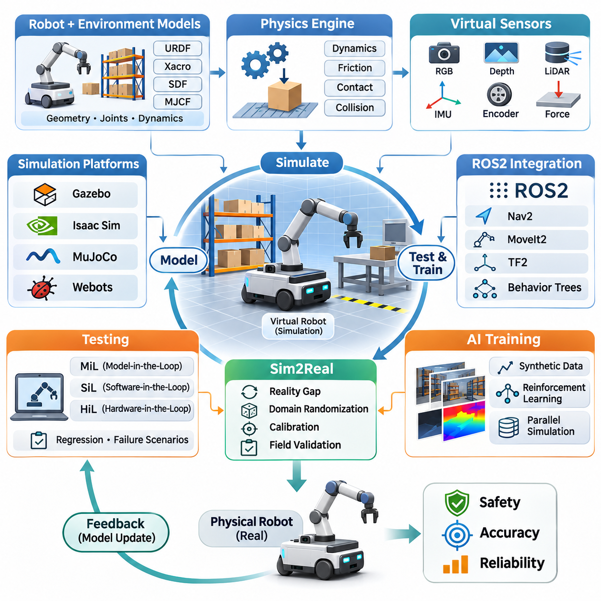
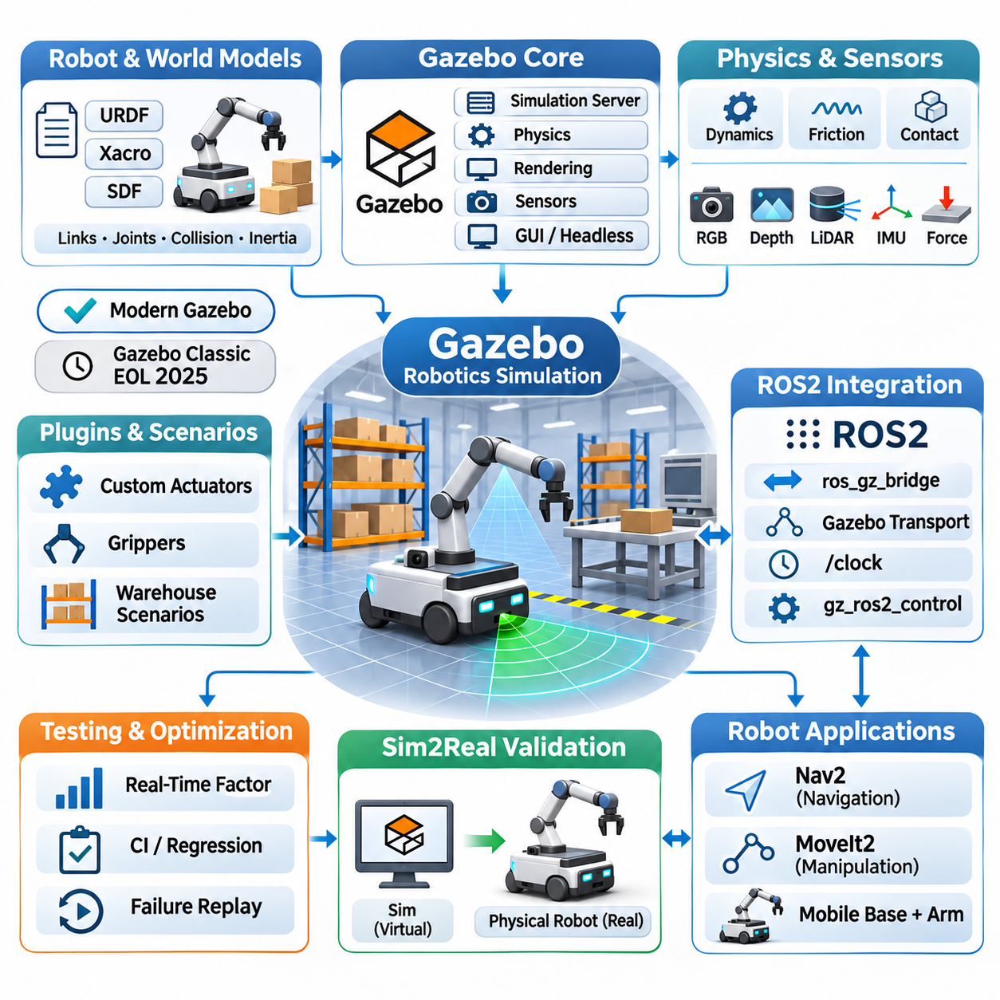
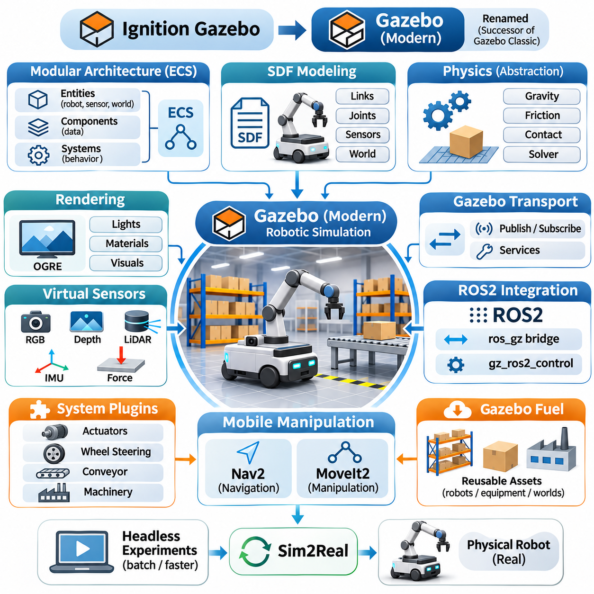
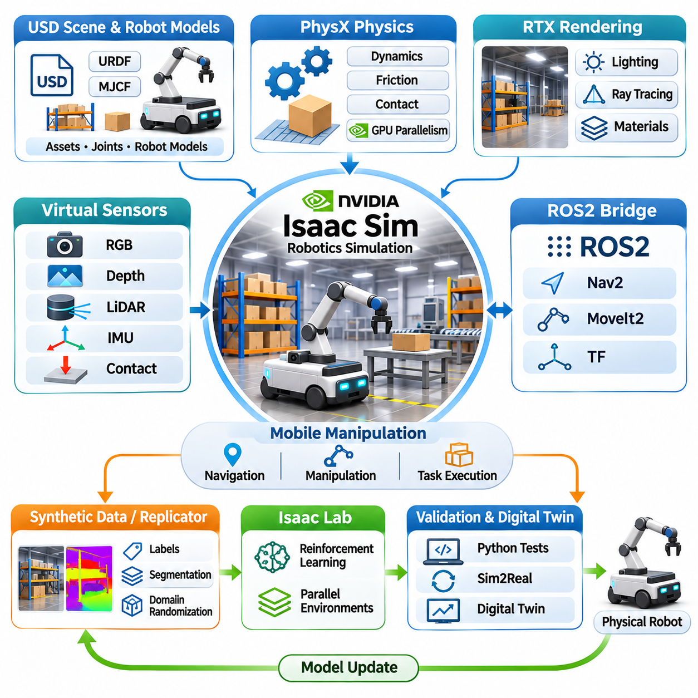
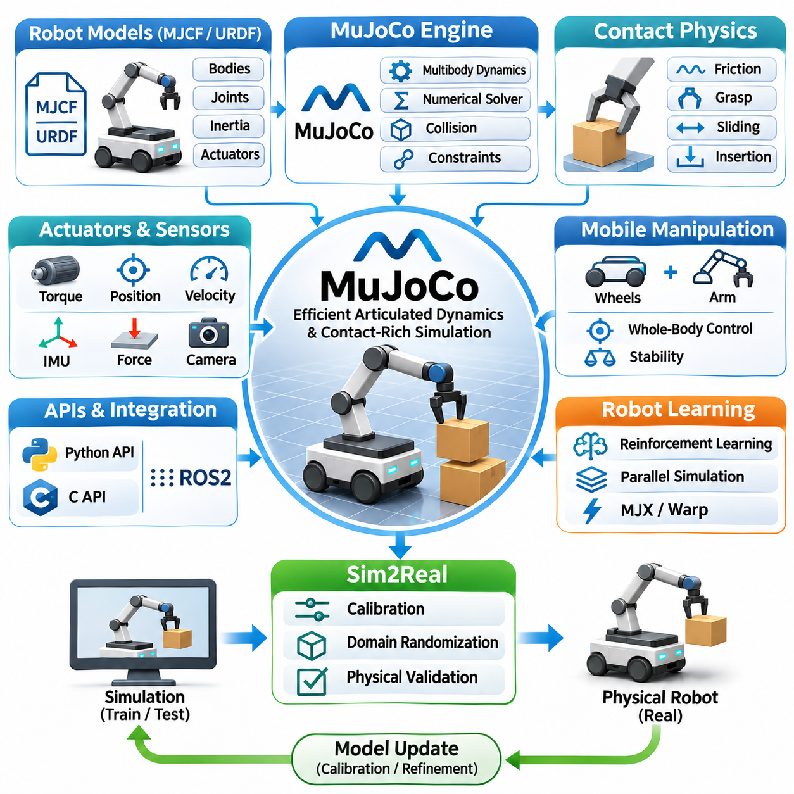
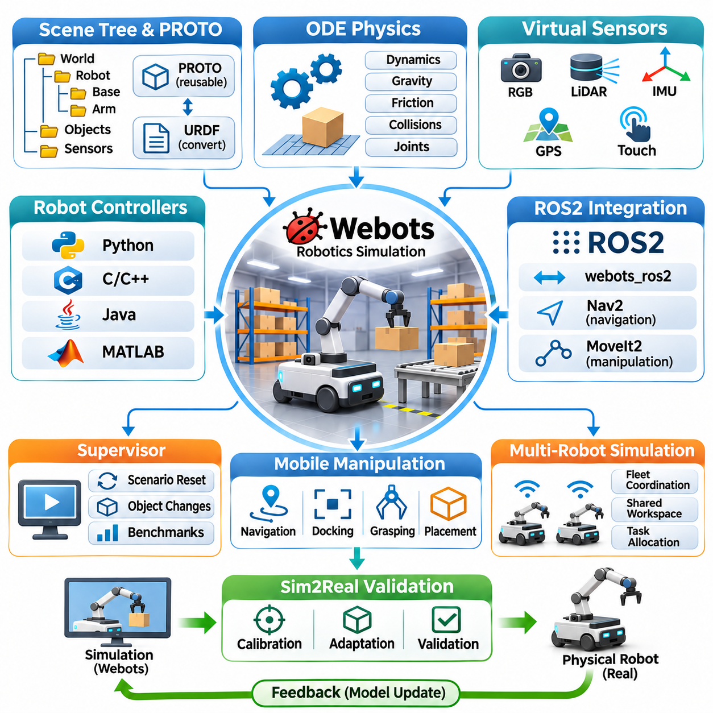
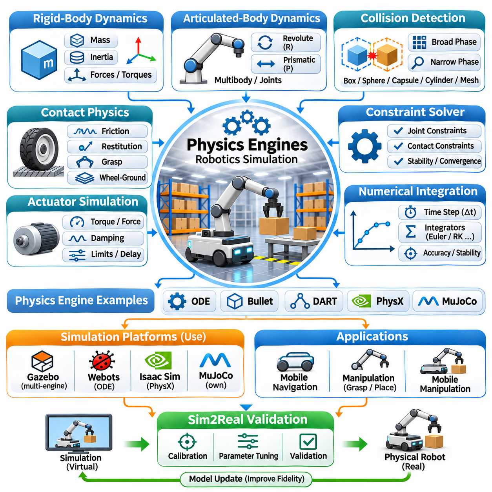
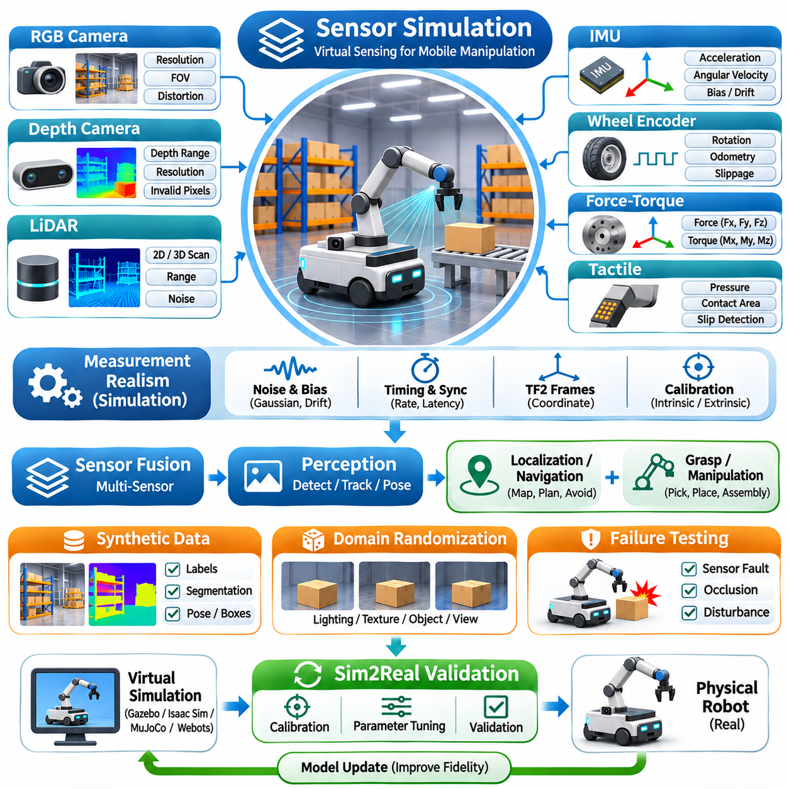
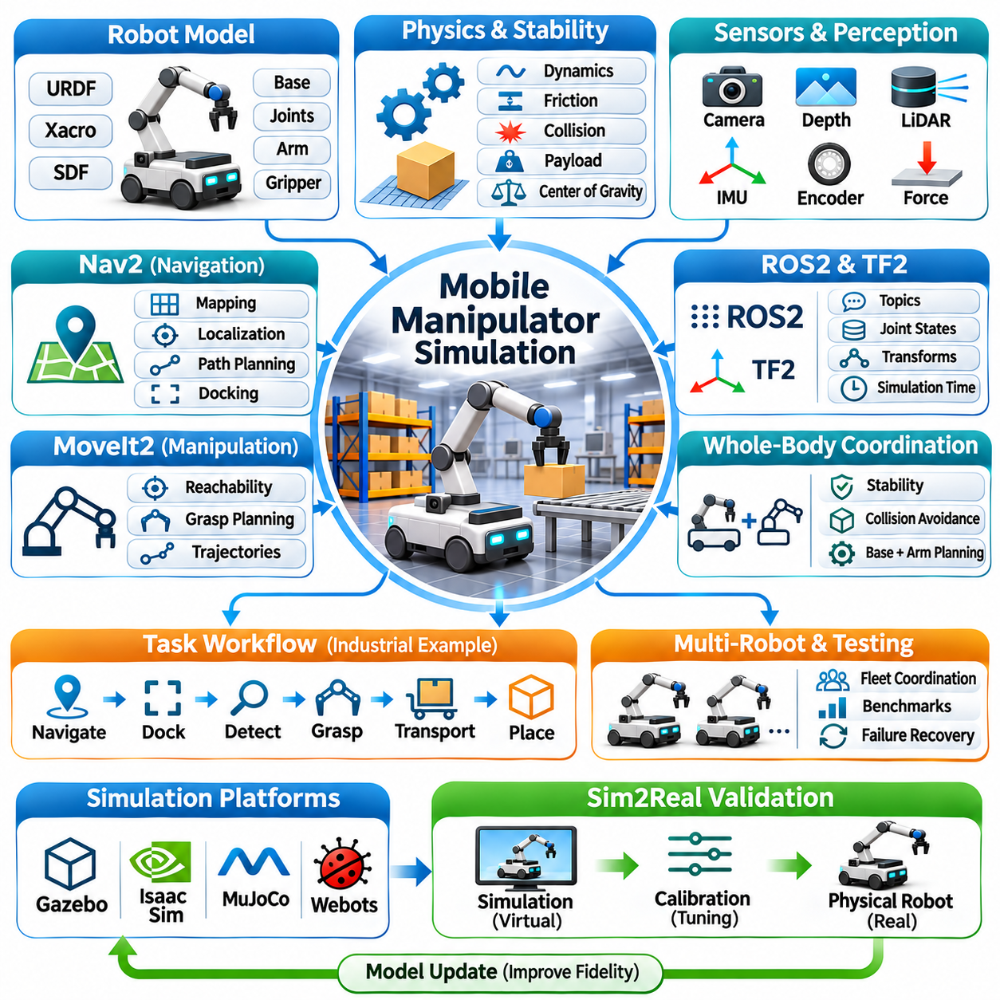
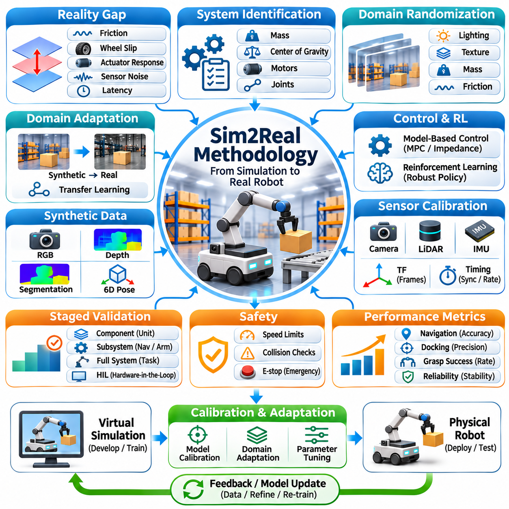

# Chapter 08. Simulation

## 01 Simulation Overview

{width="7.268055555555556in" height="7.268055555555556in"}

시뮬레이션(Simulation)은 모바일 매니퓰레이션 시스템(Mobile Manipulation System)의 개발, 검증 및 운영에 있어 핵심적인 기술이다. 물리적 배치(Physical Deployment) 이전에 로봇 하드웨어(Robot Hardware), 제어 소프트웨어(Control Software), 인식 알고리즘(Perception Algorithm) 및 운영 워크플로우(Operational Workflow)를 평가할 수 있는 가상 환경(Virtual Environment)을 제공한다. 실제 운영 조건을 컴퓨터상에서 재현함으로써 시뮬레이션은 개발 비용을 절감하고, 하드웨어 손상을 최소화하며, 반복적인 엔지니어링 개발(Engineering Iteration)을 가속화한다.

고정된 작업 공간(Workspace)에서 작동하는 기존 산업용 로봇(Industrial Robot)과 달리, 모바일 매니퓰레이터(Mobile Manipulator)는 지속적으로 변화하는 환경에서 자율주행(Autonomous Navigation)과 로봇 조작(Robotic Manipulation)을 결합한다. 이러한 운영 복잡성에는 이동 베이스(Mobile Base)의 이동, 다관절 로봇 암(Articulated Robot Arm)의 움직임, 객체 상호작용(Object Interaction), 환경 인식(Environmental Perception) 및 작업 수준 의사결정(Task-Level Decision-Making)이 포함된다. 시뮬레이션은 상호 연결된 이러한 기능을 통합된 컴퓨팅 환경(Computational Environment)에서 개발하고 검증할 수 있도록 한다.

로봇 시뮬레이션 환경(Robotic Simulation Environment)은 일반적으로 로봇 모델(Robot Model), 환경 모델(Environmental Model), 물리 엔진(Physics Engine), 가상 센서(Virtual Sensor), 액추에이터 인터페이스(Actuator Interface) 및 소프트웨어 통신 계층(Software Communication Layer)으로 구성된다. 로봇 모델은 기계적 형상(Mechanical Geometry), 관절 구성(Joint Configuration), 질량 분포(Mass Distribution) 및 동역학적 특성(Dynamic Properties)을 정의한다. 환경 모델은 공장 바닥, 물류창고 선반, 작업 스테이션(Workstation), 장애물(Obstacle) 및 사람이 조작하는 장비와 같은 물리적 주변 환경을 표현한다.

물리 엔진(Physics Engine)은 물리 법칙(Physical Laws)의 수학적 표현을 기반으로 가상 객체(Virtual Object)가 어떻게 움직이고 상호작용하는지를 계산한다. 이러한 계산에는 중력(Gravity), 강체 동역학(Rigid-Body Dynamics), 마찰(Friction), 충돌 반응(Collision Response), 관절 제약 조건(Joint Constraint) 및 접촉력(Contact Force)이 포함된다. 모바일 매니퓰레이션에서는 주행 안정성(Navigation Stability)과 조작 성능(Manipulation Performance)이 여러 기계적 하위 시스템(Mechanical Subsystem) 간의 상호작용에 의존하므로 정확한 물리 모델링(Physical Modeling)이 특히 중요하다.

URDF, Xacro, SDF 및 MJCF와 같은 로봇 기술 형식(Robot Description Format)은 시뮬레이션에 적합한 로봇 모델의 구축을 지원한다. 이러한 형식은 로봇 구성요소 간의 구조적 관계(Structural Relationship), 좌표계(Coordinate Frame), 시각적 형상(Visual Geometry), 충돌 형상(Collision Geometry) 및 관성 특성(Inertial Properties)을 표현한다. 적절한 모델링 매개변수(Modeling Parameters)를 선택하면 시뮬레이션의 신뢰성(Reliability)이 향상되며, 가상 로봇의 동작과 실제 하드웨어 구성 간의 일관성(Consistency)을 확보할 수 있다.

센서 시뮬레이션(Sensor Simulation)은 실제 로봇이 주변 환경으로부터 수신하는 정보를 재현한다. 가상 카메라(Virtual Camera), 깊이 센서(Depth Sensor), 라이다(LiDAR), 관성 측정 장치(Inertial Measurement Unit, IMU), 휠 엔코더(Wheel Encoder) 및 힘-토크 센서(Force-Torque Sensor)는 시뮬레이션된 환경 조건을 기반으로 관측 데이터(Observation Data)를 생성한다. 또한 실제 운영상의 제한 사항을 근사하기 위해 센서 잡음(Sensor Noise), 측정 불확실성(Measurement Uncertainty), 통신 지연(Communication Latency) 및 제한된 시야각(Field of View, FoV)을 도입할 수 있다.

현대적인 시뮬레이션 플랫폼(Simulation Platform)은 ROS2와 같은 로봇 미들웨어(Robotic Middleware)와 통합되어 가상 로봇이 실제 시스템에서 사용하는 것과 유사한 인터페이스를 통해 통신할 수 있도록 한다. 토픽(Topic), 서비스(Service), 액션(Action), 좌표 변환(Coordinate Transformation) 및 하드웨어 추상화 메커니즘(Hardware Abstraction Mechanism)은 소프트웨어 이식성(Software Portability)을 지원한다. 이러한 아키텍처를 통해 개발자는 실제 로봇에 지속적으로 접근하지 않고도 자율주행 알고리즘(Navigation Algorithm), MoveIt2 모션 플래닝(Motion Planning), 인식 파이프라인(Perception Pipeline) 및 행동 트리(Behavior Tree)를 평가할 수 있다.

다양한 로봇 시뮬레이션 플랫폼(Robotic Simulation Platform)은 모바일 매니퓰레이션 개발을 위한 서로 다른 기능을 제공한다. Gazebo와 과거 Ignition Gazebo로 알려졌던 최신 세대의 Gazebo는 범용 로봇 시뮬레이션(General-Purpose Robotics Simulation)과 ROS 통합(ROS Integration)을 지원한다. NVIDIA Isaac Sim은 고급 렌더링(Advanced Rendering), GPU 가속 시뮬레이션(GPU-Accelerated Simulation) 및 합성 데이터 생성(Synthetic Data Generation) 기능을 제공한다. MuJoCo는 다관절 동역학(Articulated-Body Dynamics)과 접촉 모델링(Contact Modeling)에 중점을 두며, Webots는 통합 로봇 개발 환경(Integrated Robotics Development Environment)을 제공한다.

시뮬레이션 충실도(Simulation Fidelity)는 가상 환경에서의 동작이 물리적 현실과 얼마나 일치하는지를 나타낸다. 고충실도 시뮬레이션(High-Fidelity Simulation)은 상세한 기계적 특성(Mechanical Properties), 현실적인 환경 형상(Environmental Geometry), 센서 특성(Sensor Characteristics) 및 복잡한 물리적 상호작용(Physical Interaction)을 포함한다. 그러나 충실도가 증가하면 일반적으로 추가적인 컴퓨팅 요구사항(Computational Requirements)이 발생한다. 엔지니어는 물리적 정확도(Physical Accuracy), 실행 속도(Execution Speed), 자원 소비량(Resource Consumption) 및 각 시뮬레이션 실험의 구체적인 목적 사이에서 균형을 유지해야 한다.

시뮬레이션은 모델 기반 루프 테스트(Model-in-the-Loop, MiL), 소프트웨어 기반 루프 테스트(Software-in-the-Loop, SiL) 및 하드웨어 기반 루프 테스트(Hardware-in-the-Loop, HiL)를 포함하는 다양한 수준의 시스템 통합(System Integration)을 지원한다. 이러한 접근법은 수학적 모델(Mathematical Model), 실제 운영용 소프트웨어(Production Software) 및 물리적 하드웨어(Physical Hardware)를 통제된 가상 실험 환경에 단계적으로 포함한다. 이러한 점진적 통합(Incremental Integration)은 전체 시스템을 배치하기 전에 인터페이스 불일치(Interface Inconsistency), 타이밍 문제(Timing Problem), 제어 불안정성(Control Instability) 및 통신 장애(Communication Failure)를 식별하는 데 도움이 된다.

모바일 매니퓰레이터 시뮬레이션(Mobile Manipulator Simulation)은 이동 베이스의 자율주행과 로봇 암의 움직임 사이에서 발생하는 상호작용을 고려해야 한다. 로봇 암의 자세 구성(Arm Configuration)이 변화하면 시스템의 무게중심(Center of Gravity), 안정성(Stability) 및 충돌 경계(Collision Boundary)에 영향을 미칠 수 있다. 통합 시뮬레이션(Coordinated Simulation)을 통해 엔지니어는 다양한 적재 하중(Payload)과 환경 조건에서 전신 움직임(Whole-Body Motion), 작업 공간 접근성(Workspace Accessibility), 궤적 실현 가능성(Trajectory Feasibility), 동적 안정성(Dynamic Stability) 및 조작 정확도(Manipulation Accuracy)를 평가할 수 있다.

인공지능(Artificial Intelligence, AI) 개발은 합성 데이터 생성(Synthetic Data Generation), 자동화된 실험(Automated Experimentation) 및 강화학습(Reinforcement Learning)을 통해 시뮬레이션의 이점을 활용할 수 있다. 가상 환경은 레이블이 지정된 이미지(Labeled Image), 깊이 맵(Depth Map), 분할 마스크(Segmentation Mask), 객체 자세(Object Pose) 및 상호작용 궤적(Interaction Trajectory)을 생성할 수 있다. 다수의 시뮬레이션 인스턴스(Simulation Instance)를 병렬로 실행함으로써 학습 효율성(Training Efficiency)을 향상시키고, 과도한 물리적 하드웨어 사용 없이 학습 기반 시스템(Learning-Based System)을 다양한 운영 조건에 노출할 수 있다.

로봇 시뮬레이션의 주요 과제 중 하나는 시뮬레이션 환경과 실제 물리적 환경 간의 차이를 의미하는 현실 격차(Reality Gap)이다. 마찰(Friction), 액추에이터 응답(Actuator Response), 센서 잡음(Sensor Noise), 재료 특성(Material Properties) 및 환경 불확실성(Environmental Uncertainty)의 차이는 실제 로봇으로 이전된 알고리즘의 효과를 저하시킬 수 있다. 시뮬레이션-현실 전이 방법론(Simulation-to-Reality Methodology, Sim2Real)은 도메인 무작위화(Domain Randomization), 시스템 식별(System Identification), 매개변수 보정(Parameter Calibration) 및 단계적 물리 검증(Progressive Physical Validation)을 통해 이러한 차이를 해결한다.

시뮬레이션은 체계적인 시나리오 테스트(Scenario Testing)와 자동화된 회귀 테스트(Automated Regression Testing)를 가능하게 함으로써 운영 신뢰성(Operational Reliability) 향상에 기여한다. 엔지니어는 통제된 조건에서 자율주행 실패(Navigation Failure), 파지 실패(Grasping Failure), 통신 중단(Communication Interruption), 예기치 않은 장애물(Unexpected Obstacle) 및 센서 성능 저하(Sensor Degradation)를 재현할 수 있다. 시뮬레이션만으로 물리적 안전 요구사항의 준수 여부(Safety Compliance)를 확립할 수는 없지만, 위험성 평가(Risk Assessment), 고장 분석(Failure Analysis) 및 후속 하드웨어 기반 안전 검증(Hardware-Based Safety Validation)에 중요한 근거를 제공한다.

산업용 모바일 매니퓰레이션(Industrial Mobile Manipulation)에서 시뮬레이션은 소프트웨어 개발(Software Development), 디지털 트윈(Digital Twin), 인공지능 학습(AI Training), 시스템 통합(System Integration) 및 현장 운영(Field Operations) 사이의 지속적인 연결 관계를 구축한다. 작업 완료율(Task Completion Rate), 사이클 타임(Cycle Time), 충돌 빈도(Collision Frequency), 위치 정확도(Positioning Accuracy) 및 연산 지연(Computational Latency)과 같은 성능 지표(Performance Indicator)를 실제 배치 이전에 평가할 수 있다. 물리적 테스트(Physical Testing) 및 운영 피드백(Operational Feedback)과 결합된 시뮬레이션은 로봇 시스템의 전체 생애주기(Robotic System Lifecycle)에 걸쳐 필수적인 엔지니어링 인프라(Engineering Infrastructure)가 된다.

## 02 Gazebo

{width="7.268055555555556in" height="7.268055555555556in"}

Gazebo는 3차원 가상 환경(Three-Dimensional Virtual Environment)에서 로봇의 동작(Robot Behavior), 물리적 상호작용(Physical Interaction) 및 센서 관측(Sensor Observation)을 재현하도록 설계된 오픈소스 로봇 시뮬레이션 플랫폼(Open-Source Robotics Simulation Platform)이다. 개발자는 물리적 하드웨어(Physical Hardware)에 지속적으로 접근하지 않고도 로봇 시스템을 설계, 테스트 및 검증할 수 있다. 모바일 매니퓰레이션(Mobile Manipulation)에서 Gazebo는 자율주행(Autonomous Navigation), 로봇 암 제어(Robotic Arm Control), 인식(Perception) 및 작업 실행(Task Execution)의 통합 개발을 지원한다.

Gazebo 생태계(Gazebo Ecosystem)는 Gazebo Classic과 과거 Ignition Gazebo로 알려졌던 최신 Gazebo 아키텍처(Modern Gazebo Architecture)를 포함한다. Gazebo Classic은 ROS 기반 로봇 개발을 위해 널리 채택된 시뮬레이션 환경(Simulation Environment)을 구축했으며, 최신 Gazebo는 독립적으로 개발된 소프트웨어 라이브러리(Software Library)를 기반으로 더욱 모듈화된 아키텍처(Modular Architecture)를 도입하였다. Gazebo Classic은 2025년 1월에 수명 종료(End of Life, EOL)에 도달했으므로 신규 로봇 프로젝트에서는 일반적으로 최신 Gazebo를 사용하는 것이 권장된다.

Gazebo의 기본 아키텍처(Fundamental Architecture)는 시뮬레이션 서버(Simulation Server), 그래픽 사용자 인터페이스(Graphical User Interface, GUI), 물리 엔진(Physics Engine), 렌더링 엔진(Rendering Engine), 센서 시뮬레이션 구성요소(Sensor Simulation Component) 및 통신 인프라(Communication Infrastructure)로 구성된다. 시뮬레이션 서버는 가상 세계의 상태(Virtual World State)와 물리적 상호작용을 관리하며, 그래픽 인터페이스는 시각화(Visualization)와 대화형 제어(Interactive Control)를 제공한다. 헤드리스 실행(Headless Execution)은 그래픽 시각화 없이 시뮬레이션 실험을 수행함으로써 연산 오버헤드(Computational Overhead)를 감소시킨다.

Gazebo에서의 로봇 모델링(Robot Modeling)은 일반적으로 통합 로봇 기술 형식(Unified Robot Description Format, URDF), Xacro 및 시뮬레이션 기술 형식(Simulation Description Format, SDF)을 활용한다. 이러한 형식은 기계적 링크(Mechanical Link), 관절 관계(Joint Relationship), 충돌 형상(Collision Geometry), 시각적 외관(Visual Appearance), 관성 특성(Inertial Properties) 및 센서 구성(Sensor Configuration)을 정의한다. URDF와 Xacro는 ROS 기반 개발에서 일반적으로 사용되며, SDF는 시뮬레이션 환경과 물리적 특성(Physical Properties)에 대한 더욱 포괄적인 표현을 제공한다.

Gazebo는 물리 엔진(Physics Engine)을 사용하여 강체 동역학(Rigid-Body Dynamics), 중력 가속도(Gravitational Acceleration), 마찰(Friction), 충돌 반응(Collision Response), 관절 운동(Joint Motion) 및 접촉 상호작용(Contact Interaction)을 계산한다. Gazebo Classic은 ODE, Bullet, DART 및 Simbody와 같은 물리 엔진을 지원하며, 최신 Gazebo는 모듈형 추상화 계층(Modular Abstraction Layer)을 통해 물리 엔진 통합(Physics Engine Integration)을 제공한다. 현실적인 이동 플랫폼의 움직임과 로봇 조작 동작을 재현하기 위해서는 적절한 물리 매개변수 구성(Physical Parameter Configuration)이 필수적이다.

Gazebo의 가상 환경(Virtual Environment)은 로봇 모델(Robot Model), 정적 구조물(Static Structure), 이동 가능한 객체(Movable Object), 조명 조건(Lighting Condition) 및 환경 매개변수(Environmental Parameter)를 포함하는 월드 기술(World Description)을 통해 정의된다. 산업 운영 환경(Industrial Operating Environment)에는 물류창고 선반(Warehouse Shelf), 제조 작업 스테이션(Manufacturing Workstation), 컨베이어 시스템(Conveyor System), 충전 스테이션(Charging Station) 및 동적 장애물(Dynamic Obstacle)이 포함될 수 있다. 재사용 가능한 시뮬레이션 자산(Reusable Simulation Asset)을 활용하면 전체 환경을 반복적으로 개발하지 않고도 다양한 운영 시나리오(Operational Scenario)를 구축할 수 있다.

센서 시뮬레이션(Sensor Simulation)은 Gazebo 기반 로봇 개발의 중요한 기능이다. 가상 RGB 카메라(Virtual RGB Camera), 깊이 카메라(Depth Camera), 라이다 센서(LiDAR Sensor), 관성 측정 장치(Inertial Measurement Unit, IMU), GPS 수신기(GPS Receiver) 및 힘-토크 센서(Force-Torque Sensor)는 시뮬레이션 환경으로부터 관측 데이터(Observation Data)를 생성한다. 설정 가능한 측정 잡음(Measurement Noise), 갱신 주기(Update Rate), 감지 범위(Sensing Range) 및 센서 장착 위치(Sensor Mounting Position)를 통해 개발자는 실제 센서의 물리적 한계에 근접한 조건에서 인식 알고리즘(Perception Algorithm)을 평가할 수 있다.

Gazebo는 통신 브리지(Communication Bridge), 제어 인터페이스(Control Interface) 및 지원 소프트웨어 패키지(Supporting Software Package)를 통해 ROS2와 통합된다. 최신 Gazebo는 일반적으로 ros_gz_bridge를 사용하여 Gazebo Transport와 ROS2 사이에서 지원되는 메시지 유형(Message Type)을 교환한다. 시뮬레이션 시간(Simulation Time)은 클록 토픽(Clock Topic)을 통해 배포될 수 있으며, 이를 통해 ROS2 노드는 가상 시간(Virtual Time)에 따라 작동할 수 있다. 이러한 메커니즘은 시뮬레이션 구성요소와 외부 로봇 애플리케이션(External Robotic Application) 사이의 일관된 통신을 지원한다.

ros2_control 프레임워크(Framework)는 시뮬레이션된 액추에이터(Simulated Actuator)가 표준화된 하드웨어 인터페이스(Standardized Hardware Interface)와 제어기 구성(Controller Configuration)을 통해 작동할 수 있도록 한다. Gazebo Classic은 기존에 gazebo_ros2_control을 사용했으며, 최신 Gazebo는 gz_ros2_control을 통한 통합을 지원한다. 관절 궤적 제어기(Joint Trajectory Controller), 속도 제어기(Velocity Controller) 및 관절 상태 브로드캐스터(Joint State Broadcaster)를 통해 개발자는 실제 시스템 구현과 유사한 소프트웨어 아키텍처(Software Architecture)를 사용하여 로봇 암의 움직임과 이동 베이스 제어(Mobile Base Control)를 평가할 수 있다.

자율이동로봇(Autonomous Mobile Robot, AMR)의 경우 Gazebo는 위치 추정(Localization), 지도 작성(Mapping), 장애물 회피(Obstacle Avoidance) 및 경로 계획(Path Planning) 알고리즘을 개발하기 위한 환경을 제공한다. 일반적으로 Nav2로 알려진 ROS2 내비게이션 스택(ROS2 Navigation Stack)과의 통합은 가상 산업 시설(Virtual Industrial Facility) 내에서 자율주행 성능을 평가할 수 있도록 지원한다. 개발자는 현장 배치(Field Deployment) 이전에 경로 효율성(Route Efficiency), 위치 추정 드리프트(Localization Drift), 장애물 대응(Obstacle Response), 도킹 정확도(Docking Accuracy) 및 자율주행 복구 동작(Navigation Recovery Behavior)을 분석할 수 있다.

Gazebo에서의 로봇 조작 개발(Robotic Manipulation Development)은 운동학적 분석(Kinematic Analysis), 충돌 검사(Collision Checking), 모션 플래닝(Motion Planning) 및 궤적 실행(Trajectory Execution)을 위해 MoveIt2와의 통합을 빈번하게 활용한다. 가상 로봇 암(Virtual Robot Arm)과 그리퍼(Gripper)는 객체 획득(Object Acquisition), 운반(Transportation), 배치(Placement) 및 작업 스테이션과의 상호작용을 포함하는 조작 작업을 수행할 수 있다. 계획된 궤적(Planned Trajectory)과 시뮬레이션 실행 결과(Simulated Execution)를 비교하면 관절 제한(Joint Limitation), 제어기 구성 문제(Controller Configuration Problem) 및 잠재적인 충돌(Potential Collision)을 식별하는 데 도움이 된다.

모바일 매니퓰레이터 시뮬레이션(Mobile Manipulator Simulation)은 공유 가상 환경(Shared Virtual Environment) 내에서 자율이동 플랫폼(Autonomous Mobile Platform)의 동작과 다관절 로봇 암(Articulated Robot Arm)의 작동을 결합한다. 엔지니어는 이동 베이스 위치 결정(Base Positioning), 로봇 암 도달 가능성(Arm Reachability), 적재 하중 분포(Payload Distribution) 및 조작 정확도(Manipulation Accuracy) 사이의 상호작용을 평가할 수 있다. 통합 시뮬레이션(Coordinated Simulation)은 복잡한 산업 운영 과정에서 전신 움직임(Whole-Body Motion), 동적 안정성(Dynamic Stability), 충돌 회피(Collision Avoidance) 및 작업 수준 시퀀싱(Task-Level Sequencing)에 대한 분석도 지원한다.

Gazebo는 표준 플랫폼 기능을 확장하는 플러그인(Plugin)과 시스템 구성요소(System Component)를 통해 시뮬레이션 사용자 정의(Simulation Customization)를 지원한다. 이러한 확장 기능은 특수 액추에이터 동작(Specialized Actuator Behavior), 센서 특성(Sensor Characteristics), 환경 상호작용(Environmental Interaction), 통신 인터페이스(Communication Interface) 및 자동화된 시나리오 실행(Automated Scenario Execution)을 구현할 수 있다. 사용자 정의 시뮬레이션 구성요소(Custom Simulation Component)는 독자적인 이동 플랫폼(Proprietary Mobile Platform), 독립 조향 메커니즘(Independent Steering Mechanism), 특수 그리퍼(Specialized Gripper) 또는 산업용 장비(Industrial Equipment)를 모델링할 때 특히 유용하다.

시뮬레이션 성능(Simulation Performance)은 물리 계산 시간 간격(Physics Time Step), 솔버 구성(Solver Configuration), 센서 갱신 주파수(Sensor Update Frequency), 렌더링 복잡도(Rendering Complexity) 및 사용 가능한 컴퓨팅 자원(Computing Resource)에 따라 달라진다. 실시간 계수(Real-Time Factor, RTF)는 시뮬레이션 시간과 실제 경과 시간 사이의 관계를 나타낸다. 단순화된 충돌 형상(Simplified Collision Geometry), 헤드리스 실행(Headless Execution), 최적화된 센서 구성(Optimized Sensor Configuration) 및 병렬 시뮬레이션 인스턴스(Parallel Simulation Instance)는 개별 실험에서 요구되는 시뮬레이션 충실도(Simulation Fidelity)를 유지하면서 연산 효율성(Computational Efficiency)을 향상시킬 수 있다.

Gazebo는 지속적 통합 파이프라인(Continuous Integration Pipeline, CI Pipeline) 내에서 자동화된 소프트웨어 검증(Automated Software Verification), 회귀 테스트(Regression Testing) 및 고장 시나리오 재현(Failure Scenario Reproduction)도 지원한다. 기록된 시뮬레이션 이벤트(Simulation Event)와 ROS2 메시지 데이터(Message Data)는 자율주행 실패(Navigation Failure), 조작 오류(Manipulation Error) 및 통신 불일치(Communication Inconsistency)를 진단하는 데 활용될 수 있다. 그러나 단순화된 접촉 모델(Contact Model), 센서 모델링 가정(Sensor Assumption) 및 액추에이터 동역학(Actuator Dynamics)이 시뮬레이션과 현실 간의 격차(Simulation-to-Reality Gap)를 발생시킬 수 있으므로, 시뮬레이션 결과는 반드시 물리적 테스트(Physical Testing)를 통해 보완되어야 한다.

## 03 Ignition Gazebo

{width="7.268055555555556in" height="7.268055555555556in"}

Ignition Gazebo는 Gazebo Classic의 후속 시스템으로 개발된 모듈형 오픈소스 로봇 시뮬레이션 아키텍처(Modular Open-Source Robotics Simulation Architecture)이다. 긴밀하게 결합된 시뮬레이션 구성요소(Tightly Coupled Simulation Component)에서 발생하는 한계를 극복하고, 확장 가능한 로봇 개발 환경(Scalable Robotic Development Environment)을 지원하기 위해 설계되었다. 이후 Ignition Gazebo는 Gazebo로 명칭이 변경되었지만, 그 아키텍처 설계 원칙(Architectural Principle)은 현대 로봇 시뮬레이션(Robotics Simulation)과 모바일 매니퓰레이션 개발(Mobile Manipulation Development)의 핵심으로 유지되고 있다.

기존에 다수의 시뮬레이션 기능을 상대적으로 통합된 소프트웨어 아키텍처(Integrated Software Architecture) 내에서 관리했던 Gazebo Classic과 달리, Ignition Gazebo는 주요 기능을 독립적으로 유지보수되는 라이브러리(Independently Maintained Library)로 분리한다. 물리 연산(Physics Computation), 렌더링(Rendering), 센서 데이터 생성(Sensor Generation), 수학적 연산(Mathematical Operation), 통신(Communication) 및 그래픽 시각화(Graphical Visualization)는 모듈형 구성요소(Modular Component)로 구성된다. 이러한 분리 구조는 다양한 로봇 애플리케이션에서 유지보수성(Maintainability), 확장성(Extensibility) 및 유연성(Flexibility)을 향상시킨다.

엔티티 컴포넌트 시스템(Entity Component System, ECS)은 Ignition Gazebo의 핵심적인 아키텍처 설계 원칙이다. 이러한 아키텍처에서 로봇, 센서, 관절(Joint), 조명(Light) 및 환경 객체(Environmental Object)는 특수화된 데이터 구성요소(Data Component)와 연결된 엔티티(Entity)로 표현된다. 독립적인 시스템(Independent System)은 이러한 구성요소를 대상으로 연산을 수행하여 시뮬레이션 동작(Simulation Behavior)을 구현한다. 이러한 접근법은 소프트웨어 모듈(Software Module) 간의 의존성(Dependency)을 감소시키고 복잡한 가상 환경(Virtual Environment)의 효율적인 관리를 지원한다.

Ignition Gazebo는 로봇 모델(Robot Model)과 가상 환경을 표현하기 위해 시뮬레이션 기술 형식(Simulation Description Format, SDF)을 활용한다. SDF는 기계적 링크(Mechanical Link), 관절 관계(Joint Relationship), 관성 특성(Inertial Properties), 충돌 형상(Collision Geometry), 센서 구성(Sensor Configuration) 및 환경 구조물(Environmental Structure)을 정의한다. 이러한 계층적 표현(Hierarchical Representation)은 공유 시뮬레이션 환경(Shared Simulation Environment) 내에서 이동 플랫폼(Mobile Platform), 다관절 매니퓰레이터(Articulated Manipulator), 다중 센서(Multiple Sensor) 및 상호작용하는 기계적 조립체(Mechanical Assembly)를 포함하는 복잡한 로봇 시스템을 지원한다.

Ignition Gazebo의 물리 아키텍처(Physics Architecture)는 시뮬레이션 기능과 기반 물리 엔진(Underlying Physics Engine) 사이에 추상화 계층(Abstraction Layer)을 제공한다. 이러한 설계는 전체 시뮬레이터(Simulator)를 단일 구현에 긴밀하게 결합하는 대신 표준화된 인터페이스(Standardized Interface)를 통해 지원되는 물리 엔진을 통합할 수 있도록 한다. 엔지니어는 구체적인 실험 요구사항(Experimental Requirement)에 따라 중력(Gravity), 마찰(Friction), 접촉 매개변수(Contact Parameter), 관절 제약 조건(Joint Constraint) 및 솔버 특성(Solver Characteristics)을 구성할 수 있다.

렌더링 기능(Rendering Functionality)은 과거 Ignition Rendering으로 알려졌던 Gazebo Rendering 라이브러리를 통해 독립적으로 관리된다. OGRE 기반 구현(OGRE-Based Implementation)을 포함하는 지원 렌더링 엔진(Rendering Engine)은 가상 환경의 시각적 표현(Visual Representation)을 제공하고 시뮬레이션된 광학 센서(Simulated Optical Sensor)를 위한 관측 데이터(Observation Data)를 생성한다. 고급 조명(Advanced Lighting), 그림자(Shadow), 재질 외관(Material Appearance) 및 환경 효과(Environmental Effect)는 비전 기반 로봇 애플리케이션(Vision-Based Robotic Application)을 더욱 현실적으로 평가하는 데 기여한다.

센서 시뮬레이션(Sensor Simulation)은 물리적 감지 장치(Physical Sensing Device)에서 생성되는 측정값(Measurement)을 재현하는 모듈형 라이브러리(Modular Library)를 통해 구현된다. 가상 RGB 카메라(Virtual RGB Camera), 깊이 카메라(Depth Camera), 라이다 시스템(LiDAR System), 관성 측정 장치(Inertial Measurement Unit, IMU) 및 힘-토크 센서(Force-Torque Sensor)는 로봇 엔티티(Robotic Entity)와 연결될 수 있다. 설정 가능한 갱신 주파수(Update Frequency), 측정 잡음(Measurement Noise), 시야각 제한(Field-of-View Restriction) 및 감지 한계(Sensing Limitation)를 통해 엔지니어는 다양한 운영 조건에서 인식 성능(Perception Performance)을 분석할 수 있다.

Ignition Gazebo의 통신 인프라(Communication Infrastructure)는 현재 Gazebo Transport로 알려진 자체 전송 미들웨어(Native Transport Middleware)를 기반으로 한다. 이러한 미들웨어는 메시지 발행(Message Publication), 구독(Subscription) 및 서비스 메커니즘(Service Mechanism)을 통한 분산 통신(Distributed Communication)을 지원한다. 시뮬레이션 구성요소와 외부 애플리케이션(External Application)은 개별 소프트웨어 프로세스(Software Process) 간의 직접적인 의존성 없이 로봇 상태(Robot State), 센서 관측(Sensor Observation), 액추에이터 명령(Actuator Command) 및 환경 정보(Environmental Information)를 교환할 수 있다.

ROS2와의 통합(ROS2 Integration)을 통해 Ignition Gazebo는 분산 로봇 애플리케이션(Distributed Robotic Application)을 위한 가상 실행 환경(Virtual Execution Environment)으로 기능할 수 있다. 기존에 ros_ign을 통해 제공되었으며 이후 ros_gz로 명칭이 변경된 통신 브리지(Communication Bridge)는 Gazebo Transport와 ROS2 인터페이스 사이에서 지원되는 메시지를 변환한다. 개발자는 센서 데이터(Sensor Data), 속도 명령(Velocity Command), 관절 상태(Joint State), 시뮬레이션 클록(Simulation Clock) 및 기타 로봇 정보를 위한 통신 채널(Communication Channel)을 구축할 수 있다.

최신 Gazebo와 ros2_control의 통합을 통해 시뮬레이션된 이동 플랫폼과 로봇 매니퓰레이터(Robotic Manipulator)는 표준화된 제어기 인터페이스(Standardized Controller Interface)를 기반으로 작동할 수 있다. gz_ros2_control 패키지는 시뮬레이션 기반 하드웨어 표현(Simulation-Based Hardware Representation)과 ROS2 제어 구성요소(ROS2 Control Component)를 연결한다. 이러한 아키텍처는 관절 궤적 실행(Joint Trajectory Execution), 속도 조절(Velocity Regulation) 및 상태 피드백(State Feedback)을 지원하면서 가상 로봇 시스템(Virtual Robotic System)과 실제 하드웨어 구현(Physical Hardware Implementation) 사이의 소프트웨어 재사용(Software Reuse)을 촉진한다.

모바일 매니퓰레이션 애플리케이션(Mobile Manipulation Application)에서 Ignition Gazebo는 자율주행(Autonomous Navigation)과 로봇 암 움직임(Robotic Arm Movement) 사이의 상호작용을 평가하기 위한 통합 환경(Unified Environment)을 제공한다. 엔지니어는 Nav2, MoveIt2, 행동 트리(Behavior Tree) 및 인식 알고리즘(Perception Algorithm)을 통합하여 완전한 산업용 워크플로우(Industrial Workflow)를 재현할 수 있다. 이러한 워크플로우에는 자율 운송(Autonomous Transportation), 정밀 도킹(Precision Docking), 객체 검출(Object Detection), 파지 실행(Grasp Execution), 자재 취급(Material Handling) 및 운영 장애 복구(Operational Failure Recovery)가 포함될 수 있다.

모듈형 시스템 아키텍처(Modular System Architecture)를 통해 개발자는 시스템 플러그인(System Plugin)을 활용하여 사용자 정의 시뮬레이션 동작(Customized Simulation Behavior)을 구현할 수 있다. 이러한 플러그인은 특수 액추에이터 동역학(Specialized Actuator Dynamics), 독립 휠 조향(Independent Wheel Steering), 컨베이어 이동(Conveyor Movement), 산업용 기계(Industrial Machinery) 및 환경 외란(Environmental Disturbance)을 재현할 수 있다. 사용자 정의 시스템 구성요소(Customized System Component)는 상용 로봇 플랫폼(Commercial Robotic Platform) 또는 독자적인 기계적 구성(Proprietary Mechanical Configuration)을 표준 시뮬레이션 모델(Standard Simulation Model)로 충분히 표현할 수 없는 경우 특히 유용하다.

과거 Ignition Fuel로 알려졌던 Gazebo Fuel은 로봇 모델, 산업용 장비(Industrial Equipment), 환경 객체 및 완전한 가상 세계(Virtual World)와 같은 재사용 가능한 시뮬레이션 자산(Reusable Simulation Asset)에 대한 접근을 제공한다. 공유 자원(Shared Resource)은 대표적인 운영 환경(Representative Operating Environment)을 구축하는 데 필요한 엔지니어링 작업량(Engineering Effort)을 감소시킨다. 그러나 다운로드한 시뮬레이션 모델은 형상 정확도(Geometric Accuracy), 물리적 특성(Physical Properties), 소프트웨어 호환성(Software Compatibility) 및 특정 산업 애플리케이션에 대한 적합성(Suitability)을 평가해야 한다.

Ignition Gazebo는 헤드리스 실행(Headless Execution), 설정 가능한 시뮬레이션 시나리오(Configurable Simulation Scenario) 및 독립적으로 운영되는 시뮬레이션 인스턴스(Simulation Instance)를 통해 자동화된 실험(Automated Experimentation)을 지원한다. 이러한 기능은 자율주행 성능(Navigation Performance), 조작 신뢰성(Manipulation Reliability), 제어기 안정성(Controller Stability) 및 통신 동작(Communication Behavior)에 대한 반복적인 평가를 가능하게 한다. 실험 목적(Experimental Objective)에 따라 물리 계산 시간 간격(Physics Time Step), 렌더링 요구사항(Rendering Requirement), 센서 갱신 주기(Sensor Update Rate) 및 모델 복잡도(Model Complexity)를 조정함으로써 연산 효율성(Computational Efficiency)을 향상시킬 수 있다.

산업용 모바일 매니퓰레이션 개발(Industrial Mobile Manipulation Development)에서 Ignition Gazebo 아키텍처는 디지털 트윈 통합(Digital Twin Integration), 지속적인 소프트웨어 검증(Continuous Software Verification) 및 시뮬레이션-현실 전이 방법론(Simulation-to-Reality Methodology, Sim2Real)을 위한 기반을 구축한다. 모듈형 설계(Modular Design)는 장기적인 소프트웨어 유지보수(Long-Term Software Maintenance)와 단계적 시스템 통합(Progressive System Integration)을 지원한다. 그러나 액추에이터 동작(Actuator Behavior), 접촉 동역학(Contact Dynamics), 센서 불확실성(Sensor Uncertainty) 및 실제 운영 조건(Real-World Operating Condition)에서 발생하는 차이를 해결하기 위해서는 가상 실험(Virtual Experiment)을 반드시 물리적 검증(Physical Validation)으로 보완해야 한다.

## 04 Isaac Sim

{width="7.268055555555556in" height="7.268055555555556in"}

NVIDIA Isaac Sim은 물리 기반 가상 환경(Physically Based Virtual Environment)에서 지능형 로봇 시스템(Intelligent Robotic System)의 개발, 학습, 테스트 및 검증을 지원하도록 설계된 로봇 시뮬레이션 플랫폼(Robotics Simulation Platform)이다. NVIDIA Omniverse 기술을 기반으로 구축된 Isaac Sim은 GPU 가속 물리 시뮬레이션(GPU-Accelerated Physics Simulation), 고급 렌더링(Advanced Rendering), 센서 모델링(Sensor Modeling) 및 인공지능 개발 기능(Artificial Intelligence Development Capability)을 결합하여 자율 모바일 매니퓰레이션(Autonomous Mobile Manipulation)을 포함한 복잡한 로봇 애플리케이션을 지원한다.

Isaac Sim의 기반 아키텍처(Underlying Architecture)는 로봇 시스템(Robotic System), 환경 자산(Environmental Asset), 재질(Material), 조명 조건(Lighting Condition) 및 시뮬레이션 속성(Simulation Property)을 표현하기 위한 프레임워크로 범용 장면 기술(Universal Scene Description, USD)을 활용한다. USD는 계층적 장면 구성(Hierarchical Scene Composition), 재사용 가능한 자산 관리(Reusable Asset Management) 및 협업 개발(Collaborative Development)을 지원한다. 따라서 이동 로봇(Mobile Robot), 로봇 암(Robotic Arm), 작업 스테이션(Workstation) 및 자재 취급 장비(Material Handling Equipment)를 포함하는 복잡한 산업 환경을 통합 시뮬레이션 프레임워크(Unified Simulation Framework) 내에서 구축할 수 있다.

Isaac Sim은 NVIDIA PhysX를 활용하여 강체 동역학(Rigid-Body Dynamics), 다관절 물체 운동(Articulated-Body Motion), 충돌 상호작용(Collision Interaction), 마찰(Friction) 및 접촉력(Contact Force)을 계산한다. GPU 가속 물리 연산(GPU-Accelerated Physics Computation)은 특히 다수의 로봇 환경을 병렬로 실행할 때 시뮬레이션 처리량(Simulation Throughput)을 향상시킬 수 있다. 현실적인 로봇 동작(Robotic Behavior)을 재현하기 위해서는 질량 분포(Mass Distribution), 관절 제약 조건(Joint Constraint), 액추에이터 특성(Actuator Properties) 및 접촉 매개변수(Contact Parameter)를 정확하게 구성하는 것이 필수적이다.

물리 기반 렌더링(Physically Based Rendering, PBR)과 광선 추적(Ray Tracing) 기술은 Isaac Sim을 다수의 기존 로봇 시뮬레이션 환경과 차별화한다. 이러한 기능은 가상 장면(Virtual Scene) 내에서 복잡한 조명 조건(Lighting Condition), 재질 반사(Material Reflection), 그림자(Shadow) 및 광학적 상호작용(Optical Interaction)을 재현한다. 이러한 시각적 사실성(Visual Realism)은 RGB 이미지(RGB Image), 깊이 측정(Depth Measurement), 객체 인식(Object Recognition) 및 시각 유도 조작(Visually Guided Manipulation)에 의존하는 로봇 인식 시스템(Robotic Perception System)의 개발에 특히 유용하다.

로봇 모델(Robot Model)은 URDF 및 MJCF와 같은 지원 형식(Supported Format)을 통해 Isaac Sim으로 가져오거나 USD 환경 내에서 직접 구축할 수 있다. 가져온 모델(Imported Model)에는 다관절 구조의 관절(Articulated Joint), 충돌 메시(Collision Mesh), 관성 특성(Inertial Properties), 액추에이터 구성(Actuator Configuration) 및 좌표 변환(Coordinate Transformation)에 대한 적절한 정의가 필요하다. 엔지니어는 자율이동로봇(Autonomous Mobile Robot, AMR), 산업용 매니퓰레이터(Industrial Manipulator), 협동로봇(Collaborative Robot, Cobot) 및 통합 모바일 매니퓰레이션 플랫폼(Integrated Mobile Manipulation Platform)에 대한 시뮬레이션용 모델을 구축할 수 있다.

Isaac Sim의 센서 시뮬레이션(Sensor Simulation)은 가상 RGB 카메라(Virtual RGB Camera), 깊이 카메라(Depth Camera), 라이다 센서(LiDAR Sensor), 관성 측정 장치(Inertial Measurement Unit, IMU), 접촉 센서(Contact Sensor) 및 기타 로봇 감지 메커니즘(Robotic Sensing Mechanism)을 지원한다. 센서 구성(Sensor Configuration)은 장착 위치(Mounting Position), 측정 주파수(Measurement Frequency), 광학적 특성(Optical Characteristics) 및 감지 범위(Sensing Range)를 재현할 수 있다. 이러한 기능을 통해 개발자는 멀티모달 인식(Multimodal Perception), 센서 융합(Sensor Fusion), 위치 추정(Localization), 객체 자세 추정(Object Pose Estimation) 및 환경 이해(Environmental Understanding)를 평가할 수 있다.

ROS2와의 통합(ROS2 Integration)을 통해 Isaac Sim은 지원되는 메시지 인터페이스(Message Interface)를 기반으로 외부 로봇 소프트웨어(External Robotic Software)와 통신할 수 있다. ROS2 브리지(ROS2 Bridge)는 센서 관측(Sensor Observation), 액추에이터 명령(Actuator Command), 관절 상태(Joint State), 좌표 변환(Coordinate Transformation) 및 시뮬레이션 시간(Simulation Time)의 교환을 지원한다. 따라서 기존 로봇 애플리케이션(Robotic Application)은 실제 물리적 배치(Physical Deployment) 과정에서 사용되는 것과 유사한 통신 아키텍처(Communication Architecture)를 통해 시뮬레이션된 플랫폼과 상호작용할 수 있다.

Isaac Sim에서의 자율주행 개발(Autonomous Navigation Development)은 ROS2 Nav2, 지도 작성 알고리즘(Mapping Algorithm), 위치 추정 프레임워크(Localization Framework) 및 장애물 회피 메커니즘(Obstacle Avoidance Mechanism)을 포함할 수 있다. 엔지니어는 정적 장애물(Static Obstacle) 및 동적 장애물(Dynamic Obstacle)을 포함하는 대표적인 물류창고(Warehouse), 제조 시설(Manufacturing Facility), 병원(Hospital) 및 물류 환경(Logistics Environment)을 구축할 수 있다. 가상 실험(Virtual Experiment)은 통제된 운영 조건에서 자율주행 정확도(Navigation Accuracy), 도킹 성능(Docking Performance), 경로 효율성(Route Efficiency) 및 복구 동작(Recovery Behavior)의 평가를 지원한다.

로봇 조작 개발(Robotic Manipulation Development)은 Isaac Sim을 MoveIt2 또는 NVIDIA Isaac ROS 구성요소(Component) 및 기타 움직임 생성 프레임워크(Motion Generation Framework)와 결합할 수 있다. 시뮬레이션된 로봇 암과 그리퍼(Gripper)는 객체 획득(Object Acquisition), 집기 및 배치 작업(Pick-and-Place Operation), 궤적 추종(Trajectory Tracking) 및 충돌 회피(Collision Avoidance)를 수행할 수 있다. 접촉이 빈번한 시뮬레이션(Contact-Rich Simulation)은 파지 안정성(Grasp Stability), 객체 변위(Object Displacement), 조작 제약 조건(Manipulation Constraint) 및 로봇 메커니즘과 환경 구조물 사이의 상호작용에 대한 분석도 지원한다.

모바일 매니퓰레이터 시뮬레이션(Mobile Manipulator Simulation)은 자율이동 플랫폼(Autonomous Mobile Platform)과 다관절 로봇 암(Articulated Robotic Arm)에 대한 통합 모델링(Coordinated Modeling)을 필요로 한다. Isaac Sim을 통해 엔지니어는 이동 베이스 위치 결정 정확도(Base Positioning Accuracy), 매니퓰레이터 도달 가능성(Manipulator Reachability), 적재 하중 분포(Payload Distribution), 전신 움직임(Whole-Body Motion) 및 환경 충돌(Environmental Collision)을 분석할 수 있다. 통합 시뮬레이션 시나리오(Integrated Simulation Scenario)는 자율주행, 정밀 도킹(Precision Docking), 객체 식별(Object Identification), 파지(Grasping), 운반(Transportation) 및 배치(Placement)를 포함하는 전체 산업용 워크플로우(Industrial Workflow)를 재현할 수 있다.

합성 데이터 생성(Synthetic Data Generation)은 Isaac Sim과 관련 NVIDIA Replicator 프레임워크의 주요 기능이다. 가상 환경은 자동으로 주석이 지정된 RGB 이미지(Automatically Annotated RGB Image), 깊이 맵(Depth Map), 의미론적 분할 마스크(Semantic Segmentation Mask), 인스턴스 분할 마스크(Instance Segmentation Mask), 경계 상자(Bounding Box) 및 객체 자세(Object Pose)를 생성할 수 있다. 도메인 무작위화(Domain Randomization)는 조명(Lighting), 텍스처(Texture), 객체 배치(Object Arrangement) 및 카메라 시점(Camera Viewpoint)에 다양한 변화를 도입함으로써 학습 데이터셋(Training Dataset)의 다양성을 증가시킬 수 있다.

Isaac Sim은 강화학습(Reinforcement Learning, RL) 및 기타 학습 기반 로봇 개발 방법론(Learning-Based Robotic Development Methodology)을 위해 설계된 프레임워크인 Isaac Lab을 통해 로봇 학습(Robot Learning)을 위한 시뮬레이션 기반도 제공한다. 병렬 시뮬레이션 환경(Parallel Simulation Environment)은 로봇 에이전트(Robot Agent)가 상호작용 경험(Interaction Experience)을 더욱 효율적으로 축적할 수 있도록 한다. 학습 애플리케이션(Learning Application)에는 이동 운동(Locomotion), 정교한 조작(Dexterous Manipulation), 객체 파지(Object Grasping), 통합 모바일 매니퓰레이션(Coordinated Mobile Manipulation) 및 적응형 제어 정책 개발(Adaptive Control Policy Development)이 포함될 수 있다.

시뮬레이션 성능(Simulation Performance)은 사용 가능한 CPU 및 GPU 자원(Computing Resource), 물리 구성(Physics Configuration), 렌더링 복잡도(Rendering Complexity), 센서 갱신 주파수(Sensor Update Frequency) 및 환경 규모(Environmental Scale)에 따라 달라진다. 고충실도 광학 시뮬레이션(High-Fidelity Optical Simulation)과 대규모 병렬 학습(Large-Scale Parallel Learning)은 상당한 GPU 메모리(GPU Memory) 및 연산 요구사항(Computational Requirement)을 발생시킬 수 있다. 헤드리스 실행(Headless Execution), 단순화된 충돌 형상(Simplified Collision Geometry), 선택적 센서 활성화(Selective Sensor Activation) 및 최적화된 렌더링 구성(Optimized Rendering Configuration)은 시뮬레이션 충실도(Simulation Fidelity)와 실행 효율성(Execution Efficiency) 사이의 균형을 유지하는 데 도움이 된다.

Isaac Sim은 자동화된 시나리오 실행(Automated Scenario Execution), 소프트웨어 회귀 테스트(Software Regression Testing), 고장 재현(Failure Reproduction) 및 운영 디지털 트윈 통합(Operational Digital Twin Integration)을 지원한다. Python 스크립팅(Python Scripting)과 프로그래밍 가능한 시뮬레이션 인터페이스(Programmable Simulation Interface)를 통해 엔지니어는 환경을 수정하고, 로봇 시스템을 구성하며, 실험을 실행하고, 성능 측정값(Performance Measurement)을 체계적으로 수집할 수 있다. 그러나 시뮬레이션 정확도(Simulation Accuracy)는 여전히 물리 모델(Physical Model), 센서 모델링 가정(Sensor Assumption) 및 환경 표현(Environmental Representation)의 품질에 의존한다.

산업용 모바일 매니퓰레이션(Industrial Mobile Manipulation)에서 Isaac Sim은 로봇 소프트웨어(Robotics Software), 물리적 인공지능(Physical AI), 합성 데이터 생성(Synthetic Data Generation), 디지털 트윈(Digital Twin) 및 시뮬레이션-현실 전이 방법론(Simulation-to-Reality Methodology, Sim2Real)을 연결하는 개발 환경(Development Environment)을 구축한다. 이러한 기능은 개별 로봇 구성요소(Individual Robotic Component)에서 통합 운영 워크플로우(Integrated Operational Workflow)에 이르기까지 단계적 검증(Progressive Validation)을 지원한다. 그럼에도 불구하고 현실 격차(Reality Gap)를 해결하고 신뢰할 수 있는 실제 환경 성능(Real-World Performance)을 확보하기 위해서는 보정된 물리적 테스트(Calibrated Physical Testing)와 현장 검증(Field Validation)이 반드시 필요하다.

## 05 MuJoCo

{width="7.268055555555556in" height="7.268055555555556in"}

MuJoCo는 접촉을 포함한 다관절 동역학(Multi-Joint Dynamics with Contact)을 의미하며, 다관절 기계 시스템(Articulated Mechanical System)을 효율적이고 정확하게 모델링하기 위해 설계된 오픈소스 물리 시뮬레이션 엔진(Open-Source Physics Simulation Engine)이다. 초기에는 로봇공학(Robotics)과 생체역학(Biomechanics) 연구를 위해 개발되었으며, 현재는 특히 복잡한 접촉 상호작용(Contact Interaction)과 통합 기계적 움직임(Coordinated Mechanical Motion)을 포함하는 애플리케이션에서 로봇 제어(Robotic Control), 강화학습(Reinforcement Learning, RL) 및 물리적 인공지능(Physical AI) 개발을 위한 중요한 플랫폼으로 활용되고 있다.

환경 시각화(Environmental Visualization)와 분산 소프트웨어 통합(Distributed Software Integration)을 강조하는 범용 로봇 시뮬레이션 플랫폼(General-Purpose Robotics Simulation Platform)과 달리, MuJoCo는 주로 연산 효율성(Computational Efficiency), 다물체 동역학(Multibody Dynamics) 및 접촉 모델링(Contact Modeling)에 중점을 둔다. 이러한 아키텍처(Architecture)는 기계적 상호작용(Mechanical Interaction)에 대한 신속한 수치 연산(Numerical Computation)을 지원하므로 반복적인 제어 실험(Control Experiment), 궤적 최적화(Trajectory Optimization) 및 대규모 로봇 학습(Large-Scale Robot Learning) 애플리케이션에 특히 적합하다.

MuJoCo의 기본 아키텍처(Fundamental Architecture)는 모델 표현(Model Representation), 동적 상태 변수(Dynamic State Variable), 수치 솔버(Numerical Solver), 충돌 검출 메커니즘(Collision Detection Mechanism), 액추에이터 모델(Actuator Model) 및 시뮬레이션 인터페이스(Simulation Interface)로 구성된다. 컴파일된 모델 구조(Compiled Model Structure)는 기계적 매개변수(Mechanical Parameter)와 시스템 구성(System Configuration)을 포함하며, 동적 데이터 구조(Dynamic Data Structure)는 지속적으로 변화하는 시뮬레이션 상태(Simulation State)를 유지한다. 이러한 분리 구조는 효율적인 연산, 반복적인 시뮬레이션 실행 및 체계적인 실험 분석(Systematic Experimental Analysis)을 가능하게 한다.

MuJoCo는 로봇 메커니즘(Robotic Mechanism)과 시뮬레이션 환경(Simulation Environment)을 기술하기 위해 주로 MuJoCo XML 형식(MuJoCo XML Format, MJCF)을 사용한다. MJCF는 계층적 물체 구조(Hierarchical Body Structure), 관절(Joint), 기하학적 객체(Geometric Object), 관성 특성(Inertial Properties), 액추에이터(Actuator), 센서(Sensor) 및 환경 제약 조건(Environmental Constraint)을 정의한다. MuJoCo는 URDF 모델의 가져오기(Model Import)도 지원하지만, 특수 액추에이터 동작(Specialized Actuator Behavior), 접촉 특성(Contact Properties) 및 시뮬레이션 전용 매개변수(Simulation-Specific Parameter)를 표현하기 위해 추가적인 구성이 필요할 수 있다.

다물체 동역학 연산(Multibody Dynamics Computation)은 MuJoCo의 핵심 기능이다. 물리 엔진(Physics Engine)은 다관절 기계 시스템 내에서 일반화 위치(Generalized Position), 속도(Velocity), 가속도(Acceleration), 중력(Gravity), 관성 상호작용(Inertial Interaction) 및 액추에이터 생성 힘(Actuator-Generated Force)을 계산한다. 효율적인 수치 알고리즘(Numerical Algorithm)을 통해 로봇 암(Robotic Arm), 이동 플랫폼(Mobile Platform), 정교한 로봇 핸드(Dexterous Robotic Hand), 보행 로봇(Legged Robot) 및 상호 연결된 다수의 자유도(Degree of Freedom, DoF)를 포함하는 기타 메커니즘을 시뮬레이션할 수 있다.

접촉 동역학(Contact Dynamics)은 MuJoCo를 차별화하는 주요 특성 중 하나이다. 제약 조건 기반 접촉 모델링(Constraint-Based Contact Modeling) 접근법은 마찰(Friction), 표면 침투(Surface Penetration), 미끄러짐(Sliding), 구름 운동(Rolling) 및 기계적 충돌(Mechanical Collision)을 포함하는 상호작용을 지원한다. 설정 가능한 접촉 매개변수(Contact Parameter)를 통해 엔지니어는 다양한 물리적 조건(Physical Condition)과 기계적 구성(Mechanical Configuration)에서 파지 안정성(Grasp Stability), 객체 변위(Object Displacement), 표면 상호작용(Surface Interaction) 및 조작 신뢰성(Manipulation Reliability)을 분석할 수 있다.

MuJoCo의 액추에이터 모델링(Actuator Modeling)은 힘(Force), 토크(Torque), 위치(Position), 속도(Velocity) 및 기타 설정 가능한 구동 메커니즘(Actuation Mechanism)을 지원한다. 개발자는 구체적인 로봇 요구사항(Robotic Requirement)에 따라 모터 구동 관절(Motor-Driven Joint), 동력 전달 관계(Transmission Relationship), 제어 한계(Control Limit) 및 액추에이터 동역학(Actuator Dynamics)을 표현할 수 있다. 이러한 기능은 관절 제어(Joint Control), 토크 제어(Torque Control), 임피던스 제어(Impedance Control), 궤적 추종(Trajectory Tracking) 및 다수의 로봇 하위 시스템(Robotic Subsystem) 간의 통합 움직임(Coordinated Motion)에 대한 분석을 촉진한다.

MuJoCo는 관절 위치(Joint Position), 관절 속도(Joint Velocity), 가속도계(Accelerometer), 자이로스코프(Gyroscope), 힘 측정(Force Measurement), 촉각 접촉(Tactile Contact) 및 거리 측정(Distance Measurement)을 위한 설정 가능한 센서 모델(Configurable Sensor Model)을 제공한다. 가상 카메라(Virtual Camera)는 학습 기반 인식(Learning-Based Perception)과 로봇 조작을 위한 시각적 관측 데이터(Visual Observation)를 생성할 수도 있다. 그러나 상세한 광학적 사실성(Optical Realism)과 특수 산업용 센서 시뮬레이션(Specialized Industrial Sensor Simulation)을 구현하려면 추가적인 개발 또는 보완적 시뮬레이션 플랫폼(Complementary Simulation Platform)과의 통합이 필요할 수 있다.

이동 로봇 개발(Mobile Robot Development)에서 MuJoCo는 바퀴형 플랫폼(Wheeled Platform), 조향 메커니즘(Steering Mechanism), 바퀴와 지면의 상호작용(Wheel-Ground Interaction) 및 차량의 동적 거동(Dynamic Vehicle Behavior)에 대한 시뮬레이션을 가능하게 한다. 차동 구동(Differential Drive), 전방향 구동(Omnidirectional Drive) 및 독립 조향 이동 베이스(Independently Steered Mobile Base)는 적절한 기계적 구성을 통해 표현할 수 있다. 엔지니어는 다양한 환경 조건(Environmental Condition)에서 가속(Acceleration), 제동(Braking), 선회 동작(Turning Behavior), 견인력 한계(Traction Limitation) 및 이동 안정성(Mobility Stability)을 평가할 수 있다.

로봇 조작 애플리케이션(Robotic Manipulation Application)은 다관절 로봇 암(Articulated Robot Arm), 말단 장치(End Effector), 그리퍼(Gripper) 및 정교한 로봇 핸드(Dexterous Robotic Hand)에 대한 MuJoCo의 효율적인 시뮬레이션 기능을 활용할 수 있다. 객체 파지(Object Grasping), 삽입(Insertion), 밀기(Pushing), 미끄러뜨리기(Sliding) 및 조립(Assembly)을 포함하는 접촉 중심 조작 작업(Contact-Rich Manipulation Task)은 반복적인 가상 실험(Virtual Experiment)을 통해 분석할 수 있다. 이러한 기능은 힘 감응형 조작(Force-Sensitive Manipulation)과 적응형 로봇 제어 전략(Adaptive Robotic Control Strategy)을 개발할 때 특히 유용하다.

MuJoCo에서의 모바일 매니퓰레이터 시뮬레이션(Mobile Manipulator Simulation)은 통합 기계 모델(Unified Mechanical Model) 내에서 이동 베이스 동역학(Mobile Base Dynamics)과 로봇 암 움직임(Robotic Arm Motion)을 결합한다. 이동 베이스의 가속도(Base Acceleration), 매니퓰레이터 구성(Manipulator Configuration), 적재 하중 분포(Payload Distribution) 및 시스템의 무게중심(Center of Gravity) 사이의 상호작용을 체계적으로 분석할 수 있다. 이러한 접근법은 전신 제어 개발(Whole-Body Control Development), 통합 궤적 생성(Coordinated Trajectory Generation), 동적 안정성 평가(Dynamic Stability Evaluation) 및 자율주행과 로봇 조작의 동시 수행 연구(Simultaneous Navigation and Manipulation Research)를 지원한다.

MuJoCo는 C 언어 애플리케이션 프로그래밍 인터페이스(C Application Programming Interface, C API)와 공식 Python 바인딩(Official Python Binding)을 통해 프로그래밍 가능한 시뮬레이션 인터페이스(Programmable Simulation Interface)를 제공한다. 개발자는 시뮬레이션 상태에 접근하고, 제어 입력(Control Input)을 수정하며, 운동학적 물리량(Kinematic Quantity)을 계산하고, 사용자 정의 제어 알고리즘(Custom Control Algorithm)을 직접 실행할 수 있다. 외부 인터페이스(External Interface)를 통해 ROS2, Nav2 및 MoveIt2와의 통합도 가능하지만, 개발자는 특정 시스템에 적합한 통신 브리지(Communication Bridge)와 하드웨어 추상화 구성요소(Hardware Abstraction Component)를 구현해야 할 수 있다.

강화학습(Reinforcement Learning, RL)은 MuJoCo의 주요 응용 분야(Application Area) 중 하나이다. 학습 프레임워크(Learning Framework)는 시뮬레이션된 로봇 환경을 사용하여 관측 데이터(Observation)를 생성하고, 행동(Action)을 실행하며, 보상(Reward)을 계산하고, 상호작용 궤적(Interaction Trajectory)을 수집할 수 있다. CPU 기반 병렬 실행(CPU-Based Parallel Execution)과 MuJoCo MJX 및 MuJoCo Warp와 같은 가속기 지향 구현(Accelerator-Oriented Implementation)은 로봇 학습(Robot Learning), 정교한 조작(Dexterous Manipulation) 및 적응형 제어 정책(Adaptive Control Policy)을 위한 확장 가능한 실험(Scalable Experimentation)을 지원한다.

시뮬레이션 성능(Simulation Performance)은 모델 복잡도(Model Complexity), 접촉 제약 조건(Contact Constraint), 수치 적분 방법(Numerical Integration Method), 솔버 설정(Solver Setting) 및 컴퓨팅 자원(Computational Resource)에 따라 달라진다. 접촉이 집중적으로 발생하는 작업(Contact-Intensive Operation)에서 수치적 안정성(Numerical Stability)을 유지하기 위해서는 적절한 시뮬레이션 시간 간격(Simulation Time Step)과 솔버 매개변수(Solver Parameter)가 필수적이다. 단순화된 충돌 형상(Simplified Collision Geometry), 선택적 렌더링(Selective Rendering) 및 병렬 실험(Parallel Experimentation)은 작업별 시뮬레이션 충실도(Task-Specific Simulation Fidelity)를 불필요하게 저하시키지 않으면서 연산 처리량(Computational Throughput)을 향상시킬 수 있다.

MuJoCo는 시스템 식별(System Identification), 물리 매개변수 보정(Physical Parameter Calibration), 도메인 무작위화(Domain Randomization) 및 강건한 제어 정책 개발(Robust Control Policy Development)을 통해 시뮬레이션-현실 전이 방법론(Simulation-to-Reality Methodology, Sim2Real)에 기여한다. 가상 실험 과정에서 질량(Mass), 마찰(Friction), 액추에이터 응답(Actuator Response), 외부 외란(External Disturbance) 및 센서 불확실성(Sensor Uncertainty)에 다양한 변화를 도입할 수 있다. 그럼에도 불구하고 실제 산업 환경에서 접촉 거동(Contact Behavior), 기계적 성능(Mechanical Performance) 및 운영 안전성(Operational Safety)을 검증하기 위해서는 물리적 테스트(Physical Testing)가 반드시 필요하다.

산업용 모바일 매니퓰레이션(Industrial Mobile Manipulation)에서 MuJoCo는 동역학 분석(Dynamic Analysis), 고급 로봇 제어(Advanced Robotic Control), 접촉 중심 조작(Contact-Rich Manipulation) 및 물리적 인공지능 개발(Physical AI Development)을 위한 특화된 시뮬레이션 기반(Specialized Simulation Foundation)을 제공한다. MuJoCo의 연산 효율성은 보다 광범위한 시스템 통합(System Integration) 또는 고충실도 시각 시뮬레이션(High-Fidelity Visual Simulation)을 강조하는 Gazebo 및 NVIDIA Isaac Sim과 같은 플랫폼을 보완한다. 적절한 시뮬레이션 환경을 선택하기 위해서는 물리적 정확도(Physical Accuracy), 연산 효율성(Computational Efficiency), 센서 충실도(Sensor Fidelity) 및 운영 요구사항(Operational Requirement) 사이의 균형을 고려해야 한다.

## 06 Webots

{width="7.268055555555556in" height="7.268055555555556in"}

Webots는 3차원 가상 환경(Three-Dimensional Virtual Environment) 내에서 로봇 시스템(Robotic System)의 설계, 프로그래밍, 테스트 및 검증을 지원하기 위해 Cyberbotics에서 개발한 오픈소스 로봇 시뮬레이션 플랫폼(Open-Source Robotics Simulation Platform)이다. 물리 시뮬레이션(Physics Simulation), 그래픽 시각화(Graphical Visualization), 로봇 모델링(Robot Modeling), 센서 시뮬레이션(Sensor Simulation) 및 프로그래밍 가능한 제어 인터페이스(Programmable Control Interface)를 통합하여 교육, 연구 및 산업용 로봇 애플리케이션에 적합한 통합 개발 환경(Integrated Development Environment)을 제공한다.

고충실도 렌더링(High-Fidelity Rendering) 또는 연산 집약적 로봇 학습(Computationally Intensive Robot Learning)을 주로 강조하는 시뮬레이션 플랫폼과 달리, Webots는 접근성(Accessibility), 물리 모델링(Physical Modeling) 및 소프트웨어 개발(Software Development)을 결합하는 균형 잡힌 접근법을 제공한다. 통합 아키텍처(Integrated Architecture)를 통해 엔지니어는 대규모 시뮬레이션 인프라(Simulation Infrastructure) 없이도 가상 환경을 구축하고, 로봇 메커니즘(Robotic Mechanism)을 구성하며, 제어 알고리즘(Control Algorithm)을 구현하고, 운영 동작(Operational Behavior)을 평가할 수 있다.

Webots의 기본 아키텍처(Fundamental Architecture)는 시뮬레이션 엔진(Simulation Engine), 그래픽 사용자 인터페이스(Graphical User Interface, GUI), 장면 트리(Scene Tree), 로봇 제어기(Robot Controller), 가상 센서(Virtual Sensor), 액추에이터 모델(Actuator Model) 및 프로그래밍 가능한 인터페이스(Programmable Interface)로 구성된다. 장면 트리는 계층적 구조(Hierarchical Structure)를 통해 환경 객체(Environmental Object)와 로봇 구성요소(Robotic Component)를 구성한다. 이러한 표현 방식은 개발자가 기계적 관계(Mechanical Relationship), 물리적 특성(Physical Properties), 센서 위치(Sensor Position) 및 환경 조건(Environmental Condition)을 체계적으로 구성할 수 있도록 한다.

Webots는 시뮬레이션 환경 내에서 물리적 상호작용(Physical Interaction)을 계산하기 위해 오픈 동역학 엔진(Open Dynamics Engine, ODE)을 사용한다. 물리 엔진(Physics Engine)은 강체 동역학(Rigid-Body Dynamics), 중력 가속도(Gravitational Acceleration), 충돌 반응(Collision Response), 마찰(Friction), 관절 제약 조건(Joint Constraint) 및 접촉 상호작용(Contact Interaction)을 지원한다. 엔지니어는 질량(Mass), 관성(Inertia), 표면 특성(Surface Properties) 및 시뮬레이션 시간 간격(Simulation Time Step)을 구성하여 실제 로봇 시스템의 특성에 근접한 기계적 동작(Mechanical Behavior)을 재현할 수 있다.

Webots의 로봇 모델링(Robot Modeling)은 기계적 구조(Mechanical Structure), 관절(Joint), 센서(Sensor), 액추에이터(Actuator) 및 물리적 특성을 정의하는 계층적 장면 기술(Hierarchical Scene Description)을 기반으로 한다. PROTO 메커니즘(PROTO Mechanism)은 재사용 가능하고 매개변수화된 로봇 구성요소(Reusable and Parameterized Robotic Component)의 생성을 지원한다. 기존 URDF 기술 형식(URDF Description)도 적절한 도구를 사용하여 Webots 호환 표현(Webots-Compatible Representation)으로 변환할 수 있지만, 시뮬레이션 전용 물리 매개변수(Simulation-Specific Physical Parameter)와 액추에이터 매개변수(Actuator Parameter)에 대한 추가 구성이 필요할 수 있다.

Webots는 RGB 카메라(RGB Camera), 거리 영상 센서(Range Finder), 라이다 센서(LiDAR Sensor), 가속도계(Accelerometer), 자이로스코프(Gyroscope), GPS 수신기(GPS Receiver), 거리 센서(Distance Sensor) 및 접촉 센서(Touch Sensor)를 포함하는 설정 가능한 가상 센서(Configurable Virtual Sensor)를 제공한다. 이러한 장치는 개별 구성에 따라 시뮬레이션 환경으로부터 측정값(Measurement)을 생성한다. 개발자는 현실적인 감지 조건(Sensing Condition)을 근사하기 위해 센서 해상도(Sensor Resolution), 샘플링 주기(Sampling Period), 측정 잡음(Measurement Noise), 감지 범위(Detection Range) 및 장착 위치(Mounting Position)를 조정할 수 있다.

Webots의 로봇 제어기(Robot Controller)는 Python, C, C++, Java 및 MATLAB과 같은 프로그래밍 언어(Programming Language)를 사용하여 구현할 수 있다. 제어기는 시뮬레이션된 센서 측정값(Simulated Sensor Measurement)에 접근하고, 의사결정 알고리즘(Decision-Making Algorithm)을 실행하며, 표준화된 프로그래밍 인터페이스(Standardized Programming Interface)를 통해 로봇 액추에이터에 명령을 전달한다. 이러한 아키텍처는 피드백 제어(Feedback Control), 자율주행(Autonomous Navigation), 로봇 조작(Robotic Manipulation) 및 적응형 작업 실행 알고리즘(Adaptive Task Execution Algorithm)의 개발을 지원한다.

ROS2와의 통합(ROS2 Integration)은 Webots 시뮬레이션 구성요소와 외부 ROS2 애플리케이션(External ROS2 Application) 간의 통신을 구축하는 webots_ros2 소프트웨어 생태계(Software Ecosystem)를 통해 지원된다. 개발자는 센서 관측(Sensor Observation), 관절 상태(Joint State), 액추에이터 명령(Actuator Command), 좌표 변환(Coordinate Transformation) 및 시뮬레이션 시간 정보(Simulation Timing Information)를 교환할 수 있다. 적절한 드라이버 플러그인(Driver Plugin)과 제어기 구성(Controller Configuration)은 시뮬레이션된 로봇과 실제 로봇 플랫폼(Physical Robotic Platform) 사이의 소프트웨어 재사용(Software Reuse)을 촉진한다.

자율이동로봇 개발(Autonomous Mobile Robot Development)에서 Webots는 차동 구동(Differential Drive), 애커먼 조향(Ackermann Steering), 전방향 구동(Omnidirectional Drive) 및 독립 조향 이동 플랫폼(Independently Steered Mobile Platform)의 모델링을 지원한다. 가상 실험(Virtual Experiment)은 바퀴와 지면의 상호작용(Wheel-Ground Interaction), 가속(Acceleration), 제동(Braking), 조향(Steering) 및 장애물 회피(Obstacle Avoidance)를 재현할 수 있다. ROS2 Nav2와의 통합을 통해 엔지니어는 위치 추정(Localization), 지도 작성(Mapping), 경로 계획(Path Planning), 도킹 동작(Docking Behavior) 및 자율주행 복구 전략(Navigation Recovery Strategy)을 분석할 수 있다.

Webots에서의 로봇 조작 개발(Robotic Manipulation Development)은 다관절 로봇 암(Articulated Robotic Arm), 말단 장치(End Effector), 그리퍼(Gripper) 및 상호작용하는 객체(Interacting Object)의 시뮬레이션을 포함한다. 관절 모터(Joint Motor), 위치 센서(Position Sensor) 및 접촉 관련 감지 메커니즘(Contact-Related Sensing Mechanism)은 모션 제어(Motion Control)와 조작 알고리즘(Manipulation Algorithm)의 구현을 가능하게 한다. MoveIt2와 같은 외부 프레임워크(External Framework)는 적절한 ROS2 인터페이스를 통해 통합되어 모션 플래닝(Motion Planning), 충돌 검사(Collision Checking) 및 궤적 실행(Trajectory Execution)을 평가할 수 있다.

모바일 매니퓰레이터 시뮬레이션(Mobile Manipulator Simulation)은 공유 가상 환경(Shared Virtual Environment) 내에서 자율이동 베이스의 움직임(Autonomous Mobile Base Movement)과 로봇 암 작동(Robotic Arm Operation)을 결합한다. 엔지니어는 이동 베이스 위치 결정(Base Positioning), 매니퓰레이터 도달 가능성(Manipulator Reachability), 적재 하중 분포(Payload Distribution) 및 환경 제약 조건(Environmental Constraint) 사이의 상호작용을 분석할 수 있다. 통합 시나리오(Integrated Scenario)는 자율주행, 정밀 도킹(Precision Docking), 객체 획득(Object Acquisition), 운반(Transportation), 배치(Placement) 및 운영 복구(Operational Recovery)를 포함하는 산업용 워크플로우(Industrial Workflow)의 평가를 지원한다.

슈퍼바이저 인터페이스(Supervisor Interface)는 시뮬레이션 환경에 대한 특별한 권한을 가진 프로그래밍 방식의 접근(Privileged Programmatic Access)을 제공하는 Webots의 차별화된 기능이다. 슈퍼바이저 제어기(Supervisor Controller)는 객체 위치(Object Position)를 수정하고, 시뮬레이션 상태(Simulation State)를 검사하며, 환경 변화(Environmental Change)를 도입하고, 실험을 초기화하며, 성능 측정값(Performance Measurement)을 수집할 수 있다. 이러한 기능은 자동화된 시나리오 실행(Automated Scenario Execution), 반복 가능한 벤치마킹(Repeatable Benchmarking), 강화학습 실험(Reinforcement Learning Experiment) 및 체계적인 고장 재현(Systematic Failure Reproduction)을 지원한다.

Webots는 다중 로봇 시뮬레이션(Multi-Robot Simulation)도 지원하여 여러 자율 로봇 시스템(Autonomous Robotic System)이 공통의 가상 환경 내에서 작동할 수 있도록 한다. 개별 로봇 제어기는 시뮬레이션 환경 또는 통신 인터페이스(Communication Interface)를 통해 상호작용하면서 독립적인 행동(Independent Behavior)을 실행할 수 있다. 이러한 구성은 플릿 관리(Fleet Management), 협력 조작(Cooperative Manipulation), 공유 작업 공간 활용(Shared Workspace Utilization), 교통 흐름 조정(Traffic Coordination) 및 분산 작업 실행(Distributed Task Execution)을 분석하는 데 유용하다.

시뮬레이션 성능(Simulation Performance)은 기계적 복잡도(Mechanical Complexity), 충돌 형상(Collision Geometry), 물리 계산 시간 간격(Physics Time Step), 센서 구성(Sensor Configuration), 렌더링 요구사항(Rendering Requirement) 및 사용 가능한 컴퓨팅 자원(Computational Resource)에 따라 달라진다. 고속 시뮬레이션 모드(Fast Simulation Mode), 그래픽 렌더링 감소(Reduced Graphical Rendering) 및 단순화된 물리 모델(Simplified Physical Model)은 실험 처리량(Experimental Throughput)을 향상시킬 수 있다. 개발자는 수치적 안정성(Numerical Stability), 물리적 충실도(Physical Fidelity) 및 실행 효율성(Execution Efficiency) 사이에서 요구되는 균형에 따라 시뮬레이션 매개변수를 선택해야 한다.

Webots는 개발자가 환경 조건(Environmental Condition), 물리 매개변수(Physical Parameter), 센서 불확실성(Sensor Uncertainty) 및 제어 구성(Control Configuration)에 다양한 변화를 도입할 수 있도록 함으로써 시뮬레이션-현실 전이 방법론(Simulation-to-Reality Methodology, Sim2Real)을 지원한다. 자동화된 실험(Automated Experiment)은 실제 배치 이전에 알고리즘의 강건성(Algorithm Robustness)을 평가할 수 있다. 그러나 접촉 동역학(Contact Dynamics), 액추에이터 응답(Actuator Response), 광학적 특성(Optical Characteristics) 및 하드웨어 타이밍(Hardware Timing)에서 발생하는 차이로 인해 신뢰할 수 있는 실제 환경 성능(Real-World Performance)을 확보하기 위해서는 추가적인 시스템 보정(System Calibration)과 물리적 검증(Physical Validation)이 필요하다.

산업용 모바일 매니퓰레이션(Industrial Mobile Manipulation)에서 Webots는 로봇 소프트웨어 개발(Robotic Software Development), 기계적 모델링(Mechanical Modeling), 제어 공학(Control Engineering) 및 운영 검증(Operational Verification)을 연결하는 접근성 높은 시뮬레이션 환경(Accessible Simulation Environment)을 제공한다. 이러한 통합 아키텍처는 Gazebo, NVIDIA Isaac Sim 및 MuJoCo와 같은 시뮬레이션 플랫폼을 보완한다. 플랫폼 선택(Platform Selection) 시에는 통합 요구사항(Integration Requirement), 시뮬레이션 충실도(Simulation Fidelity), 연산 효율성(Computational Efficiency), 개발 복잡도(Development Complexity) 및 목표 운영 목적(Operational Objective)을 종합적으로 고려해야 한다.

## 07 Physics Engines

{width="7.268055555555556in" height="7.268055555555556in"}

물리 엔진(Physics Engine)은 시뮬레이션 환경(Simulated Environment) 내에서 객체(Object), 기계적 구조물(Mechanical Structure) 및 상호작용하는 로봇 시스템(Interacting Robotic System)의 물리적 거동(Physical Behavior)을 재현하기 위해 설계된 연산 시스템(Computational System)이다. 물리 법칙(Physical Law)의 수학적 표현(Mathematical Representation)에 따라 운동(Motion), 힘(Force), 토크(Torque), 충돌(Collision), 마찰(Friction) 및 기계적 제약 조건(Mechanical Constraint)을 계산한다. 모바일 매니퓰레이션(Mobile Manipulation)에서 물리 엔진은 현실적인 로봇 시뮬레이션(Realistic Robotic Simulation)을 위한 핵심 연산 인프라(Computational Infrastructure)를 구축한다.

물리 엔진의 기본 아키텍처(Fundamental Architecture)는 기계적 모델(Mechanical Model), 충돌 검출 알고리즘(Collision Detection Algorithm), 동역학 방정식(Dynamic Equation), 제약 조건 솔버(Constraint Solver), 수치 적분 방법(Numerical Integration Method) 및 시뮬레이션 상태 관리 메커니즘(Simulation State Management Mechanism)으로 구성된다. 이러한 구성요소는 이산적인 시뮬레이션 시간 간격(Discrete Simulation Time Step)에 따라 물리 시스템(Physical System)의 상태 변화를 계산하기 위해 지속적으로 작동한다. 연산 정확도(Computational Accuracy)와 효율성(Efficiency)은 로봇 시뮬레이션 실험(Robotic Simulation Experiment)의 신뢰성(Reliability)에 직접적인 영향을 미친다.

강체 동역학(Rigid-Body Dynamics)은 로봇 물리 엔진(Robotics Physics Engine)의 핵심 기능이다. 강체(Rigid Body)는 질량(Mass), 무게중심(Center of Gravity), 관성 텐서(Inertia Tensor), 위치(Position), 방향(Orientation), 선속도(Linear Velocity) 및 각속도(Angular Velocity)를 통해 표현된다. 외력(External Force)과 토크(Torque)는 기계적 운동 방정식(Mechanical Equation of Motion)에 따라 강체의 동적 상태(Dynamic State)를 변화시킨다. 이러한 표현 방식은 로봇 섀시 구조(Robot Chassis Structure), 매니퓰레이터 링크(Manipulator Link), 적재 하중(Payload) 및 주변 산업용 장비(Industrial Equipment)의 시뮬레이션을 가능하게 한다.

다관절 물체 동역학(Articulated-Body Dynamics)은 다수의 기계적 물체(Mechanical Body)를 관절(Joint)과 구조적 제약 조건(Structural Constraint)을 통해 연결함으로써 강체 시뮬레이션(Rigid-Body Simulation)을 확장한다. 회전 관절(Revolute Joint), 직동 관절(Prismatic Joint), 구면 관절(Spherical Joint) 및 고정 관절(Fixed Joint)은 상호 연결된 구성요소 사이에서 허용되는 상대 운동(Relative Motion)을 정의한다. 효율적인 다물체 동역학 알고리즘(Multibody Dynamics Algorithm)은 복잡한 기계적 조립체(Mechanical Assembly) 내에서 로봇 링크(Robotic Link), 관절 액추에이터(Joint Actuator), 중력(Gravity) 및 외부 하중(External Load) 사이의 상호작용을 계산한다.

충돌 검출(Collision Detection)은 가상 환경(Virtual Environment) 내에서 시뮬레이션된 객체가 서로 교차하거나 접촉 상태에 접근하는지를 판단한다. 광역 충돌 검출(Broad-Phase Collision Detection)은 잠재적으로 상호작용할 가능성이 있는 객체를 식별하며, 정밀 충돌 검출 알고리즘(Narrow-Phase Collision Detection Algorithm)은 보다 상세한 접촉 형상(Contact Geometry)을 계산한다. 상자(Box), 구(Sphere), 캡슐(Capsule), 원통(Cylinder) 및 볼록 메시(Convex Mesh)를 포함하는 단순화된 충돌 형상(Simplified Collision Geometry)은 적절한 기하학적 정확도(Geometric Accuracy)를 유지하면서 연산 복잡도(Computational Complexity)를 감소시키기 위해 자주 사용된다.

접촉 동역학(Contact Dynamics)은 기계적 물체가 상호작용할 때 발생하는 물리적 반응(Physical Response)을 계산한다. 물리 엔진은 수학적 접촉 모델(Mathematical Contact Model)을 사용하여 법선력(Normal Force), 접선력(Tangential Force), 반발 특성(Restitution), 표면 침투(Surface Penetration) 및 마찰 거동(Frictional Behavior)을 근사한다. 이러한 연산은 바퀴와 지면의 상호작용(Wheel-Ground Interaction), 객체 파지(Object Grasping), 기계적 삽입(Mechanical Insertion), 조립 작업(Assembly Operation) 및 지속적인 물리적 접촉을 수반하는 힘 감응형 조작(Force-Sensitive Manipulation)에서 특히 중요하다.

제약 조건 솔버(Constraint Solver)는 시뮬레이션된 물체, 관절 및 접촉 표면(Contact Surface) 사이의 기계적 관계(Mechanical Relationship)를 유지하도록 한다. 물리 엔진에 따라 제약 조건 처리(Constraint Processing)는 반복적 수치 계산 방법(Iterative Numerical Method), 최적화 기반 정식화(Optimization-Based Formulation) 또는 직접 해법(Direct Solution Technique)을 포함할 수 있다. 솔버 수렴(Solver Convergence), 반복 횟수 제한(Iteration Limit), 제약 조건 안정화(Constraint Stabilization) 및 접촉 매개변수(Contact Parameter)는 복잡한 로봇 상호작용(Robotic Interaction)의 정확도(Accuracy), 안정성(Stability) 및 연산 비용(Computational Cost)에 영향을 미친다.

수치 적분(Numerical Integration)은 연속적인 시뮬레이션 시간 간격(Simulation Time Step)에 따라 물리적 상태(Physical State)가 어떻게 변화하는지를 결정한다. 다양한 적분 방법(Integration Method)은 서로 다른 수준의 수치적 정확도(Numerical Accuracy), 연산 효율성(Computational Efficiency) 및 안정성(Stability)을 제공한다. 일반적으로 더 작은 시간 간격(Time Step)은 빠르게 변화하는 기계적 상호작용(Mechanical Interaction)의 시간적 해상도(Temporal Resolution)를 향상시키지만 연산 요구사항(Computational Requirement)을 증가시킨다. 적절한 적분 구성(Integration Configuration)은 고속 운동(High-Speed Motion)과 접촉이 집중적으로 발생하는 로봇 작업(Contact-Intensive Robotic Operation)을 시뮬레이션하는 데 필수적이다.

액추에이터 시뮬레이션(Actuator Simulation)은 모터(Motor), 유압 메커니즘(Hydraulic Mechanism) 및 기타 로봇 구동 시스템(Robotic Drive System)에서 생성되는 기계적 효과(Mechanical Effect)를 표현한다. 물리 엔진은 설정된 액추에이터 모델(Actuator Model)에 따라 힘(Force), 토크(Torque), 목표 위치(Position Target) 및 목표 속도(Velocity Target)를 적용할 수 있다. 토크 제한(Torque Limit), 감쇠(Damping), 동력 전달비(Transmission Ratio), 응답 지연(Response Delay) 및 관절 마찰(Joint Friction)과 같은 추가 매개변수는 현실적인 기계적 거동(Mechanical Behavior)을 재현하고 고급 로봇 제어 개발(Advanced Robot Control Development)을 지원한다.

로봇 시뮬레이션에서는 오픈 동역학 엔진(Open Dynamics Engine, ODE), Bullet Physics, 동적 애니메이션 및 로봇공학 툴킷(Dynamic Animation and Robotics Toolkit, DART), NVIDIA PhysX 및 MuJoCo를 포함한 다양한 물리 엔진이 널리 활용된다. 각 엔진은 다물체 동역학(Multibody Dynamics), 충돌 처리(Collision Processing), 접촉 모델링(Contact Modeling) 및 수치 최적화(Numerical Optimization)에 대해 서로 다른 접근법을 구현한다. 각 엔진의 적합성(Suitability)은 특정 로봇 애플리케이션(Robotic Application)의 물리적 특성(Physical Characteristics)과 연산 요구사항(Computational Requirement)에 따라 달라진다.

ODE와 Bullet은 강체 동역학(Rigid-Body Dynamics), 충돌 검출(Collision Detection) 및 제약 조건 기반 시뮬레이션(Constraint-Based Simulation)을 위한 검증된 솔루션을 제공하며, DART는 다관절 물체 동역학(Articulated-Body Dynamics)과 로봇공학 지향 연산 방법(Robotics-Oriented Computational Method)을 강조한다. NVIDIA PhysX는 고급 물리 시뮬레이션(Advanced Physical Simulation)과 지원되는 작업 부하(Workload)에 대한 GPU 가속(GPU Acceleration)을 지원한다. MuJoCo는 효율적인 다물체 동역학과 접촉 중심 시뮬레이션(Contact-Rich Simulation)을 강조하므로 로봇 제어(Robotic Control)와 강화학습(Reinforcement Learning, RL)에 특히 유용하다.

로봇 시뮬레이션 플랫폼(Robotics Simulation Platform)은 자체 기반 아키텍처(Underlying Architecture)와 개발 목표(Development Objective)에 따라 물리 엔진을 활용한다. Gazebo는 설정 가능한 인터페이스(Configurable Interface)를 통해 다수의 물리 엔진을 지원해 왔으며, Webots는 물리 시뮬레이션(Physics Simulation)을 위해 ODE를 사용한다. NVIDIA Isaac Sim은 PhysX를 활용하는 반면, MuJoCo는 자체 물리 연산 프레임워크(Physics Computation Framework)를 통합하고 있다. 물리 엔진 아키텍처(Physics Engine Architecture)의 차이는 유사한 로봇 모델(Robot Model)을 사용하더라도 서로 다른 시뮬레이션 결과(Simulation Result)를 생성할 수 있다.

자율이동로봇(Autonomous Mobile Robot, AMR)에서 물리 엔진은 바퀴와 지면의 상호작용(Wheel-Ground Interaction), 견인력(Traction Force), 조향 거동(Steering Behavior), 가속(Acceleration), 제동(Braking) 및 차량 안정성(Vehicle Stability)을 재현한다. 이동 성능(Mobility Performance)을 평가하기 위해서는 바퀴 형상(Wheel Geometry), 표면 마찰(Surface Friction), 질량 분포(Mass Distribution), 서스펜션 특성(Suspension Characteristics) 및 액추에이터 한계(Actuator Limit)를 정확하게 구성하는 것이 필수적이다. 이러한 시뮬레이션은 모션 제어기(Motion Controller), 자율주행 전략(Navigation Strategy) 및 정밀 도킹 메커니즘(Precision Docking Mechanism)의 개발을 지원한다.

로봇 조작(Robotic Manipulation)은 다관절 운동(Articulated Motion), 접촉력(Contact Force), 그리퍼 거동(Gripper Behavior) 및 객체 상호작용(Object Interaction)에 대한 정확한 모델링을 필요로 한다. 물리 엔진을 통해 엔지니어는 파지 안정성(Grasp Stability), 객체 미끄러짐(Object Slippage), 삽입력(Insertion Force), 적재 하중 취급(Payload Handling) 및 궤적 실행(Trajectory Execution) 과정에서 발생하는 충돌을 분석할 수 있다. 모바일 매니퓰레이션은 통합 움직임(Coordinated Motion), 하중 전달(Load Transfer) 및 전체 기계적 안정성(Overall Mechanical Stability)을 평가하기 위해 이동 베이스(Mobile Base)와 로봇 암(Robotic Arm)의 통합 동역학 모델링(Integrated Dynamic Modeling)을 추가로 필요로 한다.

시뮬레이션 성능(Simulation Performance)은 단순화된 충돌 형상(Simplified Collision Geometry), 최적화된 솔버 구성(Optimized Solver Configuration), 병렬 연산(Parallel Computation), 적응형 모델링 전략(Adaptive Modeling Strategy) 및 지원되는 경우 GPU 가속(GPU Acceleration)을 통해 향상시킬 수 있다. 그럼에도 불구하고 연산 효율성을 확보하기 위해 필수적인 물리적 특성을 희생해서는 안 된다. 실제 측정된 로봇 거동(Measured Robotic Behavior)을 기준으로 수행하는 벤치마킹(Benchmarking)은 엔지니어가 모델링 오차(Modeling Error), 수치적 불안정성(Numerical Instability) 및 시뮬레이션 충실도(Simulation Fidelity)의 한계를 식별할 수 있도록 한다.

산업용 모바일 매니퓰레이션(Industrial Mobile Manipulation)에서 물리 엔진은 기계적 분석(Mechanical Analysis), 소프트웨어 검증(Software Validation), 디지털 트윈 개발(Digital Twin Development), 로봇 학습(Robot Learning) 및 시뮬레이션-현실 전이(Simulation-to-Reality Transfer, Sim2Real)를 위한 기반을 제공한다. 물리 엔진 선택(Physics Engine Selection) 시에는 동역학적 정확도(Dynamic Accuracy), 접촉 충실도(Contact Fidelity), 수치적 안정성(Numerical Stability), 연산 처리량(Computational Throughput) 및 소프트웨어 통합 요구사항(Software Integration Requirement) 사이의 균형을 고려해야 한다. 신뢰할 수 있는 시뮬레이션 결과를 확보하기 위해서는 물리 매개변수 보정(Physical Parameter Calibration)과 실제 환경 검증(Real-World Validation)이 반드시 필요하다.

## 08 Sensor Simulation

{width="7.268055555555556in" height="7.268055555555556in"}

센서 시뮬레이션(Sensor Simulation)은 로봇 시뮬레이션 환경(Robotic Simulation Environment)의 핵심 구성요소로, 가상 로봇(Virtual Robot)이 실제 감지 장치(Physical Sensing Device)에서 생성되는 측정값(Measurement)과 관측 정보(Observation)를 재현할 수 있도록 한다. 물리적 배치(Physical Deployment) 이전에 인식 알고리즘(Perception Algorithm), 센서 통합(Sensor Integration), 위치 추정(Localization), 객체 인식(Object Recognition) 및 자율 의사결정(Autonomous Decision-Making)을 평가하기 위한 통제된 프레임워크(Controlled Framework)를 제공한다. 모바일 매니퓰레이션(Mobile Manipulation)에서 센서 시뮬레이션은 신뢰할 수 있는 로봇 운영에 필요한 가상 환경과 인식 및 제어 시스템을 연결한다.

현대적인 로봇 시스템(Robotic System)은 주변 환경을 이해하고 내부 상태(Internal State)를 추정하기 위해 다양한 센서 기술(Sensor Technology)에 의존한다. RGB 카메라(RGB Camera), 깊이 카메라(Depth Camera), 라이다 센서(LiDAR Sensor), 관성 측정 장치(Inertial Measurement Unit, IMU), 휠 엔코더(Wheel Encoder), 힘-토크 센서(Force-Torque Sensor) 및 촉각 센서(Tactile Sensor)는 상호 보완적인 정보를 제공한다. 센서 시뮬레이션은 이러한 측정 메커니즘(Measurement Mechanism)을 가상 환경에서 재현하여 개발자가 개별 센서와 통합 인식 파이프라인(Integrated Perception Pipeline)을 평가할 수 있도록 한다.

가상 카메라 시뮬레이션(Virtual Camera Simulation)은 카메라 위치(Camera Position), 방향(Orientation), 광학적 특성(Optical Characteristics) 및 렌더링 구성(Rendering Configuration)에 따라 3차원 환경(Three-Dimensional Environment)으로부터 이미지를 생성한다. 주요 매개변수에는 이미지 해상도(Image Resolution), 초점거리(Focal Length), 시야각(Field of View), 노출(Exposure), 프레임률(Frame Rate) 및 렌즈 왜곡(Lens Distortion)이 포함된다. 이러한 매개변수는 인식 알고리즘(Perception Algorithm)이 활용할 수 있는 시각 정보(Visual Information)를 결정하며, 객체 검출(Object Detection), 분류(Classification), 추적(Tracking) 및 자세 추정(Pose Estimation) 성능에 영향을 미친다.

깊이 카메라 시뮬레이션(Depth Camera Simulation)은 가상 깊이 감지 모델(Virtual Depth Sensing Model)을 사용하여 관측 가능한 표면의 거리 측정값(Distance Measurement)을 생성한다. 생성된 깊이 이미지(Depth Image) 또는 포인트 클라우드(Point Cloud)는 3차원 객체 위치 추정(Three-Dimensional Object Localization), 장애물 검출(Obstacle Detection), 작업 공간 재구성(Workspace Reconstruction) 및 로봇 파지 계획(Robotic Grasp Planning)을 지원한다. 현실적인 깊이 감지 동작(Depth Sensing Behavior)을 재현하려면 깊이 측정 범위(Depth Range), 측정 해상도(Measurement Resolution), 유효하지 않은 픽셀(Invalid Pixel), 반사 표면(Reflective Surface) 및 환경 가림(Environmental Occlusion)을 고려해야 한다.

라이다 시뮬레이션(LiDAR Simulation)은 가상 광선 투사(Virtual Ray Casting) 또는 이에 상응하는 감지 모델을 통해 레이저 기반 거리 측정(Laser-Based Distance Measurement)을 재현한다. 시뮬레이션된 라이다 시스템(Simulated LiDAR System)은 구성에 따라 2차원 스캔(2D Scan) 또는 3차원 포인트 클라우드(3D Point Cloud)를 생성한다. 주요 특성에는 각도 해상도(Angular Resolution), 수직 채널(Vertical Channel), 측정 범위(Measurement Range), 회전 주파수(Rotation Frequency), 빔 발산(Beam Divergence) 및 측정 잡음(Measurement Noise)이 포함된다. 이러한 특성은 지도 작성(Mapping), 위치 추정(Localization), 장애물 검출(Obstacle Detection) 및 자율주행 성능(Navigation Performance)에 직접적인 영향을 미친다.

관성 측정 장치 시뮬레이션(IMU Simulation)은 가속도계(Accelerometer)와 자이로스코프(Gyroscope)를 모델링하여 선형 가속도(Linear Acceleration)와 각속도(Angular Velocity) 측정값을 재현한다. 이러한 관측 정보(Observation)는 로봇 자세 추정(Robot Orientation Estimation), 운동 추적(Motion Tracking), 센서 융합(Sensor Fusion) 및 주행 상태 추정(Navigation State Estimation)을 지원한다. 현실적인 시뮬레이션에서는 측정 잡음(Measurement Noise), 바이어스(Bias), 드리프트(Drift), 샘플링 주파수(Sampling Frequency), 축 정렬(Axis Alignment) 및 좌표 변환(Coordinate Transformation)을 고려해야 한다. 관성 오차(Inertial Error)는 시간에 따라 누적되며 위치 추정 정확도(Localization Accuracy)에 영향을 미칠 수 있기 때문이다.

휠 엔코더 시뮬레이션(Wheel Encoder Simulation)은 바퀴 회전(Wheel Rotation)과 추정 이동 거리(Estimated Travel Distance)에 해당하는 측정값을 생성한다. 이러한 측정값은 일반적으로 오도메트리(Odometry)와 이동 로봇 운동 추정(Mobile Robot Motion Estimation)에 사용된다. 시뮬레이션 모델(Simulation Model)은 바퀴 반경(Wheel Radius), 엔코더 해상도(Encoder Resolution), 바퀴 간격(Wheel Separation), 동력 전달 특성(Transmission Characteristic) 및 발생 가능한 바퀴 미끄러짐(Wheel Slippage)을 고려해야 한다. 엔코더 측정값을 IMU 및 라이다 관측 정보와 결합하면 개발자는 통합 위치 추정 시스템(Integrated Localization System)을 평가할 수 있다.

힘-토크 센서 시뮬레이션(Force-Torque Sensor Simulation)은 로봇 관절(Robotic Joint), 손목(Wrist) 및 말단 장치(End Effector)에 작용하는 힘과 모멘트의 측정값을 재현한다. 이러한 센서는 접촉에 민감한 조작(Contact-Sensitive Manipulation), 삽입(Insertion), 조립(Assembly) 및 순응적 객체 상호작용(Compliant Interaction with Objects)에서 특히 중요하다. 현실적인 힘 제어 실험(Force Control Experiment)을 지원하려면 센서 분해능(Sensor Resolution), 측정 잡음(Measurement Noise), 바이어스(Bias), 좌표 정렬(Coordinate Alignment) 및 기계적 접촉 특성(Mechanical Contact Characteristic)을 시뮬레이션 매개변수에 반영해야 한다.

촉각 센서 시뮬레이션(Tactile Sensor Simulation)은 로봇 파지(Robotic Grasping) 과정에서 접촉 분포(Contact Distribution), 압력(Pressure), 변형(Deformation) 및 잠재적인 객체 미끄러짐(Object Slippage)에 관한 정보를 제공한다. 가상 촉각 측정값(Virtual Tactile Measurement)은 파지 안정성 추정(Grasp Stability Estimation), 접촉 위치 추정(Contact Localization) 및 적응형 손가락 제어(Adaptive Finger Control)의 개발에 활용될 수 있다. 정밀한 촉각 시뮬레이션(Precise Tactile Simulation)에는 특수한 물리 모델(Specialized Physical Model)이 필요할 수 있지만, 단순화된 접촉 표현(Simplified Contact Representation)만으로도 학습 기반 파지 및 조작 알고리즘(Learning-Based Grasping and Manipulation Algorithm)의 초기 개발을 지원할 수 있다.

센서 잡음과 불확실성(Sensor Noise and Uncertainty)은 현실적인 센서 시뮬레이션에서 필수적으로 고려해야 하는 요소이다. 실제 센서는 전자적 잡음(Electronic Noise), 환경 간섭(Environmental Interference), 제조 공차(Manufacturing Tolerance) 및 측정 한계(Measurement Limitation)로 인해 완벽하게 정확한 측정값을 생성하지 못한다. 가우시안 잡음(Gaussian Noise), 시스템 바이어스(Systematic Bias), 무작위 드리프트(Random Drift), 양자화 오차(Quantization Error) 및 간헐적인 측정 실패(Intermittent Measurement Failure)를 가상 센서에 도입하면 불완전한 관측 조건(Imperfect Observation Condition)에서 알고리즘의 강건성(Algorithm Robustness)을 평가할 수 있다.

센서 타이밍과 동기화(Sensor Timing and Synchronization)는 여러 감지 장치로부터 수집되는 정보의 일관성(Consistency)에 영향을 미친다. 카메라(Camera), 라이다 센서(LiDAR Sensor), IMU 및 엔코더(Encoder)는 서로 다른 샘플링 주파수(Sampling Frequency)로 작동하는 경우가 많으며, 처리 지연(Processing Delay)과 통신 지연(Communication Delay)도 서로 다르게 발생할 수 있다. 신뢰할 수 있는 센서 융합(Sensor Fusion)과 시간 의존적 인식 알고리즘(Time-Dependent Perception Algorithm)을 지원하려면 시뮬레이션 환경에서 타임스탬프(Timestamp), 갱신 주기(Update Rate), 지연 시간(Latency) 및 동기화 동작(Synchronization Behavior)을 재현해야 한다.

좌표 변환(Coordinate Transformation)은 로봇의 서로 다른 위치와 방향에 설치된 센서의 측정값을 해석하는 데 필요하다. 카메라 좌표계(Camera Frame), 라이다 좌표계(LiDAR Frame), IMU 좌표계(IMU Frame), 로봇 베이스 좌표계(Robot Base Frame) 및 말단 장치 좌표계(End-Effector Frame)는 공통 좌표계(Common Coordinate System) 내에서 일관성 있게 표현되어야 한다. ROS2 기반 애플리케이션에서는 TF2가 이러한 공간적 관계(Spatial Relationship)를 관리하고 통합 인식(Integrated Perception) 및 모션 플래닝(Motion Planning)을 지원하는 데 필요한 좌표 변환 인프라(Coordinate Transformation Infrastructure)를 제공한다.

센서 시뮬레이션은 Gazebo, NVIDIA Isaac Sim, MuJoCo 및 Webots를 포함한 여러 로봇 플랫폼(Robotics Platform)에서 지원된다. Gazebo는 설정 가능한 센서 모델(Configurable Sensor Model)과 ROS2 통합(ROS2 Integration)을 제공하며, Isaac Sim은 고급 시각 렌더링(Advanced Visual Rendering)과 합성 데이터 생성(Synthetic Data Generation) 기능을 제공한다. MuJoCo는 효율적인 물리 시뮬레이션(Physical Simulation)과 프로그래밍 가능한 센싱(Programmable Sensing)을 강조하는 반면, Webots는 가상 센서(Virtual Sensor)와 로봇 제어기(Robot Controller)를 구성할 수 있는 통합 환경(Integrated Environment)을 제공한다.

합성 데이터 생성(Synthetic Data Generation)은 기존의 측정값 재현(Measurement Reproduction)을 넘어 센서 시뮬레이션의 활용 범위를 확장한다. 가상 카메라(Virtual Camera)와 기타 센서는 자동으로 레이블이 지정된 이미지(Automatically Labeled Image), 깊이 맵(Depth Map), 분할 마스크(Segmentation Mask), 경계 상자(Bounding Box) 및 객체 자세(Object Pose) 정보를 생성할 수 있다. 이러한 데이터셋(Dataset)은 모든 학습 샘플을 실제 로봇 장비에서 수집하지 않고도 지도학습(Supervised Learning), 객체 검출(Object Detection), 의미론적 분할(Semantic Segmentation), 자세 추정(Pose Estimation) 및 멀티모달 인식(Multimodal Perception)을 지원한다.

도메인 무작위화(Domain Randomization)는 시뮬레이션된 감지 조건에 통제된 변화를 도입하여 인식 및 제어 알고리즘의 일반화 성능(Generalization Performance)을 향상시킨다. 조명(Lighting), 텍스처(Texture), 카메라 시점(Camera Viewpoint), 센서 잡음(Sensor Noise), 객체 배치(Object Placement) 및 환경 외관(Environmental Appearance)을 변화시키면 학습 기반 시스템(Learning-Based System)이 다양한 관측 정보에 노출된다. 이러한 접근법은 특정 시뮬레이션 구성(Simulation Configuration)에 대한 의존성을 줄이고 이전에 경험하지 못한 실제 환경으로의 전이(Transfer)를 지원한다.

모바일 매니퓰레이션(Mobile Manipulation)에서 센서 시뮬레이션은 자율주행(Autonomous Navigation)과 정밀한 로봇 상호작용(Precise Robotic Interaction)을 모두 지원해야 한다. 이동 플랫폼(Mobile Platform)은 위치 추정과 장애물 회피를 위해 라이다, 카메라, IMU 및 휠 엔코더에 의존하는 반면, 로봇 암(Robotic Arm)은 객체 조작을 위해 시각 정보(Visual Information), 힘 정보(Force Information) 및 촉각 정보(Tactile Information)를 필요로 한다. 통합 센서 시뮬레이션(Coordinated Sensor Simulation)을 통해 개발자는 일관된 환경 조건(Environmental Condition)에서 전체 인식-행동 파이프라인(Perception-to-Action Pipeline)을 평가할 수 있다.

센서 시뮬레이션은 반복 가능한 시나리오(Repeatable Scenario)와 통제된 고장 주입(Controlled Failure Injection)을 통한 시스템 수준 테스트(System-Level Testing)도 지원한다. 엔지니어는 센서 작동 중단(Sensor Outage), 측정 지연(Delayed Measurement), 과도한 잡음(Excessive Noise), 잘못된 보정(Incorrect Calibration), 통신 중단(Communication Interruption) 및 부분적인 시야 확보(Partial Visibility)와 같은 조건을 도입할 수 있다. 이러한 실험은 실제 로봇 플랫폼에서 테스트하기 전에 센서 융합(Sensor Fusion), 위치 추정(Localization), 인식(Perception) 및 복구 메커니즘(Recovery Mechanism)의 취약점을 식별하는 데 도움이 된다.

센서 시뮬레이션의 정확도(Sensor Simulation Accuracy)는 가상 센서 모델(Virtual Sensor Model), 환경 표현(Environmental Representation), 렌더링 구성(Rendering Configuration) 및 물리적 보정 매개변수(Physical Calibration Parameter)의 품질에 따라 달라진다. 지나치게 단순화된 모델(Overly Simplified Model)은 비현실적인 관측 정보를 생성할 수 있으며, 지나치게 상세한 시뮬레이션은 연산 요구사항(Computational Requirement)을 증가시킬 수 있다. 엔지니어는 목표 애플리케이션(Intended Application), 알고리즘 민감도(Algorithm Sensitivity) 및 사용 가능한 컴퓨팅 자원(Computing Resource)에 따라 적절한 센서 충실도(Sensor Fidelity)를 선택해야 한다.

산업용 모바일 매니퓰레이션(Industrial Mobile Manipulation)에서 센서 시뮬레이션은 가상 환경(Virtual Environment), 인식 기술 개발(Perception Development), 인공지능 학습(Artificial Intelligence Training), 디지털 트윈(Digital Twin) 및 실제 로봇 검증(Physical Robot Validation)을 연결하는 핵심적인 기반을 구축한다. 센싱 성능(Sensing Performance)을 체계적으로 평가하고 실제 배치 이전의 개발 위험(Development Risk)을 줄일 수 있도록 한다. 그러나 시뮬레이션된 측정값(Simulated Measurement)은 실제 센서의 모든 특성을 완벽하게 재현할 수 없으므로, 신뢰할 수 있는 로봇 운영(Dependable Robotic Operation)을 위해서는 실제 환경 보정(Real-World Calibration), 하드웨어 테스트(Hardware Testing) 및 시뮬레이션-현실 전이 검증(Simulation-to-Reality Validation)이 반드시 필요하다.

## 09 Mobile Manipulator Simulation

{width="7.268055555555556in" height="7.268055555555556in"}

모바일 매니퓰레이터 시뮬레이션(Mobile Manipulator Simulation)은 통합된 가상 환경(Unified Virtual Environment) 내에서 자율이동로봇 시뮬레이션(Autonomous Mobile Robot Simulation)과 로봇 암 및 말단 장치 시뮬레이션(Robotic Arm and End-Effector Simulation)을 결합한다. 이를 통해 엔지니어는 실제 하드웨어를 배치하기 전에 통합 로봇 시스템(Integrated Robotic System)을 개발하고, 테스트하며, 검증할 수 있다. 주로 자율주행과 장애물 회피에 중점을 두는 기존 이동 로봇 시뮬레이션과 달리, 모바일 매니퓰레이터 시뮬레이션은 기계적 상호작용(Mechanical Interaction), 조작 정확도(Manipulation Accuracy), 객체 취급(Object Handling) 및 이동 베이스와 로봇 암 사이의 통합 움직임(Coordinated Motion)도 재현해야 한다.

모바일 매니퓰레이터(Mobile Manipulator)는 이동 플랫폼(Mobile Platform), 다관절 로봇 암(Articulated Robotic Arm), 말단 장치(End Effector), 감지 장치(Sensing Device), 제어 시스템(Control System) 및 연산 하드웨어(Computational Hardware)로 구성된다. 각 구성요소는 독립적인 기계적 특성과 운영 특성을 가지지만, 전체 작업을 수행하기 위해 서로 협력해야 한다. 시뮬레이션 환경은 이러한 구성요소를 통합 로봇 시스템으로 표현하여 개발자가 자율주행, 위치 결정, 로봇 조작 및 환경 제약 조건 사이의 상호작용을 분석할 수 있도록 한다.

로봇 모델링(Robot Modeling)은 모바일 매니퓰레이터 시뮬레이션의 기초이다. 이동 베이스(Mobile Base), 로봇 암, 관절(Joint), 바퀴(Wheel), 액추에이터(Actuator) 및 말단 장치는 적절한 기하학적 특성과 물리적 특성을 사용하여 표현해야 한다. URDF, Xacro 및 SDF와 같은 로봇 기술 형식(Robot Description Format)은 기계적 구조(Mechanical Structure), 관절 관계(Joint Relationship), 질량 분포(Mass Distribution), 관성(Inertia) 및 충돌 형상(Collision Geometry)을 정의한다. 정확한 모델링은 통합 플랫폼의 운동학적 및 동역학적 거동(Kinematic and Dynamic Behavior)을 재현하는 데 필수적이다.

이동 베이스와 로봇 암 사이의 기계적 관계(Mechanical Relationship)는 추가적인 시뮬레이션 요구사항을 발생시킨다. 베이스의 움직임은 환경에 대한 매니퓰레이터의 위치와 방향을 변화시키며, 반대로 암의 움직임은 전체 무게중심(Center of Gravity)과 기계적 안정성(Mechanical Stability)에 영향을 미칠 수 있다. 엔지니어는 전체 모바일 매니퓰레이션 시스템의 거동을 평가할 때 적재 하중 분포(Payload Distribution), 매니퓰레이터의 확장 상태(Manipulator Extension), 관절 구성(Joint Configuration), 가속도(Acceleration) 및 외력(External Force)을 고려해야 한다.

시뮬레이션 환경(Simulation Environment)은 창고 통로(Warehouse Aisle), 제조 작업대(Manufacturing Workstation), 선반(Shelf), 컨베이어(Conveyor), 충전 스테이션(Charging Station) 및 이동 가능한 객체(Movable Object)를 포함하는 대표적인 산업 운영 조건(Industrial Operating Condition)을 재현해야 한다. 정적 장애물(Static Obstacle)과 동적 장애물(Dynamic Obstacle)을 도입하여 변화하는 환경 조건에서 자율주행과 로봇 조작을 평가할 수 있다. 환경 모델(Environmental Model)은 충돌 검사(Collision Checking), 작업 공간 평가(Workspace Evaluation), 객체 상호작용(Object Interaction) 및 작업 실행(Task Execution)을 지원할 수 있도록 충분한 기하학적 정확도와 물리적 정확도를 제공해야 한다.

센서 통합(Sensor Integration)은 실제 모바일 매니퓰레이터의 인식 기능(Perception Capability)을 재현하는 데 필수적이다. 카메라(Camera), 깊이 센서(Depth Sensor), 라이다(LiDAR), 관성 측정 장치(IMU), 휠 엔코더(Wheel Encoder) 및 힘-토크 센서(Force-Torque Sensor)는 위치 추정(Localization), 환경 이해(Environmental Understanding), 객체 검출(Object Detection) 및 로봇 조작에 필요한 정보를 제공한다. 시뮬레이션된 센서 측정값(Simulated Sensor Measurement)에 잡음(Noise), 지연 시간(Latency), 보정 오차(Calibration Error) 및 가림(Occlusion)을 포함하면 현실적인 운영 조건을 재현하고 인식 시스템의 강건성(Perception System Robustness)을 평가할 수 있다.

물리 시뮬레이션(Physics Simulation)은 모바일 매니퓰레이션 작업 전반에서 발생하는 기계적 상호작용을 평가할 수 있도록 한다. 강체 동역학(Rigid-Body Dynamics), 관절 제약 조건(Joint Constraint), 마찰(Friction), 충돌 반응(Collision Response) 및 접촉력(Contact Force)은 이동 플랫폼의 움직임과 로봇 암의 작동 모두에 영향을 미친다. 엔지니어는 바퀴와 지면의 상호작용(Wheel-Ground Interaction), 객체 파지(Object Grasping), 적재 하중 운반(Payload Transportation), 삽입(Insertion) 및 배치(Placement)를 분석할 수 있다. 정확한 물리 매개변수(Physical Parameter)는 접촉에 민감한 조작(Contact-Sensitive Manipulation)과 통합 전신 운동(Coordinated Whole-Body Motion)을 평가할 때 특히 중요하다.

ROS2와의 통합(ROS2 Integration)은 시뮬레이션 환경을 로봇 제어 및 인식 애플리케이션과 연결하기 위한 소프트웨어 아키텍처(Software Architecture)를 제공한다. 시뮬레이션된 로봇은 ROS2 토픽(Topics), 서비스(Services) 및 액션(Actions)을 통해 통신하면서 센서 측정값, 관절 상태(Joint State), 속도 명령(Velocity Command) 및 조작 궤적(Manipulation Trajectory)을 교환할 수 있다. TF2 프레임워크(TF2 Framework)는 지도(Map), 오도메트리(Odometry), 이동 베이스, 로봇 암 및 말단 장치 기준 좌표계(End-Effector Reference Frame) 사이의 좌표 변환(Coordinate Transformation)을 관리하여 통합 시스템 전반의 공간적 일관성(Spatial Consistency)을 유지한다.

자율주행(Autonomous Navigation)은 모바일 매니퓰레이터 시뮬레이션의 중요한 구성요소이다. Nav2와의 통합을 통해 개발자는 지도 작성(Mapping), 위치 추정(Localization), 경로 계획(Path Planning), 장애물 회피(Obstacle Avoidance) 및 자율주행 복구(Navigation Recovery)를 평가할 수 있다. 시뮬레이션 시나리오에는 작업대로의 자율 이동(Autonomous Movement), 좁은 통로 주행(Narrow Aisle Navigation), 동적 장애물 회피(Dynamic Obstacle Avoidance) 및 정밀 도킹(Precision Docking)이 포함될 수 있다. 로봇 암이 조작 작업을 시작하기 전에 이동 플랫폼은 적절한 위치와 방향에 도달해야 한다.

로봇 조작 시뮬레이션(Robotic Manipulation Simulation)은 모션 플래닝(Motion Planning), 궤적 실행(Trajectory Execution), 파지(Grasping) 및 객체와의 물리적 상호작용(Physical Interaction with Objects)에 중점을 둔다. MoveIt2는 로봇 암에 대한 운동학 분석(Kinematic Analysis), 충돌 검사(Collision Checking), 모션 플래닝 및 궤적 생성을 제공할 수 있다. 개발자는 도달 가능한 작업 공간(Reachable Workspace), 관절 제한(Joint Limitation), 파지 구성(Grasp Configuration) 및 충돌 없는 궤적(Collision-Free Trajectory)을 평가할 수 있다. 시뮬레이션된 그리퍼(Gripper)와 말단 장치는 객체 획득(Object Acquisition), 운반(Transportation), 삽입(Insertion) 및 정밀 배치(Accurate Placement)에 대한 분석을 지원한다.

통합 자율주행과 로봇 조작(Coordinated Navigation and Manipulation)을 위해서는 이동 베이스와 로봇 암이 하나의 통합 시스템으로 작동해야 한다. 일부 애플리케이션에서는 위치 정확도(Positioning Accuracy)와 기계적 안정성(Mechanical Stability)을 유지하기 위해 조작 중 베이스가 정지 상태를 유지해야 한다. 반면 다른 애플리케이션에서는 유효 작업 공간(Effective Workspace)을 확장하기 위해 베이스와 암의 통합 움직임(Coordinated Base and Arm Movement)이 필요할 수 있다. 전신 계획(Whole-Body Planning)은 충돌, 안정성 및 운동 제약 조건을 준수하면서 이동 플랫폼과 매니퓰레이터의 통합 구성을 고려한다.

작업 실행(Task Execution)은 행동 트리(Behavior Tree), 상태 머신(State Machine) 또는 작업 계획 프레임워크(Task Planning Framework)를 통해 구성할 수 있다. 대표적인 산업용 워크플로우(Industrial Workflow)는 작업대로 이동하고, 목표 위치에 정렬하며, 이동 플랫폼을 안정화하고, 객체를 감지하며, 파지 동작을 계획하고, 조작을 실행한 다음, 객체를 다른 위치로 운반하는 과정을 포함할 수 있다. 시뮬레이션을 통해 실제 로봇에 워크플로우를 구현하기 전에 작업 순서(Task Sequencing), 실행 조건(Execution Condition), 고장 감지(Failure Detection) 및 복구 동작(Recovery Behavior)을 테스트할 수 있다.

모바일 매니퓰레이터 시뮬레이션은 여러 플랫폼이 공통 산업 작업 공간(Shared Industrial Workspace)에서 작동하는 다중 로봇 환경(Multi-Robot Environment)도 지원한다. 엔지니어는 작업 할당(Task Allocation), 교통 조정(Traffic Coordination), 작업 공간 충돌(Workspace Conflict), 협력 작업(Cooperative Operation) 및 모바일 매니퓰레이터 간의 상호작용을 분석할 수 있다. 이러한 실험은 플릿 수준 운영 성능(Fleet-Level Operational Performance)을 평가하고 여러 로봇 시스템이 존재하는 환경에서 자율주행과 조작 활동 사이의 잠재적 간섭을 식별하는 데 도움이 된다.

자동화된 시뮬레이션 실험(Automated Simulation Experiment)은 위치 결정 정확도(Positioning Accuracy), 자율주행 성능(Navigation Performance), 조작 성공률(Manipulation Success Rate), 충돌 빈도(Collision Frequency), 작업 완료 시간(Task Completion Time) 및 시스템 신뢰성(System Reliability)을 체계적으로 평가할 수 있도록 한다. 서로 다른 적재 하중, 객체 위치, 환경 조건 및 센서 구성을 적용한 반복 실험(Repeated Experiment)은 정량적인 성능 비교(Quantitative Performance Comparison)를 제공한다. 기록된 시뮬레이션 상태(Simulation State)와 ROS2 메시지(ROS2 Message)는 개발 과정 전반에서 고장 분석(Failure Analysis), 회귀 테스트(Regression Testing) 및 소프트웨어 검증(Software Verification)에도 활용할 수 있다.

시뮬레이션 플랫폼(Simulation Platform)의 선택은 목표 애플리케이션과 필요한 물리적 및 시각적 충실도(Physical and Visual Fidelity)에 따라 달라진다. Gazebo는 ROS2 통합과 설정 가능한 물리 시뮬레이션을 제공하며, NVIDIA Isaac Sim은 고급 렌더링(Advanced Rendering)과 합성 데이터 생성(Synthetic Data Generation)을 지원한다. MuJoCo는 효율적인 동역학 연산과 접촉 중심 조작(Contact-Rich Manipulation)을 강조하며, Webots는 로봇 모델링과 제어기 개발(Robot Modeling and Controller Development)을 위한 통합 환경을 제공한다. 프로젝트에서 요구하는 여러 시뮬레이션 기능에 따라 서로 다른 플랫폼을 상호 보완적으로 활용할 수 있다.

모바일 매니퓰레이터 시뮬레이션은 디지털 트윈 개발(Digital Twin Development)과 시뮬레이션-현실 전이(Simulation-to-Reality Transfer, Sim2Real)를 위한 중요한 기반을 구축한다. 시뮬레이션 모델(Simulation Model)은 액추에이터 응답(Actuator Response), 바퀴 동작(Wheel Behavior), 센서 특성(Sensor Characteristics), 관절 동역학(Joint Dynamics) 및 조작 성능(Manipulation Performance)을 포함하는 실제 로봇의 측정값을 사용하여 점진적으로 보정할 수 있다. 그러나 시뮬레이션은 실제 기계적 공차(Mechanical Tolerance), 접촉 불확실성(Contact Uncertainty), 센서 한계(Sensor Limitation) 및 환경 외란(Environmental Disturbance)을 완벽하게 재현할 수 없다. 따라서 신뢰할 수 있는 산업 운영(Reliable Industrial Operation)을 확보하기 위해서는 실제 하드웨어 테스트(Physical Testing)와 현장 검증(Field Validation)이 반드시 필요하다.

## 10 Sim2Real Methodology

{width="7.268055555555556in" height="7.268055555555556in"}

시뮬레이션-현실 전이(Simulation-to-Reality, Sim2Real) 방법론은 가상 환경(Virtual Environment)에서 개발된 로봇 동작(Robotic Behavior), 제어 정책(Control Policy) 및 인공지능 모델(Artificial Intelligence Model)을 실제 로봇 시스템(Physical Robotic System)으로 이전하기 위한 체계적인 접근법이다. 이는 일반적으로 현실 격차(Reality Gap)라고 불리는 시뮬레이션 조건과 실제 운영 환경 사이의 차이를 해결하는 데 중점을 둔다. 모바일 매니퓰레이션(Mobile Manipulation)에서 Sim2Real은 자율주행(Autonomous Navigation), 인식(Perception) 및 로봇 조작(Robotic Manipulation)의 신뢰성을 향상시키면서 실제 배치 위험(Deployment Risk)을 줄이기 위한 개발 전략을 제공한다.

시뮬레이션 환경(Simulation Environment)은 반복 가능한 실험(Repeatable Experiment)을 수행하고, 위험한 상황을 조사하며, 실제 하드웨어 없이도 대량의 학습 데이터(Training Data)를 생성할 수 있으므로 로봇 개발에 상당한 이점을 제공한다. 그러나 시뮬레이션 환경은 기계적 공차(Mechanical Tolerance), 액추에이터 특성(Actuator Characteristic), 센서 불완전성(Sensor Imperfection), 접촉 동역학(Contact Dynamics) 및 환경 외란(Environmental Disturbance)을 완벽하게 재현할 수 없다. 이러한 차이로 인해 시뮬레이션에서 성공적으로 작동하는 알고리즘도 실제 로봇으로 이전되면 다르게 동작할 수 있다.

현실 격차(Reality Gap)는 물리적 매개변수(Physical Parameter), 환경 조건(Environmental Condition), 감지 특성(Sensing Characteristic) 및 소프트웨어 실행(Software Execution)의 차이에서 발생한다. 질량 분포(Mass Distribution), 마찰 계수(Friction Coefficient), 모터 응답(Motor Response), 바퀴 미끄러짐(Wheel Slippage), 관절 백래시(Joint Backlash) 및 구조적 유연성(Structural Flexibility)은 시뮬레이션 모델과 실제 하드웨어 사이에서 차이가 발생할 수 있다. 마찬가지로 조명 조건(Lighting Condition), 카메라 노출(Camera Exposure), 센서 잡음(Sensor Noise), 통신 지연(Communication Latency) 및 예상하지 못한 장애물(Unexpected Obstacle)도 인식과 제어 성능에 영향을 미치는 변동을 발생시킨다.

신뢰할 수 있는 Sim2Real 방법론은 정확한 시스템 식별(System Identification)과 시뮬레이션 모델 보정(Simulation Model Calibration)에서 시작한다. 엔지니어는 실제 로봇 구성요소(Physical Robotic Component)에서 측정값을 수집하고 이를 해당 시뮬레이션 결과와 비교한다. 주요 매개변수에는 로봇 질량(Robot Mass), 무게중심(Center of Gravity), 바퀴 치수(Wheel Dimension), 액추에이터 응답(Actuator Response), 관절 마찰(Joint Friction), 센서 장착 위치(Sensor Mounting Position) 및 기계적 제약 조건(Mechanical Constraint)이 포함된다. 보정(Calibration)은 시뮬레이션과 실제 동작 사이의 불일치를 줄이고 보다 대표성 있는 가상 모델(Representative Virtual Model)을 구축한다.

물리적 매개변수 식별(Physical Parameter Identification)은 개별 액추에이터, 기계적 조립체(Mechanical Assembly) 및 전체 로봇 플랫폼을 대상으로 하는 통제된 실험(Controlled Experiment)을 통해 수행할 수 있다. 모터 명령(Motor Command)과 측정된 응답(Measured Response)을 사용하여 토크 특성(Torque Characteristic), 가속도 한계(Acceleration Limit) 및 응답 지연(Response Delay)을 추정할 수 있다. 바퀴 운동 실험(Wheel Motion Experiment)은 유효 바퀴 반경(Effective Wheel Radius), 접지력 거동(Traction Behavior) 및 미끄러짐(Slippage)을 식별하는 데 도움이 되며, 매니퓰레이터 실험(Manipulator Experiment)은 관절 동역학(Joint Dynamics), 적재 하중 효과(Payload Effect) 및 위치 결정 정확도(Positioning Accuracy)에 관한 정보를 제공한다.

도메인 무작위화(Domain Randomization)는 Sim2Real 전이 성능을 향상시키는 중요한 기술이다. 알고리즘을 하나의 고정된 시뮬레이션 구성(Simulation Configuration)에서 학습시키는 대신, 개발자는 물리적 매개변수와 환경 매개변수에 통제된 변화를 도입한다. 질량(Mass), 마찰(Friction), 조명(Lighting), 텍스처(Texture), 센서 잡음(Sensor Noise), 객체 위치(Object Position) 및 액추에이터 특성(Actuator Characteristic)을 변화시키면 학습 기반 시스템(Learning-Based System)은 더 광범위한 조건에 노출된다. 이러한 접근법은 특정 시뮬레이션 가정(Simulation Assumption)에 대한 알고리즘의 의존성을 줄이고 보다 강건한 동작을 개발하도록 유도한다.

도메인 적응(Domain Adaptation)은 시뮬레이션 데이터와 실제 환경 데이터 분포(Data Distribution) 사이의 차이를 줄임으로써 도메인 무작위화를 보완한다. 합성 이미지(Synthetic Image)로 학습된 인식 모델(Perception Model)은 실제 환경에 배치되면 조명, 재료 외관(Material Appearance), 카메라 특성(Camera Characteristic) 및 배경 조건(Background Condition)의 차이에 직면할 수 있다. 이미지 정규화(Image Normalization), 특징 정렬(Feature Alignment), 전이 학습(Transfer Learning) 및 제한적인 실제 환경 미세 조정(Real-World Fine-Tuning)은 서로 다른 도메인에서 인식 시스템의 작동 능력을 향상시킬 수 있다.

합성 데이터 생성(Synthetic Data Generation)은 인공지능 모델을 시뮬레이션에서 실제 환경으로 이전하기 위한 또 다른 중요한 메커니즘이다. 가상 카메라(Virtual Camera)와 센서는 자동으로 레이블이 지정된 이미지(Automatically Labeled Image), 깊이 맵(Depth Map), 분할 마스크(Segmentation Mask), 객체 위치(Object Position) 및 6차원 자세(Six-Dimensional Pose) 정보를 생성할 수 있다. 이러한 데이터셋(Dataset)은 객체 검출(Object Detection), 분류(Classification), 추적(Tracking), 자세 추정(Pose Estimation) 및 파지 인식(Grasp Recognition)을 지원한다. 대규모 합성 데이터셋은 수작업 레이블링(Manual Annotation)의 필요성을 줄이고 로봇 인식 모델(Robotic Perception Model)의 개발을 가속화할 수 있다.

시스템 식별(System Identification)과 모델 기반 제어(Model-Based Control)는 Sim2Real 개발을 보완하는 접근법이다. 식별된 물리적 매개변수(Identified Physical Parameter)는 동역학 모델(Dynamic Model), 모션 제어기(Motion Controller) 및 궤적 계획 알고리즘(Trajectory Planning Algorithm)에 반영할 수 있다. 모델 예측 제어(Model Predictive Control), 임피던스 제어(Impedance Control) 및 적응 제어(Adaptive Control)는 예상된 시스템 동작과 관측된 시스템 동작 사이의 차이를 보정할 수 있다. 실제 센서의 피드백(Feedback)을 활용하면 실제 로봇의 움직임이 시뮬레이션 예측에서 벗어날 때 제어기가 명령을 조정할 수 있다.

강화학습(Reinforcement Learning, RL)은 시뮬레이션 환경과의 반복적인 상호작용을 통해 정책(Policy)을 개발하는 경우 추가적인 과제를 발생시킨다. 접촉력(Contact Force), 액추에이터 동역학(Actuator Dynamics) 및 센서 측정값(Sensor Measurement)의 작은 차이도 학습된 동작에 상당한 영향을 미칠 수 있다. 무작위화된 시뮬레이션 조건(Randomized Simulation Condition), 강건한 보상 설계(Robust Reward Design), 관측값 정규화(Observation Normalization) 및 정책 정규화(Policy Regularization)는 전이 가능성(Transferability)을 향상시킬 수 있다. 신중하게 통제된 실제 환경 상호작용(Real-World Interaction)을 통한 물리적 미세 조정(Physical Fine-Tuning)은 정책을 추가적으로 개선할 수 있다.

모바일 매니퓰레이터(Mobile Manipulator)의 경우 Sim2Real 전이는 이동 베이스 동역학(Mobile Base Dynamics)과 로봇 암의 동작(Robotic Arm Behavior)을 모두 고려해야 한다. 바퀴 접지력(Wheel Traction), 조향 응답(Steering Response), 위치 추정 정확도(Localization Accuracy) 및 도킹 정밀도(Docking Precision)의 차이는 조작 작업의 초기 조건(Initial Condition)에 영향을 미칠 수 있다. 마찬가지로 적재 하중 변화(Payload Variation), 관절 마찰(Joint Friction), 그리퍼 순응성(Gripper Compliance) 및 객체 접촉 특성(Object Contact Characteristic)은 조작 결과에 영향을 미친다. 따라서 실제 배치 이후에도 자율주행과 조작이 통합적으로 유지되도록 통합 보정(Integrated Calibration)이 필요하다.

센서 보정(Sensor Calibration)은 인식 및 위치 추정 알고리즘(Perception and Localization Algorithm)을 실제 로봇으로 이전할 때 특히 중요하다. 카메라 내부 매개변수(Camera Intrinsic Parameter), 외부 변환(Extrinsic Transformation), 라이다 정렬(LiDAR Alignment), IMU 바이어스(IMU Bias) 및 엔코더 스케일(Encoder Scaling)을 측정하고 일관성 있게 설정해야 한다. 센서 관측값과 액추에이터 명령이 서로 다른 주파수로 처리되므로 시간 동기화(Time Synchronization)와 통신 지연(Communication Latency)도 고려해야 한다. 잘못된 보정은 기반 알고리즘 자체가 정확하더라도 심각한 위치 추정 및 로봇 조작 오차를 발생시킬 수 있다.

단계적 검증 전략(Staged Validation Strategy)은 시뮬레이션 시스템을 실제 하드웨어로 이전할 때 발생하는 위험을 줄인다. 초기 테스트는 센서, 액추에이터 및 로봇 관절을 포함하는 개별 구성요소에 집중할 수 있다. 후속 실험에서는 이동 로봇 자율주행, 객체 검출 및 로봇 조작과 같은 통합 하위 시스템(Integrated Subsystem)을 평가한다. 이후 전체 시스템 테스트(Full-System Testing)를 통해 현장 배치(Field Deployment)에 앞서 대표적인 환경 조건에서 완전한 운영 워크플로우(Operational Workflow)를 검증한다.

하드웨어 인 더 루프(Hardware-in-the-Loop, HIL) 테스트는 순수 시뮬레이션과 완전한 실제 환경 작동 사이의 중간 검증 방법(Intermediate Validation Approach)을 제공한다. 실제 제어기(Actual Controller), 임베디드 컴퓨터(Embedded Computer), 통신 인터페이스(Communication Interface) 또는 일부 센서는 시뮬레이션된 로봇 모델과 상호작용할 수 있다. 이러한 구성은 통제된 시뮬레이션 환경의 안전성과 반복 가능성을 유지하면서 실시간 실행(Real-Time Execution), 연산 한계(Computational Limitation), 통신 지연 및 소프트웨어 통합 문제(Software Integration Problem)를 조사할 수 있도록 한다.

Sim2Real 개발 전반에서 안전 고려사항(Safety Consideration)은 핵심적으로 유지되어야 한다. 초기 실제 환경 실험(Physical Experiment)은 제한된 작업 영역(Restricted Operating Area), 보수적인 속도 제한(Conservative Velocity Limit), 감소된 액추에이터 힘(Reduced Actuator Force) 및 적절한 비상 정지 장치(Emergency Stopping Mechanism)를 사용하여 수행해야 한다. 충돌 검출(Collision Detection), 관절 제한(Joint Limit), 작업 공간 제한(Workspace Restriction) 및 안전 모니터링(Safety Monitoring)은 운영 복잡도를 높이기 전에 검증해야 한다. 시뮬레이션 기반 안전 테스트(Simulation-Based Safety Testing)는 잠재적 위험을 식별할 수 있지만 실제 물리적 안전 검증(Physical Safety Validation)을 대체할 수는 없다.

성능 평가(Performance Evaluation)는 시뮬레이션 실험과 실제 환경 실험에서 일관된 지표를 사용해야 한다. 자율주행 정확도(Navigation Accuracy), 위치 추정 오차(Localization Error), 도킹 정밀도(Docking Precision), 조작 성공률(Manipulation Success Rate), 파지 안정성(Grasp Stability), 궤적 편차(Trajectory Deviation), 작업 완료 시간(Task Completion Time) 및 시스템 신뢰성(System Reliability)은 전이 성능(Transfer Performance)을 정량적으로 측정할 수 있는 지표를 제공한다. 이러한 측정값을 비교하면 엔지니어는 현실 격차의 구체적인 원인을 식별하고 모델 보정(Model Calibration), 알고리즘 적응(Algorithm Adaptation) 또는 하드웨어 개선(Hardware Improvement)의 우선순위를 결정할 수 있다.

지속적인 개선(Continuous Improvement)은 효과적인 Sim2Real 워크플로우의 필수 요소이다. 실제 운영 과정에서 수집된 데이터는 모델의 부정확성(Model Inaccuracy), 예상하지 못한 환경 조건(Unexpected Environmental Condition) 및 이전에 식별되지 않은 고장 유형(Failure Mode)을 밝혀낼 수 있다. 이러한 관측 결과는 업데이트된 시뮬레이션 모델, 확장된 학습 데이터셋 및 개선된 제어 정책에 반영할 수 있다. 이 과정을 반복하면 가상 환경에서의 개발과 실제 로봇 성능 사이의 연관성을 점진적으로 강화할 수 있다.

산업용 모바일 매니퓰레이션(Industrial Mobile Manipulation)에서 Sim2Real 방법론은 시뮬레이션 엔지니어링(Simulation Engineering), 물리적 AI 개발(Physical AI Development), 로봇 보정(Robot Calibration), 소프트웨어 검증(Software Verification) 및 현장 배치(Field Deployment)를 연결한다. 그 목적은 시뮬레이션과 현실 사이의 모든 차이를 제거하는 것이 아니라 측정(Measurement), 모델링(Modeling), 적응(Adaptation) 및 검증(Validation)을 통해 이러한 차이를 체계적으로 관리하는 것이다. 체계적인 Sim2Real 프로세스는 모바일 매니퓰레이터가 가상 실험에서 신뢰할 수 있는 산업 운영으로 전환하는 과정에서 더 높은 확신과 감소된 개발 위험을 확보할 수 있도록 한다.
