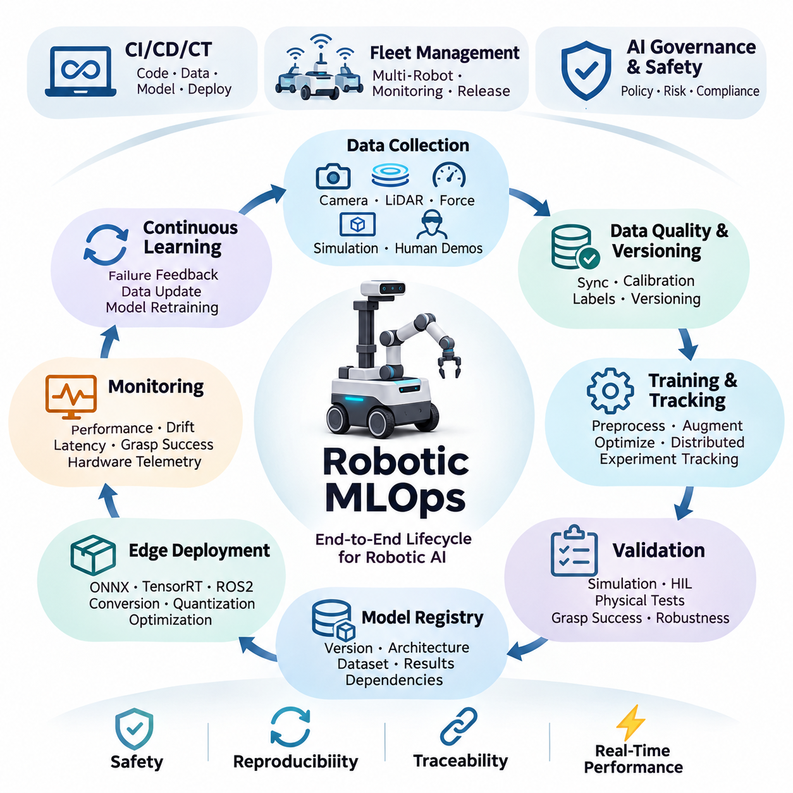
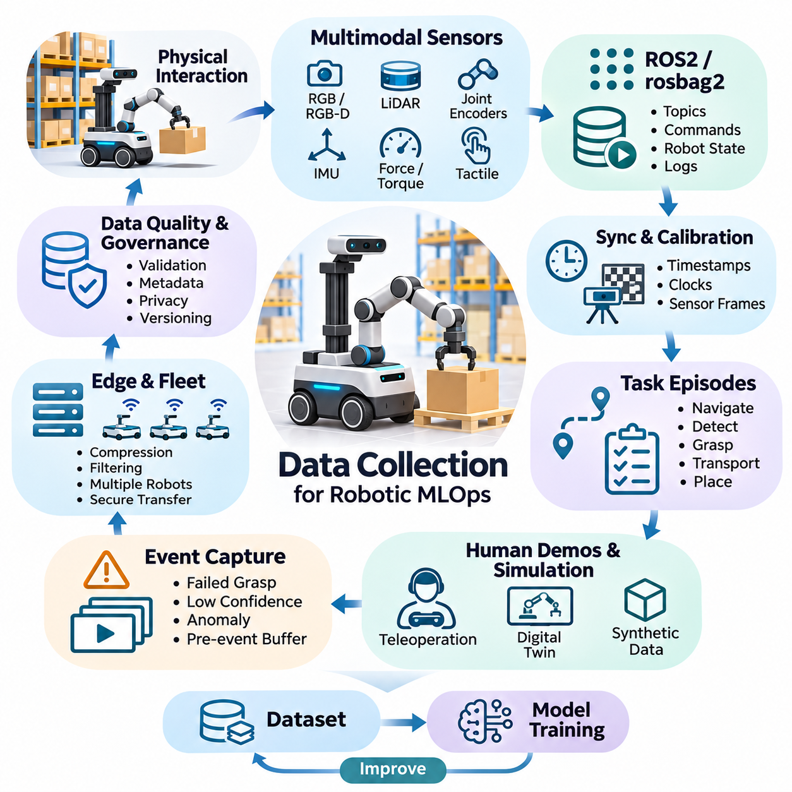
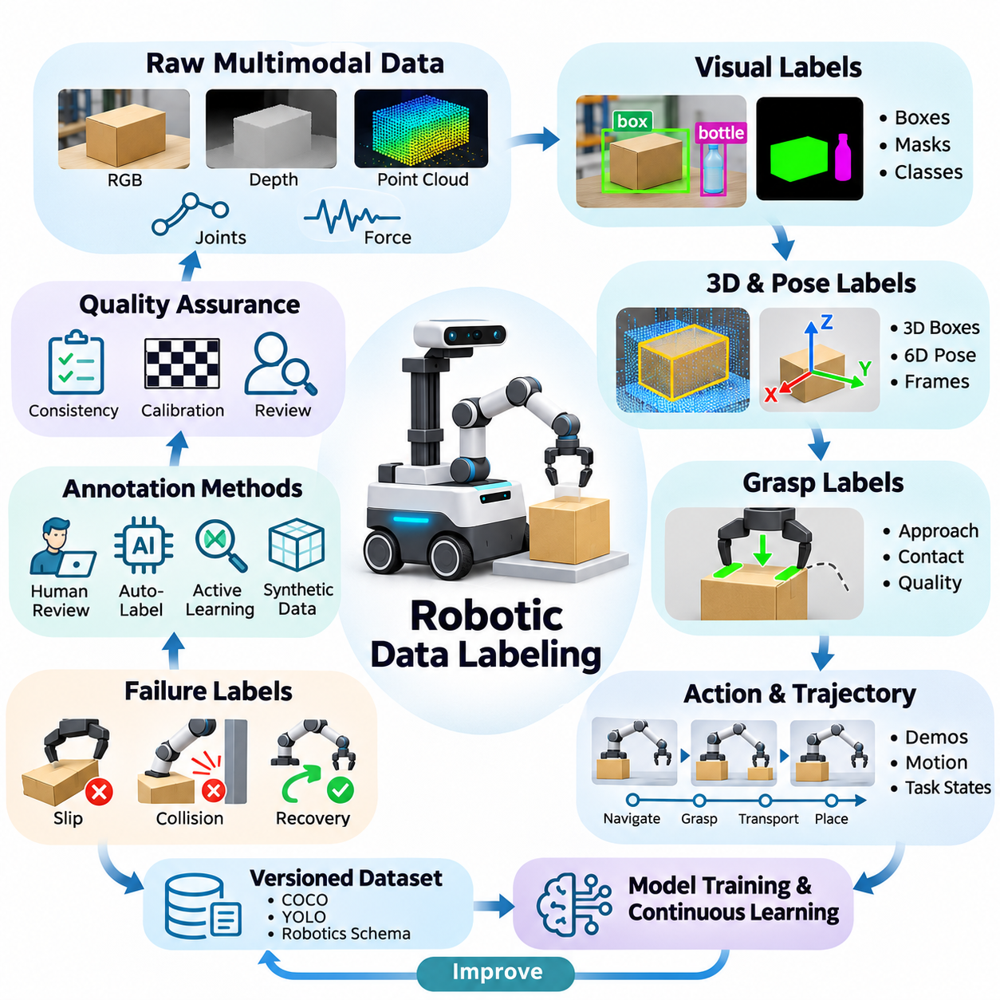
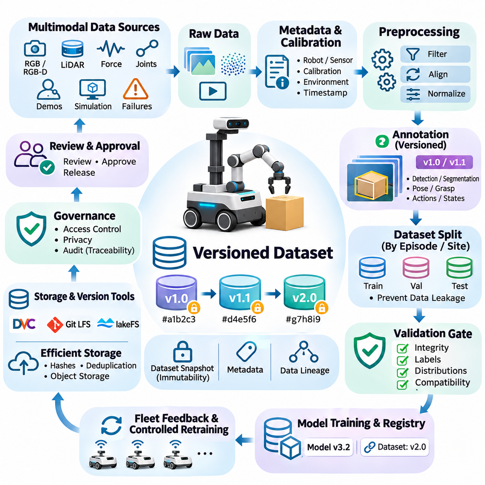
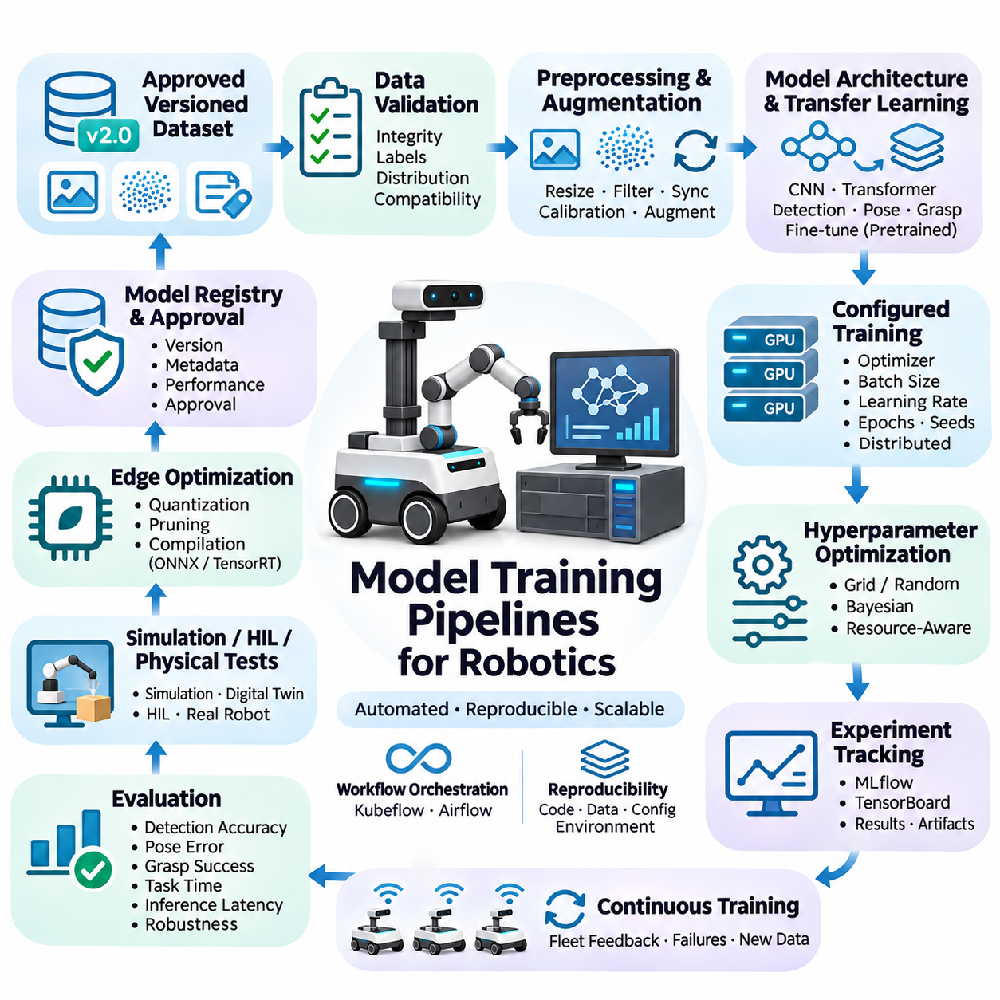
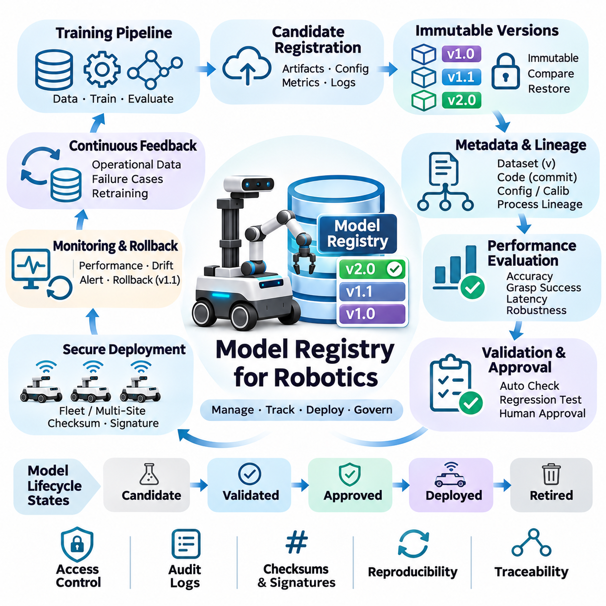
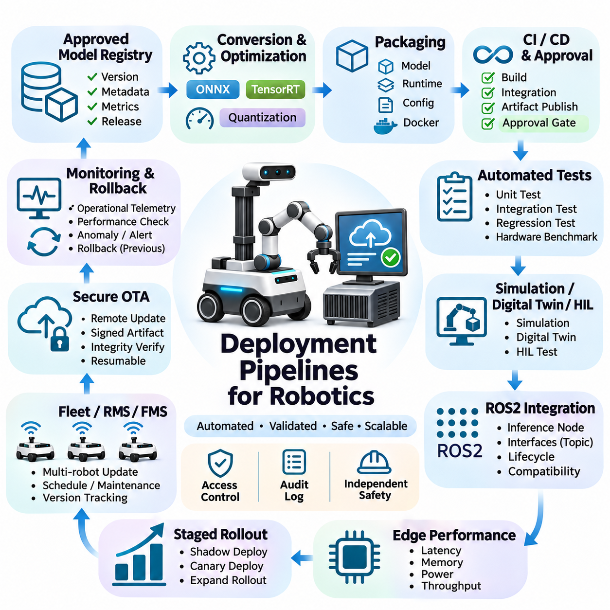
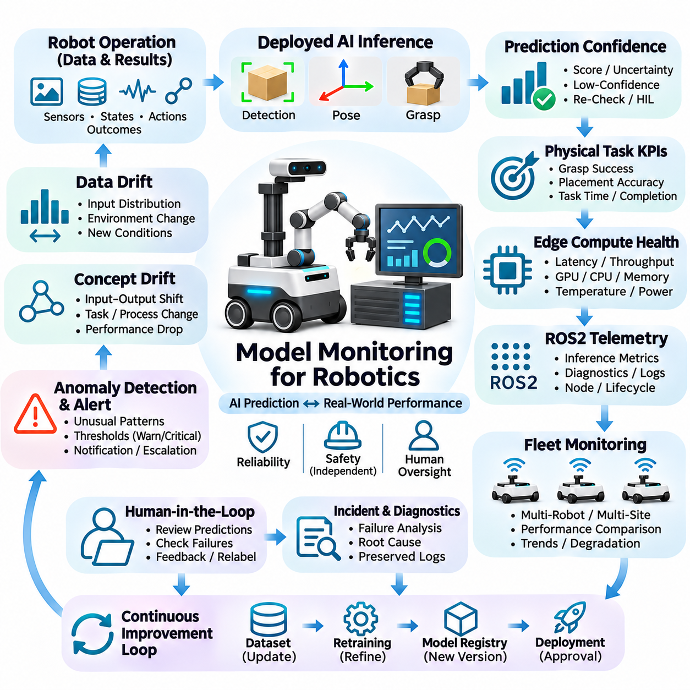
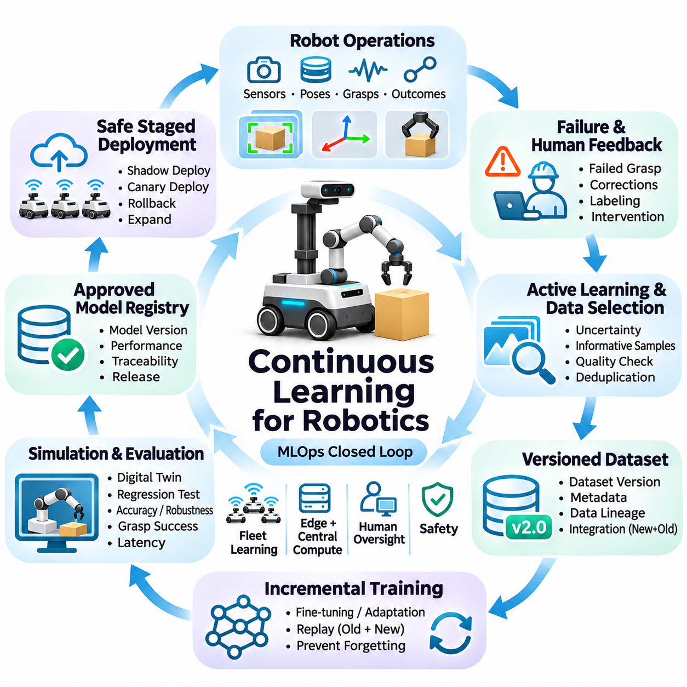
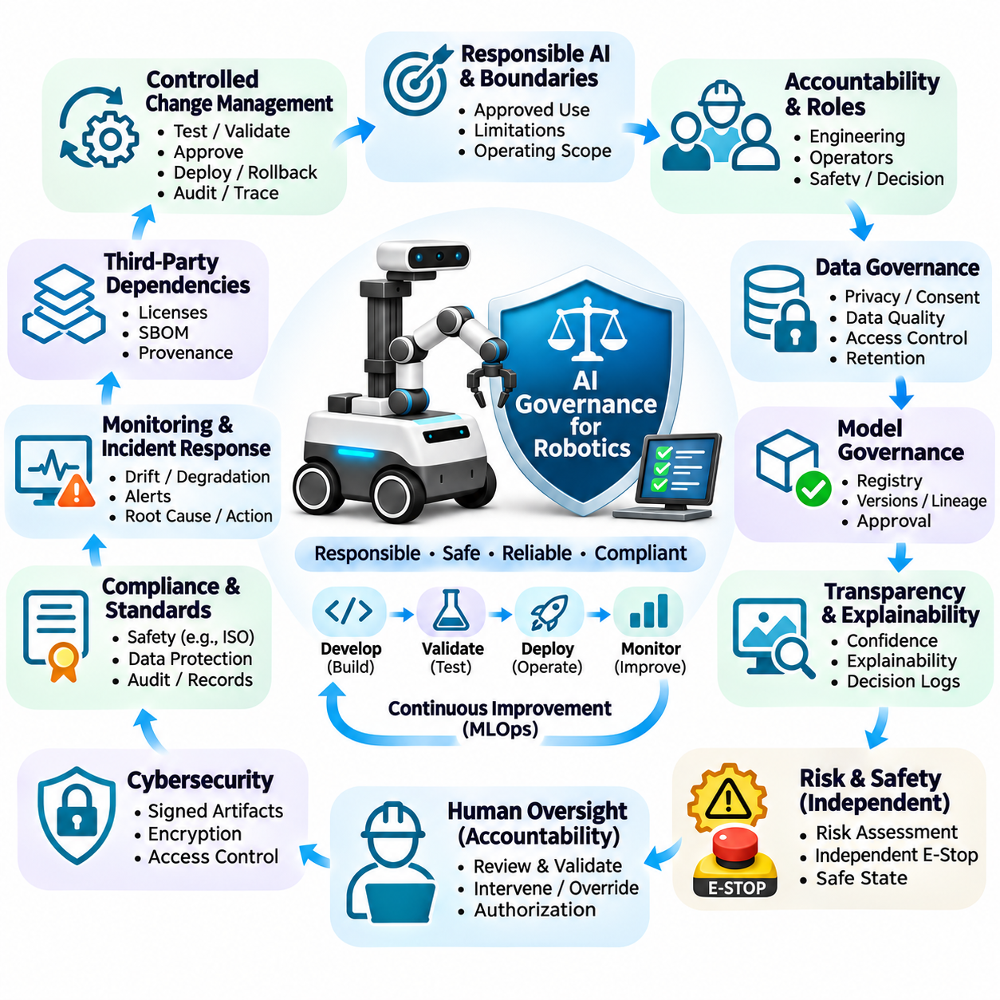

**Volume 04. Mobile Manipulation Software and Operations**

# Chapter 09. MLOps

## 01 MLOps for Robotics

{width="7.268055555555556in" height="7.268055555555556in"}

Machine Learning Operations (MLOps) for robotics is an engineering discipline that integrates machine learning development, software engineering, data management, and operational processes into a unified lifecycle. Its primary objective is to ensure that artificial intelligence models deployed in robotic systems remain reliable, reproducible, scalable, and maintainable throughout their operational lifetime under changing environmental conditions.

Unlike conventional machine learning applications operating primarily in digital environments, robotic AI systems interact directly with the physical world. Prediction errors may result in unsuccessful grasping, incorrect object recognition, navigation failures, equipment damage, or hazardous situations. Consequently, robotic MLOps must address not only prediction accuracy but also execution reliability, operational safety, and real-time performance.

In mobile manipulation systems, machine learning models support numerous functions, including object detection, semantic segmentation, six-dimensional pose estimation, grasp prediction, obstacle recognition, anomaly detection, and intelligent task planning. Each model operates as a component within a larger robotic software architecture, requiring coordinated management of model dependencies, sensor configurations, computational resources, and communication interfaces.

The robotic MLOps lifecycle begins with data acquisition from physical robots, simulation environments, digital twins, and human demonstrations. Cameras, LiDAR sensors, force-torque sensors, tactile sensors, and joint encoders generate heterogeneous datasets representing different aspects of robotic behavior. These datasets provide the foundation for developing AI models capable of operating across diverse industrial and commercial environments.

Data management is a fundamental component of robotic MLOps because model performance depends heavily on dataset quality, diversity, and representativeness. Raw sensor observations must be synchronized, calibrated, filtered, annotated, and organized into reproducible datasets. Dataset versioning establishes traceability between training samples, experimental configurations, model parameters, and deployment results, enabling systematic investigation of operational failures.

Automated model training pipelines transform validated datasets into deployable machine learning models through standardized computational workflows. These pipelines typically integrate data preprocessing, augmentation, hyperparameter optimization, distributed training, performance evaluation, and artifact generation. Automated experiment tracking records training conditions and validation results, allowing engineers to reproduce experiments and compare candidate models objectively.

Model validation in robotics extends beyond conventional metrics such as accuracy, precision, recall, and mean average precision. Engineers must evaluate grasp success rates, manipulation cycle times, inference latency, resource utilization, failure recovery capabilities, and robustness against environmental variations. Simulation-based testing, hardware-in-the-loop evaluation, and controlled physical experiments provide complementary evidence of operational readiness.

A model registry provides a centralized repository for managing trained models and their associated metadata throughout the deployment lifecycle. Each registered model should include its version, architecture, training dataset, evaluation results, hardware compatibility, software dependencies, and approval status. This structured approach allows engineering teams to identify approved models, manage release histories, and restore previously validated configurations.

Deployment pipelines connect the machine learning development environment with robotic edge computing platforms. Trained models may undergo conversion, quantization, pruning, or hardware-specific optimization before deployment. Technologies such as ONNX, TensorRT, and containerized inference environments help establish repeatable execution configurations while addressing the computational limitations of embedded robotic systems.

Integration with ROS2 enables machine learning models to operate as modular components within distributed robotic software architectures. Inference nodes receive sensor observations, execute trained models, and publish prediction results to navigation, manipulation, or task planning components. Lifecycle management, Quality of Service configurations, and standardized message interfaces help maintain predictable communication and controlled model activation.

Continuous Integration, Continuous Delivery, and Continuous Training extend traditional software engineering practices into robotic AI development. Automated workflows verify source code, dataset integrity, model compatibility, and deployment configurations whenever changes occur. However, production activation must remain subject to appropriate validation and approval procedures because modifications can directly influence physical robotic behavior.

Once models are deployed, continuous monitoring becomes essential for detecting performance degradation and unexpected behavior. Changes in lighting conditions, object appearances, sensor calibration, workspace configurations, and equipment characteristics can introduce data drift or concept drift. Monitoring systems collect operational statistics, inference confidence, execution outcomes, and hardware telemetry to identify conditions requiring further investigation.

Fleet-level MLOps extends machine learning management across multiple robots operating in geographically distributed facilities. Centralized monitoring infrastructure can aggregate operational information, identify recurring failure patterns, and coordinate model releases across heterogeneous robotic platforms. Staged deployment strategies reduce operational risks by introducing validated updates to selected robots before expanding them throughout the fleet.

Continuous learning establishes a controlled feedback mechanism between deployed robotic systems and centralized model development infrastructure. Failed grasps, uncertain predictions, operator interventions, and unexpected environmental observations become valuable sources of additional training data. After appropriate review and annotation, these observations can support retraining and validation without permitting uncontrolled modification of production models.

AI governance defines the policies, responsibilities, approval mechanisms, and documentation requirements governing robotic machine learning operations. Model provenance, cybersecurity, data privacy, access control, release authorization, and auditability are particularly important in industrial environments. Independent safety mechanisms and validated fallback behaviors must remain effective even when machine learning components produce unreliable predictions.

Ultimately, MLOps transforms robotic artificial intelligence from an isolated experimental capability into a sustainable engineering and operational infrastructure. By connecting data collection, labeling, dataset versioning, model training, registration, deployment, monitoring, continuous learning, and AI governance, it supports the systematic evolution of mobile manipulation systems while maintaining operational reliability, scalability, and safety.

## 02 Data Collection

{width="7.268055555555556in" height="7.268055555555556in"}

Data collection is the foundational stage of Machine Learning Operations (MLOps) for robotics, providing the observations required to develop, validate, and continuously improve artificial intelligence models. In mobile manipulation systems, data collection must capture interactions among the mobile platform, robotic arm, end effector, surrounding environment, and human operators under representative operational conditions.

Unlike conventional machine learning applications that rely primarily on static datasets, robotic systems generate continuous streams of multimodal data through physical interaction with their surroundings. These streams include visual observations, depth measurements, point clouds, joint positions, motor currents, contact forces, navigation trajectories, and execution results. Their integration enables comprehensive analysis of robotic behavior and environmental conditions.

Vision sensors represent one of the most important data sources for mobile manipulation. RGB cameras, stereo cameras, RGB-D cameras, and three-dimensional LiDAR sensors provide information about object appearance, spatial geometry, obstacle distribution, and workspace characteristics. Collected observations support the development of object detection, semantic segmentation, pose estimation, grasp detection, and collision avoidance models.

Proprioceptive sensors provide information about the internal physical state of robotic systems. Joint encoders, inertial measurement units, motor current sensors, force-torque sensors, and tactile sensors capture motion, acceleration, mechanical loading, and physical contact. Combining proprioceptive measurements with external environmental observations enables machine learning models to understand relationships between perception, motion, and physical interaction.

ROS2 provides a standardized communication infrastructure for collecting data from distributed robotic software components. Sensor measurements, robot states, coordinate transformations, control commands, and diagnostic information can be recorded using rosbag2. Selective topic recording, compression, and configurable recording frequencies help balance dataset completeness against communication bandwidth, storage capacity, and computational overhead.

Temporal synchronization is particularly important when collecting multimodal robotic datasets. Cameras, LiDAR sensors, joint encoders, and force-torque sensors frequently operate at different sampling frequencies and exhibit different communication delays. Accurate timestamps, synchronized clocks, and temporal alignment mechanisms ensure that observations correspond to consistent physical states, reducing discrepancies that could degrade model training and evaluation.

Spatial consistency must also be maintained throughout the data collection process. Sensor calibration, intrinsic and extrinsic parameters, and coordinate frame transformations establish geometric relationships among cameras, manipulators, mobile platforms, and environmental reference frames. Recording calibration information alongside sensor observations enables reproducible reconstruction of robotic interactions and supports accurate spatial learning.

Operational data collection should capture complete task execution sequences rather than isolated sensor measurements. A mobile manipulation episode may include navigation toward a workstation, object identification, pose estimation, grasp planning, trajectory execution, object transportation, and placement. Recording intermediate states, issued commands, and final outcomes allows engineers to investigate dependencies between perception failures and unsuccessful physical actions.

Human demonstrations provide additional data for imitation learning, reinforcement learning, and embodied artificial intelligence. Operators can guide robotic systems through teleoperation, kinesthetic teaching, motion capture, or specialized control interfaces. Demonstration datasets should preserve observation-action relationships, task objectives, timestamps, and execution outcomes to support the development of policies that reproduce desirable robotic behaviors.

Simulation environments and digital twins complement physical data collection by enabling controlled generation of synthetic datasets. Virtual environments can systematically vary object geometry, lighting, textures, camera viewpoints, obstacle arrangements, and physical interaction parameters. Synthetic data improves scenario coverage and reduces collection costs, although simulation-to-reality discrepancies must be evaluated using representative physical observations.

Event-triggered data collection improves operational efficiency by recording information when predefined conditions occur. Detection failures, unsuccessful grasps, unexpected contact forces, navigation interruptions, low-confidence predictions, and operator interventions can initiate targeted recording. Rolling data buffers preserve observations immediately preceding such events, enabling detailed failure analysis without continuously storing every sensor stream.

Fleet-level data collection extends recording capabilities across multiple mobile manipulators operating at different facilities. Centralized infrastructure aggregates observations from robots with varying hardware configurations, operational tasks, and environmental conditions. Robot identifiers, site information, software versions, and model versions must accompany collected datasets to maintain traceability and support meaningful comparisons across distributed deployments.

Edge computing platforms play an essential role in managing data collection under practical resource constraints. High-resolution images, dense point clouds, and high-frequency sensor measurements can generate substantial data volumes. Local filtering, compression, selective sampling, temporary buffering, and scheduled transmission reduce network utilization while preserving valuable observations for centralized storage, subsequent annotation, and model development.

Data quality assurance must be incorporated directly into the collection pipeline. Automated checks can identify corrupted images, missing timestamps, inconsistent coordinate transformations, sensor saturation, dropped messages, and incomplete execution records. Dataset metadata should describe recording conditions, sensor configurations, collection parameters, and identified quality issues, establishing a reliable foundation for data labeling and dataset versioning.

Security, privacy, and operational safety are essential considerations when collecting robotic data in industrial facilities, warehouses, hospitals, and public environments. Recorded observations may contain personal information, confidential manufacturing processes, or restricted spatial information. Access controls, encryption, anonymization, retention policies, and resource isolation help protect sensitive data without interfering with safety-critical robotic functions.

Ultimately, effective robotic data collection establishes a continuous feedback connection between physical operations and machine learning development. By integrating representative sensor measurements, execution histories, human demonstrations, synthetic observations, failure events, and structured metadata, organizations create a sustainable data infrastructure that supports reliable model training, performance monitoring, and continuous improvement of mobile manipulation systems.

## 03 Data Labeling

{width="7.268055555555556in" height="7.268055555555556in"}

Data labeling is a fundamental process within Machine Learning Operations (MLOps) that transforms raw robotic observations into structured training information for artificial intelligence models. In mobile manipulation systems, labeling establishes relationships among sensory observations, environmental characteristics, robotic actions, and execution outcomes, enabling supervised learning and systematic performance evaluation.

Unlike conventional image classification applications, robotic data labeling frequently requires the integration of multiple sensing modalities and physical interaction information. Images, depth measurements, point clouds, joint configurations, contact forces, navigation trajectories, and manipulation states must be annotated consistently. These annotations allow machine learning models to associate environmental observations with meaningful physical actions and operational objectives.

Visual data labeling supports essential perception functions in mobile manipulation, including object detection, semantic segmentation, instance segmentation, and object recognition. Bounding boxes identify object locations, while segmentation masks describe object boundaries at the pixel level. Accurate annotations must account for occlusion, overlapping objects, illumination variations, reflections, and complex industrial backgrounds.

Three-dimensional data labeling extends conventional image annotation into spatial environments. Point clouds and depth images can be annotated using three-dimensional bounding boxes, semantic categories, surface information, and object identifiers. These representations help robotic systems understand spatial relationships, estimate object dimensions, identify obstacles, and recognize accessible regions within their operational workspaces.

Object pose labeling is particularly important for robotic manipulation because successful grasping depends on accurate spatial orientation and position. Six-dimensional pose annotations represent three translational and three rotational degrees of freedom relative to a defined coordinate frame. Reliable pose labels require calibrated sensors, consistent coordinate transformations, accurate geometric models, and appropriate treatment of object symmetry.

Grasp labeling describes potential interaction configurations between robotic end effectors and target objects. Individual annotations may include grasp positions, approach directions, gripper orientations, opening widths, contact locations, and grasp quality scores. Successful and unsuccessful grasp attempts provide complementary training information, allowing models to distinguish mechanically feasible configurations from unstable or inaccessible alternatives.

Action and trajectory labeling supports imitation learning, reinforcement learning, and intelligent task execution. Recorded robotic demonstrations can be annotated with task objectives, motion primitives, joint trajectories, control commands, interaction phases, and completion states. Temporal annotations establish relationships between observations and subsequent actions, supporting the development of policies that reproduce successful manipulation behaviors.

Failure labeling provides valuable information for improving robotic reliability and operational robustness. Unsuccessful grasping, object slippage, incorrect pose estimation, navigation interruptions, excessive contact forces, and operator interventions should be categorized according to consistent failure taxonomies. Distinguishing observed failure symptoms from verified root causes enables more accurate diagnosis and targeted model improvement.

Annotation guidelines establish standardized procedures for assigning labels across diverse datasets and operational environments. These guidelines should define object categories, annotation boundaries, coordinate conventions, acceptance criteria, ambiguous cases, and failure classifications. Consistent labeling terminology reduces subjective interpretation and improves compatibility among datasets generated by different robots, facilities, and annotation teams.

Manual annotation remains important when robotic datasets contain complex scenes, unfamiliar objects, or uncertain interaction outcomes. Human annotators can interpret contextual relationships that automated systems may overlook. However, manual labeling introduces substantial labor costs and potential inconsistencies, making standardized training, annotation review, and inter-annotator agreement essential components of quality management.

Automated and semi-automated labeling techniques improve scalability by employing existing perception models, geometric algorithms, tracking methods, and sensor fusion. Pretrained models can generate preliminary annotations that human specialists subsequently review and correct. Active learning further improves annotation efficiency by prioritizing uncertain predictions, rare events, and underrepresented operational scenarios.

Synthetic data labeling uses simulation environments and digital twins to generate annotations directly from known virtual scene properties. Object identities, segmentation masks, depth information, six-dimensional poses, and contact states can be extracted automatically. Although synthetic annotations reduce manual labeling requirements, their usefulness depends on simulation fidelity and validation against representative real-world observations.

Data labeling quality assurance combines automated consistency checks with human verification. Validation procedures can identify missing annotations, incorrect class assignments, invalid geometric representations, inconsistent coordinate frames, and temporal discontinuities. Annotation errors should be documented and corrected through controlled review processes before labeled datasets become eligible for model training and evaluation.

Labeling infrastructure should preserve relationships among raw sensor records, annotation files, labeling instructions, sensor calibration information, and dataset versions. Standard formats such as COCO, YOLO, and custom robotics schemas can support different learning tasks. Version-controlled annotation metadata ensures that model development teams can reproduce training datasets and investigate discrepancies between experimental and operational results.

Ultimately, data labeling establishes the semantic and physical foundations required for reliable robotic intelligence. By combining standardized annotation procedures, multimodal representations, human expertise, automated labeling, synthetic data, and systematic quality assurance, organizations create reproducible datasets that support model training, deployment validation, continuous learning, and long-term operational improvement.

## 04 Dataset Versioning

{width="7.268055555555556in" height="7.268055555555556in"}

Dataset versioning is a fundamental component of Machine Learning Operations (MLOps) that enables systematic management, tracking, and reproduction of datasets throughout the artificial intelligence lifecycle. In mobile manipulation systems, dataset versioning establishes explicit relationships among raw sensor observations, annotations, preprocessing procedures, training configurations, and deployed models, ensuring consistency across development and operational environments.

Unlike conventional software development, where source code represents the primary version-controlled artifact, machine learning systems depend heavily on the characteristics of their training datasets. Changes in sensor observations, object categories, annotation accuracy, or environmental conditions can substantially influence model behavior. Dataset versioning therefore treats data as a managed engineering asset rather than an interchangeable collection of training samples.

Robotic datasets frequently contain heterogeneous information generated by cameras, LiDAR sensors, force-torque sensors, tactile sensors, joint encoders, and navigation systems. These datasets may also include human demonstrations, synthetic observations, manipulation trajectories, and operational failure records. A comprehensive versioning architecture must preserve relationships among these data modalities while maintaining temporal synchronization and spatial consistency.

Each dataset version should possess a unique identifier representing a specific and reproducible collection of data samples, annotations, and associated metadata. Version identifiers may incorporate sequential numbers, semantic versioning conventions, timestamps, or cryptographic hashes. Immutable dataset snapshots prevent unintended modifications to approved training data and provide stable references for experimental comparison and production model development.

Dataset metadata provides essential contextual information for interpreting and reproducing robotic training datasets. Relevant metadata includes collection dates, robot identifiers, sensor configurations, calibration parameters, operating environments, annotation guidelines, and software versions. Recording these attributes enables engineers to determine whether a dataset remains compatible with particular robotic platforms, perception systems, and manipulation requirements.

Data lineage describes the complete history of a dataset from its original collection through subsequent processing, annotation, transformation, and publication. A processed dataset may originate from multiple physical robots, simulation environments, and previously released datasets. Maintaining explicit lineage relationships allows engineering teams to identify the origin of individual samples and investigate the causes of unexpected model behavior.

Version-controlled preprocessing pipelines ensure that transformations applied to raw robotic observations remain reproducible. Image resizing, normalization, point cloud filtering, coordinate conversion, temporal alignment, and data augmentation can significantly influence training results. The source code, configuration parameters, software dependencies, and random seeds associated with these procedures should be recorded alongside the resulting dataset version.

Annotation versioning is particularly important because labeling requirements may evolve independently of raw sensor data. Object categories can be expanded, segmentation boundaries corrected, pose annotations refined, and failure classifications reorganized. Separating raw observations from version-controlled annotations enables engineers to improve labeling quality without unnecessarily duplicating large sensor recordings or losing historical dataset configurations.

Training, validation, and test partitions must also be explicitly managed as version-controlled dataset components. In robotics, randomly separating individual sensor frames may introduce data leakage because consecutive observations often contain nearly identical information. Partitioning datasets according to task episodes, recording sessions, physical sites, or object instances helps establish more reliable evaluations of model generalization.

Storage architecture represents a major consideration because robotic datasets can reach terabyte or petabyte scales. High-resolution images, dense point clouds, and multimodal sensor recordings make complete dataset duplication economically inefficient. Content-addressable storage, deduplication, incremental versioning, and object storage allow multiple dataset versions to reference shared data artifacts while preserving their individual configurations.

Tools such as Data Version Control (DVC), Git Large File Storage (Git LFS), and lakeFS provide different mechanisms for managing large datasets alongside software development workflows. These technologies can integrate with Git repositories, cloud storage, or on-premises infrastructure. Their suitability depends on dataset scale, access requirements, collaboration structures, storage architecture, and reproducibility objectives.

Automated dataset validation should be integrated into the versioning workflow before new dataset releases become available for model training. Validation procedures can verify file integrity, annotation completeness, class distributions, coordinate conventions, calibration compatibility, and synchronization accuracy. Dataset acceptance criteria help prevent corrupted, incomplete, or incompatible observations from entering approved machine learning pipelines.

Dataset versioning must also support controlled collaboration among robotics engineers, machine learning developers, annotation specialists, and field operators. Branching mechanisms can isolate experimental dataset modifications from approved production datasets, while review procedures ensure that proposed changes satisfy established quality requirements. Access permissions and approval records maintain accountability across distributed development teams.

Integration with model training pipelines establishes direct traceability between dataset versions and trained model artifacts. Every experiment should reference the exact dataset revision, preprocessing configuration, training code, and evaluation partitions used during development. When these relationships are preserved in experiment tracking systems and model registries, engineers can reproduce historical results and systematically evaluate the effects of dataset changes.

Fleet-level dataset versioning supports continuous improvement across geographically distributed mobile manipulation systems. Newly collected observations, failed grasps, unfamiliar objects, sensor anomalies, and operator interventions can be incorporated into candidate dataset versions. After quality verification and approval, these datasets support controlled retraining while preserving the validated datasets associated with existing production models.

Dataset governance defines policies for data ownership, access control, retention, licensing, privacy protection, and authorized modifications. Industrial robotic datasets may contain confidential manufacturing information, facility layouts, or personally identifiable information. Encryption, audit logs, and controlled deletion procedures help protect sensitive observations while maintaining the traceability required for engineering investigations and regulatory compliance.

Ultimately, dataset versioning transforms robotic data management into a reproducible and auditable engineering process. By integrating immutable dataset snapshots, metadata management, data lineage, annotation history, automated validation, and model lifecycle traceability, organizations establish a sustainable foundation for reliable model training, controlled deployment, continuous learning, and long-term improvement of mobile manipulation systems.

## 05 Model Training Pipelines

{width="7.268055555555556in" height="7.268055555555556in"}

Model training pipelines are structured computational workflows that transform validated datasets into deployable artificial intelligence models within Machine Learning Operations (MLOps). In mobile manipulation systems, these pipelines integrate data preparation, model configuration, training, optimization, evaluation, and artifact generation into reproducible processes that support reliable robotic intelligence and continuous operational improvement.

Unlike experimental model development, which frequently relies on manually executed scripts and isolated computational environments, production-oriented training pipelines emphasize automation, standardization, and traceability. Each pipeline stage should have clearly defined inputs, processing requirements, execution dependencies, and output artifacts. This architecture reduces human error and ensures consistency across repeated training experiments.

The model training process begins with the selection of an approved dataset version that satisfies established data quality and application requirements. Training pipelines retrieve raw observations, annotations, metadata, calibration information, and predefined dataset partitions from controlled storage infrastructure. Automated validation verifies dataset integrity, annotation completeness, class distributions, and compatibility with the selected model architecture.

Data preprocessing converts heterogeneous robotic observations into standardized representations suitable for machine learning algorithms. Image resizing, normalization, point cloud filtering, coordinate transformations, temporal alignment, and sensor fusion may be required depending on the application. Preprocessing parameters and software configurations must be version-controlled to maintain consistency between training and production inference environments.

Data augmentation improves model generalization by introducing controlled variations into available training samples. Visual augmentation may include changes in illumination, contrast, orientation, scale, and partial occlusion, while spatial augmentation can modify point cloud geometry and sensor viewpoints. For robotic manipulation, augmentation procedures must preserve physically meaningful relationships among objects, poses, grasp configurations, and corresponding annotations.

Model architecture selection depends on the functional requirements of the mobile manipulation system. Convolutional neural networks, vision transformers, object detection networks, point cloud models, and multimodal learning architectures address different perception and manipulation tasks. Training pipelines should support configurable model selection while maintaining standardized interfaces for dataset loading, optimization, evaluation, and artifact management.

Transfer learning provides an efficient approach to developing specialized robotic intelligence using pretrained models. Existing models trained on large datasets can be adapted to application-specific environments through fine-tuning or feature extraction. This approach can reduce computational requirements and improve learning efficiency, particularly when collecting and labeling representative physical interaction data is expensive or operationally difficult.

Training configuration management establishes explicit control over the parameters governing model optimization. Learning rates, batch sizes, optimizer configurations, loss functions, training epochs, initialization methods, and random seeds should be maintained as version-controlled configuration artifacts. These records improve experimental reproducibility and allow engineers to investigate relationships between training conditions and resulting model performance.

Distributed training enables computational workloads to be executed across multiple graphics processing units or computing nodes. Data parallelism, model parallelism, mixed-precision training, and gradient accumulation can improve computational efficiency for large robotic datasets and complex neural networks. Resource scheduling and utilization monitoring help balance training duration, hardware availability, energy consumption, and infrastructure costs.

Hyperparameter optimization systematically evaluates alternative training configurations to identify models satisfying predefined performance objectives. Grid search, random search, Bayesian optimization, and resource-aware optimization methods can automate candidate selection. For robotic applications, optimization objectives should consider prediction accuracy alongside inference latency, memory consumption, computational complexity, and physical task performance.

Experiment tracking provides centralized records of training executions, dataset versions, model configurations, evaluation metrics, and generated artifacts. Platforms such as MLflow, TensorBoard, and Weights & Biases support systematic comparison of experimental results. Recording source code revisions, dependency versions, hardware configurations, and execution logs further strengthens traceability and facilitates collaborative model development.

Model evaluation must extend beyond conventional machine learning metrics because robotic intelligence directly influences physical task execution. Object detection accuracy, pose estimation error, and grasp prediction quality should be assessed alongside manipulation success rates, task completion times, inference latency, and robustness to environmental disturbances. Acceptance thresholds should reflect application-specific operational and safety requirements.

Simulation-based validation provides an intermediate evaluation stage between offline model testing and physical robot deployment. Digital twins and simulation environments enable controlled assessment of model behavior under diverse object configurations, sensor conditions, and interaction scenarios. Hardware-in-the-loop testing and supervised physical experiments subsequently evaluate execution behavior that simulated environments may not represent accurately.

Model optimization prepares trained neural networks for deployment on resource-constrained robotic edge computing platforms. Quantization, pruning, knowledge distillation, operator fusion, and hardware-specific compilation can reduce computational overhead and inference latency. Optimized models must undergo renewed evaluation because numerical precision changes and architectural modifications may affect prediction accuracy and downstream physical behavior.

Pipeline orchestration coordinates dependencies among data validation, preprocessing, model training, evaluation, optimization, and artifact registration. Workflow orchestration platforms such as Kubeflow Pipelines, Apache Airflow, and Prefect support scheduling, dependency management, execution monitoring, and failure recovery. Containerized execution environments further improve portability across cloud, on-premises, and distributed computing infrastructure.

Continuous Training (CT) extends model training pipelines into a controlled feedback cycle driven by newly collected operational data. Failed grasps, unfamiliar objects, uncertain predictions, and environmental changes may initiate retraining workflows after dataset verification. Newly trained models must satisfy established acceptance criteria and regression tests before registration and approval for production deployment.

Ultimately, model training pipelines transform robotic AI development into a standardized, reproducible, and scalable engineering process. By integrating version-controlled datasets, automated preprocessing, configurable training, experiment tracking, physical performance evaluation, and controlled model registration, organizations establish the computational foundation for reliable deployment and continuous improvement of mobile manipulation systems.

## 06 Model Registry

{width="7.268055555555556in" height="7.268055555555556in"}

A model registry is a centralized management system that organizes, tracks, and controls machine learning models throughout their operational lifecycle. Within Machine Learning Operations (MLOps) for mobile manipulation, it establishes a structured connection between model training, performance evaluation, deployment approval, and production operations, ensuring that robotic systems execute identifiable and appropriately validated model versions.

Unlike conventional file storage systems that primarily preserve model weights and configuration files, a model registry manages machine learning models as version-controlled engineering assets. Each registered model is associated with descriptive metadata, development history, evaluation results, deployment requirements, and approval records. This approach improves reproducibility, operational accountability, and collaboration across robotics development teams.

Model registration begins when a training pipeline produces a candidate model that satisfies predefined evaluation requirements. The generated model artifacts, training configurations, dataset references, performance metrics, and execution logs are transferred to the registry. Registration establishes a persistent model identity that enables subsequent evaluation, optimization, deployment, and lifecycle management without losing its original development context.

Model versioning allows multiple revisions of a machine learning model to coexist within a controlled management environment. Each version receives a unique identifier associated with its training conditions, architectural characteristics, and generated artifacts. Immutable model versions prevent unauthorized modifications and allow engineers to compare historical performance or restore previously validated models when operational problems arise.

Model metadata provides essential information for understanding the characteristics and intended applications of registered models. Typical metadata includes model architecture, input and output specifications, training dataset versions, preprocessing requirements, framework dependencies, numerical precision, hardware compatibility, and evaluation conditions. These attributes support informed model selection and integration within distributed robotic architectures.

Model lineage establishes traceability between registered models and the processes responsible for their creation. A complete lineage record connects dataset revisions, annotation versions, preprocessing configurations, source code commits, training parameters, and optimization procedures. Maintaining these relationships enables engineers to reproduce development results and investigate whether operational failures originate from data, algorithms, or deployment configurations.

Performance records associated with registered models must reflect both machine learning accuracy and physical robotic behavior. Object detection precision, pose estimation error, segmentation accuracy, and grasp prediction quality should be accompanied by task success rates, execution latency, memory utilization, and environmental robustness. Recording evaluation conditions allows meaningful comparisons between candidate models and previously validated production versions.

Model lifecycle management establishes controlled transitions between experimental, candidate, validated, approved, deployed, and retired model states. These states represent different levels of technical assessment and operational authorization. A successfully trained model does not automatically qualify for production deployment because its influence on physical robot behavior must be evaluated against application-specific acceptance and safety requirements.

Approval workflows provide a formal mechanism for determining whether registered models are suitable for operational deployment. Automated validation can verify performance thresholds, artifact integrity, software compatibility, and regression test results. Human authorization may also be required for models affecting critical manipulation or navigation functions, ensuring that deployment decisions remain consistent with established engineering responsibilities.

Hardware compatibility management is particularly important because mobile manipulators frequently operate on heterogeneous edge computing platforms. A registered model may have separate PyTorch, ONNX, TensorRT, or quantized deployment artifacts derived from a common trained model. Each artifact should document its supported hardware, runtime dependencies, numerical precision, resource requirements, and independently verified performance characteristics.

Integration with ROS2 requires registered models to maintain explicit interface specifications for robotic inference components. Input image dimensions, normalization parameters, coordinate conventions, output tensor structures, and semantic class definitions must remain compatible with connected perception and manipulation nodes. Interface validation helps prevent integration failures when model versions change independently of other robotic software components.

Deployment pipelines retrieve approved model artifacts from the registry and distribute them to designated robotic platforms. Artifact checksums, digital signatures, compatibility checks, and release manifests help ensure that the intended model version reaches each target system. Controlled deployment mechanisms also preserve relationships among model versions, robot identifiers, software configurations, and operational environments.

Fleet-level model registries support the management of artificial intelligence models across multiple mobile manipulators operating in different facilities. Robots may require specialized models because of differences in sensor configurations, computational resources, object categories, or environmental characteristics. Centralized model inventories help operators identify deployed versions, coordinate staged releases, and maintain configuration consistency.

Model rollback capabilities allow engineering teams to restore previously approved models when newly deployed versions exhibit unexpected performance degradation. Effective rollback requires preserving compatible inference environments, preprocessing configurations, model dependencies, and deployment histories. Restoring model weights alone may be insufficient when software interfaces or hardware-specific runtime configurations have changed.

Model registry platforms such as MLflow Model Registry, Kubeflow Model Registry, and managed cloud services provide mechanisms for organizing model artifacts and lifecycle metadata. These platforms can be integrated with experiment tracking, object storage, continuous integration systems, and deployment infrastructure. Platform selection depends on operational scale, security requirements, infrastructure architecture, and integration complexity.

Security and governance mechanisms protect registered models against unauthorized access, modification, and distribution. Role-based access control, artifact encryption, digital signatures, audit logs, and retention policies support controlled model management. Independent robotic safety mechanisms must remain effective regardless of model approval status, since registration cannot itself guarantee safe physical behavior under every operating condition.

Ultimately, a model registry transforms trained machine learning models into traceable, governed, and operationally manageable engineering assets. By integrating model versioning, metadata, lineage, performance records, approval workflows, deployment histories, and rollback mechanisms, it establishes a reliable foundation for deployment pipelines, continuous learning, and the long-term evolution of mobile manipulation systems.

## 07 Deployment Pipelines

{width="7.268055555555556in" height="7.268055555555556in"}

Deployment pipelines are automated engineering workflows that transfer validated machine learning models from development environments into operational robotic systems. Within Machine Learning Operations (MLOps) for mobile manipulation, these pipelines connect model registries, software integration, deployment validation, edge computing infrastructure, and fleet operations to establish reliable and traceable artificial intelligence deployment.

Unlike conventional software deployment, robotic model deployment directly influences interactions with physical environments. Changes in object detection, pose estimation, grasp prediction, or intelligent task planning may alter robot behavior and operational safety. Deployment pipelines must therefore evaluate not only software compatibility and computational performance but also the physical consequences of introducing new model versions.

The deployment process begins with the selection of an approved model version from a model registry. The selected model must be associated with verified training records, dataset references, evaluation metrics, interface specifications, and deployment requirements. Release manifests establish explicit relationships among model artifacts, software dependencies, target hardware configurations, and authorized operational environments.

Model conversion and optimization prepare trained neural networks for execution on target computing platforms. Models developed using PyTorch or TensorFlow may be converted into ONNX or optimized using TensorRT, OpenVINO, or other hardware-specific inference frameworks. Quantization, operator fusion, and computational graph optimization can reduce inference latency and memory consumption while maintaining acceptable prediction accuracy.

Deployment packaging integrates model artifacts, preprocessing components, inference runtimes, configuration files, and software dependencies into reproducible execution environments. Container technologies such as Docker facilitate consistent application distribution across development servers and robotic edge computers. Packages should also define hardware requirements, version dependencies, and runtime initialization procedures.

Continuous Integration and Continuous Delivery (CI/CD) provide automation mechanisms for building, testing, and distributing deployment packages. Platforms such as GitHub Actions, GitLab CI/CD, and Jenkins can coordinate model conversion, dependency verification, integration testing, and artifact publication. Production deployment should remain subject to explicit approval gates when model changes affect safety-critical robotic functions.

Automated validation pipelines evaluate deployment packages before they become available to operational robots. Unit tests, integration tests, regression tests, inference benchmarks, and interface compatibility checks help identify unexpected behavioral changes. Validation should include representative sensor observations, challenging environmental conditions, previously recorded failure scenarios, and performance measurements on target hardware.

Simulation environments and digital twins provide controlled intermediate stages for evaluating candidate deployment packages. Newly deployed perception and manipulation models can be tested against virtual objects, dynamic obstacles, sensor disturbances, and complex task sequences. Hardware-in-the-loop testing and supervised physical experiments provide additional evidence before introducing model changes into unrestricted production operations.

Integration with ROS2 requires deployment pipelines to preserve compatibility among inference nodes, communication interfaces, transformation frameworks, and manipulation components. Model updates must maintain consistent message structures, coordinate conventions, semantic class definitions, and preprocessing requirements. Managed lifecycle nodes can support controlled initialization, activation, deactivation, and replacement of inference components.

Edge deployment introduces computational constraints that differ significantly from centralized model training environments. Mobile manipulators frequently operate with limited memory, electrical power, thermal capacity, and processing resources. Deployment pipelines should measure inference throughput, end-to-end latency, resource utilization, and sustained operating performance to ensure compatibility with physical task execution requirements.

Staged deployment reduces operational risk by introducing new model versions incrementally across selected robots or facilities. Canary deployment initially distributes a candidate model to a limited subset of the robot fleet, while shadow deployment evaluates predictions without allowing them to control physical actions. Operational evidence collected during these stages informs decisions regarding broader production deployment.

Fleet-level deployment requires centralized coordination of model distribution, installation, activation, and version tracking. Robot Management Systems (RMS) and Fleet Management Systems (FMS) can coordinate maintenance windows, robot availability, battery conditions, and mission schedules. Updates should occur when robots are in predefined safe operational states to minimize service interruptions and prevent inconsistent execution behavior.

Over-the-Air (OTA) deployment mechanisms support remote distribution of artificial intelligence models across geographically dispersed robotic systems. Reliable update procedures should accommodate intermittent connectivity, interrupted transfers, limited network bandwidth, and installation failures. Artifact integrity verification, authenticated communication, and recoverable installation mechanisms improve deployment reliability.

Rollback strategies provide recovery mechanisms when newly deployed models demonstrate unacceptable performance or unexpected operational behavior. Previously approved model versions, compatible inference runtimes, and associated configurations should remain available for restoration. Automatic rollback triggers may respond to repeated inference failures, excessive latency, resource exhaustion, or significant deterioration in physical task performance.

Deployment security and governance protect robotic systems against unauthorized or compromised model updates. Cryptographic signatures, artifact checksums, encrypted communication, role-based access control, and audit logs establish controlled distribution procedures. Independent safety controllers, emergency stop mechanisms, and protective functions must remain effective regardless of the deployed machine learning model or update status.

Post-deployment verification connects deployment pipelines with model monitoring and continuous learning workflows. Operational telemetry, prediction confidence, manipulation success rates, inference latency, and failure records provide evidence of real-world performance. Together, controlled releases, rollback mechanisms, and operational feedback establish a sustainable foundation for reliable and continuously improving mobile manipulation systems.

This explanation expands the supplied chapter outline using general robotics and MLOps engineering principles.

## 08 Model Monitoring

{width="7.268055555555556in" height="7.268055555555556in"}

Model monitoring is a critical component of Machine Learning Operations (MLOps) that continuously evaluates the behavior, performance, and reliability of deployed artificial intelligence models. In mobile manipulation systems, monitoring ensures that perception, object recognition, pose estimation, grasp prediction, and task planning models continue to operate effectively under changing environmental and operational conditions.

Unlike conventional software monitoring, which primarily focuses on application availability, resource utilization, and execution errors, robotic model monitoring must also evaluate prediction quality and physical task outcomes. A model may execute without software errors while producing inaccurate object detections or unreliable grasp predictions. Therefore, monitoring must connect computational performance with actual robotic behavior.

Model performance monitoring begins with collecting inference results and operational measurements from deployed robotic systems. Relevant information includes prediction confidence, detected object categories, estimated poses, grasp success rates, task completion times, and failure events. These measurements provide continuous evidence of model behavior and enable engineering teams to identify performance degradation before it significantly affects operations.

Prediction confidence monitoring evaluates the reliability of model outputs during real-world execution. Low-confidence object detections, uncertain pose estimates, inconsistent segmentation results, and unstable grasp predictions may indicate unfamiliar objects, environmental changes, or insufficient training data. Confidence thresholds can trigger additional verification, alternative perception methods, or human intervention when model outputs become unreliable.

Data drift monitoring identifies changes in the statistical characteristics of incoming operational data compared with the original training dataset. Variations in illumination, camera viewpoints, object appearances, sensor noise, workspace layouts, and environmental conditions may cause input distributions to change. Monitoring these differences helps identify situations in which deployed models encounter observations that were poorly represented during training.

Concept drift monitoring focuses on changes in the relationship between model inputs and expected outputs. For example, modifications to object materials, grasping requirements, workstation configurations, or manipulation procedures may change the expected outcomes of previously learned predictions. Detecting concept drift requires evaluating prediction results against verified operational outcomes, human feedback, or subsequently available ground-truth annotations.

Robotic model monitoring must incorporate physical task performance because prediction metrics alone cannot fully describe operational effectiveness. Grasp success rates, object placement accuracy, navigation completion rates, collision avoidance performance, and manipulation cycle times provide practical indicators of model quality. Combining these measurements with model predictions helps identify whether declining task performance originates from artificial intelligence components or other robotic subsystems.

Inference performance monitoring evaluates the computational behavior of deployed models on robotic edge platforms. Important measurements include inference latency, throughput, memory consumption, GPU utilization, CPU load, temperature, and power consumption. Sustained monitoring helps identify resource contention, thermal throttling, memory leaks, and unexpected execution delays that may interfere with real-time robotic control requirements.

Integration with ROS2 enables model monitoring information to be collected from distributed robotic software components. Inference nodes can publish prediction confidence, processing duration, detection statistics, and diagnostic information through standardized topics. Diagnostic messages, lifecycle states, and system logs provide additional context for understanding model behavior and identifying communication or integration problems.

Centralized monitoring infrastructure aggregates information from multiple robots and operational facilities. Monitoring platforms can collect model metrics, sensor statistics, execution logs, and hardware telemetry for analysis through dashboards and alerting systems. This centralized approach allows engineering teams to compare model performance across different robots, identify recurring problems, and investigate location-specific degradation.

Anomaly detection techniques can identify unusual patterns in model outputs and robotic execution records. Sudden changes in prediction confidence, abnormal object detection frequencies, repeated grasp failures, and unexpected variations in inference latency may indicate emerging problems. Statistical monitoring, threshold-based alerts, and machine learning-based anomaly detection provide complementary mechanisms for identifying operational abnormalities.

Monitoring thresholds should be defined according to application requirements and validated operating conditions. Excessively sensitive thresholds can generate unnecessary alerts, while permissive thresholds may allow significant degradation to remain undetected. Establishing appropriate warning levels, critical thresholds, and escalation procedures enables engineering teams to distinguish temporary fluctuations from persistent performance problems.

Human-in-the-loop monitoring provides an additional mechanism for evaluating uncertain predictions and unexpected robotic behavior. Operators can review suspicious detections, incorrect pose estimates, failed manipulation attempts, and unusual environmental observations. Their feedback can support failure classification, annotation correction, and subsequent model improvement while preserving human oversight over critical operational decisions.

Monitoring alerts should be connected to structured incident management and diagnostic workflows. When a model exhibits abnormal behavior, the system should preserve relevant sensor observations, inference outputs, model versions, software configurations, and execution histories. This information enables engineers to reproduce failures, identify contributing factors, and determine whether corrective actions require model replacement, software modification, sensor recalibration, or operational intervention.

Fleet-level monitoring provides visibility into the performance and reliability of multiple mobile manipulation systems operating simultaneously. Aggregated metrics can reveal differences among robot configurations, facilities, sensor installations, and deployed model versions. These comparisons support systematic performance benchmarking and help organizations prioritize maintenance, retraining, and deployment activities according to operational evidence.

Model monitoring also establishes the feedback foundation for continuous learning. Observations associated with low-confidence predictions, data drift, failed grasps, and operator interventions can be collected for subsequent annotation and dataset integration. However, monitoring systems should not automatically modify production models without appropriate data validation, retraining, evaluation, and deployment approval procedures.

Ultimately, model monitoring transforms deployed robotic artificial intelligence into an observable and continuously evaluated operational capability. By integrating prediction quality, physical task performance, data drift detection, computational health, centralized telemetry, and human feedback, organizations can maintain reliable model behavior and identify emerging problems throughout the operational lifecycle of mobile manipulation systems.

## 09 Continuous Learning

{width="7.268055555555556in" height="7.268055555555556in"}

Continuous learning is an essential capability of Machine Learning Operations (MLOps) that enables robotic artificial intelligence models to improve through accumulated operational experience. In mobile manipulation systems, continuous learning establishes a feedback process in which newly collected observations, execution outcomes, and environmental changes are incorporated into subsequent model development, allowing deployed robots to adapt to evolving operational requirements.

Unlike conventional machine learning deployment, where a trained model may remain unchanged for extended periods, continuous learning treats model development as an ongoing engineering process. Robotic environments frequently introduce unfamiliar objects, changing workspace configurations, different lighting conditions, and unexpected physical interactions. Continuous learning provides a systematic approach to incorporating these experiences into future model versions.

Operational data collected from deployed robots represents the primary source of information for continuous improvement. Sensor observations, object detection results, estimated poses, grasp configurations, manipulation trajectories, and task completion records provide valuable evidence about actual system behavior. Combining these records with model predictions enables engineers to identify limitations that may not have appeared during initial training and validation.

Failure-driven learning is particularly important for mobile manipulation because unsuccessful physical interactions reveal weaknesses in perception, planning, and control. Failed grasps, object slippage, incorrect pose estimates, unexpected collisions, and incomplete manipulation tasks can be recorded as learning examples. Analyzing these events helps distinguish model limitations from mechanical problems, sensor failures, and environmental disturbances.

Human feedback provides an additional source of supervision when automated evaluation cannot reliably determine whether a robotic action was successful. Operators can correct object classifications, adjust estimated poses, identify inappropriate grasp configurations, and classify unsuccessful task executions. These corrections can be transformed into labeled training samples, enabling future models to learn from expert intervention and operational experience.

Active learning improves data utilization by identifying observations that provide the greatest potential value for model improvement. Instead of labeling every newly collected observation, the system prioritizes uncertain predictions, unfamiliar objects, unusual environmental conditions, and underrepresented manipulation scenarios. This approach reduces annotation costs while directing engineering resources toward areas where additional training data is most beneficial.

Data selection is an important stage because continuously collected robotic observations may contain redundant, irrelevant, or low-quality information. Before entering a training dataset, newly collected samples should undergo quality checks, duplicate detection, annotation verification, and relevance assessment. Selecting representative observations helps prevent unnecessary dataset expansion and maintains the quality of subsequent model training.

Dataset integration connects newly collected operational observations with existing version-controlled training datasets. New samples should retain their original timestamps, robot configurations, sensor calibration information, task descriptions, and labeling history. Maintaining this metadata allows engineers to trace the origin of newly introduced training examples and reproduce the conditions under which they were collected.

Incremental learning provides methods for updating existing models using newly available data without always repeating the complete training process. Depending on the model architecture and application, techniques such as fine-tuning, feature adaptation, and replay-based training can reduce computational requirements. However, incremental updates must be carefully evaluated because new training samples may cause previously learned capabilities to deteriorate.

Catastrophic forgetting is an important challenge in continuous learning. A model adapted to recently encountered objects or environmental conditions may lose accuracy on previously learned categories and operating scenarios. Experience replay, representative historical datasets, regularization methods, and periodic evaluation across multiple task categories help preserve previously acquired knowledge while incorporating new information.

Simulation environments and digital twins can accelerate continuous learning by generating additional training scenarios based on observed operational limitations. Newly identified failure conditions can be reproduced under controlled virtual environments, allowing engineers to investigate alternative object configurations, sensor conditions, and manipulation strategies. Simulation-generated observations can supplement physical data, although their relevance must be verified against actual robotic behavior.

Continuous training pipelines automate the transition from newly collected data to updated candidate models. These workflows integrate data validation, annotation, dataset versioning, preprocessing, model training, experiment tracking, and performance evaluation. Automated execution improves development efficiency, while controlled approval procedures ensure that newly trained models do not enter production environments without appropriate verification.

Model evaluation must determine whether a newly trained model provides meaningful improvements without introducing unacceptable regressions. Performance comparisons should include previously validated datasets, newly collected operational observations, unfamiliar objects, and challenging environmental conditions. Relevant measurements include prediction accuracy, grasp success rate, task completion time, inference latency, and computational resource consumption.

Safe model deployment is essential when continuous learning affects robots operating in physical environments. Newly trained models should initially be evaluated in simulation, offline inference environments, or supervised testing conditions. Shadow deployment and staged rollout can provide additional operational evidence before updated models are authorized to control physical robotic actions across an entire fleet.

Model versioning and rollback mechanisms preserve operational stability throughout continuous learning cycles. Every updated model should retain references to its training dataset, source code, preprocessing configuration, evaluation results, and deployment history. If an updated model demonstrates unexpected behavior, the system should support restoration of a previously validated version without losing the information associated with the failed update.

Fleet-level continuous learning enables knowledge acquired by individual robots to benefit an entire population of mobile manipulation systems. Observations from different facilities may reveal new object categories, recurring grasp failures, sensor limitations, and environmental variations. After appropriate verification and anonymization where necessary, these observations can contribute to shared datasets and improved model versions distributed across compatible robotic platforms.

Continuous learning also requires coordination between centralized computing infrastructure and robotic edge devices. Edge systems collect operational observations and may perform preliminary filtering or inference analysis, while centralized infrastructure manages dataset integration, model retraining, evaluation, and release management. This division of responsibilities reduces unnecessary network transfers and supports scalable learning across geographically distributed deployments.

Ultimately, continuous learning transforms mobile manipulation systems from static AI deployments into evolving intelligent platforms. By integrating operational feedback, failure analysis, human supervision, active learning, incremental training, simulation-based improvement, and controlled deployment, organizations can systematically improve robotic capabilities while preserving reliability, reproducibility, and operational safety throughout the machine learning lifecycle.

## 10 AI Governance

{width="7.268055555555556in" height="7.268055555555556in"}

AI governance is a comprehensive framework of policies, responsibilities, technical controls, and operational procedures that ensures artificial intelligence systems are developed, deployed, and maintained responsibly. In mobile manipulation systems, AI governance establishes organizational principles for managing autonomous decision-making, physical interactions, data processing, model updates, and operational risks throughout the machine learning lifecycle.

Unlike conventional software governance, AI governance must address uncertainty in model predictions and the consequences of autonomous actions in physical environments. A robotic system may produce unexpected behavior even when its software executes correctly. Governance therefore requires coordination among engineering teams, system operators, safety specialists, data managers, and organizational decision-makers to maintain accountability and operational reliability.

Responsible AI development begins with clearly defined objectives, intended applications, and operational boundaries. Each robotic AI capability should have documented responsibilities, expected performance levels, and limitations. Object recognition, autonomous navigation, grasp planning, and manipulation functions must operate within approved application contexts. Explicit operational boundaries help prevent models from being used in environments or situations for which they have not been adequately evaluated.

AI governance requires clear ownership and accountability throughout the development and deployment process. Organizations should identify the individuals or teams responsible for dataset management, model development, validation, deployment approval, monitoring, and incident response. Decision-making authority must be clearly assigned, particularly when AI systems influence safety-critical robotic operations or interact with human workers.

Data governance establishes policies for collecting, processing, storing, sharing, and retaining robotic training data. Sensor recordings may contain confidential manufacturing information, facility layouts, worker images, and operational records. Data management procedures should address ownership, consent where applicable, access permissions, retention periods, anonymization, and secure deletion. These controls help protect sensitive information while maintaining the traceability required for model development.

Data quality and representativeness are important governance considerations because biased or incomplete datasets can produce unreliable robotic behavior. Training datasets should cover relevant object categories, environmental conditions, sensor variations, and manipulation scenarios. Organizations should document known data limitations and evaluate whether particular environments, object types, or operational conditions are insufficiently represented.

Model governance establishes controlled procedures for developing, evaluating, approving, and updating machine learning models. Each model should have a documented identity, version history, training dataset references, performance records, and deployment authorization. Model registries and experiment tracking systems provide traceability and help organizations determine which model versions are approved for specific robotic applications.

Transparency and explainability improve the ability of engineers and operators to understand AI-generated decisions. Robotic perception systems should provide interpretable information about detected objects, estimated positions, prediction confidence, and relevant environmental observations. Although complex neural networks may not provide complete explanations of their internal computations, diagnostic outputs and decision records can support investigation and operational oversight.

Risk management is a central element of AI governance because autonomous robotic systems can cause physical damage or create hazards for nearby workers. Risk assessments should consider incorrect object recognition, inaccurate pose estimation, inappropriate grasp selection, unexpected motion, collision events, and failures in human detection. Appropriate safeguards must be established according to the severity and likelihood of potential hazards.

Safety governance should distinguish AI functionality from independently implemented safety mechanisms. Machine learning models may support perception and decision-making, but emergency stops, protective sensors, safety controllers, and motion limitations should provide independent protective functions where required. The system must remain capable of entering a safe state when AI predictions become unreliable or communication with intelligent components is interrupted.

Human oversight defines how operators and authorized personnel supervise robotic behavior and intervene when necessary. Critical operations may require explicit authorization, supervised execution, or confirmation before potentially hazardous actions. Human operators should also have access to understandable system status information and clearly defined procedures for stopping operations, reporting abnormal behavior, and requesting technical assistance.

AI governance must address cybersecurity and protection against unauthorized modification of models, datasets, and deployment configurations. Robotic systems may be exposed to malicious software, manipulated sensor inputs, compromised communication channels, and unauthorized model updates. Authentication, encryption, access control, signed model artifacts, software integrity verification, and security logging help establish a controlled operational environment.

Regulatory compliance and standards alignment provide additional requirements for responsible robotic AI development. Depending on the application and deployment region, organizations may need to consider applicable machinery safety regulations, industrial robot standards, functional safety requirements, data protection legislation, and emerging AI regulations. Compliance activities should be documented through technical records, risk assessments, validation reports, and operational procedures.

Continuous monitoring and periodic auditing ensure that governance controls remain effective after deployment. Organizations should review model performance, data drift, operational incidents, access records, software changes, and safety-related events. Governance reviews should also evaluate whether deployed systems continue to operate within their approved boundaries and whether changes in operating conditions require additional validation or authorization.

Incident management establishes procedures for responding to unexpected AI behavior and operational failures. Relevant records should include sensor observations, model versions, inference outputs, software configurations, operator interventions, and event timelines. Root cause analysis helps determine whether incidents originate from data limitations, model behavior, integration errors, hardware failures, or environmental conditions, supporting appropriate corrective and preventive actions.

Third-party AI components introduce additional governance responsibilities because robotic systems frequently integrate external models, software libraries, pretrained weights, and commercial inference platforms. Organizations should evaluate licensing conditions, security characteristics, update policies, technical support arrangements, and known limitations. Software bills of materials and model provenance records improve visibility into external dependencies and associated operational risks.

Governance should also support controlled change management throughout the robotic system lifecycle. Changes to training datasets, model architectures, inference runtimes, sensor configurations, and operational procedures may influence system behavior. Each significant modification should undergo appropriate impact analysis, testing, approval, and documentation before entering production. This process helps prevent uncontrolled changes from undermining previously validated system capabilities.

Ultimately, AI governance transforms robotic artificial intelligence from an isolated technical capability into an accountable and responsibly managed organizational system. By integrating data governance, model traceability, transparency, risk management, human oversight, cybersecurity, regulatory compliance, and continuous auditing, organizations can develop and operate mobile manipulation systems that remain reliable, secure, and accountable throughout their operational lifecycle.
