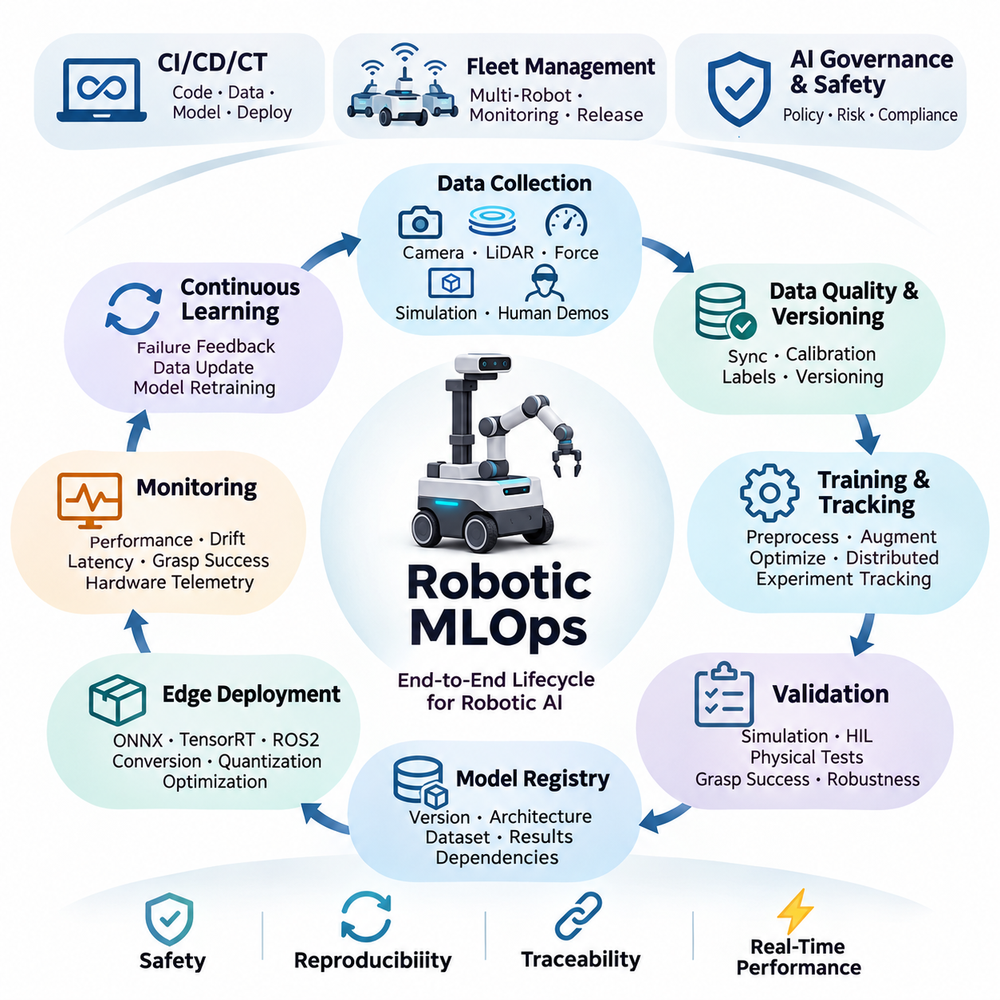
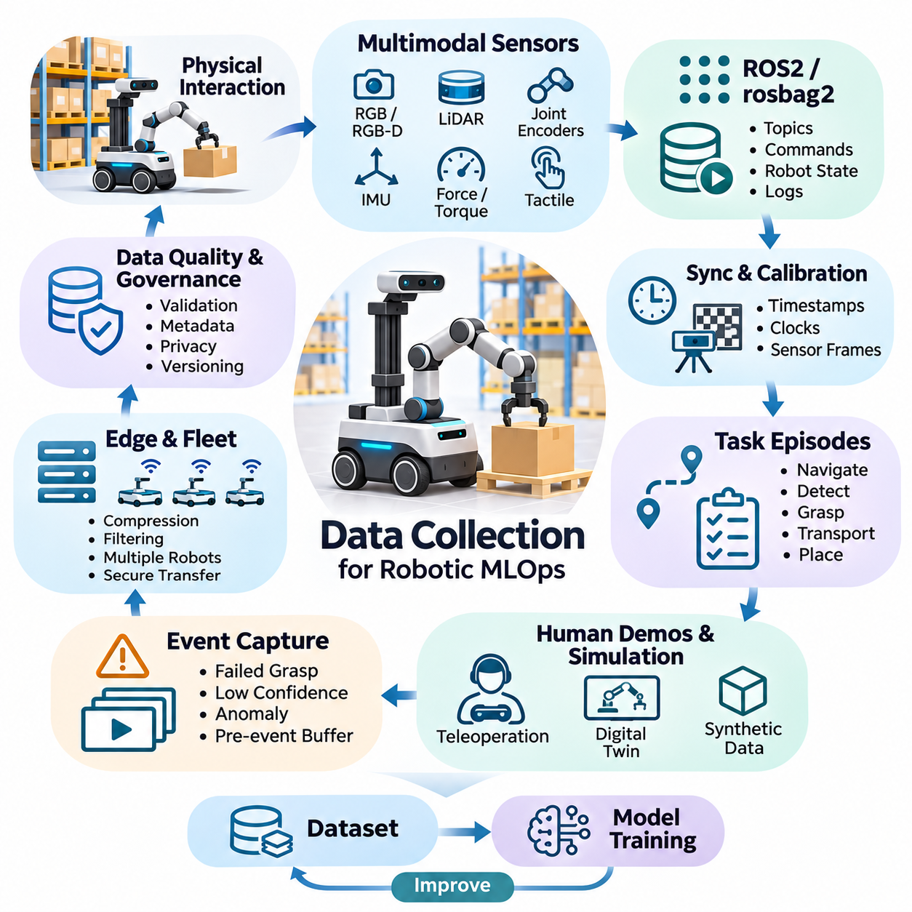
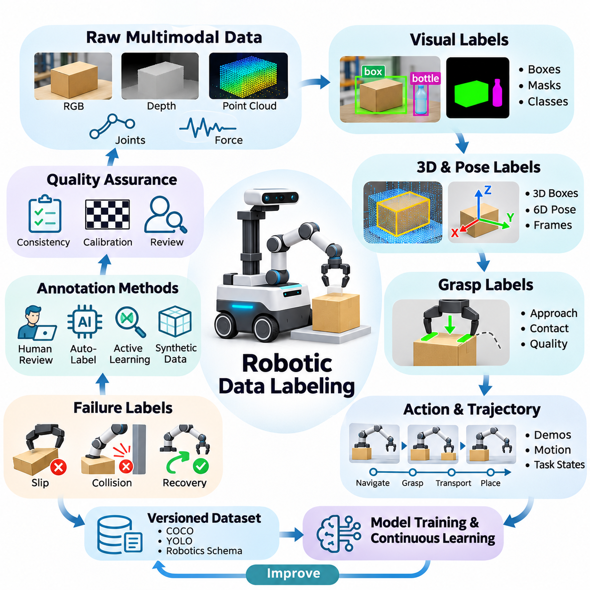
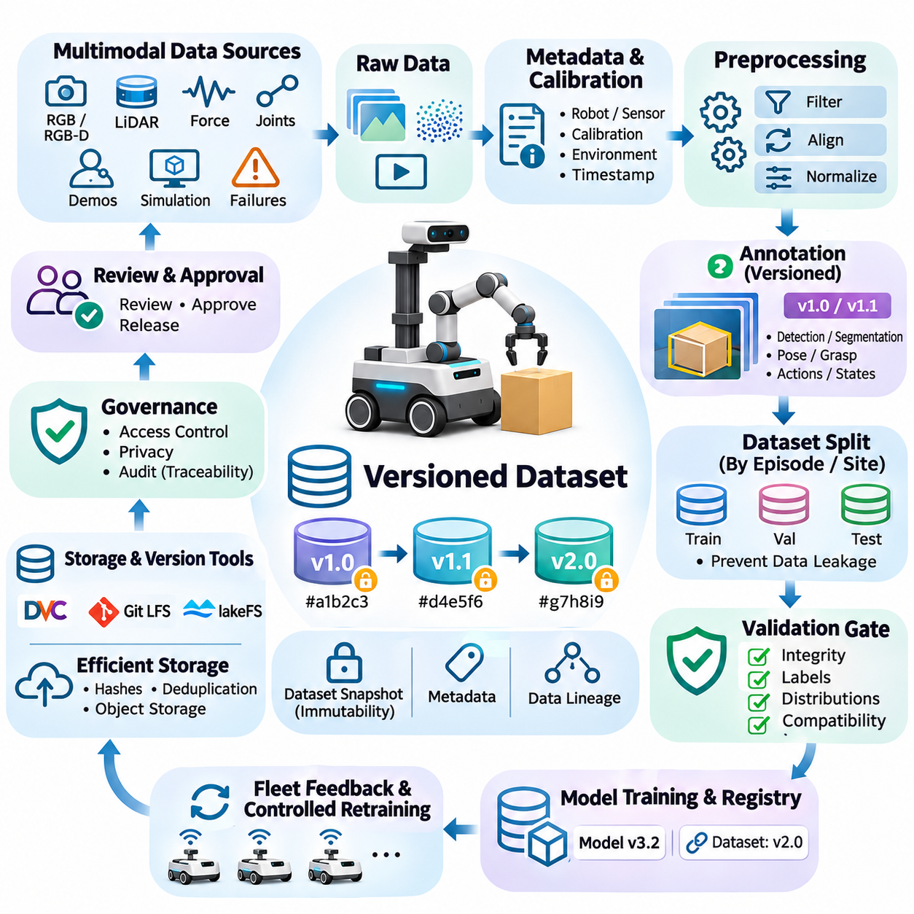
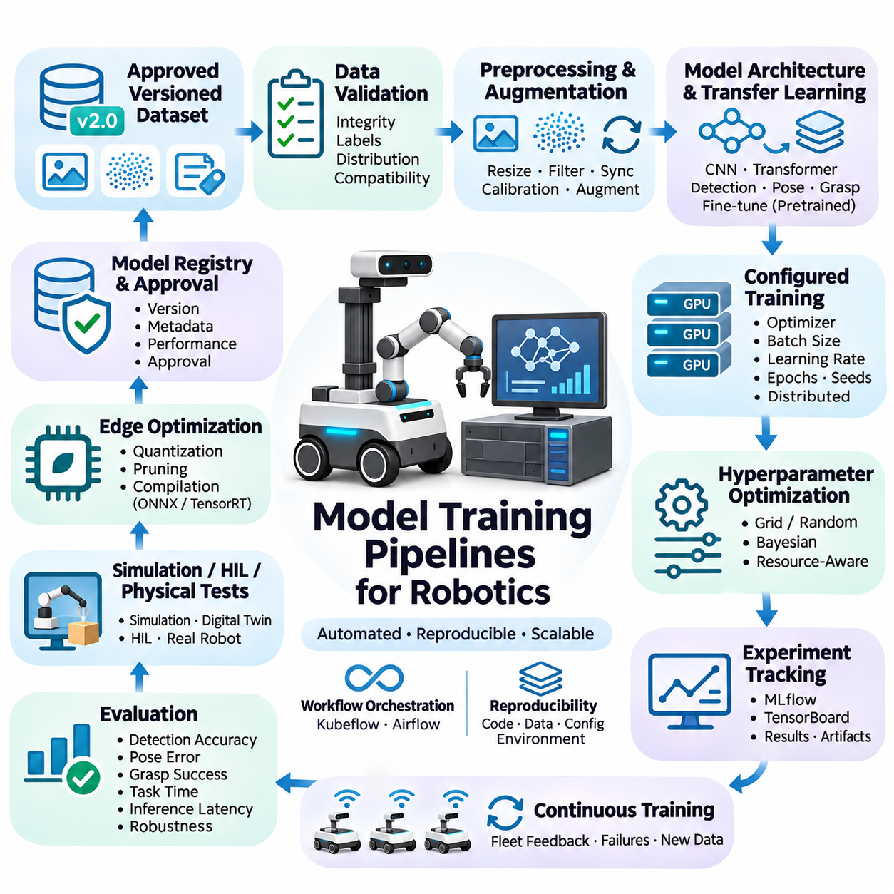
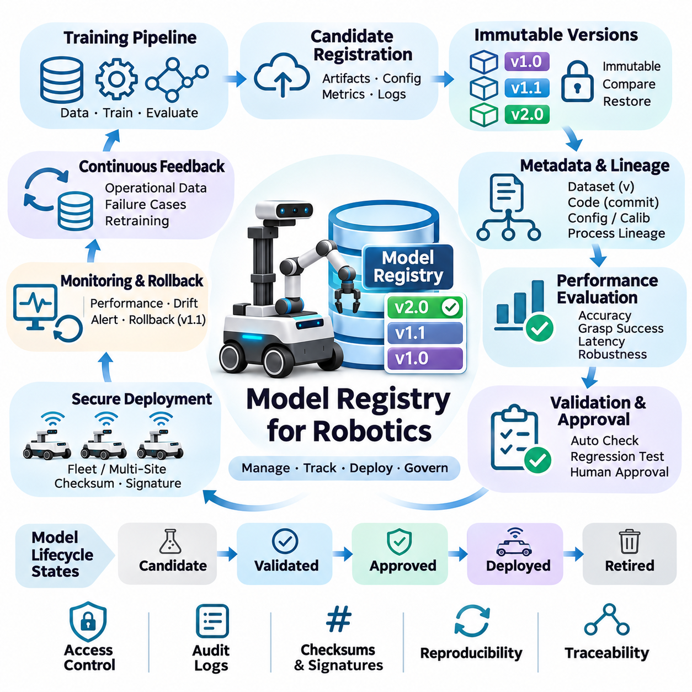
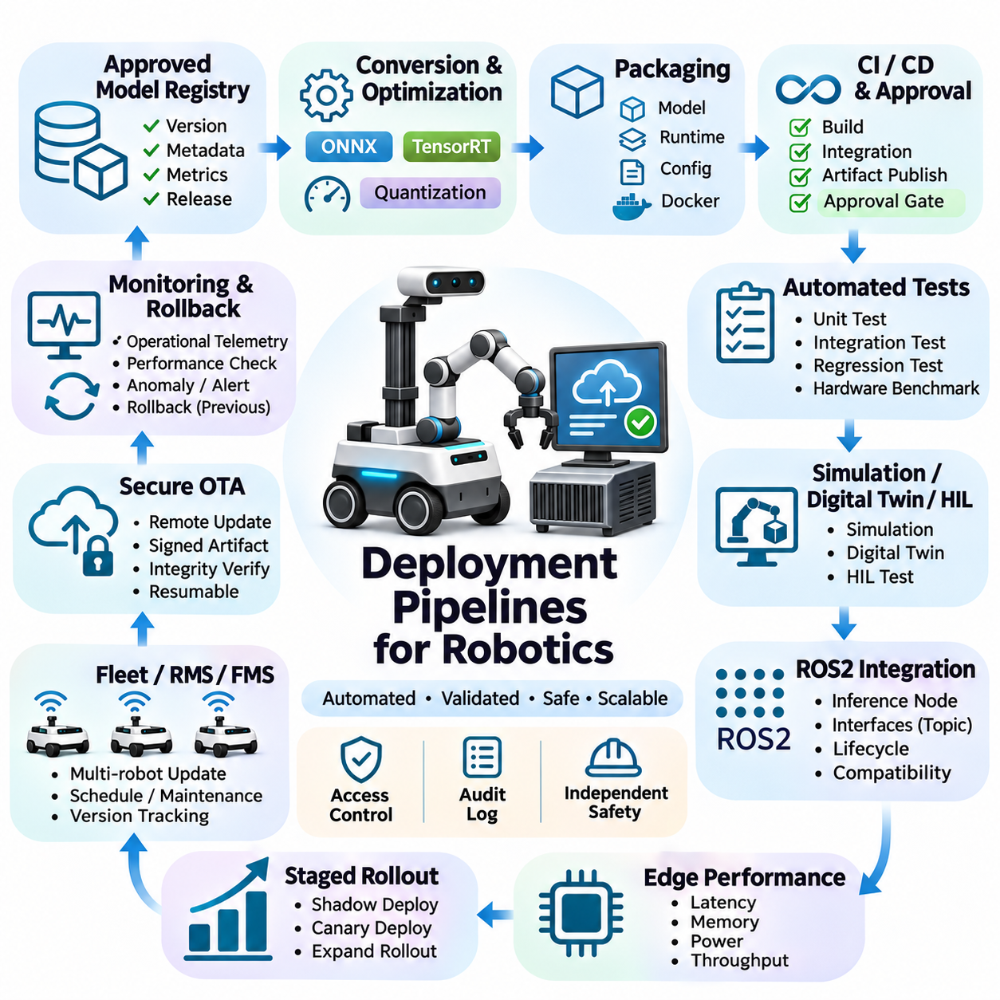
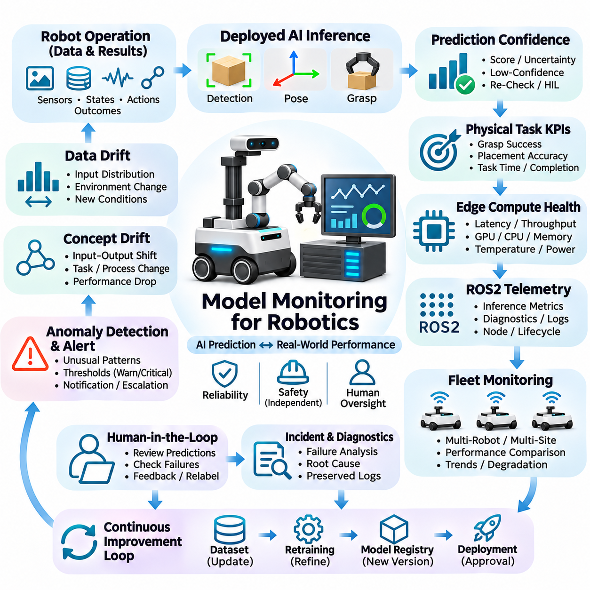
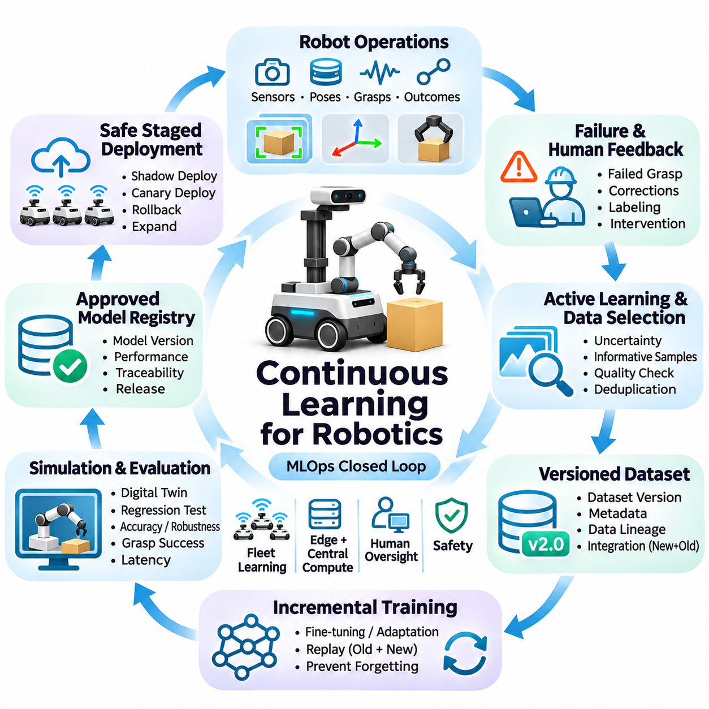
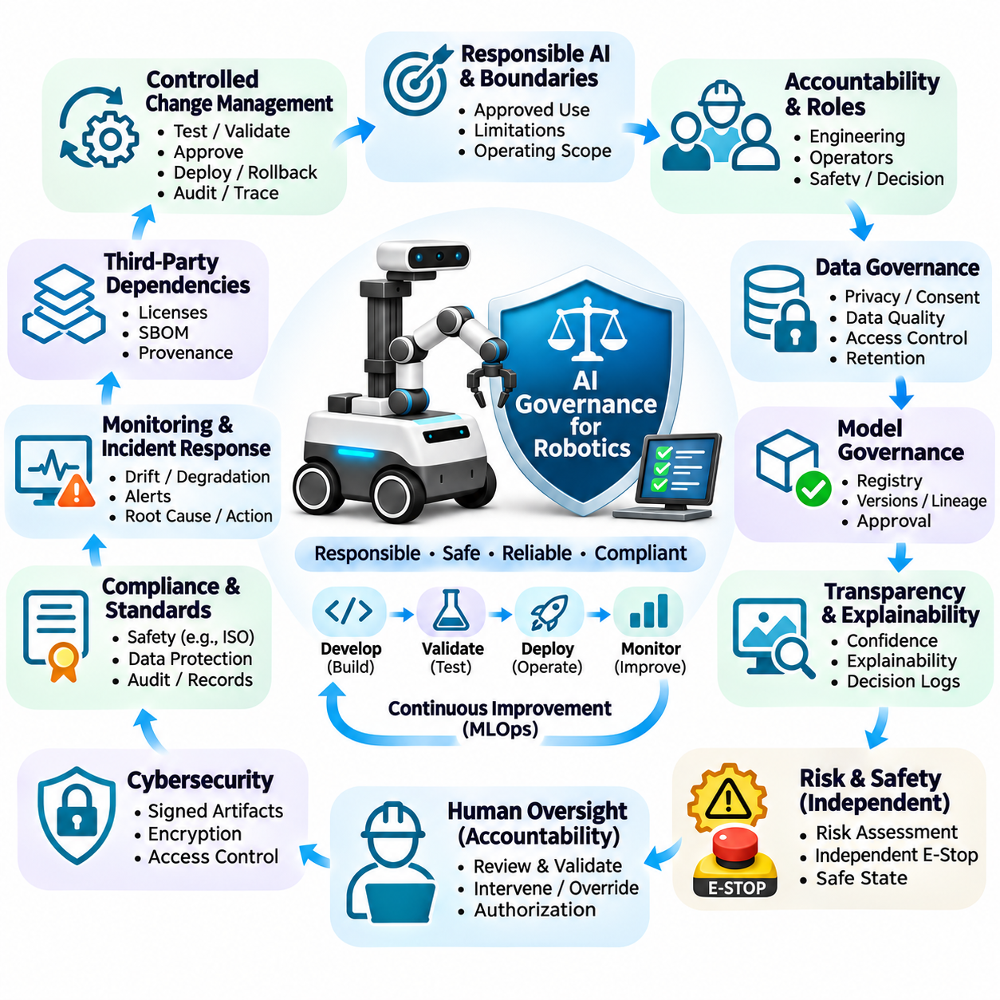

# Chapter 09. MLOps

## 01 MLOps for Robotics

{width="7.268055555555556in" height="7.268055555555556in"}

로봇을 위한 머신러닝 운영(Machine Learning Operations, MLOps)은 머신러닝 개발(Machine Learning Development), 소프트웨어 공학(Software Engineering), 데이터 관리(Data Management), 운영 프로세스(Operational Process)를 하나의 통합된 수명주기(Unified Lifecycle)로 결합하는 공학 분야이다. 주요 목적은 로봇 시스템에 배포된 인공지능 모델(Artificial Intelligence Model)이 변화하는 환경 조건에서도 전체 운영 수명주기 동안 신뢰성(Reliability), 재현성(Reproducibility), 확장성(Scalability), 유지보수성(Maintainability)을 유지하도록 보장하는 것이다.

주로 디지털 환경에서 동작하는 기존 머신러닝 애플리케이션과 달리 로봇 인공지능 시스템(Robotic AI System)은 물리적 세계(Physical World)와 직접 상호작용한다. 예측 오류(Prediction Error)는 파지 실패, 잘못된 객체 인식, 자율주행 실패, 장비 손상 또는 위험 상황을 초래할 수 있다. 따라서 로봇 MLOps는 예측 정확도(Prediction Accuracy)뿐만 아니라 실행 신뢰성(Execution Reliability), 운영 안전성(Operational Safety), 실시간 성능(Real-Time Performance)까지 고려해야 한다.

모바일 매니퓰레이션 시스템(Mobile Manipulation System)에서 머신러닝 모델은 객체 검출(Object Detection), 의미론적 분할(Semantic Segmentation), 6차원 자세 추정(6D Pose Estimation), 파지 예측(Grasp Prediction), 장애물 인식(Obstacle Recognition), 이상 탐지(Anomaly Detection), 지능형 작업 계획(Intelligent Task Planning) 등 다양한 기능을 지원한다. 각각의 모델은 보다 광범위한 로봇 소프트웨어 아키텍처의 구성요소로 동작하므로 모델 의존성(Model Dependency), 센서 구성(Sensor Configuration), 연산 자원(Computational Resource), 통신 인터페이스(Communication Interface)에 대한 통합적인 관리가 필요하다.

로봇 MLOps의 수명주기(Lifecycle)는 실제 로봇, 시뮬레이션 환경(Simulation Environment), 디지털 트윈(Digital Twin), 인간 시연(Human Demonstration)으로부터 데이터를 수집하는 과정에서 시작한다. 카메라(Camera), 라이다 센서(LiDAR Sensor), 힘·토크 센서(Force-Torque Sensor), 촉각 센서(Tactile Sensor), 관절 엔코더(Joint Encoder)는 로봇 행동의 다양한 측면을 표현하는 이종 데이터셋(Heterogeneous Dataset)을 생성한다. 이러한 데이터셋은 다양한 산업 및 상업 환경에서 동작할 수 있는 인공지능 모델을 개발하기 위한 기반을 제공한다.

데이터 관리(Data Management)는 모델의 성능이 데이터셋의 품질(Quality), 다양성(Diversity), 대표성(Representativeness)에 크게 의존하기 때문에 로봇 MLOps의 핵심 구성요소이다. 원시 센서 관측 데이터(Raw Sensor Observation)는 동기화(Synchronization), 보정(Calibration), 필터링(Filtering), 라벨링(Annotation) 과정을 거쳐 재현 가능한 데이터셋으로 구성되어야 한다. 데이터셋 버전 관리(Dataset Versioning)는 학습 샘플, 실험 구성, 모델 매개변수, 배포 결과 사이의 추적성(Traceability)을 확보하여 운영 장애의 체계적인 분석을 가능하게 한다.

자동화된 모델 학습 파이프라인(Automated Model Training Pipeline)은 표준화된 연산 작업 흐름(Computational Workflow)을 통해 검증된 데이터셋을 배포 가능한 머신러닝 모델로 변환한다. 이러한 파이프라인은 일반적으로 데이터 전처리(Data Preprocessing), 데이터 증강(Data Augmentation), 하이퍼파라미터 최적화(Hyperparameter Optimization), 분산 학습(Distributed Training), 성능 평가(Performance Evaluation), 산출물 생성(Artifact Generation)을 통합한다. 자동화된 실험 추적(Automated Experiment Tracking)은 학습 조건과 검증 결과를 기록하여 엔지니어가 실험을 재현하고 후보 모델을 객관적으로 비교할 수 있도록 지원한다.

로봇 분야의 모델 검증(Model Validation)은 정확도(Accuracy), 정밀도(Precision), 재현율(Recall), 평균 정밀도 평균(mean Average Precision, mAP)과 같은 기존 평가 지표를 넘어선다. 엔지니어는 파지 성공률(Grasp Success Rate), 조작 작업 주기 시간(Manipulation Cycle Time), 추론 지연시간(Inference Latency), 자원 활용률(Resource Utilization), 장애 복구 능력(Failure Recovery Capability), 환경 변화에 대한 강건성(Robustness)을 평가해야 한다. 시뮬레이션 기반 시험(Simulation-Based Testing), 하드웨어 연동 평가(Hardware-in-the-Loop Evaluation), 통제된 물리적 실험(Controlled Physical Experiment)은 운영 준비 상태(Operational Readiness)를 판단하기 위한 상호 보완적인 근거를 제공한다.

모델 레지스트리(Model Registry)는 전체 배포 수명주기 동안 학습된 모델과 관련 메타데이터(Metadata)를 관리하기 위한 중앙집중형 저장소(Centralized Repository)를 제공한다. 등록된 각 모델에는 버전(Version), 아키텍처(Architecture), 학습 데이터셋(Training Dataset), 평가 결과(Evaluation Result), 하드웨어 호환성(Hardware Compatibility), 소프트웨어 의존성(Software Dependency), 승인 상태(Approval Status)가 포함되어야 한다. 이러한 구조화된 접근법은 엔지니어링 팀이 승인된 모델을 식별하고 배포 이력을 관리하며 이전에 검증된 구성을 복원할 수 있도록 한다.

배포 파이프라인(Deployment Pipeline)은 머신러닝 개발 환경과 로봇 엣지 컴퓨팅 플랫폼(Robotic Edge Computing Platform)을 연결한다. 학습된 모델은 배포 전에 모델 변환(Model Conversion), 양자화(Quantization), 가지치기(Pruning), 하드웨어 특화 최적화(Hardware-Specific Optimization) 과정을 거칠 수 있다. ONNX(Open Neural Network Exchange), TensorRT, 컨테이너 기반 추론 환경(Containerized Inference Environment)과 같은 기술은 임베디드 로봇 시스템의 연산 제약을 고려하면서 반복적으로 재현 가능한 실행 구성을 확립하는 데 기여한다.

ROS2(Robot Operating System 2)와의 통합은 머신러닝 모델이 분산형 로봇 소프트웨어 아키텍처(Distributed Robotic Software Architecture)에서 모듈형 구성요소(Modular Component)로 동작할 수 있도록 한다. 추론 노드(Inference Node)는 센서 관측 데이터를 수신하고 학습된 모델을 실행하며 예측 결과를 자율주행, 매니퓰레이션 또는 작업 계획 구성요소에 발행한다. 수명주기 관리(Lifecycle Management), 서비스 품질(Quality of Service, QoS) 설정, 표준화된 메시지 인터페이스(Standardized Message Interface)는 예측 가능한 통신과 제어된 모델 활성화를 유지하는 데 기여한다.

지속적 통합(Continuous Integration, CI), 지속적 전달(Continuous Delivery, CD), 지속적 학습(Continuous Training, CT)은 기존 소프트웨어 공학의 개발 방식을 로봇 인공지능 개발 영역으로 확장한다. 자동화된 작업 흐름(Automated Workflow)은 변경 사항이 발생할 때마다 소스 코드(Source Code), 데이터셋 무결성(Dataset Integrity), 모델 호환성(Model Compatibility), 배포 구성(Deployment Configuration)을 검증한다. 그러나 이러한 변경은 로봇의 물리적 행동에 직접적인 영향을 미칠 수 있으므로 실제 운영 환경에서의 활성화는 적절한 검증 및 승인 절차를 거쳐야 한다.

모델이 배포된 이후에는 성능 저하(Performance Degradation)와 예상하지 못한 행동(Unexpected Behavior)을 탐지하기 위한 지속적 모니터링(Continuous Monitoring)이 필수적이다. 조명 조건(Lighting Condition), 객체의 외형(Object Appearance), 센서 보정(Sensor Calibration), 작업공간 구성(Workspace Configuration), 장비 특성의 변화는 데이터 드리프트(Data Drift) 또는 개념 드리프트(Concept Drift)를 발생시킬 수 있다. 모니터링 시스템은 운영 통계(Operational Statistics), 추론 신뢰도(Inference Confidence), 실행 결과(Execution Outcome), 하드웨어 원격 측정 데이터(Hardware Telemetry)를 수집하여 추가 분석이 필요한 조건을 식별한다.

플릿 수준의 MLOps(Fleet-Level MLOps)는 지리적으로 분산된 여러 시설에서 동작하는 다수의 로봇으로 머신러닝 관리 범위를 확장한다. 중앙집중형 모니터링 인프라(Centralized Monitoring Infrastructure)는 운영 정보를 통합하고 반복적으로 발생하는 장애 패턴(Failure Pattern)을 식별하며 이기종 로봇 플랫폼(Heterogeneous Robotic Platform)에 대한 모델 배포를 조율할 수 있다. 단계적 배포 전략(Staged Deployment Strategy)은 검증된 업데이트를 일부 로봇에 우선 적용한 후 전체 플릿으로 확대함으로써 운영 위험(Operational Risk)을 감소시킨다.

연속 학습(Continuous Learning)은 배포된 로봇 시스템과 중앙집중형 모델 개발 인프라 사이에 제어된 피드백 메커니즘(Controlled Feedback Mechanism)을 구축한다. 파지 실패(Failed Grasp), 불확실한 예측(Uncertain Prediction), 운영자 개입(Operator Intervention), 예상하지 못한 환경 관측 데이터는 추가적인 학습 데이터를 확보하기 위한 중요한 원천이 된다. 적절한 검토와 라벨링을 거친 이러한 관측 데이터는 운영 중인 모델의 통제되지 않은 변경을 허용하지 않으면서 모델 재학습(Retraining)과 검증(Validation)을 지원할 수 있다.

인공지능 거버넌스(AI Governance)는 로봇 머신러닝 운영을 관리하기 위한 정책(Policy), 책임(Responsibility), 승인 메커니즘(Approval Mechanism), 문서화 요구사항(Documentation Requirement)을 정의한다. 모델 출처 및 이력(Model Provenance), 사이버 보안(Cybersecurity), 데이터 개인정보 보호(Data Privacy), 접근 제어(Access Control), 배포 승인(Release Authorization), 감사 가능성(Auditability)은 산업 환경에서 특히 중요하다. 독립적인 안전 메커니즘(Independent Safety Mechanism)과 검증된 대체 행동(Validated Fallback Behavior)은 머신러닝 구성요소가 신뢰할 수 없는 예측 결과를 생성하는 상황에서도 효과적으로 동작해야 한다.

궁극적으로 MLOps는 로봇 인공지능을 독립적인 실험적 기능에서 지속 가능한 엔지니어링 및 운영 인프라(Engineering and Operational Infrastructure)로 전환한다. 데이터 수집(Data Collection), 데이터 라벨링(Data Labeling), 데이터셋 버전 관리(Dataset Versioning), 모델 학습(Model Training), 모델 등록(Model Registration), 모델 배포(Model Deployment), 모니터링(Monitoring), 연속 학습(Continuous Learning), 인공지능 거버넌스(AI Governance)를 유기적으로 연결함으로써 운영 신뢰성(Operational Reliability), 확장성(Scalability), 안전성(Safety)을 유지하면서 모바일 매니퓰레이션 시스템의 체계적인 발전을 지원한다.

## 02 Data Collection

{width="7.268055555555556in" height="7.268055555555556in"}

데이터 수집(Data Collection)은 로봇을 위한 머신러닝 운영(Machine Learning Operations, MLOps)의 기초 단계로서 인공지능 모델의 개발, 검증 및 지속적인 개선에 필요한 관측 데이터를 제공한다. 모바일 매니퓰레이션 시스템(Mobile Manipulation System)에서 데이터 수집은 대표적인 운영 조건에서 모바일 플랫폼(Mobile Platform), 로봇 암(Robotic Arm), 엔드 이펙터(End Effector), 주변 환경(Surrounding Environment), 인간 운영자(Human Operator) 사이의 상호작용을 포착해야 한다.

주로 정적 데이터셋(Static Dataset)에 의존하는 기존 머신러닝 애플리케이션과 달리 로봇 시스템은 주변 환경과의 물리적 상호작용(Physical Interaction)을 통해 연속적인 멀티모달 데이터 스트림(Multimodal Data Stream)을 생성한다. 이러한 데이터 스트림에는 시각적 관측 데이터(Visual Observation), 깊이 측정값(Depth Measurement), 포인트 클라우드(Point Cloud), 관절 위치(Joint Position), 모터 전류(Motor Current), 접촉력(Contact Force), 자율주행 궤적(Navigation Trajectory), 실행 결과(Execution Result)가 포함된다. 이러한 데이터를 통합함으로써 로봇 행동과 환경 조건에 대한 종합적인 분석이 가능해진다.

비전 센서(Vision Sensor)는 모바일 매니퓰레이션에서 가장 중요한 데이터 원천(Data Source) 중 하나이다. RGB 카메라(RGB Camera), 스테레오 카메라(Stereo Camera), RGB-D 카메라(RGB-D Camera), 3차원 라이다 센서(3D LiDAR Sensor)는 객체의 외형(Object Appearance), 공간 기하구조(Spatial Geometry), 장애물 분포(Obstacle Distribution), 작업공간 특성(Workspace Characteristic)에 대한 정보를 제공한다. 수집된 관측 데이터는 객체 검출(Object Detection), 의미론적 분할(Semantic Segmentation), 자세 추정(Pose Estimation), 파지 검출(Grasp Detection), 충돌 회피(Collision Avoidance) 모델의 개발을 지원한다.

고유수용감각 센서(Proprioceptive Sensor)는 로봇 시스템의 내부 물리적 상태(Internal Physical State)에 대한 정보를 제공한다. 관절 엔코더(Joint Encoder), 관성 측정 장치(Inertial Measurement Unit, IMU), 모터 전류 센서(Motor Current Sensor), 힘·토크 센서(Force-Torque Sensor), 촉각 센서(Tactile Sensor)는 움직임(Motion), 가속도(Acceleration), 기계적 하중(Mechanical Loading), 물리적 접촉(Physical Contact)을 측정한다. 고유수용감각 측정값과 외부 환경 관측 데이터를 결합함으로써 머신러닝 모델은 인식(Perception), 움직임(Motion), 물리적 상호작용(Physical Interaction) 사이의 관계를 이해할 수 있다.

ROS2(Robot Operating System 2)는 분산형 로봇 소프트웨어 구성요소로부터 데이터를 수집하기 위한 표준화된 통신 인프라(Standardized Communication Infrastructure)를 제공한다. 센서 측정값(Sensor Measurement), 로봇 상태(Robot State), 좌표 변환(Coordinate Transformation), 제어 명령(Control Command), 진단 정보(Diagnostic Information)는 rosbag2를 사용하여 기록할 수 있다. 선택적 토픽 기록(Selective Topic Recording), 압축(Compression), 조정 가능한 기록 주파수(Configurable Recording Frequency)는 데이터셋 완전성(Dataset Completeness)과 통신 대역폭(Communication Bandwidth), 저장 용량(Storage Capacity), 연산 오버헤드(Computational Overhead) 사이의 균형을 유지하는 데 기여한다.

시간적 동기화(Temporal Synchronization)는 멀티모달 로봇 데이터셋(Multimodal Robotic Dataset)을 수집할 때 특히 중요하다. 카메라, 라이다 센서, 관절 엔코더, 힘·토크 센서는 서로 다른 샘플링 주파수(Sampling Frequency)에서 동작하며 서로 다른 통신 지연시간(Communication Latency)을 나타내는 경우가 많다. 정확한 타임스탬프(Timestamp), 동기화된 클록(Synchronized Clock), 시간 정렬 메커니즘(Temporal Alignment Mechanism)은 관측 데이터가 일관된 물리적 상태에 대응하도록 보장하여 모델 학습과 평가의 성능을 저하시킬 수 있는 불일치를 감소시킨다.

공간적 일관성(Spatial Consistency) 역시 전체 데이터 수집 과정에서 유지되어야 한다. 센서 보정(Sensor Calibration), 내부 및 외부 매개변수(Intrinsic and Extrinsic Parameters), 좌표계 변환(Coordinate Frame Transformation)은 카메라, 매니퓰레이터, 모바일 플랫폼, 환경 기준 좌표계(Environmental Reference Frame) 사이의 기하학적 관계(Geometric Relationship)를 확립한다. 센서 관측 데이터와 함께 보정 정보를 기록하면 로봇 상호작용의 재현 가능한 재구성(Reproducible Reconstruction)이 가능해지며 정확한 공간 학습(Spatial Learning)을 지원할 수 있다.

운영 데이터 수집(Operational Data Collection)은 개별적인 센서 측정값이 아니라 완전한 작업 실행 시퀀스(Task Execution Sequence)를 포착해야 한다. 모바일 매니퓰레이션 에피소드(Mobile Manipulation Episode)에는 작업대로의 자율주행(Navigation), 객체 식별(Object Identification), 자세 추정(Pose Estimation), 파지 계획(Grasp Planning), 궤적 실행(Trajectory Execution), 객체 운반(Object Transportation), 배치(Placement)가 포함될 수 있다. 중간 상태(Intermediate State), 전달된 명령(Issued Command), 최종 실행 결과(Final Outcome)를 기록함으로써 엔지니어는 인식 실패(Perception Failure)와 물리적 행동 실패 사이의 의존 관계를 분석할 수 있다.

인간 시연(Human Demonstration)은 모방 학습(Imitation Learning), 강화학습(Reinforcement Learning), 체화 인공지능(Embodied Artificial Intelligence)을 위한 추가적인 데이터를 제공한다. 운영자는 원격 조작(Teleoperation), 운동감각 기반 교시(Kinesthetic Teaching), 모션 캡처(Motion Capture), 특수 제어 인터페이스(Specialized Control Interface)를 통해 로봇 시스템을 유도할 수 있다. 시연 데이터셋(Demonstration Dataset)은 바람직한 로봇 행동을 재현하는 정책(Policy)의 개발을 지원하기 위해 관측-행동 관계(Observation-Action Relationship), 작업 목표(Task Objective), 타임스탬프(Timestamp), 실행 결과(Execution Outcome)를 보존해야 한다.

시뮬레이션 환경(Simulation Environment)과 디지털 트윈(Digital Twin)은 합성 데이터셋(Synthetic Dataset)의 제어된 생성을 가능하게 함으로써 실제 환경에서의 데이터 수집을 보완한다. 가상 환경(Virtual Environment)에서는 객체의 기하구조(Object Geometry), 조명(Lighting), 텍스처(Texture), 카메라 시점(Camera Viewpoint), 장애물 배치(Obstacle Arrangement), 물리적 상호작용 매개변수(Physical Interaction Parameter)를 체계적으로 변화시킬 수 있다. 합성 데이터(Synthetic Data)는 시나리오 포괄 범위(Scenario Coverage)를 확대하고 데이터 수집 비용을 절감하지만, 시뮬레이션과 실제 환경 사이의 불일치(Simulation-to-Reality Discrepancy)는 대표적인 물리적 관측 데이터를 활용하여 평가해야 한다.

이벤트 기반 데이터 수집(Event-Triggered Data Collection)은 사전에 정의된 조건이 발생할 때 정보를 기록함으로써 운영 효율성(Operational Efficiency)을 향상시킨다. 검출 실패(Detection Failure), 파지 실패(Unsuccessful Grasp), 예상하지 못한 접촉력(Unexpected Contact Force), 자율주행 중단(Navigation Interruption), 낮은 신뢰도의 예측(Low-Confidence Prediction), 운영자 개입(Operator Intervention)은 선택적 기록(Targeted Recording)을 시작하는 조건이 될 수 있다. 순환 데이터 버퍼(Rolling Data Buffer)는 이러한 이벤트가 발생하기 직전의 관측 데이터를 보존하여 모든 센서 스트림을 지속적으로 저장하지 않고도 상세한 장애 분석(Failure Analysis)을 가능하게 한다.

플릿 수준의 데이터 수집(Fleet-Level Data Collection)은 서로 다른 시설에서 동작하는 다수의 모바일 매니퓰레이터로 데이터 기록 기능을 확장한다. 중앙집중형 인프라(Centralized Infrastructure)는 서로 다른 하드웨어 구성(Hardware Configuration), 운영 작업(Operational Task), 환경 조건(Environmental Condition)을 갖는 로봇으로부터 관측 데이터를 통합한다. 분산 배포 환경(Distributed Deployment)에서 추적성(Traceability)을 유지하고 의미 있는 비교 분석을 지원하기 위해 로봇 식별자(Robot Identifier), 현장 정보(Site Information), 소프트웨어 버전(Software Version), 모델 버전(Model Version)이 수집된 데이터셋에 함께 포함되어야 한다.

엣지 컴퓨팅 플랫폼(Edge Computing Platform)은 실제 자원 제약(Resource Constraint)하에서 데이터 수집을 관리하는 데 필수적인 역할을 수행한다. 고해상도 이미지(High-Resolution Image), 고밀도 포인트 클라우드(Dense Point Cloud), 고주파 센서 측정값(High-Frequency Sensor Measurement)은 상당한 데이터 용량을 발생시킬 수 있다. 로컬 필터링(Local Filtering), 압축(Compression), 선택적 샘플링(Selective Sampling), 임시 버퍼링(Temporary Buffering), 예약 전송(Scheduled Transmission)은 중앙집중형 저장소(Centralized Storage), 후속 라벨링(Annotation), 모델 개발에 필요한 유용한 관측 데이터를 보존하면서 네트워크 사용량(Network Utilization)을 감소시킨다.

데이터 품질 보증(Data Quality Assurance)은 데이터 수집 파이프라인(Data Collection Pipeline)에 직접 통합되어야 한다. 자동화된 검사(Automated Check)는 손상된 이미지(Corrupted Image), 누락된 타임스탬프(Missing Timestamp), 일관되지 않은 좌표 변환(Inconsistent Coordinate Transformation), 센서 포화(Sensor Saturation), 메시지 누락(Dropped Message), 불완전한 실행 기록(Incomplete Execution Record)을 식별할 수 있다. 데이터셋 메타데이터(Dataset Metadata)는 기록 조건(Recording Condition), 센서 구성(Sensor Configuration), 수집 매개변수(Collection Parameter), 식별된 품질 문제(Quality Issue)를 기술하여 데이터 라벨링(Data Labeling)과 데이터셋 버전 관리(Dataset Versioning)를 위한 신뢰할 수 있는 기반을 확립해야 한다.

보안(Security), 개인정보 보호(Privacy), 운영 안전성(Operational Safety)은 산업 시설, 물류창고, 병원 및 공공 환경에서 로봇 데이터를 수집할 때 필수적으로 고려해야 하는 요소이다. 기록된 관측 데이터에는 개인정보(Personal Information), 기밀 제조 공정(Confidential Manufacturing Process), 접근이 제한된 공간 정보(Restricted Spatial Information)가 포함될 수 있다. 접근 제어(Access Control), 암호화(Encryption), 익명화(Anonymization), 데이터 보존 정책(Retention Policy), 자원 격리(Resource Isolation)는 안전 필수 로봇 기능(Safety-Critical Robotic Function)을 방해하지 않으면서 민감한 데이터를 보호하는 데 기여한다.

궁극적으로 효과적인 로봇 데이터 수집(Robotic Data Collection)은 물리적 운영(Physical Operation)과 머신러닝 개발(Machine Learning Development) 사이에 지속적인 피드백 연결(Continuous Feedback Connection)을 확립한다. 대표적인 센서 측정값(Sensor Measurement), 실행 이력(Execution History), 인간 시연(Human Demonstration), 합성 관측 데이터(Synthetic Observation), 장애 이벤트(Failure Event), 구조화된 메타데이터(Structured Metadata)를 통합함으로써 조직은 신뢰할 수 있는 모델 학습(Model Training), 성능 모니터링(Performance Monitoring), 모바일 매니퓰레이션 시스템의 지속적인 개선(Continuous Improvement)을 지원하는 지속 가능한 데이터 인프라(Sustainable Data Infrastructure)를 구축할 수 있다.

## 03 Data Labeling

{width="7.268055555555556in" height="7.268055555555556in"}

데이터 라벨링(Data Labeling)은 머신러닝 운영(Machine Learning Operations, MLOps)의 핵심 프로세스로서 로봇의 원시 관측 데이터(Raw Robotic Observation)를 인공지능 모델을 위한 구조화된 학습 정보(Structured Training Information)로 변환한다. 모바일 매니퓰레이션 시스템(Mobile Manipulation System)에서 라벨링은 센서 관측 데이터(Sensory Observation), 환경 특성(Environmental Characteristic), 로봇 행동(Robotic Action), 실행 결과(Execution Outcome) 사이의 관계를 확립하여 지도학습(Supervised Learning)과 체계적인 성능 평가(Systematic Performance Evaluation)를 가능하게 한다.

기존의 이미지 분류 애플리케이션(Image Classification Application)과 달리 로봇 데이터 라벨링은 여러 센싱 모달리티(Sensing Modality)와 물리적 상호작용 정보(Physical Interaction Information)의 통합을 요구하는 경우가 많다. 이미지(Image), 깊이 측정값(Depth Measurement), 포인트 클라우드(Point Cloud), 관절 구성(Joint Configuration), 접촉력(Contact Force), 자율주행 궤적(Navigation Trajectory), 매니퓰레이션 상태(Manipulation State)는 일관된 방식으로 라벨링되어야 한다. 이러한 라벨은 머신러닝 모델이 환경 관측 데이터를 의미 있는 물리적 행동(Physical Action) 및 운영 목표(Operational Objective)와 연결할 수 있도록 한다.

시각 데이터 라벨링(Visual Data Labeling)은 객체 검출(Object Detection), 의미론적 분할(Semantic Segmentation), 인스턴스 분할(Instance Segmentation), 객체 인식(Object Recognition)을 포함한 모바일 매니퓰레이션의 핵심 인식 기능을 지원한다. 바운딩 박스(Bounding Box)는 객체의 위치를 식별하며, 분할 마스크(Segmentation Mask)는 픽셀 수준에서 객체의 경계를 표현한다. 정확한 라벨링을 위해서는 가려짐(Occlusion), 객체 중첩(Overlapping Object), 조명 변화(Illumination Variation), 반사(Reflection), 복잡한 산업 환경의 배경(Industrial Background)을 고려해야 한다.

3차원 데이터 라벨링(3D Data Labeling)은 기존의 이미지 라벨링(Image Annotation)을 3차원 공간 환경(Spatial Environment)으로 확장한다. 포인트 클라우드(Point Cloud)와 깊이 이미지(Depth Image)는 3차원 바운딩 박스(3D Bounding Box), 의미론적 범주(Semantic Category), 표면 정보(Surface Information), 객체 식별자(Object Identifier)를 사용하여 라벨링할 수 있다. 이러한 표현은 로봇 시스템이 공간적 관계(Spatial Relationship)를 이해하고 객체의 치수(Object Dimension)를 추정하며 장애물을 식별하고 운영 작업공간 내에서 접근 가능한 영역(Accessible Region)을 인식하도록 지원한다.

객체 자세 라벨링(Object Pose Labeling)은 성공적인 파지(Grasping)가 정확한 공간적 방향과 위치에 의존하기 때문에 로봇 매니퓰레이션에서 특히 중요하다. 6차원 자세 라벨(6D Pose Annotation)은 정의된 좌표계(Coordinate Frame)를 기준으로 3개의 병진 자유도(Translational Degree of Freedom)와 3개의 회전 자유도(Rotational Degree of Freedom)를 표현한다. 신뢰할 수 있는 자세 라벨(Pose Label)을 생성하기 위해서는 보정된 센서(Calibrated Sensor), 일관된 좌표 변환(Coordinate Transformation), 정확한 기하학적 모델(Geometric Model), 객체 대칭성(Object Symmetry)에 대한 적절한 처리가 필요하다.

파지 라벨링(Grasp Labeling)은 로봇 엔드 이펙터(Robotic End Effector)와 대상 객체(Target Object) 사이에서 가능한 상호작용 구성을 표현한다. 개별 라벨에는 파지 위치(Grasp Position), 접근 방향(Approach Direction), 그리퍼 방향(Gripper Orientation), 개방 폭(Opening Width), 접촉 위치(Contact Location), 파지 품질 점수(Grasp Quality Score)가 포함될 수 있다. 성공적인 파지 시도와 실패한 파지 시도는 상호 보완적인 학습 정보를 제공하여 모델이 기계적으로 실현 가능한 구성(Mechanically Feasible Configuration)과 불안정하거나 접근할 수 없는 대안을 구분할 수 있도록 한다.

행동 및 궤적 라벨링(Action and Trajectory Labeling)은 모방 학습(Imitation Learning), 강화학습(Reinforcement Learning), 지능형 작업 실행(Intelligent Task Execution)을 지원한다. 기록된 로봇 시연(Robotic Demonstration)은 작업 목표(Task Objective), 기본 동작(Motion Primitive), 관절 궤적(Joint Trajectory), 제어 명령(Control Command), 상호작용 단계(Interaction Phase), 완료 상태(Completion State)를 사용하여 라벨링할 수 있다. 시간적 라벨링(Temporal Annotation)은 관측 데이터와 후속 행동 사이의 관계를 확립하여 성공적인 매니퓰레이션 행동을 재현하는 정책(Policy)의 개발을 지원한다.

실패 라벨링(Failure Labeling)은 로봇의 신뢰성(Reliability)과 운영 강건성(Operational Robustness)을 향상시키기 위한 중요한 정보를 제공한다. 파지 실패(Unsuccessful Grasping), 객체 미끄러짐(Object Slippage), 잘못된 자세 추정(Incorrect Pose Estimation), 자율주행 중단(Navigation Interruption), 과도한 접촉력(Excessive Contact Force), 운영자 개입(Operator Intervention)은 일관된 실패 분류체계(Failure Taxonomy)에 따라 분류되어야 한다. 관측된 실패 증상(Failure Symptom)과 검증된 근본 원인(Root Cause)을 구분함으로써 보다 정확한 진단과 목표 지향적인 모델 개선(Targeted Model Improvement)이 가능해진다.

라벨링 지침(Annotation Guideline)은 다양한 데이터셋과 운영 환경에서 라벨을 할당하기 위한 표준화된 절차(Standardized Procedure)를 확립한다. 이러한 지침은 객체 범주(Object Category), 라벨링 경계(Annotation Boundary), 좌표계 규약(Coordinate Convention), 허용 기준(Acceptance Criteria), 모호한 사례(Ambiguous Case), 실패 분류(Failure Classification)를 정의해야 한다. 일관된 라벨링 용어(Labeling Terminology)는 주관적인 해석(Subjective Interpretation)을 감소시키고 서로 다른 로봇, 시설 및 라벨링 팀에서 생성된 데이터셋 간의 호환성(Compatibility)을 향상시킨다.

수동 라벨링(Manual Annotation)은 로봇 데이터셋에 복잡한 장면(Complex Scene), 익숙하지 않은 객체(Unfamiliar Object), 불확실한 상호작용 결과(Uncertain Interaction Outcome)가 포함된 경우 여전히 중요하다. 인간 라벨링 작업자(Human Annotator)는 자동화된 시스템이 간과할 수 있는 맥락적 관계(Contextual Relationship)를 해석할 수 있다. 그러나 수동 라벨링은 상당한 인건비(Labor Cost)와 잠재적인 불일치(Inconsistency)를 발생시키므로 표준화된 작업자 교육(Standardized Training), 라벨 검토(Annotation Review), 작업자 간 일치도(Inter-Annotator Agreement)가 품질 관리(Quality Management)의 필수 구성요소가 된다.

자동 및 반자동 라벨링(Automated and Semi-Automated Labeling) 기술은 기존 인식 모델(Perception Model), 기하학적 알고리즘(Geometric Algorithm), 추적 기법(Tracking Method), 센서 융합(Sensor Fusion)을 활용하여 확장성(Scalability)을 향상시킨다. 사전 학습 모델(Pretrained Model)은 인간 전문가가 이후 검토하고 수정할 수 있는 초기 라벨(Preliminary Annotation)을 생성할 수 있다. 능동 학습(Active Learning)은 불확실한 예측(Uncertain Prediction), 희귀 이벤트(Rare Event), 데이터셋에서 충분히 표현되지 않은 운영 시나리오(Underrepresented Operational Scenario)에 우선순위를 부여함으로써 라벨링 효율성(Annotation Efficiency)을 더욱 향상시킨다.

합성 데이터 라벨링(Synthetic Data Labeling)은 시뮬레이션 환경(Simulation Environment)과 디지털 트윈(Digital Twin)을 활용하여 이미 알려진 가상 장면의 속성(Virtual Scene Property)으로부터 라벨을 직접 생성한다. 객체 식별 정보(Object Identity), 분할 마스크(Segmentation Mask), 깊이 정보(Depth Information), 6차원 자세(6D Pose), 접촉 상태(Contact State)는 자동으로 추출할 수 있다. 합성 라벨(Synthetic Annotation)은 수동 라벨링의 필요성을 감소시키지만, 그 유용성은 시뮬레이션 충실도(Simulation Fidelity)와 대표적인 실제 환경 관측 데이터(Real-World Observation)를 기반으로 한 검증에 의존한다.

데이터 라벨링 품질 보증(Data Labeling Quality Assurance)은 자동화된 일관성 검사(Automated Consistency Check)와 인간 검증(Human Verification)을 결합한다. 검증 절차(Validation Procedure)는 누락된 라벨(Missing Annotation), 잘못된 클래스 할당(Incorrect Class Assignment), 유효하지 않은 기하학적 표현(Invalid Geometric Representation), 일관되지 않은 좌표계(Inconsistent Coordinate Frame), 시간적 불연속성(Temporal Discontinuity)을 식별할 수 있다. 라벨링 오류(Annotation Error)는 라벨링된 데이터셋이 모델 학습 및 평가에 사용될 수 있도록 승인되기 전에 통제된 검토 프로세스(Controlled Review Process)를 통해 문서화되고 수정되어야 한다.

라벨링 인프라(Labeling Infrastructure)는 원시 센서 기록(Raw Sensor Record), 라벨 파일(Annotation File), 라벨링 지침(Labeling Instruction), 센서 보정 정보(Sensor Calibration Information), 데이터셋 버전(Dataset Version) 사이의 관계를 보존해야 한다. COCO, YOLO와 같은 표준 데이터 형식(Standard Data Format)과 사용자 정의 로봇 데이터 스키마(Custom Robotics Schema)는 다양한 학습 작업(Learning Task)을 지원할 수 있다. 버전 관리되는 라벨링 메타데이터(Version-Controlled Annotation Metadata)는 모델 개발팀이 학습 데이터셋을 재현하고 실험 결과(Experimental Result)와 운영 결과(Operational Result) 사이의 불일치를 분석할 수 있도록 보장한다.

궁극적으로 데이터 라벨링(Data Labeling)은 신뢰할 수 있는 로봇 지능(Robotic Intelligence)에 필요한 의미론적 및 물리적 기반(Semantic and Physical Foundation)을 확립한다. 표준화된 라벨링 절차(Standardized Annotation Procedure), 멀티모달 표현(Multimodal Representation), 인간 전문 지식(Human Expertise), 자동화된 라벨링(Automated Labeling), 합성 데이터(Synthetic Data), 체계적인 품질 보증(Systematic Quality Assurance)을 결합함으로써 조직은 모델 학습(Model Training), 배포 검증(Deployment Validation), 연속 학습(Continuous Learning), 장기적인 운영 개선(Long-Term Operational Improvement)을 지원하는 재현 가능한 데이터셋(Reproducible Dataset)을 구축할 수 있다.

## 04 Dataset Versioning

{width="7.268055555555556in" height="7.268055555555556in"}

데이터셋 버전 관리(Dataset Versioning)는 인공지능 수명주기(Artificial Intelligence Lifecycle) 전반에 걸쳐 데이터셋의 체계적인 관리, 추적 및 재현을 가능하게 하는 머신러닝 운영(Machine Learning Operations, MLOps)의 핵심 구성요소이다. 모바일 매니퓰레이션 시스템(Mobile Manipulation System)에서 데이터셋 버전 관리는 원시 센서 관측 데이터(Raw Sensor Observation), 라벨(Annotation), 전처리 절차(Preprocessing Procedure), 학습 구성(Training Configuration), 배포된 모델(Deployed Model) 사이의 명시적인 관계를 확립하여 개발 환경과 운영 환경 간의 일관성(Consistency)을 보장한다.

소스 코드(Source Code)가 주요 버전 관리 산출물(Version-Controlled Artifact)을 나타내는 기존 소프트웨어 개발(Software Development)과 달리 머신러닝 시스템(Machine Learning System)은 학습 데이터셋(Training Dataset)의 특성에 크게 의존한다. 센서 관측 데이터, 객체 범주(Object Category), 라벨링 정확도(Annotation Accuracy), 환경 조건(Environmental Condition)의 변화는 모델의 행동(Model Behavior)에 상당한 영향을 미칠 수 있다. 따라서 데이터셋 버전 관리는 데이터를 상호 교체 가능한 학습 샘플(Training Sample)의 집합이 아니라 체계적으로 관리되는 엔지니어링 자산(Engineering Asset)으로 취급한다.

로봇 데이터셋(Robotic Dataset)은 카메라(Camera), 라이다 센서(LiDAR Sensor), 힘·토크 센서(Force-Torque Sensor), 촉각 센서(Tactile Sensor), 관절 엔코더(Joint Encoder), 자율주행 시스템(Navigation System)에서 생성되는 이종 정보(Heterogeneous Information)를 포함하는 경우가 많다. 이러한 데이터셋에는 인간 시연(Human Demonstration), 합성 관측 데이터(Synthetic Observation), 매니퓰레이션 궤적(Manipulation Trajectory), 운영 실패 기록(Operational Failure Record)이 포함될 수도 있다. 포괄적인 버전 관리 아키텍처(Versioning Architecture)는 시간적 동기화(Temporal Synchronization)와 공간적 일관성(Spatial Consistency)을 유지하면서 이러한 데이터 모달리티(Data Modality) 사이의 관계를 보존해야 한다.

각각의 데이터셋 버전(Dataset Version)은 재현 가능한 특정 데이터 샘플(Data Sample), 라벨(Annotation), 관련 메타데이터(Metadata)의 집합을 나타내는 고유 식별자(Unique Identifier)를 가져야 한다. 버전 식별자(Version Identifier)는 순차 번호(Sequential Number), 의미론적 버전 관리 규약(Semantic Versioning Convention), 타임스탬프(Timestamp), 암호학적 해시(Cryptographic Hash)를 포함할 수 있다. 불변 데이터셋 스냅샷(Immutable Dataset Snapshot)은 승인된 학습 데이터의 의도하지 않은 변경을 방지하고 실험 비교(Experimental Comparison) 및 운영 모델 개발(Production Model Development)을 위한 안정적인 참조 기준을 제공한다.

데이터셋 메타데이터(Dataset Metadata)는 로봇 학습 데이터셋을 해석하고 재현하기 위한 필수적인 맥락 정보(Contextual Information)를 제공한다. 관련 메타데이터에는 수집 날짜(Collection Date), 로봇 식별자(Robot Identifier), 센서 구성(Sensor Configuration), 보정 매개변수(Calibration Parameter), 운영 환경(Operating Environment), 라벨링 지침(Annotation Guideline), 소프트웨어 버전(Software Version)이 포함된다. 이러한 속성을 기록함으로써 엔지니어는 특정 로봇 플랫폼(Robotic Platform), 인식 시스템(Perception System), 매니퓰레이션 요구사항(Manipulation Requirement)에 대한 데이터셋의 호환성(Compatibility)을 판단할 수 있다.

데이터 계보(Data Lineage)는 최초 데이터 수집부터 후속 처리(Processing), 라벨링(Annotation), 변환(Transformation), 공개(Publication)에 이르기까지 데이터셋의 전체 이력을 나타낸다. 처리된 데이터셋(Processed Dataset)은 여러 실제 로봇(Physical Robot), 시뮬레이션 환경(Simulation Environment), 이전에 배포된 데이터셋으로부터 생성될 수 있다. 명시적인 데이터 계보 관계(Data Lineage Relationship)를 유지함으로써 엔지니어링 팀은 개별 데이터 샘플의 출처(Data Origin)를 식별하고 예상하지 못한 모델 행동(Unexpected Model Behavior)의 원인을 조사할 수 있다.

버전 관리되는 전처리 파이프라인(Version-Controlled Preprocessing Pipeline)은 원시 로봇 관측 데이터에 적용되는 변환 과정의 재현성(Reproducibility)을 보장한다. 이미지 크기 조정(Image Resizing), 정규화(Normalization), 포인트 클라우드 필터링(Point Cloud Filtering), 좌표 변환(Coordinate Conversion), 시간 정렬(Temporal Alignment), 데이터 증강(Data Augmentation)은 학습 결과에 상당한 영향을 미칠 수 있다. 이러한 절차와 관련된 소스 코드(Source Code), 구성 매개변수(Configuration Parameter), 소프트웨어 의존성(Software Dependency), 난수 시드(Random Seed)는 생성된 데이터셋 버전과 함께 기록되어야 한다.

라벨 버전 관리(Annotation Versioning)는 라벨링 요구사항(Labeling Requirement)이 원시 센서 데이터(Raw Sensor Data)와 독립적으로 발전할 수 있기 때문에 특히 중요하다. 객체 범주(Object Category)는 확장될 수 있으며, 분할 경계(Segmentation Boundary)는 수정되고, 자세 라벨(Pose Annotation)은 정교화되며, 실패 분류(Failure Classification)는 재구성될 수 있다. 원시 관측 데이터와 버전 관리되는 라벨을 분리함으로써 엔지니어는 대규모 센서 기록을 불필요하게 복제하거나 과거 데이터셋 구성(Dataset Configuration)을 손실하지 않으면서 라벨링 품질을 개선할 수 있다.

학습(Training), 검증(Validation), 테스트(Test) 데이터 분할(Data Partition) 역시 버전 관리되는 데이터셋 구성요소로 명시적으로 관리되어야 한다. 로봇 분야에서는 연속적인 관측 데이터가 거의 동일한 정보를 포함하는 경우가 많으므로 개별 센서 프레임(Sensor Frame)을 무작위로 분리하면 데이터 누출(Data Leakage)이 발생할 수 있다. 작업 에피소드(Task Episode), 기록 세션(Recording Session), 물리적 현장(Physical Site), 객체 인스턴스(Object Instance)를 기준으로 데이터셋을 분할하면 모델 일반화 성능(Model Generalization Performance)에 대한 보다 신뢰할 수 있는 평가가 가능해진다.

저장소 아키텍처(Storage Architecture)는 로봇 데이터셋의 규모가 테라바이트(Terabyte) 또는 페타바이트(Petabyte) 수준에 도달할 수 있기 때문에 중요한 고려사항이다. 고해상도 이미지(High-Resolution Image), 고밀도 포인트 클라우드(Dense Point Cloud), 멀티모달 센서 기록(Multimodal Sensor Recording)은 전체 데이터셋의 복제를 경제적으로 비효율적인 방식으로 만든다. 콘텐츠 주소 지정 저장소(Content-Addressable Storage), 중복 제거(Deduplication), 증분 버전 관리(Incremental Versioning), 객체 저장소(Object Storage)는 개별 데이터셋 구성을 보존하면서 여러 데이터셋 버전이 공유 데이터 산출물(Shared Data Artifact)을 참조할 수 있도록 한다.

데이터 버전 관리(Data Version Control, DVC), Git 대용량 파일 저장소(Git Large File Storage, Git LFS), lakeFS와 같은 도구는 소프트웨어 개발 작업 흐름(Software Development Workflow)과 연계하여 대규모 데이터셋(Large-Scale Dataset)을 관리하기 위한 다양한 메커니즘을 제공한다. 이러한 기술은 Git 저장소(Git Repository), 클라우드 저장소(Cloud Storage), 온프레미스 인프라(On-Premises Infrastructure)와 통합될 수 있다. 각 기술의 적합성(Suitability)은 데이터셋 규모(Dataset Scale), 접근 요구사항(Access Requirement), 협업 구조(Collaboration Structure), 저장소 아키텍처(Storage Architecture), 재현성 목표(Reproducibility Objective)에 따라 달라진다.

자동화된 데이터셋 검증(Automated Dataset Validation)은 새로운 데이터셋 버전이 모델 학습에 사용되기 전에 버전 관리 작업 흐름(Versioning Workflow)에 통합되어야 한다. 검증 절차(Validation Procedure)는 파일 무결성(File Integrity), 라벨 완전성(Annotation Completeness), 클래스 분포(Class Distribution), 좌표계 규약(Coordinate Convention), 보정 호환성(Calibration Compatibility), 동기화 정확도(Synchronization Accuracy)를 확인할 수 있다. 데이터셋 허용 기준(Dataset Acceptance Criteria)은 손상되거나 불완전하거나 호환되지 않는 관측 데이터가 승인된 머신러닝 파이프라인(Machine Learning Pipeline)에 유입되는 것을 방지하는 데 기여한다.

데이터셋 버전 관리는 로봇 엔지니어(Robotics Engineer), 머신러닝 개발자(Machine Learning Developer), 라벨링 전문가(Annotation Specialist), 현장 운영자(Field Operator) 사이의 통제된 협업(Controlled Collaboration)도 지원해야 한다. 브랜칭 메커니즘(Branching Mechanism)은 실험적인 데이터셋 변경사항을 승인된 운영 데이터셋(Production Dataset)으로부터 격리할 수 있으며, 검토 절차(Review Procedure)는 제안된 변경사항이 정해진 품질 요구사항(Quality Requirement)을 충족하도록 보장한다. 접근 권한(Access Permission)과 승인 기록(Approval Record)은 분산형 개발팀(Distributed Development Team) 전반에 걸쳐 책임성(Accountability)을 유지한다.

모델 학습 파이프라인(Model Training Pipeline)과의 통합은 데이터셋 버전과 학습된 모델 산출물(Trained Model Artifact) 사이의 직접적인 추적성(Traceability)을 확립한다. 모든 실험은 개발 과정에서 사용된 정확한 데이터셋 리비전(Dataset Revision), 전처리 구성(Preprocessing Configuration), 학습 코드(Training Code), 평가 데이터 분할(Evaluation Partition)을 참조해야 한다. 이러한 관계가 실험 추적 시스템(Experiment Tracking System)과 모델 레지스트리(Model Registry)에 보존되면 엔지니어는 과거 실험 결과를 재현하고 데이터셋 변경이 모델에 미치는 영향을 체계적으로 평가할 수 있다.

플릿 수준의 데이터셋 버전 관리(Fleet-Level Dataset Versioning)는 지리적으로 분산된 모바일 매니퓰레이션 시스템 전반에 걸친 지속적인 개선(Continuous Improvement)을 지원한다. 새롭게 수집된 관측 데이터, 파지 실패(Failed Grasp), 익숙하지 않은 객체(Unfamiliar Object), 센서 이상(Sensor Anomaly), 운영자 개입(Operator Intervention)은 후보 데이터셋 버전(Candidate Dataset Version)에 통합될 수 있다. 품질 검증(Quality Verification)과 승인(Approval)을 거친 이러한 데이터셋은 기존 운영 모델과 연계된 검증 완료 데이터셋(Validated Dataset)을 보존하면서 통제된 모델 재학습(Controlled Retraining)을 지원한다.

데이터셋 거버넌스(Dataset Governance)는 데이터 소유권(Data Ownership), 접근 제어(Access Control), 데이터 보존(Data Retention), 라이선스 관리(Licensing), 개인정보 보호(Privacy Protection), 승인된 변경(Authorized Modification)에 대한 정책을 정의한다. 산업용 로봇 데이터셋(Industrial Robotic Dataset)에는 기밀 제조 정보(Confidential Manufacturing Information), 시설 배치 정보(Facility Layout), 개인 식별 가능 정보(Personally Identifiable Information, PII)가 포함될 수 있다. 암호화(Encryption), 감사 로그(Audit Log), 통제된 삭제 절차(Controlled Deletion Procedure)는 엔지니어링 조사(Engineering Investigation) 및 규제 준수(Regulatory Compliance)에 필요한 추적성을 유지하면서 민감한 관측 데이터를 보호하는 데 기여한다.

궁극적으로 데이터셋 버전 관리(Dataset Versioning)는 로봇 데이터 관리(Robotic Data Management)를 재현 가능하고 감사 가능한 엔지니어링 프로세스(Reproducible and Auditable Engineering Process)로 전환한다. 불변 데이터셋 스냅샷(Immutable Dataset Snapshot), 메타데이터 관리(Metadata Management), 데이터 계보(Data Lineage), 라벨링 이력(Annotation History), 자동화된 검증(Automated Validation), 모델 수명주기 추적성(Model Lifecycle Traceability)을 통합함으로써 조직은 신뢰할 수 있는 모델 학습(Reliable Model Training), 통제된 배포(Controlled Deployment), 연속 학습(Continuous Learning), 모바일 매니퓰레이션 시스템의 장기적인 개선(Long-Term Improvement)을 위한 지속 가능한 기반을 구축할 수 있다.

## 05 Model Training Pipelines

{width="7.268055555555556in" height="7.268055555555556in"}

모델 학습 파이프라인(Model Training Pipeline)은 머신러닝 운영(Machine Learning Operations, MLOps)에서 검증된 데이터셋(Validated Dataset)을 배포 가능한 인공지능 모델(Deployable Artificial Intelligence Model)로 변환하는 구조화된 연산 작업 흐름(Structured Computational Workflow)이다. 모바일 매니퓰레이션 시스템(Mobile Manipulation System)에서 이러한 파이프라인은 데이터 준비(Data Preparation), 모델 구성(Model Configuration), 학습(Training), 최적화(Optimization), 평가(Evaluation), 산출물 생성(Artifact Generation)을 재현 가능한 프로세스로 통합하여 신뢰할 수 있는 로봇 지능(Robotic Intelligence)과 지속적인 운영 개선(Continuous Operational Improvement)을 지원한다.

수동으로 실행되는 스크립트(Manually Executed Script)와 독립적인 연산 환경(Isolated Computational Environment)에 의존하는 경우가 많은 실험적 모델 개발(Experimental Model Development)과 달리 운영 지향적인 학습 파이프라인(Production-Oriented Training Pipeline)은 자동화(Automation), 표준화(Standardization), 추적성(Traceability)을 강조한다. 각 파이프라인 단계는 명확하게 정의된 입력(Input), 처리 요구사항(Processing Requirement), 실행 의존성(Execution Dependency), 출력 산출물(Output Artifact)을 가져야 한다. 이러한 아키텍처는 인간의 오류(Human Error)를 감소시키고 반복적인 학습 실험 전반에서 일관성(Consistency)을 보장한다.

모델 학습 프로세스(Model Training Process)는 사전에 정의된 데이터 품질(Data Quality)과 애플리케이션 요구사항(Application Requirement)을 충족하는 승인된 데이터셋 버전(Approved Dataset Version)을 선택하는 과정에서 시작한다. 학습 파이프라인은 통제된 저장소 인프라(Controlled Storage Infrastructure)로부터 원시 관측 데이터(Raw Observation), 라벨(Annotation), 메타데이터(Metadata), 보정 정보(Calibration Information), 사전에 정의된 데이터셋 분할(Dataset Partition)을 가져온다. 자동화된 검증(Automated Validation)은 데이터셋 무결성(Dataset Integrity), 라벨 완전성(Annotation Completeness), 클래스 분포(Class Distribution), 선택된 모델 아키텍처와의 호환성(Compatibility)을 확인한다.

데이터 전처리(Data Preprocessing)는 이종 로봇 관측 데이터(Heterogeneous Robotic Observation)를 머신러닝 알고리즘(Machine Learning Algorithm)에 적합한 표준화된 표현(Standardized Representation)으로 변환한다. 애플리케이션에 따라 이미지 크기 조정(Image Resizing), 정규화(Normalization), 포인트 클라우드 필터링(Point Cloud Filtering), 좌표 변환(Coordinate Transformation), 시간 정렬(Temporal Alignment), 센서 융합(Sensor Fusion)이 필요할 수 있다. 학습 환경과 실제 운영 추론 환경(Production Inference Environment) 사이의 일관성을 유지하기 위해 전처리 매개변수(Preprocessing Parameter)와 소프트웨어 구성(Software Configuration)은 버전 관리되어야 한다.

데이터 증강(Data Augmentation)은 사용 가능한 학습 샘플(Training Sample)에 제어된 변화(Controlled Variation)를 도입하여 모델의 일반화 성능(Model Generalization Performance)을 향상시킨다. 시각적 데이터 증강(Visual Augmentation)에는 조명(Illumination), 대비(Contrast), 방향(Orientation), 크기(Scale), 부분적 가려짐(Partial Occlusion)의 변화가 포함될 수 있으며, 공간적 데이터 증강(Spatial Augmentation)은 포인트 클라우드의 기하구조(Point Cloud Geometry)와 센서 시점(Sensor Viewpoint)을 변경할 수 있다. 로봇 매니퓰레이션에서는 데이터 증강 절차가 객체, 자세(Pose), 파지 구성(Grasp Configuration), 관련 라벨 사이의 물리적으로 의미 있는 관계를 보존해야 한다.

모델 아키텍처 선택(Model Architecture Selection)은 모바일 매니퓰레이션 시스템의 기능적 요구사항(Functional Requirement)에 따라 달라진다. 합성곱 신경망(Convolutional Neural Network, CNN), 비전 트랜스포머(Vision Transformer, ViT), 객체 검출 네트워크(Object Detection Network), 포인트 클라우드 모델(Point Cloud Model), 멀티모달 학습 아키텍처(Multimodal Learning Architecture)는 서로 다른 인식 및 매니퓰레이션 작업을 처리한다. 학습 파이프라인은 데이터셋 로딩(Dataset Loading), 최적화(Optimization), 평가(Evaluation), 산출물 관리(Artifact Management)를 위한 표준화된 인터페이스를 유지하면서 설정 가능한 모델 선택(Configurable Model Selection)을 지원해야 한다.

전이 학습(Transfer Learning)은 사전 학습 모델(Pretrained Model)을 활용하여 특화된 로봇 지능(Specialized Robotic Intelligence)을 개발하기 위한 효율적인 접근법을 제공한다. 대규모 데이터셋(Large-Scale Dataset)으로 학습된 기존 모델은 미세 조정(Fine-Tuning) 또는 특징 추출(Feature Extraction)을 통해 특정 애플리케이션 환경에 적응할 수 있다. 이러한 접근법은 연산 요구량(Computational Requirement)을 감소시키고 학습 효율성(Learning Efficiency)을 향상시킬 수 있으며, 특히 대표적인 물리적 상호작용 데이터(Physical Interaction Data)의 수집과 라벨링에 많은 비용이 발생하거나 운영상 어려움이 존재하는 경우 효과적이다.

학습 구성 관리(Training Configuration Management)는 모델 최적화(Model Optimization)를 제어하는 매개변수에 대한 명시적인 관리 체계를 확립한다. 학습률(Learning Rate), 배치 크기(Batch Size), 옵티마이저 구성(Optimizer Configuration), 손실 함수(Loss Function), 학습 에포크(Training Epoch), 초기화 방법(Initialization Method), 난수 시드(Random Seed)는 버전 관리되는 구성 산출물(Version-Controlled Configuration Artifact)로 유지되어야 한다. 이러한 기록은 실험 재현성(Experimental Reproducibility)을 향상시키고 엔지니어가 학습 조건(Training Condition)과 결과적인 모델 성능(Model Performance) 사이의 관계를 분석할 수 있도록 한다.

분산 학습(Distributed Training)은 여러 그래픽 처리 장치(Graphics Processing Unit, GPU) 또는 컴퓨팅 노드(Computing Node)에 걸쳐 연산 작업(Computational Workload)을 실행할 수 있도록 한다. 데이터 병렬화(Data Parallelism), 모델 병렬화(Model Parallelism), 혼합 정밀도 학습(Mixed-Precision Training), 그래디언트 누적(Gradient Accumulation)은 대규모 로봇 데이터셋과 복잡한 신경망(Neural Network)의 연산 효율성(Computational Efficiency)을 향상시킬 수 있다. 자원 스케줄링(Resource Scheduling)과 활용률 모니터링(Utilization Monitoring)은 학습 시간(Training Duration), 하드웨어 가용성(Hardware Availability), 에너지 소비량(Energy Consumption), 인프라 비용(Infrastructure Cost) 사이의 균형을 유지하는 데 기여한다.

하이퍼파라미터 최적화(Hyperparameter Optimization, HPO)는 사전에 정의된 성능 목표(Performance Objective)를 충족하는 모델을 식별하기 위해 다양한 학습 구성을 체계적으로 평가한다. 그리드 탐색(Grid Search), 무작위 탐색(Random Search), 베이지안 최적화(Bayesian Optimization), 자원 인식 최적화(Resource-Aware Optimization) 기법은 후보 모델 선택(Candidate Model Selection)을 자동화할 수 있다. 로봇 애플리케이션에서 최적화 목표는 예측 정확도(Prediction Accuracy)뿐만 아니라 추론 지연시간(Inference Latency), 메모리 사용량(Memory Consumption), 연산 복잡도(Computational Complexity), 물리적 작업 성능(Physical Task Performance)까지 고려해야 한다.

실험 추적(Experiment Tracking)은 학습 실행 이력(Training Execution Record), 데이터셋 버전(Dataset Version), 모델 구성(Model Configuration), 평가 지표(Evaluation Metric), 생성된 산출물(Generated Artifact)에 대한 중앙집중형 기록(Centralized Record)을 제공한다. MLflow, TensorBoard, Weights & Biases와 같은 플랫폼은 실험 결과(Experimental Result)의 체계적인 비교를 지원한다. 소스 코드 리비전(Source Code Revision), 의존성 버전(Dependency Version), 하드웨어 구성(Hardware Configuration), 실행 로그(Execution Log)를 기록하면 추적성이 더욱 강화되고 협업 기반 모델 개발(Collaborative Model Development)이 용이해진다.

로봇 지능은 물리적 작업 실행(Physical Task Execution)에 직접적인 영향을 미치기 때문에 모델 평가(Model Evaluation)는 기존 머신러닝 평가 지표(Machine Learning Metric)를 넘어서는 범위에서 수행되어야 한다. 객체 검출 정확도(Object Detection Accuracy), 자세 추정 오차(Pose Estimation Error), 파지 예측 품질(Grasp Prediction Quality)은 매니퓰레이션 성공률(Manipulation Success Rate), 작업 완료 시간(Task Completion Time), 추론 지연시간(Inference Latency), 환경 교란(Environmental Disturbance)에 대한 강건성(Robustness)과 함께 평가되어야 한다. 허용 임계값(Acceptance Threshold)은 애플리케이션별 운영 및 안전 요구사항(Operational and Safety Requirements)을 반영해야 한다.

시뮬레이션 기반 검증(Simulation-Based Validation)은 오프라인 모델 시험(Offline Model Testing)과 실제 로봇 배포(Physical Robot Deployment) 사이의 중간 평가 단계(Intermediate Evaluation Stage)를 제공한다. 디지털 트윈(Digital Twin)과 시뮬레이션 환경(Simulation Environment)은 다양한 객체 구성(Object Configuration), 센서 조건(Sensor Condition), 상호작용 시나리오(Interaction Scenario)에서 모델 행동(Model Behavior)을 통제된 방식으로 평가할 수 있도록 한다. 이후 하드웨어 연동 시험(Hardware-in-the-Loop Testing, HIL)과 감독하에 수행되는 물리적 실험(Supervised Physical Experiment)을 통해 시뮬레이션 환경에서 정확하게 재현하기 어려운 실행 행동(Execution Behavior)을 평가한다.

모델 최적화(Model Optimization)는 학습된 신경망을 자원이 제한된 로봇 엣지 컴퓨팅 플랫폼(Resource-Constrained Robotic Edge Computing Platform)에 배포할 수 있도록 준비하는 과정이다. 양자화(Quantization), 가지치기(Pruning), 지식 증류(Knowledge Distillation), 연산자 융합(Operator Fusion), 하드웨어 특화 컴파일(Hardware-Specific Compilation)은 연산 오버헤드(Computational Overhead)와 추론 지연시간(Inference Latency)을 감소시킬 수 있다. 수치 정밀도(Numerical Precision)의 변화와 아키텍처 수정(Architectural Modification)이 예측 정확도 및 후속 물리적 행동(Downstream Physical Behavior)에 영향을 미칠 수 있으므로 최적화된 모델은 재평가를 거쳐야 한다.

파이프라인 오케스트레이션(Pipeline Orchestration)은 데이터 검증(Data Validation), 전처리(Preprocessing), 모델 학습(Model Training), 평가(Evaluation), 최적화(Optimization), 산출물 등록(Artifact Registration) 사이의 의존 관계(Dependency)를 조율한다. Kubeflow Pipelines, Apache Airflow, Prefect와 같은 작업 흐름 오케스트레이션 플랫폼(Workflow Orchestration Platform)은 스케줄링(Scheduling), 의존성 관리(Dependency Management), 실행 모니터링(Execution Monitoring), 장애 복구(Failure Recovery)를 지원한다. 컨테이너 기반 실행 환경(Containerized Execution Environment)은 클라우드(Cloud), 온프레미스(On-Premises), 분산 컴퓨팅 인프라(Distributed Computing Infrastructure) 전반에서 이식성(Portability)을 더욱 향상시킨다.

지속적 학습(Continuous Training, CT)은 새롭게 수집된 운영 데이터(Operational Data)에 의해 구동되는 제어된 피드백 순환 구조(Controlled Feedback Cycle)로 모델 학습 파이프라인을 확장한다. 파지 실패(Failed Grasp), 익숙하지 않은 객체(Unfamiliar Object), 불확실한 예측(Uncertain Prediction), 환경 변화(Environmental Change)는 데이터셋 검증 이후 모델 재학습 작업 흐름(Retraining Workflow)을 시작하는 조건이 될 수 있다. 새롭게 학습된 모델은 모델 등록(Model Registration) 및 운영 배포 승인(Production Deployment Approval) 이전에 사전에 정의된 허용 기준(Acceptance Criteria)과 회귀 시험(Regression Test)을 충족해야 한다.

궁극적으로 모델 학습 파이프라인(Model Training Pipeline)은 로봇 인공지능 개발(Robotic AI Development)을 표준화되고 재현 가능하며 확장 가능한 엔지니어링 프로세스(Scalable Engineering Process)로 전환한다. 버전 관리되는 데이터셋(Version-Controlled Dataset), 자동화된 전처리(Automated Preprocessing), 설정 가능한 학습(Configurable Training), 실험 추적(Experiment Tracking), 물리적 성능 평가(Physical Performance Evaluation), 통제된 모델 등록(Controlled Model Registration)을 통합함으로써 조직은 모바일 매니퓰레이션 시스템의 신뢰할 수 있는 배포(Reliable Deployment)와 지속적인 개선(Continuous Improvement)을 위한 연산 기반(Computational Foundation)을 확립할 수 있다.

## 06 Model Registry

{width="7.268055555555556in" height="7.268055555555556in"}

모델 레지스트리(Model Registry)는 전체 운영 수명주기(Operational Lifecycle)에 걸쳐 머신러닝 모델을 구성하고 추적하며 제어하는 중앙집중형 관리 시스템(Centralized Management System)이다. 모바일 매니퓰레이션을 위한 머신러닝 운영(Machine Learning Operations, MLOps)에서 모델 레지스트리는 모델 학습(Model Training), 성능 평가(Performance Evaluation), 배포 승인(Deployment Approval), 실제 운영(Production Operation) 사이의 구조화된 연결 관계를 확립하여 로봇 시스템이 식별 가능하고 적절하게 검증된 모델 버전(Model Version)을 실행하도록 보장한다.

주로 모델 가중치(Model Weight)와 구성 파일(Configuration File)을 보존하는 기존 파일 저장 시스템(File Storage System)과 달리 모델 레지스트리는 머신러닝 모델을 버전 관리되는 엔지니어링 자산(Version-Controlled Engineering Asset)으로 관리한다. 등록된 각 모델은 설명형 메타데이터(Descriptive Metadata), 개발 이력(Development History), 평가 결과(Evaluation Result), 배포 요구사항(Deployment Requirement), 승인 기록(Approval Record)과 연계된다. 이러한 접근법은 로봇 개발팀 전반의 재현성(Reproducibility), 운영 책임성(Operational Accountability), 협업(Collaboration)을 향상시킨다.

모델 등록(Model Registration)은 학습 파이프라인(Training Pipeline)이 사전에 정의된 평가 요구사항(Evaluation Requirement)을 충족하는 후보 모델(Candidate Model)을 생성할 때 시작된다. 생성된 모델 산출물(Model Artifact), 학습 구성(Training Configuration), 데이터셋 참조 정보(Dataset Reference), 성능 지표(Performance Metric), 실행 로그(Execution Log)는 모델 레지스트리로 전송된다. 모델 등록은 영속적인 모델 식별 정보(Persistent Model Identity)를 확립하여 최초 개발 맥락(Original Development Context)을 손실하지 않으면서 후속 평가, 최적화, 배포 및 수명주기 관리를 가능하게 한다.

모델 버전 관리(Model Versioning)는 머신러닝 모델의 여러 리비전(Revision)이 통제된 관리 환경(Controlled Management Environment)에서 공존할 수 있도록 한다. 각 버전에는 학습 조건(Training Condition), 아키텍처 특성(Architectural Characteristic), 생성된 산출물(Generated Artifact)과 연계된 고유 식별자(Unique Identifier)가 부여된다. 불변 모델 버전(Immutable Model Version)은 승인되지 않은 변경을 방지하고 엔지니어가 과거 성능(Historical Performance)을 비교하거나 운영 문제가 발생했을 때 이전에 검증된 모델을 복원할 수 있도록 한다.

모델 메타데이터(Model Metadata)는 등록된 모델의 특성과 의도된 적용 분야(Intended Application)를 이해하기 위한 필수적인 정보를 제공한다. 일반적인 메타데이터에는 모델 아키텍처(Model Architecture), 입출력 사양(Input and Output Specification), 학습 데이터셋 버전(Training Dataset Version), 전처리 요구사항(Preprocessing Requirement), 프레임워크 의존성(Framework Dependency), 수치 정밀도(Numerical Precision), 하드웨어 호환성(Hardware Compatibility), 평가 조건(Evaluation Condition)이 포함된다. 이러한 속성은 분산형 로봇 아키텍처(Distributed Robotic Architecture) 내에서 합리적인 모델 선택(Model Selection)과 통합(Integration)을 지원한다.

모델 계보(Model Lineage)는 등록된 모델과 해당 모델의 생성에 관여한 프로세스 사이의 추적성(Traceability)을 확립한다. 완전한 모델 계보 기록(Lineage Record)은 데이터셋 리비전(Dataset Revision), 라벨 버전(Annotation Version), 전처리 구성(Preprocessing Configuration), 소스 코드 커밋(Source Code Commit), 학습 매개변수(Training Parameter), 최적화 절차(Optimization Procedure)를 연결한다. 이러한 관계를 유지함으로써 엔지니어는 개발 결과를 재현하고 운영 장애(Operational Failure)가 데이터, 알고리즘 또는 배포 구성(Deployment Configuration)에서 비롯되었는지를 조사할 수 있다.

등록된 모델과 연계된 성능 기록(Performance Record)은 머신러닝 정확도(Machine Learning Accuracy)와 물리적 로봇 행동(Physical Robotic Behavior)을 모두 반영해야 한다. 객체 검출 정밀도(Object Detection Precision), 자세 추정 오차(Pose Estimation Error), 분할 정확도(Segmentation Accuracy), 파지 예측 품질(Grasp Prediction Quality)은 작업 성공률(Task Success Rate), 실행 지연시간(Execution Latency), 메모리 활용률(Memory Utilization), 환경적 강건성(Environmental Robustness)과 함께 기록되어야 한다. 평가 조건(Evaluation Condition)을 기록하면 후보 모델과 이전에 검증된 운영 모델 버전(Production Model Version) 사이의 의미 있는 비교가 가능해진다.

모델 수명주기 관리(Model Lifecycle Management)는 실험 모델(Experimental Model), 후보 모델(Candidate Model), 검증 완료 모델(Validated Model), 승인 모델(Approved Model), 배포 모델(Deployed Model), 운영 종료 모델(Retired Model) 상태 사이의 통제된 전환(Controlled Transition)을 확립한다. 이러한 상태는 서로 다른 수준의 기술적 평가(Technical Assessment)와 운영 승인(Operational Authorization)을 나타낸다. 성공적으로 학습된 모델이라도 물리적 로봇 행동에 미치는 영향을 애플리케이션별 허용 요구사항(Acceptance Requirement)과 안전 요구사항(Safety Requirement)에 따라 평가해야 하므로 자동으로 운영 배포 자격을 획득하는 것은 아니다.

승인 작업 흐름(Approval Workflow)은 등록된 모델이 실제 운영 배포(Operational Deployment)에 적합한지를 판단하기 위한 공식적인 메커니즘(Formal Mechanism)을 제공한다. 자동화된 검증(Automated Validation)은 성능 임계값(Performance Threshold), 산출물 무결성(Artifact Integrity), 소프트웨어 호환성(Software Compatibility), 회귀 시험 결과(Regression Test Result)를 확인할 수 있다. 중요한 매니퓰레이션 또는 자율주행 기능에 영향을 미치는 모델에는 인간의 승인(Human Authorization)이 추가적으로 요구될 수 있으며, 이를 통해 배포 의사결정(Deployment Decision)이 사전에 확립된 엔지니어링 책임(Engineering Responsibility)과 일치하도록 보장한다.

하드웨어 호환성 관리(Hardware Compatibility Management)는 모바일 매니퓰레이터가 이기종 엣지 컴퓨팅 플랫폼(Heterogeneous Edge Computing Platform)에서 동작하는 경우가 많기 때문에 특히 중요하다. 등록된 모델은 하나의 공통 학습 모델(Common Trained Model)로부터 파생된 별도의 PyTorch, ONNX, TensorRT 또는 양자화된 배포 산출물(Quantized Deployment Artifact)을 가질 수 있다. 각각의 산출물에는 지원 하드웨어(Supported Hardware), 런타임 의존성(Runtime Dependency), 수치 정밀도(Numerical Precision), 자원 요구사항(Resource Requirement), 독립적으로 검증된 성능 특성(Independently Verified Performance Characteristic)이 문서화되어야 한다.

ROS2(Robot Operating System 2)와의 통합을 위해서는 등록된 모델이 로봇 추론 구성요소(Robotic Inference Component)에 대한 명시적인 인터페이스 사양(Interface Specification)을 유지해야 한다. 입력 이미지 크기(Input Image Dimension), 정규화 매개변수(Normalization Parameter), 좌표계 규약(Coordinate Convention), 출력 텐서 구조(Output Tensor Structure), 의미론적 클래스 정의(Semantic Class Definition)는 연결된 인식 노드(Perception Node) 및 매니퓰레이션 노드(Manipulation Node)와 호환되어야 한다. 인터페이스 검증(Interface Validation)은 모델 버전이 다른 로봇 소프트웨어 구성요소와 독립적으로 변경될 때 발생할 수 있는 통합 장애(Integration Failure)를 방지하는 데 기여한다.

배포 파이프라인(Deployment Pipeline)은 모델 레지스트리에서 승인된 모델 산출물(Approved Model Artifact)을 가져와 지정된 로봇 플랫폼(Robotic Platform)에 배포한다. 산출물 체크섬(Artifact Checksum), 디지털 서명(Digital Signature), 호환성 검사(Compatibility Check), 릴리스 매니페스트(Release Manifest)는 의도된 모델 버전이 각각의 대상 시스템(Target System)에 전달되도록 보장하는 데 기여한다. 통제된 배포 메커니즘(Controlled Deployment Mechanism)은 모델 버전, 로봇 식별자(Robot Identifier), 소프트웨어 구성(Software Configuration), 운영 환경(Operational Environment) 사이의 관계도 보존한다.

플릿 수준의 모델 레지스트리(Fleet-Level Model Registry)는 서로 다른 시설에서 동작하는 다수의 모바일 매니퓰레이터에 대한 인공지능 모델 관리를 지원한다. 로봇은 센서 구성(Sensor Configuration), 연산 자원(Computational Resource), 객체 범주(Object Category), 환경 특성(Environmental Characteristic)의 차이로 인해 특화된 모델(Specialized Model)을 필요로 할 수 있다. 중앙집중형 모델 목록(Centralized Model Inventory)은 운영자가 배포된 모델 버전을 식별하고 단계적 릴리스(Staged Release)를 조율하며 구성 일관성(Configuration Consistency)을 유지할 수 있도록 지원한다.

모델 롤백 기능(Model Rollback Capability)은 새롭게 배포된 모델 버전에서 예상하지 못한 성능 저하(Unexpected Performance Degradation)가 발생했을 때 엔지니어링 팀이 이전에 승인된 모델을 복원할 수 있도록 한다. 효과적인 롤백(Rollback)을 위해서는 호환 가능한 추론 환경(Compatible Inference Environment), 전처리 구성(Preprocessing Configuration), 모델 의존성(Model Dependency), 배포 이력(Deployment History)을 보존해야 한다. 소프트웨어 인터페이스(Software Interface) 또는 하드웨어 특화 런타임 구성(Hardware-Specific Runtime Configuration)이 변경되었다면 모델 가중치(Model Weight)만 복원하는 것으로는 충분하지 않을 수 있다.

MLflow Model Registry, Kubeflow Model Registry, 관리형 클라우드 서비스(Managed Cloud Service)와 같은 모델 레지스트리 플랫폼(Model Registry Platform)은 모델 산출물과 수명주기 메타데이터(Lifecycle Metadata)를 체계적으로 구성하기 위한 메커니즘을 제공한다. 이러한 플랫폼은 실험 추적(Experiment Tracking), 객체 저장소(Object Storage), 지속적 통합 시스템(Continuous Integration System), 배포 인프라(Deployment Infrastructure)와 통합될 수 있다. 플랫폼 선택(Platform Selection)은 운영 규모(Operational Scale), 보안 요구사항(Security Requirement), 인프라 아키텍처(Infrastructure Architecture), 통합 복잡도(Integration Complexity)에 따라 달라진다.

보안 및 거버넌스 메커니즘(Security and Governance Mechanism)은 승인되지 않은 접근(Unauthorized Access), 변경(Modification), 배포(Distribution)로부터 등록된 모델을 보호한다. 역할 기반 접근 제어(Role-Based Access Control, RBAC), 산출물 암호화(Artifact Encryption), 디지털 서명(Digital Signature), 감사 로그(Audit Log), 보존 정책(Retention Policy)은 통제된 모델 관리(Controlled Model Management)를 지원한다. 모델 등록 자체가 모든 운영 조건에서 안전한 물리적 행동(Safe Physical Behavior)을 보장할 수는 없으므로 독립적인 로봇 안전 메커니즘(Independent Robotic Safety Mechanism)은 모델 승인 상태(Model Approval Status)와 관계없이 효과적으로 동작해야 한다.

궁극적으로 모델 레지스트리(Model Registry)는 학습된 머신러닝 모델을 추적 가능하고 거버넌스가 적용되며 운영상 관리 가능한 엔지니어링 자산(Operationally Manageable Engineering Asset)으로 전환한다. 모델 버전 관리(Model Versioning), 메타데이터(Metadata), 모델 계보(Model Lineage), 성능 기록(Performance Record), 승인 작업 흐름(Approval Workflow), 배포 이력(Deployment History), 롤백 메커니즘(Rollback Mechanism)을 통합함으로써 모델 레지스트리는 배포 파이프라인(Deployment Pipeline), 연속 학습(Continuous Learning), 모바일 매니퓰레이션 시스템의 장기적인 발전(Long-Term Evolution)을 위한 신뢰할 수 있는 기반을 확립한다.

## 07 Deployment Pipelines

{width="7.268055555555556in" height="7.268055555555556in"}

배포 파이프라인(Deployment Pipeline)은 검증된 머신러닝 모델(Validated Machine Learning Model)을 개발 환경(Development Environment)에서 실제 운영 로봇 시스템(Operational Robotic System)으로 전달하는 자동화된 엔지니어링 작업 흐름(Automated Engineering Workflow)이다. 모바일 매니퓰레이션을 위한 머신러닝 운영(Machine Learning Operations, MLOps)에서 이러한 파이프라인은 모델 레지스트리(Model Registry), 소프트웨어 통합(Software Integration), 배포 검증(Deployment Validation), 엣지 컴퓨팅 인프라(Edge Computing Infrastructure), 플릿 운영(Fleet Operation)을 연결하여 신뢰성과 추적성을 갖춘 인공지능 배포(Artificial Intelligence Deployment) 체계를 확립한다.

기존 소프트웨어 배포(Conventional Software Deployment)와 달리 로봇 모델 배포(Robotic Model Deployment)는 물리적 환경(Physical Environment)과의 상호작용에 직접적인 영향을 미친다. 객체 검출(Object Detection), 자세 추정(Pose Estimation), 파지 예측(Grasp Prediction), 지능형 작업 계획(Intelligent Task Planning)의 변화는 로봇 행동(Robot Behavior)과 운영 안전성(Operational Safety)을 변화시킬 수 있다. 따라서 배포 파이프라인은 소프트웨어 호환성(Software Compatibility)과 연산 성능(Computational Performance)뿐만 아니라 새로운 모델 버전의 도입으로 발생하는 물리적 영향(Physical Consequence)도 평가해야 한다.

배포 프로세스(Deployment Process)는 모델 레지스트리에서 승인된 모델 버전(Approved Model Version)을 선택하는 과정으로 시작한다. 선택된 모델은 검증된 학습 기록(Verified Training Record), 데이터셋 참조 정보(Dataset Reference), 평가 지표(Evaluation Metric), 인터페이스 사양(Interface Specification), 배포 요구사항(Deployment Requirement)과 연계되어야 한다. 릴리스 매니페스트(Release Manifest)는 모델 산출물(Model Artifact), 소프트웨어 의존성(Software Dependency), 대상 하드웨어 구성(Target Hardware Configuration), 승인된 운영 환경(Authorized Operational Environment) 사이의 명시적인 관계를 확립한다.

모델 변환 및 최적화(Model Conversion and Optimization)는 학습된 신경망(Trained Neural Network)이 대상 컴퓨팅 플랫폼(Target Computing Platform)에서 실행될 수 있도록 준비하는 과정이다. PyTorch 또는 TensorFlow를 사용하여 개발된 모델은 ONNX 형식으로 변환되거나 TensorRT, OpenVINO 또는 기타 하드웨어 특화 추론 프레임워크(Hardware-Specific Inference Framework)를 사용하여 최적화될 수 있다. 양자화(Quantization), 연산자 융합(Operator Fusion), 연산 그래프 최적화(Computational Graph Optimization)는 허용 가능한 예측 정확도(Prediction Accuracy)를 유지하면서 추론 지연시간(Inference Latency)과 메모리 사용량(Memory Consumption)을 감소시킬 수 있다.

배포 패키징(Deployment Packaging)은 모델 산출물(Model Artifact), 전처리 구성요소(Preprocessing Component), 추론 런타임(Inference Runtime), 구성 파일(Configuration File), 소프트웨어 의존성(Software Dependency)을 재현 가능한 실행 환경(Reproducible Execution Environment)으로 통합한다. Docker와 같은 컨테이너 기술(Container Technology)은 개발 서버(Development Server)와 로봇 엣지 컴퓨터(Robotic Edge Computer) 전반에서 일관된 애플리케이션 배포(Application Distribution)를 용이하게 한다. 배포 패키지(Deployment Package)는 하드웨어 요구사항(Hardware Requirement), 버전 의존성(Version Dependency), 런타임 초기화 절차(Runtime Initialization Procedure)도 정의해야 한다.

지속적 통합 및 지속적 전달(Continuous Integration and Continuous Delivery, CI/CD)은 배포 패키지의 빌드(Build), 시험(Testing), 배포(Distribution)를 위한 자동화 메커니즘(Automation Mechanism)을 제공한다. GitHub Actions, GitLab CI/CD, Jenkins와 같은 플랫폼은 모델 변환(Model Conversion), 의존성 검증(Dependency Verification), 통합 시험(Integration Testing), 산출물 공개(Artifact Publication)를 조율할 수 있다. 모델 변경이 안전 필수 로봇 기능(Safety-Critical Robotic Function)에 영향을 미치는 경우 실제 운영 배포(Production Deployment)는 명시적인 승인 관문(Approval Gate)을 거쳐야 한다.

자동화된 검증 파이프라인(Automated Validation Pipeline)은 배포 패키지가 운영 로봇(Operational Robot)에 제공되기 전에 해당 패키지를 평가한다. 단위 시험(Unit Test), 통합 시험(Integration Test), 회귀 시험(Regression Test), 추론 벤치마크(Inference Benchmark), 인터페이스 호환성 검사(Interface Compatibility Check)는 예상하지 못한 행동 변화(Unexpected Behavioral Change)를 식별하는 데 기여한다. 검증 과정에는 대표적인 센서 관측 데이터(Representative Sensor Observation), 까다로운 환경 조건(Challenging Environmental Condition), 이전에 기록된 실패 시나리오(Failure Scenario), 대상 하드웨어에서의 성능 측정(Performance Measurement)이 포함되어야 한다.

시뮬레이션 환경(Simulation Environment)과 디지털 트윈(Digital Twin)은 후보 배포 패키지(Candidate Deployment Package)를 평가하기 위한 통제된 중간 단계(Controlled Intermediate Stage)를 제공한다. 새롭게 배포된 인식 및 매니퓰레이션 모델(Perception and Manipulation Model)은 가상 객체(Virtual Object), 동적 장애물(Dynamic Obstacle), 센서 교란(Sensor Disturbance), 복잡한 작업 시퀀스(Complex Task Sequence)를 대상으로 시험될 수 있다. 하드웨어 연동 시험(Hardware-in-the-Loop Testing, HIL)과 감독하에 수행되는 물리적 실험(Supervised Physical Experiment)은 모델 변경사항을 제한 없는 실제 운영 환경(Unrestricted Production Operation)에 도입하기 전에 추가적인 검증 근거를 제공한다.

ROS2(Robot Operating System 2)와의 통합을 위해서는 배포 파이프라인이 추론 노드(Inference Node), 통신 인터페이스(Communication Interface), 좌표 변환 프레임워크(Transformation Framework), 매니퓰레이션 구성요소(Manipulation Component) 사이의 호환성을 유지해야 한다. 모델 업데이트(Model Update)는 일관된 메시지 구조(Message Structure), 좌표계 규약(Coordinate Convention), 의미론적 클래스 정의(Semantic Class Definition), 전처리 요구사항(Preprocessing Requirement)을 유지해야 한다. 관리형 수명주기 노드(Managed Lifecycle Node)는 추론 구성요소의 통제된 초기화(Initialization), 활성화(Activation), 비활성화(Deactivation), 교체(Replacement)를 지원할 수 있다.

엣지 배포(Edge Deployment)는 중앙집중형 모델 학습 환경(Centralized Model Training Environment)과 상당히 다른 연산 제약조건(Computational Constraint)을 수반한다. 모바일 매니퓰레이터(Mobile Manipulator)는 제한된 메모리(Memory), 전력(Electrical Power), 열 관리 용량(Thermal Capacity), 처리 자원(Processing Resource)으로 동작하는 경우가 많다. 배포 파이프라인은 물리적 작업 실행 요구사항(Physical Task Execution Requirement)과의 호환성을 보장하기 위해 추론 처리량(Inference Throughput), 종단 간 지연시간(End-to-End Latency), 자원 활용률(Resource Utilization), 지속적인 운영 성능(Sustained Operating Performance)을 측정해야 한다.

단계적 배포(Staged Deployment)는 선택된 로봇 또는 시설에 새로운 모델 버전을 점진적으로 도입하여 운영 위험(Operational Risk)을 감소시킨다. 카나리 배포(Canary Deployment)는 초기에 후보 모델(Candidate Model)을 로봇 플릿(Robot Fleet)의 제한된 일부에 배포하는 방식이며, 섀도 배포(Shadow Deployment)는 모델의 예측 결과가 물리적 행동(Physical Action)을 제어하지 못하도록 제한하면서 예측 성능을 평가하는 방식이다. 이러한 단계에서 수집된 운영 근거(Operational Evidence)는 보다 광범위한 실제 운영 배포에 관한 의사결정(Deployment Decision)을 지원한다.

플릿 수준의 배포(Fleet-Level Deployment)는 모델 배포(Model Distribution), 설치(Installation), 활성화(Activation), 버전 추적(Version Tracking)에 대한 중앙집중형 조율(Centralized Coordination)을 필요로 한다. 로봇 관리 시스템(Robot Management System, RMS)과 플릿 관리 시스템(Fleet Management System, FMS)은 유지보수 시간대(Maintenance Window), 로봇 가용성(Robot Availability), 배터리 상태(Battery Condition), 임무 일정(Mission Schedule)을 조율할 수 있다. 서비스 중단(Service Interruption)을 최소화하고 일관되지 않은 실행 행동(Inconsistent Execution Behavior)을 방지하기 위해 업데이트는 로봇이 사전에 정의된 안전 운영 상태(Safe Operational State)에 있을 때 수행되어야 한다.

무선 원격 배포(Over-the-Air Deployment, OTA Deployment) 메커니즘은 지리적으로 분산된 로봇 시스템 전반에 걸쳐 인공지능 모델의 원격 배포(Remote Distribution)를 지원한다. 신뢰할 수 있는 업데이트 절차(Update Procedure)는 간헐적인 네트워크 연결(Intermittent Connectivity), 전송 중단(Interrupted Transfer), 제한된 네트워크 대역폭(Limited Network Bandwidth), 설치 실패(Installation Failure)에 대응할 수 있어야 한다. 산출물 무결성 검증(Artifact Integrity Verification), 인증된 통신(Authenticated Communication), 복구 가능한 설치 메커니즘(Recoverable Installation Mechanism)은 배포 신뢰성(Deployment Reliability)을 향상시킨다.

롤백 전략(Rollback Strategy)은 새롭게 배포된 모델이 허용할 수 없는 성능(Unacceptable Performance) 또는 예상하지 못한 운영 행동(Unexpected Operational Behavior)을 나타낼 때 복구 메커니즘(Recovery Mechanism)을 제공한다. 이전에 승인된 모델 버전(Previously Approved Model Version), 호환 가능한 추론 런타임(Compatible Inference Runtime), 관련 구성정보(Associated Configuration)는 복원할 수 있는 상태로 유지되어야 한다. 자동 롤백 실행 조건(Automatic Rollback Trigger)은 반복적인 추론 실패(Repeated Inference Failure), 과도한 지연시간(Excessive Latency), 자원 고갈(Resource Exhaustion), 물리적 작업 성능의 현저한 저하(Significant Deterioration in Physical Task Performance)에 대응할 수 있다.

배포 보안 및 거버넌스(Deployment Security and Governance)는 승인되지 않았거나 보안이 침해된 모델 업데이트(Unauthorized or Compromised Model Update)로부터 로봇 시스템을 보호한다. 암호학적 서명(Cryptographic Signature), 산출물 체크섬(Artifact Checksum), 암호화된 통신(Encrypted Communication), 역할 기반 접근 제어(Role-Based Access Control, RBAC), 감사 로그(Audit Log)는 통제된 배포 절차(Controlled Distribution Procedure)를 확립한다. 독립적인 안전 제어기(Independent Safety Controller), 비상정지 메커니즘(Emergency Stop Mechanism), 보호 기능(Protective Function)은 배포된 머신러닝 모델이나 업데이트 상태와 관계없이 효과적으로 동작해야 한다.

배포 후 검증(Post-Deployment Verification)은 배포 파이프라인을 모델 모니터링(Model Monitoring) 및 연속 학습 작업 흐름(Continuous Learning Workflow)과 연결한다. 운영 텔레메트리(Operational Telemetry), 예측 신뢰도(Prediction Confidence), 매니퓰레이션 성공률(Manipulation Success Rate), 추론 지연시간(Inference Latency), 실패 기록(Failure Record)은 실제 환경에서의 성능(Real-World Performance)에 대한 근거를 제공한다. 통제된 릴리스(Controlled Release), 롤백 메커니즘(Rollback Mechanism), 운영 피드백(Operational Feedback)은 신뢰할 수 있고 지속적으로 개선되는 모바일 매니퓰레이션 시스템을 위한 지속 가능한 기반(Sustainable Foundation)을 확립한다.

본 설명은 제공된 장의 구성(Chapter Outline)을 바탕으로 일반적인 로봇공학(Robotics) 및 머신러닝 운영 엔지니어링 원칙(MLOps Engineering Principle)을 적용하여 확장한 내용이다.

## 08 Model Monitoring

{width="7.268055555555556in" height="7.268055555555556in"}

모델 모니터링(Model Monitoring)은 배포된 인공지능 모델(Artificial Intelligence Model)의 행동, 성능, 신뢰성을 지속적으로 평가하는 머신러닝 운영(Machine Learning Operations, MLOps)의 핵심 구성요소이다. 모바일 매니퓰레이션 시스템(Mobile Manipulation System)에서 모니터링은 인식(Perception), 객체 인식(Object Recognition), 자세 추정(Pose Estimation), 파지 예측(Grasp Prediction), 작업 계획(Task Planning) 모델이 변화하는 환경 및 운영 조건에서도 효과적으로 동작하도록 보장한다.

애플리케이션 가용성(Application Availability), 자원 활용률(Resource Utilization), 실행 오류(Execution Error)에 주로 초점을 맞추는 기존 소프트웨어 모니터링(Conventional Software Monitoring)과 달리 로봇 모델 모니터링(Robotic Model Monitoring)은 예측 품질(Prediction Quality)과 물리적 작업 결과(Physical Task Outcome)도 평가해야 한다. 모델이 소프트웨어 오류 없이 실행되더라도 부정확한 객체 검출(Object Detection)이나 신뢰할 수 없는 파지 예측(Grasp Prediction)을 생성할 수 있다. 따라서 모니터링은 연산 성능(Computational Performance)과 실제 로봇 행동(Actual Robotic Behavior)을 연결해야 한다.

모델 성능 모니터링(Model Performance Monitoring)은 배포된 로봇 시스템으로부터 추론 결과(Inference Result)와 운영 측정값(Operational Measurement)을 수집하는 과정에서 시작한다. 관련 정보에는 예측 신뢰도(Prediction Confidence), 검출된 객체 범주(Detected Object Category), 추정 자세(Estimated Pose), 파지 성공률(Grasp Success Rate), 작업 완료 시간(Task Completion Time), 실패 이벤트(Failure Event)가 포함된다. 이러한 측정값은 모델 행동에 대한 지속적인 근거를 제공하며, 운영에 심각한 영향을 미치기 전에 엔지니어링 팀이 성능 저하(Performance Degradation)를 식별할 수 있도록 한다.

예측 신뢰도 모니터링(Prediction Confidence Monitoring)은 실제 환경에서 실행되는 동안 모델 출력(Model Output)의 신뢰성을 평가한다. 낮은 신뢰도의 객체 검출(Low-Confidence Object Detection), 불확실한 자세 추정(Uncertain Pose Estimation), 일관성이 없는 분할 결과(Inconsistent Segmentation Result), 불안정한 파지 예측(Unstable Grasp Prediction)은 익숙하지 않은 객체(Unfamiliar Object), 환경 변화(Environmental Change), 불충분한 학습 데이터(Insufficient Training Data)를 나타낼 수 있다. 신뢰도 임계값(Confidence Threshold)을 설정하면 모델 출력의 신뢰성이 낮아졌을 때 추가 검증(Additional Verification), 대체 인식 방법(Alternative Perception Method), 인간의 개입(Human Intervention)을 요청할 수 있다.

데이터 드리프트 모니터링(Data Drift Monitoring)은 유입되는 운영 데이터(Incoming Operational Data)의 통계적 특성이 원래의 학습 데이터셋(Training Dataset)과 달라지는 현상을 식별한다. 조명(Illumination), 카메라 시점(Camera Viewpoint), 객체 외관(Object Appearance), 센서 잡음(Sensor Noise), 작업 공간 배치(Workspace Layout), 환경 조건(Environmental Condition)의 변화는 입력 데이터 분포(Input Data Distribution)를 변화시킬 수 있다. 이러한 차이를 모니터링하면 배포된 모델이 학습 과정에서 충분히 반영되지 않았던 관측 데이터(Observation)를 접하는 상황을 식별하는 데 도움이 된다.

개념 드리프트 모니터링(Concept Drift Monitoring)은 모델 입력(Model Input)과 기대 출력(Expected Output) 사이의 관계 변화를 중점적으로 다룬다. 예를 들어 객체 재질(Object Material), 파지 요구사항(Grasping Requirement), 작업대 구성(Workstation Configuration), 매니퓰레이션 절차(Manipulation Procedure)가 변경되면 기존에 학습된 예측의 기대 결과(Expected Outcome)도 달라질 수 있다. 개념 드리프트를 감지하려면 검증된 운영 결과(Verified Operational Outcome), 인간의 피드백(Human Feedback), 또는 이후에 확보된 정답 라벨(Ground-Truth Annotation)을 활용하여 예측 결과를 평가해야 한다.

로봇 모델 모니터링(Robotic Model Monitoring)은 예측 지표(Prediction Metric)만으로는 운영 효과성(Operational Effectiveness)을 충분히 설명할 수 없기 때문에 물리적 작업 성능(Physical Task Performance)을 포함해야 한다. 파지 성공률(Grasp Success Rate), 객체 배치 정확도(Object Placement Accuracy), 자율주행 완료율(Navigation Completion Rate), 충돌 회피 성능(Collision Avoidance Performance), 매니퓰레이션 사이클 시간(Manipulation Cycle Time)은 모델 품질(Model Quality)을 나타내는 실질적인 지표를 제공한다. 이러한 측정값을 모델 예측(Model Prediction)과 결합하면 작업 성능 저하가 인공지능 구성요소(Artificial Intelligence Component)에서 발생했는지 또는 다른 로봇 하위 시스템(Robotic Subsystem)에서 발생했는지를 식별하는 데 도움이 된다.

추론 성능 모니터링(Inference Performance Monitoring)은 로봇 엣지 플랫폼(Robotic Edge Platform)에서 배포된 모델의 연산 동작(Computational Behavior)을 평가한다. 중요한 측정 항목에는 추론 지연시간(Inference Latency), 처리량(Throughput), 메모리 소비량(Memory Consumption), GPU 활용률(GPU Utilization), CPU 부하(CPU Load), 온도(Temperature), 전력 소비량(Power Consumption)이 포함된다. 지속적인 모니터링은 자원 경합(Resource Contention), 열 스로틀링(Thermal Throttling), 메모리 누수(Memory Leak), 예상하지 못한 실행 지연(Unexpected Execution Delay)을 식별하여 실시간 로봇 제어 요구사항(Real-Time Robotic Control Requirement)에 미치는 영향을 방지하는 데 기여한다.

ROS2(Robot Operating System 2)와의 통합은 분산된 로봇 소프트웨어 구성요소(Distributed Robotic Software Component)로부터 모델 모니터링 정보를 수집할 수 있도록 한다. 추론 노드(Inference Node)는 예측 신뢰도(Prediction Confidence), 처리 시간(Processing Duration), 검출 통계(Detection Statistics), 진단 정보(Diagnostic Information)를 표준화된 토픽(Topic)을 통해 발행할 수 있다. 진단 메시지(Diagnostic Message), 수명주기 상태(Lifecycle State), 시스템 로그(System Log)는 모델 행동을 이해하고 통신 또는 통합 문제(Integration Problem)를 식별하기 위한 추가적인 맥락 정보를 제공한다.

중앙집중형 모니터링 인프라(Centralized Monitoring Infrastructure)는 여러 로봇과 운영 시설에서 수집된 정보를 통합한다. 모니터링 플랫폼(Monitoring Platform)은 모델 지표(Model Metric), 센서 통계(Sensor Statistics), 실행 로그(Execution Log), 하드웨어 텔레메트리(Hardware Telemetry)를 수집하여 대시보드(Dashboard)와 경보 시스템(Alerting System)을 통한 분석을 지원할 수 있다. 이러한 중앙집중형 접근법을 통해 엔지니어링 팀은 서로 다른 로봇의 모델 성능을 비교하고 반복적으로 발생하는 문제를 식별하며 특정 장소에서 발생하는 성능 저하를 조사할 수 있다.

이상 탐지 기법(Anomaly Detection Technique)은 모델 출력과 로봇 실행 기록(Robotic Execution Record)에서 비정상적인 패턴을 식별할 수 있다. 예측 신뢰도의 급격한 변화(Sudden Change in Prediction Confidence), 비정상적인 객체 검출 빈도(Abnormal Object Detection Frequency), 반복적인 파지 실패(Repeated Grasp Failure), 추론 지연시간의 예상하지 못한 변화(Unexpected Variation in Inference Latency)는 잠재적인 문제를 나타낼 수 있다. 통계적 모니터링(Statistical Monitoring), 임계값 기반 경보(Threshold-Based Alert), 머신러닝 기반 이상 탐지(Machine Learning-Based Anomaly Detection)는 운영상의 이상 현상(Operational Abnormality)을 식별하기 위한 상호 보완적인 메커니즘을 제공한다.

모니터링 임계값(Monitoring Threshold)은 애플리케이션 요구사항(Application Requirement)과 검증된 운영 조건(Validated Operating Condition)에 따라 정의되어야 한다. 지나치게 민감한 임계값은 불필요한 경보(Unnecessary Alert)를 발생시킬 수 있으며, 지나치게 완화된 임계값은 심각한 성능 저하(Significant Degradation)가 감지되지 않은 상태로 지속되도록 할 수 있다. 적절한 경고 수준(Warning Level), 위험 임계값(Critical Threshold), 단계별 대응 절차(Escalation Procedure)를 설정하면 엔지니어링 팀은 일시적인 변동(Temporary Fluctuation)과 지속적인 성능 문제(Persistent Performance Problem)를 구분할 수 있다.

인간 개입 기반 모니터링(Human-in-the-Loop Monitoring)은 불확실한 예측(Uncertain Prediction)과 예상하지 못한 로봇 행동(Unexpected Robotic Behavior)을 평가하기 위한 추가적인 메커니즘을 제공한다. 운영자는 의심스러운 객체 검출(Suspicious Object Detection), 부정확한 자세 추정(Inaccurate Pose Estimation), 실패한 매니퓰레이션 시도(Failed Manipulation Attempt), 비정상적인 환경 관측(Unusual Environmental Observation)을 검토할 수 있다. 이러한 피드백은 중요한 운영 의사결정(Operational Decision)에 대한 인간의 감독(Human Oversight)을 유지하면서 실패 분류(Failure Classification), 라벨 수정(Annotation Correction), 후속 모델 개선(Subsequent Model Improvement)을 지원할 수 있다.

모니터링 경보(Monitoring Alert)는 구조화된 사고 관리(Incident Management) 및 진단 작업 흐름(Diagnostic Workflow)과 연결되어야 한다. 모델이 비정상적인 행동을 보이면 시스템은 관련 센서 관측 데이터(Sensor Observation), 추론 출력(Inference Output), 모델 버전(Model Version), 소프트웨어 구성(Software Configuration), 실행 이력(Execution History)을 보존해야 한다. 이러한 정보는 엔지니어가 실패를 재현하고 원인 요소(Contributing Factor)를 식별하며 모델 교체(Model Replacement), 소프트웨어 수정(Software Modification), 센서 재보정(Sensor Recalibration), 운영 개입(Operational Intervention) 중 어떤 시정 조치(Corrective Action)가 필요한지를 결정할 수 있도록 한다.

플릿 수준 모니터링(Fleet-Level Monitoring)은 동시에 운영되는 여러 모바일 매니퓰레이션 시스템의 성능과 신뢰성을 파악할 수 있도록 한다. 통합 지표(Aggregated Metric)는 로봇 구성(Robot Configuration), 시설(Facility), 센서 설치(Sensor Installation), 배포된 모델 버전(Deployed Model Version) 사이의 차이를 드러낼 수 있다. 이러한 비교는 체계적인 성능 벤치마킹(Performance Benchmarking)을 지원하며 조직이 실제 운영 근거(Operational Evidence)에 따라 유지보수(Maintenance), 재학습(Retraining), 배포 활동(Deployment Activity)의 우선순위를 결정하도록 돕는다.

모델 모니터링(Model Monitoring)은 연속 학습(Continuous Learning)을 위한 피드백 기반(Feedback Foundation)도 확립한다. 낮은 신뢰도의 예측(Low-Confidence Prediction), 데이터 드리프트(Data Drift), 파지 실패(Failed Grasp), 운영자 개입(Operator Intervention)과 관련된 관측 데이터는 후속 라벨링(Annotation)과 데이터셋 통합(Dataset Integration)을 위해 수집될 수 있다. 그러나 적절한 데이터 검증(Data Validation), 재학습(Retraining), 평가(Evaluation), 배포 승인(Deployment Approval) 절차 없이 모니터링 시스템이 운영 모델(Production Model)을 자동으로 변경해서는 안 된다.

궁극적으로 모델 모니터링(Model Monitoring)은 배포된 로봇 인공지능(Deployed Robotic Artificial Intelligence)을 관찰 가능하고 지속적으로 평가되는 운영 역량(Operational Capability)으로 전환한다. 예측 품질(Prediction Quality), 물리적 작업 성능(Physical Task Performance), 데이터 드리프트 탐지(Data Drift Detection), 연산 상태(Computational Health), 중앙집중형 텔레메트리(Centralized Telemetry), 인간 피드백(Human Feedback)을 통합함으로써 조직은 신뢰할 수 있는 모델 행동(Reliable Model Behavior)을 유지하고 모바일 매니퓰레이션 시스템의 운영 수명주기(Operational Lifecycle) 전반에 걸쳐 새롭게 발생하는 문제를 식별할 수 있다.

## 09 Continuous Learning

{width="7.268055555555556in" height="7.268055555555556in"}

연속 학습(Continuous Learning)은 축적된 운영 경험(Operational Experience)을 통해 로봇 인공지능 모델(Robotic Artificial Intelligence Model)을 개선할 수 있도록 하는 머신러닝 운영(Machine Learning Operations, MLOps)의 핵심 기능이다. 모바일 매니퓰레이션 시스템(Mobile Manipulation System)에서 연속 학습은 새롭게 수집된 관측 데이터(Observation), 실행 결과(Execution Outcome), 환경 변화(Environmental Change)를 후속 모델 개발에 반영하는 피드백 프로세스(Feedback Process)를 확립하여 배포된 로봇이 변화하는 운영 요구사항(Operational Requirement)에 적응할 수 있도록 한다.

학습된 모델이 장기간 변경되지 않은 상태로 유지될 수 있는 기존 머신러닝 배포(Conventional Machine Learning Deployment)와 달리 연속 학습은 모델 개발(Model Development)을 지속적인 엔지니어링 프로세스(Ongoing Engineering Process)로 취급한다. 로봇 환경(Robotic Environment)에서는 익숙하지 않은 객체(Unfamiliar Object), 변화하는 작업공간 구성(Workspace Configuration), 다양한 조명 조건(Lighting Condition), 예상하지 못한 물리적 상호작용(Physical Interaction)이 빈번하게 발생한다. 연속 학습은 이러한 경험을 미래의 모델 버전에 체계적으로 반영하기 위한 접근법을 제공한다.

배포된 로봇으로부터 수집된 운영 데이터(Operational Data)는 지속적인 개선(Continuous Improvement)을 위한 주요 정보 원천이다. 센서 관측 데이터(Sensor Observation), 객체 검출 결과(Object Detection Result), 추정 자세(Estimated Pose), 파지 구성(Grasp Configuration), 매니퓰레이션 궤적(Manipulation Trajectory), 작업 완료 기록(Task Completion Record)은 실제 시스템 행동(Actual System Behavior)에 대한 중요한 근거를 제공한다. 이러한 기록을 모델 예측(Model Prediction)과 결합하면 엔지니어는 초기 학습 및 검증 과정에서 나타나지 않았던 모델의 한계를 식별할 수 있다.

실패 기반 학습(Failure-Driven Learning)은 물리적 상호작용의 실패가 인식(Perception), 계획(Planning), 제어(Control)의 취약점을 드러내기 때문에 모바일 매니퓰레이션에서 특히 중요하다. 파지 실패(Failed Grasp), 객체 미끄러짐(Object Slippage), 잘못된 자세 추정(Incorrect Pose Estimation), 예상하지 못한 충돌(Unexpected Collision), 불완전한 매니퓰레이션 작업(Incomplete Manipulation Task)은 학습 사례(Learning Example)로 기록할 수 있다. 이러한 이벤트를 분석하면 모델의 한계(Model Limitation)를 기계적 문제(Mechanical Problem), 센서 고장(Sensor Failure), 환경적 교란(Environmental Disturbance)과 구분하는 데 도움이 된다.

인간 피드백(Human Feedback)은 자동화된 평가(Automated Evaluation)만으로 로봇 행동의 성공 여부를 신뢰성 있게 판단하기 어려운 경우 추가적인 감독 정보(Supervision)를 제공한다. 운영자는 객체 분류(Object Classification)를 수정하고, 추정 자세(Estimated Pose)를 조정하며, 부적절한 파지 구성(Inappropriate Grasp Configuration)을 식별하고, 실패한 작업 실행(Unsuccessful Task Execution)을 분류할 수 있다. 이러한 수정 정보는 라벨링된 학습 샘플(Labeled Training Sample)로 변환되어 미래의 모델이 전문가의 개입과 운영 경험으로부터 학습할 수 있도록 한다.

능동 학습(Active Learning)은 모델 개선에 가장 큰 잠재적 가치를 제공하는 관측 데이터를 식별하여 데이터 활용 효율성(Data Utilization Efficiency)을 향상시킨다. 새롭게 수집된 모든 관측 데이터에 라벨을 부여하는 대신 시스템은 불확실한 예측(Uncertain Prediction), 익숙하지 않은 객체(Unfamiliar Object), 비정상적인 환경 조건(Unusual Environmental Condition), 충분히 표현되지 않은 매니퓰레이션 시나리오(Underrepresented Manipulation Scenario)에 우선순위를 부여한다. 이러한 접근법은 라벨링 비용(Annotation Cost)을 감소시키면서 추가 학습 데이터가 가장 유용한 영역에 엔지니어링 자원을 집중할 수 있도록 한다.

데이터 선택(Data Selection)은 지속적으로 수집되는 로봇 관측 데이터에 중복되거나 관련성이 낮거나 품질이 낮은 정보가 포함될 수 있기 때문에 중요한 단계이다. 새롭게 수집된 샘플은 학습 데이터셋에 포함되기 전에 품질 검사(Quality Check), 중복 탐지(Duplicate Detection), 라벨 검증(Annotation Verification), 관련성 평가(Relevance Assessment)를 거쳐야 한다. 대표성 있는 관측 데이터를 선택하면 불필요한 데이터셋 확장을 방지하고 후속 모델 학습의 품질을 유지할 수 있다.

데이터셋 통합(Dataset Integration)은 새롭게 수집된 운영 관측 데이터를 기존의 버전 관리 학습 데이터셋(Version-Controlled Training Dataset)과 연결한다. 새로운 샘플에는 최초 수집 타임스탬프(Original Timestamp), 로봇 구성(Robot Configuration), 센서 보정 정보(Sensor Calibration Information), 작업 설명(Task Description), 라벨링 이력(Annotation History)이 보존되어야 한다. 이러한 메타데이터를 유지하면 엔지니어는 새롭게 추가된 학습 사례의 출처를 추적하고 해당 데이터가 수집된 조건을 재현할 수 있다.

점진적 학습(Incremental Learning)은 전체 학습 과정을 항상 반복하지 않고 새롭게 확보된 데이터를 사용하여 기존 모델을 업데이트하는 방법을 제공한다. 모델 아키텍처(Model Architecture)와 애플리케이션에 따라 미세 조정(Fine-Tuning), 특징 적응(Feature Adaptation), 재생 기반 학습(Replay-Based Training)과 같은 기법을 활용하여 연산 요구량(Computational Requirement)을 감소시킬 수 있다. 그러나 새로운 학습 샘플이 기존에 학습된 기능을 저하시킬 수 있으므로 점진적 업데이트(Incremental Update)는 신중하게 평가되어야 한다.

치명적 망각(Catastrophic Forgetting)은 연속 학습에서 중요한 문제이다. 최근에 접한 객체나 환경 조건에 적응한 모델이 이전에 학습한 범주(Category)와 운영 시나리오(Operating Scenario)에서 정확도를 잃을 수 있다. 경험 재생(Experience Replay), 대표적인 과거 데이터셋(Representative Historical Dataset), 정규화 기법(Regularization Method), 여러 작업 범주에 대한 주기적 평가(Periodic Evaluation)는 새로운 정보를 반영하면서 기존에 습득한 지식을 보존하는 데 도움이 된다.

시뮬레이션 환경(Simulation Environment)과 디지털 트윈(Digital Twin)은 관측된 운영상의 한계를 바탕으로 추가 학습 시나리오(Training Scenario)를 생성하여 연속 학습을 가속할 수 있다. 새롭게 식별된 실패 조건(Failure Condition)은 통제된 가상 환경(Controlled Virtual Environment)에서 재현할 수 있으며, 이를 통해 엔지니어는 다양한 객체 구성(Object Configuration), 센서 조건(Sensor Condition), 매니퓰레이션 전략(Manipulation Strategy)을 조사할 수 있다. 시뮬레이션에서 생성된 관측 데이터(Simulation-Generated Observation)는 실제 데이터를 보완할 수 있지만, 실제 로봇 행동(Actual Robotic Behavior)을 기준으로 그 관련성을 검증해야 한다.

연속 학습 파이프라인(Continuous Training Pipeline)은 새롭게 수집된 데이터에서 업데이트된 후보 모델(Updated Candidate Model)까지의 전환 과정을 자동화한다. 이러한 작업 흐름(Workflow)은 데이터 검증(Data Validation), 라벨링(Annotation), 데이터셋 버전 관리(Dataset Versioning), 전처리(Preprocessing), 모델 학습(Model Training), 실험 추적(Experiment Tracking), 성능 평가(Performance Evaluation)를 통합한다. 자동화된 실행(Automated Execution)은 개발 효율성(Development Efficiency)을 향상시키며, 통제된 승인 절차(Controlled Approval Procedure)는 새롭게 학습된 모델이 적절한 검증 없이 실제 운영 환경에 투입되는 것을 방지한다.

모델 평가는 새롭게 학습된 모델이 허용할 수 없는 성능 저하(Unacceptable Regression)를 발생시키지 않으면서 실질적인 개선을 제공하는지 판단해야 한다. 성능 비교(Performance Comparison)에는 이전에 검증된 데이터셋(Previously Validated Dataset), 새롭게 수집된 운영 관측 데이터(Newly Collected Operational Observation), 익숙하지 않은 객체(Unfamiliar Object), 까다로운 환경 조건(Challenging Environmental Condition)이 포함되어야 한다. 관련 평가 지표에는 예측 정확도(Prediction Accuracy), 파지 성공률(Grasp Success Rate), 작업 완료 시간(Task Completion Time), 추론 지연시간(Inference Latency), 연산 자원 소비량(Computational Resource Consumption)이 포함된다.

연속 학습이 물리적 환경에서 동작하는 로봇에 영향을 미치는 경우 안전한 모델 배포(Safe Model Deployment)는 필수적이다. 새롭게 학습된 모델은 먼저 시뮬레이션(Simulation), 오프라인 추론 환경(Offline Inference Environment), 감독하의 시험 조건(Supervised Testing Condition)에서 평가되어야 한다. 섀도 배포(Shadow Deployment)와 단계적 배포(Staged Rollout)는 업데이트된 모델이 전체 로봇 플릿(Robot Fleet)에서 물리적 로봇 행동을 제어하도록 승인되기 전에 추가적인 운영 근거(Operational Evidence)를 확보할 수 있도록 한다.

모델 버전 관리(Model Versioning)와 롤백 메커니즘(Rollback Mechanism)은 연속 학습 과정에서 운영 안정성(Operational Stability)을 유지한다. 업데이트된 모든 모델은 학습 데이터셋(Training Dataset), 소스 코드(Source Code), 전처리 구성(Preprocessing Configuration), 평가 결과(Evaluation Result), 배포 이력(Deployment History)에 대한 참조 정보를 보존해야 한다. 업데이트된 모델이 예상하지 못한 행동을 보이는 경우 시스템은 실패한 업데이트와 관련된 정보를 손실하지 않으면서 이전에 검증된 모델 버전(Previously Validated Model Version)을 복원할 수 있어야 한다.

플릿 수준의 연속 학습(Fleet-Level Continuous Learning)은 개별 로봇이 습득한 지식을 전체 모바일 매니퓰레이션 시스템에 활용할 수 있도록 한다. 서로 다른 시설에서 수집된 관측 데이터는 새로운 객체 범주(New Object Category), 반복적인 파지 실패(Recurring Grasp Failure), 센서 한계(Sensor Limitation), 환경적 변화(Environmental Variation)를 드러낼 수 있다. 적절한 검증과 필요한 경우 익명화(Anonymization)를 거친 이러한 관측 데이터는 공유 데이터셋(Shared Dataset)과 호환 가능한 로봇 플랫폼(Compatible Robotic Platform) 전반에 배포되는 개선된 모델 버전(Improved Model Version)에 기여할 수 있다.

연속 학습은 중앙집중형 연산 인프라(Centralized Computing Infrastructure)와 로봇 엣지 장치(Robotic Edge Device) 사이의 협력도 필요로 한다. 엣지 시스템(Edge System)은 운영 관측 데이터(Operational Observation)를 수집하고 사전 필터링(Preliminary Filtering) 또는 추론 분석(Inference Analysis)을 수행할 수 있으며, 중앙집중형 인프라는 데이터셋 통합(Dataset Integration), 모델 재학습(Model Retraining), 평가(Evaluation), 릴리스 관리(Release Management)를 담당한다. 이러한 역할 분담은 불필요한 네트워크 데이터 전송(Network Data Transfer)을 감소시키고 지리적으로 분산된 배포 환경(Geographically Distributed Deployment) 전반에서 확장 가능한 학습(Scalable Learning)을 지원한다.

궁극적으로 연속 학습(Continuous Learning)은 모바일 매니퓰레이션 시스템을 정적인 인공지능 배포(Static AI Deployment)에서 지속적으로 발전하는 지능형 플랫폼(Evolving Intelligent Platform)으로 전환한다. 운영 피드백(Operational Feedback), 실패 분석(Failure Analysis), 인간 감독(Human Supervision), 능동 학습(Active Learning), 점진적 학습(Incremental Training), 시뮬레이션 기반 개선(Simulation-Based Improvement), 통제된 배포(Controlled Deployment)를 통합함으로써 조직은 머신러닝 수명주기(Machine Learning Lifecycle) 전반에서 신뢰성(Reliability), 재현성(Reproducibility), 운영 안전성(Operational Safety)을 유지하면서 로봇의 기능을 체계적으로 향상시킬 수 있다.

## 10 AI Governance

{width="7.268055555555556in" height="7.268055555555556in"}

인공지능 거버넌스(AI Governance)는 인공지능 시스템이 책임감 있게 개발, 배포 및 유지관리되도록 보장하는 정책(Policy), 책임(Responsibility), 기술적 통제(Technical Control), 운영 절차(Operational Procedure)의 포괄적인 프레임워크이다. 모바일 매니퓰레이션 시스템(Mobile Manipulation System)에서 인공지능 거버넌스는 머신러닝 수명주기(Machine Learning Lifecycle) 전반에 걸쳐 자율적 의사결정(Autonomous Decision-Making), 물리적 상호작용(Physical Interaction), 데이터 처리(Data Processing), 모델 업데이트(Model Update), 운영 위험(Operational Risk)을 관리하기 위한 조직적 원칙(Organizational Principle)을 확립한다.

기존 소프트웨어 거버넌스(Conventional Software Governance)와 달리 인공지능 거버넌스는 모델 예측(Model Prediction)의 불확실성과 물리적 환경에서 자율 행동(Autonomous Action)이 초래할 수 있는 결과를 다루어야 한다. 로봇 시스템(Robotic System)은 소프트웨어가 정상적으로 실행되더라도 예상하지 못한 행동을 보일 수 있다. 따라서 거버넌스는 엔지니어링 팀(Engineering Team), 시스템 운영자(System Operator), 안전 전문가(Safety Specialist), 데이터 관리자(Data Manager), 조직 의사결정자(Organizational Decision-Maker) 사이의 협력을 통해 책임성(Accountability)과 운영 신뢰성(Operational Reliability)을 유지해야 한다.

책임 있는 인공지능 개발(Responsible AI Development)은 명확하게 정의된 목표(Objective), 의도된 적용 분야(Intended Application), 운영 경계(Operational Boundary)에서 시작한다. 각 로봇 인공지능 기능(Robotic AI Capability)은 문서화된 책임(Responsibility), 기대 성능(Expected Performance), 한계(Limitation)를 가져야 한다. 객체 인식(Object Recognition), 자율주행(Autonomous Navigation), 파지 계획(Grasp Planning), 매니퓰레이션 기능(Manipulation Function)은 승인된 적용 환경(Approved Application Context) 내에서 동작해야 한다. 명시적인 운영 경계(Operational Boundary)는 충분한 평가를 거치지 않은 환경이나 상황에서 모델이 사용되는 것을 방지하는 데 도움이 된다.

인공지능 거버넌스(AI Governance)는 개발 및 배포 프로세스 전반에 걸쳐 명확한 소유권(Ownership)과 책임성(Accountability)을 요구한다. 조직은 데이터셋 관리(Dataset Management), 모델 개발(Model Development), 검증(Validation), 배포 승인(Deployment Approval), 모니터링(Monitoring), 사고 대응(Incident Response)을 담당하는 개인이나 팀을 지정해야 한다. 특히 인공지능 시스템이 안전 필수 로봇 운영(Safety-Critical Robotic Operation)에 영향을 미치거나 인간 작업자와 상호작용하는 경우 의사결정 권한(Decision-Making Authority)을 명확하게 지정해야 한다.

데이터 거버넌스(Data Governance)는 로봇 학습 데이터(Robotic Training Data)의 수집(Collection), 처리(Processing), 저장(Storage), 공유(Sharing), 보존(Retention)을 위한 정책을 확립한다. 센서 기록(Sensor Recording)에는 기밀 제조 정보(Confidential Manufacturing Information), 시설 배치 정보(Facility Layout), 작업자 이미지(Worker Image), 운영 기록(Operational Record)이 포함될 수 있다. 데이터 관리 절차(Data Management Procedure)는 소유권(Ownership), 해당되는 경우의 동의(Consent), 접근 권한(Access Permission), 보존 기간(Retention Period), 익명화(Anonymization), 안전한 삭제(Secure Deletion)를 다루어야 한다. 이러한 통제는 모델 개발에 필요한 추적성(Traceability)을 유지하면서 민감한 정보를 보호하는 데 기여한다.

데이터 품질(Data Quality)과 대표성(Representativeness)은 편향되거나 불완전한 데이터셋이 신뢰할 수 없는 로봇 행동(Unreliable Robotic Behavior)을 유발할 수 있기 때문에 중요한 거버넌스 고려사항이다. 학습 데이터셋(Training Dataset)은 관련 객체 범주(Object Category), 환경 조건(Environmental Condition), 센서 변동(Sensor Variation), 매니퓰레이션 시나리오(Manipulation Scenario)를 포괄해야 한다. 조직은 알려진 데이터 한계(Data Limitation)를 문서화하고 특정 환경, 객체 유형 또는 운영 조건이 충분히 표현되지 않았는지를 평가해야 한다.

모델 거버넌스(Model Governance)는 머신러닝 모델의 개발(Development), 평가(Evaluation), 승인(Approval), 업데이트(Update)를 위한 통제된 절차(Controlled Procedure)를 확립한다. 각 모델은 문서화된 식별 정보(Identity), 버전 이력(Version History), 학습 데이터셋 참조 정보(Training Dataset Reference), 성능 기록(Performance Record), 배포 승인(Deployment Authorization)을 가져야 한다. 모델 레지스트리(Model Registry)와 실험 추적 시스템(Experiment Tracking System)은 추적성을 제공하고 조직이 특정 로봇 애플리케이션에 어떤 모델 버전이 승인되었는지를 판단할 수 있도록 지원한다.

투명성(Transparency)과 설명 가능성(Explainability)은 엔지니어와 운영자가 인공지능이 생성한 의사결정(AI-Generated Decision)을 이해하는 능력을 향상시킨다. 로봇 인식 시스템(Robotic Perception System)은 검출된 객체(Detected Object), 추정 위치(Estimated Position), 예측 신뢰도(Prediction Confidence), 관련 환경 관측 정보(Environmental Observation)에 관한 해석 가능한 정보를 제공해야 한다. 복잡한 신경망(Neural Network)이 내부 연산 과정에 대한 완전한 설명을 제공하지 못하더라도 진단 출력(Diagnostic Output)과 의사결정 기록(Decision Record)은 사고 조사(Investigation)와 운영 감독(Operational Oversight)을 지원할 수 있다.

위험 관리(Risk Management)는 자율 로봇 시스템(Autonomous Robotic System)이 물리적 손상을 일으키거나 주변 작업자에게 위험을 초래할 수 있기 때문에 인공지능 거버넌스의 핵심 요소이다. 위험 평가는 잘못된 객체 인식(Incorrect Object Recognition), 부정확한 자세 추정(Inaccurate Pose Estimation), 부적절한 파지 선택(Inappropriate Grasp Selection), 예상하지 못한 움직임(Unexpected Motion), 충돌 이벤트(Collision Event), 사람 감지 실패(Human Detection Failure)를 고려해야 한다. 잠재적 위험의 심각도(Severity)와 발생 가능성(Likelihood)에 따라 적절한 안전장치(Safeguard)를 확립해야 한다.

안전 거버넌스(Safety Governance)는 인공지능 기능(AI Function)과 독립적으로 구현된 안전 메커니즘(Independently Implemented Safety Mechanism)을 구분해야 한다. 머신러닝 모델(Machine Learning Model)은 인식(Perception)과 의사결정(Decision-Making)을 지원할 수 있지만, 필요한 경우 비상정지(Emergency Stop), 보호 센서(Protective Sensor), 안전 제어기(Safety Controller), 동작 제한(Motion Limitation)이 독립적인 보호 기능(Protective Function)을 제공해야 한다. 인공지능 예측의 신뢰성이 낮아지거나 지능형 구성요소(Intelligent Component)와의 통신이 중단되더라도 시스템은 안전 상태(Safe State)로 진입할 수 있어야 한다.

인간 감독(Human Oversight)은 운영자와 권한을 부여받은 담당자가 로봇 행동을 감독하고 필요한 경우 개입하는 방법을 정의한다. 중요한 작업(Critical Operation)에는 명시적인 승인(Explicit Authorization), 감독하의 실행(Supervised Execution), 잠재적으로 위험한 행동에 앞선 확인(Confirmation)이 요구될 수 있다. 인간 운영자는 이해하기 쉬운 시스템 상태 정보(System Status Information)와 함께 작업 중단(Stopping Operations), 비정상적인 행동 보고(Reporting Abnormal Behavior), 기술 지원 요청(Requesting Technical Assistance)을 위한 명확한 절차에 접근할 수 있어야 한다.

인공지능 거버넌스(AI Governance)는 모델(Model), 데이터셋(Dataset), 배포 구성(Deployment Configuration)의 무단 변경(Unauthorized Modification)으로부터 로봇 시스템을 보호하기 위한 사이버 보안(Cybersecurity)과 보호 조치도 다루어야 한다. 로봇 시스템은 악성 소프트웨어(Malicious Software), 조작된 센서 입력(Manipulated Sensor Input), 침해된 통신 채널(Compromised Communication Channel), 승인되지 않은 모델 업데이트(Unauthorized Model Update)에 노출될 수 있다. 인증(Authentication), 암호화(Encryption), 접근 제어(Access Control), 서명된 모델 산출물(Signed Model Artifact), 소프트웨어 무결성 검증(Software Integrity Verification), 보안 로깅(Security Logging)은 통제된 운영 환경(Controlled Operational Environment)을 확립하는 데 기여한다.

규제 준수(Regulatory Compliance)와 표준 정합성(Standards Alignment)은 책임 있는 로봇 인공지능 개발(Responsible Robotic AI Development)을 위한 추가적인 요구사항을 제공한다. 애플리케이션과 배포 지역에 따라 조직은 적용 가능한 기계 안전 규정(Machinery Safety Regulation), 산업용 로봇 표준(Industrial Robot Standard), 기능 안전 요구사항(Functional Safety Requirement), 데이터 보호 법률(Data Protection Legislation), 새롭게 도입되는 인공지능 규제(AI Regulation)를 고려해야 할 수 있다. 규제 준수 활동(Compliance Activity)은 기술 기록(Technical Record), 위험 평가(Risk Assessment), 검증 보고서(Validation Report), 운영 절차(Operational Procedure)를 통해 문서화되어야 한다.

지속적인 모니터링(Continuous Monitoring)과 정기적인 감사(Periodic Auditing)는 배포 이후에도 거버넌스 통제(Governance Control)가 효과적으로 유지되도록 보장한다. 조직은 모델 성능(Model Performance), 데이터 드리프트(Data Drift), 운영 사고(Operational Incident), 접근 기록(Access Record), 소프트웨어 변경(Software Change), 안전 관련 이벤트(Safety-Related Event)를 검토해야 한다. 거버넌스 검토(Governance Review)는 배포된 시스템이 승인된 운영 경계(Approved Operational Boundary) 내에서 계속 동작하는지, 운영 조건의 변화로 인해 추가적인 검증이나 승인이 필요한지를 평가해야 한다.

사고 관리(Incident Management)는 예상하지 못한 인공지능 행동(Unexpected AI Behavior)과 운영 실패(Operational Failure)에 대응하기 위한 절차를 확립한다. 관련 기록에는 센서 관측 데이터(Sensor Observation), 모델 버전(Model Version), 추론 출력(Inference Output), 소프트웨어 구성(Software Configuration), 운영자 개입(Operator Intervention), 이벤트 발생 시간 정보(Event Timeline)가 포함되어야 한다. 근본 원인 분석(Root Cause Analysis)은 사고가 데이터 한계(Data Limitation), 모델 행동(Model Behavior), 통합 오류(Integration Error), 하드웨어 고장(Hardware Failure), 환경 조건(Environmental Condition) 중 어디에서 비롯되었는지를 판단하도록 지원하며, 적절한 시정 및 예방 조치(Corrective and Preventive Action)를 수립할 수 있도록 한다.

제3자 인공지능 구성요소(Third-Party AI Component)는 로봇 시스템이 외부 모델(External Model), 소프트웨어 라이브러리(Software Library), 사전 학습 가중치(Pretrained Weight), 상용 추론 플랫폼(Commercial Inference Platform)을 자주 통합하기 때문에 추가적인 거버넌스 책임을 발생시킨다. 조직은 라이선스 조건(Licensing Condition), 보안 특성(Security Characteristic), 업데이트 정책(Update Policy), 기술 지원 조건(Technical Support Arrangement), 알려진 한계(Known Limitation)를 평가해야 한다. 소프트웨어 자재 명세서(Software Bill of Materials, SBOM)와 모델 출처 기록(Model Provenance Record)은 외부 의존성(External Dependency)과 관련 운영 위험(Operational Risk)에 대한 가시성을 향상시킨다.

거버넌스는 로봇 시스템 수명주기(Robotic System Lifecycle) 전반에서 통제된 변경 관리(Controlled Change Management)도 지원해야 한다. 학습 데이터셋(Training Dataset), 모델 아키텍처(Model Architecture), 추론 런타임(Inference Runtime), 센서 구성(Sensor Configuration), 운영 절차(Operational Procedure)의 변경은 시스템 행동(System Behavior)에 영향을 미칠 수 있다. 중요한 변경사항은 실제 운영 환경에 적용되기 전에 적절한 영향 분석(Impact Analysis), 시험(Testing), 승인(Approval), 문서화(Documentation)를 거쳐야 한다. 이러한 프로세스는 통제되지 않은 변경이 기존에 검증된 시스템 기능(Validated System Capability)을 저하시키는 것을 방지하는 데 도움이 된다.

궁극적으로 인공지능 거버넌스(AI Governance)는 로봇 인공지능(Robotic Artificial Intelligence)을 독립적인 기술적 기능(Isolated Technical Capability)에서 책임성과 적절한 관리 체계를 갖춘 조직적 시스템(Accountable and Responsibly Managed Organizational System)으로 전환한다. 데이터 거버넌스(Data Governance), 모델 추적성(Model Traceability), 투명성(Transparency), 위험 관리(Risk Management), 인간 감독(Human Oversight), 사이버 보안(Cybersecurity), 규제 준수(Regulatory Compliance), 지속적인 감사(Continuous Auditing)를 통합함으로써 조직은 운영 수명주기(Operational Lifecycle) 전반에 걸쳐 신뢰성(Reliability), 보안성(Security), 책임성(Accountability)을 유지하는 모바일 매니퓰레이션 시스템(Mobile Manipulation System)을 개발하고 운영할 수 있다.
