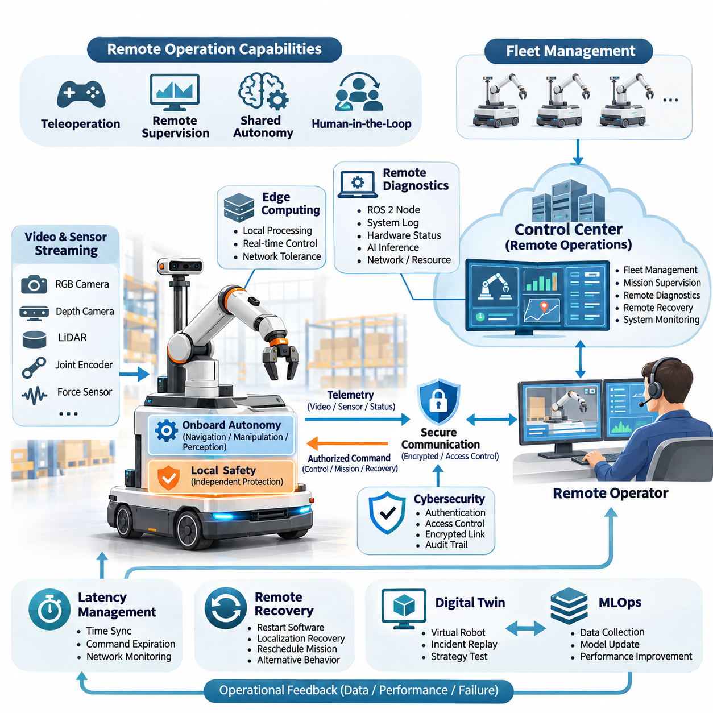
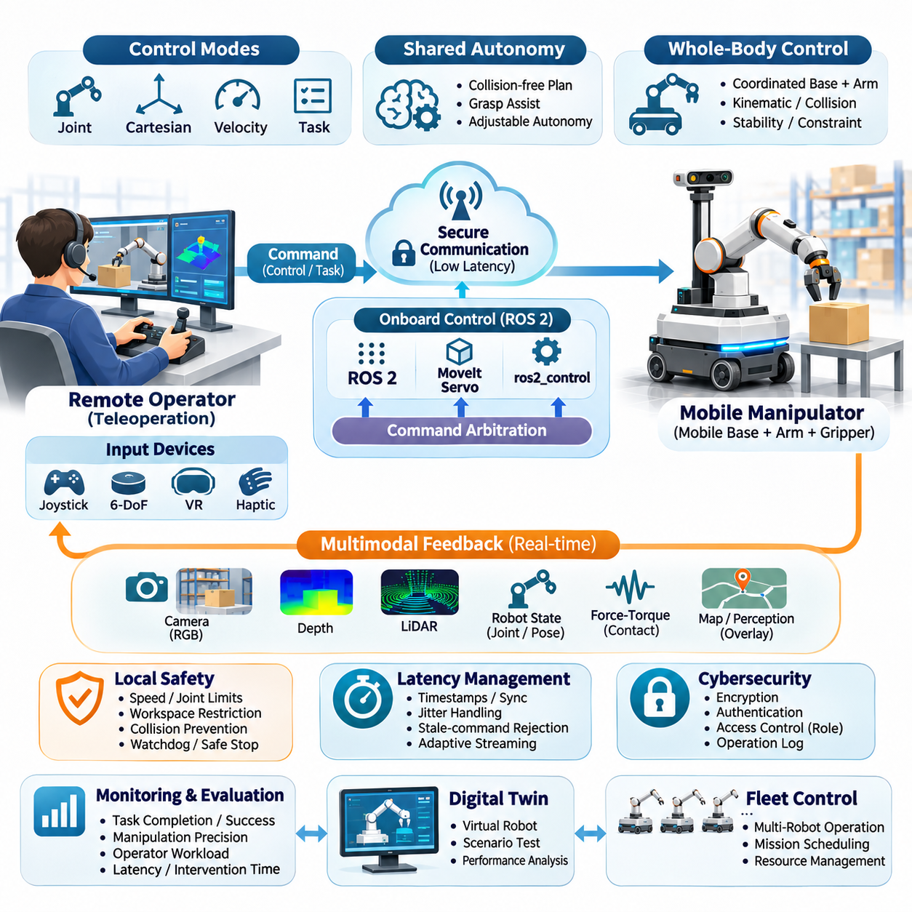
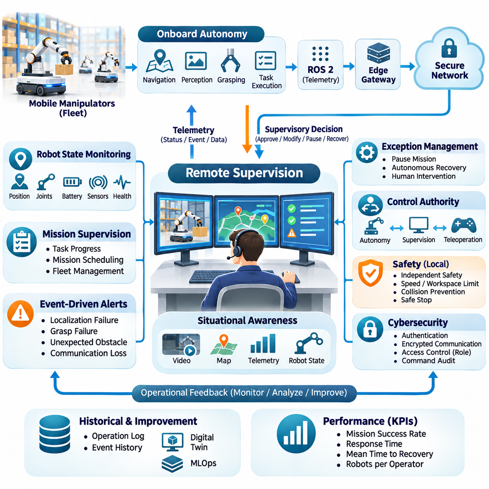
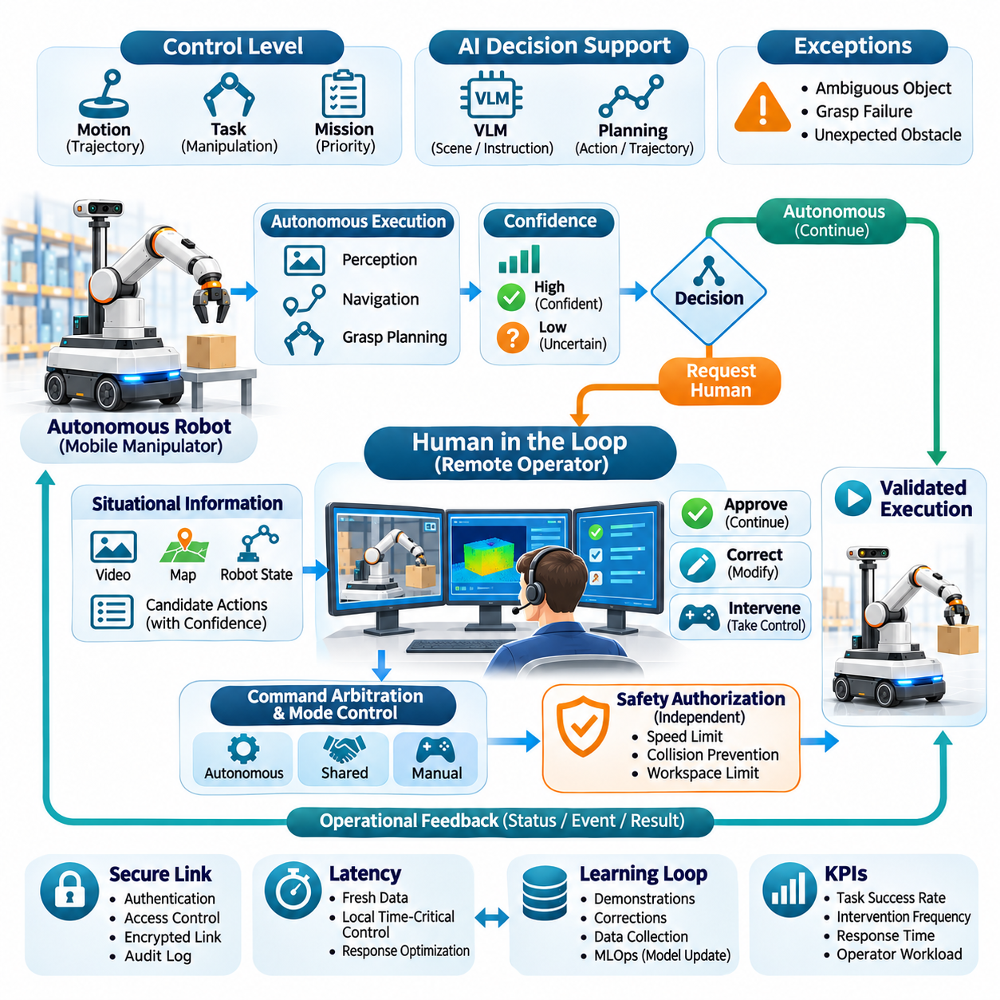
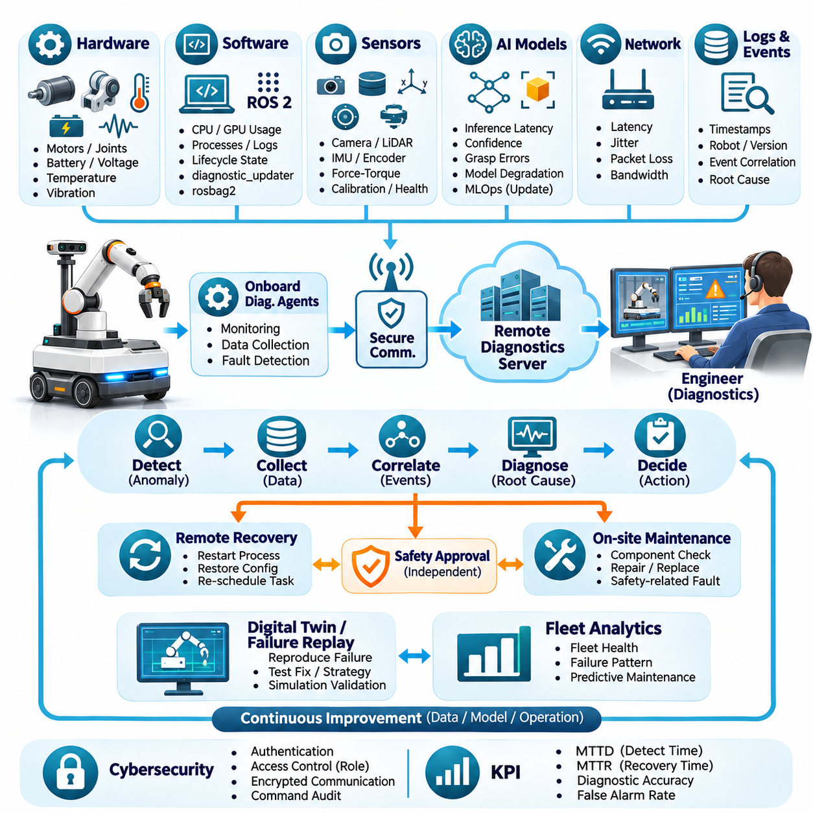
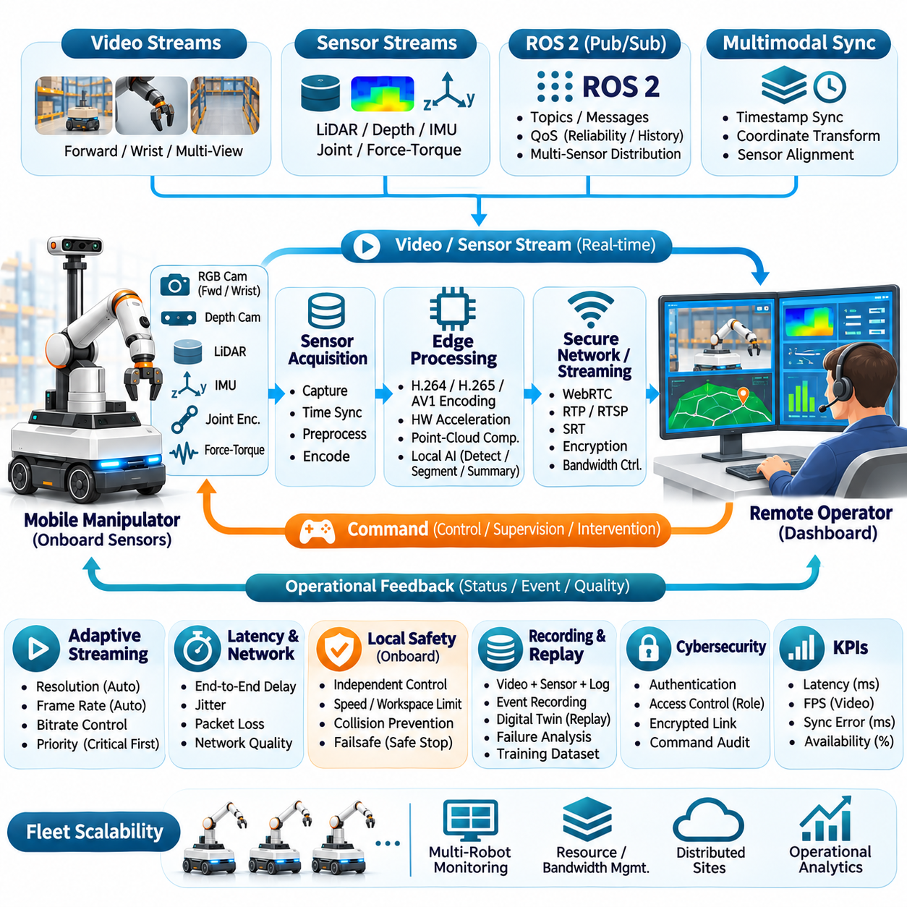
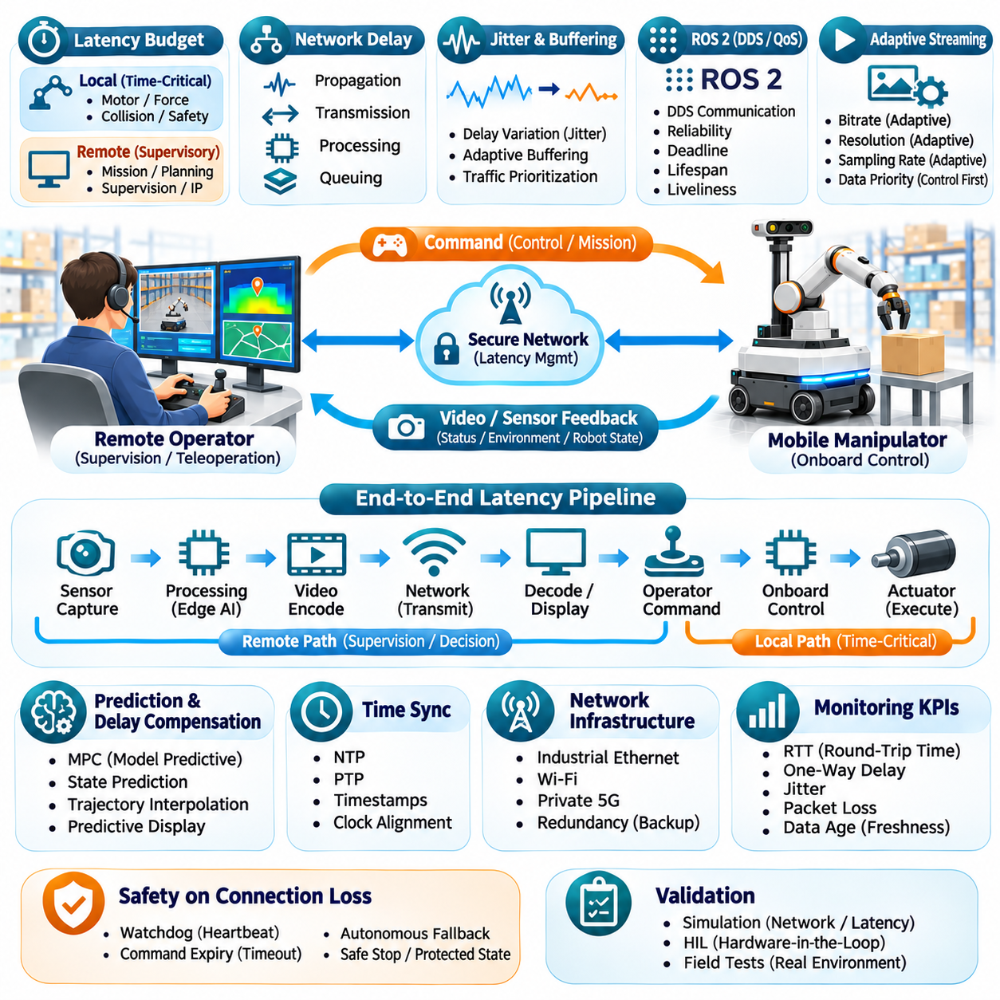
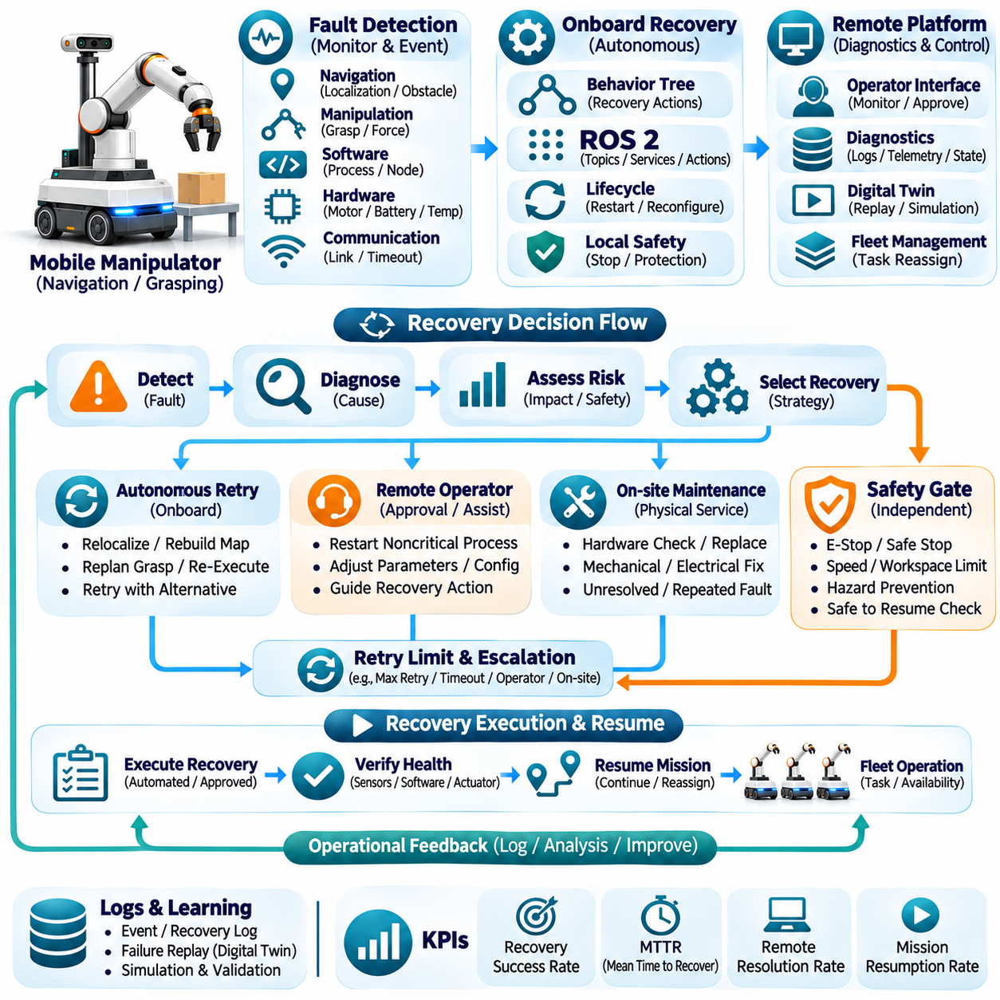
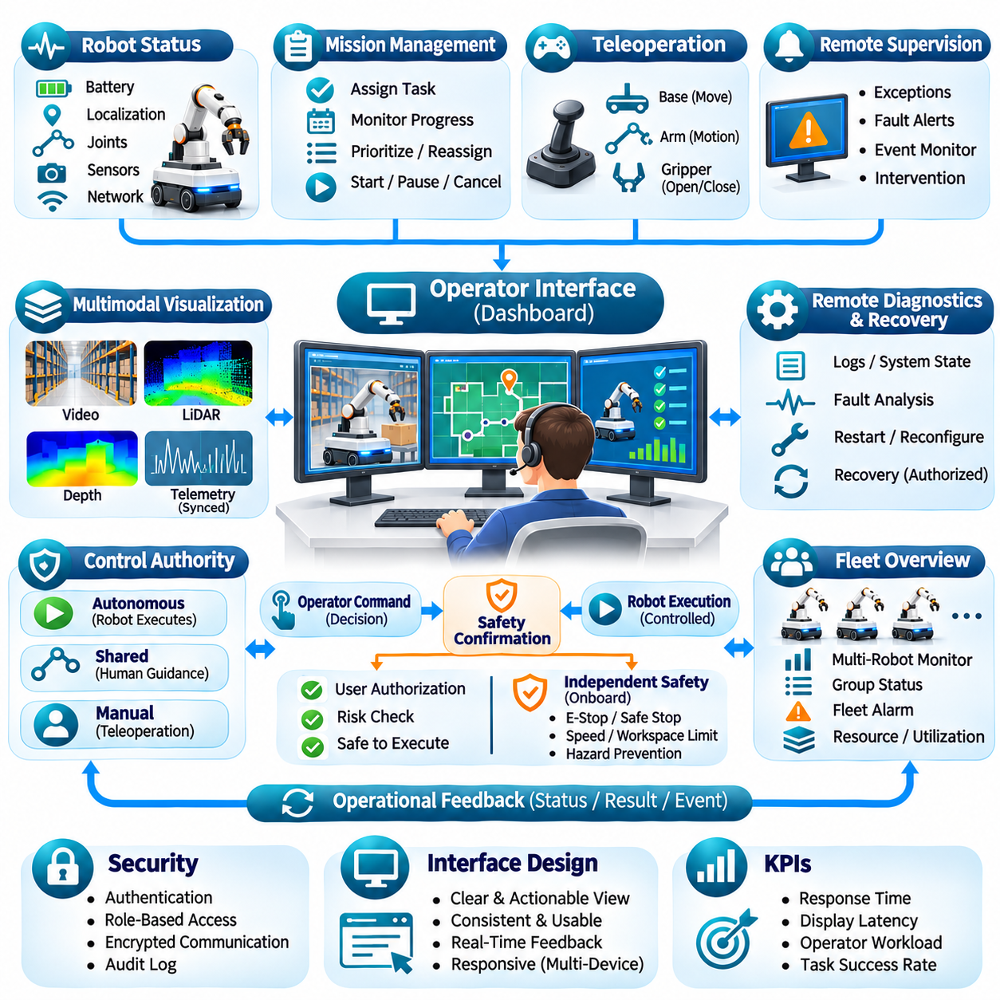
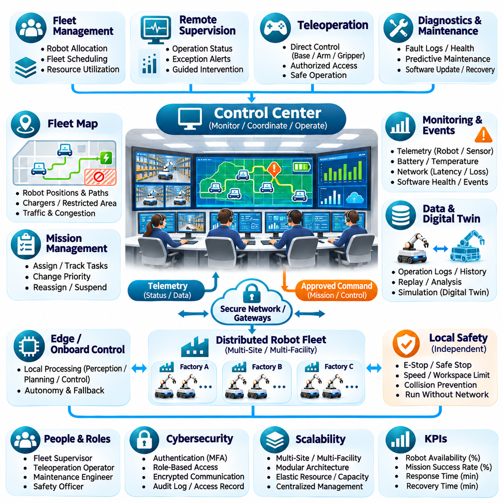

**Volume 04. Mobile Manipulation Software and Operations**


# Chapter 10. Remote Operations

##  

## 01 Remote Operations Overview

{width="7.268055555555556in" height="7.268055555555556in"}

Remote operations represent a fundamental component of modern mobile manipulation systems, enabling robots to be monitored, controlled, diagnosed, and managed from geographically distributed locations. By integrating autonomous capabilities with remote human supervision, organizations can improve operational reliability, reduce on-site staffing requirements, and maintain continuous robotic services across industrial, logistics, healthcare, and commercial environments.

Unlike conventional industrial robots operating within fixed and structured workspaces, mobile manipulators navigate dynamic environments while performing complex physical interaction tasks. These operating conditions introduce uncertainties associated with localization, environmental perception, object manipulation, and human interaction. Remote operations provide an additional management layer for addressing situations that exceed the capabilities of autonomous systems.

The architecture of remote operations typically consists of onboard robot controllers, communication infrastructure, edge computing platforms, centralized management servers, and operator interfaces. Onboard systems execute navigation, manipulation, perception, and safety functions, while remote platforms provide mission supervision, performance monitoring, diagnostic analysis, and authorized intervention. This distributed architecture supports scalable robot operations.

Remote operation capabilities can be classified into direct teleoperation, supervisory control, shared autonomy, and exception-based intervention. Direct teleoperation allows human operators to control robot movements remotely, whereas supervisory control enables robots to execute autonomous missions under human oversight. Shared autonomy combines intelligent robotic behavior with human guidance to achieve reliable task execution in uncertain environments.

Teleoperation is particularly valuable when mobile manipulators encounter unfamiliar objects, unexpected obstacles, or manipulation scenarios that cannot be resolved through autonomous planning. Operators may remotely control the mobile base, robotic arm, and end effector using joysticks, graphical interfaces, or motion-tracking devices. Local collision avoidance and motion constraints remain important during remotely controlled operations.

Remote supervision emphasizes monitoring rather than continuous manual control. Operators observe robot locations, mission progress, battery conditions, manipulation states, communication quality, and system health through centralized dashboards. When abnormal conditions occur, the supervisory platform generates notifications and allows authorized personnel to initiate appropriate corrective actions without interrupting unaffected robots.

Human-in-the-loop control establishes a collaborative operational framework in which human intelligence complements autonomous decision-making. Artificial intelligence systems may identify candidate objects, generate grasping strategies, or recommend recovery actions, while human operators validate uncertain decisions. This approach improves operational flexibility without requiring continuous manual control of every robotic function.

Remote diagnostics enable engineers to investigate software, hardware, communication, and artificial intelligence failures without physically accessing the robot. Diagnostic information may include ROS 2 node states, system logs, actuator feedback, sensor measurements, inference results, network statistics, and computational resource utilization. Historical records help identify recurring failures and distinguish temporary anomalies from persistent defects.

Video and sensor streaming provide the situational awareness required for effective remote decision-making. RGB cameras, depth cameras, LiDAR sensors, joint encoders, and force-torque sensors supply complementary information about the robot and its surroundings. Adaptive compression, selective transmission, and bandwidth allocation help maintain useful environmental feedback while avoiding excessive network utilization.

Communication latency represents a significant challenge because delayed commands and outdated sensor information can produce inaccurate operator decisions. Network congestion, wireless interference, packet loss, and communication distance influence remote control performance. Latency management therefore requires timestamp synchronization, command expiration, network quality monitoring, and appropriate allocation of control responsibilities between onboard and remote systems.

Edge computing plays a critical role in maintaining operational stability during network degradation. Time-sensitive perception, motion control, collision avoidance, and protective functions should remain within the local robotic architecture. Remote platforms primarily handle higher-level decisions and operational coordination. When communication is interrupted, predefined onboard behaviors should bring the robot into an appropriate safe or controlled state.

Remote recovery mechanisms allow operators to address selected operational failures without immediately dispatching field service personnel. Recovery procedures may include restarting non-safety-critical software components, requesting localization recovery, rescheduling missions, or executing validated alternative behaviors. Physical obstructions, mechanical damage, and safety-related failures may still require qualified on-site intervention.

Safety and cybersecurity must be incorporated throughout the remote operations architecture. Authentication, encrypted communication, role-based access control, command authorization, and operational audit trails help prevent unauthorized interventions. Independent local safety mechanisms must retain authority over hazardous robot movements, and remote commands must not bypass protective functions or validated operating boundaries.

Operator interfaces and centralized control centers provide the foundation for scalable multi-robot supervision. Their effectiveness depends on intuitive visualization, prioritized alarms, clear control authority, and consistent operational procedures. Performance indicators such as intervention frequency, mean time to recovery, mission completion rate, network availability, and robots supervised per operator support continuous operational improvement.

Ultimately, remote operations transform mobile manipulators from individually deployed machines into connected robotic services. Integration with fleet management systems, digital twins, simulation platforms, MLOps pipelines, and maintenance infrastructure creates a unified operational ecosystem. The objective is to maximize autonomous productivity while preserving human oversight, operational resilience, cybersecurity, and physical safety throughout the robotic lifecycle.

원격 운영(Remote Operations)은 현대 모바일 매니퓰레이션 시스템(Mobile Manipulation System)의 핵심 구성 요소로, 지리적으로 분산된 위치에서 로봇을 모니터링하고 제어하며, 진단하고 관리할 수 있도록 한다. 자율 기능(Autonomous Capability)과 원격 인간 감독(Remote Human Supervision)을 통합함으로써 조직은 운영 신뢰성(Operational Reliability)을 향상시키고, 현장 인력 요구를 줄이며, 산업, 물류, 의료 및 상업 환경에서 지속적인 로봇 서비스를 유지할 수 있다.

고정되고 구조화된 작업 공간(Workspace)에서 작동하는 기존 산업용 로봇(Industrial Robot)과 달리, 모바일 매니퓰레이터(Mobile Manipulator)는 동적인 환경에서 이동하면서 복잡한 물리적 상호작용 작업을 수행한다. 이러한 운영 조건은 위치 추정(Localization), 환경 인식(Environmental Perception), 객체 조작(Object Manipulation) 및 인간 상호작용(Human Interaction)과 관련된 불확실성을 발생시킨다. 원격 운영은 자율 시스템(Autonomous System)의 처리 능력을 초과하는 상황에 대응하기 위한 추가적인 관리 계층(Management Layer)을 제공한다.

원격 운영 아키텍처(Remote Operations Architecture)는 일반적으로 온보드 로봇 제어기(Onboard Robot Controller), 통신 인프라(Communication Infrastructure), 엣지 컴퓨팅 플랫폼(Edge Computing Platform), 중앙 집중식 관리 서버(Centralized Management Server) 및 운영자 인터페이스(Operator Interface)로 구성된다. 온보드 시스템(Onboard System)은 자율주행(Navigation), 조작(Manipulation), 인식(Perception) 및 안전 기능(Safety Function)을 실행하며, 원격 플랫폼(Remote Platform)은 임무 감독(Mission Supervision), 성능 모니터링(Performance Monitoring), 진단 분석(Diagnostic Analysis) 및 승인된 개입(Authorized Intervention)을 제공한다. 이러한 분산 아키텍처(Distributed Architecture)는 확장 가능한 로봇 운영을 지원한다.

원격 운영 기능(Remote Operation Capability)은 직접 원격 제어(Direct Teleoperation), 감독 제어(Supervisory Control), 공유 자율성(Shared Autonomy) 및 예외 기반 개입(Exception-Based Intervention)으로 분류할 수 있다. 직접 원격 제어는 인간 운영자가 원격으로 로봇의 움직임을 제어할 수 있도록 하며, 감독 제어는 인간의 감독하에서 로봇이 자율적으로 임무를 수행할 수 있도록 한다. 공유 자율성은 지능형 로봇 행동(Intelligent Robotic Behavior)과 인간의 지침(Human Guidance)을 결합하여 불확실한 환경에서도 신뢰성 높은 작업 수행을 가능하게 한다.

원격 제어(Teleoperation)는 모바일 매니퓰레이터가 익숙하지 않은 객체, 예상하지 못한 장애물 또는 자율 계획(Autonomous Planning)을 통해 해결하기 어려운 조작 상황에 직면했을 때 특히 유용하다. 운영자는 조이스틱(Joystick), 그래픽 인터페이스(Graphical Interface) 또는 동작 추적 장치(Motion-Tracking Device)를 사용하여 이동 베이스(Mobile Base), 로봇 암(Robotic Arm) 및 말단 장치(End Effector)를 원격으로 제어할 수 있다. 원격으로 제어되는 작업에서도 로컬 충돌 회피(Local Collision Avoidance)와 동작 제약 조건(Motion Constraint)은 여전히 중요하다.

원격 감독(Remote Supervision)은 지속적인 수동 제어(Manual Control)보다 모니터링(Monitoring)에 중점을 둔다. 운영자는 중앙 집중식 대시보드(Centralized Dashboard)를 통해 로봇의 위치, 임무 진행 상황(Mission Progress), 배터리 상태(Battery Condition), 조작 상태(Manipulation State), 통신 품질(Communication Quality) 및 시스템 건전성(System Health)을 확인한다. 비정상적인 상황이 발생하면 감독 플랫폼(Supervisory Platform)은 알림(Notification)을 생성하고, 승인된 인력이 영향을 받지 않은 다른 로봇의 운영을 중단하지 않으면서 적절한 시정 조치(Corrective Action)를 수행할 수 있도록 한다.

인간 참여형 제어(Human-in-the-Loop Control)는 인간의 지능(Human Intelligence)이 자율 의사결정(Autonomous Decision-Making)을 보완하는 협업 운영 프레임워크(Collaborative Operational Framework)를 구축한다. 인공지능 시스템(Artificial Intelligence System)은 후보 객체(Candidate Object)를 식별하고, 파지 전략(Grasping Strategy)을 생성하거나 복구 조치(Recovery Action)를 추천할 수 있으며, 인간 운영자는 불확실한 의사결정을 검증한다. 이러한 접근 방식은 모든 로봇 기능에 대한 지속적인 수동 제어 없이도 운영 유연성(Operational Flexibility)을 향상시킨다.

원격 진단(Remote Diagnostics)은 엔지니어가 로봇에 물리적으로 접근하지 않고도 소프트웨어, 하드웨어, 통신 및 인공지능 관련 장애를 조사할 수 있도록 한다. 진단 정보(Diagnostic Information)에는 ROS 2 노드 상태(Node State), 시스템 로그(System Log), 액추에이터 피드백(Actuator Feedback), 센서 측정값(Sensor Measurement), 추론 결과(Inference Result), 네트워크 통계(Network Statistics) 및 컴퓨팅 자원 활용률(Computational Resource Utilization)이 포함될 수 있다. 과거 기록(Historical Record)은 반복적으로 발생하는 장애를 식별하고 일시적인 이상 현상과 지속적인 결함을 구분하는 데 도움을 준다.

영상 및 센서 스트리밍(Video and Sensor Streaming)은 효과적인 원격 의사결정(Remote Decision-Making)에 필요한 상황 인식(Situational Awareness)을 제공한다. RGB 카메라(RGB Camera), 깊이 카메라(Depth Camera), 라이다 센서(LiDAR Sensor), 관절 엔코더(Joint Encoder) 및 힘·토크 센서(Force-Torque Sensor)는 로봇과 주변 환경에 대한 상호 보완적인 정보를 제공한다. 적응형 압축(Adaptive Compression), 선택적 전송(Selective Transmission) 및 대역폭 할당(Bandwidth Allocation)은 과도한 네트워크 사용을 방지하면서 유용한 환경 피드백(Environmental Feedback)을 유지하는 데 도움을 준다.

통신 지연(Communication Latency)은 지연된 제어 명령과 오래된 센서 정보가 운영자의 부정확한 의사결정을 유발할 수 있다는 점에서 중요한 해결 과제이다. 네트워크 혼잡(Network Congestion), 무선 간섭(Wireless Interference), 패킷 손실(Packet Loss) 및 통신 거리(Communication Distance)는 원격 제어 성능에 영향을 미친다. 따라서 지연 관리(Latency Management)는 타임스탬프 동기화(Timestamp Synchronization), 명령 유효기간 설정(Command Expiration), 네트워크 품질 모니터링(Network Quality Monitoring) 및 온보드 시스템과 원격 시스템 간의 적절한 제어 책임 분담을 요구한다.

엣지 컴퓨팅(Edge Computing)은 네트워크 성능 저하(Network Degradation) 상황에서 운영 안정성(Operational Stability)을 유지하는 데 핵심적인 역할을 수행한다. 시간 민감형 인식(Time-Sensitive Perception), 동작 제어(Motion Control), 충돌 회피(Collision Avoidance) 및 보호 기능(Protective Function)은 로컬 로봇 아키텍처(Local Robotic Architecture) 내부에 유지되어야 한다. 원격 플랫폼은 주로 상위 수준 의사결정(High-Level Decision-Making)과 운영 조정(Operational Coordination)을 담당한다. 통신이 중단되면 사전에 정의된 온보드 행동(Onboard Behavior)을 통해 로봇이 적절한 안전 상태(Safe State) 또는 제어된 상태(Controlled State)에 진입하도록 해야 한다.

원격 복구 메커니즘(Remote Recovery Mechanism)은 현장 서비스 인력(Field Service Personnel)을 즉시 파견하지 않고도 운영자가 특정 운영 장애에 대응할 수 있도록 한다. 복구 절차(Recovery Procedure)에는 안전에 직접적으로 영향을 미치지 않는 소프트웨어 구성 요소의 재시작, 위치 추정 복구(Localization Recovery) 요청, 임무 재스케줄링(Mission Rescheduling) 또는 검증된 대체 행동(Alternative Behavior)의 실행 등이 포함될 수 있다. 물리적 장애물(Physical Obstruction), 기계적 손상(Mechanical Damage) 및 안전 관련 장애(Safety-Related Failure)는 여전히 자격을 갖춘 현장 인력의 개입을 필요로 할 수 있다.

안전(Safety)과 사이버 보안(Cybersecurity)은 원격 운영 아키텍처 전반에 걸쳐 통합되어야 한다. 인증(Authentication), 암호화 통신(Encrypted Communication), 역할 기반 접근 제어(Role-Based Access Control), 명령 권한 부여(Command Authorization) 및 운영 감사 기록(Operational Audit Trail)은 승인되지 않은 개입을 방지하는 데 도움을 준다. 독립적인 로컬 안전 메커니즘(Local Safety Mechanism)은 위험한 로봇 움직임에 대한 제어 권한을 유지해야 하며, 원격 명령(Remote Command)은 보호 기능이나 검증된 운영 경계(Validated Operating Boundary)를 우회해서는 안 된다.

운영자 인터페이스(Operator Interface)와 중앙 집중식 관제 센터(Centralized Control Center)는 확장 가능한 다중 로봇 감독(Multi-Robot Supervision)의 기반을 제공한다. 이러한 시스템의 효과는 직관적인 시각화(Intuitive Visualization), 우선순위 기반 경보(Prioritized Alarm), 명확한 제어 권한(Control Authority) 및 일관된 운영 절차(Operational Procedure)에 따라 결정된다. 개입 빈도(Intervention Frequency), 평균 복구 시간(Mean Time to Recovery), 임무 완료율(Mission Completion Rate), 네트워크 가용성(Network Availability) 및 운영자 1인당 감독 로봇 수(Robots Supervised per Operator)와 같은 성능 지표(Performance Indicator)는 지속적인 운영 개선을 지원한다.

궁극적으로 원격 운영은 모바일 매니퓰레이터를 개별적으로 배치된 기계에서 상호 연결된 로봇 서비스(Connected Robotic Service)로 전환한다. 로봇군 관리 시스템(Fleet Management System), 디지털 트윈(Digital Twin), 시뮬레이션 플랫폼(Simulation Platform), 머신러닝 운영 파이프라인(MLOps Pipeline) 및 유지보수 인프라(Maintenance Infrastructure)와의 통합은 일원화된 운영 생태계(Unified Operational Ecosystem)를 구축한다. 궁극적인 목표는 로봇의 전체 생애주기(Robotic Lifecycle)에 걸쳐 인간 감독(Human Oversight), 운영 복원력(Operational Resilience), 사이버 보안(Cybersecurity) 및 물리적 안전(Physical Safety)을 유지하면서 자율 운영 생산성(Autonomous Productivity)을 극대화하는 것이다.

##  

## 02 Teleoperation

{width="7.268055555555556in" height="7.268055555555556in"}

Teleoperation is a remote control methodology that enables human operators to directly or indirectly control robotic systems from geographically separated locations. In mobile manipulation, teleoperation encompasses the control of mobile platforms, robotic arms, end effectors, and associated sensing systems. It provides an essential operational capability when autonomous intelligence cannot independently resolve complex or unexpected situations.

The primary objective of teleoperation is to extend human perception, decision-making, and physical manipulation capabilities beyond the operator\'s immediate environment. By combining robotic mobility with dexterous manipulation, remote operators can perform object handling, equipment inspection, material transportation, and maintenance tasks in environments that may be inaccessible, hazardous, or unsuitable for continuous human presence.

A typical teleoperation architecture consists of an operator station, communication network, onboard control system, perception modules, and robotic actuators. The operator station generates control commands, while the onboard system interprets these commands and executes corresponding movements. Visual, positional, and force feedback are continuously transmitted to the operator, establishing a closed-loop human-machine control system.

Teleoperation can be implemented through joint-space control, Cartesian-space control, velocity control, or task-level commands. Joint-space control enables operators to manipulate individual robot joints, whereas Cartesian-space control specifies the desired position and orientation of the end effector. Velocity control is frequently used for mobile platforms, while task-level commands provide a more abstract interaction mechanism.

Input devices significantly influence teleoperation accuracy, responsiveness, and operator workload. Conventional interfaces include joysticks, game controllers, keyboards, and touchscreens. Advanced systems may incorporate six-degree-of-freedom controllers, motion capture devices, virtual reality headsets, and haptic interfaces. Device selection depends on task complexity, required manipulation precision, and operational conditions.

Mobile manipulator teleoperation requires coordinated control of the mobile base and robotic arm. Independent control may simplify implementation but increase operator workload during complex manipulation tasks. Whole-body control can coordinate base movement and arm configuration while respecting kinematic constraints, collision boundaries, stability requirements, and the desired position and orientation of the end effector.

In ROS 2-based systems, teleoperation commands can be distributed through topics, services, and actions. Mobile base velocity commands are commonly represented using geometry_msgs/Twist messages, while robotic arm movements may be managed through MoveIt Servo and ros2_control interfaces. Command arbitration mechanisms prevent conflicting instructions from autonomous planners, remote operators, and other control sources.

Situational awareness is essential for successful teleoperation because remote operators cannot directly observe the physical environment. Multiple camera perspectives, depth information, LiDAR maps, robot configuration data, and graphical overlays help operators understand spatial relationships. Wrist-mounted cameras are particularly useful for precise manipulation, while external cameras provide broader environmental awareness.

Communication performance directly affects the stability and usability of teleoperation systems. End-to-end latency, jitter, packet loss, and limited bandwidth can degrade the relationship between operator commands and robot responses. Time synchronization, command timestamps, adaptive video streaming, and stale-command rejection help reduce communication-related risks and improve consistency across distributed operating environments.

Haptic feedback extends teleoperation beyond conventional visual observation by transmitting information about contact forces, resistance, and physical interaction. Force-torque sensors mounted on robotic wrists or end effectors provide measurements that can be translated into tactile or force feedback at the operator station. Bilateral control systems must address communication delays to maintain stable physical interactions.

Shared autonomy combines human teleoperation with onboard robotic intelligence to reduce operator workload and improve execution quality. The operator may specify a target object or desired movement, while autonomous algorithms calculate collision-free trajectories, regulate grasping forces, or maintain end-effector alignment. Adjustable autonomy levels enable the system to accommodate different tasks and environmental uncertainties.

Safety mechanisms must remain active throughout teleoperation regardless of the operator\'s control authority. Local protective functions should enforce validated speed limits, workspace restrictions, joint limits, stability constraints, and collision prevention requirements. Communication watchdogs, enabling devices, and appropriate stopping behaviors help mitigate hazardous motion caused by connection failures or unintended commands.

Cybersecurity is equally important because teleoperation interfaces provide access to physical robotic capabilities. Encrypted communication, mutual authentication, session management, role-based access control, and command validation help prevent unauthorized manipulation. Operational logs should record operator identities, control transitions, commands, and abnormal events to support incident investigation and accountability.

Teleoperation performance should be evaluated using quantitative indicators such as task completion time, manipulation accuracy, success rate, intervention duration, communication latency, and operator workload. Simulation environments and digital twins allow engineers to evaluate control interfaces and recovery procedures before physical deployment. Recorded demonstrations can also support imitation learning and subsequent improvements in autonomous behavior, subject to data validation.

Industrial teleoperation is increasingly important in warehouses, manufacturing facilities, healthcare environments, infrastructure inspection, and hazardous material handling. Rather than replacing autonomous operation, teleoperation provides a complementary capability for addressing operational exceptions. Integration with fleet management systems and centralized control centers enables authorized operators to supervise multiple robots and selectively intervene when necessary.

The long-term objective of teleoperation is to minimize continuous manual intervention while maintaining reliable human control whenever required. Advances in artificial intelligence, multimodal perception, shared autonomy, edge computing, and communication technologies are supporting this transition. Effective teleoperation architecture therefore balances operational efficiency, human-machine interaction, communication resilience, cybersecurity, and physical safety.

원격 조작(Teleoperation)은 인간 운영자(Human Operator)가 지리적으로 떨어진 위치에서 로봇 시스템(Robotic System)을 직접 또는 간접적으로 제어할 수 있도록 하는 원격 제어 방법론(Remote Control Methodology)이다. 모바일 매니퓰레이션(Mobile Manipulation)에서 원격 조작은 이동 플랫폼(Mobile Platform), 로봇 암(Robotic Arm), 말단 장치(End Effector) 및 관련 센싱 시스템(Sensing System)의 제어를 포함한다. 이는 자율 지능(Autonomous Intelligence)이 복잡하거나 예상하지 못한 상황을 독립적으로 해결할 수 없을 때 필수적인 운영 기능(Operational Capability)을 제공한다.

원격 조작의 주요 목적은 인간의 인식(Perception), 의사결정(Decision-Making) 및 물리적 조작 능력(Physical Manipulation Capability)을 운영자의 직접적인 주변 환경을 넘어 확장하는 것이다. 로봇 이동성(Robotic Mobility)과 정교한 조작(Dexterous Manipulation)을 결합함으로써 원격 운영자는 접근이 어렵거나 위험하거나 인간이 지속적으로 머무르기 어려운 환경에서 객체 취급(Object Handling), 장비 검사(Equipment Inspection), 자재 운송(Material Transportation) 및 유지보수(Maintenance) 작업을 수행할 수 있다.

일반적인 원격 조작 아키텍처(Teleoperation Architecture)는 운영자 스테이션(Operator Station), 통신 네트워크(Communication Network), 온보드 제어 시스템(Onboard Control System), 인식 모듈(Perception Module) 및 로봇 액추에이터(Robotic Actuator)로 구성된다. 운영자 스테이션은 제어 명령(Control Command)을 생성하며, 온보드 시스템(Onboard System)은 이러한 명령을 해석하고 그에 상응하는 움직임을 실행한다. 시각, 위치 및 힘 피드백(Visual, Positional, and Force Feedback)은 운영자에게 지속적으로 전송되어 폐루프 인간-기계 제어 시스템(Closed-Loop Human-Machine Control System)을 형성한다.

원격 조작은 관절 공간 제어(Joint-Space Control), 데카르트 공간 제어(Cartesian-Space Control), 속도 제어(Velocity Control) 또는 작업 수준 명령(Task-Level Command)을 통해 구현할 수 있다. 관절 공간 제어는 운영자가 개별 로봇 관절을 조작할 수 있도록 하며, 데카르트 공간 제어는 말단 장치의 목표 위치(Position)와 방향(Orientation)을 지정한다. 속도 제어는 이동 플랫폼에서 빈번하게 사용되며, 작업 수준 명령은 더욱 추상화된 상호작용 메커니즘(Interaction Mechanism)을 제공한다.

입력 장치(Input Device)는 원격 조작의 정확도(Accuracy), 응답성(Responsiveness) 및 운영자 작업 부하(Operator Workload)에 상당한 영향을 미친다. 일반적인 인터페이스에는 조이스틱(Joystick), 게임 컨트롤러(Game Controller), 키보드(Keyboard) 및 터치스크린(Touchscreen)이 포함된다. 고급 시스템은 6자유도 제어기(Six-Degree-of-Freedom Controller), 동작 캡처 장치(Motion Capture Device), 가상현실 헤드셋(Virtual Reality Headset) 및 햅틱 인터페이스(Haptic Interface)를 통합할 수 있다. 장치의 선정은 작업 복잡성(Task Complexity), 요구되는 조작 정밀도(Manipulation Precision) 및 운영 조건(Operational Condition)에 따라 결정된다.

모바일 매니퓰레이터의 원격 조작은 이동 베이스(Mobile Base)와 로봇 암(Robotic Arm)의 협조 제어(Coordinated Control)를 필요로 한다. 독립 제어(Independent Control)는 시스템 구현을 단순화할 수 있지만, 복잡한 조작 작업에서 운영자의 작업 부하를 증가시킬 수 있다. 전신 제어(Whole-Body Control)는 기구학적 제약 조건(Kinematic Constraint), 충돌 경계(Collision Boundary), 안정성 요구사항(Stability Requirement) 및 말단 장치의 목표 위치와 방향을 고려하면서 이동 베이스의 움직임과 로봇 암의 구성(Robot Arm Configuration)을 조정할 수 있다.

ROS 2 기반 시스템에서 원격 조작 명령(Teleoperation Command)은 토픽(Topic), 서비스(Service) 및 액션(Action)을 통해 전달할 수 있다. 이동 베이스의 속도 명령(Velocity Command)은 일반적으로 geometry_msgs/Twist 메시지를 사용하여 표현하며, 로봇 암의 움직임은 MoveIt Servo 및 ros2_control 인터페이스를 통해 관리할 수 있다. 명령 중재 메커니즘(Command Arbitration Mechanism)은 자율 계획기(Autonomous Planner), 원격 운영자(Remote Operator) 및 기타 제어 소스(Control Source)에서 발생하는 명령 간의 충돌을 방지한다.

상황 인식(Situational Awareness)은 원격 운영자가 물리적 환경(Physical Environment)을 직접 관찰할 수 없다는 점에서 성공적인 원격 조작에 필수적이다. 다중 카메라 시점(Multiple Camera Perspective), 깊이 정보(Depth Information), 라이다 지도(LiDAR Map), 로봇 구성 데이터(Robot Configuration Data) 및 그래픽 오버레이(Graphical Overlay)는 운영자가 공간적 관계(Spatial Relationship)를 이해하는 데 도움을 준다. 손목 장착형 카메라(Wrist-Mounted Camera)는 정밀 조작(Precise Manipulation)에 특히 유용하며, 외부 카메라(External Camera)는 더욱 광범위한 환경 인식(Environmental Awareness)을 제공한다.

통신 성능(Communication Performance)은 원격 조작 시스템의 안정성(Stability)과 사용성(Usability)에 직접적인 영향을 미친다. 종단 간 지연(End-to-End Latency), 지터(Jitter), 패킷 손실(Packet Loss) 및 제한된 대역폭(Limited Bandwidth)은 운영자의 명령과 로봇 응답 간의 연계성을 저하시킬 수 있다. 시간 동기화(Time Synchronization), 명령 타임스탬프(Command Timestamp), 적응형 영상 스트리밍(Adaptive Video Streaming) 및 오래된 명령의 거부(Stale-Command Rejection)는 통신 관련 위험을 줄이고 분산 운영 환경(Distributed Operating Environment) 전반의 일관성을 향상시키는 데 도움을 준다.

햅틱 피드백(Haptic Feedback)은 접촉력(Contact Force), 저항(Resistance) 및 물리적 상호작용(Physical Interaction)에 관한 정보를 전달함으로써 원격 조작의 범위를 기존의 시각적 관찰(Visual Observation) 이상으로 확장한다. 로봇 손목이나 말단 장치에 장착된 힘·토크 센서(Force-Torque Sensor)는 운영자 스테이션에서 촉각 또는 힘 피드백(Tactile or Force Feedback)으로 변환할 수 있는 측정값을 제공한다. 양방향 제어 시스템(Bilateral Control System)은 안정적인 물리적 상호작용을 유지하기 위해 통신 지연 문제를 해결해야 한다.

공유 자율성(Shared Autonomy)은 인간의 원격 조작과 온보드 로봇 지능(Onboard Robotic Intelligence)을 결합하여 운영자의 작업 부하를 줄이고 실행 품질(Execution Quality)을 향상시킨다. 운영자는 목표 객체(Target Object) 또는 원하는 움직임을 지정하고, 자율 알고리즘(Autonomous Algorithm)은 충돌 없는 궤적(Collision-Free Trajectory)을 계산하거나 파지력(Grasping Force)을 조절하고 말단 장치의 정렬(End-Effector Alignment)을 유지할 수 있다. 조절 가능한 자율성 수준(Adjustable Autonomy Level)은 시스템이 다양한 작업과 환경적 불확실성(Environmental Uncertainty)에 대응할 수 있도록 한다.

안전 메커니즘(Safety Mechanism)은 운영자의 제어 권한(Control Authority)과 관계없이 원격 조작 전반에 걸쳐 활성화된 상태로 유지되어야 한다. 로컬 보호 기능(Local Protective Function)은 검증된 속도 제한(Speed Limit), 작업 공간 제한(Workspace Restriction), 관절 한계(Joint Limit), 안정성 제약 조건(Stability Constraint) 및 충돌 방지 요구사항(Collision Prevention Requirement)을 강제해야 한다. 통신 감시 장치(Communication Watchdog), 인에이블링 장치(Enabling Device) 및 적절한 정지 동작(Stopping Behavior)은 연결 장애(Connection Failure) 또는 의도하지 않은 명령(Unintended Command)으로 인해 발생하는 위험한 움직임을 완화하는 데 도움을 준다.

원격 조작 인터페이스는 로봇의 물리적 기능(Physical Robotic Capability)에 대한 접근을 제공하므로 사이버 보안(Cybersecurity) 역시 중요하다. 암호화 통신(Encrypted Communication), 상호 인증(Mutual Authentication), 세션 관리(Session Management), 역할 기반 접근 제어(Role-Based Access Control) 및 명령 검증(Command Validation)은 승인되지 않은 조작을 방지하는 데 도움을 준다. 운영 로그(Operational Log)는 사고 조사(Incident Investigation)와 책임 추적성(Accountability)을 지원하기 위해 운영자 신원(Operator Identity), 제어 권한 전환(Control Transition), 명령 및 비정상 이벤트(Abnormal Event)를 기록해야 한다.

원격 조작 성능(Teleoperation Performance)은 작업 완료 시간(Task Completion Time), 조작 정확도(Manipulation Accuracy), 성공률(Success Rate), 개입 지속 시간(Intervention Duration), 통신 지연(Communication Latency) 및 운영자 작업 부하(Operator Workload)와 같은 정량적 지표(Quantitative Indicator)를 사용하여 평가해야 한다. 시뮬레이션 환경(Simulation Environment)과 디지털 트윈(Digital Twin)은 엔지니어가 실제 시스템을 배포하기 전에 제어 인터페이스와 복구 절차(Recovery Procedure)를 평가할 수 있도록 한다. 기록된 시연 데이터(Recorded Demonstration)는 데이터 검증(Data Validation)을 전제로 모방 학습(Imitation Learning)과 후속 자율 행동(Autonomous Behavior)의 개선에도 활용될 수 있다.

산업용 원격 조작(Industrial Teleoperation)은 물류 창고(Warehouse), 제조 시설(Manufacturing Facility), 의료 환경(Healthcare Environment), 인프라 검사(Infrastructure Inspection) 및 위험 물질 취급(Hazardous Material Handling) 분야에서 점점 더 중요해지고 있다. 원격 조작은 자율 운영(Autonomous Operation)을 대체하기보다 운영상 발생하는 예외 상황(Operational Exception)에 대응하기 위한 상호 보완적 기능(Complementary Capability)을 제공한다. 로봇군 관리 시스템(Fleet Management System) 및 중앙 집중식 관제 센터(Centralized Control Center)와의 통합을 통해 승인된 운영자는 여러 로봇을 감독하고 필요한 경우 선택적으로 개입할 수 있다.

원격 조작의 장기적인 목표는 필요한 경우 신뢰성 높은 인간 제어(Human Control)를 유지하면서 지속적인 수동 개입(Manual Intervention)을 최소화하는 것이다. 인공지능(Artificial Intelligence), 멀티모달 인식(Multimodal Perception), 공유 자율성(Shared Autonomy), 엣지 컴퓨팅(Edge Computing) 및 통신 기술(Communication Technology)의 발전은 이러한 전환을 지원하고 있다. 따라서 효과적인 원격 조작 아키텍처(Teleoperation Architecture)는 운영 효율성(Operational Efficiency), 인간-기계 상호작용(Human-Machine Interaction), 통신 복원력(Communication Resilience), 사이버 보안(Cybersecurity) 및 물리적 안전(Physical Safety) 간의 균형을 확보해야 한다.

##  

## 03 Remote Supervision

{width="7.268055555555556in" height="7.268055555555556in"}

Remote supervision is an operational methodology that enables human operators to monitor, evaluate, and coordinate autonomous robotic systems from geographically separated locations. Unlike direct teleoperation, remote supervision emphasizes continuous observation and selective intervention rather than manual control. In mobile manipulation systems, this capability supports reliable autonomous operations across distributed industrial environments.

The fundamental principle of remote supervision is to maintain autonomous task execution while providing human oversight whenever operational uncertainties arise. Mobile manipulators independently perform navigation, object recognition, motion planning, grasping, and task execution within predefined operational boundaries. Human supervisors intervene when abnormal conditions, system failures, or unexpected environmental changes exceed autonomous recovery capabilities.

A remote supervision architecture typically consists of onboard monitoring modules, communication gateways, centralized supervision servers, data storage infrastructure, and operator dashboards. Onboard modules collect operational information and transmit relevant system states to remote platforms. Centralized servers aggregate information from multiple robots, enabling operators to maintain comprehensive awareness of distributed robotic assets.

Robot state monitoring provides essential information about the operational condition of individual mobile manipulators. Monitored parameters include robot position, navigation status, joint configurations, end-effector conditions, battery capacity, actuator temperatures, sensor availability, and computational resource utilization. Continuous monitoring enables supervisors to identify emerging problems before they develop into significant operational failures.

Mission supervision focuses on evaluating task execution and ensuring that robotic activities remain consistent with operational objectives. Supervisors monitor mission assignments, task progress, execution sequences, estimated completion times, and task outcomes. Integration with fleet management systems allows operators to identify delayed missions, unavailable resources, and coordination conflicts that may influence overall productivity.

Event-driven supervision reduces the need for continuous human observation by automatically detecting and reporting significant operational changes. Events may include localization failures, unsuccessful grasping attempts, unexpected obstacles, communication interruptions, or abnormal hardware conditions. Event classification and prioritization help operators distinguish routine notifications from critical situations requiring immediate attention.

Exception management is an essential function of remote supervision because autonomous robots cannot anticipate every possible operating condition. When a predefined exception occurs, the robot may pause its mission, execute a validated recovery behavior, or request human assistance. Supervisors evaluate the available information and determine whether autonomous execution should continue, be modified, or remain suspended until the problem is resolved.

Remote supervision requires reliable situational awareness to support accurate human decision-making. Operator interfaces combine live video, environmental maps, robot positions, manipulation states, sensor measurements, and historical information. Context-aware visualization helps supervisors understand the relationship between robot behavior and environmental conditions without continuously examining every available data stream.

Telemetry infrastructure supports the continuous exchange of operational information between robots and remote supervision platforms. ROS 2-based architectures can collect node diagnostics, topic data, lifecycle states, and application-level events through dedicated monitoring components. Edge gateways aggregate and filter information before transmission, reducing network overhead while preserving essential operational visibility.

Communication reliability influences the effectiveness of distributed supervision systems. Network interruptions, excessive latency, and packet loss can prevent operators from obtaining accurate information about current robot conditions. Heartbeat signals, timestamped telemetry, connection monitoring, and local data buffering help maintain reliable supervision and distinguish genuine robot failures from temporary communication problems.

Human intervention should be governed by clearly defined authority levels and operational procedures. Supervisors may authorize mission cancellation, task reassignment, alternative execution strategies, or transitions into teleoperation mode. Control arbitration mechanisms ensure that supervisory commands do not conflict with autonomous behavior, other operators, or independent safety functions responsible for protecting the physical environment.

Multi-robot supervision enables a single operator to oversee several autonomous mobile manipulators simultaneously. Its scalability depends on robot autonomy, intervention frequency, task complexity, and the effectiveness of automated monitoring. Intelligent alarm management and exception-based workflows help reduce cognitive workload, while appropriate staffing policies ensure that simultaneous incidents can be addressed within acceptable response times.

Safety and cybersecurity requirements must be integrated throughout the remote supervision architecture. Local safety controllers must retain independent authority over hazardous movements, regardless of communication availability or supervisory instructions. Secure authentication, encrypted data transmission, access permissions, and command auditing protect robotic assets against unauthorized supervision and potentially dangerous remote interventions.

Historical operational data provides a valuable foundation for performance analysis and continuous improvement. Mission records, supervisory interventions, diagnostic events, and recovery outcomes can be correlated to identify recurring operational weaknesses. Integration with digital twins, predictive maintenance platforms, and MLOps pipelines enables engineering teams to improve system reliability, autonomous decision-making, and recovery capabilities.

Remote supervision performance should be evaluated through measurable indicators such as mission completion rate, intervention frequency, alarm response time, mean time to recovery, supervision availability, and the number of robots managed per operator. These indicators help organizations assess operational scalability, identify supervision bottlenecks, optimize staffing requirements, and establish appropriate service-level objectives.

Ultimately, remote supervision provides the organizational and technological foundation for scalable autonomous robotic services. By combining distributed monitoring, intelligent event detection, centralized coordination, and selective human intervention, mobile manipulator fleets can operate with reduced dependence on continuous manual control while maintaining operational reliability, human accountability, cybersecurity, and physical safety.

원격 감독(Remote Supervision)은 인간 운영자(Human Operator)가 지리적으로 떨어진 위치에서 자율 로봇 시스템(Autonomous Robotic System)을 모니터링하고 평가하며 조정할 수 있도록 하는 운영 방법론(Operational Methodology)이다. 직접 원격 조작(Direct Teleoperation)과 달리 원격 감독은 수동 제어(Manual Control)보다 지속적인 관찰(Continuous Observation)과 선택적 개입(Selective Intervention)에 중점을 둔다. 모바일 매니퓰레이션 시스템(Mobile Manipulation System)에서 이러한 기능은 분산된 산업 환경 전반에 걸쳐 신뢰성 높은 자율 운영(Autonomous Operation)을 지원한다.

원격 감독의 기본 원리는 자율 작업 실행(Autonomous Task Execution)을 유지하면서 운영상의 불확실성(Operational Uncertainty)이 발생할 때 인간 감독(Human Oversight)을 제공하는 것이다. 모바일 매니퓰레이터(Mobile Manipulator)는 사전에 정의된 운영 경계(Operational Boundary) 내에서 자율주행(Navigation), 객체 인식(Object Recognition), 동작 계획(Motion Planning), 파지(Grasping) 및 작업 실행(Task Execution)을 독립적으로 수행한다. 인간 감독자(Human Supervisor)는 비정상적인 상황, 시스템 장애 또는 예상하지 못한 환경 변화가 자율 복구 능력(Autonomous Recovery Capability)을 초과할 때 개입한다.

원격 감독 아키텍처(Remote Supervision Architecture)는 일반적으로 온보드 모니터링 모듈(Onboard Monitoring Module), 통신 게이트웨이(Communication Gateway), 중앙 집중식 감독 서버(Centralized Supervision Server), 데이터 저장 인프라(Data Storage Infrastructure) 및 운영자 대시보드(Operator Dashboard)로 구성된다. 온보드 모듈은 운영 정보를 수집하고 관련 시스템 상태(System State)를 원격 플랫폼(Remote Platform)으로 전송한다. 중앙 집중식 서버는 여러 로봇의 정보를 통합하여 운영자가 분산된 로봇 자산(Distributed Robotic Asset)의 전반적인 상황을 파악할 수 있도록 한다.

로봇 상태 모니터링(Robot State Monitoring)은 개별 모바일 매니퓰레이터의 운영 상태(Operational Condition)에 관한 필수 정보를 제공한다. 모니터링 매개변수(Monitored Parameter)에는 로봇 위치(Robot Position), 자율주행 상태(Navigation Status), 관절 구성(Joint Configuration), 말단 장치 상태(End-Effector Condition), 배터리 용량(Battery Capacity), 액추에이터 온도(Actuator Temperature), 센서 가용성(Sensor Availability) 및 컴퓨팅 자원 활용률(Computational Resource Utilization)이 포함된다. 지속적인 모니터링(Continuous Monitoring)은 감독자가 잠재적인 문제를 심각한 운영 장애(Operational Failure)로 발전하기 전에 식별할 수 있도록 한다.

임무 감독(Mission Supervision)은 작업 실행을 평가하고 로봇 활동이 운영 목표(Operational Objective)와 일치하도록 유지하는 데 중점을 둔다. 감독자는 임무 할당(Mission Assignment), 작업 진행 상황(Task Progress), 실행 순서(Execution Sequence), 예상 완료 시간(Estimated Completion Time) 및 작업 결과(Task Outcome)를 모니터링한다. 로봇군 관리 시스템(Fleet Management System)과의 통합은 운영자가 전체 생산성(Productivity)에 영향을 미칠 수 있는 임무 지연(Delayed Mission), 가용하지 않은 자원(Unavailable Resource) 및 조정 충돌(Coordination Conflict)을 식별할 수 있도록 한다.

이벤트 기반 감독(Event-Driven Supervision)은 중요한 운영상의 변화를 자동으로 감지하고 보고함으로써 지속적인 인간 관찰(Human Observation)의 필요성을 줄인다. 이벤트(Event)에는 위치 추정 실패(Localization Failure), 파지 실패(Unsuccessful Grasping Attempt), 예상하지 못한 장애물(Unexpected Obstacle), 통신 중단(Communication Interruption) 또는 비정상적인 하드웨어 상태(Abnormal Hardware Condition)가 포함될 수 있다. 이벤트 분류(Event Classification)와 우선순위 지정(Prioritization)은 운영자가 일상적인 알림(Routine Notification)과 즉각적인 대응이 필요한 중요 상황(Critical Situation)을 구분하는 데 도움을 준다.

예외 관리(Exception Management)는 자율 로봇이 발생 가능한 모든 운영 조건을 예측할 수 없다는 점에서 원격 감독의 핵심 기능이다. 사전에 정의된 예외 상황(Predefined Exception)이 발생하면 로봇은 임무를 일시 중지하거나 검증된 복구 행동(Validated Recovery Behavior)을 실행하거나 인간의 지원(Human Assistance)을 요청할 수 있다. 감독자는 가용한 정보를 평가하고 자율 실행(Autonomous Execution)을 계속할 것인지, 수정할 것인지 또는 문제가 해결될 때까지 중단 상태로 유지할 것인지를 결정한다.

원격 감독은 정확한 인간 의사결정(Human Decision-Making)을 지원하기 위해 신뢰성 높은 상황 인식(Situational Awareness)을 필요로 한다. 운영자 인터페이스(Operator Interface)는 실시간 영상(Live Video), 환경 지도(Environmental Map), 로봇 위치, 조작 상태(Manipulation State), 센서 측정값(Sensor Measurement) 및 과거 정보(Historical Information)를 결합한다. 맥락 인식형 시각화(Context-Aware Visualization)는 감독자가 가용한 모든 데이터 스트림(Data Stream)을 지속적으로 확인하지 않고도 로봇 행동(Robot Behavior)과 환경 조건(Environmental Condition) 간의 관계를 이해할 수 있도록 한다.

원격 측정 인프라(Telemetry Infrastructure)는 로봇과 원격 감독 플랫폼(Remote Supervision Platform) 간의 지속적인 운영 정보 교환을 지원한다. ROS 2 기반 아키텍처(ROS 2-Based Architecture)는 전용 모니터링 구성 요소(Dedicated Monitoring Component)를 통해 노드 진단(Node Diagnostics), 토픽 데이터(Topic Data), 생애주기 상태(Lifecycle State) 및 애플리케이션 수준 이벤트(Application-Level Event)를 수집할 수 있다. 엣지 게이트웨이(Edge Gateway)는 전송 전에 정보를 통합하고 필터링하여 필수적인 운영 가시성(Operational Visibility)을 유지하면서 네트워크 오버헤드(Network Overhead)를 줄인다.

통신 신뢰성(Communication Reliability)은 분산 감독 시스템(Distributed Supervision System)의 효과에 영향을 미친다. 네트워크 중단(Network Interruption), 과도한 지연(Excessive Latency) 및 패킷 손실(Packet Loss)은 운영자가 현재 로봇 상태에 관한 정확한 정보를 획득하지 못하게 할 수 있다. 하트비트 신호(Heartbeat Signal), 타임스탬프가 부여된 원격 측정 데이터(Timestamped Telemetry), 연결 모니터링(Connection Monitoring) 및 로컬 데이터 버퍼링(Local Data Buffering)은 신뢰성 높은 감독을 유지하고 실제 로봇 장애와 일시적인 통신 문제를 구분하는 데 도움을 준다.

인간 개입(Human Intervention)은 명확하게 정의된 권한 수준(Authority Level)과 운영 절차(Operational Procedure)에 따라 관리되어야 한다. 감독자는 임무 취소(Mission Cancellation), 작업 재할당(Task Reassignment), 대체 실행 전략(Alternative Execution Strategy) 또는 원격 조작 모드(Teleoperation Mode)로의 전환을 승인할 수 있다. 제어 중재 메커니즘(Control Arbitration Mechanism)은 감독 명령(Supervisory Command)이 자율 행동(Autonomous Behavior), 다른 운영자의 명령 또는 물리적 환경을 보호하는 독립적인 안전 기능(Independent Safety Function)과 충돌하지 않도록 한다.

다중 로봇 감독(Multi-Robot Supervision)은 한 명의 운영자가 여러 자율 모바일 매니퓰레이터를 동시에 감독할 수 있도록 한다. 이러한 감독 방식의 확장성(Scalability)은 로봇 자율성(Robot Autonomy), 개입 빈도(Intervention Frequency), 작업 복잡성(Task Complexity) 및 자동화된 모니터링(Automated Monitoring)의 효과에 따라 결정된다. 지능형 경보 관리(Intelligent Alarm Management)와 예외 기반 작업 흐름(Exception-Based Workflow)은 인지적 작업 부하(Cognitive Workload)를 줄이는 데 도움을 주며, 적절한 인력 배치 정책(Staffing Policy)은 동시에 발생하는 여러 사고에 허용 가능한 응답 시간(Response Time) 내에 대응할 수 있도록 한다.

안전(Safety)과 사이버 보안(Cybersecurity) 요구사항은 원격 감독 아키텍처 전반에 걸쳐 통합되어야 한다. 로컬 안전 제어기(Local Safety Controller)는 통신 가용성(Communication Availability)이나 감독 명령과 관계없이 위험한 움직임(Hazardous Movement)에 대한 독립적인 제어 권한을 유지해야 한다. 보안 인증(Secure Authentication), 암호화된 데이터 전송(Encrypted Data Transmission), 접근 권한(Access Permission) 및 명령 감사(Command Auditing)는 승인되지 않은 감독과 잠재적으로 위험한 원격 개입(Remote Intervention)으로부터 로봇 자산을 보호한다.

과거 운영 데이터(Historical Operational Data)는 성능 분석(Performance Analysis)과 지속적인 개선(Continuous Improvement)을 위한 중요한 기반을 제공한다. 임무 기록(Mission Record), 감독 개입(Supervisory Intervention), 진단 이벤트(Diagnostic Event) 및 복구 결과(Recovery Outcome) 간의 상관관계를 분석하여 반복적으로 발생하는 운영상의 취약점(Operational Weakness)을 식별할 수 있다. 디지털 트윈(Digital Twin), 예측 유지보수 플랫폼(Predictive Maintenance Platform) 및 머신러닝 운영 파이프라인(MLOps Pipeline)과의 통합은 엔지니어링 팀이 시스템 신뢰성(System Reliability), 자율 의사결정(Autonomous Decision-Making) 및 복구 능력(Recovery Capability)을 향상시킬 수 있도록 한다.

원격 감독 성능(Remote Supervision Performance)은 임무 완료율(Mission Completion Rate), 개입 빈도(Intervention Frequency), 경보 응답 시간(Alarm Response Time), 평균 복구 시간(Mean Time to Recovery), 감독 가용성(Supervision Availability) 및 운영자 1인당 관리 로봇 수(Number of Robots Managed per Operator)와 같은 측정 가능한 지표(Measurable Indicator)를 통해 평가해야 한다. 이러한 지표는 조직이 운영 확장성(Operational Scalability)을 평가하고, 감독 병목 현상(Supervision Bottleneck)을 식별하며, 인력 요구사항(Staffing Requirement)을 최적화하고 적절한 서비스 수준 목표(Service-Level Objective)를 수립하는 데 도움을 준다.

궁극적으로 원격 감독은 확장 가능한 자율 로봇 서비스(Scalable Autonomous Robotic Service)를 위한 조직적·기술적 기반(Organizational and Technological Foundation)을 제공한다. 분산 모니터링(Distributed Monitoring), 지능형 이벤트 감지(Intelligent Event Detection), 중앙 집중식 조정(Centralized Coordination) 및 선택적 인간 개입(Selective Human Intervention)을 결합함으로써 모바일 매니퓰레이터 로봇군(Mobile Manipulator Fleet)은 운영 신뢰성(Operational Reliability), 인간의 책임성(Human Accountability), 사이버 보안(Cybersecurity) 및 물리적 안전(Physical Safety)을 유지하면서 지속적인 수동 제어에 대한 의존도를 줄여 운영할 수 있다.

##  

## 04 Human in the Loop Control

{width="7.268055555555556in" height="7.268055555555556in"}

Human-in-the-loop control is a collaborative control methodology that integrates human judgment, decision-making, and intervention into autonomous robotic systems. In mobile manipulation, this approach combines robotic perception, navigation, motion planning, and manipulation capabilities with human intelligence to address complex situations that cannot be reliably resolved through fully autonomous algorithms.

The fundamental objective of human-in-the-loop control is to achieve an effective balance between machine autonomy and human supervision. Autonomous systems provide computational efficiency, repeatability, and continuous operation, while human operators contribute contextual understanding, experience, and adaptive reasoning. Their integration improves operational flexibility and reliability in dynamic and uncertain environments.

Human-in-the-loop architectures typically consist of autonomous execution modules, decision-making components, human-machine interfaces, communication infrastructure, and independent safety mechanisms. Autonomous modules perform routine robotic tasks, while decision-making components identify situations requiring human assistance. Operator interfaces facilitate information exchange, decision approval, and controlled intervention.

Human participation can occur at different levels of robotic control, ranging from direct motion commands to high-level mission approval. At the motion level, operators may adjust robot trajectories or end-effector positions. At the task level, they may select target objects or alternative manipulation strategies. At the mission level, operators may modify operational priorities, resolve exceptions, or authorize task continuation.

Shared autonomy represents an important implementation of human-in-the-loop control. Instead of requiring operators to manage every robotic movement, autonomous algorithms execute selected functions while humans provide strategic guidance. For example, an operator may identify a target object, while the robot independently calculates a feasible grasp, generates a collision-free trajectory, and regulates the manipulation process.

Confidence-based intervention enables autonomous systems to determine when human assistance may be necessary. Perception confidence, grasp quality estimates, localization uncertainty, and planning feasibility can provide indicators for intervention decisions. However, confidence scores must be calibrated and combined with operational constraints because high numerical confidence does not necessarily guarantee correct or safe robotic behavior.

Exception-driven workflows allow mobile manipulators to request human assistance when autonomous execution encounters predefined operational difficulties. These situations may include ambiguous object recognition, repeated grasping failures, unexpected obstacles, or incompatible task requirements. The system presents relevant contextual information to the operator, who selects an appropriate recovery or alternative execution strategy.

Artificial intelligence technologies expand the capabilities of human-in-the-loop control through multimodal perception, natural language interaction, and intelligent decision support. Vision-language models can interpret visual scenes and operator instructions, while planning algorithms generate candidate actions. Human validation helps prevent uncertain or inappropriate AI-generated decisions from being directly translated into physical movements.

Effective human-machine interfaces are essential for maintaining situational awareness and reducing operator workload. Interfaces should present relevant environmental observations, robot states, planned actions, confidence estimates, and available intervention options. Clear visualization of decision consequences and control authority enables operators to understand system behavior without examining unnecessary technical information.

Control authority management ensures that human instructions and autonomous commands remain consistent throughout robotic execution. State machines, command arbitration mechanisms, and explicit mode transitions help determine which control source is authorized at a particular moment. Transitions between autonomous, shared, and manual control should prevent conflicting commands, unexpected movements, and unintended mission execution.

Communication latency and information freshness directly influence the effectiveness of human-in-the-loop control. Delayed sensor observations or operator responses may reduce the accuracy of decisions involving moving robots and dynamic environments. Local controllers should maintain time-sensitive functions, while remote operators primarily address decisions that can tolerate communication delays within validated operational limits.

Safety mechanisms must remain independent of human and artificial intelligence decision-making processes. Operator approval does not automatically establish that a proposed robotic action is safe. Local protective systems must enforce applicable speed limits, collision protection, workspace restrictions, and stability constraints. Hazardous operations require appropriate risk assessment and validated safety procedures before execution.

Human-in-the-loop interactions also provide valuable information for improving autonomous robotic intelligence. Operator demonstrations, corrected grasp selections, approved trajectories, and recovery decisions can be recorded as structured training data. Integration with imitation learning, active learning, reinforcement learning, and MLOps pipelines enables systematic model improvement following appropriate data quality and safety validation.

Cybersecurity and operational accountability are equally important because human intervention can directly influence physical robotic behavior. Secure authentication, role-based permissions, encrypted communication, command validation, and audit trails help protect control interfaces. Recorded decisions and intervention histories support incident investigation, engineering analysis, and traceability throughout distributed robotic operations.

Performance evaluation should consider autonomous task success, intervention frequency, operator response time, recovery effectiveness, manipulation accuracy, and cognitive workload. A decreasing intervention rate may indicate improving autonomy, provided that safety and task quality remain acceptable. Evaluation should also examine whether operators can effectively manage simultaneous assistance requests during fleet-scale operations.

Ultimately, human-in-the-loop control establishes a practical foundation for scalable and trustworthy mobile manipulation by integrating human expertise with autonomous robotic intelligence. Its long-term objective is to reduce unnecessary manual intervention while preserving meaningful human oversight, reliable exception management, operational accountability, and physical safety throughout the robotic system lifecycle.

인간 참여형 제어(Human-in-the-Loop Control)는 인간의 판단(Human Judgment), 의사결정(Decision-Making) 및 개입(Intervention)을 자율 로봇 시스템(Autonomous Robotic System)에 통합하는 협업 제어 방법론(Collaborative Control Methodology)이다. 모바일 매니퓰레이션(Mobile Manipulation)에서 이러한 접근 방식은 로봇 인식(Robotic Perception), 자율주행(Navigation), 동작 계획(Motion Planning) 및 조작 능력(Manipulation Capability)을 인간 지능(Human Intelligence)과 결합하여 완전 자율 알고리즘(Fully Autonomous Algorithm)만으로는 신뢰성 있게 해결하기 어려운 복잡한 상황에 대응한다.

인간 참여형 제어의 기본 목표는 기계 자율성(Machine Autonomy)과 인간 감독(Human Supervision) 간의 효과적인 균형을 확보하는 것이다. 자율 시스템(Autonomous System)은 계산 효율성(Computational Efficiency), 반복성(Repeatability) 및 연속 운영(Continuous Operation)을 제공하는 반면, 인간 운영자(Human Operator)는 맥락적 이해(Contextual Understanding), 경험(Experience) 및 적응형 추론(Adaptive Reasoning)을 제공한다. 이러한 능력의 통합은 동적이고 불확실한 환경에서 운영 유연성(Operational Flexibility)과 신뢰성(Reliability)을 향상시킨다.

인간 참여형 아키텍처(Human-in-the-Loop Architecture)는 일반적으로 자율 실행 모듈(Autonomous Execution Module), 의사결정 구성 요소(Decision-Making Component), 인간-기계 인터페이스(Human-Machine Interface), 통신 인프라(Communication Infrastructure) 및 독립적인 안전 메커니즘(Independent Safety Mechanism)으로 구성된다. 자율 모듈은 일상적인 로봇 작업을 수행하며, 의사결정 구성 요소는 인간의 지원(Human Assistance)이 필요한 상황을 식별한다. 운영자 인터페이스(Operator Interface)는 정보 교환(Information Exchange), 의사결정 승인(Decision Approval) 및 제어된 개입(Controlled Intervention)을 지원한다.

인간 참여(Human Participation)는 직접적인 동작 명령(Motion Command)부터 상위 수준의 임무 승인(High-Level Mission Approval)에 이르기까지 다양한 로봇 제어 수준에서 이루어질 수 있다. 동작 수준(Motion Level)에서 운영자는 로봇 궤적(Robot Trajectory)이나 말단 장치 위치(End-Effector Position)를 조정할 수 있다. 작업 수준(Task Level)에서는 목표 객체(Target Object) 또는 대체 조작 전략(Alternative Manipulation Strategy)을 선택할 수 있다. 임무 수준(Mission Level)에서는 운영 우선순위(Operational Priority)를 변경하거나 예외 상황(Exception)을 해결하고 작업 지속(Task Continuation)을 승인할 수 있다.

공유 자율성(Shared Autonomy)은 인간 참여형 제어의 중요한 구현 방식(Implementation Approach)이다. 운영자가 모든 로봇의 움직임을 관리하도록 요구하는 대신, 자율 알고리즘(Autonomous Algorithm)이 선택된 기능을 실행하고 인간은 전략적 지침(Strategic Guidance)을 제공한다. 예를 들어, 운영자가 목표 객체를 식별하면 로봇은 실행 가능한 파지(Feasible Grasp)를 독립적으로 계산하고, 충돌 없는 궤적(Collision-Free Trajectory)을 생성하며 조작 과정(Manipulation Process)을 제어할 수 있다.

신뢰도 기반 개입(Confidence-Based Intervention)은 자율 시스템이 인간의 지원이 필요한 시점을 판단할 수 있도록 한다. 인식 신뢰도(Perception Confidence), 파지 품질 추정값(Grasp Quality Estimate), 위치 추정 불확실성(Localization Uncertainty) 및 계획 실행 가능성(Planning Feasibility)은 개입 의사결정(Intervention Decision)을 위한 지표를 제공할 수 있다. 그러나 높은 수치적 신뢰도(Numerical Confidence)가 반드시 정확하거나 안전한 로봇 행동(Robotic Behavior)을 보장하는 것은 아니므로 신뢰도 점수(Confidence Score)는 보정(Calibration)되어야 하며 운영 제약 조건(Operational Constraint)과 함께 고려되어야 한다.

예외 기반 작업 흐름(Exception-Driven Workflow)은 자율 실행(Autonomous Execution) 과정에서 사전에 정의된 운영상의 어려움이 발생할 때 모바일 매니퓰레이터가 인간의 지원을 요청할 수 있도록 한다. 이러한 상황에는 모호한 객체 인식(Ambiguous Object Recognition), 반복적인 파지 실패(Repeated Grasping Failure), 예상하지 못한 장애물(Unexpected Obstacle) 또는 상호 양립할 수 없는 작업 요구사항(Incompatible Task Requirement)이 포함될 수 있다. 시스템은 관련 맥락 정보(Contextual Information)를 운영자에게 제공하며, 운영자는 적절한 복구 전략(Recovery Strategy) 또는 대체 실행 전략(Alternative Execution Strategy)을 선택한다.

인공지능 기술(Artificial Intelligence Technology)은 멀티모달 인식(Multimodal Perception), 자연어 상호작용(Natural Language Interaction) 및 지능형 의사결정 지원(Intelligent Decision Support)을 통해 인간 참여형 제어의 기능을 확장한다. 비전-언어 모델(Vision-Language Model, VLM)은 시각적 장면(Visual Scene)과 운영자 지시(Operator Instruction)를 해석할 수 있으며, 계획 알고리즘(Planning Algorithm)은 후보 행동(Candidate Action)을 생성한다. 인간 검증(Human Validation)은 불확실하거나 부적절한 인공지능 생성 의사결정(AI-Generated Decision)이 물리적 움직임(Physical Movement)으로 직접 전환되는 것을 방지하는 데 도움을 준다.

효과적인 인간-기계 인터페이스(Human-Machine Interface)는 상황 인식(Situational Awareness)을 유지하고 운영자의 작업 부하(Operator Workload)를 줄이는 데 필수적이다. 인터페이스는 관련 환경 관찰 정보(Environmental Observation), 로봇 상태(Robot State), 계획된 행동(Planned Action), 신뢰도 추정값(Confidence Estimate) 및 가용한 개입 옵션(Intervention Option)을 제공해야 한다. 의사결정 결과(Decision Consequence)와 제어 권한(Control Authority)을 명확하게 시각화함으로써 운영자는 불필요한 기술 정보를 검토하지 않고도 시스템 행동(System Behavior)을 이해할 수 있다.

제어 권한 관리(Control Authority Management)는 로봇 실행 전반에 걸쳐 인간의 지시(Human Instruction)와 자율 명령(Autonomous Command)이 일관성을 유지하도록 한다. 상태 머신(State Machine), 명령 중재 메커니즘(Command Arbitration Mechanism) 및 명시적 모드 전환(Explicit Mode Transition)은 특정 시점에 어떤 제어 소스(Control Source)가 권한을 가지는지 결정하는 데 도움을 준다. 자율 제어(Autonomous Control), 공유 제어(Shared Control) 및 수동 제어(Manual Control) 간의 전환은 상충하는 명령(Conflicting Command), 예상하지 못한 움직임(Unexpected Movement) 및 의도하지 않은 임무 실행(Unintended Mission Execution)을 방지해야 한다.

통신 지연(Communication Latency)과 정보 최신성(Information Freshness)은 인간 참여형 제어의 효과에 직접적인 영향을 미친다. 지연된 센서 관측 정보(Delayed Sensor Observation) 또는 운영자 응답(Operator Response)은 움직이는 로봇과 동적 환경(Dynamic Environment)에 관련된 의사결정의 정확도를 저하시킬 수 있다. 로컬 제어기(Local Controller)는 시간 민감형 기능(Time-Sensitive Function)을 유지해야 하며, 원격 운영자(Remote Operator)는 검증된 운영 한계(Validated Operational Limit) 내에서 통신 지연을 허용할 수 있는 의사결정을 주로 담당해야 한다.

안전 메커니즘(Safety Mechanism)은 인간 및 인공지능 의사결정 프로세스(Artificial Intelligence Decision-Making Process)와 독립적으로 유지되어야 한다. 운영자 승인(Operator Approval)이 제안된 로봇 행동의 안전성을 자동으로 보장하는 것은 아니다. 로컬 보호 시스템(Local Protective System)은 적용 가능한 속도 제한(Speed Limit), 충돌 보호(Collision Protection), 작업 공간 제한(Workspace Restriction) 및 안정성 제약 조건(Stability Constraint)을 강제해야 한다. 위험 작업(Hazardous Operation)은 실행 전에 적절한 위험성 평가(Risk Assessment)와 검증된 안전 절차(Validated Safety Procedure)를 필요로 한다.

인간 참여형 상호작용(Human-in-the-Loop Interaction)은 자율 로봇 지능(Autonomous Robotic Intelligence)을 개선하기 위한 중요한 정보도 제공한다. 운영자 시연(Operator Demonstration), 수정된 파지 선택(Corrected Grasp Selection), 승인된 궤적(Approved Trajectory) 및 복구 의사결정(Recovery Decision)은 구조화된 학습 데이터(Structured Training Data)로 기록할 수 있다. 모방 학습(Imitation Learning), 능동 학습(Active Learning), 강화 학습(Reinforcement Learning) 및 머신러닝 운영 파이프라인(MLOps Pipeline)과의 통합은 적절한 데이터 품질 검증(Data Quality Validation)과 안전 검증(Safety Validation)을 거쳐 체계적인 모델 개선(Systematic Model Improvement)을 가능하게 한다.

인간 개입이 물리적 로봇 행동(Physical Robotic Behavior)에 직접적인 영향을 미칠 수 있으므로 사이버 보안(Cybersecurity)과 운영 책임성(Operational Accountability) 역시 중요하다. 보안 인증(Secure Authentication), 역할 기반 권한(Role-Based Permission), 암호화 통신(Encrypted Communication), 명령 검증(Command Validation) 및 감사 추적 기록(Audit Trail)은 제어 인터페이스(Control Interface)를 보호하는 데 도움을 준다. 기록된 의사결정(Recorded Decision)과 개입 이력(Intervention History)은 분산 로봇 운영(Distributed Robotic Operation) 전반에서 사고 조사(Incident Investigation), 엔지니어링 분석(Engineering Analysis) 및 추적성(Traceability)을 지원한다.

성능 평가(Performance Evaluation)는 자율 작업 성공률(Autonomous Task Success Rate), 개입 빈도(Intervention Frequency), 운영자 응답 시간(Operator Response Time), 복구 효과(Recovery Effectiveness), 조작 정확도(Manipulation Accuracy) 및 인지적 작업 부하(Cognitive Workload)를 고려해야 한다. 안전성과 작업 품질(Task Quality)이 허용 가능한 수준으로 유지된다면 개입률(Intervention Rate)의 감소는 자율성 향상(Autonomy Improvement)을 나타낼 수 있다. 또한 평가 과정에서는 로봇군 규모의 운영(Fleet-Scale Operation) 중 동시에 발생하는 여러 지원 요청(Simultaneous Assistance Request)을 운영자가 효과적으로 관리할 수 있는지도 검토해야 한다.

궁극적으로 인간 참여형 제어는 인간의 전문 지식(Human Expertise)과 자율 로봇 지능(Autonomous Robotic Intelligence)을 통합함으로써 확장 가능하고 신뢰할 수 있는 모바일 매니퓰레이션(Scalable and Trustworthy Mobile Manipulation)을 위한 실질적인 기반을 구축한다. 장기적인 목표는 로봇 시스템의 전체 생애주기(Robotic System Lifecycle)에 걸쳐 실질적인 인간 감독(Meaningful Human Oversight), 신뢰성 높은 예외 관리(Reliable Exception Management), 운영 책임성(Operational Accountability) 및 물리적 안전(Physical Safety)을 유지하면서 불필요한 수동 개입(Manual Intervention)을 최소화하는 것이다.

##  

## 05 Remote Diagnostics

{width="7.268055555555556in" height="7.268055555555556in"}

Remote diagnostics is a systematic methodology for identifying, analyzing, and evaluating robotic system faults without requiring engineers to physically access the equipment. In mobile manipulation systems, remote diagnostics supports the investigation of hardware failures, software errors, communication problems, perception anomalies, and manipulation difficulties across geographically distributed robotic installations.

The primary objective of remote diagnostics is to minimize operational downtime while improving system reliability, maintainability, and service efficiency. Mobile manipulators integrate numerous interconnected mechanical, electrical, computational, and software components. Diagnostic capabilities enable engineering teams to identify abnormal conditions, determine their underlying causes, and establish appropriate corrective actions before failures propagate throughout the system.

A remote diagnostic architecture typically consists of onboard diagnostic agents, data acquisition modules, communication gateways, centralized diagnostic servers, and engineering interfaces. Onboard components collect system information and detect predefined abnormalities, while centralized platforms aggregate and analyze diagnostic records. This distributed architecture enables engineers to investigate individual robots and identify failure patterns across entire fleets.

Hardware diagnostics focuses on monitoring the physical components of mobile manipulators, including drive motors, steering actuators, robotic joints, batteries, motor controllers, and end effectors. Parameters such as motor current, actuator temperature, vibration, joint position error, and battery voltage provide valuable indicators of component degradation, mechanical resistance, electrical abnormalities, and potential equipment failures.

Software diagnostics involves evaluating operating system conditions, middleware communication, application processes, and autonomous execution modules. Engineers monitor process availability, memory consumption, CPU and GPU utilization, software exceptions, and execution timing. Correlating these measurements with application logs helps identify resource exhaustion, synchronization problems, software instability, and unexpected execution failures.

ROS 2 provides diagnostic mechanisms that support distributed robotic software monitoring. Diagnostic messages, lifecycle node states, topic statistics, and application-specific health indicators enable engineers to evaluate individual software components. Packages such as diagnostic_updater and diagnostic_aggregator facilitate diagnostic reporting and aggregation, while rosbag2 supports recording and subsequent analysis of selected operational data.

Sensor diagnostics is particularly important because autonomous mobile manipulation depends on accurate environmental perception and robot state estimation. Cameras, LiDAR sensors, inertial measurement units, encoders, and force-torque sensors should be monitored for connectivity, measurement consistency, calibration deviations, and data freshness. Cross-sensor comparisons may help identify unreliable measurements and emerging sensor degradation.

Artificial intelligence diagnostics focuses on evaluating the operational behavior of deployed perception, planning, and manipulation models. Engineers monitor inference latency, confidence distributions, detection failures, grasp prediction errors, and computational resource requirements. Integration with MLOps infrastructure supports the investigation of model degradation, environmental domain shifts, and differences between expected and observed inference performance.

Communication diagnostics evaluates connectivity and data exchange between onboard subsystems, fleet management platforms, and remote operation centers. Relevant measurements include network latency, jitter, packet loss, signal strength, bandwidth utilization, and message delivery rates. These indicators help distinguish robotic component failures from communication interruptions that may produce similar operational symptoms.

Structured logging and event correlation provide the foundation for effective root cause analysis. Diagnostic records should include synchronized timestamps, robot identifiers, software versions, component states, mission context, and error codes. By reconstructing the sequence of events preceding a failure, engineers can distinguish primary faults from secondary consequences and identify interactions between multiple robotic subsystems.

Automated fault detection improves diagnostic efficiency by identifying abnormal operating patterns without continuous engineering supervision. Threshold-based monitoring, statistical anomaly detection, and machine learning algorithms can recognize deviations from established operational baselines. Diagnostic rules should consider payload, environmental conditions, operating modes, and component characteristics to reduce false alarms and missed failures.

Remote diagnostic platforms may also incorporate digital twins and failure replay capabilities to reproduce abnormal robotic behavior in controlled environments. Recorded sensor observations, motion commands, joint states, and software events support reconstruction of failure scenarios. Simulation-based analysis allows engineers to investigate suspected causes and evaluate potential corrective strategies before applying changes to physical robots.

Diagnostic information can support remote recovery and maintenance decisions, but fault identification must remain distinct from corrective execution. Engineers may recommend restarting non-safety-critical processes, restoring validated configurations, or scheduling component replacement. Safety-related faults, mechanical damage, and unresolved electrical abnormalities may require qualified on-site personnel before normal robotic operation can resume.

Cybersecurity and data governance are essential because remote diagnostic interfaces may expose sensitive operational information and privileged system capabilities. Secure authentication, encrypted communication, role-based access control, and audit trails help protect diagnostic infrastructure. Read-only diagnostic access should be separated from administrative privileges, and collected data should follow appropriate retention and confidentiality policies.

The effectiveness of remote diagnostics can be evaluated through indicators such as mean time to detect, mean time to diagnose, diagnostic accuracy, false alarm rate, remote resolution rate, and mean time to repair. Fleet-level diagnostic analytics also help identify recurring component weaknesses, software version dependencies, and maintenance requirements, supporting more effective allocation of engineering and field service resources.

Ultimately, remote diagnostics establishes a critical foundation for reliable and scalable mobile manipulator operations. Its integration with fleet management, remote supervision, digital twins, MLOps, predictive maintenance, and centralized control centers creates a comprehensive infrastructure for continuous system improvement. The objective is to reduce downtime and maintenance costs while preserving operational transparency, cybersecurity, and physical safety.

원격 진단(Remote Diagnostics)은 엔지니어가 장비에 물리적으로 접근하지 않고도 로봇 시스템의 장애(Robotic System Fault)를 식별하고 분석하며 평가하기 위한 체계적인 방법론(Systematic Methodology)이다. 모바일 매니퓰레이션 시스템(Mobile Manipulation System)에서 원격 진단은 지리적으로 분산된 로봇 설치 환경 전반에 걸쳐 하드웨어 장애(Hardware Failure), 소프트웨어 오류(Software Error), 통신 문제(Communication Problem), 인식 이상(Perception Anomaly) 및 조작 문제(Manipulation Difficulty)에 대한 조사를 지원한다.

원격 진단의 주요 목적은 시스템 신뢰성(System Reliability), 유지보수성(Maintainability) 및 서비스 효율성(Service Efficiency)을 향상시키면서 운영 중단 시간(Operational Downtime)을 최소화하는 것이다. 모바일 매니퓰레이터(Mobile Manipulator)는 상호 연결된 수많은 기계적, 전기적, 컴퓨팅 및 소프트웨어 구성 요소를 통합한다. 진단 기능(Diagnostic Capability)은 엔지니어링 팀이 비정상적인 상태(Abnormal Condition)를 식별하고 근본 원인(Underlying Cause)을 파악하며, 장애가 시스템 전체로 전파되기 전에 적절한 시정 조치(Corrective Action)를 수립할 수 있도록 한다.

원격 진단 아키텍처(Remote Diagnostic Architecture)는 일반적으로 온보드 진단 에이전트(Onboard Diagnostic Agent), 데이터 수집 모듈(Data Acquisition Module), 통신 게이트웨이(Communication Gateway), 중앙 집중식 진단 서버(Centralized Diagnostic Server) 및 엔지니어링 인터페이스(Engineering Interface)로 구성된다. 온보드 구성 요소는 시스템 정보를 수집하고 사전에 정의된 이상 현상(Predefined Abnormality)을 감지하며, 중앙 집중식 플랫폼은 진단 기록(Diagnostic Record)을 통합하고 분석한다. 이러한 분산 아키텍처(Distributed Architecture)는 엔지니어가 개별 로봇을 조사하고 전체 로봇군에 걸친 장애 패턴(Failure Pattern)을 식별할 수 있도록 한다.

하드웨어 진단(Hardware Diagnostics)은 구동 모터(Drive Motor), 조향 액추에이터(Steering Actuator), 로봇 관절(Robotic Joint), 배터리(Battery), 모터 제어기(Motor Controller) 및 말단 장치(End Effector)를 포함하는 모바일 매니퓰레이터의 물리적 구성 요소를 모니터링하는 데 중점을 둔다. 모터 전류(Motor Current), 액추에이터 온도(Actuator Temperature), 진동(Vibration), 관절 위치 오차(Joint Position Error) 및 배터리 전압(Battery Voltage)과 같은 매개변수는 구성 요소의 성능 저하(Component Degradation), 기계적 저항(Mechanical Resistance), 전기적 이상(Electrical Abnormality) 및 잠재적 장비 고장(Potential Equipment Failure)에 관한 중요한 지표를 제공한다.

소프트웨어 진단(Software Diagnostics)은 운영체제 상태(Operating System Condition), 미들웨어 통신(Middleware Communication), 애플리케이션 프로세스(Application Process) 및 자율 실행 모듈(Autonomous Execution Module)을 평가하는 것을 포함한다. 엔지니어는 프로세스 가용성(Process Availability), 메모리 사용량(Memory Consumption), CPU 및 GPU 활용률(CPU and GPU Utilization), 소프트웨어 예외(Software Exception) 및 실행 타이밍(Execution Timing)을 모니터링한다. 이러한 측정값과 애플리케이션 로그(Application Log) 간의 상관관계를 분석하면 자원 고갈(Resource Exhaustion), 동기화 문제(Synchronization Problem), 소프트웨어 불안정성(Software Instability) 및 예상하지 못한 실행 장애(Execution Failure)를 식별하는 데 도움이 된다.

ROS 2는 분산 로봇 소프트웨어 모니터링(Distributed Robotic Software Monitoring)을 지원하는 진단 메커니즘(Diagnostic Mechanism)을 제공한다. 진단 메시지(Diagnostic Message), 생애주기 노드 상태(Lifecycle Node State), 토픽 통계(Topic Statistics) 및 애플리케이션별 건전성 지표(Application-Specific Health Indicator)는 엔지니어가 개별 소프트웨어 구성 요소를 평가할 수 있도록 한다. diagnostic_updater 및 diagnostic_aggregator와 같은 패키지는 진단 보고(Diagnostic Reporting)와 진단 정보 통합(Diagnostic Aggregation)을 지원하며, rosbag2는 선택된 운영 데이터(Operational Data)의 기록과 후속 분석을 지원한다.

센서 진단(Sensor Diagnostics)은 자율 모바일 매니퓰레이션이 정확한 환경 인식(Environmental Perception)과 로봇 상태 추정(Robot State Estimation)에 의존한다는 점에서 특히 중요하다. 카메라(Camera), 라이다 센서(LiDAR Sensor), 관성 측정 장치(Inertial Measurement Unit, IMU), 엔코더(Encoder) 및 힘·토크 센서(Force-Torque Sensor)는 연결성(Connectivity), 측정 일관성(Measurement Consistency), 보정 편차(Calibration Deviation) 및 데이터 최신성(Data Freshness)을 기준으로 모니터링되어야 한다. 센서 간 교차 비교(Cross-Sensor Comparison)는 신뢰할 수 없는 측정값(Unreliable Measurement)과 초기 센서 성능 저하(Sensor Degradation)를 식별하는 데 도움을 줄 수 있다.

인공지능 진단(Artificial Intelligence Diagnostics)은 배포된 인식 모델(Perception Model), 계획 모델(Planning Model) 및 조작 모델(Manipulation Model)의 운영 행동(Operational Behavior)을 평가하는 데 중점을 둔다. 엔지니어는 추론 지연(Inference Latency), 신뢰도 분포(Confidence Distribution), 검출 실패(Detection Failure), 파지 예측 오차(Grasp Prediction Error) 및 컴퓨팅 자원 요구사항(Computational Resource Requirement)을 모니터링한다. 머신러닝 운영 인프라(MLOps Infrastructure)와의 통합은 모델 성능 저하(Model Degradation), 환경 도메인 변화(Environmental Domain Shift) 및 예상 추론 성능과 실제 관측된 추론 성능(Inference Performance) 간의 차이를 조사하는 데 도움을 준다.

통신 진단(Communication Diagnostics)은 온보드 하위 시스템(Onboard Subsystem), 로봇군 관리 플랫폼(Fleet Management Platform) 및 원격 운영 센터(Remote Operation Center) 간의 연결성과 데이터 교환(Data Exchange)을 평가한다. 관련 측정 지표에는 네트워크 지연(Network Latency), 지터(Jitter), 패킷 손실(Packet Loss), 신호 강도(Signal Strength), 대역폭 활용률(Bandwidth Utilization) 및 메시지 전달률(Message Delivery Rate)이 포함된다. 이러한 지표는 유사한 운영 증상(Operational Symptom)을 발생시킬 수 있는 로봇 구성 요소의 장애와 통신 중단(Communication Interruption)을 구분하는 데 도움을 준다.

구조화된 로깅(Structured Logging)과 이벤트 상관관계 분석(Event Correlation)은 효과적인 근본 원인 분석(Root Cause Analysis, RCA)의 기반을 제공한다. 진단 기록에는 동기화된 타임스탬프(Synchronized Timestamp), 로봇 식별자(Robot Identifier), 소프트웨어 버전(Software Version), 구성 요소 상태(Component State), 임무 맥락(Mission Context) 및 오류 코드(Error Code)가 포함되어야 한다. 장애 발생 이전의 이벤트 순서(Event Sequence)를 재구성함으로써 엔지니어는 일차적 장애(Primary Fault)와 이차적 결과(Secondary Consequence)를 구분하고 여러 로봇 하위 시스템 간의 상호작용을 식별할 수 있다.

자동화된 장애 감지(Automated Fault Detection)는 엔지니어의 지속적인 감독 없이 비정상적인 운영 패턴(Abnormal Operating Pattern)을 식별함으로써 진단 효율성(Diagnostic Efficiency)을 향상시킨다. 임계값 기반 모니터링(Threshold-Based Monitoring), 통계적 이상 탐지(Statistical Anomaly Detection) 및 머신러닝 알고리즘(Machine Learning Algorithm)은 수립된 운영 기준선(Operational Baseline)으로부터의 편차를 인식할 수 있다. 진단 규칙(Diagnostic Rule)은 오경보(False Alarm)와 장애 미탐지(Missed Failure)를 줄이기 위해 가반하중(Payload), 환경 조건(Environmental Condition), 운영 모드(Operating Mode) 및 구성 요소 특성(Component Characteristic)을 고려해야 한다.

원격 진단 플랫폼(Remote Diagnostic Platform)은 통제된 환경에서 비정상적인 로봇 행동(Abnormal Robotic Behavior)을 재현하기 위해 디지털 트윈(Digital Twin)과 장애 재현 기능(Failure Replay Capability)을 통합할 수도 있다. 기록된 센서 관측 정보(Sensor Observation), 동작 명령(Motion Command), 관절 상태(Joint State) 및 소프트웨어 이벤트(Software Event)는 장애 시나리오(Failure Scenario)의 재구성을 지원한다. 시뮬레이션 기반 분석(Simulation-Based Analysis)은 엔지니어가 실제 로봇에 변경 사항을 적용하기 전에 추정되는 장애 원인을 조사하고 잠재적인 시정 전략(Corrective Strategy)을 평가할 수 있도록 한다.

진단 정보(Diagnostic Information)는 원격 복구(Remote Recovery)와 유지보수 의사결정(Maintenance Decision)을 지원할 수 있지만, 장애 식별(Fault Identification)은 시정 조치 실행(Corrective Execution)과 명확히 구분되어야 한다. 엔지니어는 안전 필수 기능에 해당하지 않는 프로세스(Non-Safety-Critical Process)의 재시작, 검증된 구성(Validated Configuration)의 복원 또는 구성 요소 교체(Component Replacement) 일정의 수립을 권고할 수 있다. 안전 관련 장애(Safety-Related Fault), 기계적 손상(Mechanical Damage) 및 해결되지 않은 전기적 이상(Unresolved Electrical Abnormality)은 정상적인 로봇 운영을 재개하기 전에 자격을 갖춘 현장 인력(Qualified On-Site Personnel)의 개입을 필요로 할 수 있다.

원격 진단 인터페이스(Remote Diagnostic Interface)는 민감한 운영 정보(Sensitive Operational Information)와 특권이 부여된 시스템 기능(Privileged System Capability)을 노출할 수 있으므로 사이버 보안(Cybersecurity)과 데이터 거버넌스(Data Governance)가 필수적이다. 보안 인증(Secure Authentication), 암호화 통신(Encrypted Communication), 역할 기반 접근 제어(Role-Based Access Control) 및 감사 추적 기록(Audit Trail)은 진단 인프라(Diagnostic Infrastructure)를 보호하는 데 도움을 준다. 읽기 전용 진단 접근(Read-Only Diagnostic Access)은 관리자 권한(Administrative Privilege)과 분리되어야 하며, 수집된 데이터는 적절한 데이터 보존 정책(Data Retention Policy)과 기밀성 정책(Confidentiality Policy)을 준수해야 한다.

원격 진단의 효과는 평균 감지 시간(Mean Time to Detect, MTTD), 평균 진단 시간(Mean Time to Diagnose), 진단 정확도(Diagnostic Accuracy), 오경보율(False Alarm Rate), 원격 해결률(Remote Resolution Rate) 및 평균 수리 시간(Mean Time to Repair, MTTR)과 같은 지표를 통해 평가할 수 있다. 로봇군 수준의 진단 분석(Fleet-Level Diagnostic Analytics)은 반복적으로 발생하는 구성 요소의 취약점(Component Weakness), 소프트웨어 버전 의존성(Software Version Dependency) 및 유지보수 요구사항(Maintenance Requirement)을 식별하여 엔지니어링 자원과 현장 서비스 자원(Field Service Resource)을 더욱 효과적으로 배분할 수 있도록 지원한다.

궁극적으로 원격 진단은 신뢰성 높고 확장 가능한 모바일 매니퓰레이터 운영(Scalable Mobile Manipulator Operations)을 위한 핵심 기반을 구축한다. 로봇군 관리(Fleet Management), 원격 감독(Remote Supervision), 디지털 트윈(Digital Twin), 머신러닝 운영(MLOps), 예측 유지보수(Predictive Maintenance) 및 중앙 집중식 관제 센터(Centralized Control Center)와의 통합은 지속적인 시스템 개선(Continuous System Improvement)을 위한 포괄적인 인프라를 구축한다. 궁극적인 목표는 운영 투명성(Operational Transparency), 사이버 보안(Cybersecurity) 및 물리적 안전(Physical Safety)을 유지하면서 운영 중단 시간(Downtime)과 유지보수 비용(Maintenance Cost)을 최소화하는 것이다.

##  

## 06 Video and Sensor Streaming

{width="7.268055555555556in" height="7.268055555555556in"}

Video and sensor streaming is a fundamental capability of remote robotic operations that enables continuous transmission of environmental observations and robot state information to geographically distributed operators. In mobile manipulation systems, streaming infrastructure supports remote supervision, teleoperation, human-in-the-loop control, remote diagnostics, and operational decision-making by providing timely access to physical and computational conditions.

Mobile manipulators operate in dynamic environments where navigation, object recognition, grasping, and physical interaction require comprehensive situational awareness. Video streams provide visual information about the surrounding workspace, while additional sensor streams describe spatial structures, robot configurations, and physical interactions. Combining these information sources enables remote operators to understand complex operational situations more effectively.

A typical streaming architecture consists of onboard sensors, data acquisition modules, edge processing components, communication gateways, streaming servers, and remote visualization interfaces. Sensor measurements are collected, processed, compressed, and transmitted according to operational requirements. Remote applications decode and synchronize incoming information to provide a coherent representation of robot behavior and environmental conditions.

Video streaming commonly utilizes RGB cameras mounted on the mobile platform, robotic arm, and end effector. Forward-facing cameras provide navigation awareness, while wrist-mounted cameras support precise object manipulation and grasp verification. Multiple camera perspectives help reduce visual occlusion and improve spatial understanding, particularly when mobile manipulators operate within confined or cluttered environments.

Video compression is essential for reducing communication bandwidth while maintaining acceptable visual quality. Encoding technologies such as H.264, H.265, and AV1 provide different trade-offs between compression efficiency, computational requirements, and latency. Hardware-accelerated encoding on edge computing platforms reduces processor workload and supports simultaneous transmission of multiple camera streams during robotic operations.

Streaming protocols influence transmission reliability, responsiveness, and system interoperability. Real-Time Transport Protocol (RTP), Real-Time Streaming Protocol (RTSP), WebRTC, and Secure Reliable Transport (SRT) support different streaming requirements. Protocol selection should consider end-to-end latency, packet loss tolerance, network accessibility, encryption capabilities, and compatibility with remote operator applications.

Sensor streaming extends beyond conventional video by transmitting LiDAR point clouds, depth images, inertial measurements, joint states, force-torque measurements, and diagnostic information. These heterogeneous data streams provide complementary descriptions of robot behavior and environmental conditions. Selective transmission and appropriate sampling rates help maintain operational visibility without overwhelming communication infrastructure.

ROS 2 supports sensor data distribution through its publish-subscribe communication architecture and standardized message interfaces. Images, point clouds, inertial measurements, and joint states can be distributed using appropriate ROS 2 message types. Quality of Service policies governing reliability, history, durability, and data deadlines help configure communication behavior according to the characteristics of individual sensor streams.

Multimodal synchronization is particularly important when operators interpret information from multiple sensors simultaneously. Camera images, depth measurements, LiDAR observations, and robot joint states must be associated with consistent temporal and spatial references. Timestamp synchronization, calibrated coordinate transformations, and controlled buffering reduce discrepancies between observed environmental conditions and actual robot movements.

Adaptive streaming dynamically adjusts transmission parameters according to network conditions and operational priorities. Video resolution, frame rate, compression bitrate, sensor sampling frequency, and point cloud density can be modified to accommodate available bandwidth. Critical telemetry and control messages should receive appropriate communication priority, while less essential visualization streams may temporarily operate at reduced quality.

Edge computing enables onboard processing of sensor information before transmission to remote platforms. Object detections, segmentation results, grasp candidates, compressed point clouds, and diagnostic summaries can be generated locally. Transmitting processed information instead of continuously transferring all raw sensor measurements reduces bandwidth consumption and supports scalable multi-robot monitoring across distributed installations.

Streaming latency directly influences remote situational awareness and the effectiveness of human intervention. Sensor acquisition, encoding, buffering, network transmission, decoding, and visualization contribute to total end-to-end delay. Remote interfaces should display information freshness and communication quality, while onboard controllers retain authority over time-sensitive motion control and independent protective functions.

Data recording and historical playback extend streaming capabilities beyond real-time supervision. Selected video sequences, sensor measurements, robot states, and operational events can be stored for failure analysis, digital twin reconstruction, operator training, and machine learning dataset development. Event-triggered recording and configurable retention policies help balance storage requirements, diagnostic usefulness, and data governance obligations.

Cybersecurity and privacy protection are essential because video and sensor streams may contain sensitive industrial information, personal data, and detailed environmental observations. Authentication, encrypted transmission, access control, secure session management, and audit logging help protect streaming infrastructure. Appropriate data minimization and retention policies reduce unnecessary exposure of confidential operational information.

Streaming performance should be evaluated using measurable indicators such as end-to-end latency, achieved frame rate, bitrate, packet loss, synchronization error, stream availability, and decoding stability. Evaluation should consider normal network conditions, congestion, wireless interference, and temporary disconnections. Different operational modes require different performance thresholds based on task complexity and validated safety requirements.

Ultimately, video and sensor streaming establishes the information foundation for effective remote mobile manipulator operations. Integration with fleet management, remote supervision, teleoperation, digital twins, and MLOps platforms enables comprehensive operational visibility and continuous system improvement. The objective is to deliver timely, synchronized, secure, and reliable information while balancing communication efficiency, scalability, and physical safety.

영상 및 센서 스트리밍(Video and Sensor Streaming)은 지리적으로 분산된 운영자에게 환경 관측 정보(Environmental Observation)와 로봇 상태 정보(Robot State Information)를 지속적으로 전송할 수 있도록 하는 원격 로봇 운영(Remote Robotic Operation)의 핵심 기능이다. 모바일 매니퓰레이션 시스템(Mobile Manipulation System)에서 스트리밍 인프라(Streaming Infrastructure)는 물리적 상태(Physical Condition)와 컴퓨팅 상태(Computational Condition)에 적시에 접근할 수 있도록 함으로써 원격 감독(Remote Supervision), 원격 조작(Teleoperation), 인간 참여형 제어(Human-in-the-Loop Control), 원격 진단(Remote Diagnostics) 및 운영 의사결정(Operational Decision-Making)을 지원한다.

모바일 매니퓰레이터(Mobile Manipulator)는 자율주행(Navigation), 객체 인식(Object Recognition), 파지(Grasping) 및 물리적 상호작용(Physical Interaction)을 위해 포괄적인 상황 인식(Situational Awareness)이 요구되는 동적 환경(Dynamic Environment)에서 작동한다. 영상 스트림(Video Stream)은 주변 작업 공간(Workspace)에 관한 시각 정보(Visual Information)를 제공하며, 추가적인 센서 스트림(Sensor Stream)은 공간 구조(Spatial Structure), 로봇 구성(Robot Configuration) 및 물리적 상호작용을 표현한다. 이러한 정보 소스(Information Source)를 결합하면 원격 운영자가 복잡한 운영 상황을 더욱 효과적으로 이해할 수 있다.

일반적인 스트리밍 아키텍처(Streaming Architecture)는 온보드 센서(Onboard Sensor), 데이터 수집 모듈(Data Acquisition Module), 엣지 처리 구성 요소(Edge Processing Component), 통신 게이트웨이(Communication Gateway), 스트리밍 서버(Streaming Server) 및 원격 시각화 인터페이스(Remote Visualization Interface)로 구성된다. 센서 측정값(Sensor Measurement)은 운영 요구사항(Operational Requirement)에 따라 수집, 처리, 압축 및 전송된다. 원격 애플리케이션(Remote Application)은 수신된 정보를 디코딩(Decoding)하고 동기화(Synchronization)하여 로봇 행동(Robot Behavior)과 환경 조건(Environmental Condition)에 대한 일관된 표현(Coherent Representation)을 제공한다.

영상 스트리밍(Video Streaming)은 일반적으로 이동 플랫폼(Mobile Platform), 로봇 암(Robotic Arm) 및 말단 장치(End Effector)에 장착된 RGB 카메라(RGB Camera)를 활용한다. 전방 장착형 카메라(Forward-Facing Camera)는 자율주행 상황 인식(Navigation Awareness)을 제공하며, 손목 장착형 카메라(Wrist-Mounted Camera)는 정밀한 객체 조작(Precise Object Manipulation)과 파지 검증(Grasp Verification)을 지원한다. 다중 카메라 시점(Multiple Camera Perspective)은 특히 모바일 매니퓰레이터가 제한적이거나 복잡한 환경에서 작동할 때 시각적 가림(Visual Occlusion)을 줄이고 공간적 이해(Spatial Understanding)를 향상시키는 데 도움을 준다.

영상 압축(Video Compression)은 허용 가능한 시각적 품질(Visual Quality)을 유지하면서 통신 대역폭(Communication Bandwidth)을 줄이는 데 필수적이다. H.264, H.265 및 AV1과 같은 인코딩 기술(Encoding Technology)은 압축 효율성(Compression Efficiency), 컴퓨팅 요구사항(Computational Requirement) 및 지연 시간(Latency) 간에 서로 다른 절충 관계(Trade-Off)를 제공한다. 엣지 컴퓨팅 플랫폼(Edge Computing Platform)에서의 하드웨어 가속 인코딩(Hardware-Accelerated Encoding)은 프로세서 작업 부하(Processor Workload)를 줄이고 로봇 운영 중 여러 카메라 스트림의 동시 전송(Simultaneous Transmission)을 지원한다.

스트리밍 프로토콜(Streaming Protocol)은 전송 신뢰성(Transmission Reliability), 응답성(Responsiveness) 및 시스템 상호운용성(System Interoperability)에 영향을 미친다. 실시간 전송 프로토콜(Real-Time Transport Protocol, RTP), 실시간 스트리밍 프로토콜(Real-Time Streaming Protocol, RTSP), 웹 실시간 통신(Web Real-Time Communication, WebRTC) 및 보안 신뢰 전송(Secure Reliable Transport, SRT)은 서로 다른 스트리밍 요구사항(Streaming Requirement)을 지원한다. 프로토콜 선정(Protocol Selection)은 종단 간 지연(End-to-End Latency), 패킷 손실 허용성(Packet Loss Tolerance), 네트워크 접근성(Network Accessibility), 암호화 기능(Encryption Capability) 및 원격 운영자 애플리케이션과의 호환성(Compatibility)을 고려해야 한다.

센서 스트리밍(Sensor Streaming)은 라이다 포인트 클라우드(LiDAR Point Cloud), 깊이 영상(Depth Image), 관성 측정값(Inertial Measurement), 관절 상태(Joint State), 힘·토크 측정값(Force-Torque Measurement) 및 진단 정보(Diagnostic Information)를 전송함으로써 기존 영상 스트리밍의 범위를 확장한다. 이러한 이기종 데이터 스트림(Heterogeneous Data Stream)은 로봇 행동과 환경 조건에 대한 상호 보완적인 정보를 제공한다. 선택적 전송(Selective Transmission)과 적절한 샘플링 속도(Sampling Rate)는 통신 인프라(Communication Infrastructure)에 과도한 부하를 발생시키지 않으면서 운영 가시성(Operational Visibility)을 유지하는 데 도움을 준다.

ROS 2는 발행-구독 통신 아키텍처(Publish-Subscribe Communication Architecture)와 표준화된 메시지 인터페이스(Standardized Message Interface)를 통해 센서 데이터 배포(Sensor Data Distribution)를 지원한다. 영상, 포인트 클라우드, 관성 측정값 및 관절 상태는 적절한 ROS 2 메시지 유형(Message Type)을 사용하여 배포할 수 있다. 신뢰성(Reliability), 이력(History), 지속성(Durability) 및 데이터 전달 기한(Data Deadline)을 관리하는 서비스 품질 정책(Quality of Service Policy, QoS)은 개별 센서 스트림의 특성에 따라 통신 동작(Communication Behavior)을 설정하는 데 도움을 준다.

멀티모달 동기화(Multimodal Synchronization)는 운영자가 여러 센서의 정보를 동시에 해석할 때 특히 중요하다. 카메라 영상(Camera Image), 깊이 측정값(Depth Measurement), 라이다 관측 정보(LiDAR Observation) 및 로봇 관절 상태(Robot Joint State)는 일관된 시간적·공간적 기준(Temporal and Spatial Reference)과 연계되어야 한다. 타임스탬프 동기화(Timestamp Synchronization), 보정된 좌표 변환(Calibrated Coordinate Transformation) 및 제어된 버퍼링(Controlled Buffering)은 관측된 환경 조건과 실제 로봇 움직임(Actual Robot Movement) 간의 불일치(Discrepancy)를 줄인다.

적응형 스트리밍(Adaptive Streaming)은 네트워크 조건(Network Condition)과 운영 우선순위(Operational Priority)에 따라 전송 매개변수(Transmission Parameter)를 동적으로 조정한다. 영상 해상도(Video Resolution), 프레임 속도(Frame Rate), 압축 비트레이트(Compression Bitrate), 센서 샘플링 주파수(Sensor Sampling Frequency) 및 포인트 클라우드 밀도(Point Cloud Density)는 가용 대역폭(Available Bandwidth)에 맞추어 변경할 수 있다. 핵심 원격 측정 데이터(Critical Telemetry)와 제어 메시지(Control Message)에는 적절한 통신 우선순위(Communication Priority)가 부여되어야 하며, 상대적으로 중요도가 낮은 시각화 스트림(Visualization Stream)은 일시적으로 낮은 품질에서 작동할 수 있다.

엣지 컴퓨팅(Edge Computing)은 원격 플랫폼(Remote Platform)으로 정보를 전송하기 전에 센서 정보의 온보드 처리(Onboard Processing)를 가능하게 한다. 객체 검출 결과(Object Detection Result), 분할 결과(Segmentation Result), 파지 후보(Grasp Candidate), 압축된 포인트 클라우드(Compressed Point Cloud) 및 진단 요약 정보(Diagnostic Summary)는 로컬에서 생성할 수 있다. 모든 원시 센서 측정값(Raw Sensor Measurement)을 지속적으로 전송하는 대신 처리된 정보(Processed Information)를 전송하면 대역폭 사용량(Bandwidth Consumption)을 줄이고 분산된 로봇 설치 환경 전반에 걸쳐 확장 가능한 다중 로봇 모니터링(Scalable Multi-Robot Monitoring)을 지원할 수 있다.

스트리밍 지연(Streaming Latency)은 원격 상황 인식(Remote Situational Awareness)과 인간 개입(Human Intervention)의 효과에 직접적인 영향을 미친다. 센서 데이터 수집(Sensor Acquisition), 인코딩(Encoding), 버퍼링(Buffering), 네트워크 전송(Network Transmission), 디코딩(Decoding) 및 시각화(Visualization)는 전체 종단 간 지연(Total End-to-End Delay)을 구성한다. 원격 인터페이스(Remote Interface)는 정보 최신성(Information Freshness)과 통신 품질(Communication Quality)을 표시해야 하며, 온보드 제어기(Onboard Controller)는 시간 민감형 동작 제어(Time-Sensitive Motion Control)와 독립적인 보호 기능(Independent Protective Function)에 대한 제어 권한(Control Authority)을 유지해야 한다.

데이터 기록(Data Recording)과 과거 데이터 재생(Historical Playback)은 스트리밍 기능을 실시간 감독(Real-Time Supervision) 이상의 영역으로 확장한다. 선택된 영상 시퀀스(Video Sequence), 센서 측정값, 로봇 상태(Robot State) 및 운영 이벤트(Operational Event)는 장애 분석(Failure Analysis), 디지털 트윈 재구성(Digital Twin Reconstruction), 운영자 교육(Operator Training) 및 머신러닝 데이터셋 개발(Machine Learning Dataset Development)을 위해 저장할 수 있다. 이벤트 기반 기록(Event-Triggered Recording)과 설정 가능한 데이터 보존 정책(Configurable Retention Policy)은 저장 공간 요구사항(Storage Requirement), 진단 활용성(Diagnostic Usefulness) 및 데이터 거버넌스 의무(Data Governance Obligation) 간의 균형을 확보하는 데 도움을 준다.

영상 및 센서 스트림에는 민감한 산업 정보(Sensitive Industrial Information), 개인 데이터(Personal Data) 및 상세한 환경 관측 정보가 포함될 수 있으므로 사이버 보안(Cybersecurity)과 개인정보 보호(Privacy Protection)가 필수적이다. 인증(Authentication), 암호화 전송(Encrypted Transmission), 접근 제어(Access Control), 보안 세션 관리(Secure Session Management) 및 감사 로깅(Audit Logging)은 스트리밍 인프라를 보호하는 데 도움을 준다. 적절한 데이터 최소화(Data Minimization) 및 데이터 보존 정책(Retention Policy)은 기밀 운영 정보(Confidential Operational Information)의 불필요한 노출을 줄인다.

스트리밍 성능(Streaming Performance)은 종단 간 지연, 실제 달성 프레임 속도(Achieved Frame Rate), 비트레이트(Bitrate), 패킷 손실(Packet Loss), 동기화 오차(Synchronization Error), 스트림 가용성(Stream Availability) 및 디코딩 안정성(Decoding Stability)과 같은 측정 가능한 지표(Measurable Indicator)를 사용하여 평가해야 한다. 평가 과정에서는 정상적인 네트워크 조건(Normal Network Condition), 네트워크 혼잡(Network Congestion), 무선 간섭(Wireless Interference) 및 일시적인 연결 중단(Temporary Disconnection)을 고려해야 한다. 서로 다른 운영 모드(Operational Mode)는 작업 복잡성(Task Complexity)과 검증된 안전 요구사항(Validated Safety Requirement)에 따라 서로 다른 성능 임계값(Performance Threshold)을 요구한다.

궁극적으로 영상 및 센서 스트리밍은 효과적인 원격 모바일 매니퓰레이터 운영(Remote Mobile Manipulator Operations)을 위한 정보 기반(Information Foundation)을 구축한다. 로봇군 관리(Fleet Management), 원격 감독(Remote Supervision), 원격 조작(Teleoperation), 디지털 트윈(Digital Twin) 및 머신러닝 운영 플랫폼(MLOps Platform)과의 통합은 포괄적인 운영 가시성(Comprehensive Operational Visibility)과 지속적인 시스템 개선(Continuous System Improvement)을 가능하게 한다. 궁극적인 목표는 통신 효율성(Communication Efficiency), 확장성(Scalability) 및 물리적 안전(Physical Safety) 간의 균형을 유지하면서 적시성, 동기화, 보안성 및 신뢰성이 확보된 정보(Timely, Synchronized, Secure, and Reliable Information)를 제공하는 것이다.

##  

## 07 Latency Management

{width="7.268055555555556in" height="7.268055555555556in"}

Latency management is a fundamental engineering discipline in remote robotic operations that focuses on measuring, controlling, and minimizing delays throughout communication, computation, and physical execution processes. In mobile manipulation systems, effective latency management directly influences teleoperation responsiveness, remote supervision accuracy, control stability, operational efficiency, and physical safety.

End-to-end latency represents the total elapsed time between the generation of an event and the corresponding response at its destination. In remote mobile manipulation, latency originates from sensor acquisition, data processing, video encoding, network transmission, decoding, command interpretation, and actuator execution. Understanding individual delay contributions is essential for identifying system bottlenecks and establishing optimization strategies.

Different robotic functions have different latency requirements depending on their operational characteristics. Motor control, force feedback, collision avoidance, and contact regulation require highly responsive execution, whereas mission scheduling, historical data analysis, and maintenance reporting can tolerate longer delays. Establishing latency budgets for individual functions helps engineers allocate computational and communication resources effectively.

Network latency consists of propagation delay, transmission delay, processing delay, and queuing delay. Communication distance, available bandwidth, network congestion, routing architecture, and wireless interference influence the overall transmission performance. Mobile manipulators operating across distributed industrial environments must accommodate changing network conditions without compromising essential autonomous functions.

Jitter represents variations in communication delay between consecutive messages or data packets. Even when average latency remains acceptable, excessive jitter can produce irregular command execution, inconsistent sensor updates, and unpredictable feedback behavior. Adaptive buffering, traffic prioritization, and timestamp-based processing help mitigate jitter, although excessive buffering may introduce additional end-to-end latency.

Distributed control architectures reduce dependence on remote communication by separating time-critical functions from supervisory decision-making. High-frequency motor control, trajectory tracking, collision avoidance, and protective functions should execute locally on the robot. Remote platforms primarily manage mission objectives, operator instructions, exception handling, and operational functions that can tolerate validated communication delays.

Edge computing significantly contributes to latency reduction by processing computational workloads near the physical robotic system. Object detection, pose estimation, motion planning, sensor fusion, and grasp evaluation can be performed using onboard computational resources. Local processing reduces dependence on external servers, minimizes unnecessary data transmission, and improves responsiveness under variable network conditions.

ROS 2 provides configurable communication mechanisms that support latency management within distributed robotic applications. Data Distribution Service (DDS) and Quality of Service (QoS) policies allow engineers to configure reliability, message history, deadlines, lifespan, and liveliness. Appropriate configurations help balance communication reliability, data freshness, and resource consumption according to application requirements.

Adaptive communication strategies dynamically adjust transmission behavior according to available network resources. Video bitrate, image resolution, sensor sampling frequency, and telemetry update rates can be modified when congestion or packet loss increases. Prioritizing control commands and essential robot state information over noncritical data streams helps preserve operational responsiveness during bandwidth limitations.

Predictive control and delay compensation techniques can reduce the negative effects of communication latency during remote manipulation. Model predictive control, state prediction, trajectory interpolation, and predictive visualization estimate future robot conditions based on available measurements. However, prediction uncertainty must be considered because estimated robot states may differ from actual physical conditions.

Time synchronization is essential for accurately measuring latency and coordinating distributed robotic subsystems. Network Time Protocol (NTP), Precision Time Protocol (PTP), hardware timestamps, and synchronized system clocks support consistent temporal references. Accurate timestamping enables engineers to distinguish communication delays from computational delays and identify outdated sensor measurements.

Communication infrastructure should be designed to support predictable performance across industrial operating environments. Industrial Ethernet, Wi-Fi, private 5G networks, edge servers, and dedicated communication gateways provide different performance characteristics. Network segmentation, traffic shaping, bandwidth reservation, and redundant communication paths can improve transmission consistency when appropriately engineered.

Latency monitoring should operate continuously during remote robotic operations. Metrics such as round-trip time, one-way delay, jitter, packet loss, command execution delay, and sensor data age provide measurable indicators of communication quality. Monitoring latency distributions and high-percentile values is particularly important because average measurements may conceal temporary but operationally significant delays.

Excessive latency and communication interruptions require predefined operational responses. Command expiration policies, heartbeat monitoring, watchdog mechanisms, and communication timeout detection help prevent uncontrolled execution of outdated instructions. Depending on validated operating conditions, mobile manipulators may reduce movement speed, suspend remote control, continue approved autonomous functions, or transition into a safe state.

Latency management should be validated through simulation, hardware-in-the-loop testing, and controlled field experiments. Artificially introduced network delays, packet loss, bandwidth restrictions, and communication interruptions enable engineers to evaluate robotic behavior under degraded conditions. Testing should examine navigation accuracy, manipulation precision, control stability, operator workload, and the effectiveness of protective responses.

Ultimately, latency management establishes an essential foundation for reliable, responsive, and scalable remote mobile manipulation. Integration with edge AI, ROS 2, fleet management, remote diagnostics, adaptive streaming, and intelligent control architectures enables coordinated optimization throughout the robotic system. The objective is to maintain predictable responsiveness, operational continuity, and physical safety despite changing communication conditions.

지연 시간 관리(Latency Management)는 통신(Communication), 연산(Computation) 및 물리적 실행(Physical Execution) 프로세스 전반에서 발생하는 지연을 측정하고 제어하며 최소화하는 데 중점을 둔 원격 로봇 운영(Remote Robotic Operation)의 핵심 엔지니어링 분야이다. 모바일 매니퓰레이션 시스템(Mobile Manipulation System)에서 효과적인 지연 시간 관리는 원격 조작 응답성(Teleoperation Responsiveness), 원격 감독 정확도(Remote Supervision Accuracy), 제어 안정성(Control Stability), 운영 효율성(Operational Efficiency) 및 물리적 안전(Physical Safety)에 직접적인 영향을 미친다.

종단 간 지연(End-to-End Latency)은 이벤트(Event)가 발생한 시점부터 목적지에서 해당 이벤트에 대한 응답이 이루어지는 시점까지의 전체 경과 시간(Total Elapsed Time)을 의미한다. 원격 모바일 매니퓰레이션(Remote Mobile Manipulation)에서 지연은 센서 데이터 수집(Sensor Acquisition), 데이터 처리(Data Processing), 영상 인코딩(Video Encoding), 네트워크 전송(Network Transmission), 디코딩(Decoding), 명령 해석(Command Interpretation) 및 액추에이터 실행(Actuator Execution) 과정에서 발생한다. 개별 지연 요소(Delay Contribution)를 이해하는 것은 시스템 병목 현상(System Bottleneck)을 식별하고 최적화 전략(Optimization Strategy)을 수립하는 데 필수적이다.

서로 다른 로봇 기능(Robotic Function)은 운영 특성(Operational Characteristic)에 따라 서로 다른 지연 시간 요구사항(Latency Requirement)을 가진다. 모터 제어(Motor Control), 힘 피드백(Force Feedback), 충돌 회피(Collision Avoidance) 및 접촉 제어(Contact Regulation)는 높은 응답성을 갖춘 실행을 요구하는 반면, 임무 스케줄링(Mission Scheduling), 과거 데이터 분석(Historical Data Analysis) 및 유지보수 보고(Maintenance Reporting)는 상대적으로 긴 지연을 허용할 수 있다. 개별 기능에 대한 지연 시간 예산(Latency Budget)을 수립하면 엔지니어가 컴퓨팅 자원(Computational Resource)과 통신 자원(Communication Resource)을 효과적으로 할당할 수 있다.

네트워크 지연(Network Latency)은 전파 지연(Propagation Delay), 전송 지연(Transmission Delay), 처리 지연(Processing Delay) 및 대기열 지연(Queuing Delay)으로 구성된다. 통신 거리(Communication Distance), 가용 대역폭(Available Bandwidth), 네트워크 혼잡(Network Congestion), 라우팅 아키텍처(Routing Architecture) 및 무선 간섭(Wireless Interference)은 전체 전송 성능(Transmission Performance)에 영향을 미친다. 분산된 산업 환경(Distributed Industrial Environment)에서 작동하는 모바일 매니퓰레이터(Mobile Manipulator)는 필수 자율 기능(Essential Autonomous Function)을 저해하지 않으면서 변화하는 네트워크 조건(Network Condition)에 대응할 수 있어야 한다.

지터(Jitter)는 연속적인 메시지(Message) 또는 데이터 패킷(Data Packet) 사이에서 발생하는 통신 지연의 변동(Variation in Communication Delay)을 의미한다. 평균 지연 시간(Average Latency)이 허용 가능한 수준으로 유지되더라도 과도한 지터는 불규칙한 명령 실행(Irregular Command Execution), 일관성 없는 센서 업데이트(Inconsistent Sensor Update) 및 예측하기 어려운 피드백 동작(Unpredictable Feedback Behavior)을 발생시킬 수 있다. 적응형 버퍼링(Adaptive Buffering), 트래픽 우선순위 지정(Traffic Prioritization) 및 타임스탬프 기반 처리(Timestamp-Based Processing)는 지터를 완화하는 데 도움이 되지만, 과도한 버퍼링은 추가적인 종단 간 지연을 발생시킬 수 있다.

분산 제어 아키텍처(Distributed Control Architecture)는 시간 임계형 기능(Time-Critical Function)과 감독 수준의 의사결정(Supervisory Decision-Making)을 분리함으로써 원격 통신(Remote Communication)에 대한 의존성을 줄인다. 고주파 모터 제어(High-Frequency Motor Control), 궤적 추종(Trajectory Tracking), 충돌 회피(Collision Avoidance) 및 보호 기능(Protective Function)은 로봇 내부에서 로컬로 실행되어야 한다. 원격 플랫폼(Remote Platform)은 주로 임무 목표(Mission Objective), 운영자 지시(Operator Instruction), 예외 처리(Exception Handling) 및 검증된 통신 지연(Validated Communication Delay)을 허용할 수 있는 운영 기능(Operational Function)을 관리한다.

엣지 컴퓨팅(Edge Computing)은 물리적 로봇 시스템(Physical Robotic System)과 가까운 위치에서 컴퓨팅 작업 부하(Computational Workload)를 처리함으로써 지연 시간 감소(Latency Reduction)에 크게 기여한다. 객체 검출(Object Detection), 자세 추정(Pose Estimation), 동작 계획(Motion Planning), 센서 융합(Sensor Fusion) 및 파지 평가(Grasp Evaluation)는 온보드 컴퓨팅 자원(Onboard Computational Resource)을 활용하여 수행할 수 있다. 로컬 처리(Local Processing)는 외부 서버(External Server)에 대한 의존성을 줄이고 불필요한 데이터 전송(Data Transmission)을 최소화하며, 가변적인 네트워크 조건(Variable Network Condition)에서도 응답성을 향상시킨다.

ROS 2는 분산 로봇 애플리케이션(Distributed Robotic Application) 내에서 지연 시간 관리를 지원하는 설정 가능한 통신 메커니즘(Configurable Communication Mechanism)을 제공한다. 데이터 분산 서비스(Data Distribution Service, DDS)와 서비스 품질 정책(Quality of Service Policy, QoS)은 엔지니어가 신뢰성(Reliability), 메시지 이력(Message History), 전달 기한(Deadline), 메시지 유효 수명(Lifespan) 및 활성 상태(Liveliness)를 설정할 수 있도록 한다. 적절한 구성(Configuration)은 애플리케이션 요구사항(Application Requirement)에 따라 통신 신뢰성(Communication Reliability), 데이터 최신성(Data Freshness) 및 자원 사용량(Resource Consumption) 간의 균형을 확보하는 데 도움을 준다.

적응형 통신 전략(Adaptive Communication Strategy)은 가용 네트워크 자원(Available Network Resource)에 따라 전송 동작(Transmission Behavior)을 동적으로 조정한다. 네트워크 혼잡이나 패킷 손실(Packet Loss)이 증가하면 영상 비트레이트(Video Bitrate), 영상 해상도(Image Resolution), 센서 샘플링 주파수(Sensor Sampling Frequency) 및 원격 측정 데이터 업데이트 속도(Telemetry Update Rate)를 변경할 수 있다. 중요도가 낮은 데이터 스트림(Noncritical Data Stream)보다 제어 명령(Control Command)과 필수 로봇 상태 정보(Essential Robot State Information)에 높은 우선순위를 부여하면 대역폭 제한(Bandwidth Limitation) 상황에서도 운영 응답성(Operational Responsiveness)을 유지하는 데 도움이 된다.

예측 제어(Predictive Control)와 지연 보상 기술(Delay Compensation Technique)은 원격 조작 과정에서 통신 지연으로 발생하는 부정적인 영향을 줄일 수 있다. 모델 예측 제어(Model Predictive Control, MPC), 상태 예측(State Prediction), 궤적 보간(Trajectory Interpolation) 및 예측 시각화(Predictive Visualization)는 가용 측정값(Available Measurement)을 기반으로 미래의 로봇 상태(Future Robot State)를 추정한다. 그러나 추정된 로봇 상태(Estimated Robot State)는 실제 물리적 상태(Actual Physical Condition)와 다를 수 있으므로 예측 불확실성(Prediction Uncertainty)을 반드시 고려해야 한다.

시간 동기화(Time Synchronization)는 지연 시간을 정확하게 측정하고 분산 로봇 하위 시스템(Distributed Robotic Subsystem)을 조정하는 데 필수적이다. 네트워크 시간 프로토콜(Network Time Protocol, NTP), 정밀 시간 프로토콜(Precision Time Protocol, PTP), 하드웨어 타임스탬프(Hardware Timestamp) 및 동기화된 시스템 클록(Synchronized System Clock)은 일관된 시간적 기준(Consistent Temporal Reference)을 지원한다. 정확한 타임스탬프 기록(Accurate Timestamping)은 엔지니어가 통신 지연과 연산 지연(Computational Delay)을 구분하고 최신성이 상실된 센서 측정값(Outdated Sensor Measurement)을 식별할 수 있도록 한다.

통신 인프라(Communication Infrastructure)는 산업 운영 환경(Industrial Operating Environment) 전반에서 예측 가능한 성능(Predictable Performance)을 지원하도록 설계되어야 한다. 산업용 이더넷(Industrial Ethernet), 무선랜(Wi-Fi), 사설 5G 네트워크(Private 5G Network), 엣지 서버(Edge Server) 및 전용 통신 게이트웨이(Dedicated Communication Gateway)는 서로 다른 성능 특성(Performance Characteristic)을 제공한다. 네트워크 분할(Network Segmentation), 트래픽 셰이핑(Traffic Shaping), 대역폭 예약(Bandwidth Reservation) 및 이중화 통신 경로(Redundant Communication Path)는 적절하게 설계될 경우 전송 일관성(Transmission Consistency)을 향상시킬 수 있다.

지연 시간 모니터링(Latency Monitoring)은 원격 로봇 운영 과정에서 지속적으로 수행되어야 한다. 왕복 시간(Round-Trip Time, RTT), 단방향 지연(One-Way Delay), 지터(Jitter), 패킷 손실(Packet Loss), 명령 실행 지연(Command Execution Delay) 및 센서 데이터 경과 시간(Sensor Data Age)과 같은 지표는 통신 품질(Communication Quality)을 측정할 수 있는 정량적 기준을 제공한다. 평균 측정값(Average Measurement)은 일시적이지만 운영에 중요한 영향을 미치는 지연을 숨길 수 있으므로 지연 시간 분포(Latency Distribution)와 상위 백분위수 값(High-Percentile Value)을 모니터링하는 것이 특히 중요하다.

과도한 지연 시간(Excessive Latency)과 통신 중단(Communication Interruption)은 사전에 정의된 운영 대응(Predefined Operational Response)을 필요로 한다. 명령 만료 정책(Command Expiration Policy), 하트비트 모니터링(Heartbeat Monitoring), 워치독 메커니즘(Watchdog Mechanism) 및 통신 타임아웃 감지(Communication Timeout Detection)는 최신성이 상실된 명령(Outdated Instruction)이 통제되지 않은 상태로 실행되는 것을 방지하는 데 도움을 준다. 검증된 운영 조건(Validated Operating Condition)에 따라 모바일 매니퓰레이터는 이동 속도(Movement Speed)를 감소시키거나 원격 제어(Remote Control)를 중단하고, 승인된 자율 기능(Approved Autonomous Function)을 지속하거나 안전 상태(Safe State)로 전환할 수 있다.

지연 시간 관리는 시뮬레이션(Simulation), 하드웨어 인더 루프 시험(Hardware-in-the-Loop Testing, HIL) 및 통제된 현장 실험(Controlled Field Experiment)을 통해 검증되어야 한다. 인위적으로 발생시킨 네트워크 지연(Artificially Introduced Network Delay), 패킷 손실, 대역폭 제한 및 통신 중단은 엔지니어가 통신 성능이 저하된 조건(Degraded Condition)에서 로봇 행동(Robotic Behavior)을 평가할 수 있도록 한다. 시험 과정에서는 자율주행 정확도(Navigation Accuracy), 조작 정밀도(Manipulation Precision), 제어 안정성(Control Stability), 운영자 작업 부하(Operator Workload) 및 보호 대응의 효과(Effectiveness of Protective Response)를 검토해야 한다.

궁극적으로 지연 시간 관리는 신뢰성 높고 응답성이 우수하며 확장 가능한 원격 모바일 매니퓰레이션(Reliable, Responsive, and Scalable Remote Mobile Manipulation)을 위한 필수적인 기반을 구축한다. 엣지 인공지능(Edge AI), ROS 2, 로봇군 관리(Fleet Management), 원격 진단(Remote Diagnostics), 적응형 스트리밍(Adaptive Streaming) 및 지능형 제어 아키텍처(Intelligent Control Architecture)와의 통합은 로봇 시스템 전반에 걸친 통합적인 최적화(Coordinated Optimization)를 가능하게 한다. 궁극적인 목표는 변화하는 통신 조건(Changing Communication Condition)에서도 예측 가능한 응답성(Predictable Responsiveness), 운영 연속성(Operational Continuity) 및 물리적 안전(Physical Safety)을 유지하는 것이다.

##  

## 08 Remote Recovery

{width="7.268055555555556in" height="7.268055555555556in"}

Remote recovery is a systematic operational capability that enables mobile robotic systems to restore normal functionality after unexpected failures, abnormal conditions, or interrupted mission execution. In mobile manipulation, remote recovery combines automated fault handling, onboard recovery behaviors, remote diagnostics, and human intervention to minimize operational downtime while maintaining system reliability and physical safety.

The primary objective of remote recovery is to restore robotic operations without requiring immediate physical access to the robot. Mobile manipulators integrate navigation, perception, motion planning, manipulation, and fleet coordination functions. A failure in any of these subsystems may interrupt an entire mission. Remote recovery provides structured procedures for identifying the affected subsystem, evaluating recovery options, and restoring an acceptable operating condition.

A typical remote recovery architecture consists of fault detection modules, recovery controllers, onboard safety mechanisms, communication gateways, remote diagnostic services, and operator interfaces. Fault detection modules identify abnormal conditions, while recovery controllers select appropriate corrective behaviors. Remote platforms provide additional diagnostic information and allow authorized operators to approve or initiate recovery procedures when autonomous mechanisms are insufficient.

Recovery procedures should distinguish between temporary operational disturbances, recoverable software failures, hardware abnormalities, and safety-critical faults. Temporary disturbances may be resolved through controlled retries or alternative navigation strategies. Software failures may require restarting non-safety-critical processes, while hardware abnormalities may require component isolation or maintenance. Safety-critical faults must trigger validated protective responses rather than unrestricted automatic recovery.

Navigation recovery is particularly important because mobile manipulators depend on reliable localization and obstacle avoidance. Localization failures may occur because of sensor occlusion, environmental changes, insufficient geometric features, or accumulated estimation errors. Recovery strategies may include stopping movement, collecting additional sensor observations, performing relocalization, rebuilding local maps, or requesting operator assistance before navigation resumes.

Manipulation recovery addresses failures during object recognition, grasp planning, grasp execution, and object placement. A robot may encounter unsuccessful grasps, object displacement, excessive contact forces, or unexpected changes in object orientation. Recovery behaviors can include releasing the gripper, repositioning the end effector, acquiring new visual observations, recalculating grasp candidates, and executing validated alternative manipulation strategies.

Behavior trees provide a structured mechanism for implementing autonomous recovery procedures. Recovery actions can be represented as reusable behavior nodes and connected to navigation, manipulation, and mission execution workflows. Conditional branches determine whether the system should retry an action, execute an alternative behavior, request human intervention, or terminate the current mission. This structure improves recovery consistency and simplifies maintenance of complex robotic applications.

ROS 2-based recovery architectures can coordinate diagnostic information and corrective actions through topics, services, actions, and lifecycle management. Fault notifications can be published to dedicated monitoring components, while recovery services initiate predefined procedures. Lifecycle transitions may be used to restart selected software components, provided that dependencies, actuator states, and safety requirements are properly managed.

Remote recovery should follow a controlled decision process that evaluates fault severity, recovery feasibility, operational risk, and available resources. Automated recovery is appropriate when the failure condition is understood and the corrective action has been validated. Human approval becomes important when environmental uncertainty is high, repeated recovery attempts fail, or the proposed action could affect equipment, objects, or nearby personnel.

Communication failures require specific recovery mechanisms because remote operators may temporarily lose access to the robot. Heartbeat monitoring, communication timeouts, command expiration, and local watchdog mechanisms help detect connection interruptions. During communication loss, the robot should execute predefined onboard behaviors, such as stopping safely, maintaining a stable configuration, or continuing only previously authorized autonomous activities.

Remote software recovery may involve restarting application processes, restoring validated configurations, replacing corrupted runtime data, or rolling back an unsuccessful software deployment. Recovery procedures should preserve essential diagnostic records and avoid disrupting safety-critical services. Before restarting a component, the system must evaluate its dependencies and ensure that the resulting state is consistent with the overall robotic architecture.

Remote recovery must maintain strict separation between operational restoration and safety authorization. A robot that successfully restarts or resumes communication is not necessarily safe to operate. Independent safety controllers must retain authority over emergency stopping, protective monitoring, speed restrictions, and hazardous movement prevention. Physical damage, electrical faults, and unresolved mechanical abnormalities may require qualified on-site inspection.

Recovery attempts should be limited by predefined retry policies and escalation thresholds. Repeatedly executing the same unsuccessful action may increase mechanical stress, create additional uncertainty, or produce hazardous conditions. Recovery controllers should maintain attempt counters, execution time limits, and failure histories. When predefined limits are exceeded, the system should stop automatic retries and request appropriate human or maintenance intervention.

Recovery logging and event recording support systematic investigation and continuous improvement. Each recovery event should capture the original fault, affected subsystem, diagnostic measurements, selected recovery strategy, execution results, and final robot state. These records enable engineers to identify recurring failure patterns, evaluate recovery effectiveness, and improve autonomous fault-handling procedures through simulation and controlled testing.

Digital twins and simulation environments provide valuable tools for validating remote recovery strategies before deployment. Recorded failures can be reconstructed using corresponding sensor observations, robot configurations, and environmental conditions. Engineers can evaluate alternative recovery actions, examine potential secondary failures, and verify that corrective procedures do not introduce additional collision or stability risks.

Fleet management integration enables recovery activities to be coordinated across multiple mobile manipulators. When a robot becomes unavailable, the fleet management system may suspend its assignments, reallocate pending missions, and update resource availability. After successful recovery, the robot can undergo a health verification procedure before returning to normal fleet operations. This approach reduces the impact of individual robot failures on overall operational productivity.

Remote recovery performance should be evaluated using measurable indicators such as recovery success rate, mean time to recovery, repeated failure frequency, remote resolution rate, mission resumption rate, and human intervention frequency. These indicators help organizations determine whether recovery procedures are effective, identify recurring weaknesses, and optimize the balance between autonomous recovery and human assistance.

Ultimately, remote recovery transforms unexpected robotic failures from uncontrolled operational interruptions into managed and traceable engineering events. Integration with remote diagnostics, behavior trees, ROS 2 lifecycle management, fleet management, digital twins, and safety monitoring establishes a comprehensive recovery framework. The objective is to restore robotic functionality efficiently while preserving system integrity, operational continuity, human accountability, and physical safety.

원격 복구(Remote Recovery)는 예상하지 못한 장애(Unexpected Failure), 비정상 상태(Abnormal Condition) 또는 중단된 임무 실행(Interrupted Mission Execution) 이후 모바일 로봇 시스템(Mobile Robotic System)이 정상적인 기능을 복원할 수 있도록 하는 체계적인 운영 기능(Operational Capability)이다. 모바일 매니퓰레이션(Mobile Manipulation)에서 원격 복구는 자동화된 장애 처리(Automated Fault Handling), 온보드 복구 행동(Onboard Recovery Behavior), 원격 진단(Remote Diagnostics) 및 인간 개입(Human Intervention)을 결합하여 시스템 신뢰성(System Reliability)과 물리적 안전(Physical Safety)을 유지하면서 운영 중단 시간(Operational Downtime)을 최소화한다.

원격 복구의 주요 목표는 로봇에 즉시 물리적으로 접근하지 않고도 로봇 운영을 복원하는 것이다. 모바일 매니퓰레이터(Mobile Manipulator)는 자율주행(Navigation), 인식(Perception), 동작 계획(Motion Planning), 조작(Manipulation) 및 로봇군 협조(Fleet Coordination) 기능을 통합한다. 이러한 하위 시스템 중 어느 하나에서 장애가 발생하더라도 전체 임무가 중단될 수 있다. 원격 복구는 영향을 받은 하위 시스템을 식별하고 복구 방법을 평가하며, 허용 가능한 운영 상태(Acceptable Operating Condition)를 복원하기 위한 체계적인 절차를 제공한다.

일반적인 원격 복구 아키텍처(Remote Recovery Architecture)는 장애 감지 모듈(Fault Detection Module), 복구 제어기(Recovery Controller), 온보드 안전 메커니즘(Onboard Safety Mechanism), 통신 게이트웨이(Communication Gateway), 원격 진단 서비스(Remote Diagnostic Service) 및 운영자 인터페이스(Operator Interface)로 구성된다. 장애 감지 모듈은 비정상 상태를 식별하며, 복구 제어기는 적절한 시정 행동(Corrective Behavior)을 선택한다. 원격 플랫폼(Remote Platform)은 추가적인 진단 정보를 제공하고 자율 메커니즘(Autonomous Mechanism)만으로 충분하지 않은 경우 승인된 운영자가 복구 절차를 승인하거나 시작할 수 있도록 한다.

복구 절차(Recovery Procedure)는 일시적인 운영 장애(Temporary Operational Disturbance), 복구 가능한 소프트웨어 장애(Recoverable Software Failure), 하드웨어 이상(Hardware Abnormality) 및 안전 필수 장애(Safety-Critical Fault)를 구분해야 한다. 일시적인 장애는 제어된 재시도(Controlled Retry) 또는 대체 자율주행 전략(Alternative Navigation Strategy)을 통해 해결할 수 있다. 소프트웨어 장애는 안전에 직접적인 영향을 미치지 않는 프로세스(Non-Safety-Critical Process)의 재시작이 필요할 수 있으며, 하드웨어 이상은 구성 요소 격리(Component Isolation) 또는 유지보수를 필요로 할 수 있다. 안전 필수 장애는 제한 없는 자동 복구가 아니라 검증된 보호 대응(Validated Protective Response)을 유발해야 한다.

자율주행 복구(Navigation Recovery)는 모바일 매니퓰레이터가 신뢰성 높은 위치 추정(Localization)과 장애물 회피(Obstacle Avoidance)에 의존하기 때문에 특히 중요하다. 위치 추정 실패(Localization Failure)는 센서 가림(Sensor Occlusion), 환경 변화(Environmental Change), 불충분한 기하학적 특징(Geometric Feature) 또는 누적된 추정 오차(Accumulated Estimation Error)로 인해 발생할 수 있다. 복구 전략에는 이동 중지(Stopping Movement), 추가 센서 관측 정보 수집(Additional Sensor Observation), 재위치 추정(Relocalization), 로컬 지도 재구성(Local Map Reconstruction) 또는 자율주행을 재개하기 전 운영자 지원 요청(Operator Assistance Request)이 포함될 수 있다.

조작 복구(Manipulation Recovery)는 객체 인식(Object Recognition), 파지 계획(Grasp Planning), 파지 실행(Grasp Execution) 및 객체 배치(Object Placement) 과정에서 발생하는 장애를 해결한다. 로봇은 파지 실패(Unsuccessful Grasp), 객체 위치 이동(Object Displacement), 과도한 접촉력(Excessive Contact Force) 또는 예상하지 못한 객체 방향 변화(Unexpected Change in Object Orientation)를 경험할 수 있다. 복구 행동(Recovery Behavior)에는 그리퍼 해제(Gripper Release), 말단 장치 위치 재조정(End-Effector Repositioning), 새로운 시각 정보 획득(New Visual Observation), 파지 후보 재계산(Recalculation of Grasp Candidates) 및 검증된 대체 조작 전략(Validated Alternative Manipulation Strategy)의 실행이 포함될 수 있다.

행동 트리(Behavior Tree)는 자율 복구 절차(Autonomous Recovery Procedure)를 구현하기 위한 체계적인 메커니즘을 제공한다. 복구 작업(Recovery Action)은 재사용 가능한 행동 노드(Reusable Behavior Node)로 표현하고 자율주행, 조작 및 임무 실행 워크플로(Mission Execution Workflow)와 연결할 수 있다. 조건 분기(Conditional Branch)는 시스템이 작업을 재시도할지, 대체 행동(Alternative Behavior)을 실행할지, 인간 개입(Human Intervention)을 요청할지 또는 현재 임무를 종료할지를 결정한다. 이러한 구조는 복구 일관성(Recovery Consistency)을 향상시키고 복잡한 로봇 애플리케이션(Robotic Application)의 유지보수를 단순화한다.

ROS 2 기반 복구 아키텍처(ROS 2-Based Recovery Architecture)는 토픽(Topic), 서비스(Service), 액션(Action) 및 생애주기 관리(Lifecycle Management)를 통해 진단 정보(Diagnostic Information)와 시정 조치(Corrective Action)를 조정할 수 있다. 장애 알림(Fault Notification)은 전용 모니터링 구성 요소(Dedicated Monitoring Component)에 발행할 수 있으며, 복구 서비스(Recovery Service)는 사전에 정의된 절차를 시작한다. 생애주기 전환(Lifecycle Transition)은 선택된 소프트웨어 구성 요소를 재시작하는 데 사용할 수 있지만, 이 경우 의존성(Dependency), 액추에이터 상태(Actuator State) 및 안전 요구사항(Safety Requirement)을 적절하게 관리해야 한다.

원격 복구는 장애 심각도(Fault Severity), 복구 가능성(Recovery Feasibility), 운영 위험(Operational Risk) 및 가용 자원(Available Resource)을 평가하는 제어된 의사결정 프로세스(Controlled Decision Process)를 따라야 한다. 장애 조건이 명확하고 시정 조치가 검증된 경우 자동 복구(Automated Recovery)가 적절하다. 환경적 불확실성(Environmental Uncertainty)이 높거나 반복적인 복구 시도가 실패하거나 제안된 조치가 장비, 객체 또는 주변 작업자에게 영향을 미칠 수 있는 경우에는 인간의 승인이 중요해진다.

통신 장애(Communication Failure)는 원격 운영자가 일시적으로 로봇에 접근하지 못할 수 있으므로 별도의 복구 메커니즘을 필요로 한다. 하트비트 모니터링(Heartbeat Monitoring), 통신 타임아웃(Communication Timeout), 명령 만료(Command Expiration) 및 로컬 워치독 메커니즘(Local Watchdog Mechanism)은 연결 중단(Connection Interruption)을 감지하는 데 도움을 준다. 통신이 손실된 동안 로봇은 안전한 정지(Safe Stop), 안정적인 자세 유지(Maintaining a Stable Configuration) 또는 이전에 승인된 자율 작업(Previously Authorized Autonomous Activity)의 지속과 같은 사전에 정의된 온보드 행동(Onboard Behavior)을 실행해야 한다.

원격 소프트웨어 복구(Remote Software Recovery)는 애플리케이션 프로세스(Application Process)의 재시작, 검증된 구성(Validated Configuration)의 복원, 손상된 런타임 데이터(Corrupted Runtime Data)의 교체 또는 실패한 소프트웨어 배포(Unsuccessful Software Deployment)의 롤백을 포함할 수 있다. 복구 절차는 필수 진단 기록(Essential Diagnostic Record)을 보존하고 안전 필수 서비스(Safety-Critical Service)를 방해하지 않아야 한다. 구성 요소를 재시작하기 전에 시스템은 해당 구성 요소의 의존성을 평가하고 그 결과로 생성되는 상태가 전체 로봇 아키텍처(Overall Robotic Architecture)와 일관성을 유지하는지 확인해야 한다.

원격 복구는 운영 기능 복원(Operational Restoration)과 안전 승인(Safety Authorization)을 엄격하게 분리해야 한다. 로봇이 성공적으로 재시작되거나 통신을 재개했다고 해서 반드시 안전하게 작동할 수 있는 것은 아니다. 독립적인 안전 제어기(Independent Safety Controller)는 비상 정지(Emergency Stop), 보호 모니터링(Protective Monitoring), 속도 제한(Speed Restriction) 및 위험한 움직임 방지(Hazardous Movement Prevention)에 대한 권한을 유지해야 한다. 물리적 손상(Physical Damage), 전기적 장애(Electrical Fault) 및 해결되지 않은 기계적 이상(Unresolved Mechanical Abnormality)은 자격을 갖춘 현장 인력(Qualified On-Site Personnel)의 점검을 필요로 할 수 있다.

복구 시도(Recovery Attempt)는 사전에 정의된 재시도 정책(Predefined Retry Policy)과 단계적 대응 임계값(Escalation Threshold)에 따라 제한되어야 한다. 동일한 실패 작업을 반복적으로 실행하면 기계적 응력(Mechanical Stress)이 증가하거나 불확실성이 확대되거나 위험한 상황이 발생할 수 있다. 복구 제어기(Recovery Controller)는 시도 횟수 카운터(Attempt Counter), 실행 시간 제한(Execution Time Limit) 및 장애 이력(Failure History)을 관리해야 한다. 사전에 정의된 한계를 초과하면 시스템은 자동 재시도(Automatic Retry)를 중단하고 적절한 인간 개입 또는 유지보수 개입(Maintenance Intervention)을 요청해야 한다.

복구 로깅(Recovery Logging)과 이벤트 기록(Event Recording)은 체계적인 조사(Systematic Investigation)와 지속적인 개선(Continuous Improvement)을 지원한다. 각 복구 이벤트(Recovery Event)에는 최초 장애(Original Fault), 영향을 받은 하위 시스템(Affected Subsystem), 진단 측정값(Diagnostic Measurement), 선택된 복구 전략(Selected Recovery Strategy), 실행 결과(Execution Result) 및 최종 로봇 상태(Final Robot State)가 기록되어야 한다. 이러한 기록을 통해 엔지니어는 반복적인 장애 패턴(Recurring Failure Pattern)을 식별하고 복구 효과(Recovery Effectiveness)를 평가하며, 시뮬레이션(Simulation)과 통제된 시험(Controlled Testing)을 통해 자율 장애 처리 절차(Autonomous Fault-Handling Procedure)를 개선할 수 있다.

디지털 트윈(Digital Twin)과 시뮬레이션 환경(Simulation Environment)은 배포 전에 원격 복구 전략(Remote Recovery Strategy)을 검증하기 위한 유용한 도구를 제공한다. 기록된 장애(Recorded Failure)는 관련 센서 관측 정보(Sensor Observation), 로봇 구성(Robot Configuration) 및 환경 조건(Environmental Condition)을 활용하여 재구성할 수 있다. 엔지니어는 대체 복구 행동(Alternative Recovery Action)을 평가하고 잠재적인 2차 장애(Secondary Failure)를 조사하며, 시정 절차(Corrective Procedure)가 추가적인 충돌 위험(Collision Risk)이나 안정성 위험(Stability Risk)을 유발하지 않는지 검증할 수 있다.

로봇군 관리 시스템(Fleet Management System)과의 통합은 여러 모바일 매니퓰레이터에 걸쳐 복구 활동(Recovery Activity)을 조정할 수 있도록 한다. 로봇을 사용할 수 없게 되면 로봇군 관리 시스템은 해당 로봇의 임무 할당(Mission Assignment)을 일시 중단하고 대기 중인 임무(Pending Mission)를 재할당하며 자원 가용성(Resource Availability)을 갱신할 수 있다. 복구에 성공한 이후에는 정상적인 로봇군 운영(Normal Fleet Operation)에 복귀하기 전에 로봇의 상태 검증 절차(Health Verification Procedure)를 수행할 수 있다. 이러한 접근 방식은 개별 로봇 장애가 전체 운영 생산성(Overall Operational Productivity)에 미치는 영향을 줄인다.

원격 복구 성능(Remote Recovery Performance)은 복구 성공률(Recovery Success Rate), 평균 복구 시간(Mean Time to Recovery), 반복 장애 빈도(Repeated Failure Frequency), 원격 해결률(Remote Resolution Rate), 임무 재개율(Mission Resumption Rate) 및 인간 개입 빈도(Human Intervention Frequency)와 같은 측정 가능한 지표(Measurable Indicator)를 통해 평가해야 한다. 이러한 지표는 조직이 복구 절차의 효과를 판단하고 반복적인 취약점을 식별하며 자율 복구(Autonomous Recovery)와 인간 지원(Human Assistance) 간의 균형을 최적화하는 데 도움을 준다.

궁극적으로 원격 복구는 예상하지 못한 로봇 장애를 통제되지 않은 운영 중단(Uncontrolled Operational Interruption)에서 관리 가능하고 추적 가능한 엔지니어링 이벤트(Traceable Engineering Event)로 전환한다. 원격 진단(Remote Diagnostics), 행동 트리(Behavior Tree), ROS 2 생애주기 관리(ROS 2 Lifecycle Management), 로봇군 관리(Fleet Management), 디지털 트윈(Digital Twin) 및 안전 모니터링(Safety Monitoring)과의 통합은 포괄적인 복구 프레임워크(Comprehensive Recovery Framework)를 구축한다. 궁극적인 목표는 시스템 무결성(System Integrity), 운영 연속성(Operational Continuity), 인간의 책임성(Human Accountability) 및 물리적 안전(Physical Safety)을 유지하면서 로봇 기능(Robotic Function)을 효율적으로 복원하는 것이다.

##  

## 09 Operator Interfaces

{width="7.268055555555556in" height="7.268055555555556in"}

Operator interfaces are essential components of remote robotic operations that enable humans to monitor, understand, and interact with mobile manipulation systems. They provide the communication layer between human operators and autonomous robots, presenting operational information and supporting supervisory decisions, teleoperation, diagnostics, and recovery activities. Effective interface design improves operational efficiency, situational awareness, and human-machine collaboration.

A well-designed operator interface should transform complex robotic system information into clear and actionable representations. Mobile manipulators generate large amounts of data from navigation, perception, manipulation, sensors, and computational subsystems. Operators should not need to interpret raw technical data continuously. Instead, interfaces should organize information according to operational priorities, system conditions, and the decisions that operators are expected to make.

The overall architecture of an operator interface typically consists of a graphical user interface, robot communication middleware, visualization components, command management services, and backend monitoring systems. The graphical interface presents robot status and operational information, while communication middleware exchanges commands and telemetry with onboard systems. Backend services manage authentication, mission information, historical records, and operational events.

Robot visualization is a fundamental capability for remote operator interfaces. Two-dimensional maps, three-dimensional models, camera images, and sensor overlays provide complementary representations of the robot and its environment. Operators can observe robot positions, navigation paths, obstacles, manipulation targets, and workspace boundaries. Combining these visual elements improves spatial understanding and supports accurate remote decision-making.

Robot status dashboards provide continuous information about the operational health of individual robotic systems. Important indicators include battery capacity, localization status, navigation mode, joint positions, actuator temperatures, sensor availability, network connectivity, and computational resource utilization. Status information should use consistent visual conventions and clearly distinguish normal operation, warnings, and critical faults.

Mission management interfaces allow operators to monitor and control high-level robotic activities. They present assigned tasks, execution progress, task dependencies, estimated completion times, and mission results. Operators may approve new missions, modify task priorities, suspend activities, or reassign tasks according to operational requirements. Integration with fleet management systems provides a unified view of multiple mobile manipulators.

Teleoperation interfaces enable direct human control when autonomous execution is insufficient. Depending on the application, operators may control mobile base velocity, steering direction, robotic arm configuration, end-effector position, and gripper actions. Joysticks, touchscreen controls, keyboard inputs, and three-dimensional interaction devices provide different control methods. Interface design should minimize accidental commands and clearly indicate the currently active control mode.

Remote supervision interfaces emphasize exception monitoring and selective human intervention rather than continuous manual operation. Operators receive notifications about localization failures, unsuccessful grasping, unexpected obstacles, communication interruptions, and abnormal hardware conditions. Alarm prioritization helps distinguish informational events from conditions requiring immediate intervention, reducing unnecessary cognitive workload.

Multimodal visualization improves operator understanding by integrating video, depth information, LiDAR observations, robot states, and diagnostic measurements. Multiple camera perspectives help address visual occlusion during manipulation, while three-dimensional environmental representations provide additional spatial context. Time synchronization between different data sources is important because inconsistent observations may lead to incorrect operator decisions.

Human-machine interaction should follow consistent principles of usability, accessibility, and operational clarity. Frequently used commands should be easy to locate, while potentially hazardous actions should require appropriate confirmation or authorization. Clear feedback should indicate whether a command has been accepted, is being executed, has completed, or has failed. Consistent interaction patterns reduce training requirements and operator errors.

Control authority management is particularly important when autonomous behavior, supervisory commands, and manual teleoperation coexist. Interfaces should clearly communicate whether a robot is operating autonomously, awaiting human approval, executing a remotely controlled action, or maintaining a protective state. Explicit mode indicators and controlled transitions help prevent conflicting commands and unintended physical movements.

Alarm management and notification systems should communicate operational problems according to severity, urgency, and required response. Critical faults may require immediate attention, while informational notifications can be stored for later review. Alarm acknowledgment, escalation procedures, event histories, and response tracking support systematic incident management and improve accountability across remote operations teams.

Operator interfaces should also provide access to remote diagnostics and recovery functions. Engineers may inspect software logs, sensor conditions, communication statistics, and subsystem health information through dedicated diagnostic views. Authorized users may initiate validated recovery procedures, restart selected non-safety-critical processes, or request maintenance assistance. Administrative and operational permissions should remain clearly separated.

Multi-robot operator interfaces introduce additional challenges related to information density and attention management. When one operator supervises multiple robots, the interface should provide an overview of fleet status while allowing detailed inspection of individual machines. Map-based visualization, grouped alarms, mission summaries, and exception-focused notifications help operators identify which robots require attention without continuously monitoring every system.

Responsive interface design is important because remote operators may access robotic systems through desktop computers, industrial workstations, or mobile devices. Layouts should adapt to different display sizes while preserving essential operational information and control functions. Industrial environments may also require support for multiple monitors, specialized input devices, and restricted network configurations.

Cybersecurity must be integrated into operator interface architecture because graphical interfaces provide access to physical robotic capabilities. Secure authentication, role-based access control, encrypted communication, session management, and command authorization help prevent unauthorized operations. Critical commands should be recorded in audit logs, and sensitive diagnostic or video information should be accessible only to authorized personnel.

Performance evaluation should examine both technical interface responsiveness and human operational effectiveness. Relevant indicators include command response time, display latency, alarm acknowledgment time, task completion rate, operator workload, intervention accuracy, and training duration. Usability testing with representative operators helps identify confusing interactions, unnecessary information, and potential sources of operational error.

Ultimately, operator interfaces provide the foundation for effective human supervision and control of distributed mobile manipulation systems. Integration with ROS 2, fleet management, remote diagnostics, video streaming, digital twins, and centralized control platforms creates a unified operational environment. The objective is to present the right information at the right time, support reliable human decisions, and maintain efficient, secure, and safe robotic operations.

운영자 인터페이스(Operator Interface)는 원격 로봇 운영(Remote Robotic Operations)의 핵심 구성 요소로서 사람이 모바일 매니퓰레이션 시스템(Mobile Manipulation System)을 모니터링하고 이해하며 상호작용할 수 있도록 한다. 운영자 인터페이스는 인간 운영자(Human Operator)와 자율 로봇(Autonomous Robot) 사이의 통신 계층(Communication Layer)을 제공하며, 운영 정보(Operational Information)를 표현하고 감독 제어(Supervisory Control), 원격 조작(Teleoperation), 진단(Diagnostics) 및 복구 활동(Recovery Activity)을 지원한다. 효과적인 인터페이스 설계(Interface Design)는 운영 효율성(Operational Efficiency), 상황 인식(Situational Awareness) 및 인간-기계 협업(Human-Machine Collaboration)을 향상시킨다.

잘 설계된 운영자 인터페이스는 복잡한 로봇 시스템 정보를 명확하고 실행 가능한 형태로 변환해야 한다. 모바일 매니퓰레이터는 자율주행(Navigation), 인식(Perception), 조작(Manipulation), 센서(Sensor) 및 컴퓨팅 하위 시스템(Computational Subsystem)으로부터 대량의 데이터를 생성한다. 운영자는 원시 기술 데이터(Raw Technical Data)를 지속적으로 해석할 필요가 없어야 한다. 대신 인터페이스는 운영 우선순위(Operational Priority), 시스템 상태(System Condition) 및 운영자가 수행해야 하는 의사결정(Decision)을 기준으로 정보를 체계화해야 한다.

운영자 인터페이스의 전체 아키텍처(Overall Architecture)는 일반적으로 그래픽 사용자 인터페이스(Graphical User Interface, GUI), 로봇 통신 미들웨어(Robot Communication Middleware), 시각화 구성 요소(Visualization Component), 명령 관리 서비스(Command Management Service) 및 백엔드 모니터링 시스템(Backend Monitoring System)으로 구성된다. 그래픽 인터페이스는 로봇 상태와 운영 정보를 표시하며, 통신 미들웨어는 온보드 시스템(Onboard System)과 명령 및 원격 측정 데이터(Telemetry)를 교환한다. 백엔드 서비스(Backend Service)는 인증(Authentication), 임무 정보(Mission Information), 과거 기록(Historical Record) 및 운영 이벤트(Operational Event)를 관리한다.

로봇 시각화(Robot Visualization)는 원격 운영자 인터페이스의 기본 기능이다. 2차원 지도(2D Map), 3차원 모델(3D Model), 카메라 영상(Camera Image) 및 센서 오버레이(Sensor Overlay)는 로봇과 주변 환경에 대한 상호 보완적인 표현을 제공한다. 운영자는 로봇 위치(Robot Position), 자율주행 경로(Navigation Path), 장애물(Obstacle), 조작 대상(Manipulation Target) 및 작업 공간 경계(Workspace Boundary)를 관찰할 수 있다. 이러한 시각적 요소를 결합하면 공간적 이해(Spatial Understanding)가 향상되고 정확한 원격 의사결정(Remote Decision-Making)을 지원할 수 있다.

로봇 상태 대시보드(Robot Status Dashboard)는 개별 로봇 시스템의 운영 건전성(Operational Health)에 관한 정보를 지속적으로 제공한다. 주요 지표에는 배터리 용량(Battery Capacity), 위치 추정 상태(Localization Status), 자율주행 모드(Navigation Mode), 관절 위치(Joint Position), 액추에이터 온도(Actuator Temperature), 센서 가용성(Sensor Availability), 네트워크 연결성(Network Connectivity) 및 컴퓨팅 자원 활용률(Computational Resource Utilization)이 포함된다. 상태 정보는 일관된 시각적 표현(Consistent Visual Convention)을 사용해야 하며 정상 작동(Normal Operation), 경고(Warning) 및 치명적 장애(Critical Fault)를 명확하게 구분해야 한다.

임무 관리 인터페이스(Mission Management Interface)는 운영자가 상위 수준의 로봇 작업(High-Level Robotic Activity)을 모니터링하고 제어할 수 있도록 한다. 이 인터페이스는 할당된 작업(Assigned Task), 실행 진행 상황(Execution Progress), 작업 의존성(Task Dependency), 예상 완료 시간(Estimated Completion Time) 및 임무 결과(Mission Result)를 표시한다. 운영자는 운영 요구사항(Operational Requirement)에 따라 새로운 임무를 승인하고 작업 우선순위(Task Priority)를 변경하며 활동을 일시 중단하거나 작업을 재할당할 수 있다. 로봇군 관리 시스템(Fleet Management System)과의 통합은 여러 모바일 매니퓰레이터를 통합적으로 확인할 수 있는 환경을 제공한다.

원격 조작 인터페이스(Teleoperation Interface)는 자율 실행(Autonomous Execution)이 충분하지 않을 때 인간이 로봇을 직접 제어할 수 있도록 한다. 애플리케이션에 따라 운영자는 이동 베이스 속도(Mobile Base Velocity), 조향 방향(Steering Direction), 로봇 암 구성(Robotic Arm Configuration), 말단 장치 위치(End-Effector Position) 및 그리퍼 동작(Gripper Action)을 제어할 수 있다. 조이스틱(Joystick), 터치스크린 제어(Touchscreen Control), 키보드 입력(Keyboard Input) 및 3차원 상호작용 장치(Three-Dimensional Interaction Device)는 서로 다른 제어 방법을 제공한다. 인터페이스 설계는 우발적인 명령(Accidental Command)을 최소화하고 현재 활성화된 제어 모드(Active Control Mode)를 명확하게 표시해야 한다.

원격 감독 인터페이스(Remote Supervision Interface)는 지속적인 수동 조작보다는 예외 모니터링(Exception Monitoring)과 선택적인 인간 개입(Selective Human Intervention)에 중점을 둔다. 운영자는 위치 추정 실패(Localization Failure), 파지 실패(Unsuccessful Grasping), 예상하지 못한 장애물(Unexpected Obstacle), 통신 중단(Communication Interruption) 및 비정상적인 하드웨어 상태(Abnormal Hardware Condition)에 관한 알림을 받는다. 경보 우선순위 지정(Alarm Prioritization)은 정보 제공 목적의 이벤트(Informational Event)와 즉각적인 개입이 필요한 상황을 구분하여 불필요한 인지 작업 부하(Cognitive Workload)를 줄이는 데 도움을 준다.

멀티모달 시각화(Multimodal Visualization)는 영상(Video), 깊이 정보(Depth Information), 라이다 관측 정보(LiDAR Observation), 로봇 상태(Robot State) 및 진단 측정값(Diagnostic Measurement)을 통합하여 운영자의 이해를 향상시킨다. 여러 카메라 시점(Multiple Camera Perspective)은 조작 중 시각적 가림(Visual Occlusion)을 해결하는 데 도움을 주며, 3차원 환경 표현(Three-Dimensional Environmental Representation)은 추가적인 공간적 맥락(Spatial Context)을 제공한다. 서로 다른 데이터 소스 간의 시간 동기화(Time Synchronization)는 관측 정보의 불일치가 잘못된 운영자 의사결정(Operator Decision)을 초래할 수 있기 때문에 중요하다.

인간-기계 상호작용(Human-Machine Interaction)은 사용성(Usability), 접근성(Accessibility) 및 운영 명확성(Operational Clarity)의 일관된 원칙을 따라야 한다. 자주 사용하는 명령은 쉽게 찾을 수 있어야 하며, 잠재적으로 위험한 동작(Hazardous Action)은 적절한 확인 또는 승인 절차(Authorization Procedure)를 요구해야 한다. 명확한 피드백(Clear Feedback)은 명령이 수락되었는지, 실행 중인지, 완료되었는지 또는 실패했는지를 표시해야 한다. 일관된 상호작용 패턴(Consistent Interaction Pattern)은 교육 요구사항(Training Requirement)과 운영자 오류(Operator Error)를 줄인다.

제어 권한 관리(Control Authority Management)는 자율 행동(Autonomous Behavior), 감독 명령(Supervisory Command) 및 수동 원격 조작(Manual Teleoperation)이 함께 존재할 때 특히 중요하다. 인터페이스는 로봇이 자율적으로 작동 중인지, 인간의 승인을 기다리는 중인지, 원격 제어 동작을 실행 중인지 또는 보호 상태(Protective State)를 유지하고 있는지를 명확하게 알려야 한다. 명시적인 모드 표시(Explicit Mode Indicator)와 제어된 모드 전환(Controlled Transition)은 명령 충돌(Conflicting Command)과 의도하지 않은 물리적 움직임(Unintended Physical Movement)을 방지하는 데 도움을 준다.

경보 관리 및 알림 시스템(Alarm Management and Notification System)은 심각도(Severity), 긴급성(Urgency) 및 필요한 대응(Required Response)에 따라 운영 문제(Operational Problem)를 전달해야 한다. 치명적인 장애(Critical Fault)는 즉각적인 주의가 필요할 수 있으며, 정보 제공 목적의 알림(Informational Notification)은 추후 검토를 위해 저장할 수 있다. 경보 확인(Alarm Acknowledgment), 단계적 보고 절차(Escalation Procedure), 이벤트 이력(Event History) 및 대응 추적(Response Tracking)은 체계적인 사고 관리(Systematic Incident Management)를 지원하고 원격 운영팀(Remote Operations Team) 전반의 책임성을 향상시킨다.

운영자 인터페이스는 원격 진단(Remote Diagnostics) 및 복구 기능(Recovery Function)에 대한 접근도 제공해야 한다. 엔지니어는 전용 진단 화면(Dedicated Diagnostic View)을 통해 소프트웨어 로그(Software Log), 센서 상태(Sensor Condition), 통신 통계(Communication Statistics) 및 하위 시스템 건전성 정보(Subsystem Health Information)를 확인할 수 있다. 권한이 부여된 사용자(Authorized User)는 검증된 복구 절차(Validated Recovery Procedure)를 시작하거나 선택된 안전 비핵심 프로세스(Non-Safety-Critical Process)를 재시작하거나 유지보수 지원(Maintenance Assistance)을 요청할 수 있다. 관리자 권한(Administrative Permission)과 운영 권한(Operational Permission)은 명확하게 분리되어야 한다.

다중 로봇 운영자 인터페이스(Multi-Robot Operator Interface)는 정보 밀도(Information Density)와 주의력 관리(Attention Management) 측면에서 추가적인 과제를 발생시킨다. 한 명의 운영자가 여러 로봇을 감독하는 경우 인터페이스는 로봇군 상태(Fleet Status)에 대한 전체적인 개요를 제공하는 동시에 개별 로봇을 상세하게 확인할 수 있도록 해야 한다. 지도 기반 시각화(Map-Based Visualization), 그룹화된 경보(Grouped Alarm), 임무 요약(Mission Summary) 및 예외 중심 알림(Exception-Focused Notification)은 운영자가 모든 시스템을 지속적으로 감시하지 않고도 주의가 필요한 로봇을 식별할 수 있도록 한다.

반응형 인터페이스 설계(Responsive Interface Design)는 원격 운영자가 데스크톱 컴퓨터(Desktop Computer), 산업용 워크스테이션(Industrial Workstation) 또는 모바일 장치(Mobile Device)를 통해 로봇 시스템에 접근할 수 있기 때문에 중요하다. 레이아웃(Layout)은 필수 운영 정보(Essential Operational Information)와 제어 기능(Control Function)을 유지하면서 다양한 디스플레이 크기(Display Size)에 적응해야 한다. 산업 환경(Industrial Environment)에서는 다중 모니터(Multiple Monitor), 특수 입력 장치(Specialized Input Device) 및 제한된 네트워크 구성(Restricted Network Configuration)에 대한 지원이 필요할 수도 있다.

운영자 인터페이스 아키텍처(Operator Interface Architecture)에는 물리적 로봇 기능(Physical Robotic Capability)에 접근할 수 있는 그래픽 인터페이스가 포함되므로 사이버 보안(Cybersecurity)을 반드시 통합해야 한다. 보안 인증(Secure Authentication), 역할 기반 접근 제어(Role-Based Access Control), 암호화 통신(Encrypted Communication), 세션 관리(Session Management) 및 명령 승인(Command Authorization)은 무단 운영(Unauthorized Operation)을 방지하는 데 도움을 준다. 중요 명령(Critical Command)은 감사 로그(Audit Log)에 기록해야 하며, 민감한 진단 정보(Sensitive Diagnostic Information)와 영상 정보(Video Information)는 권한이 있는 담당자만 접근할 수 있어야 한다.

성능 평가는 인터페이스의 기술적 응답성(Technical Interface Responsiveness)과 인간의 운영 효과성(Human Operational Effectiveness)을 모두 검토해야 한다. 관련 지표에는 명령 응답 시간(Command Response Time), 화면 표시 지연(Display Latency), 경보 확인 시간(Alarm Acknowledgment Time), 작업 완료율(Task Completion Rate), 운영자 작업 부하(Operator Workload), 개입 정확도(Intervention Accuracy) 및 교육 소요 시간(Training Duration)이 포함된다. 실제 운영자를 대상으로 한 사용성 시험(Usability Testing)은 혼란스러운 상호작용(Confusing Interaction), 불필요한 정보(Unnecessary Information) 및 운영 오류의 잠재적 원인(Potential Source of Operational Error)을 식별하는 데 도움을 준다.

궁극적으로 운영자 인터페이스(Operator Interface)는 분산된 모바일 매니퓰레이션 시스템(Distributed Mobile Manipulation System)의 효과적인 인간 감독(Human Supervision)과 제어(Control)를 위한 기반을 제공한다. ROS 2, 로봇군 관리(Fleet Management), 원격 진단(Remote Diagnostics), 영상 스트리밍(Video Streaming), 디지털 트윈(Digital Twin) 및 중앙 집중식 제어 플랫폼(Centralized Control Platform)과의 통합은 통합된 운영 환경(Unified Operational Environment)을 구축한다. 궁극적인 목표는 적절한 시점에 필요한 정보를 제공하고 신뢰성 높은 인간의 의사결정(Human Decision-Making)을 지원하며 효율적이고 안전하며 보안성이 확보된 로봇 운영(Robotic Operations)을 유지하는 것이다.

##  

## 10 Control Center Design

{width="7.268055555555556in" height="7.268055555555556in"}

A control center is a centralized operational environment designed to monitor, supervise, and coordinate distributed mobile manipulation systems. It integrates robotic fleet management, remote supervision, teleoperation, diagnostics, communication infrastructure, and operational data into a unified management platform. Its primary purpose is to provide operators and engineering teams with comprehensive visibility and coordinated control over robotic operations across multiple facilities and working environments.

The fundamental objective of control center design is to establish an efficient relationship between autonomous robotic systems, human operators, and operational infrastructure. Rather than managing individual robots independently, a centralized control center provides an integrated view of robot status, mission execution, resource utilization, and operational exceptions. This approach improves coordination, reduces unnecessary human intervention, and supports scalable robotic services.

A typical control center architecture consists of an operator workspace, centralized management servers, communication gateways, robot fleet management systems, data storage infrastructure, and monitoring applications. Onboard robot controllers execute navigation, perception, and manipulation functions, while centralized systems coordinate missions and collect operational information. Distributed edge infrastructure can provide local processing and maintain essential services when communication with the control center becomes unavailable.

The physical layout of a control center should support effective operator collaboration, continuous monitoring, and rapid response to operational incidents. Workstations should provide appropriate displays, ergonomic seating, communication equipment, and access to essential control interfaces. Large shared displays may present fleet status, facility maps, mission progress, and critical alerts, while individual workstations support detailed investigation and authorized intervention.

The control center software environment should integrate multiple operational functions through consistent interfaces. Fleet management applications provide robot allocation and mission scheduling, while remote supervision applications monitor execution and detect abnormal conditions. Teleoperation interfaces support direct intervention, and diagnostic applications provide access to software logs, sensor information, and hardware health indicators. Integration reduces information fragmentation and simplifies operational workflows.

Fleet visualization is an essential capability because operators may supervise multiple mobile manipulators distributed across different facilities or work zones. Geographic maps, facility layouts, robot locations, navigation paths, charging stations, and restricted areas should be represented in a consistent spatial interface. Operators can identify traffic congestion, unavailable robots, delayed missions, and potential operational conflicts through centralized visualization.

Mission management provides a unified mechanism for coordinating robotic activities and operational priorities. The control center should present mission assignments, execution states, task dependencies, estimated completion times, and mission outcomes. Authorized operators may modify priorities, suspend activities, reassign tasks, or approve alternative execution strategies. Integration with enterprise systems can connect robotic operations with warehouse management, manufacturing execution, and production scheduling processes.

Real-time monitoring and event management are critical for maintaining operational continuity. The control center should collect robot telemetry, sensor status, communication quality, battery conditions, actuator information, and software health indicators. Event processing mechanisms classify incoming notifications according to severity and operational relevance. Critical events should receive immediate attention, while routine information can be retained for historical analysis and performance evaluation.

Communication infrastructure must support reliable information exchange between the control center and distributed robotic systems. Industrial Ethernet, wireless networks, private 5G, secure gateways, and redundant network connections may be combined according to deployment requirements. Network monitoring should evaluate latency, jitter, packet loss, bandwidth availability, and connection stability. Local robot controllers must retain responsibility for time-critical control and independent safety functions.

Human resource organization is another important aspect of control center design. Operational responsibilities may be divided among fleet supervisors, teleoperation operators, maintenance engineers, system administrators, and safety personnel. Clear responsibility boundaries and escalation procedures help ensure that operational incidents are addressed by appropriately authorized personnel. Staffing requirements should reflect fleet size, mission complexity, intervention frequency, and expected response times.

Control center operations require carefully defined access control and cybersecurity policies. Authentication, role-based permissions, encrypted communication, network segmentation, and centralized audit logging protect robotic infrastructure against unauthorized access. Critical commands, configuration changes, and remote recovery operations should be restricted to authorized personnel. Administrative access should be separated from routine operational privileges to reduce security risks.

Remote diagnostics and maintenance management should be integrated into the control center to improve equipment availability. Engineers should be able to review fault histories, diagnostic measurements, software versions, hardware conditions, and maintenance records without immediately visiting the deployment site. Predictive maintenance information can help identify components requiring inspection or replacement, allowing maintenance activities to be scheduled before unexpected failures interrupt operations.

Data infrastructure is essential for maintaining historical records and supporting continuous operational improvement. The control center should collect mission logs, robot telemetry, video recordings, diagnostic events, intervention histories, and system performance indicators. Centralized storage and structured data management enable engineers to analyze recurring failures, evaluate operational efficiency, and identify opportunities for improving autonomous behavior and fleet coordination.

Digital twins and simulation platforms can extend control center capabilities by providing virtual representations of robots, facilities, and operational processes. Engineers can reconstruct historical incidents, evaluate alternative mission strategies, and investigate potential system modifications in controlled environments. Integration with digital twins also supports operational planning, system validation, and the evaluation of changes before deployment to physical robots.

Control center performance should be evaluated using measurable indicators such as fleet availability, mission completion rate, operator response time, intervention frequency, mean time to recovery, communication availability, and maintenance efficiency. Human factors should also be considered through operator workload, information accessibility, alarm effectiveness, and decision-making accuracy. These indicators provide a foundation for identifying operational bottlenecks and improving the overall management architecture.

The control center should be designed for scalability because robotic deployments may expand across additional facilities, production areas, and geographical regions. Modular software architecture, standardized communication interfaces, distributed processing, and centralized identity management help accommodate increasing numbers of robots and operators. Multi-site management capabilities allow organizations to maintain consistent operational policies while supporting local deployment requirements.

Ultimately, control center design establishes the organizational, physical, and technological foundation for large-scale remote robotic operations. Integration of ROS 2, fleet management, remote supervision, teleoperation, diagnostics, video streaming, digital twins, and cybersecurity creates a unified operational environment. The objective is to achieve reliable fleet coordination, efficient human supervision, rapid incident response, and continuous operational improvement while maintaining system availability, security, accountability, and physical safety.

관제 센터(Control Center)는 분산된 모바일 매니퓰레이션 시스템(Distributed Mobile Manipulation System)을 모니터링하고 감독하며 조정하기 위해 설계된 중앙 집중식 운영 환경(Centralized Operational Environment)이다. 관제 센터는 로봇군 관리(Fleet Management), 원격 감독(Remote Supervision), 원격 조작(Teleoperation), 진단(Diagnostics), 통신 인프라(Communication Infrastructure) 및 운영 데이터를 통합된 관리 플랫폼(Unified Management Platform)에 통합한다. 주요 목적은 여러 시설과 작업 환경에 걸쳐 수행되는 로봇 운영에 대해 운영자와 엔지니어링 팀에 포괄적인 가시성과 통합 제어 기능을 제공하는 것이다.

관제 센터 설계의 근본적인 목표는 자율 로봇 시스템(Autonomous Robotic System), 인간 운영자(Human Operator) 및 운영 인프라(Operational Infrastructure) 사이에 효율적인 관계를 구축하는 것이다. 개별 로봇을 독립적으로 관리하는 대신 중앙 집중식 관제 센터는 로봇 상태(Robot Status), 임무 실행(Mission Execution), 자원 활용률(Resource Utilization) 및 운영 예외(Operational Exception)를 통합적으로 보여준다. 이러한 접근 방식은 운영 조정 능력을 향상시키고 불필요한 인간 개입(Human Intervention)을 줄이며 확장 가능한 로봇 서비스(Scalable Robotic Service)를 지원한다.

일반적인 관제 센터 아키텍처(Control Center Architecture)는 운영자 작업 공간(Operator Workspace), 중앙 집중식 관리 서버(Centralized Management Server), 통신 게이트웨이(Communication Gateway), 로봇군 관리 시스템(Robot Fleet Management System), 데이터 저장 인프라(Data Storage Infrastructure) 및 모니터링 애플리케이션(Monitoring Application)으로 구성된다. 온보드 로봇 제어기(Onboard Robot Controller)는 자율주행(Navigation), 인식(Perception) 및 조작(Manipulation) 기능을 실행하며, 중앙 집중식 시스템(Centralized System)은 임무를 조정하고 운영 정보를 수집한다. 분산 엣지 인프라(Distributed Edge Infrastructure)는 관제 센터와의 통신이 불가능한 경우에도 로컬 처리를 제공하고 필수 서비스를 유지할 수 있다.

관제 센터의 물리적 배치(Physical Layout)는 효과적인 운영자 협업(Operator Collaboration), 지속적인 모니터링(Continuous Monitoring) 및 운영 사고(Operational Incident)에 대한 신속한 대응을 지원해야 한다. 작업 공간에는 적절한 디스플레이(Display), 인체공학적 의자(Ergonomic Seating), 통신 장비(Communication Equipment) 및 필수 제어 인터페이스(Control Interface)가 갖추어져야 한다. 대형 공용 디스플레이(Large Shared Display)는 로봇군 상태(Fleet Status), 시설 지도(Facility Map), 임무 진행 상황(Mission Progress) 및 중요 경보(Critical Alert)를 표시할 수 있으며, 개별 작업대(Individual Workstation)는 상세한 조사와 승인된 개입(Authorized Intervention)을 지원한다.

관제 센터의 소프트웨어 환경(Software Environment)은 일관된 인터페이스(Consistent Interface)를 통해 여러 운영 기능을 통합해야 한다. 로봇군 관리 애플리케이션(Fleet Management Application)은 로봇 할당(Robot Allocation)과 임무 스케줄링(Mission Scheduling)을 제공하며, 원격 감독 애플리케이션(Remote Supervision Application)은 실행 상태를 모니터링하고 비정상 상태(Abnormal Condition)를 감지한다. 원격 조작 인터페이스(Teleoperation Interface)는 직접적인 개입을 지원하고, 진단 애플리케이션(Diagnostic Application)은 소프트웨어 로그(Software Log), 센서 정보(Sensor Information) 및 하드웨어 상태 지표(Hardware Health Indicator)에 대한 접근을 제공한다. 이러한 통합은 정보 분산(Information Fragmentation)을 줄이고 운영 워크플로(Operational Workflow)를 단순화한다.

로봇군 시각화(Fleet Visualization)는 서로 다른 시설이나 작업 구역에 분산된 여러 모바일 매니퓰레이터를 운영자가 감독할 수 있도록 하는 핵심 기능이다. 지리적 지도(Geographic Map), 시설 배치도(Facility Layout), 로봇 위치(Robot Location), 자율주행 경로(Navigation Path), 충전 스테이션(Charging Station) 및 출입 제한 구역(Restricted Area)은 일관된 공간 인터페이스(Spatial Interface)에 표현되어야 한다. 운영자는 중앙 집중식 시각화(Centralized Visualization)를 통해 교통 혼잡(Traffic Congestion), 사용 불가능한 로봇(Unavailable Robot), 지연된 임무(Delayed Mission) 및 잠재적인 운영 충돌(Operational Conflict)을 식별할 수 있다.

임무 관리(Mission Management)는 로봇 작업(Robotic Activity)과 운영 우선순위(Operational Priority)를 조정하기 위한 통합 메커니즘을 제공한다. 관제 센터는 임무 할당(Mission Assignment), 실행 상태(Execution State), 작업 의존성(Task Dependency), 예상 완료 시간(Estimated Completion Time) 및 임무 결과(Mission Outcome)를 표시해야 한다. 권한이 부여된 운영자는 우선순위를 변경하고 작업을 일시 중단하거나 재할당하며 대체 실행 전략(Alternative Execution Strategy)을 승인할 수 있다. 기업 시스템(Enterprise System)과의 통합은 로봇 운영을 창고 관리(Warehouse Management), 제조 실행(Manufacturing Execution) 및 생산 스케줄링(Production Scheduling) 프로세스와 연결할 수 있다.

실시간 모니터링(Real-Time Monitoring)과 이벤트 관리(Event Management)는 운영 연속성(Operational Continuity)을 유지하는 데 매우 중요하다. 관제 센터는 로봇 원격 측정 데이터(Robot Telemetry), 센서 상태(Sensor Status), 통신 품질(Communication Quality), 배터리 상태(Battery Condition), 액추에이터 정보(Actuator Information) 및 소프트웨어 상태 지표(Software Health Indicator)를 수집해야 한다. 이벤트 처리 메커니즘(Event Processing Mechanism)은 수신된 알림(Notification)을 심각도(Severity)와 운영 관련성(Operational Relevance)에 따라 분류한다. 중요 이벤트(Critical Event)는 즉각적인 주의가 필요하며, 일반적인 정보는 과거 데이터 분석(Historical Data Analysis)과 성능 평가(Performance Evaluation)를 위해 보존할 수 있다.

통신 인프라(Communication Infrastructure)는 관제 센터와 분산된 로봇 시스템(Distributed Robotic System) 사이에서 신뢰성 높은 정보 교환(Information Exchange)을 지원해야 한다. 산업용 이더넷(Industrial Ethernet), 무선 네트워크(Wireless Network), 사설 5G(Private 5G), 보안 게이트웨이(Secure Gateway) 및 이중화 네트워크 연결(Redundant Network Connection)은 배포 요구사항(Deployment Requirement)에 따라 결합하여 사용할 수 있다. 네트워크 모니터링(Network Monitoring)은 지연 시간(Latency), 지터(Jitter), 패킷 손실(Packet Loss), 대역폭 가용성(Bandwidth Availability) 및 연결 안정성(Connection Stability)을 평가해야 한다. 로컬 로봇 제어기(Local Robot Controller)는 시간 임계형 제어(Time-Critical Control)와 독립적인 안전 기능(Independent Safety Function)에 대한 책임을 유지해야 한다.

인적 자원 조직(Human Resource Organization)은 관제 센터 설계의 또 다른 중요한 요소이다. 운영 책임(Operational Responsibility)은 로봇군 감독자(Fleet Supervisor), 원격 조작 운영자(Teleoperation Operator), 유지보수 엔지니어(Maintenance Engineer), 시스템 관리자(System Administrator) 및 안전 담당자(Safety Personnel) 사이에 구분할 수 있다. 명확한 책임 범위(Responsibility Boundary)와 단계적 보고 절차(Escalation Procedure)는 운영 사고가 적절한 권한을 가진 담당자에 의해 처리되도록 한다. 인력 배치 요구사항(Staffing Requirement)은 로봇군 규모(Fleet Size), 임무 복잡성(Mission Complexity), 개입 빈도(Intervention Frequency) 및 예상 대응 시간(Expected Response Time)을 고려하여 결정해야 한다.

관제 센터 운영(Control Center Operation)에는 명확하게 정의된 접근 제어(Access Control)와 사이버 보안 정책(Cybersecurity Policy)이 필요하다. 인증(Authentication), 역할 기반 권한(Role-Based Permission), 암호화 통신(Encrypted Communication), 네트워크 분할(Network Segmentation) 및 중앙 집중식 감사 로깅(Centralized Audit Logging)은 무단 접근(Unauthorized Access)으로부터 로봇 인프라(Robotic Infrastructure)를 보호한다. 중요 명령(Critical Command), 구성 변경(Configuration Change) 및 원격 복구 작업(Remote Recovery Operation)은 권한이 부여된 담당자로 제한해야 한다. 보안 위험(Security Risk)을 줄이기 위해 관리자 접근 권한(Administrative Access)과 일반 운영 권한(Routine Operational Privilege)을 분리해야 한다.

원격 진단(Remote Diagnostics)과 유지보수 관리(Maintenance Management)는 장비 가용성(Equipment Availability)을 향상시키기 위해 관제 센터에 통합되어야 한다. 엔지니어는 배포 현장을 즉시 방문하지 않고도 장애 이력(Fault History), 진단 측정값(Diagnostic Measurement), 소프트웨어 버전(Software Version), 하드웨어 상태(Hardware Condition) 및 유지보수 기록(Maintenance Record)을 검토할 수 있어야 한다. 예측 유지보수 정보(Predictive Maintenance Information)는 점검이나 교체가 필요한 구성 요소(Component)를 식별하는 데 도움을 주며, 예상하지 못한 장애로 운영이 중단되기 전에 유지보수 작업을 계획할 수 있도록 한다.

데이터 인프라(Data Infrastructure)는 과거 기록(Historical Record)을 유지하고 지속적인 운영 개선(Continuous Operational Improvement)을 지원하는 데 필수적이다. 관제 센터는 임무 로그(Mission Log), 로봇 원격 측정 데이터(Robot Telemetry), 영상 기록(Video Recording), 진단 이벤트(Diagnostic Event), 개입 이력(Intervention History) 및 시스템 성능 지표(System Performance Indicator)를 수집해야 한다. 중앙 집중식 저장소(Centralized Storage)와 구조화된 데이터 관리(Structured Data Management)를 통해 엔지니어는 반복적인 장애를 분석하고 운영 효율성(Operational Efficiency)을 평가하며 자율 행동(Autonomous Behavior)과 로봇군 협조(Fleet Coordination)를 개선할 기회를 식별할 수 있다.

디지털 트윈(Digital Twin)과 시뮬레이션 플랫폼(Simulation Platform)은 로봇, 시설 및 운영 프로세스에 대한 가상 표현(Virtual Representation)을 제공함으로써 관제 센터의 기능을 확장할 수 있다. 엔지니어는 과거 사고(Historical Incident)를 재구성하고 대체 임무 전략(Alternative Mission Strategy)을 평가하며 통제된 환경(Controlled Environment)에서 잠재적인 시스템 변경(System Modification)을 조사할 수 있다. 디지털 트윈과의 통합은 운영 계획(Operational Planning), 시스템 검증(System Validation) 및 실제 로봇에 변경 사항을 배포하기 전 평가를 지원한다.

관제 센터 성능(Control Center Performance)은 로봇군 가용성(Fleet Availability), 임무 완료율(Mission Completion Rate), 운영자 대응 시간(Operator Response Time), 개입 빈도(Intervention Frequency), 평균 복구 시간(Mean Time to Recovery), 통신 가용성(Communication Availability) 및 유지보수 효율성(Maintenance Efficiency)과 같은 측정 가능한 지표(Measurable Indicator)를 사용하여 평가해야 한다. 운영자 작업 부하(Operator Workload), 정보 접근성(Information Accessibility), 경보 효과성(Alarm Effectiveness) 및 의사결정 정확도(Decision-Making Accuracy)와 같은 인간 요인(Human Factor)도 고려해야 한다. 이러한 지표는 운영 병목 현상(Operational Bottleneck)을 식별하고 전체 관리 아키텍처(Overall Management Architecture)를 개선하기 위한 기반을 제공한다.

로봇 배포는 추가 시설, 생산 구역 및 지리적 지역으로 확장될 수 있으므로 관제 센터는 확장성(Scalability)을 고려하여 설계해야 한다. 모듈형 소프트웨어 아키텍처(Modular Software Architecture), 표준화된 통신 인터페이스(Standardized Communication Interface), 분산 처리(Distributed Processing) 및 중앙 집중식 ID 관리(Centralized Identity Management)는 증가하는 로봇과 운영자를 수용하는 데 도움을 준다. 다중 사이트 관리 기능(Multi-Site Management Capability)을 통해 조직은 일관된 운영 정책(Consistent Operational Policy)을 유지하면서 현지 배포 요구사항(Local Deployment Requirement)을 지원할 수 있다.

궁극적으로 관제 센터 설계(Control Center Design)는 대규모 원격 로봇 운영(Large-Scale Remote Robotic Operations)을 위한 조직적, 물리적 및 기술적 기반을 구축한다. ROS 2, 로봇군 관리(Fleet Management), 원격 감독(Remote Supervision), 원격 조작(Teleoperation), 진단(Diagnostics), 영상 스트리밍(Video Streaming), 디지털 트윈(Digital Twin) 및 사이버 보안(Cybersecurity)의 통합은 통합된 운영 환경(Unified Operational Environment)을 구축한다. 궁극적인 목표는 시스템 가용성(System Availability), 보안(Security), 책임성(Accountability) 및 물리적 안전(Physical Safety)을 유지하면서 신뢰성 높은 로봇군 협조(Reliable Fleet Coordination), 효율적인 인간 감독(Efficient Human Supervision), 신속한 사고 대응(Rapid Incident Response) 및 지속적인 운영 개선(Continuous Operational Improvement)을 달성하는 것이다.
