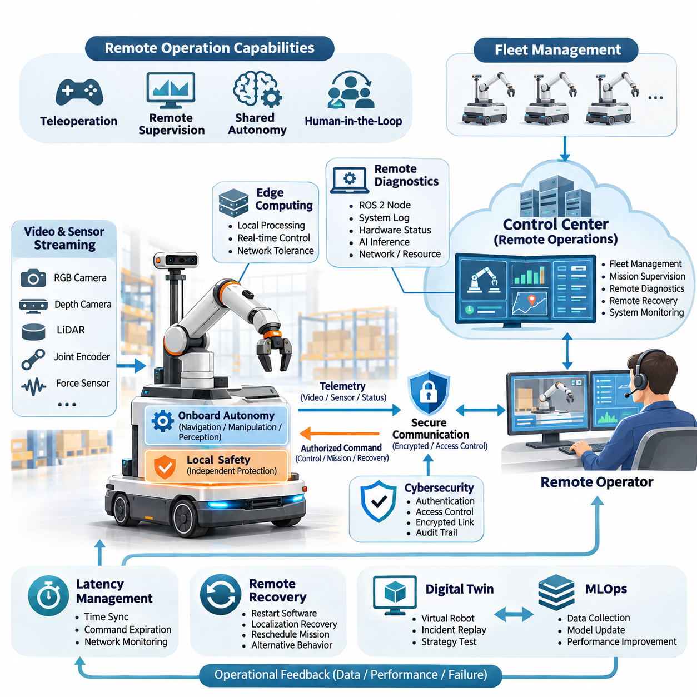
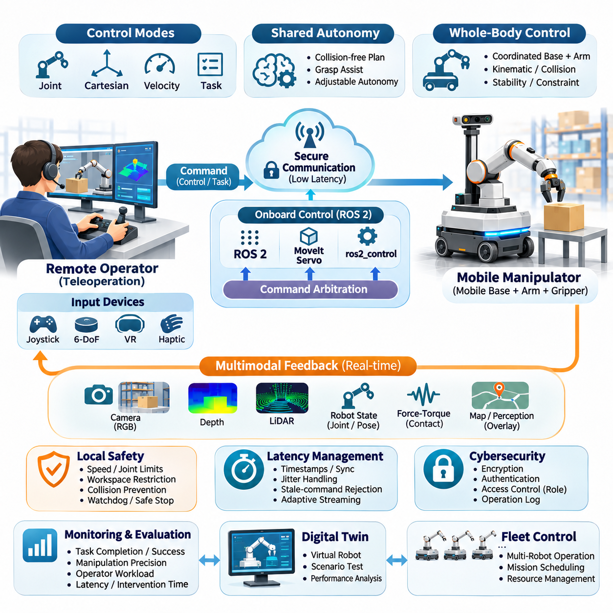
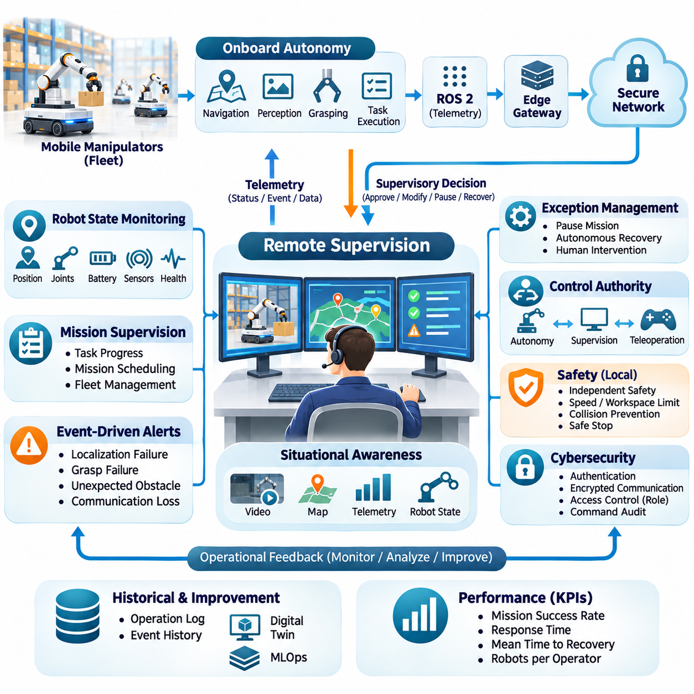
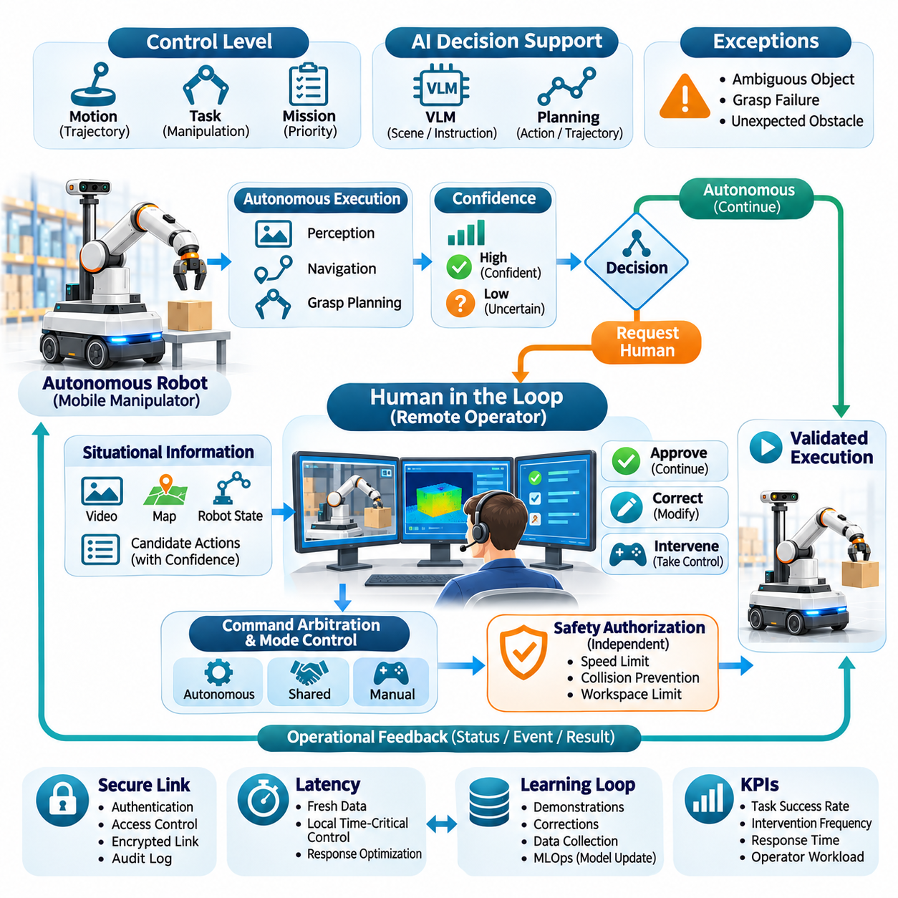
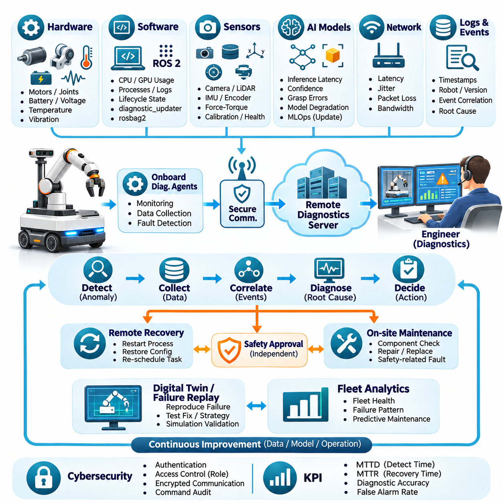
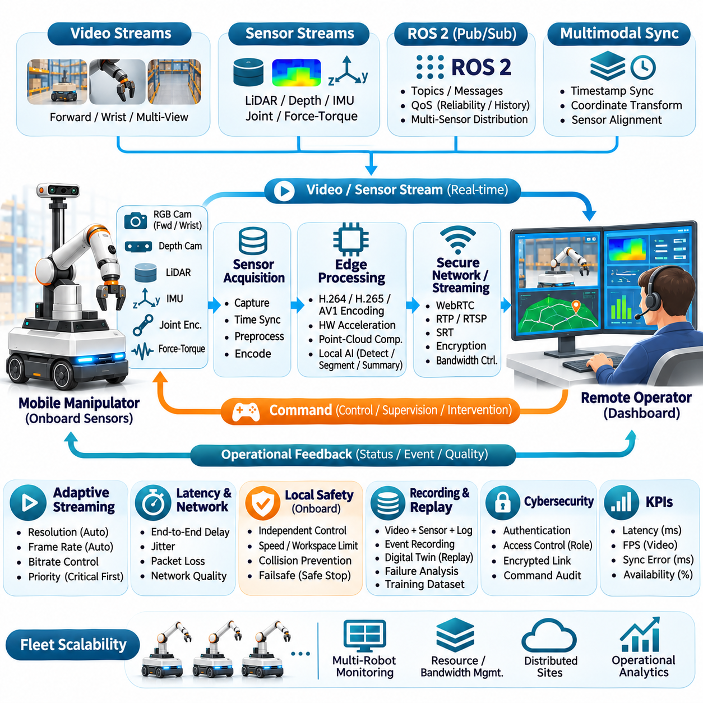
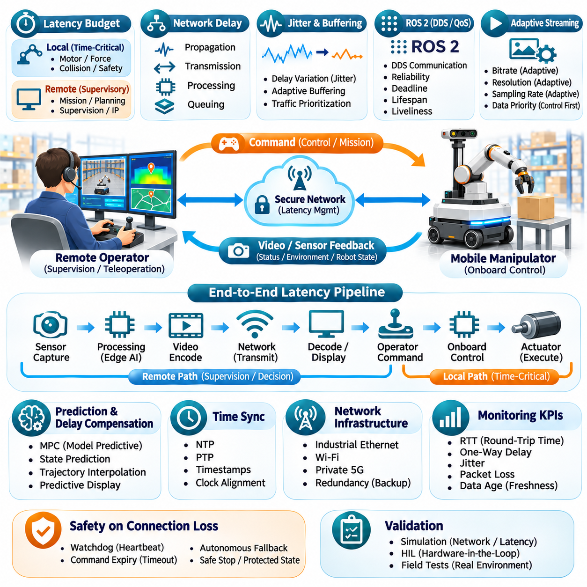
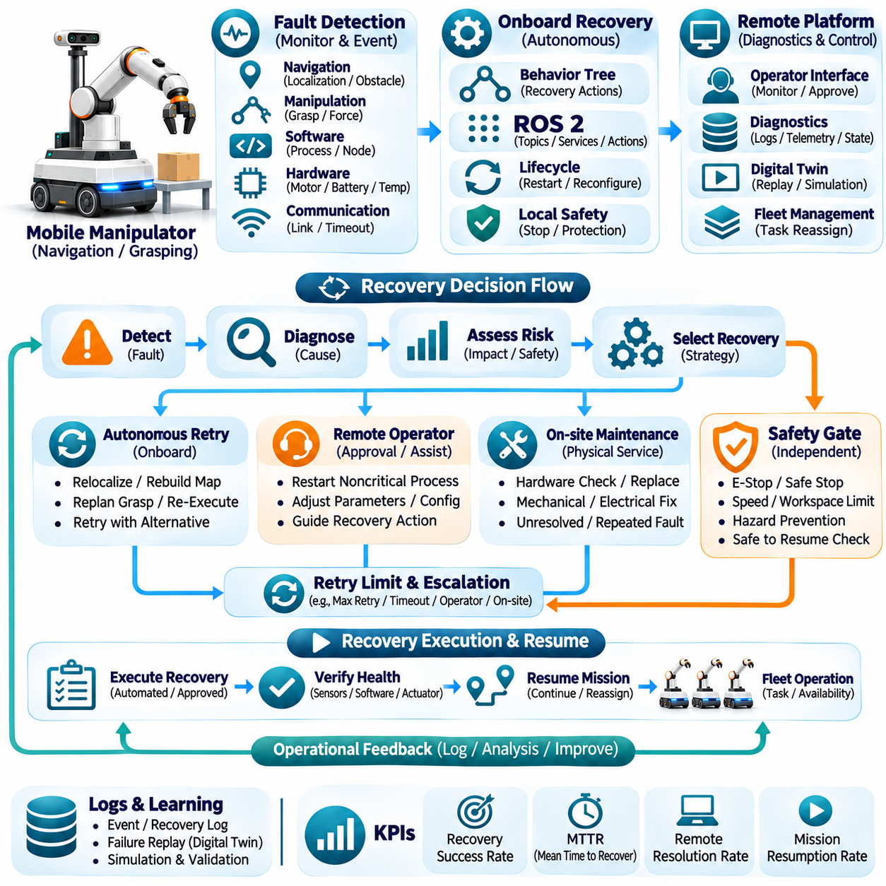
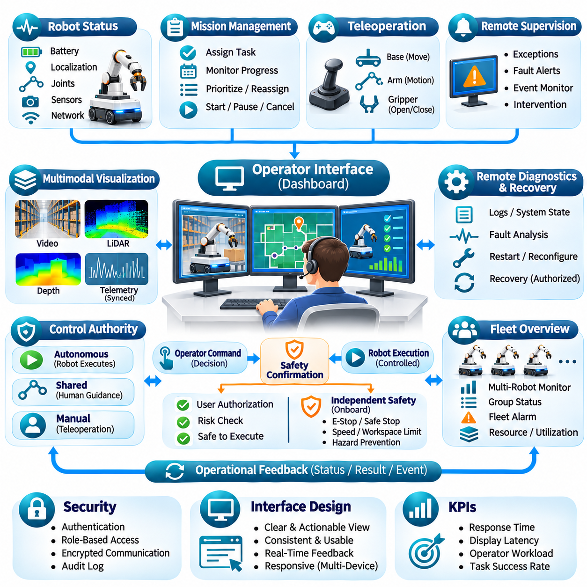
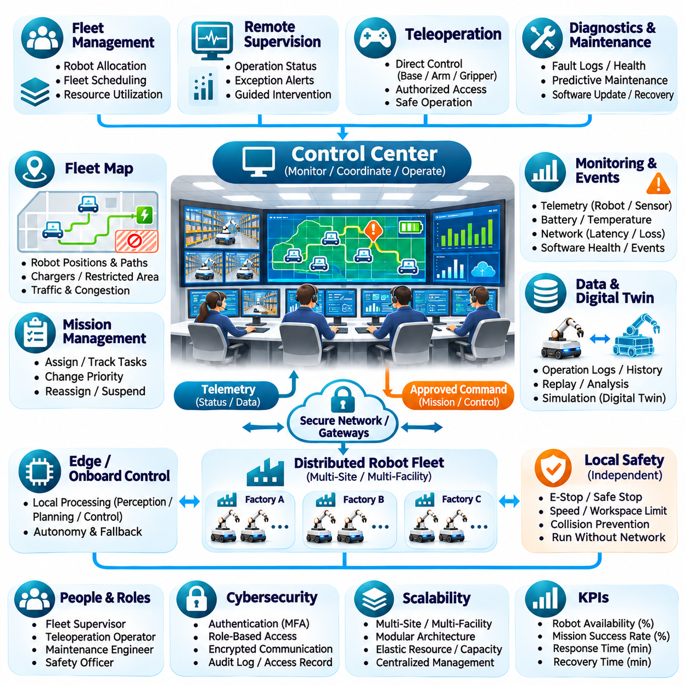

**Volume 04. Mobile Manipulation Software and Operations**

# Chapter 10. Remote Operations

## 01 Remote Operations Overview

{width="7.268055555555556in" height="7.268055555555556in"}

Remote operations represent a fundamental component of modern mobile manipulation systems, enabling robots to be monitored, controlled, diagnosed, and managed from geographically distributed locations. By integrating autonomous capabilities with remote human supervision, organizations can improve operational reliability, reduce on-site staffing requirements, and maintain continuous robotic services across industrial, logistics, healthcare, and commercial environments.

Unlike conventional industrial robots operating within fixed and structured workspaces, mobile manipulators navigate dynamic environments while performing complex physical interaction tasks. These operating conditions introduce uncertainties associated with localization, environmental perception, object manipulation, and human interaction. Remote operations provide an additional management layer for addressing situations that exceed the capabilities of autonomous systems.

The architecture of remote operations typically consists of onboard robot controllers, communication infrastructure, edge computing platforms, centralized management servers, and operator interfaces. Onboard systems execute navigation, manipulation, perception, and safety functions, while remote platforms provide mission supervision, performance monitoring, diagnostic analysis, and authorized intervention. This distributed architecture supports scalable robot operations.

Remote operation capabilities can be classified into direct teleoperation, supervisory control, shared autonomy, and exception-based intervention. Direct teleoperation allows human operators to control robot movements remotely, whereas supervisory control enables robots to execute autonomous missions under human oversight. Shared autonomy combines intelligent robotic behavior with human guidance to achieve reliable task execution in uncertain environments.

Teleoperation is particularly valuable when mobile manipulators encounter unfamiliar objects, unexpected obstacles, or manipulation scenarios that cannot be resolved through autonomous planning. Operators may remotely control the mobile base, robotic arm, and end effector using joysticks, graphical interfaces, or motion-tracking devices. Local collision avoidance and motion constraints remain important during remotely controlled operations.

Remote supervision emphasizes monitoring rather than continuous manual control. Operators observe robot locations, mission progress, battery conditions, manipulation states, communication quality, and system health through centralized dashboards. When abnormal conditions occur, the supervisory platform generates notifications and allows authorized personnel to initiate appropriate corrective actions without interrupting unaffected robots.

Human-in-the-loop control establishes a collaborative operational framework in which human intelligence complements autonomous decision-making. Artificial intelligence systems may identify candidate objects, generate grasping strategies, or recommend recovery actions, while human operators validate uncertain decisions. This approach improves operational flexibility without requiring continuous manual control of every robotic function.

Remote diagnostics enable engineers to investigate software, hardware, communication, and artificial intelligence failures without physically accessing the robot. Diagnostic information may include ROS 2 node states, system logs, actuator feedback, sensor measurements, inference results, network statistics, and computational resource utilization. Historical records help identify recurring failures and distinguish temporary anomalies from persistent defects.

Video and sensor streaming provide the situational awareness required for effective remote decision-making. RGB cameras, depth cameras, LiDAR sensors, joint encoders, and force-torque sensors supply complementary information about the robot and its surroundings. Adaptive compression, selective transmission, and bandwidth allocation help maintain useful environmental feedback while avoiding excessive network utilization.

Communication latency represents a significant challenge because delayed commands and outdated sensor information can produce inaccurate operator decisions. Network congestion, wireless interference, packet loss, and communication distance influence remote control performance. Latency management therefore requires timestamp synchronization, command expiration, network quality monitoring, and appropriate allocation of control responsibilities between onboard and remote systems.

Edge computing plays a critical role in maintaining operational stability during network degradation. Time-sensitive perception, motion control, collision avoidance, and protective functions should remain within the local robotic architecture. Remote platforms primarily handle higher-level decisions and operational coordination. When communication is interrupted, predefined onboard behaviors should bring the robot into an appropriate safe or controlled state.

Remote recovery mechanisms allow operators to address selected operational failures without immediately dispatching field service personnel. Recovery procedures may include restarting non-safety-critical software components, requesting localization recovery, rescheduling missions, or executing validated alternative behaviors. Physical obstructions, mechanical damage, and safety-related failures may still require qualified on-site intervention.

Safety and cybersecurity must be incorporated throughout the remote operations architecture. Authentication, encrypted communication, role-based access control, command authorization, and operational audit trails help prevent unauthorized interventions. Independent local safety mechanisms must retain authority over hazardous robot movements, and remote commands must not bypass protective functions or validated operating boundaries.

Operator interfaces and centralized control centers provide the foundation for scalable multi-robot supervision. Their effectiveness depends on intuitive visualization, prioritized alarms, clear control authority, and consistent operational procedures. Performance indicators such as intervention frequency, mean time to recovery, mission completion rate, network availability, and robots supervised per operator support continuous operational improvement.

Ultimately, remote operations transform mobile manipulators from individually deployed machines into connected robotic services. Integration with fleet management systems, digital twins, simulation platforms, MLOps pipelines, and maintenance infrastructure creates a unified operational ecosystem. The objective is to maximize autonomous productivity while preserving human oversight, operational resilience, cybersecurity, and physical safety throughout the robotic lifecycle.

## 02 Teleoperation

{width="7.268055555555556in" height="7.268055555555556in"}

Teleoperation is a remote control methodology that enables human operators to directly or indirectly control robotic systems from geographically separated locations. In mobile manipulation, teleoperation encompasses the control of mobile platforms, robotic arms, end effectors, and associated sensing systems. It provides an essential operational capability when autonomous intelligence cannot independently resolve complex or unexpected situations.

The primary objective of teleoperation is to extend human perception, decision-making, and physical manipulation capabilities beyond the operator\'s immediate environment. By combining robotic mobility with dexterous manipulation, remote operators can perform object handling, equipment inspection, material transportation, and maintenance tasks in environments that may be inaccessible, hazardous, or unsuitable for continuous human presence.

A typical teleoperation architecture consists of an operator station, communication network, onboard control system, perception modules, and robotic actuators. The operator station generates control commands, while the onboard system interprets these commands and executes corresponding movements. Visual, positional, and force feedback are continuously transmitted to the operator, establishing a closed-loop human-machine control system.

Teleoperation can be implemented through joint-space control, Cartesian-space control, velocity control, or task-level commands. Joint-space control enables operators to manipulate individual robot joints, whereas Cartesian-space control specifies the desired position and orientation of the end effector. Velocity control is frequently used for mobile platforms, while task-level commands provide a more abstract interaction mechanism.

Input devices significantly influence teleoperation accuracy, responsiveness, and operator workload. Conventional interfaces include joysticks, game controllers, keyboards, and touchscreens. Advanced systems may incorporate six-degree-of-freedom controllers, motion capture devices, virtual reality headsets, and haptic interfaces. Device selection depends on task complexity, required manipulation precision, and operational conditions.

Mobile manipulator teleoperation requires coordinated control of the mobile base and robotic arm. Independent control may simplify implementation but increase operator workload during complex manipulation tasks. Whole-body control can coordinate base movement and arm configuration while respecting kinematic constraints, collision boundaries, stability requirements, and the desired position and orientation of the end effector.

In ROS 2-based systems, teleoperation commands can be distributed through topics, services, and actions. Mobile base velocity commands are commonly represented using geometry_msgs/Twist messages, while robotic arm movements may be managed through MoveIt Servo and ros2_control interfaces. Command arbitration mechanisms prevent conflicting instructions from autonomous planners, remote operators, and other control sources.

Situational awareness is essential for successful teleoperation because remote operators cannot directly observe the physical environment. Multiple camera perspectives, depth information, LiDAR maps, robot configuration data, and graphical overlays help operators understand spatial relationships. Wrist-mounted cameras are particularly useful for precise manipulation, while external cameras provide broader environmental awareness.

Communication performance directly affects the stability and usability of teleoperation systems. End-to-end latency, jitter, packet loss, and limited bandwidth can degrade the relationship between operator commands and robot responses. Time synchronization, command timestamps, adaptive video streaming, and stale-command rejection help reduce communication-related risks and improve consistency across distributed operating environments.

Haptic feedback extends teleoperation beyond conventional visual observation by transmitting information about contact forces, resistance, and physical interaction. Force-torque sensors mounted on robotic wrists or end effectors provide measurements that can be translated into tactile or force feedback at the operator station. Bilateral control systems must address communication delays to maintain stable physical interactions.

Shared autonomy combines human teleoperation with onboard robotic intelligence to reduce operator workload and improve execution quality. The operator may specify a target object or desired movement, while autonomous algorithms calculate collision-free trajectories, regulate grasping forces, or maintain end-effector alignment. Adjustable autonomy levels enable the system to accommodate different tasks and environmental uncertainties.

Safety mechanisms must remain active throughout teleoperation regardless of the operator\'s control authority. Local protective functions should enforce validated speed limits, workspace restrictions, joint limits, stability constraints, and collision prevention requirements. Communication watchdogs, enabling devices, and appropriate stopping behaviors help mitigate hazardous motion caused by connection failures or unintended commands.

Cybersecurity is equally important because teleoperation interfaces provide access to physical robotic capabilities. Encrypted communication, mutual authentication, session management, role-based access control, and command validation help prevent unauthorized manipulation. Operational logs should record operator identities, control transitions, commands, and abnormal events to support incident investigation and accountability.

Teleoperation performance should be evaluated using quantitative indicators such as task completion time, manipulation accuracy, success rate, intervention duration, communication latency, and operator workload. Simulation environments and digital twins allow engineers to evaluate control interfaces and recovery procedures before physical deployment. Recorded demonstrations can also support imitation learning and subsequent improvements in autonomous behavior, subject to data validation.

Industrial teleoperation is increasingly important in warehouses, manufacturing facilities, healthcare environments, infrastructure inspection, and hazardous material handling. Rather than replacing autonomous operation, teleoperation provides a complementary capability for addressing operational exceptions. Integration with fleet management systems and centralized control centers enables authorized operators to supervise multiple robots and selectively intervene when necessary.

The long-term objective of teleoperation is to minimize continuous manual intervention while maintaining reliable human control whenever required. Advances in artificial intelligence, multimodal perception, shared autonomy, edge computing, and communication technologies are supporting this transition. Effective teleoperation architecture therefore balances operational efficiency, human-machine interaction, communication resilience, cybersecurity, and physical safety.

## 03 Remote Supervision

{width="7.268055555555556in" height="7.268055555555556in"}

Remote supervision is an operational methodology that enables human operators to monitor, evaluate, and coordinate autonomous robotic systems from geographically separated locations. Unlike direct teleoperation, remote supervision emphasizes continuous observation and selective intervention rather than manual control. In mobile manipulation systems, this capability supports reliable autonomous operations across distributed industrial environments.

The fundamental principle of remote supervision is to maintain autonomous task execution while providing human oversight whenever operational uncertainties arise. Mobile manipulators independently perform navigation, object recognition, motion planning, grasping, and task execution within predefined operational boundaries. Human supervisors intervene when abnormal conditions, system failures, or unexpected environmental changes exceed autonomous recovery capabilities.

A remote supervision architecture typically consists of onboard monitoring modules, communication gateways, centralized supervision servers, data storage infrastructure, and operator dashboards. Onboard modules collect operational information and transmit relevant system states to remote platforms. Centralized servers aggregate information from multiple robots, enabling operators to maintain comprehensive awareness of distributed robotic assets.

Robot state monitoring provides essential information about the operational condition of individual mobile manipulators. Monitored parameters include robot position, navigation status, joint configurations, end-effector conditions, battery capacity, actuator temperatures, sensor availability, and computational resource utilization. Continuous monitoring enables supervisors to identify emerging problems before they develop into significant operational failures.

Mission supervision focuses on evaluating task execution and ensuring that robotic activities remain consistent with operational objectives. Supervisors monitor mission assignments, task progress, execution sequences, estimated completion times, and task outcomes. Integration with fleet management systems allows operators to identify delayed missions, unavailable resources, and coordination conflicts that may influence overall productivity.

Event-driven supervision reduces the need for continuous human observation by automatically detecting and reporting significant operational changes. Events may include localization failures, unsuccessful grasping attempts, unexpected obstacles, communication interruptions, or abnormal hardware conditions. Event classification and prioritization help operators distinguish routine notifications from critical situations requiring immediate attention.

Exception management is an essential function of remote supervision because autonomous robots cannot anticipate every possible operating condition. When a predefined exception occurs, the robot may pause its mission, execute a validated recovery behavior, or request human assistance. Supervisors evaluate the available information and determine whether autonomous execution should continue, be modified, or remain suspended until the problem is resolved.

Remote supervision requires reliable situational awareness to support accurate human decision-making. Operator interfaces combine live video, environmental maps, robot positions, manipulation states, sensor measurements, and historical information. Context-aware visualization helps supervisors understand the relationship between robot behavior and environmental conditions without continuously examining every available data stream.

Telemetry infrastructure supports the continuous exchange of operational information between robots and remote supervision platforms. ROS 2-based architectures can collect node diagnostics, topic data, lifecycle states, and application-level events through dedicated monitoring components. Edge gateways aggregate and filter information before transmission, reducing network overhead while preserving essential operational visibility.

Communication reliability influences the effectiveness of distributed supervision systems. Network interruptions, excessive latency, and packet loss can prevent operators from obtaining accurate information about current robot conditions. Heartbeat signals, timestamped telemetry, connection monitoring, and local data buffering help maintain reliable supervision and distinguish genuine robot failures from temporary communication problems.

Human intervention should be governed by clearly defined authority levels and operational procedures. Supervisors may authorize mission cancellation, task reassignment, alternative execution strategies, or transitions into teleoperation mode. Control arbitration mechanisms ensure that supervisory commands do not conflict with autonomous behavior, other operators, or independent safety functions responsible for protecting the physical environment.

Multi-robot supervision enables a single operator to oversee several autonomous mobile manipulators simultaneously. Its scalability depends on robot autonomy, intervention frequency, task complexity, and the effectiveness of automated monitoring. Intelligent alarm management and exception-based workflows help reduce cognitive workload, while appropriate staffing policies ensure that simultaneous incidents can be addressed within acceptable response times.

Safety and cybersecurity requirements must be integrated throughout the remote supervision architecture. Local safety controllers must retain independent authority over hazardous movements, regardless of communication availability or supervisory instructions. Secure authentication, encrypted data transmission, access permissions, and command auditing protect robotic assets against unauthorized supervision and potentially dangerous remote interventions.

Historical operational data provides a valuable foundation for performance analysis and continuous improvement. Mission records, supervisory interventions, diagnostic events, and recovery outcomes can be correlated to identify recurring operational weaknesses. Integration with digital twins, predictive maintenance platforms, and MLOps pipelines enables engineering teams to improve system reliability, autonomous decision-making, and recovery capabilities.

Remote supervision performance should be evaluated through measurable indicators such as mission completion rate, intervention frequency, alarm response time, mean time to recovery, supervision availability, and the number of robots managed per operator. These indicators help organizations assess operational scalability, identify supervision bottlenecks, optimize staffing requirements, and establish appropriate service-level objectives.

Ultimately, remote supervision provides the organizational and technological foundation for scalable autonomous robotic services. By combining distributed monitoring, intelligent event detection, centralized coordination, and selective human intervention, mobile manipulator fleets can operate with reduced dependence on continuous manual control while maintaining operational reliability, human accountability, cybersecurity, and physical safety.

## 04 Human in the Loop Control

{width="7.268055555555556in" height="7.268055555555556in"}

Human-in-the-loop control is a collaborative control methodology that integrates human judgment, decision-making, and intervention into autonomous robotic systems. In mobile manipulation, this approach combines robotic perception, navigation, motion planning, and manipulation capabilities with human intelligence to address complex situations that cannot be reliably resolved through fully autonomous algorithms.

The fundamental objective of human-in-the-loop control is to achieve an effective balance between machine autonomy and human supervision. Autonomous systems provide computational efficiency, repeatability, and continuous operation, while human operators contribute contextual understanding, experience, and adaptive reasoning. Their integration improves operational flexibility and reliability in dynamic and uncertain environments.

Human-in-the-loop architectures typically consist of autonomous execution modules, decision-making components, human-machine interfaces, communication infrastructure, and independent safety mechanisms. Autonomous modules perform routine robotic tasks, while decision-making components identify situations requiring human assistance. Operator interfaces facilitate information exchange, decision approval, and controlled intervention.

Human participation can occur at different levels of robotic control, ranging from direct motion commands to high-level mission approval. At the motion level, operators may adjust robot trajectories or end-effector positions. At the task level, they may select target objects or alternative manipulation strategies. At the mission level, operators may modify operational priorities, resolve exceptions, or authorize task continuation.

Shared autonomy represents an important implementation of human-in-the-loop control. Instead of requiring operators to manage every robotic movement, autonomous algorithms execute selected functions while humans provide strategic guidance. For example, an operator may identify a target object, while the robot independently calculates a feasible grasp, generates a collision-free trajectory, and regulates the manipulation process.

Confidence-based intervention enables autonomous systems to determine when human assistance may be necessary. Perception confidence, grasp quality estimates, localization uncertainty, and planning feasibility can provide indicators for intervention decisions. However, confidence scores must be calibrated and combined with operational constraints because high numerical confidence does not necessarily guarantee correct or safe robotic behavior.

Exception-driven workflows allow mobile manipulators to request human assistance when autonomous execution encounters predefined operational difficulties. These situations may include ambiguous object recognition, repeated grasping failures, unexpected obstacles, or incompatible task requirements. The system presents relevant contextual information to the operator, who selects an appropriate recovery or alternative execution strategy.

Artificial intelligence technologies expand the capabilities of human-in-the-loop control through multimodal perception, natural language interaction, and intelligent decision support. Vision-language models can interpret visual scenes and operator instructions, while planning algorithms generate candidate actions. Human validation helps prevent uncertain or inappropriate AI-generated decisions from being directly translated into physical movements.

Effective human-machine interfaces are essential for maintaining situational awareness and reducing operator workload. Interfaces should present relevant environmental observations, robot states, planned actions, confidence estimates, and available intervention options. Clear visualization of decision consequences and control authority enables operators to understand system behavior without examining unnecessary technical information.

Control authority management ensures that human instructions and autonomous commands remain consistent throughout robotic execution. State machines, command arbitration mechanisms, and explicit mode transitions help determine which control source is authorized at a particular moment. Transitions between autonomous, shared, and manual control should prevent conflicting commands, unexpected movements, and unintended mission execution.

Communication latency and information freshness directly influence the effectiveness of human-in-the-loop control. Delayed sensor observations or operator responses may reduce the accuracy of decisions involving moving robots and dynamic environments. Local controllers should maintain time-sensitive functions, while remote operators primarily address decisions that can tolerate communication delays within validated operational limits.

Safety mechanisms must remain independent of human and artificial intelligence decision-making processes. Operator approval does not automatically establish that a proposed robotic action is safe. Local protective systems must enforce applicable speed limits, collision protection, workspace restrictions, and stability constraints. Hazardous operations require appropriate risk assessment and validated safety procedures before execution.

Human-in-the-loop interactions also provide valuable information for improving autonomous robotic intelligence. Operator demonstrations, corrected grasp selections, approved trajectories, and recovery decisions can be recorded as structured training data. Integration with imitation learning, active learning, reinforcement learning, and MLOps pipelines enables systematic model improvement following appropriate data quality and safety validation.

Cybersecurity and operational accountability are equally important because human intervention can directly influence physical robotic behavior. Secure authentication, role-based permissions, encrypted communication, command validation, and audit trails help protect control interfaces. Recorded decisions and intervention histories support incident investigation, engineering analysis, and traceability throughout distributed robotic operations.

Performance evaluation should consider autonomous task success, intervention frequency, operator response time, recovery effectiveness, manipulation accuracy, and cognitive workload. A decreasing intervention rate may indicate improving autonomy, provided that safety and task quality remain acceptable. Evaluation should also examine whether operators can effectively manage simultaneous assistance requests during fleet-scale operations.

Ultimately, human-in-the-loop control establishes a practical foundation for scalable and trustworthy mobile manipulation by integrating human expertise with autonomous robotic intelligence. Its long-term objective is to reduce unnecessary manual intervention while preserving meaningful human oversight, reliable exception management, operational accountability, and physical safety throughout the robotic system lifecycle.

## 05 Remote Diagnostics

{width="7.268055555555556in" height="7.268055555555556in"}

Remote diagnostics is a systematic methodology for identifying, analyzing, and evaluating robotic system faults without requiring engineers to physically access the equipment. In mobile manipulation systems, remote diagnostics supports the investigation of hardware failures, software errors, communication problems, perception anomalies, and manipulation difficulties across geographically distributed robotic installations.

The primary objective of remote diagnostics is to minimize operational downtime while improving system reliability, maintainability, and service efficiency. Mobile manipulators integrate numerous interconnected mechanical, electrical, computational, and software components. Diagnostic capabilities enable engineering teams to identify abnormal conditions, determine their underlying causes, and establish appropriate corrective actions before failures propagate throughout the system.

A remote diagnostic architecture typically consists of onboard diagnostic agents, data acquisition modules, communication gateways, centralized diagnostic servers, and engineering interfaces. Onboard components collect system information and detect predefined abnormalities, while centralized platforms aggregate and analyze diagnostic records. This distributed architecture enables engineers to investigate individual robots and identify failure patterns across entire fleets.

Hardware diagnostics focuses on monitoring the physical components of mobile manipulators, including drive motors, steering actuators, robotic joints, batteries, motor controllers, and end effectors. Parameters such as motor current, actuator temperature, vibration, joint position error, and battery voltage provide valuable indicators of component degradation, mechanical resistance, electrical abnormalities, and potential equipment failures.

Software diagnostics involves evaluating operating system conditions, middleware communication, application processes, and autonomous execution modules. Engineers monitor process availability, memory consumption, CPU and GPU utilization, software exceptions, and execution timing. Correlating these measurements with application logs helps identify resource exhaustion, synchronization problems, software instability, and unexpected execution failures.

ROS 2 provides diagnostic mechanisms that support distributed robotic software monitoring. Diagnostic messages, lifecycle node states, topic statistics, and application-specific health indicators enable engineers to evaluate individual software components. Packages such as diagnostic_updater and diagnostic_aggregator facilitate diagnostic reporting and aggregation, while rosbag2 supports recording and subsequent analysis of selected operational data.

Sensor diagnostics is particularly important because autonomous mobile manipulation depends on accurate environmental perception and robot state estimation. Cameras, LiDAR sensors, inertial measurement units, encoders, and force-torque sensors should be monitored for connectivity, measurement consistency, calibration deviations, and data freshness. Cross-sensor comparisons may help identify unreliable measurements and emerging sensor degradation.

Artificial intelligence diagnostics focuses on evaluating the operational behavior of deployed perception, planning, and manipulation models. Engineers monitor inference latency, confidence distributions, detection failures, grasp prediction errors, and computational resource requirements. Integration with MLOps infrastructure supports the investigation of model degradation, environmental domain shifts, and differences between expected and observed inference performance.

Communication diagnostics evaluates connectivity and data exchange between onboard subsystems, fleet management platforms, and remote operation centers. Relevant measurements include network latency, jitter, packet loss, signal strength, bandwidth utilization, and message delivery rates. These indicators help distinguish robotic component failures from communication interruptions that may produce similar operational symptoms.

Structured logging and event correlation provide the foundation for effective root cause analysis. Diagnostic records should include synchronized timestamps, robot identifiers, software versions, component states, mission context, and error codes. By reconstructing the sequence of events preceding a failure, engineers can distinguish primary faults from secondary consequences and identify interactions between multiple robotic subsystems.

Automated fault detection improves diagnostic efficiency by identifying abnormal operating patterns without continuous engineering supervision. Threshold-based monitoring, statistical anomaly detection, and machine learning algorithms can recognize deviations from established operational baselines. Diagnostic rules should consider payload, environmental conditions, operating modes, and component characteristics to reduce false alarms and missed failures.

Remote diagnostic platforms may also incorporate digital twins and failure replay capabilities to reproduce abnormal robotic behavior in controlled environments. Recorded sensor observations, motion commands, joint states, and software events support reconstruction of failure scenarios. Simulation-based analysis allows engineers to investigate suspected causes and evaluate potential corrective strategies before applying changes to physical robots.

Diagnostic information can support remote recovery and maintenance decisions, but fault identification must remain distinct from corrective execution. Engineers may recommend restarting non-safety-critical processes, restoring validated configurations, or scheduling component replacement. Safety-related faults, mechanical damage, and unresolved electrical abnormalities may require qualified on-site personnel before normal robotic operation can resume.

Cybersecurity and data governance are essential because remote diagnostic interfaces may expose sensitive operational information and privileged system capabilities. Secure authentication, encrypted communication, role-based access control, and audit trails help protect diagnostic infrastructure. Read-only diagnostic access should be separated from administrative privileges, and collected data should follow appropriate retention and confidentiality policies.

The effectiveness of remote diagnostics can be evaluated through indicators such as mean time to detect, mean time to diagnose, diagnostic accuracy, false alarm rate, remote resolution rate, and mean time to repair. Fleet-level diagnostic analytics also help identify recurring component weaknesses, software version dependencies, and maintenance requirements, supporting more effective allocation of engineering and field service resources.

Ultimately, remote diagnostics establishes a critical foundation for reliable and scalable mobile manipulator operations. Its integration with fleet management, remote supervision, digital twins, MLOps, predictive maintenance, and centralized control centers creates a comprehensive infrastructure for continuous system improvement. The objective is to reduce downtime and maintenance costs while preserving operational transparency, cybersecurity, and physical safety.

## 06 Video and Sensor Streaming

{width="7.268055555555556in" height="7.268055555555556in"}

Video and sensor streaming is a fundamental capability of remote robotic operations that enables continuous transmission of environmental observations and robot state information to geographically distributed operators. In mobile manipulation systems, streaming infrastructure supports remote supervision, teleoperation, human-in-the-loop control, remote diagnostics, and operational decision-making by providing timely access to physical and computational conditions.

Mobile manipulators operate in dynamic environments where navigation, object recognition, grasping, and physical interaction require comprehensive situational awareness. Video streams provide visual information about the surrounding workspace, while additional sensor streams describe spatial structures, robot configurations, and physical interactions. Combining these information sources enables remote operators to understand complex operational situations more effectively.

A typical streaming architecture consists of onboard sensors, data acquisition modules, edge processing components, communication gateways, streaming servers, and remote visualization interfaces. Sensor measurements are collected, processed, compressed, and transmitted according to operational requirements. Remote applications decode and synchronize incoming information to provide a coherent representation of robot behavior and environmental conditions.

Video streaming commonly utilizes RGB cameras mounted on the mobile platform, robotic arm, and end effector. Forward-facing cameras provide navigation awareness, while wrist-mounted cameras support precise object manipulation and grasp verification. Multiple camera perspectives help reduce visual occlusion and improve spatial understanding, particularly when mobile manipulators operate within confined or cluttered environments.

Video compression is essential for reducing communication bandwidth while maintaining acceptable visual quality. Encoding technologies such as H.264, H.265, and AV1 provide different trade-offs between compression efficiency, computational requirements, and latency. Hardware-accelerated encoding on edge computing platforms reduces processor workload and supports simultaneous transmission of multiple camera streams during robotic operations.

Streaming protocols influence transmission reliability, responsiveness, and system interoperability. Real-Time Transport Protocol (RTP), Real-Time Streaming Protocol (RTSP), WebRTC, and Secure Reliable Transport (SRT) support different streaming requirements. Protocol selection should consider end-to-end latency, packet loss tolerance, network accessibility, encryption capabilities, and compatibility with remote operator applications.

Sensor streaming extends beyond conventional video by transmitting LiDAR point clouds, depth images, inertial measurements, joint states, force-torque measurements, and diagnostic information. These heterogeneous data streams provide complementary descriptions of robot behavior and environmental conditions. Selective transmission and appropriate sampling rates help maintain operational visibility without overwhelming communication infrastructure.

ROS 2 supports sensor data distribution through its publish-subscribe communication architecture and standardized message interfaces. Images, point clouds, inertial measurements, and joint states can be distributed using appropriate ROS 2 message types. Quality of Service policies governing reliability, history, durability, and data deadlines help configure communication behavior according to the characteristics of individual sensor streams.

Multimodal synchronization is particularly important when operators interpret information from multiple sensors simultaneously. Camera images, depth measurements, LiDAR observations, and robot joint states must be associated with consistent temporal and spatial references. Timestamp synchronization, calibrated coordinate transformations, and controlled buffering reduce discrepancies between observed environmental conditions and actual robot movements.

Adaptive streaming dynamically adjusts transmission parameters according to network conditions and operational priorities. Video resolution, frame rate, compression bitrate, sensor sampling frequency, and point cloud density can be modified to accommodate available bandwidth. Critical telemetry and control messages should receive appropriate communication priority, while less essential visualization streams may temporarily operate at reduced quality.

Edge computing enables onboard processing of sensor information before transmission to remote platforms. Object detections, segmentation results, grasp candidates, compressed point clouds, and diagnostic summaries can be generated locally. Transmitting processed information instead of continuously transferring all raw sensor measurements reduces bandwidth consumption and supports scalable multi-robot monitoring across distributed installations.

Streaming latency directly influences remote situational awareness and the effectiveness of human intervention. Sensor acquisition, encoding, buffering, network transmission, decoding, and visualization contribute to total end-to-end delay. Remote interfaces should display information freshness and communication quality, while onboard controllers retain authority over time-sensitive motion control and independent protective functions.

Data recording and historical playback extend streaming capabilities beyond real-time supervision. Selected video sequences, sensor measurements, robot states, and operational events can be stored for failure analysis, digital twin reconstruction, operator training, and machine learning dataset development. Event-triggered recording and configurable retention policies help balance storage requirements, diagnostic usefulness, and data governance obligations.

Cybersecurity and privacy protection are essential because video and sensor streams may contain sensitive industrial information, personal data, and detailed environmental observations. Authentication, encrypted transmission, access control, secure session management, and audit logging help protect streaming infrastructure. Appropriate data minimization and retention policies reduce unnecessary exposure of confidential operational information.

Streaming performance should be evaluated using measurable indicators such as end-to-end latency, achieved frame rate, bitrate, packet loss, synchronization error, stream availability, and decoding stability. Evaluation should consider normal network conditions, congestion, wireless interference, and temporary disconnections. Different operational modes require different performance thresholds based on task complexity and validated safety requirements.

Ultimately, video and sensor streaming establishes the information foundation for effective remote mobile manipulator operations. Integration with fleet management, remote supervision, teleoperation, digital twins, and MLOps platforms enables comprehensive operational visibility and continuous system improvement. The objective is to deliver timely, synchronized, secure, and reliable information while balancing communication efficiency, scalability, and physical safety.

## 07 Latency Management

{width="7.268055555555556in" height="7.268055555555556in"}

Latency management is a fundamental engineering discipline in remote robotic operations that focuses on measuring, controlling, and minimizing delays throughout communication, computation, and physical execution processes. In mobile manipulation systems, effective latency management directly influences teleoperation responsiveness, remote supervision accuracy, control stability, operational efficiency, and physical safety.

End-to-end latency represents the total elapsed time between the generation of an event and the corresponding response at its destination. In remote mobile manipulation, latency originates from sensor acquisition, data processing, video encoding, network transmission, decoding, command interpretation, and actuator execution. Understanding individual delay contributions is essential for identifying system bottlenecks and establishing optimization strategies.

Different robotic functions have different latency requirements depending on their operational characteristics. Motor control, force feedback, collision avoidance, and contact regulation require highly responsive execution, whereas mission scheduling, historical data analysis, and maintenance reporting can tolerate longer delays. Establishing latency budgets for individual functions helps engineers allocate computational and communication resources effectively.

Network latency consists of propagation delay, transmission delay, processing delay, and queuing delay. Communication distance, available bandwidth, network congestion, routing architecture, and wireless interference influence the overall transmission performance. Mobile manipulators operating across distributed industrial environments must accommodate changing network conditions without compromising essential autonomous functions.

Jitter represents variations in communication delay between consecutive messages or data packets. Even when average latency remains acceptable, excessive jitter can produce irregular command execution, inconsistent sensor updates, and unpredictable feedback behavior. Adaptive buffering, traffic prioritization, and timestamp-based processing help mitigate jitter, although excessive buffering may introduce additional end-to-end latency.

Distributed control architectures reduce dependence on remote communication by separating time-critical functions from supervisory decision-making. High-frequency motor control, trajectory tracking, collision avoidance, and protective functions should execute locally on the robot. Remote platforms primarily manage mission objectives, operator instructions, exception handling, and operational functions that can tolerate validated communication delays.

Edge computing significantly contributes to latency reduction by processing computational workloads near the physical robotic system. Object detection, pose estimation, motion planning, sensor fusion, and grasp evaluation can be performed using onboard computational resources. Local processing reduces dependence on external servers, minimizes unnecessary data transmission, and improves responsiveness under variable network conditions.

ROS 2 provides configurable communication mechanisms that support latency management within distributed robotic applications. Data Distribution Service (DDS) and Quality of Service (QoS) policies allow engineers to configure reliability, message history, deadlines, lifespan, and liveliness. Appropriate configurations help balance communication reliability, data freshness, and resource consumption according to application requirements.

Adaptive communication strategies dynamically adjust transmission behavior according to available network resources. Video bitrate, image resolution, sensor sampling frequency, and telemetry update rates can be modified when congestion or packet loss increases. Prioritizing control commands and essential robot state information over noncritical data streams helps preserve operational responsiveness during bandwidth limitations.

Predictive control and delay compensation techniques can reduce the negative effects of communication latency during remote manipulation. Model predictive control, state prediction, trajectory interpolation, and predictive visualization estimate future robot conditions based on available measurements. However, prediction uncertainty must be considered because estimated robot states may differ from actual physical conditions.

Time synchronization is essential for accurately measuring latency and coordinating distributed robotic subsystems. Network Time Protocol (NTP), Precision Time Protocol (PTP), hardware timestamps, and synchronized system clocks support consistent temporal references. Accurate timestamping enables engineers to distinguish communication delays from computational delays and identify outdated sensor measurements.

Communication infrastructure should be designed to support predictable performance across industrial operating environments. Industrial Ethernet, Wi-Fi, private 5G networks, edge servers, and dedicated communication gateways provide different performance characteristics. Network segmentation, traffic shaping, bandwidth reservation, and redundant communication paths can improve transmission consistency when appropriately engineered.

Latency monitoring should operate continuously during remote robotic operations. Metrics such as round-trip time, one-way delay, jitter, packet loss, command execution delay, and sensor data age provide measurable indicators of communication quality. Monitoring latency distributions and high-percentile values is particularly important because average measurements may conceal temporary but operationally significant delays.

Excessive latency and communication interruptions require predefined operational responses. Command expiration policies, heartbeat monitoring, watchdog mechanisms, and communication timeout detection help prevent uncontrolled execution of outdated instructions. Depending on validated operating conditions, mobile manipulators may reduce movement speed, suspend remote control, continue approved autonomous functions, or transition into a safe state.

Latency management should be validated through simulation, hardware-in-the-loop testing, and controlled field experiments. Artificially introduced network delays, packet loss, bandwidth restrictions, and communication interruptions enable engineers to evaluate robotic behavior under degraded conditions. Testing should examine navigation accuracy, manipulation precision, control stability, operator workload, and the effectiveness of protective responses.

Ultimately, latency management establishes an essential foundation for reliable, responsive, and scalable remote mobile manipulation. Integration with edge AI, ROS 2, fleet management, remote diagnostics, adaptive streaming, and intelligent control architectures enables coordinated optimization throughout the robotic system. The objective is to maintain predictable responsiveness, operational continuity, and physical safety despite changing communication conditions.

## 08 Remote Recovery

{width="7.268055555555556in" height="7.268055555555556in"}

Remote recovery is a systematic operational capability that enables mobile robotic systems to restore normal functionality after unexpected failures, abnormal conditions, or interrupted mission execution. In mobile manipulation, remote recovery combines automated fault handling, onboard recovery behaviors, remote diagnostics, and human intervention to minimize operational downtime while maintaining system reliability and physical safety.

The primary objective of remote recovery is to restore robotic operations without requiring immediate physical access to the robot. Mobile manipulators integrate navigation, perception, motion planning, manipulation, and fleet coordination functions. A failure in any of these subsystems may interrupt an entire mission. Remote recovery provides structured procedures for identifying the affected subsystem, evaluating recovery options, and restoring an acceptable operating condition.

A typical remote recovery architecture consists of fault detection modules, recovery controllers, onboard safety mechanisms, communication gateways, remote diagnostic services, and operator interfaces. Fault detection modules identify abnormal conditions, while recovery controllers select appropriate corrective behaviors. Remote platforms provide additional diagnostic information and allow authorized operators to approve or initiate recovery procedures when autonomous mechanisms are insufficient.

Recovery procedures should distinguish between temporary operational disturbances, recoverable software failures, hardware abnormalities, and safety-critical faults. Temporary disturbances may be resolved through controlled retries or alternative navigation strategies. Software failures may require restarting non-safety-critical processes, while hardware abnormalities may require component isolation or maintenance. Safety-critical faults must trigger validated protective responses rather than unrestricted automatic recovery.

Navigation recovery is particularly important because mobile manipulators depend on reliable localization and obstacle avoidance. Localization failures may occur because of sensor occlusion, environmental changes, insufficient geometric features, or accumulated estimation errors. Recovery strategies may include stopping movement, collecting additional sensor observations, performing relocalization, rebuilding local maps, or requesting operator assistance before navigation resumes.

Manipulation recovery addresses failures during object recognition, grasp planning, grasp execution, and object placement. A robot may encounter unsuccessful grasps, object displacement, excessive contact forces, or unexpected changes in object orientation. Recovery behaviors can include releasing the gripper, repositioning the end effector, acquiring new visual observations, recalculating grasp candidates, and executing validated alternative manipulation strategies.

Behavior trees provide a structured mechanism for implementing autonomous recovery procedures. Recovery actions can be represented as reusable behavior nodes and connected to navigation, manipulation, and mission execution workflows. Conditional branches determine whether the system should retry an action, execute an alternative behavior, request human intervention, or terminate the current mission. This structure improves recovery consistency and simplifies maintenance of complex robotic applications.

ROS 2-based recovery architectures can coordinate diagnostic information and corrective actions through topics, services, actions, and lifecycle management. Fault notifications can be published to dedicated monitoring components, while recovery services initiate predefined procedures. Lifecycle transitions may be used to restart selected software components, provided that dependencies, actuator states, and safety requirements are properly managed.

Remote recovery should follow a controlled decision process that evaluates fault severity, recovery feasibility, operational risk, and available resources. Automated recovery is appropriate when the failure condition is understood and the corrective action has been validated. Human approval becomes important when environmental uncertainty is high, repeated recovery attempts fail, or the proposed action could affect equipment, objects, or nearby personnel.

Communication failures require specific recovery mechanisms because remote operators may temporarily lose access to the robot. Heartbeat monitoring, communication timeouts, command expiration, and local watchdog mechanisms help detect connection interruptions. During communication loss, the robot should execute predefined onboard behaviors, such as stopping safely, maintaining a stable configuration, or continuing only previously authorized autonomous activities.

Remote software recovery may involve restarting application processes, restoring validated configurations, replacing corrupted runtime data, or rolling back an unsuccessful software deployment. Recovery procedures should preserve essential diagnostic records and avoid disrupting safety-critical services. Before restarting a component, the system must evaluate its dependencies and ensure that the resulting state is consistent with the overall robotic architecture.

Remote recovery must maintain strict separation between operational restoration and safety authorization. A robot that successfully restarts or resumes communication is not necessarily safe to operate. Independent safety controllers must retain authority over emergency stopping, protective monitoring, speed restrictions, and hazardous movement prevention. Physical damage, electrical faults, and unresolved mechanical abnormalities may require qualified on-site inspection.

Recovery attempts should be limited by predefined retry policies and escalation thresholds. Repeatedly executing the same unsuccessful action may increase mechanical stress, create additional uncertainty, or produce hazardous conditions. Recovery controllers should maintain attempt counters, execution time limits, and failure histories. When predefined limits are exceeded, the system should stop automatic retries and request appropriate human or maintenance intervention.

Recovery logging and event recording support systematic investigation and continuous improvement. Each recovery event should capture the original fault, affected subsystem, diagnostic measurements, selected recovery strategy, execution results, and final robot state. These records enable engineers to identify recurring failure patterns, evaluate recovery effectiveness, and improve autonomous fault-handling procedures through simulation and controlled testing.

Digital twins and simulation environments provide valuable tools for validating remote recovery strategies before deployment. Recorded failures can be reconstructed using corresponding sensor observations, robot configurations, and environmental conditions. Engineers can evaluate alternative recovery actions, examine potential secondary failures, and verify that corrective procedures do not introduce additional collision or stability risks.

Fleet management integration enables recovery activities to be coordinated across multiple mobile manipulators. When a robot becomes unavailable, the fleet management system may suspend its assignments, reallocate pending missions, and update resource availability. After successful recovery, the robot can undergo a health verification procedure before returning to normal fleet operations. This approach reduces the impact of individual robot failures on overall operational productivity.

Remote recovery performance should be evaluated using measurable indicators such as recovery success rate, mean time to recovery, repeated failure frequency, remote resolution rate, mission resumption rate, and human intervention frequency. These indicators help organizations determine whether recovery procedures are effective, identify recurring weaknesses, and optimize the balance between autonomous recovery and human assistance.

Ultimately, remote recovery transforms unexpected robotic failures from uncontrolled operational interruptions into managed and traceable engineering events. Integration with remote diagnostics, behavior trees, ROS 2 lifecycle management, fleet management, digital twins, and safety monitoring establishes a comprehensive recovery framework. The objective is to restore robotic functionality efficiently while preserving system integrity, operational continuity, human accountability, and physical safety.

## 09 Operator Interfaces

{width="7.268055555555556in" height="7.268055555555556in"}

Operator interfaces are essential components of remote robotic operations that enable humans to monitor, understand, and interact with mobile manipulation systems. They provide the communication layer between human operators and autonomous robots, presenting operational information and supporting supervisory decisions, teleoperation, diagnostics, and recovery activities. Effective interface design improves operational efficiency, situational awareness, and human-machine collaboration.

A well-designed operator interface should transform complex robotic system information into clear and actionable representations. Mobile manipulators generate large amounts of data from navigation, perception, manipulation, sensors, and computational subsystems. Operators should not need to interpret raw technical data continuously. Instead, interfaces should organize information according to operational priorities, system conditions, and the decisions that operators are expected to make.

The overall architecture of an operator interface typically consists of a graphical user interface, robot communication middleware, visualization components, command management services, and backend monitoring systems. The graphical interface presents robot status and operational information, while communication middleware exchanges commands and telemetry with onboard systems. Backend services manage authentication, mission information, historical records, and operational events.

Robot visualization is a fundamental capability for remote operator interfaces. Two-dimensional maps, three-dimensional models, camera images, and sensor overlays provide complementary representations of the robot and its environment. Operators can observe robot positions, navigation paths, obstacles, manipulation targets, and workspace boundaries. Combining these visual elements improves spatial understanding and supports accurate remote decision-making.

Robot status dashboards provide continuous information about the operational health of individual robotic systems. Important indicators include battery capacity, localization status, navigation mode, joint positions, actuator temperatures, sensor availability, network connectivity, and computational resource utilization. Status information should use consistent visual conventions and clearly distinguish normal operation, warnings, and critical faults.

Mission management interfaces allow operators to monitor and control high-level robotic activities. They present assigned tasks, execution progress, task dependencies, estimated completion times, and mission results. Operators may approve new missions, modify task priorities, suspend activities, or reassign tasks according to operational requirements. Integration with fleet management systems provides a unified view of multiple mobile manipulators.

Teleoperation interfaces enable direct human control when autonomous execution is insufficient. Depending on the application, operators may control mobile base velocity, steering direction, robotic arm configuration, end-effector position, and gripper actions. Joysticks, touchscreen controls, keyboard inputs, and three-dimensional interaction devices provide different control methods. Interface design should minimize accidental commands and clearly indicate the currently active control mode.

Remote supervision interfaces emphasize exception monitoring and selective human intervention rather than continuous manual operation. Operators receive notifications about localization failures, unsuccessful grasping, unexpected obstacles, communication interruptions, and abnormal hardware conditions. Alarm prioritization helps distinguish informational events from conditions requiring immediate intervention, reducing unnecessary cognitive workload.

Multimodal visualization improves operator understanding by integrating video, depth information, LiDAR observations, robot states, and diagnostic measurements. Multiple camera perspectives help address visual occlusion during manipulation, while three-dimensional environmental representations provide additional spatial context. Time synchronization between different data sources is important because inconsistent observations may lead to incorrect operator decisions.

Human-machine interaction should follow consistent principles of usability, accessibility, and operational clarity. Frequently used commands should be easy to locate, while potentially hazardous actions should require appropriate confirmation or authorization. Clear feedback should indicate whether a command has been accepted, is being executed, has completed, or has failed. Consistent interaction patterns reduce training requirements and operator errors.

Control authority management is particularly important when autonomous behavior, supervisory commands, and manual teleoperation coexist. Interfaces should clearly communicate whether a robot is operating autonomously, awaiting human approval, executing a remotely controlled action, or maintaining a protective state. Explicit mode indicators and controlled transitions help prevent conflicting commands and unintended physical movements.

Alarm management and notification systems should communicate operational problems according to severity, urgency, and required response. Critical faults may require immediate attention, while informational notifications can be stored for later review. Alarm acknowledgment, escalation procedures, event histories, and response tracking support systematic incident management and improve accountability across remote operations teams.

Operator interfaces should also provide access to remote diagnostics and recovery functions. Engineers may inspect software logs, sensor conditions, communication statistics, and subsystem health information through dedicated diagnostic views. Authorized users may initiate validated recovery procedures, restart selected non-safety-critical processes, or request maintenance assistance. Administrative and operational permissions should remain clearly separated.

Multi-robot operator interfaces introduce additional challenges related to information density and attention management. When one operator supervises multiple robots, the interface should provide an overview of fleet status while allowing detailed inspection of individual machines. Map-based visualization, grouped alarms, mission summaries, and exception-focused notifications help operators identify which robots require attention without continuously monitoring every system.

Responsive interface design is important because remote operators may access robotic systems through desktop computers, industrial workstations, or mobile devices. Layouts should adapt to different display sizes while preserving essential operational information and control functions. Industrial environments may also require support for multiple monitors, specialized input devices, and restricted network configurations.

Cybersecurity must be integrated into operator interface architecture because graphical interfaces provide access to physical robotic capabilities. Secure authentication, role-based access control, encrypted communication, session management, and command authorization help prevent unauthorized operations. Critical commands should be recorded in audit logs, and sensitive diagnostic or video information should be accessible only to authorized personnel.

Performance evaluation should examine both technical interface responsiveness and human operational effectiveness. Relevant indicators include command response time, display latency, alarm acknowledgment time, task completion rate, operator workload, intervention accuracy, and training duration. Usability testing with representative operators helps identify confusing interactions, unnecessary information, and potential sources of operational error.

Ultimately, operator interfaces provide the foundation for effective human supervision and control of distributed mobile manipulation systems. Integration with ROS 2, fleet management, remote diagnostics, video streaming, digital twins, and centralized control platforms creates a unified operational environment. The objective is to present the right information at the right time, support reliable human decisions, and maintain efficient, secure, and safe robotic operations.

## 10 Control Center Design

{width="7.268055555555556in" height="7.268055555555556in"}

A control center is a centralized operational environment designed to monitor, supervise, and coordinate distributed mobile manipulation systems. It integrates robotic fleet management, remote supervision, teleoperation, diagnostics, communication infrastructure, and operational data into a unified management platform. Its primary purpose is to provide operators and engineering teams with comprehensive visibility and coordinated control over robotic operations across multiple facilities and working environments.

The fundamental objective of control center design is to establish an efficient relationship between autonomous robotic systems, human operators, and operational infrastructure. Rather than managing individual robots independently, a centralized control center provides an integrated view of robot status, mission execution, resource utilization, and operational exceptions. This approach improves coordination, reduces unnecessary human intervention, and supports scalable robotic services.

A typical control center architecture consists of an operator workspace, centralized management servers, communication gateways, robot fleet management systems, data storage infrastructure, and monitoring applications. Onboard robot controllers execute navigation, perception, and manipulation functions, while centralized systems coordinate missions and collect operational information. Distributed edge infrastructure can provide local processing and maintain essential services when communication with the control center becomes unavailable.

The physical layout of a control center should support effective operator collaboration, continuous monitoring, and rapid response to operational incidents. Workstations should provide appropriate displays, ergonomic seating, communication equipment, and access to essential control interfaces. Large shared displays may present fleet status, facility maps, mission progress, and critical alerts, while individual workstations support detailed investigation and authorized intervention.

The control center software environment should integrate multiple operational functions through consistent interfaces. Fleet management applications provide robot allocation and mission scheduling, while remote supervision applications monitor execution and detect abnormal conditions. Teleoperation interfaces support direct intervention, and diagnostic applications provide access to software logs, sensor information, and hardware health indicators. Integration reduces information fragmentation and simplifies operational workflows.

Fleet visualization is an essential capability because operators may supervise multiple mobile manipulators distributed across different facilities or work zones. Geographic maps, facility layouts, robot locations, navigation paths, charging stations, and restricted areas should be represented in a consistent spatial interface. Operators can identify traffic congestion, unavailable robots, delayed missions, and potential operational conflicts through centralized visualization.

Mission management provides a unified mechanism for coordinating robotic activities and operational priorities. The control center should present mission assignments, execution states, task dependencies, estimated completion times, and mission outcomes. Authorized operators may modify priorities, suspend activities, reassign tasks, or approve alternative execution strategies. Integration with enterprise systems can connect robotic operations with warehouse management, manufacturing execution, and production scheduling processes.

Real-time monitoring and event management are critical for maintaining operational continuity. The control center should collect robot telemetry, sensor status, communication quality, battery conditions, actuator information, and software health indicators. Event processing mechanisms classify incoming notifications according to severity and operational relevance. Critical events should receive immediate attention, while routine information can be retained for historical analysis and performance evaluation.

Communication infrastructure must support reliable information exchange between the control center and distributed robotic systems. Industrial Ethernet, wireless networks, private 5G, secure gateways, and redundant network connections may be combined according to deployment requirements. Network monitoring should evaluate latency, jitter, packet loss, bandwidth availability, and connection stability. Local robot controllers must retain responsibility for time-critical control and independent safety functions.

Human resource organization is another important aspect of control center design. Operational responsibilities may be divided among fleet supervisors, teleoperation operators, maintenance engineers, system administrators, and safety personnel. Clear responsibility boundaries and escalation procedures help ensure that operational incidents are addressed by appropriately authorized personnel. Staffing requirements should reflect fleet size, mission complexity, intervention frequency, and expected response times.

Control center operations require carefully defined access control and cybersecurity policies. Authentication, role-based permissions, encrypted communication, network segmentation, and centralized audit logging protect robotic infrastructure against unauthorized access. Critical commands, configuration changes, and remote recovery operations should be restricted to authorized personnel. Administrative access should be separated from routine operational privileges to reduce security risks.

Remote diagnostics and maintenance management should be integrated into the control center to improve equipment availability. Engineers should be able to review fault histories, diagnostic measurements, software versions, hardware conditions, and maintenance records without immediately visiting the deployment site. Predictive maintenance information can help identify components requiring inspection or replacement, allowing maintenance activities to be scheduled before unexpected failures interrupt operations.

Data infrastructure is essential for maintaining historical records and supporting continuous operational improvement. The control center should collect mission logs, robot telemetry, video recordings, diagnostic events, intervention histories, and system performance indicators. Centralized storage and structured data management enable engineers to analyze recurring failures, evaluate operational efficiency, and identify opportunities for improving autonomous behavior and fleet coordination.

Digital twins and simulation platforms can extend control center capabilities by providing virtual representations of robots, facilities, and operational processes. Engineers can reconstruct historical incidents, evaluate alternative mission strategies, and investigate potential system modifications in controlled environments. Integration with digital twins also supports operational planning, system validation, and the evaluation of changes before deployment to physical robots.

Control center performance should be evaluated using measurable indicators such as fleet availability, mission completion rate, operator response time, intervention frequency, mean time to recovery, communication availability, and maintenance efficiency. Human factors should also be considered through operator workload, information accessibility, alarm effectiveness, and decision-making accuracy. These indicators provide a foundation for identifying operational bottlenecks and improving the overall management architecture.

The control center should be designed for scalability because robotic deployments may expand across additional facilities, production areas, and geographical regions. Modular software architecture, standardized communication interfaces, distributed processing, and centralized identity management help accommodate increasing numbers of robots and operators. Multi-site management capabilities allow organizations to maintain consistent operational policies while supporting local deployment requirements.

Ultimately, control center design establishes the organizational, physical, and technological foundation for large-scale remote robotic operations. Integration of ROS 2, fleet management, remote supervision, teleoperation, diagnostics, video streaming, digital twins, and cybersecurity creates a unified operational environment. The objective is to achieve reliable fleet coordination, efficient human supervision, rapid incident response, and continuous operational improvement while maintaining system availability, security, accountability, and physical safety.
