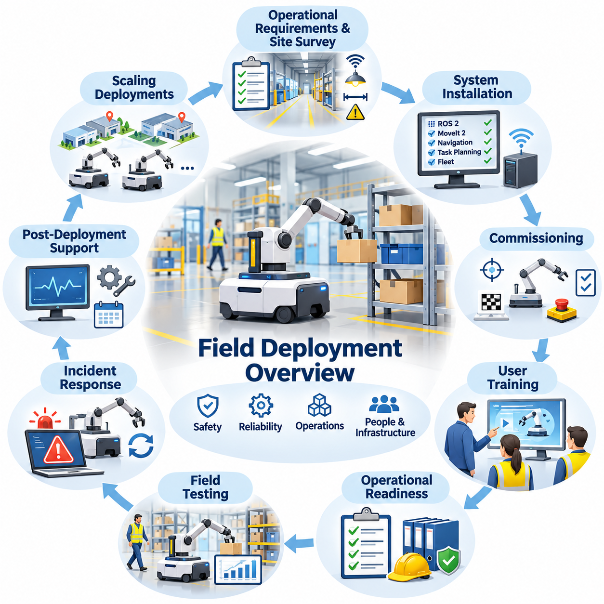
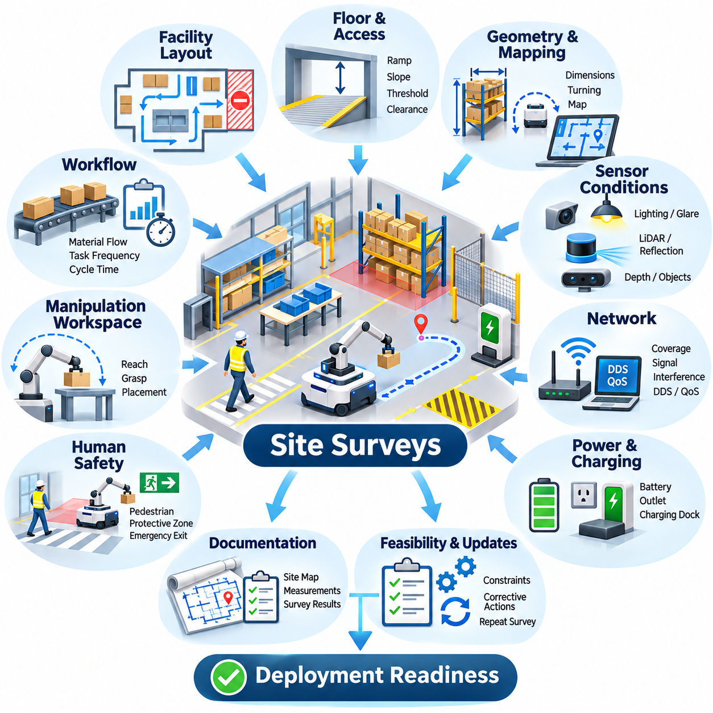
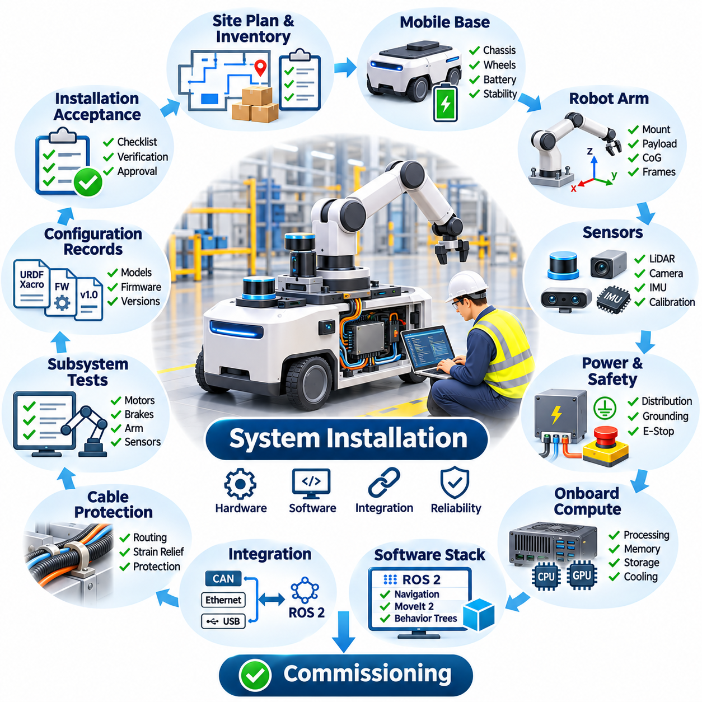
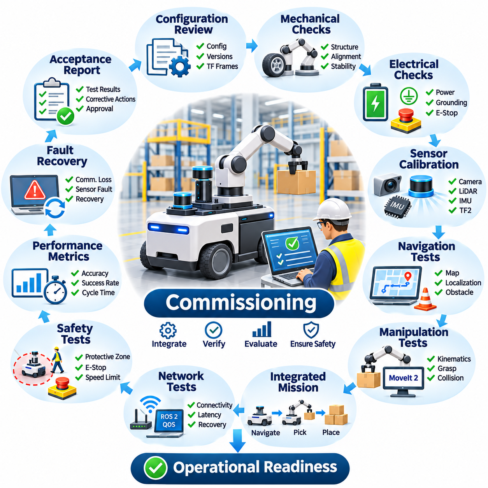
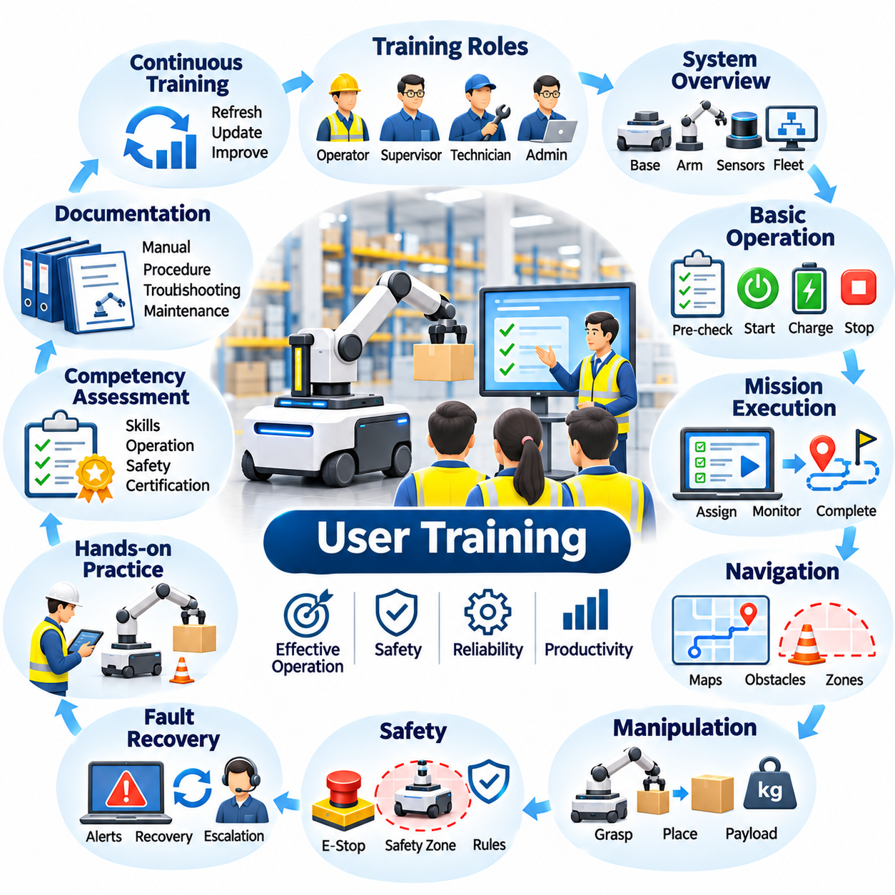
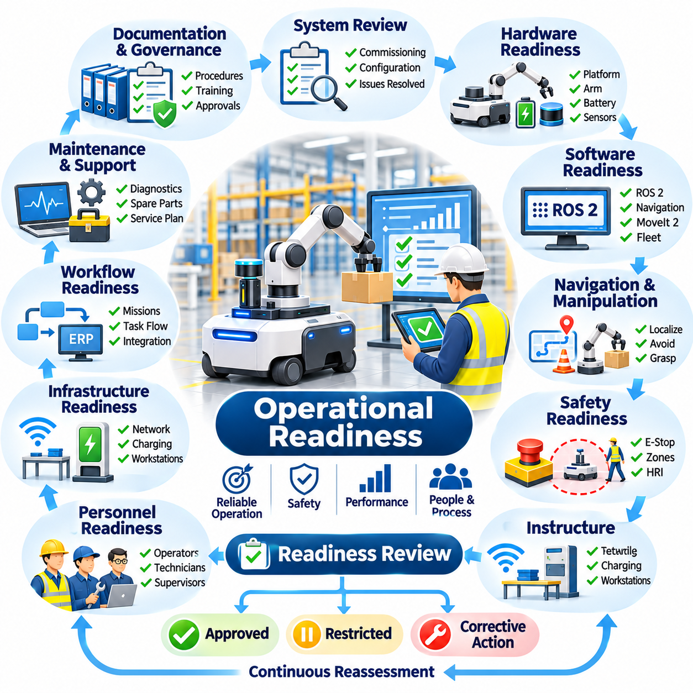
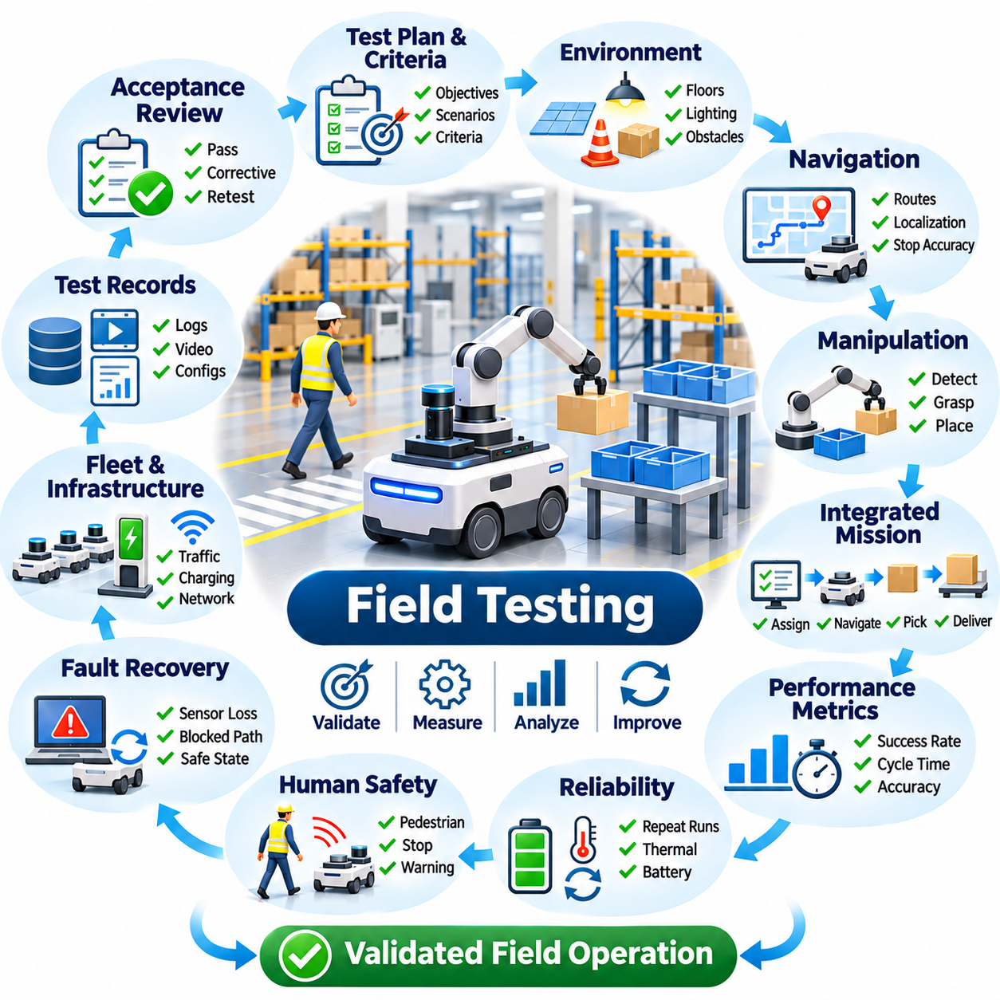
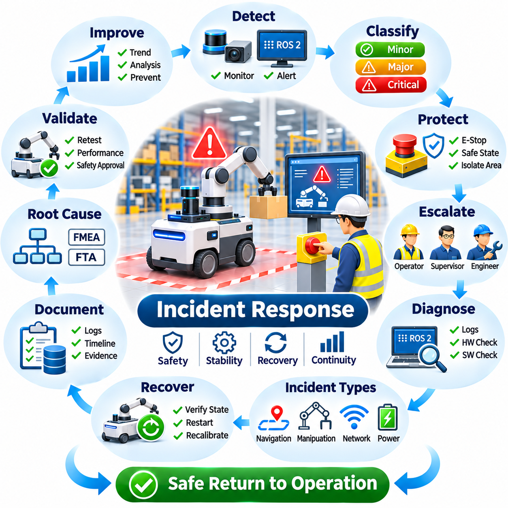
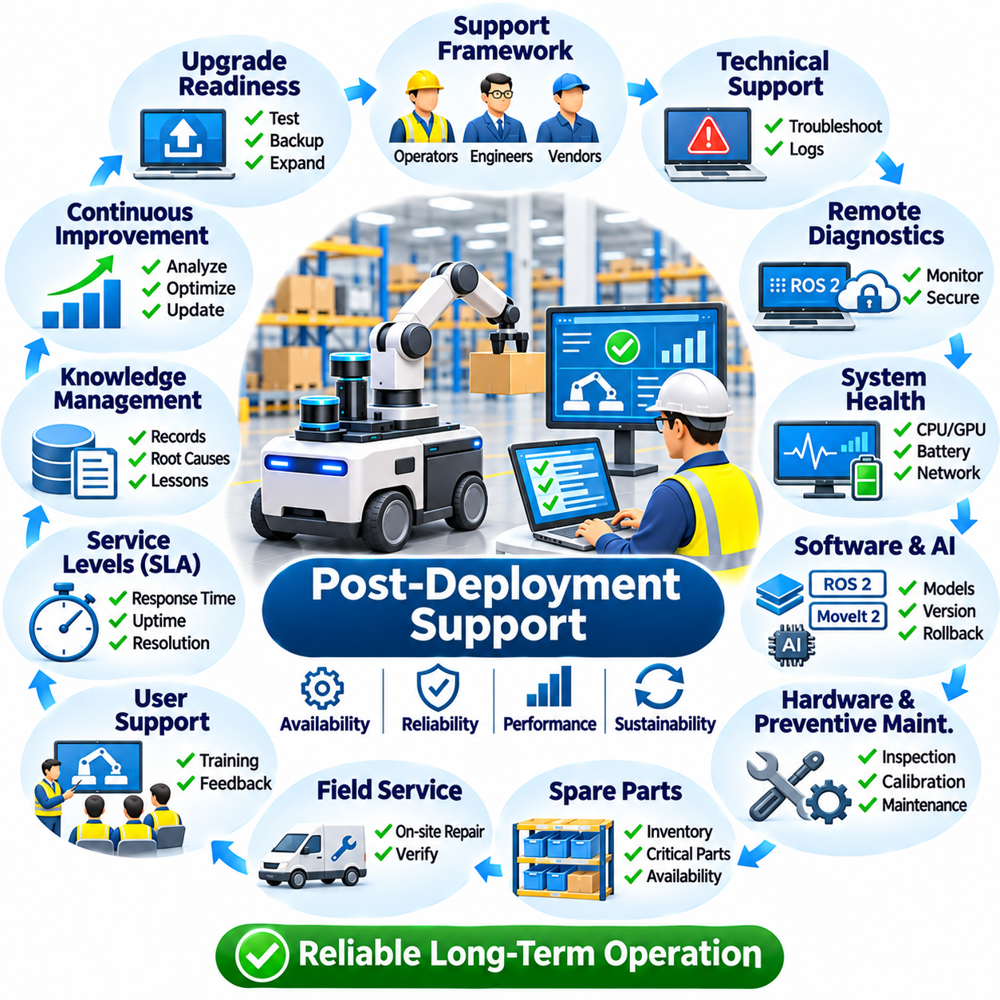
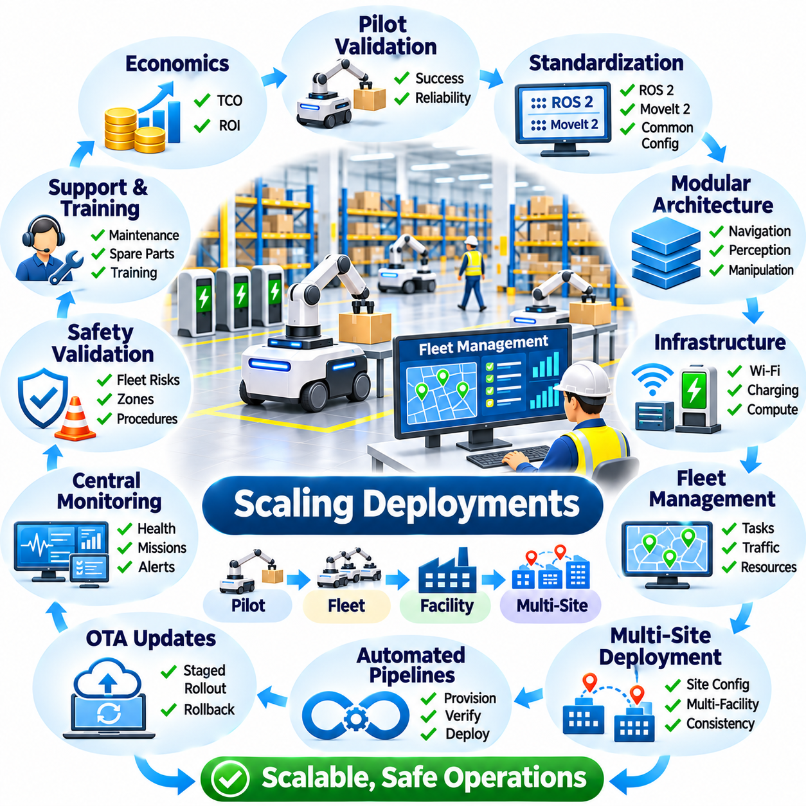

**Volume 04. Mobile Manipulation Software and Operations**

# Chapter 11. Field Deployment

## 01 Field Deployment Overview

{width="7.268055555555556in" height="7.268055555555556in"}

Field deployment is the process of transferring a mobile manipulation system from a controlled development environment into an actual operational facility. It involves more than installing hardware and launching software because the robot must operate reliably within existing workflows, infrastructure, safety requirements, and human activities. A successful deployment establishes a stable connection between the robot, its environment, operators, and enterprise systems while ensuring that technical performance meets practical operational expectations.

Unlike laboratory testing, field deployment introduces environmental conditions that are difficult to reproduce completely during development. Real facilities contain changing layouts, moving personnel, temporary obstacles, reflective surfaces, network interference, and unexpected operational events. Mobile manipulators must therefore demonstrate reliable navigation, localization, object perception, motion planning, and manipulation under these conditions. Deployment engineering must account for environmental variability rather than assuming that laboratory performance will remain unchanged.

The deployment process begins with understanding the operational requirements and the physical characteristics of the target facility. Engineers must identify the tasks the robot will perform, the locations it will visit, the objects it will manipulate, and the interactions it will have with workers and existing equipment. These requirements establish the foundation for site surveys, system configuration, installation planning, commissioning, and operational validation. Clear deployment objectives also provide measurable criteria for evaluating readiness.

Site surveys provide the information required to adapt the mobile manipulation system to its operating environment. Engineers examine floor conditions, aisle dimensions, access restrictions, charging locations, workstations, lighting conditions, communication coverage, and potential safety hazards. They also identify environmental features that may affect localization, perception, and manipulation. The resulting site information is used to configure navigation maps, sensor parameters, robot routes, workspace boundaries, and infrastructure requirements before physical installation begins.

System installation transforms the deployment design into an operational configuration. This includes assembling the mobile platform and manipulator, connecting sensors and controllers, configuring power systems, establishing network connectivity, and integrating supporting infrastructure. Software components such as ROS 2 nodes, navigation systems, MoveIt 2, task planners, behavior trees, and fleet management services must be installed and configured consistently. Installation procedures should preserve hardware and software compatibility while maintaining traceability of configuration changes.

Commissioning verifies that the installed system operates correctly before entering regular service. Engineers validate sensor calibration, coordinate transformations, localization accuracy, navigation behavior, manipulator kinematics, collision checking, communication interfaces, and emergency stopping functions. Integrated tests confirm that the mobile base and robot arm can coordinate their movements without introducing unexpected instability or unsafe interactions. Commissioning should also examine recovery procedures, startup and shutdown sequences, and responses to communication or component failures.

User training is essential because operational reliability depends on both technical performance and human understanding. Operators must learn how to start and stop the robot, assign missions, monitor execution, interpret system warnings, and respond to abnormal situations. Maintenance personnel require additional knowledge of diagnostic tools, sensor inspection, component replacement, and software recovery. Training should reflect actual workplace procedures and clearly define the responsibilities of operators, supervisors, maintenance teams, and technical support personnel.

Operational readiness determines whether the complete deployment is sufficiently prepared for production activities. This assessment considers system availability, task completion performance, navigation reliability, manipulation accuracy, safety functions, charging procedures, network stability, and maintenance arrangements. Documentation must include operating instructions, configuration records, risk assessments, emergency procedures, and escalation contacts. Readiness should be established through objective acceptance criteria rather than relying exclusively on successful demonstrations under carefully controlled conditions.

Field testing evaluates the robot under representative operating conditions and verifies that integrated functions remain reliable during actual workflows. Tests should cover normal missions, repeated task execution, changes in environmental conditions, human interaction, obstacle encounters, and recovery from expected failures. Engineers should record task success rates, cycle times, navigation errors, manipulation failures, intervention frequency, and system downtime. These measurements reveal differences between expected performance and actual operational behavior.

Incident response provides a structured approach to unexpected events that may interrupt operations or create safety risks. Incidents can include localization failures, blocked routes, dropped objects, communication interruptions, unexpected human interactions, mechanical faults, and abnormal manipulator movements. The system should support safe stopping, fault identification, event logging, operator notification, and controlled recovery. Serious incidents require investigation to identify root causes and determine whether hardware, software, environmental configuration, or operating procedures must be modified.

Post-deployment support maintains system reliability after the initial installation and acceptance process. Continuous monitoring helps identify recurring failures, performance degradation, configuration problems, and emerging maintenance requirements. Support activities may include remote diagnostics, software corrections, sensor recalibration, spare-parts management, preventive maintenance, and operator assistance. Operational feedback should be collected systematically and incorporated into engineering improvements so that the deployed system becomes more reliable throughout its service life.

Scaling deployments involves extending a validated solution to additional robots, workstations, production areas, or facilities. Replication requires standardized hardware configurations, reusable software packages, documented installation procedures, consistent safety assessments, and repeatable commissioning methods. However, different sites may have unique layouts, workflows, network conditions, and operational constraints. A scalable deployment strategy therefore combines standardized engineering practices with controlled site-specific configuration, allowing organizations to expand mobile manipulation capabilities without sacrificing reliability, safety, or operational consistency.

## 02 Site Surveys

{width="7.268055555555556in" height="7.268055555555556in"}

Site surveys establish the technical and operational foundation for deploying a mobile manipulation system in a real-world facility. They provide a structured understanding of the physical environment, infrastructure, operational workflows, and safety constraints before installation begins. The objective is to identify environmental conditions that may affect robot navigation, perception, manipulation, communication, and human interaction, allowing deployment engineers to prepare an appropriate system configuration.

A site survey begins with understanding the facility layout and the intended operational scenarios. Engineers examine production areas, warehouses, logistics routes, workstations, storage locations, and restricted zones where mobile manipulators will operate. The survey should identify the relationship between robot movement and existing human activities, material flows, and equipment operations. This information helps determine suitable deployment locations and establishes realistic operational boundaries for the robotic system.

Floor conditions and physical accessibility are important considerations during environmental assessment. Engineers evaluate floor materials, surface irregularities, slopes, expansion joints, thresholds, ramps, and transitions between different floor levels. These characteristics influence wheel traction, vibration, localization stability, and the ability of the mobile platform to transport payloads safely. A mobile manipulator must also have sufficient clearance to navigate narrow passages while maintaining stability during arm extension and object handling.

Geometric mapping provides the spatial information required for navigation and manipulation. Engineers measure aisle widths, corridor dimensions, workstation positions, shelf heights, obstacle locations, and available turning spaces. They also identify areas where the robot may need to stop, rotate, approach equipment, or perform manipulation tasks. These measurements support the creation of navigation maps and environmental representations used by ROS 2 navigation components, motion planners, and task execution systems.

Environmental perception conditions must be examined because sensors operate differently under varying lighting and surface characteristics. Camera systems may experience shadows, glare, reflections, low illumination, or changing color temperatures. LiDAR sensors may encounter difficulties with transparent surfaces, reflective materials, glass partitions, and certain geometrically ambiguous objects. Depth cameras can also be affected by sunlight and reflective objects. Survey findings should guide sensor placement, calibration requirements, perception configuration, and the selection of appropriate sensing technologies.

Network infrastructure is another essential part of a site survey. Mobile manipulators depend on reliable communication for mission dispatching, fleet coordination, remote supervision, diagnostics, and data exchange. Engineers should examine wireless coverage, access point locations, signal strength, interference sources, network congestion, and connectivity in operational areas. Communication requirements should consider ROS 2 middleware, DDS discovery, Quality of Service settings, remote monitoring traffic, and the availability of secure connections to enterprise systems.

Power infrastructure and charging arrangements must also be evaluated before deployment. Engineers identify available electrical outlets, charging station locations, voltage requirements, grounding conditions, and restrictions on electrical installation. Charging locations should not obstruct normal facility operations or create hazards for personnel and other vehicles. Battery capacity, expected mission duration, charging frequency, and fleet utilization should be considered together to determine whether the existing infrastructure can support continuous operation.

Human interaction and workplace safety are important elements of environmental assessment. Survey teams identify pedestrian routes, shared workspaces, emergency exits, evacuation paths, hazardous areas, and locations where workers regularly interact with robots. They also examine visibility conditions, potential collision zones, and areas where unexpected human movement may occur. These observations support the definition of operating speed limits, protective zones, emergency stopping requirements, and appropriate human-robot interaction procedures.

Manipulation workspaces require additional measurements beyond those needed for mobile navigation. Engineers examine workbench dimensions, object presentation locations, shelf geometry, grasping positions, placement surfaces, and the accessibility of target objects. They should also evaluate the relationship between the mobile base position and the manipulator workspace. Insufficient clearance or poor base positioning can reduce reachable workspace and introduce unstable configurations. These measurements support manipulator calibration, grasp planning, collision modeling, and task feasibility assessment.

Operational workflow analysis connects physical site conditions with actual production requirements. Engineers observe how materials move through the facility, how workers perform existing tasks, where objects are temporarily stored, and how equipment availability changes during different shifts. They identify mission sequences, task frequencies, expected cycle times, and opportunities for automation. Understanding these workflows helps determine robot deployment locations, mission priorities, fleet size, and integration requirements with existing manufacturing execution or warehouse management systems.

The survey results should be converted into structured engineering documentation. Site maps, dimensional measurements, sensor observations, network assessments, power requirements, safety findings, and operational constraints should be recorded in a consistent format. Photographs and annotated floor plans can provide additional evidence for design decisions. These records become reference materials for installation planning, navigation configuration, commissioning, and future maintenance. Maintaining accurate documentation also reduces the risk of configuration errors when deployment conditions change.

A complete site survey should conclude with a feasibility assessment and a list of identified deployment constraints. Engineers evaluate whether the existing facility can support the intended robot operations without major infrastructure modifications. Unresolved issues involving floor conditions, network coverage, charging access, manipulation clearance, or safety requirements should be documented together with appropriate corrective actions. The final assessment provides the basis for deployment approval and helps prevent unexpected engineering changes during installation.

Site surveys should be treated as an iterative engineering activity rather than a one-time inspection. Facility layouts, production processes, equipment positions, and network configurations may change after the initial assessment. Significant environmental changes should therefore trigger a review of navigation maps, safety zones, sensor configurations, and operational procedures. By maintaining an updated understanding of the deployment environment, organizations can preserve system reliability and support the long-term expansion of mobile manipulation operations.

## 03 System Installation

{width="7.268055555555556in" height="7.268055555555556in"}

System installation is the process of transforming a deployment design into a physically assembled and operationally connected mobile manipulation system. It includes the installation of the mobile platform, robotic arm, sensors, computing devices, electrical components, communication infrastructure, and supporting software. The primary objective is to establish a consistent hardware and software configuration that satisfies operational requirements while ensuring mechanical stability, electrical reliability, and system compatibility.

Installation planning should begin with a review of the site survey results and the approved system architecture. Engineers must confirm equipment locations, installation sequences, power availability, network access, mechanical interfaces, and environmental constraints. Hardware specifications, component inventories, installation drawings, and configuration records should be checked before equipment is delivered to the facility. This preparation reduces installation delays and prevents compatibility problems between components supplied by different vendors.

The mobile platform should be installed and inspected before integrating the robotic arm and other equipment. Mechanical assembly includes the chassis, drive modules, wheels, suspension components, battery system, protective structures, and mounting interfaces. Engineers must verify structural integrity, mechanical alignment, payload capacity, ground clearance, and weight distribution. Particular attention should be given to the center of gravity because manipulator movements and payload changes can influence platform stability during navigation and manipulation.

Robotic arm installation requires accurate mechanical positioning and secure integration with the mobile base. The mounting structure must withstand the expected payload, dynamic forces, and operating conditions without excessive vibration or deformation. Engineers should verify mounting dimensions, fastening conditions, joint accessibility, cable routing, and the relationship between the arm base and the mobile platform coordinate frame. Proper installation establishes the mechanical foundation for accurate kinematic modeling, motion planning, and coordinated mobile manipulation.

Sensor installation determines the quality of environmental perception and localization. Cameras, LiDAR sensors, depth cameras, IMUs, force-torque sensors, and other measurement devices must be positioned according to their functional requirements. Sensor mounting should provide sufficient field of view while minimizing vibration, occlusion, reflections, and interference from surrounding equipment. Engineers must also consider sensor protection, accessibility for maintenance, cable connections, and the repeatability of mounting positions to support subsequent calibration procedures.

Electrical installation connects the battery, power distribution units, motor controllers, computing devices, sensors, and safety circuits. Engineers should verify voltage levels, current capacity, grounding, circuit protection, connector specifications, and electrical isolation requirements. Separate power distribution may be necessary for motors, computing hardware, and sensitive sensors to reduce electrical noise and voltage fluctuations. Emergency stop circuits and protective interlocks must be integrated according to the approved safety architecture before the system enters operational testing.

The onboard computing environment provides the processing resources required for navigation, perception, manipulation, and task execution. Industrial computers, embedded AI platforms, and network devices should be mounted securely with appropriate thermal management and environmental protection. Engineers must verify processor compatibility, memory capacity, storage availability, GPU resources, cooling performance, and power requirements. Computing devices should also support reliable access to sensor data and communication with motor controllers, safety systems, and external infrastructure.

Software installation establishes the execution environment for the complete robotic system. ROS 2, device drivers, sensor interfaces, navigation packages, MoveIt 2, task planners, behavior trees, and fleet communication components must be installed using compatible versions and verified configurations. Engineers should establish consistent middleware settings, network interfaces, coordinate frame definitions, and software dependencies. Containerized deployment can improve reproducibility by maintaining controlled software environments across development computers, onboard controllers, and multiple deployed robots.

Mechanical, electrical, and software integration should be performed through controlled interface verification. Each subsystem must communicate correctly with the components it depends on, including sensors, actuators, controllers, and computing devices. Engineers should verify communication protocols such as CAN, Ethernet, USB, and other supported interfaces. ROS 2 topics, services, and actions should also be checked to confirm that sensor measurements, actuator commands, system status, and task requests are exchanged correctly across software components.

Cable management and physical protection are important installation activities that directly influence long-term reliability. Power cables, communication lines, and sensor connections should be routed to avoid interference with moving joints, wheels, suspension components, and maintenance access points. Protective conduits, strain relief, appropriate connectors, and secure mounting should be used where necessary. The installation should also account for electromagnetic interference, heat generation, dust, moisture, and mechanical wear under expected operating conditions.

After physical installation, engineers should perform initial subsystem verification before attempting complete mission execution. Motor controllers, steering systems, brakes, encoders, sensors, computing devices, and communication interfaces should be checked individually. The mobile platform should be tested for controlled movement, stopping behavior, and basic navigation functionality. The robotic arm should be evaluated for joint movement, position feedback, end-effector operation, and communication reliability. These preliminary checks help identify installation defects before integrated system testing begins.

Configuration management ensures that the installed system can be reproduced, maintained, and upgraded consistently. Engineers should record hardware serial numbers, firmware versions, software packages, calibration parameters, network settings, controller configurations, and component relationships. Robot descriptions using URDF and Xacro should reflect the actual installed mechanical structure, including sensor positions, joint limits, collision geometry, and coordinate frames. Maintaining accurate configuration records supports troubleshooting, system replication, and future deployment across multiple facilities.

System installation should conclude with an installation acceptance review that confirms the physical and technical completeness of the deployment. The review should verify mechanical assembly, electrical safety, sensor connectivity, computing performance, software availability, network communication, and documentation status. Any unresolved installation issues should be recorded with corrective actions and responsible personnel. A properly completed installation provides a stable foundation for commissioning, safety validation, operational testing, and the long-term maintenance of mobile manipulation systems.

## 04 Commissioning

{width="7.268055555555556in" height="7.268055555555556in"}

Commissioning is the process of verifying that an installed mobile manipulation system is correctly configured, functionally integrated, and ready for operational use. It establishes confidence that mechanical, electrical, sensing, computing, and software components work together according to the intended system architecture. Unlike individual installation checks, commissioning evaluates the behavior of the complete robotic system under controlled operating conditions. Its primary objective is to identify integration problems, verify system performance, and establish documented evidence of operational readiness.

Commissioning begins with a systematic review of installation records, hardware configurations, software versions, and site-specific parameters. Engineers confirm that the installed components correspond to approved specifications and that all required connections are correctly established. Robot descriptions, coordinate frames, sensor configurations, network settings, and controller parameters should be reviewed before functional testing. Any differences between the approved design and the actual installation must be documented and evaluated to prevent configuration inconsistencies from affecting subsequent tests.

Mechanical verification evaluates the physical integrity and operational characteristics of the mobile platform and robotic manipulator. Engineers inspect structural connections, wheel alignment, steering mechanisms, suspension components, joint assemblies, mounting interfaces, and end-effectors. They also verify payload capacity, mechanical clearances, cable routing, and the stability of the combined platform. Particular attention should be given to the robot\'s center of gravity and dynamic behavior because manipulator extension, payload movement, and acceleration can influence the stability of the mobile system.

Electrical commissioning verifies that power distribution and control circuits operate within their specified limits. Battery voltage, charging behavior, current consumption, grounding, protective devices, emergency stop circuits, and electrical connections should be examined. Motor controllers, encoders, brakes, and safety-related interfaces must respond correctly to control commands and fault conditions. Engineers should also verify that voltage fluctuations, electrical noise, and unexpected power interruptions do not cause unstable behavior in computing devices, sensors, or communication interfaces.

Sensor commissioning establishes the accuracy and consistency of the robot\'s perception and localization capabilities. Cameras, LiDAR sensors, IMUs, depth cameras, and force-torque sensors should be checked for correct operation, mounting alignment, communication, and calibration status. Coordinate transformations between sensors, the robot base, and the manipulator must be verified using the configured TF2 framework. Calibration errors can propagate through perception, localization, and manipulation pipelines, making accurate sensor alignment essential for reliable integrated operation.

Navigation commissioning evaluates whether the mobile platform can move safely and accurately within the configured environment. Engineers verify map loading, localization initialization, obstacle detection, path planning, trajectory execution, and recovery behavior. The robot should be tested in representative routes containing turns, narrow passages, intersections, and temporary obstacles. Navigation performance should be assessed under different operating conditions, including changes in obstacle positions and environmental features. The results help determine whether the configured navigation parameters are appropriate for actual facility requirements.

Manipulator commissioning focuses on the coordinated operation of the robotic arm, end-effector, and mobile base. Engineers verify joint limits, kinematic configurations, motion planning, trajectory execution, grasping functions, and collision detection. MoveIt 2 configurations should accurately represent the installed robot, including joint constraints, collision geometry, planning groups, and end-effector definitions. Tests should confirm that the manipulator can reach intended workspaces without violating mechanical limits or creating collisions with the mobile platform, surrounding equipment, or environmental structures.

Integrated system testing evaluates the complete mobile manipulation workflow rather than individual components in isolation. A representative mission may involve receiving a task, navigating to a workstation, positioning the mobile base, estimating object pose, planning a grasp, manipulating an object, and returning to a designated location. Engineers should verify the coordination between ROS 2 nodes, navigation components, manipulation services, task planners, and behavior trees. Successful integration requires consistent state information, reliable communication, and predictable transitions between navigation and manipulation activities.

Communication and network commissioning verifies information exchange between onboard components, fleet management systems, remote operation platforms, and enterprise infrastructure. Engineers examine ROS 2 middleware connectivity, DDS discovery, Quality of Service configurations, network stability, message latency, and communication recovery behavior. They should also verify that mission commands, robot status information, sensor data, and fault notifications are transmitted correctly. Network interruptions should be introduced under controlled conditions to evaluate whether the robot can enter a safe state and recover communication without creating unexpected movements.

Safety commissioning confirms that protective functions operate correctly before the robot is permitted to perform regular tasks. Emergency stop devices, protective sensors, speed limitations, collision monitoring, safety zones, and controlled stopping behavior should be tested under defined conditions. Engineers should verify that the robot responds appropriately to human presence, unexpected obstacles, communication failures, and component faults. Safety-related functions must be evaluated according to the approved risk assessment and applicable safety requirements. Successful functional testing does not independently establish regulatory certification or replace formal safety validation.

Performance commissioning determines whether the integrated system satisfies its intended operational requirements. Engineers measure navigation accuracy, manipulation precision, task completion time, grasp success rate, communication reliability, energy consumption, and system availability. Repeated tests help distinguish consistent performance from isolated successful executions. Acceptance criteria should be established before testing and should reflect realistic operating conditions rather than ideal laboratory assumptions. Any performance deviations should be analyzed to determine whether they originate from hardware limitations, software configuration, environmental conditions, or integration problems.

Fault injection and recovery testing examine the system\'s ability to handle abnormal conditions without creating unsafe behavior. Engineers may simulate sensor disconnection, communication loss, navigation failure, actuator errors, low battery conditions, and interrupted manipulation tasks. The system should identify abnormal states, generate appropriate diagnostic information, execute defined recovery procedures, and request human intervention when automatic recovery is inappropriate. These tests are particularly important for mobile manipulators because failures in navigation and manipulation can interact and produce complex operational situations.

Commissioning results should be recorded in a structured verification and acceptance report. The documentation should include test procedures, initial configurations, measured performance, identified defects, corrective actions, software versions, calibration records, and final acceptance decisions. Each unresolved issue should have a clearly assigned responsibility and an appropriate resolution plan. Configuration changes made during commissioning must also be recorded so that the final operational system can be reproduced and maintained consistently.

The commissioning process concludes when the system demonstrates that it meets the agreed functional, technical, and safety-related acceptance requirements. Final approval should consider the results of subsystem verification, integrated mission testing, performance evaluation, recovery testing, and operational documentation. Any restrictions or outstanding limitations should be communicated to the deployment team and facility operators. A properly completed commissioning process provides the technical evidence required to proceed toward operational readiness, user training, and controlled field deployment.

## 05 User Training

{width="7.268055555555556in" height="7.268055555555556in"}

User training is an essential part of deploying mobile manipulation systems because successful operation depends not only on technical capabilities but also on the ability of personnel to interact with the robot safely and effectively. Training prepares operators, supervisors, maintenance technicians, and system administrators to understand the robot\'s functions, operational limitations, and response procedures. The objective is to establish consistent operating practices that support productivity, safety, and long-term system reliability.

Training programs should be designed according to the responsibilities and technical backgrounds of different user groups. Operators primarily require practical knowledge of mission execution, robot monitoring, and basic fault handling. Supervisors need to understand fleet performance, task scheduling, operational reporting, and resource allocation. Maintenance technicians require deeper knowledge of hardware inspection, sensor calibration, software diagnostics, and component replacement. System administrators must understand configuration management, network settings, user permissions, and software deployment procedures.

An introductory training module should explain the overall architecture and operating principles of the mobile manipulation system. Participants should understand how the autonomous mobile robot, robotic arm, sensors, onboard computing devices, and fleet management software interact. The relationship between navigation, perception, motion planning, task execution, and safety functions should also be introduced. This knowledge helps users understand why individual system components behave in particular ways and how their interactions influence overall operational performance.

Basic operation training focuses on the procedures required to start, configure, and stop the robot. Operators should learn how to inspect the system before operation, verify battery status, confirm sensor availability, check network connectivity, and initialize the required software components. They should also understand startup sequences, operational modes, charging procedures, and controlled shutdown processes. Consistent execution of these procedures reduces operational errors and helps prevent avoidable equipment failures.

Mission execution training teaches operators how to assign tasks and monitor autonomous activities. Users should become familiar with operator dashboards, task interfaces, mission priorities, destination selection, and execution status indicators. They should understand how the robot receives navigation goals, approaches workstations, performs manipulation tasks, and reports mission completion. Training should also explain how to identify abnormal execution states and when human intervention is required to maintain safe and predictable operations.

Navigation and environmental interaction training helps operators understand how mobile robots move through shared workspaces. Participants should learn the meaning of navigation maps, localization status, planned paths, obstacle detection, and restricted zones. They should understand that changes in the physical environment, including relocated equipment, temporary obstacles, and blocked passages, can influence navigation performance. Operators must also know how to maintain appropriate clearance around moving robots and avoid interfering with autonomous movement.

Manipulation training focuses on the robotic arm, end-effector, and object-handling operations. Users should understand the basic principles of grasping, object placement, workspace limitations, payload restrictions, and manipulation accuracy. They should recognize that object shape, position, orientation, surface properties, and surrounding obstacles can affect grasping success. Operators should also learn how to identify failed grasp attempts, dropped objects, unexpected arm movements, and situations requiring a controlled recovery procedure.

Safety training establishes the behaviors and responsibilities necessary for working around mobile manipulators. Personnel should understand emergency stop devices, protective sensors, safety zones, speed restrictions, warning indicators, and procedures for responding to abnormal robot behavior. Training must emphasize that safety functions should never be bypassed or disabled to maintain production throughput. Workers should also understand pedestrian interaction rules, restricted operating areas, emergency evacuation procedures, and the appropriate communication channels for reporting safety concerns.

Fault handling and recovery training prepares users to respond to common operational problems. Typical situations include localization loss, blocked navigation paths, sensor communication failures, low battery conditions, manipulation errors, and interrupted missions. Operators should learn how to interpret system alerts, collect relevant diagnostic information, and follow approved recovery procedures. They must also recognize situations that require maintenance personnel or engineering support rather than attempting unauthorized repairs or repeatedly restarting the system.

Practical training should include supervised exercises using the actual deployed robot and its operational software. Participants should perform representative tasks such as starting the system, assigning missions, monitoring navigation, executing manipulation activities, responding to obstacles, and recovering from simulated faults. Hands-on exercises help users connect theoretical knowledge with actual system behavior. Training scenarios should gradually increase in complexity while maintaining appropriate supervision and safety controls.

Training effectiveness should be evaluated through practical assessments and documented competency requirements. Participants should demonstrate that they can perform assigned responsibilities without creating unsafe conditions or disrupting normal operations. Evaluation criteria may include startup accuracy, mission execution, alarm interpretation, emergency response, and basic recovery procedures. Training records should identify completed modules, assessment results, individual responsibilities, and any additional instruction required before independent operation is authorized.

Operational documentation provides continuous reference materials after formal training has been completed. User manuals, standard operating procedures, troubleshooting guides, emergency instructions, and maintenance references should be accessible to relevant personnel. Documentation should reflect the actual deployed configuration rather than generic product specifications. Clear instructions, consistent terminology, and realistic operational examples help reduce dependence on individual experience and support knowledge transfer when personnel change.

User training should be treated as a continuous process rather than a one-time deployment activity. Software updates, changes in robot configuration, new operational tasks, and modifications to facility layouts may introduce new procedures or operating limitations. Refresher training should therefore be provided when significant changes occur or when operational assessments identify recurring user errors. By maintaining an effective training program, organizations can improve operator confidence, reduce avoidable incidents, and sustain the safe and productive operation of mobile manipulation systems.

## 06 Operational Readiness

{width="7.268055555555556in" height="7.268055555555556in"}

Operational readiness is the state in which a mobile manipulation system has completed the necessary technical, organizational, and procedural preparations for regular operation. It confirms that the robot, supporting infrastructure, software, personnel, and operational workflows are sufficiently prepared to perform assigned tasks reliably. Operational readiness goes beyond successful installation and commissioning because it evaluates whether the complete deployment can sustain real-world activities under expected operating conditions.

The readiness assessment begins with a comprehensive review of system functionality and deployment requirements. Engineers and operational managers examine commissioning results, installation records, configuration settings, safety assessments, and outstanding technical issues. The review should confirm that all critical subsystems operate correctly and that identified defects have been resolved or formally accepted with appropriate restrictions. Readiness decisions should be based on documented evidence rather than assumptions or isolated successful demonstrations.

Hardware readiness evaluates whether the physical robotic platform is suitable for continuous operation. The assessment includes the mobile base, robotic arm, drive systems, batteries, sensors, computing devices, communication equipment, and end-effectors. Engineers verify mechanical integrity, electrical connections, payload limitations, sensor functionality, and component protection. The system must also have appropriate charging facilities, spare components, maintenance tools, and environmental protection to support the intended operational schedule.

Software readiness confirms that all required software components are installed, configured, and validated for the deployment environment. ROS 2 nodes, navigation packages, MoveIt 2, task planners, behavior trees, fleet management interfaces, and remote monitoring services should operate with compatible versions and consistent configurations. Engineers should verify startup procedures, communication interfaces, logging functions, software dependencies, and recovery mechanisms. The deployed software configuration must also be documented so that operational changes can be controlled and reproduced.

Navigation and manipulation readiness should be evaluated together because mobile manipulation requires coordinated movement between the platform and robotic arm. The robot must demonstrate reliable localization, obstacle avoidance, path execution, workstation positioning, and manipulation within designated workspaces. Engineers should verify that the mobile base can achieve sufficiently accurate positioning before manipulation begins. Task execution must remain predictable when environmental conditions, object positions, or workstation availability change within the defined operating limits.

Safety readiness is a fundamental requirement for authorizing regular operations. The assessment should verify emergency stop functions, protective sensors, speed restrictions, collision monitoring, safety zones, and procedures for responding to abnormal conditions. Human-robot interaction must also be evaluated in the context of actual workplace activities. Operators should understand emergency procedures, restricted areas, and their responsibilities when the robot behaves unexpectedly. Outstanding safety-related issues must be resolved before unrestricted operational authorization.

Personnel readiness determines whether the organization has sufficient trained individuals to operate and maintain the system. Operators should demonstrate competency in mission assignment, robot monitoring, alarm interpretation, basic recovery, and emergency response. Maintenance technicians should be capable of performing inspections, identifying hardware problems, and following approved service procedures. Supervisors and system administrators must also understand operational responsibilities, escalation procedures, and the information required to manage the deployed system effectively.

Infrastructure readiness examines whether the facility can support the expected operating schedule. Network coverage, wireless connectivity, charging stations, electrical supply, workstation accessibility, and designated robot operating areas must be available and functional. The organization should also confirm that the deployment environment remains compatible with navigation maps, sensor configurations, and established safety boundaries. Infrastructure limitations that could interrupt operations should be documented together with appropriate mitigation measures.

Operational workflow readiness confirms that robotic activities are properly integrated into existing business processes. Mission definitions, task priorities, workstation interfaces, material presentation procedures, and interaction rules should be clearly established. The integration between robot operations and enterprise systems, such as warehouse management or manufacturing execution platforms, should be tested where applicable. Human responsibilities must be defined for task assignment, exception handling, material replenishment, and the coordination of shared workspaces.

Reliability and performance readiness should be assessed using representative operational measurements. Relevant indicators include mission completion rates, navigation accuracy, manipulation success rates, task cycle times, battery endurance, system availability, and human intervention frequency. Testing should include repeated mission execution rather than relying on a small number of successful trials. Performance results should be compared with predefined acceptance criteria to determine whether the system can meet production requirements consistently.

Maintenance and support readiness ensures that operational problems can be addressed without excessive downtime. Organizations should establish preventive maintenance schedules, inspection procedures, spare-parts inventories, technical support arrangements, and diagnostic workflows. System logs and health monitoring functions should provide sufficient information to identify abnormal conditions and recurring failures. Clear escalation procedures should define when operators can perform recovery actions and when specialized engineering support is required.

Documentation and operational governance provide the formal foundation for maintaining readiness throughout the deployment lifecycle. Required documents include operating procedures, system configurations, safety assessments, maintenance instructions, training records, emergency response procedures, and acceptance reports. Responsibilities for approving configuration changes, managing software updates, reviewing incidents, and authorizing operational activities should be clearly assigned. These controls help maintain consistency and prevent unauthorized changes from introducing operational risks.

The final operational readiness review brings together the results of technical verification, safety assessment, personnel training, infrastructure inspection, and workflow validation. Relevant stakeholders should review outstanding issues, acceptance criteria, operational limitations, and available support resources before approving regular operation. Any unresolved noncritical issues should have documented mitigation plans and assigned responsibilities. The readiness decision should clearly establish whether the system is approved for full operation, restricted operation, or requires additional corrective work.

Operational readiness should be maintained through continuous monitoring and periodic reassessment rather than treated as a permanent status established during initial deployment. Changes in software, hardware, facility layouts, personnel, and production workflows may affect the original readiness conditions. Organizations should therefore review operational performance, maintenance records, safety events, and configuration changes throughout the system lifecycle. This approach ensures that mobile manipulation systems remain reliable, safe, and aligned with evolving operational requirements.

## 07 Field Testing

{width="7.268055555555556in" height="7.268055555555556in"}

Field testing is the process of evaluating a mobile manipulation system under realistic operating conditions after installation, commissioning, and initial operational readiness activities have been completed. Its primary purpose is to determine whether the integrated robot can perform assigned tasks reliably in the actual deployment environment. Unlike laboratory experiments, field testing exposes the system to changing environmental conditions, human activities, operational interruptions, and unexpected situations that influence real-world performance.

A field testing program should begin with clearly defined objectives, test scenarios, and acceptance criteria. Engineers should identify the operational functions that require validation, including autonomous navigation, localization, obstacle avoidance, object perception, grasping, manipulation, and task execution. Test scenarios should represent normal operations as well as boundary conditions and foreseeable abnormal situations. Establishing measurable criteria before testing makes it possible to evaluate performance objectively and compare results across different test sessions.

Environmental validation examines how the robot performs under the physical conditions of the target facility. Testing should include different floor surfaces, lighting conditions, aisle configurations, workstation arrangements, and obstacle distributions. Engineers should observe whether environmental changes affect sensor measurements, localization accuracy, navigation stability, or manipulation performance. Particular attention should be given to reflective surfaces, narrow passages, temporary obstacles, and dynamic human activity because these conditions may expose limitations that were not apparent during controlled commissioning.

Navigation testing evaluates the mobile platform\'s ability to move safely and consistently throughout designated operating areas. The robot should execute representative routes containing straight sections, turns, intersections, narrow passages, and workstation approaches. Engineers should measure localization accuracy, path tracking performance, navigation completion rates, obstacle avoidance behavior, and stopping accuracy. Repeated tests under different environmental conditions help determine whether the navigation system maintains consistent performance and whether map configuration or planning parameters require adjustment.

Manipulation testing evaluates the robotic arm and end-effector during actual object-handling tasks. Test scenarios should include object detection, pose estimation, grasp planning, object pickup, transportation, placement, and release. Engineers should examine how variations in object position, orientation, dimensions, surface properties, and payload affect manipulation success. The relationship between mobile base positioning and manipulator reachability is particularly important because small positioning errors can influence grasp accuracy and the overall success of coordinated mobile manipulation.

Integrated mission testing evaluates the complete operational workflow from task assignment to mission completion. A representative scenario may require the robot to receive a mission, navigate to a workstation, position its base, identify an object, execute a grasp, transport the object, and complete the placement operation. Engineers should monitor the coordination between ROS 2 components, navigation systems, MoveIt 2, task planners, behavior trees, and fleet management interfaces. The objective is to verify that subsystem interactions remain predictable throughout the entire mission.

Performance measurement provides quantitative evidence of field operation quality. Important indicators include mission success rate, navigation accuracy, manipulation success rate, task cycle time, object placement accuracy, battery consumption, system availability, and operator intervention frequency. Engineers should collect measurements over repeated trials rather than relying on individual successful demonstrations. Performance data should be compared with predefined acceptance thresholds to identify deviations, evaluate operational consistency, and determine whether the system satisfies the intended production requirements.

Reliability testing examines the ability of the mobile manipulation system to sustain repeated operations over extended periods. Continuous or repeated mission execution can reveal problems that may not appear during short demonstrations, such as thermal instability, battery degradation, communication interruptions, mechanical wear, and software resource limitations. Engineers should monitor system logs, component health indicators, processing utilization, and abnormal event frequency. These observations help determine whether the system can maintain stable operation throughout its intended working schedule.

Human-robot interaction testing evaluates how the robot behaves when sharing operational spaces with workers and other facility personnel. Testing should examine pedestrian detection, obstacle response, speed adjustment, stopping behavior, warning indicators, and recovery after temporary path obstruction. Engineers should also observe whether the robot\'s movement is predictable and understandable to nearby personnel. Human interaction scenarios should be conducted under controlled safety conditions, with clearly defined supervision and emergency intervention procedures.

Fault and recovery testing evaluates the system\'s response to operational interruptions and component failures. Representative scenarios may include temporary sensor disconnection, localization loss, blocked navigation paths, communication failures, low battery conditions, unsuccessful grasp attempts, and interrupted missions. Engineers should verify that the robot detects abnormal conditions, enters an appropriate safe state, generates diagnostic information, and follows defined recovery procedures. Testing should also establish when automatic recovery is appropriate and when human intervention or maintenance support is required.

Fleet and infrastructure testing becomes important when multiple mobile manipulators operate within the same facility. Engineers should evaluate task allocation, traffic coordination, shared workspace management, charging schedules, network communication, and fleet monitoring. Testing should examine how robots respond to competing missions, occupied workstations, blocked routes, and temporary infrastructure failures. These scenarios help identify coordination problems and determine whether fleet management policies support efficient operation without compromising safety or individual robot performance.

Field test results should be systematically recorded and analyzed to support engineering decisions. Documentation should include test conditions, robot configurations, software versions, environmental observations, measured performance, failure events, and corrective actions. Video recordings, system logs, sensor data, and mission execution records can provide additional evidence for investigating unexpected behavior. Consistent data collection makes it possible to reproduce failures, compare software configurations, and verify whether corrective modifications produce measurable improvements.

The field testing process should conclude with a formal evaluation against the established acceptance criteria. Engineers and operational stakeholders should review functional performance, reliability, safety behavior, task completion consistency, and unresolved technical limitations. Any identified deficiencies should be assigned corrective actions and verified through additional testing. Successful completion provides evidence that the mobile manipulation system can perform its intended tasks under representative field conditions and establishes a reliable basis for production deployment, operational monitoring, and future system improvements.

## 08 Incident Response

{width="7.268055555555556in" height="7.268055555555556in"}

Incident response is the process of identifying, managing, and resolving unexpected events that disrupt or threaten the safe operation of a mobile manipulation system. Incidents may involve hardware failures, software errors, navigation problems, manipulation failures, communication interruptions, or unsafe interactions with personnel. An effective incident response process minimizes operational disruption, protects people and equipment, preserves system integrity, and enables a controlled return to normal operation.

Incident management begins with establishing a clear classification framework for different types of operational events. Incidents can be categorized according to their severity, operational impact, safety implications, and required response time. Minor events may involve temporary navigation interruptions or recoverable task failures, while critical incidents may include collisions, uncontrolled robot movements, electrical faults, or failures of safety-related components. Consistent classification helps operators determine the appropriate response and escalation procedures.

Incident detection is the first technical step in responding to abnormal situations. Mobile manipulators should continuously monitor sensor conditions, actuator states, localization confidence, battery status, communication quality, and software execution health. Diagnostic systems can identify deviations from expected operating conditions and generate alerts when predefined thresholds are exceeded. Event monitoring should combine automated fault detection with operator observations so that both technical abnormalities and unexpected environmental situations can be recognized promptly.

Immediate response prioritizes human safety and the prevention of additional damage. When an incident creates an immediate hazard, the robot should enter an appropriate safe state through emergency stopping, protective functions, or controlled motion termination. Operators must understand how to activate emergency stop devices, isolate affected equipment, and restrict access to hazardous areas. Recovery activities should not begin until the situation has been assessed and the environment is considered safe for personnel and equipment.

Incident severity determines the required response strategy and organizational involvement. Operational teams should establish escalation procedures that define when operators can resolve an issue independently and when supervisors, maintenance technicians, or engineering specialists must be involved. Critical incidents may require immediate notification of facility management and safety personnel. Clear responsibilities reduce confusion during emergency situations and ensure that decisions are made by appropriately authorized personnel.

Fault isolation and diagnosis identify the subsystem or environmental condition responsible for an incident. Engineers should examine system logs, ROS 2 node status, sensor measurements, controller feedback, communication records, and recent configuration changes. For mobile manipulators, failures may involve interactions between navigation, perception, motion planning, and manipulation components rather than a single isolated subsystem. A systematic diagnostic process helps distinguish hardware faults, software defects, configuration errors, and environmental disturbances.

Navigation-related incidents may include localization loss, unexpected path deviations, blocked routes, obstacle detection failures, and inaccurate positioning near workstations. The response should prevent the robot from continuing an unreliable navigation operation. Operators may need to stop the mission, inspect the surrounding environment, verify sensor conditions, and restore localization using approved procedures. Navigation recovery should also confirm that updated environmental information and map configurations remain consistent with the actual facility layout.

Manipulation-related incidents include failed grasp attempts, dropped objects, unexpected arm movements, excessive contact forces, and collisions with surrounding equipment. These situations require careful assessment of the manipulator position, object stability, end-effector condition, and workspace safety. Recovery procedures may involve stopping arm movement, securing the object, checking joint and force feedback, and reinitializing the manipulation task. Automatic retry operations should only be permitted when the system can verify that the workspace and object conditions remain suitable.

Communication and software incidents can interrupt mission execution or prevent operators from supervising the robot effectively. Examples include wireless network disconnections, DDS communication failures, ROS 2 node crashes, delayed messages, and fleet management interruptions. The system should detect communication degradation and apply predefined safe behavior when remote supervision or critical control information becomes unavailable. Software recovery should follow controlled restart procedures that preserve configuration consistency and prevent unintended task continuation.

Incident response should also address battery, electrical, and mechanical failures. Low battery conditions, abnormal temperature, motor controller faults, brake failures, damaged cables, and unexpected power interruptions can affect both navigation and manipulation. Operators should follow approved isolation procedures and avoid attempting repairs beyond their authorized responsibilities. Maintenance personnel should inspect affected components, identify the failure mechanism, and confirm that the equipment is safe before returning it to service.

Recovery planning defines the conditions and procedures required to restore normal operation after an incident. Recovery may involve manual intervention, equipment inspection, software restart, sensor recalibration, map correction, or replacement of damaged components. Before restarting a mission, operators should verify that the robot\'s localization, manipulator state, object status, safety functions, and communication connections are valid. Interrupted tasks should be resumed only when their execution state is known and the remaining operations can be completed safely.

Incident documentation provides an accurate record of what happened and how the organization responded. Records should include incident time, location, robot identification, operating conditions, system status, event logs, observed symptoms, immediate actions, recovery procedures, and final outcomes. Relevant sensor data, video recordings, and software diagnostic information should be preserved when available. Consistent documentation supports technical investigation, regulatory reporting where applicable, and communication between operational and engineering teams.

Root cause analysis examines the underlying factors that contributed to an incident rather than focusing only on its immediate symptoms. Engineers may use methods such as Failure Mode and Effects Analysis, fault tree analysis, event sequence reconstruction, and structured technical investigation. The analysis should consider interactions between hardware, software, environmental conditions, human actions, and operational procedures. Corrective actions may involve software modifications, hardware improvements, sensor repositioning, updated safety configurations, or additional operator training.

Post-incident validation confirms that corrective measures have effectively addressed the identified problem. The affected subsystem should be tested under controlled conditions before the robot resumes normal operation. Where necessary, integrated mission tests should verify that corrective changes have not introduced new problems in other components. Significant incidents may require renewed risk assessment, updated operating procedures, and formal authorization before the system is returned to unrestricted service.

Continuous improvement connects incident response activities with long-term system reliability and operational safety. Incident trends, recurring failure patterns, recovery times, and operational impacts should be analyzed periodically. Organizations can use this information to improve preventive maintenance, software reliability, operator training, system monitoring, and deployment procedures. Lessons learned should be shared across relevant teams and, where appropriate, incorporated into fleet-wide configuration updates to prevent similar incidents from occurring on other robots.

An effective incident response framework must be integrated into the overall operational governance of mobile manipulation systems. It should define detection mechanisms, severity classification, response responsibilities, communication channels, recovery authorization, documentation requirements, and continuous improvement processes. By combining automated monitoring with structured human decision-making, organizations can respond consistently to unexpected events, reduce operational risks, and maintain safe and reliable mobile manipulation operations throughout the system lifecycle.

## 09 Post Deployment Support

{width="7.268055555555556in" height="7.268055555555556in"}

Post-deployment support is the continuous technical and operational assistance provided after a mobile manipulation system has been installed, commissioned, and introduced into regular operation. Its purpose is to maintain system availability, resolve operational problems, support users, and ensure that the deployed robot continues to satisfy performance and safety requirements. Unlike initial deployment activities, post-deployment support focuses on sustaining reliable operation throughout the system lifecycle while responding to changing operational conditions.

An effective support framework should define responsibilities, communication channels, service procedures, and escalation mechanisms before regular operation begins. The organization should establish clear relationships between facility operators, maintenance personnel, system integrators, software developers, and equipment suppliers. Support responsibilities must cover hardware, software, network infrastructure, robotic applications, and fleet management services. Clearly defined ownership helps prevent delays when problems involve multiple components or require cooperation between different technical teams.

Technical support provides assistance when users encounter system errors, unexpected behavior, or operational difficulties. Common requests may involve navigation failures, manipulation errors, sensor problems, communication interruptions, software exceptions, and configuration issues. Support personnel should collect sufficient diagnostic information before recommending corrective actions. This information may include robot status, error messages, system logs, recent configuration changes, operating conditions, and mission execution history. Structured troubleshooting helps identify the underlying problem and reduces unnecessary equipment replacement or repeated software restarts.

Remote diagnostics allow engineering teams to investigate deployed systems without requiring immediate physical access to the facility. Through secure connections, authorized personnel can examine ROS 2 node status, communication health, sensor measurements, controller feedback, system resource utilization, and application logs. Remote monitoring can also reveal recurring failures and performance degradation that may not be immediately visible to local operators. Access permissions, authentication, encrypted communication, and activity logging must be implemented to protect operational systems and sensitive facility information.

System health monitoring provides continuous visibility into the condition of hardware and software components. Important indicators include CPU and GPU utilization, memory consumption, storage capacity, processor temperature, battery condition, network latency, sensor availability, motor status, and communication reliability. Monitoring services should identify abnormal operating conditions and generate alerts when predefined thresholds are exceeded. Historical health information helps support personnel distinguish temporary disturbances from persistent degradation and determine when preventive maintenance or engineering intervention is necessary.

Software maintenance is an important part of post-deployment support because robotic applications depend on multiple interconnected software components. ROS 2 packages, navigation configurations, MoveIt 2 planning settings, behavior trees, device drivers, and fleet management interfaces may require corrections or improvements after operational use begins. Software changes should be evaluated in a controlled development environment before deployment. Version control, configuration management, regression testing, and rollback procedures help prevent software modifications from introducing new operational failures.

AI model support is particularly important for mobile manipulation systems that depend on perception, object recognition, pose estimation, and intelligent task execution. Changes in lighting, object appearance, workstation configuration, or environmental conditions may reduce model accuracy over time. Support teams should monitor model performance using representative operational data and investigate significant deviations from expected results. When model updates are necessary, the updated models should be evaluated against appropriate validation datasets and tested under controlled conditions before being introduced into production systems.

Hardware support maintains the physical condition and functional reliability of deployed robotic equipment. Maintenance activities may include inspecting drive modules, wheels, suspension components, robotic arm joints, end-effectors, cables, connectors, batteries, and protective structures. Sensor cleaning, calibration verification, cooling system inspection, and mechanical fastening checks are also important. Hardware problems should be documented with information about affected components, failure symptoms, operating history, and corrective actions. Replacing components without identifying recurring failure mechanisms may result in repeated downtime.

Preventive maintenance should be coordinated with operational schedules to reduce unexpected interruptions. Organizations should establish inspection intervals based on manufacturer recommendations, operating hours, environmental conditions, and observed component degradation. Maintenance planning should consider battery health, mechanical wear, sensor condition, actuator performance, and software health. Scheduled maintenance records provide historical evidence for identifying recurring problems and improving service intervals. Maintenance activities must also follow appropriate isolation and safety procedures before personnel access moving or energized equipment.

Spare parts management ensures that essential components are available when repairs or replacements become necessary. Organizations should identify critical components according to their failure probability, replacement lead time, operational importance, and availability from suppliers. Common spare parts may include sensors, cables, connectors, drive components, end-effector elements, batteries, and computing accessories. Inventory management should balance replacement readiness with storage costs and component obsolescence. Accurate records of spare-part consumption and replacement history support more effective procurement planning.

Field service operations provide physical assistance when problems cannot be resolved through remote diagnostics or routine maintenance. Service engineers may need to visit the facility to inspect mechanical damage, replace defective components, recalibrate sensors, repair electrical connections, or investigate complex system failures. Field service procedures should include fault verification, equipment isolation, repair documentation, functional testing, and authorization for returning the robot to operation. Effective coordination between local personnel and external service providers helps reduce repair time and minimize disruption to facility workflows.

User support and operational assistance help maintain the ability of personnel to work effectively with the deployed system. Operators may require additional guidance when new tasks are introduced, operating procedures change, or unfamiliar warnings appear. Support teams should provide updated instructions, troubleshooting references, refresher training, and assistance with unusual operating situations. User feedback should also be collected systematically because operators frequently observe practical limitations that may not be identified through automated monitoring alone.

Service level management establishes measurable expectations for the quality and responsiveness of post-deployment support. Relevant indicators may include response time, repair time, system availability, incident resolution rate, repeated failure frequency, and maintenance completion rate. Different incident categories may require different response priorities depending on their operational and safety impacts. Service performance should be reviewed periodically to identify support bottlenecks and determine whether additional technical resources, spare parts, or process improvements are necessary.

Knowledge management ensures that operational experience is preserved and made available to relevant technical teams. Support records should contain incident descriptions, diagnostic findings, root causes, corrective actions, software versions, replaced components, and verification results. Reusable troubleshooting procedures and technical knowledge bases help engineers resolve recurring problems more efficiently. Documented experience also supports the training of new operators and maintenance personnel while reducing dependence on individual specialists.

Continuous improvement connects post-deployment support with long-term system development. Operational logs, maintenance records, incident reports, user feedback, and performance measurements should be analyzed to identify opportunities for improving reliability and productivity. Repeated navigation failures may indicate a need for map optimization, while recurring manipulation errors may require improvements in perception, grasp planning, or workstation configuration. Engineering teams should prioritize improvements according to their operational impact, implementation cost, and safety implications.

Post-deployment support should also prepare the system for future upgrades and operational expansion. Changes in software versions, AI models, hardware components, network infrastructure, and facility workflows must be evaluated for compatibility and potential operational impact. Upgrade activities should follow controlled deployment procedures, including testing, configuration backup, change documentation, and recovery planning. Coordination between support and engineering teams ensures that improvements can be introduced without compromising established operational stability.

An effective post-deployment support strategy combines technical assistance, continuous monitoring, preventive maintenance, field service, user support, and systematic engineering improvement. It establishes a long-term relationship between the deployed system and the organization responsible for maintaining its performance. By treating support as an integral part of the deployment lifecycle rather than an activity performed only after failures occur, organizations can improve system availability, reduce operational costs, preserve safety, and sustain reliable mobile manipulation operations over time.

## 10 Scaling Deployments

{width="7.268055555555556in" height="7.268055555555556in"}

Scaling deployments is the process of expanding mobile manipulation systems from initial pilot installations to larger robot fleets, multiple operational areas, and distributed facilities. Successful scaling requires more than increasing the number of robots because additional systems introduce greater demands on infrastructure, software management, operational coordination, and technical support. The objective is to achieve sustainable expansion while maintaining safety, reliability, productivity, and economic feasibility.

The transition from pilot deployment to large-scale operation should begin with a structured evaluation of existing deployment results. Engineers should examine mission success rates, system availability, navigation accuracy, manipulation reliability, maintenance requirements, and operator intervention frequency. Identified technical limitations should be addressed before additional robots are introduced. A successful pilot deployment provides a reference configuration and operational baseline for subsequent installations.

Deployment standardization is essential for reducing the complexity of introducing additional mobile manipulators. Organizations should establish common hardware configurations, software architectures, communication interfaces, sensor arrangements, and operating procedures. Standardized deployment packages may include ROS 2 configurations, MoveIt 2 packages, behavior trees, navigation parameters, AI models, and diagnostic tools. Consistent configurations simplify installation, troubleshooting, maintenance, and future upgrades.

Modular system architecture supports deployment scalability by allowing individual components to be configured or replaced without redesigning the entire system. Navigation, perception, manipulation, task planning, safety monitoring, and fleet management should operate through clearly defined interfaces. Containerized applications and reusable software modules can improve deployment consistency across different robotic platforms. Site-specific requirements should be addressed through configuration layers rather than unnecessary modifications to core software.

Infrastructure scalability must be evaluated as the number of deployed robots increases. Wireless network capacity, charging stations, electrical infrastructure, computing resources, storage systems, and communication services should support the expected operational workload. Engineers should assess network coverage, bandwidth consumption, communication latency, and interference under realistic conditions. Infrastructure bottlenecks that remain unnoticed during small pilot deployments may become significant limitations during fleet expansion.

Fleet management becomes increasingly important when multiple mobile manipulators operate simultaneously. A scalable fleet management system should coordinate task allocation, mission scheduling, traffic management, charging operations, shared resources, and robot availability. Scheduling policies must consider differences in robot capabilities, battery conditions, task priorities, and workstation accessibility. Effective fleet coordination reduces congestion, prevents resource conflicts, and improves the utilization of available robotic assets.

Multi-site deployment introduces additional challenges because individual facilities may have different layouts, environmental conditions, network configurations, and operating requirements. Organizations should maintain a standardized deployment methodology while allowing controlled site-specific customization. Each facility requires appropriate site surveys, environmental mapping, infrastructure verification, safety assessment, and operational validation. Centralized configuration management helps maintain consistency across distributed installations.

Automated deployment pipelines can significantly reduce the engineering effort required to install and configure additional robots. Deployment automation may include operating system provisioning, software package installation, container distribution, configuration validation, network registration, and diagnostic verification. Infrastructure as Code and continuous integration and continuous deployment practices can improve repeatability. Automated processes should include security controls, version tracking, and verification procedures.

Over-the-air update capabilities support software maintenance across expanding robot fleets. Firmware, robotic applications, configuration files, and AI models can be distributed remotely through controlled update mechanisms. Updates should initially be introduced to representative test robots before being gradually expanded to the remaining fleet. Version compatibility, digital signatures, deployment monitoring, rollback strategies, and post-update validation are essential for reducing the risks associated with fleet-wide software changes.

Centralized monitoring provides operational visibility across multiple robots and deployment locations. Monitoring platforms should collect information about robot availability, mission progress, battery condition, component health, communication status, and operational failures. Aggregated dashboards help identify performance differences between robots, facilities, and application environments. Distributed diagnostic capabilities should also allow local operations to continue safely when centralized monitoring services become unavailable.

Safety validation must remain an essential requirement throughout deployment expansion. Increasing the number of robots may introduce new hazards associated with traffic congestion, shared workspaces, human interaction, and simultaneous manipulation operations. Risk assessments should consider both individual robot behavior and collective fleet behavior. Site-specific safety configurations, emergency procedures, protective functions, and operational boundaries must be validated before expanded systems enter regular operation.

Operational support must scale alongside the number of deployed systems. Organizations should establish appropriate technical support capacity, maintenance schedules, spare parts inventories, remote diagnostic services, and field service resources. Operator training programs and standardized troubleshooting procedures help reduce dependence on individual engineering specialists. Service level agreements and performance indicators can provide measurable expectations for response times, repair effectiveness, system availability, and operational continuity.

Economic scalability determines whether expanding the deployment provides sustainable business value. Organizations should evaluate acquisition costs, installation expenses, infrastructure investments, software licensing, energy consumption, maintenance costs, and personnel requirements. These costs should be compared with expected productivity improvements, labor utilization, operational efficiency, and system availability. Total cost of ownership and return on investment provide useful indicators for evaluating the economic feasibility of additional deployments.

A phased expansion strategy enables organizations to increase deployment capacity while controlling technical and operational risks. Expansion should progress through defined stages, beginning with validated pilot systems and followed by limited fleet expansion, facility-wide operation, and distributed multi-site deployment. Each stage should include measurable acceptance criteria, performance reviews, safety verification, and corrective actions. Lessons learned from earlier deployments should guide subsequent installations and continuous improvement.
