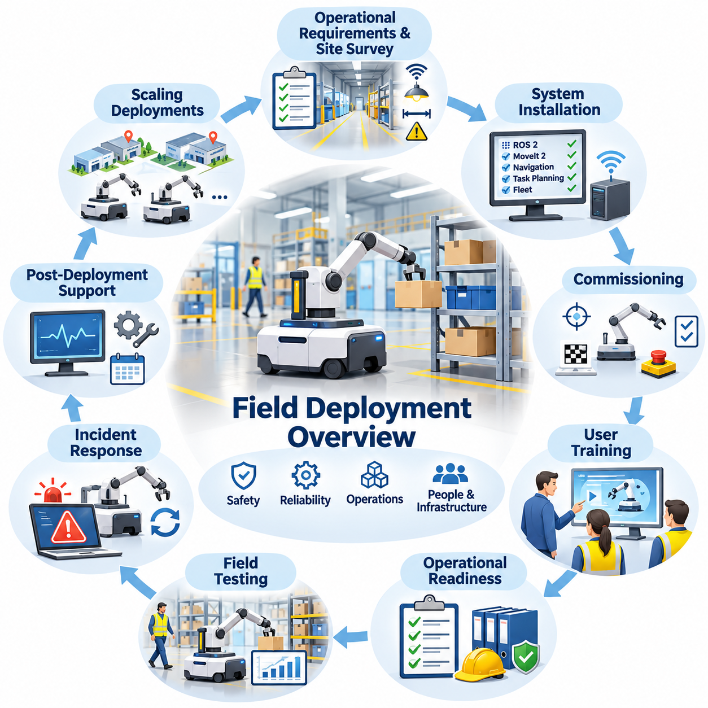
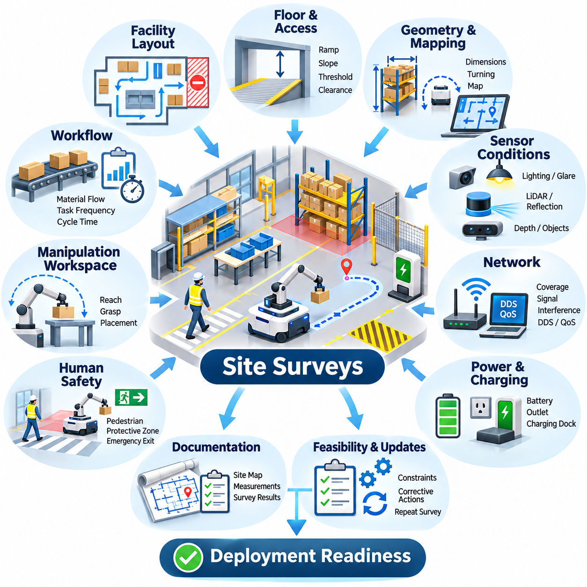
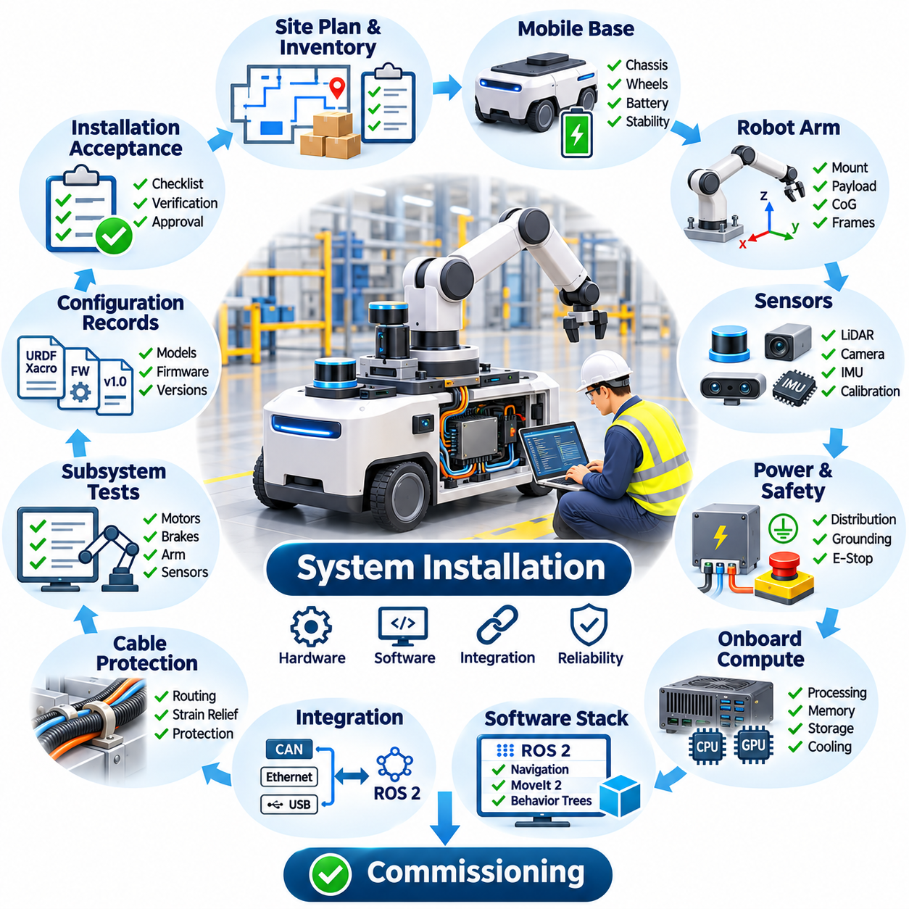
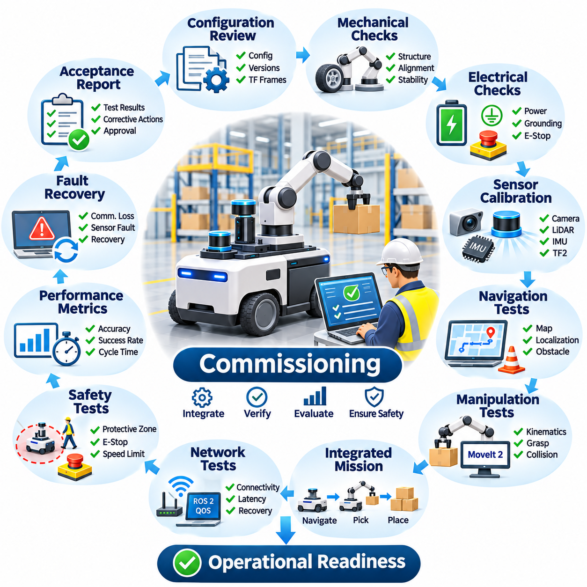
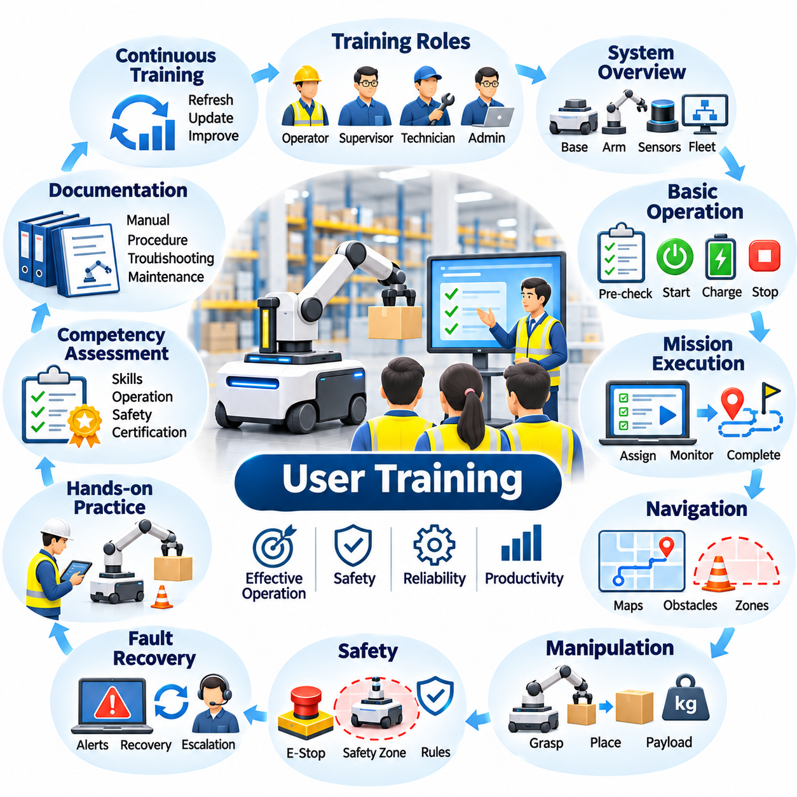
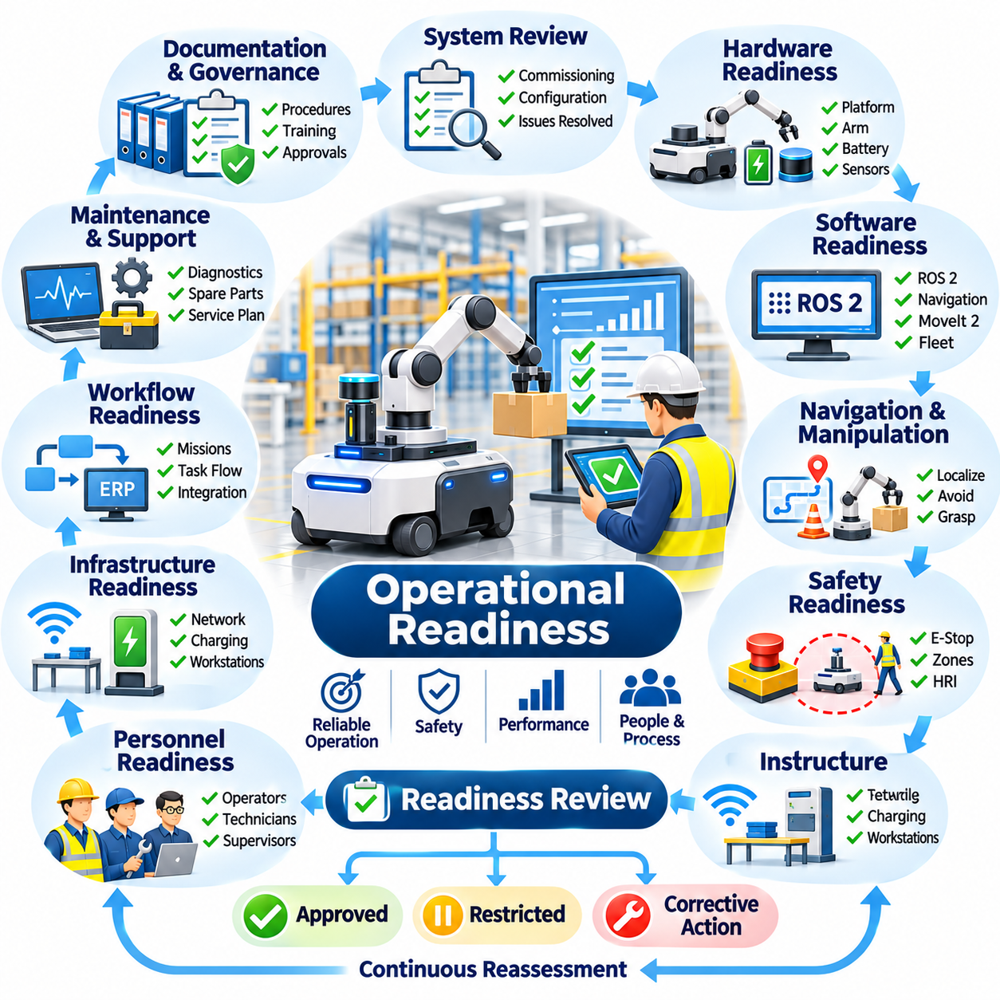
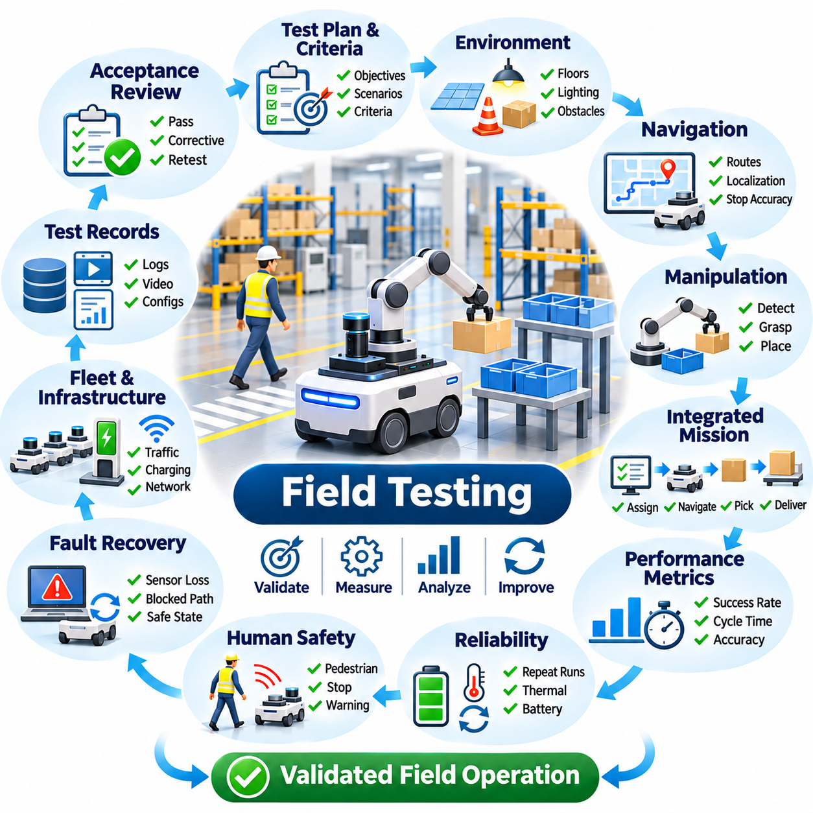
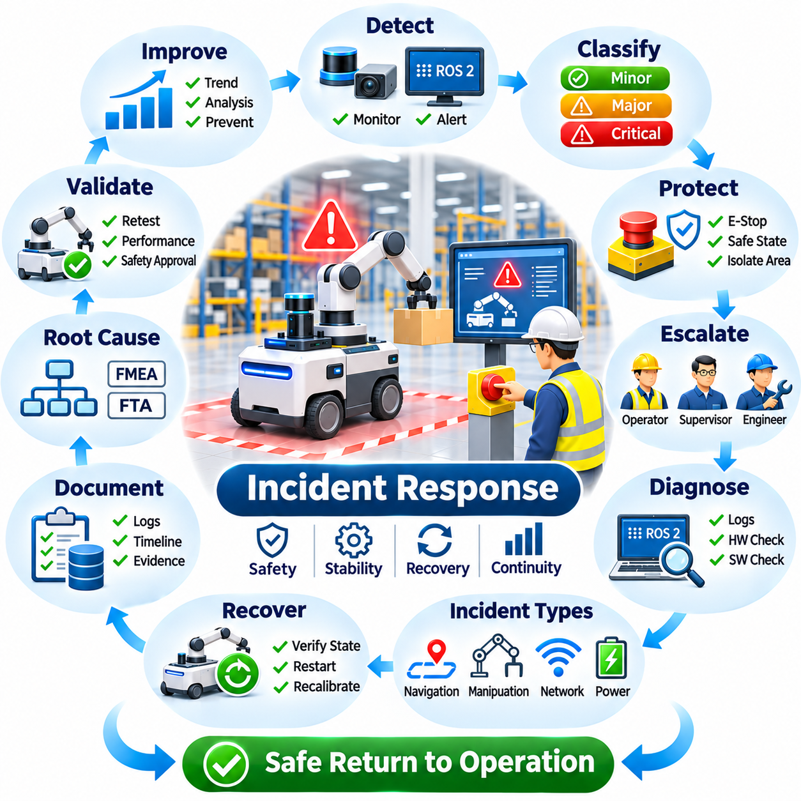
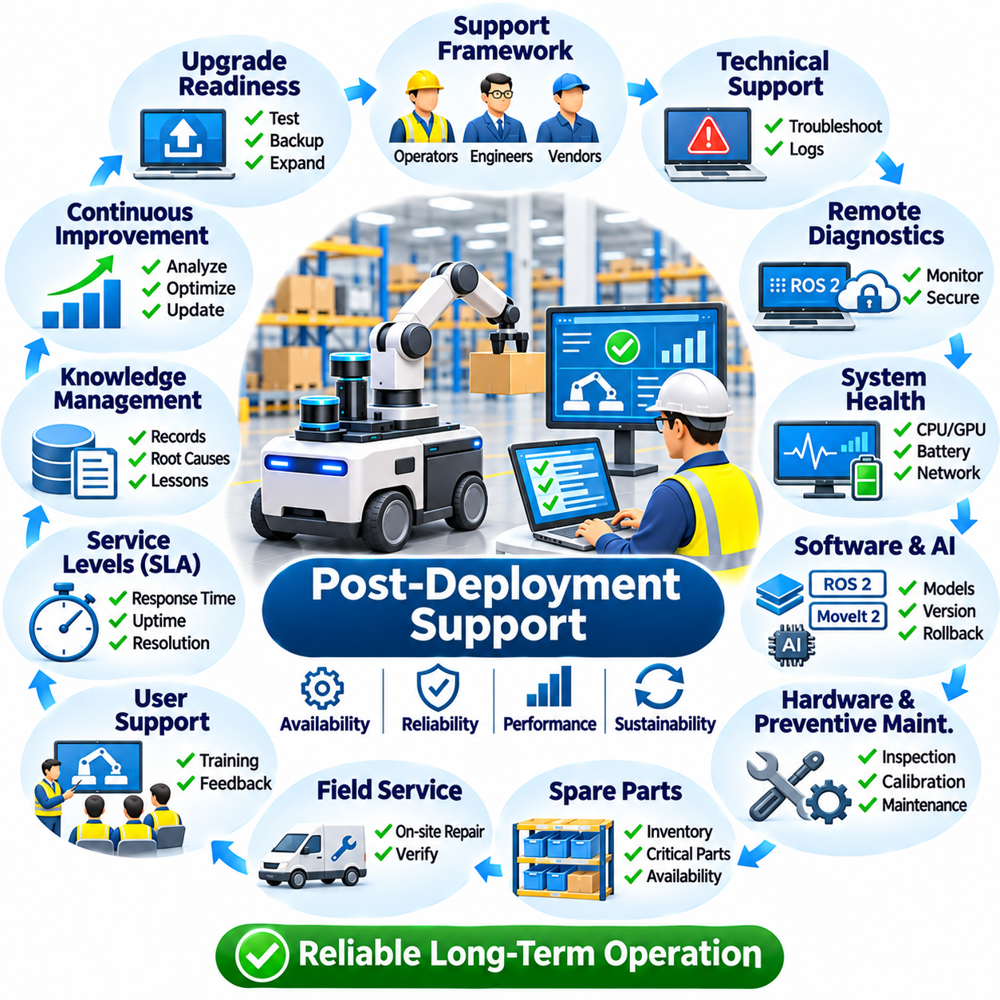
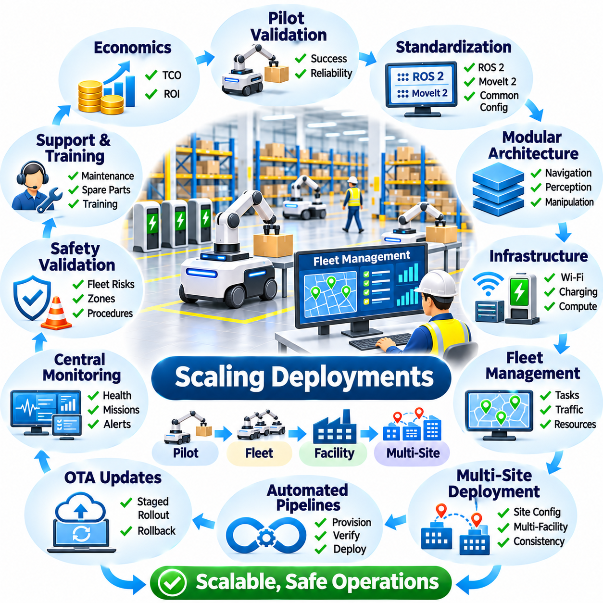

# Chapter 11. Field Deployment

## 01 Field Deployment Overview

{width="7.268055555555556in" height="7.268055555555556in"}

현장 배포(Field Deployment)는 이동형 매니퓰레이션 시스템(Mobile Manipulation System)을 통제된 개발 환경에서 실제 운영 시설로 이전하는 과정이다. 여기에는 하드웨어 설치와 소프트웨어 실행 이상의 작업이 포함된다. 로봇은 기존 작업 흐름, 인프라, 안전 요구사항 및 사람의 활동 속에서 안정적으로 작동해야 한다. 성공적인 배포는 로봇, 운영 환경, 작업자 및 기업 시스템 간의 안정적인 연계를 구축하고, 기술적 성능이 실제 운영 환경의 요구사항을 충족하도록 보장한다.

실험실 테스트와 달리 현장 배포에서는 개발 과정에서 완전히 재현하기 어려운 환경적 조건이 발생한다. 실제 시설에는 변화하는 작업 공간 배치, 이동하는 작업자, 임시 장애물, 반사 표면, 네트워크 간섭 및 예기치 않은 운영 상황이 존재한다. 따라서 이동형 매니퓰레이터(Mobile Manipulator)는 이러한 조건에서 안정적인 주행, 위치 추정, 객체 인식, 모션 계획 및 조작 성능을 입증해야 한다. 배포 엔지니어링은 실험실에서 확보한 성능이 현장에서도 그대로 유지될 것이라고 가정하지 않고 환경적 변동성을 고려해야 한다.

배포 프로세스는 대상 시설의 운영 요구사항과 물리적 특성을 파악하는 것에서 시작한다. 엔지니어는 로봇이 수행할 작업, 이동할 위치, 조작할 객체, 작업자 및 기존 장비와의 상호작용을 파악해야 한다. 이러한 요구사항은 현장 조사, 시스템 구성, 설치 계획, 시운전 및 운영 검증을 위한 기반을 형성한다. 명확한 배포 목표는 운영 준비 상태를 평가하기 위한 측정 가능한 기준도 제공한다.

현장 조사(Site Survey)는 이동형 매니퓰레이션 시스템을 실제 운영 환경에 적응시키는 데 필요한 정보를 제공한다. 엔지니어는 바닥 상태, 통로의 폭, 접근 제한 구역, 충전 위치, 작업 공간, 조명 조건, 통신 커버리지 및 잠재적인 안전 위험 요소를 조사한다. 또한 위치 추정, 인식 및 조작 성능에 영향을 줄 수 있는 환경적 특성을 확인한다. 조사 결과는 실제 설치가 시작되기 전에 주행 지도, 센서 매개변수, 로봇 경로, 작업 공간 경계 및 인프라 요구사항을 설정하는 데 활용된다.

시스템 설치(System Installation)는 배포 설계를 실제 운영 가능한 구성으로 구현하는 과정이다. 여기에는 이동형 플랫폼과 매니퓰레이터의 조립, 센서 및 제어기 연결, 전원 시스템 구성, 네트워크 연결 설정, 지원 인프라 통합이 포함된다. ROS 2 노드, 내비게이션 시스템, MoveIt 2, 작업 계획기, 행동 트리(Behavior Tree) 및 플릿 관리 서비스와 같은 소프트웨어 구성요소도 일관된 방식으로 설치하고 설정해야 한다. 설치 절차는 하드웨어와 소프트웨어의 호환성을 유지하는 동시에 구성 변경 사항을 추적할 수 있도록 해야 한다.

시운전(Commissioning)은 설치된 시스템이 정규 운영에 투입되기 전에 정상적으로 작동하는지 검증하는 과정이다. 엔지니어는 센서 보정, 좌표 변환, 위치 추정 정확도, 주행 동작, 매니퓰레이터 기구학, 충돌 검사, 통신 인터페이스 및 비상 정지 기능을 검증한다. 통합 테스트를 통해 이동형 베이스와 로봇 팔이 예상치 못한 불안정성이나 위험한 상호작용을 유발하지 않고 움직임을 조율할 수 있는지 확인한다. 또한 시운전 과정에서는 오류 복구 절차, 시작 및 종료 시퀀스, 통신 장애 또는 구성요소 고장에 대한 대응도 점검해야 한다.

사용자 교육(User Training)은 기술적 성능과 작업자의 이해가 모두 운영 신뢰성에 영향을 미치기 때문에 필수적이다. 운영자는 로봇의 시작과 정지, 미션 할당, 작업 실행 모니터링, 시스템 경고 해석 및 비정상 상황 대응 방법을 학습해야 한다. 유지보수 담당자는 진단 도구, 센서 점검, 구성요소 교체 및 소프트웨어 복구에 관한 추가적인 지식이 필요하다. 교육은 실제 작업장의 운영 절차를 반영해야 하며 운영자, 감독자, 유지보수팀 및 기술 지원 담당자의 책임을 명확하게 정의해야 한다.

운영 준비 상태(Operational Readiness)는 전체 배포 시스템이 생산 활동에 투입될 수 있을 만큼 충분히 준비되었는지를 결정한다. 이 평가는 시스템 가용성, 작업 완료 성능, 주행 신뢰성, 조작 정확도, 안전 기능, 충전 절차, 네트워크 안정성 및 유지보수 체계를 고려한다. 문서에는 운영 지침, 구성 기록, 위험성 평가, 비상 대응 절차 및 문제 발생 시 연락 체계가 포함되어야 한다. 운영 준비 상태는 통제된 환경에서 성공적으로 시연했는지에만 의존하지 않고 객관적인 인수 기준을 통해 확립해야 한다.

현장 테스트(Field Testing)는 대표적인 운영 조건에서 로봇을 평가하고 실제 작업 흐름 중에도 통합 기능이 안정적으로 유지되는지 검증한다. 테스트에는 정상적인 미션 수행, 반복 작업 실행, 환경 조건 변화, 사람과의 상호작용, 장애물 대응 및 예상 가능한 고장으로부터의 복구가 포함되어야 한다. 엔지니어는 작업 성공률, 사이클 시간, 주행 오류, 조작 실패, 작업자 개입 빈도 및 시스템 가동 중단 시간을 기록해야 한다. 이러한 측정 결과는 예상 성능과 실제 운영 성능 사이의 차이를 파악하는 데 도움을 준다.

사고 대응(Incident Response)은 운영을 중단시키거나 안전 위험을 초래할 수 있는 예기치 않은 상황에 체계적으로 대응하기 위한 절차를 제공한다. 사고에는 위치 추정 실패, 경로 차단, 객체 낙하, 통신 중단, 예상하지 못한 사람과의 상호작용, 기계적 결함 및 매니퓰레이터의 비정상적인 움직임 등이 포함될 수 있다. 시스템은 안전 정지, 고장 식별, 이벤트 기록, 운영자 알림 및 통제된 복구를 지원해야 한다. 중대한 사고가 발생하면 근본 원인을 조사하고 하드웨어, 소프트웨어, 환경 설정 또는 운영 절차의 수정이 필요한지 판단해야 한다.

배포 후 지원(Post-Deployment Support)은 초기 설치 및 인수 절차가 완료된 이후에도 시스템 신뢰성을 유지하는 역할을 한다. 지속적인 모니터링은 반복적인 고장, 성능 저하, 구성 문제 및 새롭게 발생하는 유지보수 요구사항을 식별하는 데 도움을 준다. 지원 활동에는 원격 진단, 소프트웨어 수정, 센서 재보정, 예비 부품 관리, 예방 정비 및 운영자 지원이 포함될 수 있다. 운영 피드백은 체계적으로 수집하고 엔지니어링 개선에 반영해야 하며, 이를 통해 실제 배포된 시스템은 서비스 수명 전반에 걸쳐 더욱 높은 신뢰성을 확보할 수 있다.

배포 확장(Scaling Deployments)은 검증된 솔루션을 추가 로봇, 작업 공간, 생산 구역 또는 다른 시설로 확대하는 과정이다. 반복적인 배포를 위해서는 표준화된 하드웨어 구성, 재사용 가능한 소프트웨어 패키지, 문서화된 설치 절차, 일관된 안전성 평가 및 반복 가능한 시운전 방법이 필요하다. 그러나 서로 다른 현장은 작업 공간 배치, 작업 흐름, 네트워크 환경 및 운영 제약조건에서 고유한 차이를 가질 수 있다. 따라서 확장 가능한 배포 전략은 표준화된 엔지니어링 절차와 통제된 현장별 구성을 결합해야 한다. 이를 통해 조직은 신뢰성, 안전성 및 운영 일관성을 저하시키지 않으면서 이동형 매니퓰레이션 역량을 확대할 수 있다.

## 02 Site Surveys

{width="7.268055555555556in" height="7.268055555555556in"}

현장 조사(Site Survey)는 실제 시설에서 이동형 매니퓰레이션 시스템(Mobile Manipulation System)을 배포하기 위한 기술적·운영적 기반을 확립하는 과정이다. 현장 조사는 설치 작업이 시작되기 전에 물리적 환경, 인프라, 운영 작업 흐름 및 안전 제약조건을 체계적으로 파악하는 데 목적이 있다. 이를 통해 로봇의 주행, 인식, 조작, 통신 및 인간과의 상호작용에 영향을 미칠 수 있는 환경적 조건을 식별하고, 배포 엔지니어가 적절한 시스템 구성을 사전에 준비할 수 있도록 한다.

현장 조사는 대상 시설의 배치와 예정된 운영 시나리오를 이해하는 것에서 시작한다. 엔지니어는 이동형 매니퓰레이터가 작동할 생산 구역, 창고, 물류 경로, 작업 공간, 보관 위치 및 출입 제한 구역을 조사한다. 또한 로봇의 이동과 기존 작업자의 활동, 자재 흐름 및 장비 운영 사이의 관계를 파악해야 한다. 이러한 정보는 적절한 배포 위치를 결정하는 데 도움을 주며, 로봇 시스템의 현실적인 운영 범위를 설정하는 기반이 된다.

바닥 상태와 물리적 접근성은 환경 평가에서 중요한 고려사항이다. 엔지니어는 바닥 재질, 표면의 불균일성, 경사, 바닥 이음부, 문턱, 경사로 및 서로 다른 바닥 높이 사이의 전환 구간을 평가한다. 이러한 특성은 바퀴의 접지력, 진동, 위치 추정 안정성 및 이동형 플랫폼의 적재물 안전 운반 능력에 영향을 미친다. 이동형 매니퓰레이터는 팔을 확장하고 객체를 취급하는 동안 안정성을 유지하면서 좁은 통로도 충분한 여유 공간을 확보하여 주행할 수 있어야 한다.

기하학적 매핑(Geometric Mapping)은 주행과 조작에 필요한 공간 정보를 제공한다. 엔지니어는 통로 폭, 복도 크기, 작업대 위치, 선반 높이, 장애물 위치 및 회전에 필요한 공간을 측정한다. 또한 로봇이 정지하거나 회전하고, 장비에 접근하거나 조작 작업을 수행해야 하는 구역을 식별한다. 이러한 측정값은 ROS 2 내비게이션 구성요소, 모션 계획기 및 작업 실행 시스템에서 사용하는 주행 지도와 환경 표현을 생성하는 데 활용된다.

환경 인식 조건(Environmental Perception Conditions)은 조명과 표면 특성에 따라 센서의 작동 방식이 달라질 수 있으므로 반드시 조사해야 한다. 카메라 시스템은 그림자, 눈부심, 반사, 낮은 조도 또는 색온도 변화의 영향을 받을 수 있다. LiDAR 센서는 투명한 표면, 반사 재질, 유리 칸막이 및 특정 기하학적 모호성을 가진 객체를 인식하는 데 어려움을 겪을 수 있다. 깊이 카메라(Depth Camera) 역시 햇빛과 반사 객체의 영향을 받을 수 있다. 현장 조사 결과는 센서 배치, 보정 요구사항, 인식 시스템 설정 및 적절한 센싱 기술의 선정에 반영해야 한다.

네트워크 인프라는 현장 조사의 또 다른 핵심 요소이다. 이동형 매니퓰레이터는 미션 할당, 플릿 협업, 원격 감독, 진단 및 데이터 교환을 위해 안정적인 통신에 의존한다. 엔지니어는 무선 통신 커버리지, 액세스 포인트 위치, 신호 강도, 간섭 발생원, 네트워크 혼잡 및 운영 구역 내 연결 상태를 조사해야 한다. 통신 요구사항에는 ROS 2 미들웨어, DDS 디스커버리, 서비스 품질(Quality of Service) 설정, 원격 모니터링 트래픽 및 기업 시스템과의 보안 연결 가용성도 고려해야 한다.

배포 전에 전원 인프라와 충전 환경도 평가해야 한다. 엔지니어는 사용 가능한 전기 콘센트, 충전 스테이션 위치, 전압 요구사항, 접지 조건 및 전기 설비 설치에 대한 제한사항을 파악한다. 충전 위치는 시설의 일반적인 운영을 방해하거나 작업자와 다른 차량에 위험을 초래하지 않아야 한다. 배터리 용량, 예상 미션 수행 시간, 충전 빈도 및 플릿 활용률을 종합적으로 고려하여 기존 인프라가 지속적인 운영을 지원할 수 있는지 판단해야 한다.

인간과의 상호작용 및 작업장 안전은 환경 평가의 중요한 구성요소이다. 현장 조사팀은 보행자 이동 경로, 공유 작업 공간, 비상구, 대피 경로, 위험 구역 및 작업자가 로봇과 정기적으로 상호작용하는 위치를 식별한다. 또한 시야 확보 조건, 잠재적인 충돌 구역 및 예기치 않은 사람의 이동이 발생할 수 있는 구역을 조사한다. 이러한 관찰 결과는 운영 속도 제한, 보호 구역, 비상 정지 요구사항 및 적절한 인간-로봇 상호작용(Human-Robot Interaction) 절차를 정의하는 데 활용된다.

조작 작업 공간(Manipulation Workspace)은 이동형 주행에 필요한 사항 외에도 추가적인 측정이 필요하다. 엔지니어는 작업대 크기, 객체 제시 위치, 선반 구조, 파지 위치, 배치 표면 및 대상 객체에 대한 접근성을 조사한다. 또한 이동형 베이스의 위치와 매니퓰레이터 작업 공간 사이의 관계도 평가해야 한다. 충분한 여유 공간이 없거나 베이스 위치가 적절하지 않으면 도달 가능한 작업 공간이 줄어들고 불안정한 자세가 발생할 수 있다. 이러한 측정 결과는 매니퓰레이터 보정, 파지 계획, 충돌 모델링 및 작업 실현 가능성 평가를 지원한다.

운영 작업 흐름 분석(Operational Workflow Analysis)은 물리적인 현장 조건과 실제 생산 요구사항을 연결한다. 엔지니어는 시설 내 자재의 이동 방식, 작업자의 기존 작업 수행 방식, 객체의 임시 보관 위치 및 교대 근무에 따른 장비 가용성 변화를 관찰한다. 또한 미션 순서, 작업 빈도, 예상 사이클 시간 및 자동화 기회를 식별한다. 이러한 작업 흐름을 이해하면 로봇 배포 위치, 미션 우선순위, 플릿 규모 및 기존 제조 실행 시스템(Manufacturing Execution System)이나 창고 관리 시스템(Warehouse Management System)과의 통합 요구사항을 결정하는 데 도움이 된다.

현장 조사 결과는 체계적인 엔지니어링 문서로 정리해야 한다. 현장 지도, 치수 측정값, 센서 관찰 결과, 네트워크 평가, 전원 요구사항, 안전성 조사 결과 및 운영 제약조건을 일관된 형식으로 기록해야 한다. 사진과 주석이 포함된 평면도는 설계 결정에 필요한 추가적인 근거를 제공할 수 있다. 이러한 기록은 설치 계획, 주행 설정, 시운전 및 향후 유지보수를 위한 참조 자료가 된다. 정확한 문서를 유지하면 배포 환경이 변경될 때 발생할 수 있는 설정 오류도 줄일 수 있다.

완전한 현장 조사는 실현 가능성 평가와 식별된 배포 제약조건 목록을 작성하는 것으로 마무리해야 한다. 엔지니어는 기존 시설이 대규모 인프라 변경 없이 예정된 로봇 운영을 지원할 수 있는지 평가한다. 바닥 상태, 네트워크 커버리지, 충전 접근성, 조작 공간 및 안전 요구사항과 관련된 미해결 문제는 적절한 시정 조치와 함께 문서화해야 한다. 최종 평가는 배포 승인에 필요한 근거를 제공하고 설치 과정에서 예상하지 못한 엔지니어링 변경이 발생할 가능성을 줄여준다.

현장 조사는 일회성 점검이 아니라 반복적으로 수행되는 엔지니어링 활동으로 다루어야 한다. 초기 평가 이후에도 시설 배치, 생산 공정, 장비 위치 및 네트워크 구성이 변경될 수 있다. 따라서 중요한 환경 변화가 발생하면 주행 지도, 안전 구역, 센서 구성 및 운영 절차를 다시 검토해야 한다. 배포 환경에 대한 최신 정보를 지속적으로 유지함으로써 조직은 시스템의 신뢰성을 보존하고 이동형 매니퓰레이션 운영의 장기적인 확장을 지원할 수 있다.

## 03 System Installation

{width="7.268055555555556in" height="7.268055555555556in"}

시스템 설치(System Installation)는 배포 설계를 실제로 조립하고 운영 가능한 상태로 연결된 이동형 매니퓰레이션 시스템(Mobile Manipulation System)으로 구현하는 과정이다. 여기에는 이동형 플랫폼, 로봇 팔, 센서, 컴퓨팅 장치, 전기 구성요소, 통신 인프라 및 지원 소프트웨어의 설치가 포함된다. 주요 목적은 기계적 안정성, 전기적 신뢰성 및 시스템 호환성을 확보하면서 운영 요구사항을 충족하는 일관된 하드웨어 및 소프트웨어 구성을 구축하는 것이다.

설치 계획은 현장 조사(Site Survey) 결과와 승인된 시스템 아키텍처를 검토하는 것에서 시작해야 한다. 엔지니어는 장비 위치, 설치 순서, 전원 공급 가능 여부, 네트워크 접근성, 기계적 인터페이스 및 환경적 제약조건을 확인해야 한다. 장비 사양, 구성요소 목록, 설치 도면 및 구성 기록은 장비가 시설에 반입되기 전에 검토해야 한다. 이러한 준비는 설치 지연을 줄이고 서로 다른 공급업체에서 제공한 구성요소 사이의 호환성 문제를 예방한다.

로봇 팔과 기타 장비를 통합하기 전에 이동형 플랫폼을 먼저 설치하고 점검해야 한다. 기계적 조립에는 차체, 구동 모듈, 바퀴, 서스펜션 구성요소, 배터리 시스템, 보호 구조물 및 장착 인터페이스가 포함된다. 엔지니어는 구조적 건전성, 기계적 정렬, 적재 용량, 지상고 및 무게 분포를 검증해야 한다. 특히 매니퓰레이터의 움직임과 적재물의 변화는 주행 및 조작 중 플랫폼 안정성에 영향을 미칠 수 있으므로 무게중심에 특별한 주의를 기울여야 한다.

로봇 팔 설치(Robotic Arm Installation)는 이동형 베이스에 정확한 기계적 위치를 확보하고 견고하게 통합하는 작업이다. 장착 구조물은 과도한 진동이나 변형 없이 예상되는 적재 하중, 동적 힘 및 운영 조건을 견딜 수 있어야 한다. 엔지니어는 장착 치수, 체결 상태, 관절 접근성, 케이블 배선 및 로봇 팔 베이스와 이동형 플랫폼 좌표계 사이의 관계를 확인해야 한다. 적절한 설치는 정확한 기구학 모델링, 모션 계획 및 이동형 조작 협업을 위한 기계적 기반을 확립한다.

센서 설치(Sensor Installation)는 환경 인식과 위치 추정의 품질을 결정한다. 카메라, LiDAR 센서, 깊이 카메라, IMU, 힘-토크 센서 및 기타 측정 장치는 각각의 기능적 요구사항에 따라 배치해야 한다. 센서 장착 위치는 충분한 시야각을 확보하면서 진동, 가림 현상, 반사 및 주변 장비로부터 발생하는 간섭을 최소화해야 한다. 또한 후속 보정 절차를 지원하기 위해 센서 보호, 유지보수 접근성, 케이블 연결 및 장착 위치의 반복 재현성도 고려해야 한다.

전기 설치(Electrical Installation)는 배터리, 전력 분배 장치, 모터 제어기, 컴퓨팅 장치, 센서 및 안전 회로를 연결하는 작업이다. 엔지니어는 전압 수준, 전류 용량, 접지, 회로 보호, 커넥터 사양 및 전기적 절연 요구사항을 검증해야 한다. 전기적 노이즈와 전압 변동을 줄이기 위해 모터, 컴퓨팅 하드웨어 및 민감한 센서에 별도의 전력 분배 구성을 적용할 수 있다. 비상 정지 회로와 보호 인터록은 시스템이 운영 테스트에 들어가기 전에 승인된 안전 아키텍처에 따라 통합해야 한다.

온보드 컴퓨팅 환경(Onboard Computing Environment)은 주행, 인식, 조작 및 작업 실행에 필요한 연산 자원을 제공한다. 산업용 컴퓨터, 임베디드 AI 플랫폼 및 네트워크 장치는 적절한 열 관리와 환경 보호 기능을 갖추어 견고하게 장착해야 한다. 엔지니어는 프로세서 호환성, 메모리 용량, 저장 공간, GPU 자원, 냉각 성능 및 전력 요구사항을 검증해야 한다. 또한 컴퓨팅 장치는 센서 데이터에 안정적으로 접근하고 모터 제어기, 안전 시스템 및 외부 인프라와 통신할 수 있어야 한다.

소프트웨어 설치(Software Installation)는 전체 로봇 시스템을 위한 실행 환경을 구축한다. ROS 2, 장치 드라이버, 센서 인터페이스, 내비게이션 패키지, MoveIt 2, 작업 계획기, 행동 트리(Behavior Tree) 및 플릿 통신 구성요소는 서로 호환되는 버전과 검증된 설정을 사용하여 설치해야 한다. 엔지니어는 미들웨어 설정, 네트워크 인터페이스, 좌표 프레임 정의 및 소프트웨어 종속성을 일관되게 구성해야 한다. 컨테이너 기반 배포(Containerized Deployment)는 개발 컴퓨터, 온보드 제어기 및 여러 대의 배포 로봇에서 통제된 소프트웨어 환경을 유지함으로써 재현성을 향상시킬 수 있다.

기계적, 전기적 및 소프트웨어 통합은 통제된 인터페이스 검증을 통해 수행해야 한다. 각 하위 시스템은 센서, 액추에이터, 제어기 및 컴퓨팅 장치를 포함하여 의존하는 구성요소와 정확하게 통신해야 한다. 엔지니어는 CAN, Ethernet, USB 및 기타 지원 인터페이스와 같은 통신 프로토콜을 검증해야 한다. ROS 2 토픽(Topics), 서비스(Services) 및 액션(Actions)도 점검하여 센서 측정값, 액추에이터 명령, 시스템 상태 및 작업 요청이 소프트웨어 구성요소 사이에서 올바르게 교환되는지 확인해야 한다.

케이블 관리(Cable Management)와 물리적 보호는 장기적인 신뢰성에 직접적인 영향을 미치는 중요한 설치 작업이다. 전원 케이블, 통신선 및 센서 연결선은 움직이는 관절, 바퀴, 서스펜션 구성요소 및 유지보수 접근 지점을 방해하지 않도록 배선해야 한다. 필요한 경우 보호용 전선관, 케이블 스트레인 릴리프(Strain Relief), 적절한 커넥터 및 견고한 장착 구조를 사용해야 한다. 또한 예상 운영 조건에서 발생할 수 있는 전자기 간섭, 발열, 먼지, 습기 및 기계적 마모도 고려해야 한다.

물리적 설치가 완료되면 전체 미션 실행을 시도하기 전에 엔지니어가 초기 하위 시스템 검증을 수행해야 한다. 모터 제어기, 조향 시스템, 브레이크, 엔코더, 센서, 컴퓨팅 장치 및 통신 인터페이스를 개별적으로 점검해야 한다. 이동형 플랫폼은 제어된 이동, 정지 동작 및 기본적인 내비게이션 기능을 테스트해야 한다. 로봇 팔은 관절 움직임, 위치 피드백, 엔드이펙터 작동 및 통신 신뢰성을 평가해야 한다. 이러한 사전 점검은 통합 시스템 테스트가 시작되기 전에 설치 결함을 식별하는 데 도움을 준다.

구성 관리(Configuration Management)는 설치된 시스템을 일관되게 재현하고 유지보수하며 업그레이드할 수 있도록 한다. 엔지니어는 하드웨어 일련번호, 펌웨어 버전, 소프트웨어 패키지, 보정 매개변수, 네트워크 설정, 제어기 구성 및 구성요소 간의 관계를 기록해야 한다. URDF와 Xacro를 사용한 로봇 기술 파일(Robot Description)은 센서 위치, 관절 제한, 충돌 형상 및 좌표 프레임을 포함하여 실제 설치된 기계적 구조를 정확하게 반영해야 한다. 정확한 구성 기록을 유지하면 문제 해결, 시스템 복제 및 여러 시설에 걸친 향후 배포를 지원할 수 있다.

시스템 설치는 배포의 물리적·기술적 완전성을 확인하는 설치 인수 검토(Installation Acceptance Review)로 마무리해야 한다. 검토 과정에서는 기계적 조립, 전기적 안전성, 센서 연결 상태, 컴퓨팅 성능, 소프트웨어 가용성, 네트워크 통신 및 문서화 상태를 확인해야 한다. 해결되지 않은 설치 문제는 시정 조치 및 담당자와 함께 기록해야 한다. 적절하게 완료된 설치는 이동형 매니퓰레이션 시스템의 시운전, 안전성 검증, 운영 테스트 및 장기적인 유지보수를 위한 안정적인 기반을 제공한다.

## 04 Commissioning

{width="7.268055555555556in" height="7.268055555555556in"}

시운전(Commissioning)은 설치된 이동형 매니퓰레이션 시스템(Mobile Manipulation System)이 올바르게 구성되고, 기능적으로 통합되었으며, 실제 운영에 투입할 준비가 되었는지 검증하는 과정이다. 시운전은 기계, 전기, 센싱, 컴퓨팅 및 소프트웨어 구성요소가 의도된 시스템 아키텍처에 따라 함께 작동하는지에 대한 신뢰를 확보한다. 개별적인 설치 점검과 달리 시운전은 통제된 운영 조건에서 전체 로봇 시스템의 동작을 평가한다. 주요 목적은 통합 문제를 식별하고, 시스템 성능을 검증하며, 운영 준비 상태에 대한 문서화된 근거를 확보하는 것이다.

시운전은 설치 기록, 하드웨어 구성, 소프트웨어 버전 및 현장별 매개변수를 체계적으로 검토하는 것에서 시작한다. 엔지니어는 설치된 구성요소가 승인된 사양과 일치하는지, 필요한 모든 연결이 올바르게 이루어졌는지 확인한다. 기능 테스트에 앞서 로봇 기술 파일(Robot Description), 좌표 프레임, 센서 구성, 네트워크 설정 및 제어기 매개변수를 검토해야 한다. 승인된 설계와 실제 설치 상태 사이에 차이가 있다면 후속 테스트에 구성 불일치가 영향을 미치지 않도록 해당 내용을 문서화하고 평가해야 한다.

기계적 검증(Mechanical Verification)은 이동형 플랫폼과 로봇 매니퓰레이터의 물리적 건전성 및 운영 특성을 평가한다. 엔지니어는 구조적 연결부, 바퀴 정렬, 조향 장치, 서스펜션 구성요소, 관절 조립 상태, 장착 인터페이스 및 엔드이펙터를 검사한다. 또한 적재 용량, 기계적 간극, 케이블 배선 및 통합 플랫폼의 안정성을 검증해야 한다. 특히 매니퓰레이터의 확장, 적재물 이동 및 가속은 이동형 시스템의 안정성에 영향을 미칠 수 있으므로 로봇의 무게중심과 동적 거동에 특별한 주의를 기울여야 한다.

전기적 시운전(Electrical Commissioning)은 전력 분배 및 제어 회로가 지정된 한계 내에서 작동하는지 검증한다. 배터리 전압, 충전 동작, 전류 소비량, 접지, 보호 장치, 비상 정지 회로 및 전기적 연결 상태를 점검해야 한다. 모터 제어기, 엔코더, 브레이크 및 안전 관련 인터페이스는 제어 명령과 고장 조건에 올바르게 반응해야 한다. 또한 전압 변동, 전기적 노이즈 및 예기치 않은 전원 중단이 컴퓨팅 장치, 센서 또는 통신 인터페이스에서 불안정한 동작을 유발하지 않는지 검증해야 한다.

센서 시운전(Sensor Commissioning)은 로봇의 인식 및 위치 추정 기능의 정확성과 일관성을 확보한다. 카메라, LiDAR 센서, IMU, 깊이 카메라 및 힘-토크 센서의 정상 작동 여부, 장착 정렬 상태, 통신 및 보정 상태를 확인해야 한다. 센서와 로봇 베이스 및 매니퓰레이터 사이의 좌표 변환은 구성된 TF2 프레임워크를 사용하여 검증해야 한다. 보정 오류는 인식, 위치 추정 및 조작 파이프라인 전반으로 전파될 수 있으므로 정확한 센서 정렬은 안정적인 통합 운영을 위한 필수 조건이다.

내비게이션 시운전(Navigation Commissioning)은 구성된 환경 내에서 이동형 플랫폼이 안전하고 정확하게 이동할 수 있는지 평가한다. 엔지니어는 지도 로딩, 위치 추정 초기화, 장애물 감지, 경로 계획, 궤적 실행 및 복구 동작을 검증한다. 로봇은 회전 구간, 좁은 통로, 교차로 및 임시 장애물이 포함된 대표적인 이동 경로에서 테스트해야 한다. 장애물 위치와 환경적 특성이 달라지는 상황을 포함하여 다양한 운영 조건에서 주행 성능을 평가해야 한다. 테스트 결과는 설정된 내비게이션 매개변수가 실제 시설의 요구사항에 적합한지 판단하는 데 활용된다.

매니퓰레이터 시운전(Manipulator Commissioning)은 로봇 팔, 엔드이펙터 및 이동형 베이스의 협조 동작에 중점을 둔다. 엔지니어는 관절 제한, 기구학 구성, 모션 계획, 궤적 실행, 파지 기능 및 충돌 감지를 검증한다. MoveIt 2 설정은 관절 제약조건, 충돌 형상, 계획 그룹 및 엔드이펙터 정의를 포함하여 실제 설치된 로봇을 정확하게 표현해야 한다. 테스트를 통해 매니퓰레이터가 기계적 제한을 위반하거나 이동형 플랫폼, 주변 장비 및 환경 구조물과 충돌하지 않고 의도된 작업 공간에 도달할 수 있는지 확인해야 한다.

통합 시스템 테스트(Integrated System Testing)는 개별 구성요소를 분리하여 평가하는 대신 전체 이동형 매니퓰레이션 작업 흐름을 검증한다. 대표적인 미션은 작업 요청 수신, 작업 공간으로의 주행, 이동형 베이스의 위치 설정, 객체 자세 추정, 파지 계획, 객체 조작 및 지정된 위치로의 복귀를 포함할 수 있다. 엔지니어는 ROS 2 노드, 내비게이션 구성요소, 조작 서비스, 작업 계획기 및 행동 트리(Behavior Tree) 사이의 협조 동작을 검증해야 한다. 성공적인 통합을 위해서는 일관된 상태 정보, 안정적인 통신 및 주행과 조작 활동 사이의 예측 가능한 상태 전환이 필요하다.

통신 및 네트워크 시운전(Communication and Network Commissioning)은 온보드 구성요소, 플릿 관리 시스템, 원격 운영 플랫폼 및 기업 인프라 사이의 정보 교환을 검증한다. 엔지니어는 ROS 2 미들웨어 연결성, DDS 디스커버리, 서비스 품질(Quality of Service) 설정, 네트워크 안정성, 메시지 지연 시간 및 통신 복구 동작을 검사한다. 또한 미션 명령, 로봇 상태 정보, 센서 데이터 및 고장 알림이 정확하게 전송되는지 확인해야 한다. 통제된 조건에서 네트워크 중단을 발생시켜 로봇이 안전 상태로 전환하고 예기치 않은 움직임 없이 통신을 복구할 수 있는지 평가해야 한다.

안전 시운전(Safety Commissioning)은 로봇이 정규 작업을 수행하기 전에 보호 기능이 올바르게 작동하는지 확인한다. 비상 정지 장치, 보호 센서, 속도 제한, 충돌 모니터링, 안전 구역 및 제어된 정지 동작을 정의된 조건에서 테스트해야 한다. 엔지니어는 사람의 접근, 예기치 않은 장애물, 통신 장애 및 구성요소 고장에 로봇이 적절하게 반응하는지 검증해야 한다. 안전 관련 기능은 승인된 위험성 평가와 적용 가능한 안전 요구사항에 따라 평가해야 한다. 기능 테스트의 성공만으로 규제 인증이 확보되는 것은 아니며, 공식적인 안전성 검증을 대체하지도 않는다.

성능 시운전(Performance Commissioning)은 통합 시스템이 의도된 운영 요구사항을 충족하는지 판단한다. 엔지니어는 주행 정확도, 조작 정밀도, 작업 완료 시간, 파지 성공률, 통신 신뢰성, 에너지 소비량 및 시스템 가용성을 측정한다. 반복 테스트는 일관된 성능과 일회성 성공을 구분하는 데 도움을 준다. 인수 기준은 테스트 전에 수립해야 하며 이상적인 실험실 조건이 아니라 현실적인 운영 환경을 반영해야 한다. 성능 편차가 발생하면 하드웨어의 한계, 소프트웨어 구성, 환경 조건 또는 통합 문제 중 어떤 요인에서 비롯되었는지 분석해야 한다.

고장 주입 및 복구 테스트(Fault Injection and Recovery Testing)는 비정상적인 조건에서도 시스템이 위험한 동작을 유발하지 않고 대응할 수 있는지 평가한다. 엔지니어는 센서 연결 해제, 통신 손실, 내비게이션 실패, 액추에이터 오류, 배터리 부족 및 조작 작업 중단 등을 모의할 수 있다. 시스템은 비정상 상태를 식별하고 적절한 진단 정보를 생성하며, 정의된 복구 절차를 실행하고, 자동 복구가 적절하지 않은 경우 사람의 개입을 요청해야 한다. 이러한 테스트는 내비게이션과 조작의 고장이 서로 영향을 주어 복잡한 운영 상황을 초래할 수 있는 이동형 매니퓰레이터에서 특히 중요하다.

시운전 결과는 체계적인 검증 및 인수 보고서(Verification and Acceptance Report)에 기록해야 한다. 문서에는 테스트 절차, 초기 구성, 측정된 성능, 식별된 결함, 시정 조치, 소프트웨어 버전, 보정 기록 및 최종 인수 결정이 포함되어야 한다. 해결되지 않은 각 문제에는 명확한 담당자와 적절한 해결 계획을 지정해야 한다. 시운전 중 변경된 구성도 기록하여 최종 운영 시스템을 일관되게 재현하고 유지보수할 수 있도록 해야 한다.

시운전 프로세스는 시스템이 합의된 기능적, 기술적 및 안전 관련 인수 요구사항을 충족한다는 사실을 입증하면 완료된다. 최종 승인은 하위 시스템 검증, 통합 미션 테스트, 성능 평가, 복구 테스트 및 운영 문서화 결과를 종합적으로 고려해야 한다. 남아 있는 제약사항이나 미해결 문제는 배포팀과 시설 운영자에게 명확하게 전달해야 한다. 적절하게 완료된 시운전은 운영 준비 상태 평가, 사용자 교육 및 통제된 현장 배포 단계로 진행하기 위해 필요한 기술적 근거를 제공한다.

## 05 User Training

{width="7.268055555555556in" height="7.268055555555556in"}

사용자 교육(User Training)은 이동형 매니퓰레이션 시스템(Mobile Manipulation System)을 배포하는 데 필수적인 요소이다. 성공적인 운영은 기술적 역량뿐만 아니라 담당자가 로봇과 안전하고 효과적으로 상호작용할 수 있는 능력에도 달려 있기 때문이다. 교육은 운영자, 감독자, 유지보수 기술자 및 시스템 관리자가 로봇의 기능, 운영상 한계 및 대응 절차를 이해하도록 준비시키는 역할을 한다. 궁극적인 목적은 생산성, 안전성 및 장기적인 시스템 신뢰성을 지원하는 일관된 운영 방식을 확립하는 것이다.

교육 프로그램은 사용자 그룹별 책임과 기술적 배경에 따라 설계해야 한다. 운영자는 주로 미션 실행, 로봇 모니터링 및 기본적인 고장 처리에 관한 실무 지식이 필요하다. 감독자는 플릿 성능, 작업 스케줄링, 운영 보고 및 자원 할당을 이해해야 한다. 유지보수 기술자는 하드웨어 점검, 센서 보정, 소프트웨어 진단 및 구성요소 교체에 관한 보다 심층적인 지식이 필요하다. 시스템 관리자는 구성 관리, 네트워크 설정, 사용자 권한 및 소프트웨어 배포 절차를 이해해야 한다.

기초 교육 모듈(Introductory Training Module)은 이동형 매니퓰레이션 시스템의 전체 아키텍처와 작동 원리를 설명해야 한다. 교육 참가자는 자율이동로봇(Autonomous Mobile Robot), 로봇 팔, 센서, 온보드 컴퓨팅 장치 및 플릿 관리 소프트웨어가 서로 어떻게 연동되는지 이해해야 한다. 또한 내비게이션, 인식, 모션 계획, 작업 실행 및 안전 기능 사이의 관계도 소개해야 한다. 이러한 지식은 사용자가 개별 시스템 구성요소가 특정 방식으로 작동하는 이유와 구성요소 간의 상호작용이 전체 운영 성능에 미치는 영향을 이해하는 데 도움을 준다.

기본 운영 교육(Basic Operation Training)은 로봇을 시작하고 설정하며 정지하는 데 필요한 절차에 중점을 둔다. 운영자는 작동 전 시스템 점검, 배터리 상태 확인, 센서 가용성 확인, 네트워크 연결 상태 점검 및 필수 소프트웨어 구성요소 초기화 방법을 학습해야 한다. 또한 시작 시퀀스, 운영 모드, 충전 절차 및 통제된 종료 과정도 이해해야 한다. 이러한 절차를 일관되게 수행하면 운영 오류를 줄이고 예방 가능한 장비 고장을 방지하는 데 도움이 된다.

미션 실행 교육(Mission Execution Training)은 운영자가 작업을 할당하고 자율 작업을 모니터링하는 방법을 학습하도록 한다. 사용자는 운영자 대시보드, 작업 인터페이스, 미션 우선순위, 목적지 선택 및 실행 상태 표시기에 익숙해져야 한다. 로봇이 주행 목표를 수신하고 작업 공간에 접근하며 조작 작업을 수행하고 미션 완료 상태를 보고하는 과정을 이해해야 한다. 또한 비정상적인 실행 상태를 식별하고 안전하고 예측 가능한 운영을 유지하기 위해 언제 사람의 개입이 필요한지 판단하는 방법도 교육해야 한다.

주행 및 환경 상호작용 교육(Navigation and Environmental Interaction Training)은 작업자가 이동형 로봇이 공유 작업 공간에서 어떻게 움직이는지 이해하도록 지원한다. 참가자는 내비게이션 지도, 위치 추정 상태, 계획된 경로, 장애물 감지 및 출입 제한 구역의 의미를 학습해야 한다. 장비의 재배치, 임시 장애물 및 통로 차단을 포함한 물리적 환경의 변화가 주행 성능에 영향을 미칠 수 있다는 점을 이해해야 한다. 운영자는 이동 중인 로봇 주변에 적절한 안전거리를 유지하고 자율 주행을 방해하지 않는 방법도 숙지해야 한다.

조작 교육(Manipulation Training)은 로봇 팔, 엔드이펙터 및 객체 취급 작업에 중점을 둔다. 사용자는 파지, 객체 배치, 작업 공간의 한계, 적재 하중 제한 및 조작 정확도의 기본 원리를 이해해야 한다. 객체의 형상, 위치, 방향, 표면 특성 및 주변 장애물이 파지 성공률에 영향을 미칠 수 있다는 점을 인식해야 한다. 또한 운영자는 파지 실패, 객체 낙하, 로봇 팔의 예상치 못한 움직임 및 통제된 복구 절차가 필요한 상황을 식별하는 방법을 학습해야 한다.

안전 교육(Safety Training)은 이동형 매니퓰레이터 주변에서 작업할 때 필요한 행동 원칙과 책임을 확립한다. 작업자는 비상 정지 장치, 보호 센서, 안전 구역, 속도 제한, 경고 표시기 및 로봇의 비정상적인 동작에 대응하는 절차를 이해해야 한다. 생산 처리량을 유지하기 위해 안전 기능을 우회하거나 비활성화해서는 안 된다는 점을 교육에서 강조해야 한다. 또한 작업자는 보행자 상호작용 규칙, 출입 제한 구역, 비상 대피 절차 및 안전 문제를 보고하기 위한 적절한 의사소통 채널을 이해해야 한다.

고장 처리 및 복구 교육(Fault Handling and Recovery Training)은 사용자가 일반적인 운영 문제에 대응할 수 있도록 준비시킨다. 대표적인 상황에는 위치 추정 손실, 주행 경로 차단, 센서 통신 오류, 배터리 부족, 조작 오류 및 중단된 미션 등이 포함된다. 운영자는 시스템 경고를 해석하고 관련 진단 정보를 수집하며 승인된 복구 절차를 따르는 방법을 학습해야 한다. 또한 승인되지 않은 수리를 시도하거나 시스템을 반복적으로 재시작하는 대신 유지보수 담당자 또는 엔지니어링 지원이 필요한 상황을 구분할 수 있어야 한다.

실습 교육(Practical Training)은 실제 배포된 로봇과 운영 소프트웨어를 사용하여 감독하에 수행하는 훈련을 포함해야 한다. 참가자는 시스템 시작, 미션 할당, 주행 모니터링, 조작 작업 실행, 장애물 대응 및 모의 고장으로부터의 복구와 같은 대표적인 작업을 직접 수행해야 한다. 실습은 사용자가 이론적 지식을 실제 시스템 동작과 연결하도록 도와준다. 교육 시나리오는 적절한 감독과 안전 통제를 유지하면서 점진적으로 복잡도를 높여야 한다.

교육 효과(Training Effectiveness)는 실무 평가와 문서화된 역량 요구사항을 통해 검증해야 한다. 참가자는 위험한 상황을 만들거나 정상적인 운영을 방해하지 않으면서 자신에게 할당된 책임을 수행할 수 있음을 입증해야 한다. 평가 기준에는 시스템 시작의 정확성, 미션 실행, 경보 해석, 비상 대응 및 기본적인 복구 절차가 포함될 수 있다. 교육 기록에는 이수한 교육 모듈, 평가 결과, 개인별 책임 및 독립적인 운영을 승인하기 전에 추가 교육이 필요한 항목을 명시해야 한다.

운영 문서(Operational Documentation)는 정규 교육이 완료된 이후에도 지속적으로 참고할 수 있는 자료를 제공한다. 사용자 매뉴얼, 표준 운영 절차(Standard Operating Procedures), 문제 해결 안내서, 비상 대응 지침 및 유지보수 참고 자료는 관련 담당자가 쉽게 접근할 수 있어야 한다. 문서는 일반적인 제품 사양이 아니라 실제 배포된 시스템의 구성을 반영해야 한다. 명확한 지침, 일관된 용어 및 현실적인 운영 사례는 개인의 경험에 대한 의존도를 줄이고 담당자 변경 시에도 지식이 원활하게 전달되도록 지원한다.

사용자 교육은 일회성 배포 활동이 아니라 지속적인 프로세스로 다루어야 한다. 소프트웨어 업데이트, 로봇 구성 변경, 새로운 운영 작업 및 시설 배치 수정은 새로운 절차나 운영상 제한사항을 발생시킬 수 있다. 따라서 중요한 변경이 발생하거나 운영 평가에서 반복적인 사용자 오류가 확인되면 보수 교육(Refresher Training)을 제공해야 한다. 효과적인 교육 프로그램을 지속적으로 운영함으로써 조직은 운영자의 자신감을 높이고 예방 가능한 사고를 줄이며 이동형 매니퓰레이션 시스템의 안전하고 생산적인 운영을 장기적으로 유지할 수 있다.

## 06 Operational Readiness

{width="7.268055555555556in" height="7.268055555555556in"}

운영 준비 상태(Operational Readiness)는 이동형 매니퓰레이션 시스템(Mobile Manipulation System)이 정규 운영에 투입되기 위해 필요한 기술적, 조직적 및 절차적 준비를 완료한 상태를 의미한다. 이는 로봇, 지원 인프라, 소프트웨어, 인력 및 운영 작업 흐름이 예상되는 운영 조건에서 할당된 작업을 안정적으로 수행할 수 있도록 충분히 준비되었는지 확인하는 과정이다. 운영 준비 상태는 단순히 설치와 시운전이 성공적으로 완료되었는지를 넘어, 전체 배포 시스템이 실제 환경에서 지속적인 운영을 수행할 수 있는지를 평가한다.

운영 준비 상태 평가는 시스템 기능과 배포 요구사항을 종합적으로 검토하는 것에서 시작한다. 엔지니어와 운영 관리자는 시운전 결과, 설치 기록, 구성 설정, 안전성 평가 및 미해결 기술적 문제를 검토한다. 모든 핵심 하위 시스템이 정상적으로 작동하고, 식별된 결함이 해결되었거나 적절한 운영 제한조건과 함께 공식적으로 승인되었는지 확인해야 한다. 운영 준비 여부에 대한 결정은 가정이나 개별적인 성공 시연이 아니라 문서화된 증거를 기반으로 이루어져야 한다.

하드웨어 준비 상태(Hardware Readiness)는 물리적인 로봇 플랫폼이 지속적인 운영에 적합한지 평가한다. 평가 대상에는 이동형 베이스, 로봇 팔, 구동 시스템, 배터리, 센서, 컴퓨팅 장치, 통신 장비 및 엔드이펙터가 포함된다. 엔지니어는 기계적 건전성, 전기적 연결 상태, 적재 하중 제한, 센서 기능 및 구성요소 보호 상태를 검증해야 한다. 또한 예정된 운영 일정을 지원할 수 있도록 적절한 충전 시설, 예비 부품, 유지보수 도구 및 환경 보호 설비가 확보되어야 한다.

소프트웨어 준비 상태(Software Readiness)는 필요한 모든 소프트웨어 구성요소가 배포 환경에 맞게 설치되고 구성되었으며 검증되었는지 확인한다. ROS 2 노드, 내비게이션 패키지, MoveIt 2, 작업 계획기, 행동 트리(Behavior Tree), 플릿 관리 인터페이스 및 원격 모니터링 서비스는 호환되는 버전과 일관된 설정으로 작동해야 한다. 엔지니어는 시작 절차, 통신 인터페이스, 로그 기록 기능, 소프트웨어 종속성 및 복구 메커니즘을 검증해야 한다. 또한 운영 중인 소프트웨어 구성을 문서화하여 운영 변경사항을 통제하고 동일한 환경을 재현할 수 있도록 해야 한다.

주행 및 조작 준비 상태(Navigation and Manipulation Readiness)는 이동형 매니퓰레이션이 플랫폼과 로봇 팔 사이의 협조적인 움직임을 필요로 하므로 두 기능을 함께 평가해야 한다. 로봇은 지정된 작업 공간에서 안정적인 위치 추정, 장애물 회피, 경로 실행, 작업 공간 위치 설정 및 조작 기능을 입증해야 한다. 엔지니어는 조작 작업이 시작되기 전에 이동형 베이스가 충분히 정확한 위치에 도달할 수 있는지 확인해야 한다. 또한 정의된 운영 한계 내에서 환경 조건, 객체 위치 또는 작업 공간의 가용성이 변경되더라도 작업 실행이 예측 가능한 상태로 유지되어야 한다.

안전 준비 상태(Safety Readiness)는 정규 운영을 승인하기 위한 기본적인 필수 요건이다. 평가에서는 비상 정지 기능, 보호 센서, 속도 제한, 충돌 모니터링, 안전 구역 및 비정상적인 상황에 대응하는 절차를 검증해야 한다. 실제 작업장 활동을 고려하여 인간-로봇 상호작용도 평가해야 한다. 운영자는 비상 대응 절차, 출입 제한 구역 및 로봇이 예상과 다르게 작동할 때 자신의 책임과 대응 방법을 이해해야 한다. 해결되지 않은 안전 관련 문제는 제한 없는 운영을 승인하기 전에 반드시 조치해야 한다.

인력 준비 상태(Personnel Readiness)는 조직이 시스템을 운영하고 유지보수하기에 충분한 교육 인력을 확보하고 있는지 결정한다. 운영자는 미션 할당, 로봇 모니터링, 경보 해석, 기본적인 복구 및 비상 대응 능력을 입증해야 한다. 유지보수 기술자는 점검을 수행하고 하드웨어 문제를 식별하며 승인된 서비스 절차를 따를 수 있어야 한다. 감독자와 시스템 관리자 역시 운영상의 책임, 문제 보고 및 상위 담당자에게의 전달 절차, 배포된 시스템을 효과적으로 관리하는 데 필요한 정보를 이해해야 한다.

인프라 준비 상태(Infrastructure Readiness)는 시설이 예상되는 운영 일정을 지원할 수 있는지 평가한다. 네트워크 커버리지, 무선 연결, 충전 스테이션, 전력 공급, 작업 공간 접근성 및 지정된 로봇 운영 구역이 확보되어 있고 정상적으로 작동해야 한다. 또한 배포 환경이 내비게이션 지도, 센서 구성 및 기존에 설정된 안전 경계와 지속적으로 호환되는지 확인해야 한다. 운영을 중단시킬 수 있는 인프라의 제약사항은 적절한 완화 조치와 함께 문서화해야 한다.

운영 작업 흐름 준비 상태(Operational Workflow Readiness)는 로봇의 작업이 기존 비즈니스 프로세스에 적절하게 통합되었는지 확인한다. 미션 정의, 작업 우선순위, 작업 공간 인터페이스, 자재 공급 절차 및 상호작용 규칙을 명확하게 수립해야 한다. 해당되는 경우 창고 관리 시스템(Warehouse Management System)이나 제조 실행 시스템(Manufacturing Execution System)과 같은 기업 시스템과 로봇 운영 간의 통합도 테스트해야 한다. 작업 할당, 예외 상황 처리, 자재 보충 및 공유 작업 공간의 협업에 관한 사람의 책임도 명확하게 정의해야 한다.

신뢰성 및 성능 준비 상태(Reliability and Performance Readiness)는 대표적인 운영 측정 지표를 사용하여 평가해야 한다. 주요 지표에는 미션 완료율, 주행 정확도, 조작 성공률, 작업 사이클 시간, 배터리 지속 시간, 시스템 가용성 및 사람의 개입 빈도가 포함된다. 소수의 성공적인 테스트에 의존하지 않고 반복적인 미션 실행을 포함해야 한다. 성능 결과는 사전에 정의된 인수 기준과 비교하여 시스템이 생산 요구사항을 지속적으로 충족할 수 있는지 판단해야 한다.

유지보수 및 지원 준비 상태(Maintenance and Support Readiness)는 과도한 가동 중단 없이 운영 문제를 해결할 수 있도록 보장한다. 조직은 예방 정비 일정, 점검 절차, 예비 부품 재고, 기술 지원 체계 및 진단 작업 흐름을 수립해야 한다. 시스템 로그와 상태 모니터링 기능은 비정상적인 상태와 반복적인 고장을 식별하기에 충분한 정보를 제공해야 한다. 명확한 문제 보고 및 상위 지원 요청 절차를 통해 운영자가 직접 복구할 수 있는 상황과 전문적인 엔지니어링 지원이 필요한 상황을 구분해야 한다.

문서화 및 운영 거버넌스(Documentation and Operational Governance)는 배포 수명주기 전반에 걸쳐 운영 준비 상태를 유지하기 위한 공식적인 기반을 제공한다. 필요한 문서에는 운영 절차, 시스템 구성, 안전성 평가, 유지보수 지침, 교육 기록, 비상 대응 절차 및 인수 보고서가 포함된다. 구성 변경 승인, 소프트웨어 업데이트 관리, 사고 검토 및 운영 활동 승인에 대한 책임을 명확하게 지정해야 한다. 이러한 통제 체계는 운영의 일관성을 유지하고 승인되지 않은 변경으로 인해 새로운 운영 위험이 발생하는 것을 방지한다.

최종 운영 준비 상태 검토(Final Operational Readiness Review)는 기술적 검증, 안전성 평가, 인력 교육, 인프라 점검 및 작업 흐름 검증 결과를 종합한다. 관련 이해관계자는 정규 운영을 승인하기 전에 미해결 문제, 인수 기준, 운영상 제한사항 및 지원 자원을 검토해야 한다. 해결되지 않은 비핵심 문제에는 문서화된 완화 계획과 담당자를 지정해야 한다. 최종 준비 상태 결정에서는 시스템이 전체 운영 승인 대상인지, 제한된 조건에서만 운영할 수 있는지, 또는 추가적인 시정 조치가 필요한지를 명확하게 규정해야 한다.

운영 준비 상태는 초기 배포 과정에서 한 번 확립하고 끝나는 영구적인 상태가 아니라 지속적인 모니터링과 정기적인 재평가를 통해 유지해야 한다. 소프트웨어, 하드웨어, 시설 배치, 인력 및 생산 작업 흐름의 변화는 기존에 확보한 준비 상태에 영향을 미칠 수 있다. 따라서 조직은 시스템 수명주기 전반에 걸쳐 운영 성능, 유지보수 기록, 안전 사고 및 구성 변경사항을 지속적으로 검토해야 한다. 이러한 접근 방식은 이동형 매니퓰레이션 시스템이 변화하는 운영 요구사항에 부합하면서 신뢰성, 안전성 및 운영 효율성을 지속적으로 유지하도록 보장한다.

## 07 Field Testing

{width="7.268055555555556in" height="7.268055555555556in"}

현장 테스트(Field Testing)는 설치, 시운전 및 초기 운영 준비 활동이 완료된 후 실제 운영 조건에서 이동형 매니퓰레이션 시스템(Mobile Manipulation System)을 평가하는 과정이다. 주요 목적은 통합된 로봇이 실제 배포 환경에서 할당된 작업을 안정적으로 수행할 수 있는지 확인하는 것이다. 실험실 실험과 달리 현장 테스트에서는 실제 성능에 영향을 미치는 환경 변화, 사람의 활동, 운영 중단 및 예기치 않은 상황에 시스템이 노출된다.

현장 테스트 프로그램은 명확하게 정의된 목표, 테스트 시나리오 및 인수 기준을 수립하는 것에서 시작해야 한다. 엔지니어는 자율 주행, 위치 추정, 장애물 회피, 객체 인식, 파지, 조작 및 작업 실행을 포함하여 검증이 필요한 운영 기능을 식별해야 한다. 테스트 시나리오는 정상적인 운영 상황뿐만 아니라 한계 조건과 예상 가능한 비정상 상황도 반영해야 한다. 테스트 전에 측정 가능한 기준을 수립하면 성능을 객관적으로 평가하고 서로 다른 테스트 세션의 결과를 비교할 수 있다.

환경 검증(Environmental Validation)은 대상 시설의 물리적 조건에서 로봇이 어떻게 작동하는지 평가한다. 테스트에는 다양한 바닥 표면, 조명 조건, 통로 구성, 작업 공간 배치 및 장애물 분포가 포함되어야 한다. 엔지니어는 환경 변화가 센서 측정값, 위치 추정 정확도, 주행 안정성 또는 조작 성능에 영향을 미치는지 관찰해야 한다. 특히 반사 표면, 좁은 통로, 임시 장애물 및 동적인 사람의 활동에 주의를 기울여야 한다. 이러한 조건은 통제된 시운전 과정에서는 드러나지 않았던 시스템의 한계를 노출할 수 있기 때문이다.

주행 테스트(Navigation Testing)는 지정된 운영 구역 전체에서 이동형 플랫폼이 안전하고 일관되게 이동할 수 있는지 평가한다. 로봇은 직선 구간, 회전 구간, 교차로, 좁은 통로 및 작업 공간 접근 구간을 포함하는 대표적인 경로를 실행해야 한다. 엔지니어는 위치 추정 정확도, 경로 추종 성능, 주행 완료율, 장애물 회피 동작 및 정지 정확도를 측정해야 한다. 다양한 환경 조건에서 반복 테스트를 수행하면 내비게이션 시스템이 일관된 성능을 유지하는지, 지도 구성이나 경로 계획 매개변수의 조정이 필요한지 판단할 수 있다.

조작 테스트(Manipulation Testing)는 실제 객체 취급 작업 중 로봇 팔과 엔드이펙터의 성능을 평가한다. 테스트 시나리오에는 객체 감지, 자세 추정, 파지 계획, 객체 픽업, 운반, 배치 및 해제가 포함되어야 한다. 엔지니어는 객체의 위치, 방향, 크기, 표면 특성 및 적재 하중의 변화가 조작 성공률에 미치는 영향을 조사해야 한다. 이동형 베이스의 위치 설정과 매니퓰레이터의 도달 가능성 사이의 관계도 특히 중요하다. 베이스의 작은 위치 오차도 파지 정확도와 전체 이동형 매니퓰레이션 작업의 성공 여부에 영향을 미칠 수 있기 때문이다.

통합 미션 테스트(Integrated Mission Testing)는 작업 할당부터 미션 완료까지 전체 운영 작업 흐름을 평가한다. 대표적인 시나리오에서는 로봇이 미션을 수신하고 작업 공간으로 이동한 다음 베이스 위치를 설정하고, 객체를 식별하며, 파지 작업을 수행하고, 객체를 운반한 후 배치 작업을 완료해야 한다. 엔지니어는 ROS 2 구성요소, 내비게이션 시스템, MoveIt 2, 작업 계획기, 행동 트리(Behavior Tree) 및 플릿 관리 인터페이스 사이의 협조 동작을 모니터링해야 한다. 목적은 전체 미션 과정에서 하위 시스템 간의 상호작용이 예측 가능한 상태로 유지되는지 검증하는 것이다.

성능 측정(Performance Measurement)은 현장 운영 품질에 대한 정량적인 근거를 제공한다. 주요 지표에는 미션 성공률, 주행 정확도, 조작 성공률, 작업 사이클 시간, 객체 배치 정확도, 배터리 소비량, 시스템 가용성 및 운영자 개입 빈도가 포함된다. 엔지니어는 개별적인 성공 시연에 의존하지 않고 반복적인 테스트를 통해 측정값을 수집해야 한다. 성능 데이터는 사전에 정의된 인수 기준과 비교하여 편차를 식별하고, 운영의 일관성을 평가하며, 시스템이 의도된 생산 요구사항을 충족하는지 판단하는 데 활용해야 한다.

신뢰성 테스트(Reliability Testing)는 이동형 매니퓰레이션 시스템이 장시간 반복 작업을 지속할 수 있는 능력을 평가한다. 연속적이거나 반복적인 미션 실행은 짧은 시연에서는 나타나지 않을 수 있는 문제를 발견하는 데 도움을 준다. 이러한 문제에는 열적 불안정성, 배터리 성능 저하, 통신 중단, 기계적 마모 및 소프트웨어 자원 사용의 한계 등이 포함된다. 엔지니어는 시스템 로그, 구성요소 상태 지표, 연산 자원 사용률 및 비정상 이벤트 발생 빈도를 모니터링해야 한다. 이러한 관찰 결과는 시스템이 예정된 작업 시간 동안 안정적인 운영을 유지할 수 있는지 판단하는 데 활용된다.

인간-로봇 상호작용 테스트(Human-Robot Interaction Testing)는 로봇이 작업자 및 시설 내 다른 인력과 운영 공간을 공유할 때 어떻게 동작하는지 평가한다. 테스트에서는 보행자 감지, 장애물 대응, 속도 조정, 정지 동작, 경고 표시기 및 일시적인 경로 차단 이후의 복구를 확인해야 한다. 엔지니어는 로봇의 움직임이 주변 작업자에게 예측 가능하고 이해하기 쉬운지도 관찰해야 한다. 인간과의 상호작용 시나리오는 명확하게 정의된 감독 및 비상 개입 절차에 따라 통제된 안전 조건에서 수행해야 한다.

고장 및 복구 테스트(Fault and Recovery Testing)는 운영 중단과 구성요소 고장에 대한 시스템의 대응 능력을 평가한다. 대표적인 시나리오에는 일시적인 센서 연결 해제, 위치 추정 손실, 주행 경로 차단, 통신 장애, 배터리 부족, 파지 시도 실패 및 미션 중단 등이 포함될 수 있다. 엔지니어는 로봇이 비정상적인 상황을 감지하고 적절한 안전 상태로 진입하며 진단 정보를 생성하고 정의된 복구 절차를 따르는지 검증해야 한다. 또한 자동 복구가 적절한 상황과 사람의 개입 또는 유지보수 지원이 필요한 상황을 구분할 수 있어야 한다.

여러 대의 이동형 매니퓰레이터가 동일한 시설에서 작동하는 경우 플릿 및 인프라 테스트(Fleet and Infrastructure Testing)가 중요해진다. 엔지니어는 작업 할당, 교통 흐름 조정, 공유 작업 공간 관리, 충전 일정, 네트워크 통신 및 플릿 모니터링을 평가해야 한다. 테스트에서는 서로 경쟁하는 미션, 점유된 작업 공간, 차단된 경로 및 일시적인 인프라 장애에 로봇이 어떻게 대응하는지 확인해야 한다. 이러한 시나리오는 협업 과정에서 발생할 수 있는 문제를 식별하고, 플릿 관리 정책이 안전성이나 개별 로봇의 성능을 저하시키지 않으면서 효율적인 운영을 지원하는지 판단하는 데 도움을 준다.

현장 테스트 결과(Field Test Results)는 엔지니어링 의사결정을 지원할 수 있도록 체계적으로 기록하고 분석해야 한다. 문서에는 테스트 조건, 로봇 구성, 소프트웨어 버전, 환경 관찰 결과, 측정된 성능, 고장 이벤트 및 시정 조치가 포함되어야 한다. 비디오 녹화, 시스템 로그, 센서 데이터 및 미션 실행 기록은 예기치 않은 동작을 조사하기 위한 추가적인 근거를 제공할 수 있다. 일관된 데이터 수집은 고장 상황을 재현하고 소프트웨어 구성을 비교하며 시정 조치가 측정 가능한 개선을 가져오는지 검증할 수 있도록 한다.

현장 테스트 프로세스는 수립된 인수 기준에 따른 공식적인 평가로 마무리해야 한다. 엔지니어와 운영 관계자는 기능적 성능, 신뢰성, 안전 동작, 작업 완료의 일관성 및 해결되지 않은 기술적 제한사항을 검토해야 한다. 식별된 모든 결함에는 시정 조치를 지정하고 추가 테스트를 통해 해결 여부를 검증해야 한다. 현장 테스트의 성공적인 완료는 이동형 매니퓰레이션 시스템이 대표적인 실제 환경에서 의도된 작업을 수행할 수 있다는 근거를 제공하며, 생산 현장 배포, 운영 모니터링 및 향후 시스템 개선을 위한 신뢰성 있는 기반을 확립한다.

## 08 Incident Response

{width="7.268055555555556in" height="7.268055555555556in"}

사고 대응(Incident Response)은 이동형 매니퓰레이션 시스템(Mobile Manipulation System)의 안전한 운영을 방해하거나 위협하는 예기치 않은 상황을 식별하고 관리하며 해결하는 과정이다. 사고에는 하드웨어 고장, 소프트웨어 오류, 주행 문제, 조작 실패, 통신 중단 또는 작업자와의 위험한 상호작용 등이 포함될 수 있다. 효과적인 사고 대응 프로세스는 운영 중단을 최소화하고 사람과 장비를 보호하며 시스템의 무결성을 유지하고 통제된 방식으로 정상 운영을 재개할 수 있도록 한다.

사고 관리는 다양한 운영 이벤트를 구분하기 위한 명확한 분류 체계를 수립하는 것에서 시작한다. 사고는 심각도, 운영 영향, 안전 관련성 및 필요한 대응 시간에 따라 분류할 수 있다. 경미한 이벤트에는 일시적인 주행 중단이나 복구 가능한 작업 실패가 포함될 수 있으며, 중대한 사고에는 충돌, 통제되지 않은 로봇 움직임, 전기적 결함 또는 안전 관련 구성요소의 고장이 포함될 수 있다. 일관된 분류 체계는 운영자가 적절한 대응 및 상위 보고 절차를 결정하는 데 도움을 준다.

사고 감지(Incident Detection)는 비정상적인 상황에 대응하기 위한 첫 번째 기술적 단계이다. 이동형 매니퓰레이터는 센서 상태, 액추에이터 상태, 위치 추정 신뢰도, 배터리 상태, 통신 품질 및 소프트웨어 실행 상태를 지속적으로 모니터링해야 한다. 진단 시스템은 예상된 운영 조건에서 벗어나는 상황을 식별하고 사전에 정의된 임계값을 초과하면 경고를 생성할 수 있다. 이벤트 모니터링은 자동화된 고장 감지와 운영자의 관찰을 결합하여 기술적 이상과 예기치 않은 환경적 상황을 모두 신속하게 인식할 수 있어야 한다.

즉각적인 대응(Immediate Response)은 인명 안전과 추가적인 손상 방지를 최우선으로 한다. 사고로 인해 즉각적인 위험이 발생하면 로봇은 비상 정지, 보호 기능 또는 제어된 동작 종료를 통해 적절한 안전 상태(Safe State)로 진입해야 한다. 운영자는 비상 정지 장치의 작동 방법, 영향을 받은 장비의 격리 방법 및 위험 구역의 출입 통제 방법을 숙지해야 한다. 복구 활동은 상황에 대한 평가가 완료되고 작업자와 장비에 안전한 환경이 확보된 이후에만 시작해야 한다.

사고 심각도(Incident Severity)는 필요한 대응 전략과 조직 내 참여 범위를 결정한다. 운영팀은 운영자가 독립적으로 문제를 해결할 수 있는 경우와 감독자, 유지보수 기술자 또는 엔지니어링 전문가의 개입이 필요한 경우를 구분하는 상위 보고 절차(Escalation Procedures)를 수립해야 한다. 중대한 사고가 발생하면 시설 관리 담당자와 안전 담당자에게 즉시 통보해야 할 수 있다. 명확한 책임 구분은 긴급 상황에서의 혼란을 줄이고 적절한 권한을 가진 담당자가 의사결정을 내리도록 보장한다.

고장 격리 및 진단(Fault Isolation and Diagnosis)은 사고의 원인이 되는 하위 시스템이나 환경적 조건을 식별하는 과정이다. 엔지니어는 시스템 로그, ROS 2 노드 상태, 센서 측정값, 제어기 피드백, 통신 기록 및 최근 구성 변경사항을 조사해야 한다. 이동형 매니퓰레이터의 고장은 하나의 독립적인 하위 시스템에서만 발생하는 것이 아니라 주행, 인식, 모션 계획 및 조작 구성요소 사이의 상호작용에서 발생할 수 있다. 체계적인 진단 프로세스는 하드웨어 고장, 소프트웨어 결함, 구성 오류 및 환경적 교란을 구분하는 데 도움을 준다.

주행 관련 사고(Navigation-Related Incidents)에는 위치 추정 손실, 예상하지 못한 경로 이탈, 주행 경로 차단, 장애물 감지 실패 및 작업 공간 주변의 부정확한 위치 설정 등이 포함될 수 있다. 대응 과정에서는 로봇이 신뢰할 수 없는 주행 작업을 계속 수행하지 않도록 해야 한다. 운영자는 미션을 중단하고 주변 환경을 점검하며 센서 상태를 확인하고 승인된 절차에 따라 위치 추정을 복구해야 할 수 있다. 주행 복구 과정에서는 업데이트된 환경 정보와 지도 구성이 실제 시설 배치와 일치하는지도 확인해야 한다.

조작 관련 사고(Manipulation-Related Incidents)에는 파지 시도 실패, 객체 낙하, 예상하지 못한 로봇 팔의 움직임, 과도한 접촉력 및 주변 장비와의 충돌이 포함된다. 이러한 상황에서는 매니퓰레이터의 위치, 객체의 안정성, 엔드이펙터 상태 및 작업 공간의 안전성을 신중하게 평가해야 한다. 복구 절차에는 로봇 팔의 움직임 정지, 객체 고정, 관절 및 힘 피드백 확인, 조작 작업의 재초기화 등이 포함될 수 있다. 자동 재시도 작업은 작업 공간과 객체의 상태가 여전히 적절하다는 사실을 시스템이 확인할 수 있는 경우에만 허용해야 한다.

통신 및 소프트웨어 사고(Communication and Software Incidents)는 미션 실행을 중단시키거나 운영자가 로봇을 효과적으로 감독하지 못하게 할 수 있다. 대표적인 사례에는 무선 네트워크 연결 해제, DDS 통신 실패, ROS 2 노드 충돌, 메시지 지연 및 플릿 관리 시스템 중단 등이 포함된다. 원격 감독이나 핵심 제어 정보가 제공되지 않을 경우 시스템은 통신 품질 저하를 감지하고 사전에 정의된 안전 동작을 적용해야 한다. 소프트웨어 복구는 구성의 일관성을 유지하고 의도하지 않은 작업 재개를 방지할 수 있도록 통제된 재시작 절차에 따라 수행해야 한다.

사고 대응은 배터리, 전기 및 기계적 고장도 다루어야 한다. 배터리 부족, 비정상적인 온도, 모터 제어기 결함, 브레이크 고장, 케이블 손상 및 예기치 않은 전원 중단은 주행과 조작 모두에 영향을 미칠 수 있다. 운영자는 승인된 격리 절차를 따라야 하며 자신에게 부여된 권한을 벗어나는 수리를 시도해서는 안 된다. 유지보수 담당자는 영향을 받은 구성요소를 점검하고 고장 발생 메커니즘을 식별하며 장비가 안전한 상태인지 확인한 후에 서비스 복귀를 승인해야 한다.

복구 계획(Recovery Planning)은 사고 발생 후 정상 운영을 복원하는 데 필요한 조건과 절차를 정의한다. 복구에는 수동 개입, 장비 점검, 소프트웨어 재시작, 센서 재보정, 지도 수정 또는 손상된 구성요소 교체가 포함될 수 있다. 미션을 재시작하기 전에 운영자는 로봇의 위치 추정 상태, 매니퓰레이터 상태, 객체 상태, 안전 기능 및 통신 연결이 정상인지 확인해야 한다. 중단된 작업은 실행 상태가 명확하고 남은 작업을 안전하게 완료할 수 있는 경우에만 재개해야 한다.

사고 문서화(Incident Documentation)는 발생한 상황과 조직의 대응 과정을 정확하게 기록한다. 기록에는 사고 발생 시간, 위치, 로봇 식별 정보, 운영 조건, 시스템 상태, 이벤트 로그, 관찰된 증상, 즉각적인 조치, 복구 절차 및 최종 결과가 포함되어야 한다. 사용 가능한 경우 관련 센서 데이터, 비디오 녹화 및 소프트웨어 진단 정보도 보존해야 한다. 일관된 문서화는 기술적 조사, 해당되는 경우 규제기관 보고 및 운영팀과 엔지니어링팀 사이의 의사소통을 지원한다.

근본 원인 분석(Root Cause Analysis)은 즉각적으로 나타난 증상에만 집중하지 않고 사고에 기여한 근본적인 요인을 조사한다. 엔지니어는 고장 형태 및 영향 분석(Failure Mode and Effects Analysis), 결함 트리 분석(Fault Tree Analysis), 이벤트 순서 재구성 및 체계적인 기술 조사와 같은 방법을 활용할 수 있다. 분석에서는 하드웨어, 소프트웨어, 환경 조건, 사람의 행동 및 운영 절차 사이의 상호작용을 고려해야 한다. 시정 조치에는 소프트웨어 수정, 하드웨어 개선, 센서 위치 변경, 안전 구성 업데이트 또는 추가적인 운영자 교육이 포함될 수 있다.

사고 후 검증(Post-Incident Validation)은 시정 조치가 식별된 문제를 효과적으로 해결했는지 확인한다. 영향을 받은 하위 시스템은 로봇이 정상 운영을 재개하기 전에 통제된 조건에서 테스트해야 한다. 필요한 경우 통합 미션 테스트를 통해 시정 조치가 다른 구성요소에 새로운 문제를 발생시키지 않았는지 검증해야 한다. 중대한 사고는 시스템을 제한 없이 운영 상태로 복귀시키기 전에 위험성 평가의 재수행, 운영 절차의 업데이트 및 공식적인 승인을 요구할 수 있다.

지속적 개선(Continuous Improvement)은 사고 대응 활동을 장기적인 시스템 신뢰성 및 운영 안전성과 연결한다. 사고 발생 추세, 반복적인 고장 패턴, 복구 시간 및 운영상 영향을 정기적으로 분석해야 한다. 조직은 이러한 정보를 활용하여 예방 정비, 소프트웨어 신뢰성, 운영자 교육, 시스템 모니터링 및 배포 절차를 개선할 수 있다. 사고로부터 얻은 교훈은 관련 팀 전체에 공유해야 하며, 적절한 경우 다른 로봇에서도 유사한 사고가 발생하지 않도록 플릿 전체의 구성 업데이트에 반영해야 한다.

효과적인 사고 대응 체계(Incident Response Framework)는 이동형 매니퓰레이션 시스템의 전체 운영 거버넌스에 통합되어야 한다. 여기에는 사고 감지 메커니즘, 심각도 분류, 대응 책임, 의사소통 채널, 복구 승인, 문서화 요구사항 및 지속적 개선 프로세스가 정의되어야 한다. 자동화된 모니터링과 체계적인 사람의 의사결정을 결합함으로써 조직은 예기치 않은 상황에 일관되게 대응하고 운영 위험을 줄이며 시스템 수명주기 전반에 걸쳐 안전하고 신뢰할 수 있는 이동형 매니퓰레이션 운영을 유지할 수 있다.

## 09 Post Deployment Support

{width="7.268055555555556in" height="7.268055555555556in"}

배포 후 지원(Post-Deployment Support)은 이동형 매니퓰레이션 시스템(Mobile Manipulation System)의 설치, 시운전 및 정규 운영 도입 이후 지속적으로 제공되는 기술적 및 운영적 지원을 의미한다. 주요 목적은 시스템 가용성을 유지하고 운영 문제를 해결하며 사용자를 지원하고 배포된 로봇이 성능 및 안전 요구사항을 지속적으로 충족하도록 보장하는 것이다. 초기 배포 활동과 달리 배포 후 지원은 변화하는 운영 조건에 대응하면서 시스템 수명주기(System Lifecycle) 전반에 걸쳐 신뢰성 있는 운영을 지속하는 데 중점을 둔다.

효과적인 지원 체계(Support Framework)는 정규 운영이 시작되기 전에 책임, 의사소통 채널, 서비스 절차 및 상위 지원 요청 메커니즘을 정의해야 한다. 조직은 시설 운영자, 유지보수 담당자, 시스템 통합업체, 소프트웨어 개발자 및 장비 공급업체 사이의 명확한 협력 관계를 구축해야 한다. 지원 책임은 하드웨어, 소프트웨어, 네트워크 인프라, 로봇 애플리케이션 및 플릿 관리 서비스(Fleet Management Service)를 모두 포함해야 한다. 명확한 책임 구분은 문제가 여러 구성요소와 관련되거나 서로 다른 기술팀 사이의 협력이 필요한 경우 발생할 수 있는 대응 지연을 방지하는 데 도움이 된다.

기술 지원(Technical Support)은 사용자가 시스템 오류, 예기치 않은 동작 또는 운영상의 어려움을 경험할 때 필요한 지원을 제공한다. 일반적인 지원 요청에는 주행 실패, 조작 오류, 센서 문제, 통신 중단, 소프트웨어 예외 및 구성 문제가 포함될 수 있다. 지원 담당자는 시정 조치를 권고하기 전에 충분한 진단 정보를 수집해야 한다. 이러한 정보에는 로봇 상태, 오류 메시지, 시스템 로그, 최근 구성 변경사항, 운영 조건 및 미션 실행 이력이 포함될 수 있다. 체계적인 문제 해결(Troubleshooting)은 근본적인 문제를 식별하고 불필요한 장비 교체나 반복적인 소프트웨어 재시작을 줄이는 데 도움이 된다.

원격 진단(Remote Diagnostics)은 엔지니어링팀이 시설에 즉시 물리적으로 접근하지 않고도 배포된 시스템을 조사할 수 있도록 한다. 승인된 담당자는 보안 연결을 통해 ROS 2 노드 상태, 통신 상태, 센서 측정값, 제어기 피드백, 시스템 자원 사용률 및 애플리케이션 로그를 조사할 수 있다. 원격 모니터링(Remote Monitoring)은 현장 운영자가 즉시 인식하기 어려운 반복적인 고장과 성능 저하도 발견할 수 있다. 운영 시스템과 민감한 시설 정보를 보호하기 위해 접근 권한, 인증, 암호화 통신 및 활동 기록 기능을 구현해야 한다.

시스템 상태 모니터링(System Health Monitoring)은 하드웨어 및 소프트웨어 구성요소의 상태를 지속적으로 파악할 수 있도록 한다. 주요 지표에는 CPU 및 GPU 사용률, 메모리 사용량, 저장장치 용량, 프로세서 온도, 배터리 상태, 네트워크 지연 시간, 센서 가용성, 모터 상태 및 통신 신뢰성이 포함된다. 모니터링 서비스는 비정상적인 운영 조건을 식별하고 사전에 정의된 임계값을 초과하면 경고를 생성해야 한다. 과거 상태 정보는 지원 담당자가 일시적인 교란과 지속적인 성능 저하를 구분하고 예방 정비 또는 엔지니어링 개입이 필요한 시점을 판단하는 데 도움이 된다.

소프트웨어 유지보수(Software Maintenance)는 로봇 애플리케이션이 상호 연결된 여러 소프트웨어 구성요소에 의존하기 때문에 배포 후 지원의 중요한 부분이다. ROS 2 패키지, 내비게이션 구성, MoveIt 2 계획 설정, 행동 트리(Behavior Tree), 장치 드라이버 및 플릿 관리 인터페이스는 실제 운영이 시작된 이후 수정이나 개선이 필요할 수 있다. 소프트웨어 변경사항은 배포 전에 통제된 개발 환경에서 평가해야 한다. 버전 관리(Version Control), 구성 관리(Configuration Management), 회귀 테스트(Regression Testing) 및 롤백 절차(Rollback Procedure)는 소프트웨어 변경으로 인해 새로운 운영 장애가 발생하는 것을 방지하는 데 도움이 된다.

인공지능 모델 지원(AI Model Support)은 인식, 객체 인식, 자세 추정 및 지능형 작업 실행에 의존하는 이동형 매니퓰레이션 시스템에서 특히 중요하다. 조명, 객체 외관, 작업 공간 구성 또는 환경 조건의 변화는 시간이 지남에 따라 모델의 정확도를 저하시킬 수 있다. 지원팀은 대표적인 운영 데이터를 사용하여 모델 성능을 모니터링하고 예상 결과에서 크게 벗어나는 상황을 조사해야 한다. 모델 업데이트가 필요한 경우 업데이트된 모델을 적절한 검증 데이터셋(Validation Dataset)을 사용하여 평가하고 실제 운영 시스템에 도입하기 전에 통제된 조건에서 테스트해야 한다.

하드웨어 지원(Hardware Support)은 배포된 로봇 장비의 물리적 상태와 기능적 신뢰성을 유지한다. 유지보수 활동에는 구동 모듈, 바퀴, 서스펜션 구성요소, 로봇 팔 관절, 엔드이펙터, 케이블, 커넥터, 배터리 및 보호 구조물의 점검이 포함될 수 있다. 센서 청소, 보정 상태 검증, 냉각 시스템 점검 및 기계적 체결 상태 확인도 중요하다. 하드웨어 문제는 영향을 받은 구성요소, 고장 증상, 운영 이력 및 시정 조치에 관한 정보와 함께 문서화해야 한다. 반복적인 고장 발생 메커니즘을 식별하지 않고 구성요소를 교체하면 반복적인 가동 중단(Downtime)이 발생할 수 있다.

예방 정비(Preventive Maintenance)는 예기치 않은 운영 중단을 줄일 수 있도록 운영 일정과 연계하여 수행해야 한다. 조직은 제조업체의 권장사항, 운영 시간, 환경 조건 및 관찰된 구성요소의 성능 저하를 기반으로 점검 주기를 수립해야 한다. 유지보수 계획에서는 배터리 상태, 기계적 마모, 센서 상태, 액추에이터 성능 및 소프트웨어 상태를 고려해야 한다. 계획된 유지보수 기록은 반복적인 문제를 식별하고 정비 주기를 개선하기 위한 과거의 근거를 제공한다. 또한 유지보수 담당자가 움직이거나 전원이 공급된 장비에 접근하기 전에 적절한 장비 격리 및 안전 절차를 따라야 한다.

예비 부품 관리(Spare Parts Management)는 수리 또는 교체가 필요한 경우 필수 구성요소를 사용할 수 있도록 보장한다. 조직은 고장 발생 확률, 교체 부품의 조달 소요 시간, 운영상 중요도 및 공급업체의 공급 가능성을 기준으로 핵심 구성요소를 식별해야 한다. 일반적인 예비 부품에는 센서, 케이블, 커넥터, 구동 구성요소, 엔드이펙터 부품, 배터리 및 컴퓨팅 관련 액세서리가 포함될 수 있다. 재고 관리(Inventory Management)는 부품 교체 준비 상태와 보관 비용 및 구성요소의 노후화 사이의 균형을 유지해야 한다. 예비 부품 사용량과 교체 이력에 대한 정확한 기록은 보다 효과적인 조달 계획을 지원한다.

현장 서비스 운영(Field Service Operations)은 원격 진단이나 일상적인 유지보수를 통해 문제를 해결할 수 없는 경우 물리적인 현장 지원을 제공한다. 서비스 엔지니어는 기계적 손상을 점검하고 결함이 있는 구성요소를 교체하며 센서를 재보정하고 전기적 연결을 수리하거나 복잡한 시스템 고장을 조사하기 위해 시설을 방문해야 할 수 있다. 현장 서비스 절차에는 고장 확인, 장비 격리, 수리 문서화, 기능 테스트 및 로봇의 운영 복귀 승인이 포함되어야 한다. 현장 담당자와 외부 서비스 제공업체 사이의 효과적인 협력은 수리 시간을 줄이고 시설의 작업 흐름에 대한 영향을 최소화하는 데 도움이 된다.

사용자 지원 및 운영 지원(User Support and Operational Assistance)은 담당자가 배포된 시스템을 효과적으로 활용할 수 있는 능력을 지속적으로 유지하도록 지원한다. 새로운 작업이 도입되거나 운영 절차가 변경되거나 익숙하지 않은 경고가 발생하면 운영자는 추가적인 지침이 필요할 수 있다. 지원팀은 업데이트된 지침, 문제 해결 참고 자료, 보수 교육(Refresher Training) 및 비정상적인 운영 상황에 대한 지원을 제공해야 한다. 운영자는 자동화된 모니터링만으로는 식별하기 어려운 실질적인 운영상의 한계를 자주 관찰하므로 사용자 피드백(User Feedback)도 체계적으로 수집해야 한다.

서비스 수준 관리(Service Level Management)는 배포 후 지원의 품질과 대응 능력에 대한 측정 가능한 기대 수준을 수립한다. 관련 지표에는 대응 시간, 수리 시간, 시스템 가용성, 사고 해결률, 반복 고장 발생 빈도 및 유지보수 완료율이 포함될 수 있다. 서로 다른 사고 유형은 운영 및 안전에 미치는 영향에 따라 서로 다른 대응 우선순위를 요구할 수 있다. 서비스 성능을 정기적으로 검토하여 지원 과정의 병목 현상(Bottleneck)을 식별하고 추가적인 기술 자원, 예비 부품 또는 프로세스 개선이 필요한지 판단해야 한다.

지식 관리(Knowledge Management)는 운영 과정에서 축적된 경험을 보존하고 관련 기술팀이 활용할 수 있도록 보장한다. 지원 기록에는 사고에 대한 설명, 진단 결과, 근본 원인, 시정 조치, 소프트웨어 버전, 교체된 구성요소 및 검증 결과가 포함되어야 한다. 재사용 가능한 문제 해결 절차와 기술 지식 기반(Technical Knowledge Base)은 엔지니어가 반복적인 문제를 보다 효율적으로 해결하도록 지원한다. 문서화된 경험은 개별 전문가에 대한 의존도를 줄이는 동시에 새로운 운영자 및 유지보수 담당자의 교육에도 활용될 수 있다.

지속적 개선(Continuous Improvement)은 배포 후 지원을 장기적인 시스템 개발과 연결한다. 운영 로그, 유지보수 기록, 사고 보고서, 사용자 피드백 및 성능 측정 결과를 분석하여 신뢰성과 생산성을 개선할 수 있는 기회를 식별해야 한다. 반복적인 주행 실패는 지도 최적화(Map Optimization)의 필요성을 나타낼 수 있으며, 반복적인 조작 오류는 인식, 파지 계획(Grasp Planning) 또는 작업 공간 구성의 개선을 요구할 수 있다. 엔지니어링팀은 운영상 영향, 구현 비용 및 안전에 미치는 영향을 기준으로 개선사항의 우선순위를 결정해야 한다.

배포 후 지원은 향후 시스템 업그레이드 및 운영 확장(Operational Expansion)에 대비할 수 있도록 해야 한다. 소프트웨어 버전, 인공지능 모델, 하드웨어 구성요소, 네트워크 인프라 및 시설 작업 흐름의 변경은 호환성과 잠재적인 운영 영향을 고려하여 평가해야 한다. 업그레이드 활동은 테스트, 구성 백업(Configuration Backup), 변경사항 문서화 및 복구 계획(Recovery Planning)을 포함하는 통제된 배포 절차에 따라 수행해야 한다. 지원팀과 엔지니어링팀 사이의 협력은 기존에 확보된 운영 안정성을 저하시키지 않으면서 개선사항을 도입할 수 있도록 보장한다.

효과적인 배포 후 지원 전략(Post-Deployment Support Strategy)은 기술 지원, 지속적인 모니터링, 예방 정비, 현장 서비스, 사용자 지원 및 체계적인 엔지니어링 개선을 결합한다. 이는 배포된 시스템과 해당 시스템의 성능 유지에 책임을 지는 조직 사이의 장기적인 관계를 확립한다. 지원을 단순히 고장 발생 이후에만 수행하는 활동이 아니라 배포 수명주기(Deployment Lifecycle)의 필수적인 구성요소로 다룸으로써 조직은 시스템 가용성을 향상시키고 운영 비용을 절감하며 안전성을 유지하고 장기적으로 신뢰성 있는 이동형 매니퓰레이션 운영을 지속할 수 있다.

## 10 Scaling Deployments

{width="7.268055555555556in" height="7.268055555555556in"}

배포 확장(Scaling Deployments)은 이동형 매니퓰레이션 시스템(Mobile Manipulation System)을 초기 시범 설치 단계에서 대규모 로봇 플릿, 다수의 운영 구역 및 분산된 시설로 확장하는 과정이다. 성공적인 확장을 위해서는 단순히 로봇의 수량을 증가시키는 것 이상의 활동이 필요하다. 추가적인 시스템의 도입은 인프라, 소프트웨어 관리, 운영 조정 및 기술 지원에 대한 요구사항을 증가시키기 때문이다. 주요 목적은 안전성, 신뢰성, 생산성 및 경제적 타당성을 유지하면서 지속 가능한 확장을 달성하는 것이다.

시범 배포(Pilot Deployment)에서 대규모 운영(Large-Scale Operation)으로의 전환은 기존 배포 결과에 대한 체계적인 평가에서 시작해야 한다. 엔지니어는 미션 성공률, 시스템 가용성, 주행 정확도, 조작 신뢰성, 유지보수 요구사항 및 운영자 개입 빈도를 조사해야 한다. 식별된 기술적 제한사항은 추가적인 로봇을 도입하기 전에 해결해야 한다. 성공적인 시범 배포는 후속 설치를 위한 참조 구성(Reference Configuration)과 운영 기준선(Operational Baseline)을 제공한다.

배포 표준화(Deployment Standardization)는 추가적인 이동형 매니퓰레이터 도입 과정의 복잡성을 줄이는 데 필수적이다. 조직은 공통 하드웨어 구성, 소프트웨어 아키텍처, 통신 인터페이스, 센서 배치 및 운영 절차를 수립해야 한다. 표준화된 배포 패키지(Deployment Package)에는 ROS 2 구성, MoveIt 2 패키지, 행동 트리(Behavior Tree), 내비게이션 매개변수, 인공지능 모델 및 진단 도구가 포함될 수 있다. 일관된 구성은 설치, 문제 해결, 유지보수 및 향후 업그레이드를 간소화한다.

모듈형 시스템 아키텍처(Modular System Architecture)는 전체 시스템을 재설계하지 않고 개별 구성요소를 구성하거나 교체할 수 있도록 하여 배포 확장성을 지원한다. 내비게이션, 인식, 조작, 작업 계획, 안전 모니터링 및 플릿 관리는 명확하게 정의된 인터페이스를 통해 작동해야 한다. 컨테이너 기반 애플리케이션(Containerized Application)과 재사용 가능한 소프트웨어 모듈은 서로 다른 로봇 플랫폼 사이의 배포 일관성을 향상시킬 수 있다. 현장별 요구사항은 핵심 소프트웨어를 불필요하게 수정하는 대신 구성 계층(Configuration Layer)을 통해 해결해야 한다.

인프라 확장성(Infrastructure Scalability)은 배포된 로봇의 수량이 증가함에 따라 평가되어야 한다. 무선 네트워크 용량, 충전 스테이션, 전기 인프라, 컴퓨팅 자원, 저장 시스템 및 통신 서비스는 예상되는 운영 작업 부하를 지원할 수 있어야 한다. 엔지니어는 실제 운영 조건에서 네트워크 커버리지, 대역폭 사용량, 통신 지연 시간 및 간섭을 평가해야 한다. 소규모 시범 배포에서 발견되지 않았던 인프라 병목 현상(Infrastructure Bottleneck)은 플릿 확장 과정에서 중요한 제한요인으로 나타날 수 있다.

플릿 관리(Fleet Management)는 여러 대의 이동형 매니퓰레이터가 동시에 운영될 때 더욱 중요해진다. 확장 가능한 플릿 관리 시스템(Fleet Management System)은 작업 할당, 미션 스케줄링, 교통 관리, 충전 운영, 공유 자원 및 로봇 가용성을 조정해야 한다. 스케줄링 정책은 로봇별 기능적 차이, 배터리 상태, 작업 우선순위 및 작업 공간 접근성을 고려해야 한다. 효과적인 플릿 조정(Fleet Coordination)은 교통 혼잡을 줄이고 자원 충돌을 방지하며 사용 가능한 로봇 자산의 활용률을 향상시킨다.

다중 현장 배포(Multi-Site Deployment)는 개별 시설마다 서로 다른 레이아웃, 환경 조건, 네트워크 구성 및 운영 요구사항을 가질 수 있기 때문에 추가적인 과제를 발생시킨다. 조직은 표준화된 배포 방법론을 유지하면서 통제된 현장별 맞춤 구성(Site-Specific Customization)을 허용해야 한다. 각 시설에는 적절한 현장 조사, 환경 지도 작성, 인프라 검증, 안전성 평가 및 운영 검증이 필요하다. 중앙 집중형 구성 관리(Centralized Configuration Management)는 분산된 설치 환경 전반에서 일관성을 유지하는 데 도움을 준다.

자동화된 배포 파이프라인(Automated Deployment Pipeline)은 추가적인 로봇을 설치하고 구성하는 데 필요한 엔지니어링 작업을 크게 줄일 수 있다. 배포 자동화(Deployment Automation)에는 운영체제 프로비저닝, 소프트웨어 패키지 설치, 컨테이너 배포, 구성 검증, 네트워크 등록 및 진단 검증이 포함될 수 있다. 코드형 인프라(Infrastructure as Code, IaC)와 지속적 통합 및 지속적 배포(CI/CD) 방식은 배포의 반복 재현성을 향상시킬 수 있다. 자동화된 프로세스에는 보안 제어, 버전 추적 및 검증 절차가 포함되어야 한다.

무선 원격 업데이트(Over-the-Air Update, OTA) 기능은 확장되는 로봇 플릿 전반의 소프트웨어 유지보수를 지원한다. 펌웨어, 로봇 애플리케이션, 구성 파일 및 인공지능 모델은 통제된 업데이트 메커니즘을 통해 원격으로 배포될 수 있다. 업데이트는 전체 플릿으로 점진적으로 확대하기 전에 대표적인 테스트 로봇에 우선 적용해야 한다. 버전 호환성, 디지털 서명(Digital Signature), 배포 모니터링, 롤백 전략(Rollback Strategy) 및 업데이트 후 검증은 플릿 전체의 소프트웨어 변경과 관련된 위험을 줄이는 데 필수적이다.

중앙 집중형 모니터링(Centralized Monitoring)은 여러 로봇과 배포 위치에 대한 운영 가시성(Operational Visibility)을 제공한다. 모니터링 플랫폼은 로봇 가용성, 미션 진행 상태, 배터리 상태, 구성요소 건전성, 통신 상태 및 운영 장애에 관한 정보를 수집해야 한다. 통합 대시보드(Aggregated Dashboard)는 로봇, 시설 및 애플리케이션 환경 사이의 성능 차이를 식별하는 데 도움을 준다. 또한 분산형 진단(Distributed Diagnostics) 기능은 중앙 집중형 모니터링 서비스를 사용할 수 없는 경우에도 현장 운영을 안전하게 지속할 수 있도록 지원해야 한다.

안전성 검증(Safety Validation)은 배포 확장 전반에 걸쳐 필수적인 요구사항으로 유지되어야 한다. 로봇 수량의 증가는 교통 혼잡, 공유 작업 공간, 인간과의 상호작용 및 동시 조작 작업과 관련된 새로운 위험요인을 발생시킬 수 있다. 위험성 평가(Risk Assessment)는 개별 로봇의 동작뿐만 아니라 전체 플릿의 집단적 동작도 고려해야 한다. 현장별 안전 구성, 비상 대응 절차, 보호 기능 및 운영 경계는 확장된 시스템이 정규 운영에 진입하기 전에 검증되어야 한다.

운영 지원(Operational Support)은 배포된 시스템의 수량 증가에 맞추어 함께 확장되어야 한다. 조직은 적절한 기술 지원 역량, 유지보수 일정, 예비 부품 재고, 원격 진단 서비스 및 현장 서비스 자원을 확보해야 한다. 운영자 교육 프로그램과 표준화된 문제 해결 절차는 개별 엔지니어링 전문가에 대한 의존도를 줄이는 데 도움이 된다. 서비스 수준 협약(Service Level Agreement, SLA)과 성과 지표(Performance Indicator)는 대응 시간, 수리 효과성, 시스템 가용성 및 운영 연속성에 대한 측정 가능한 기대 수준을 제공할 수 있다.

경제적 확장성(Economic Scalability)은 배포 확장이 지속 가능한 사업적 가치를 제공하는지 결정한다. 조직은 장비 도입 비용, 설치 비용, 인프라 투자 비용, 소프트웨어 라이선스 비용, 에너지 소비량, 유지보수 비용 및 인력 요구사항을 평가해야 한다. 이러한 비용은 예상되는 생산성 향상, 노동력 활용률, 운영 효율성 및 시스템 가용성과 비교해야 한다. 총소유비용(Total Cost of Ownership, TCO)과 투자수익률(Return on Investment, ROI)은 추가적인 배포의 경제적 타당성을 평가하는 데 유용한 지표를 제공한다.

단계적 확장 전략(Phased Expansion Strategy)은 조직이 기술적 및 운영적 위험을 통제하면서 배포 규모를 확대할 수 있도록 한다. 확장은 검증된 시범 시스템에서 시작하여 제한적인 플릿 확장, 시설 전체 운영 및 분산형 다중 현장 배포로 이어지는 정의된 단계를 통해 진행되어야 한다. 각 단계에는 측정 가능한 인수 기준(Acceptance Criteria), 성능 검토, 안전성 검증 및 시정 조치가 포함되어야 한다. 이전 배포 과정에서 얻은 교훈은 후속 설치와 지속적 개선(Continuous Improvement)을 위한 지침으로 활용되어야 한다.
