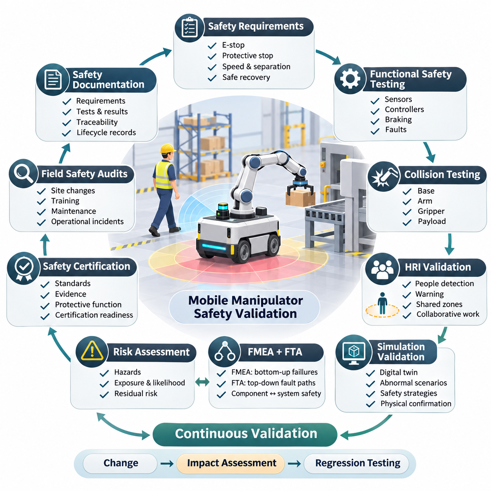
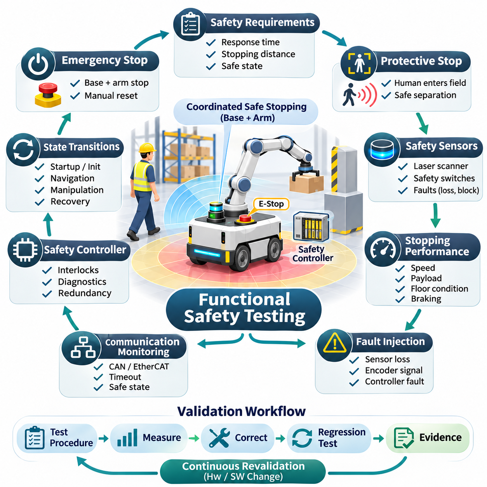
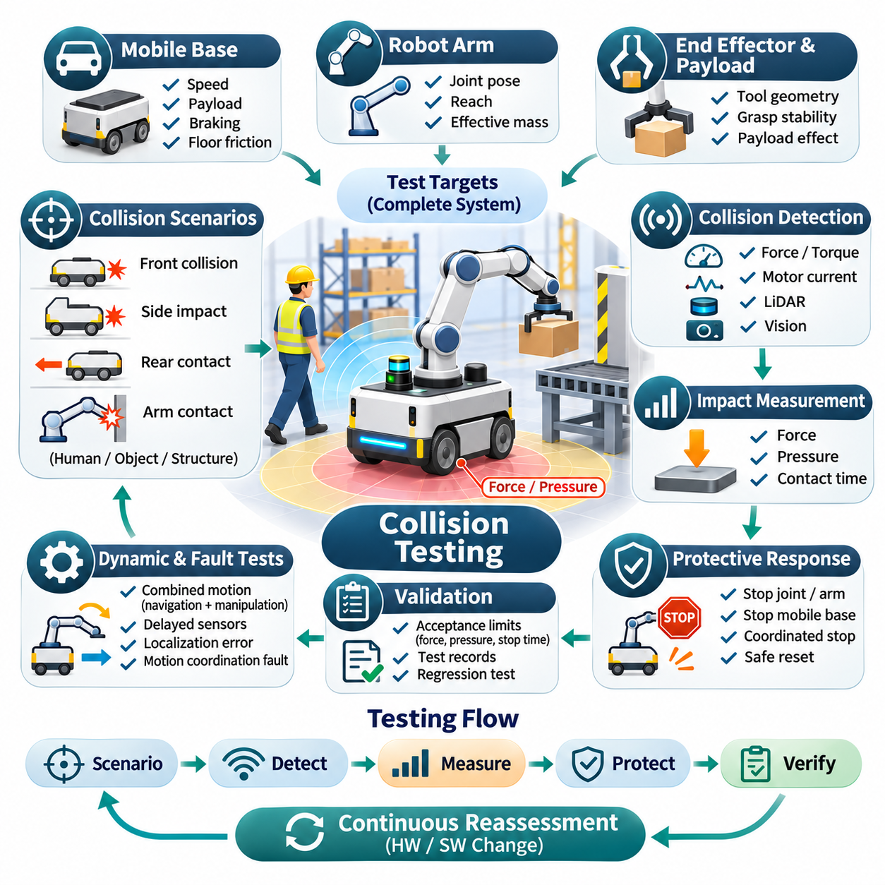
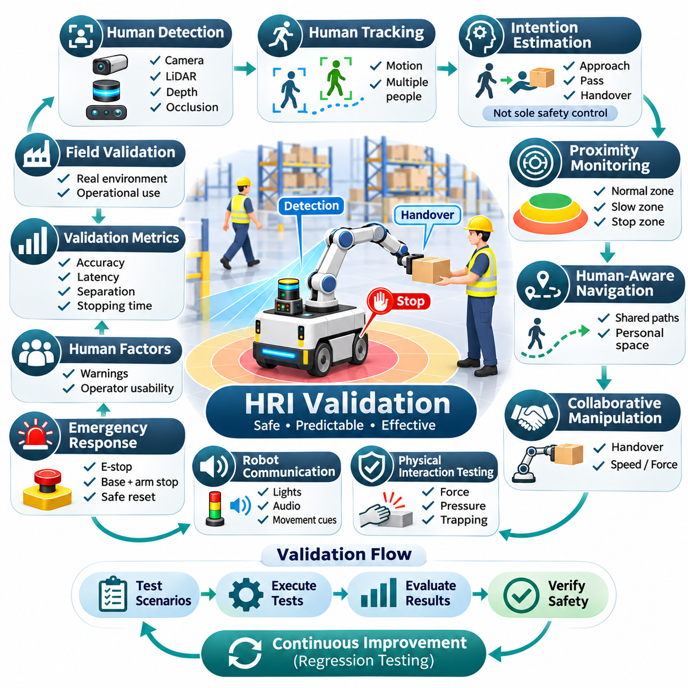
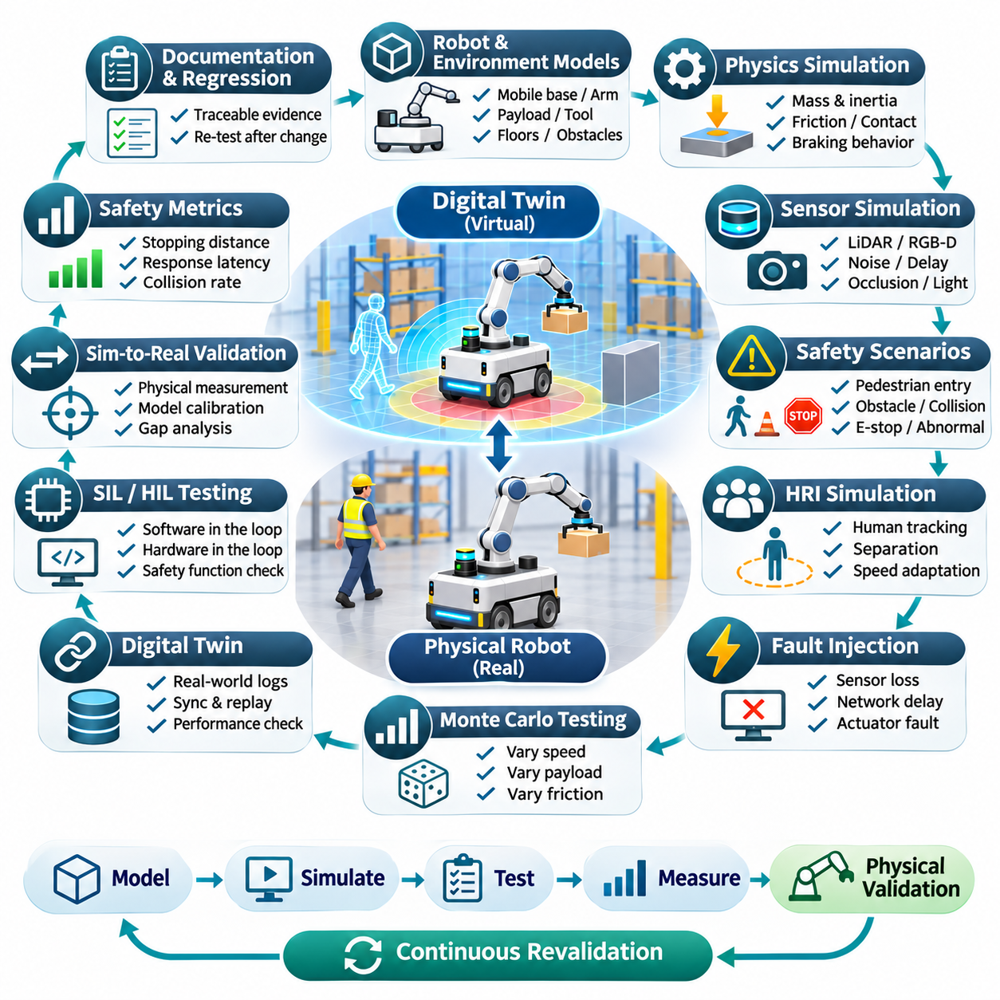
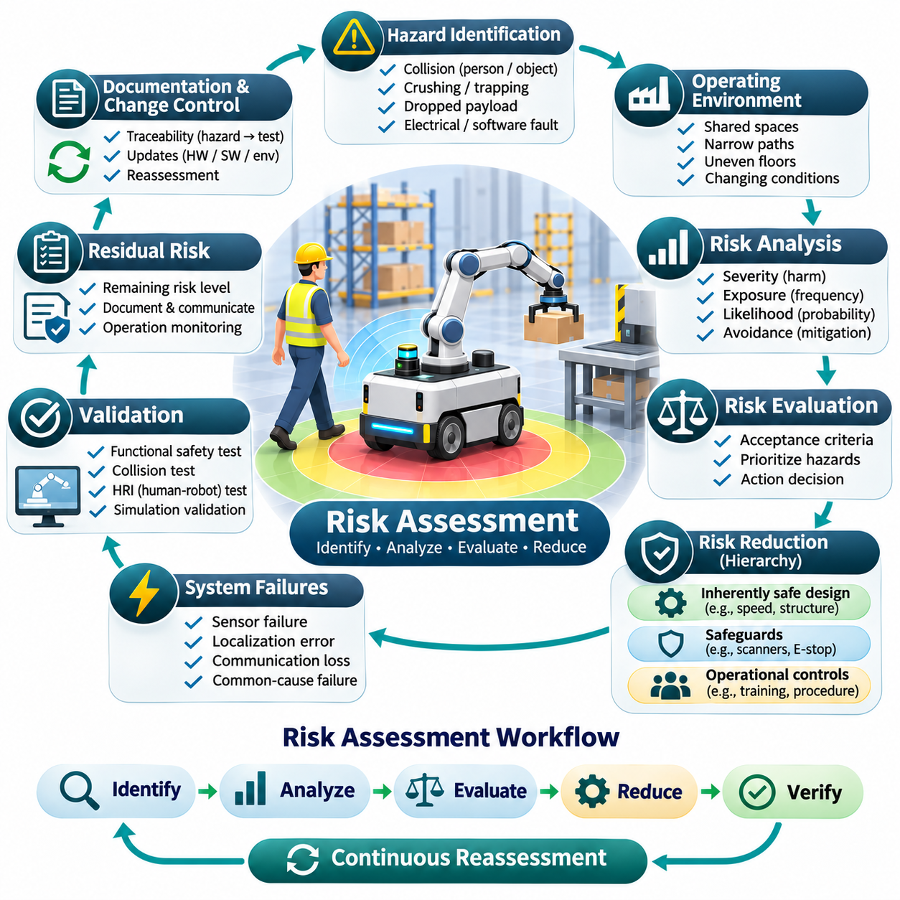
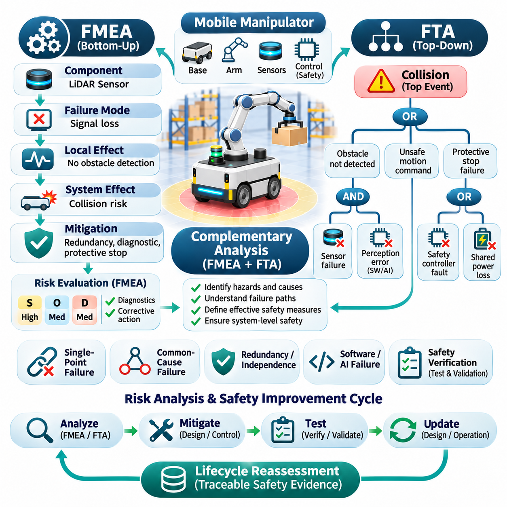
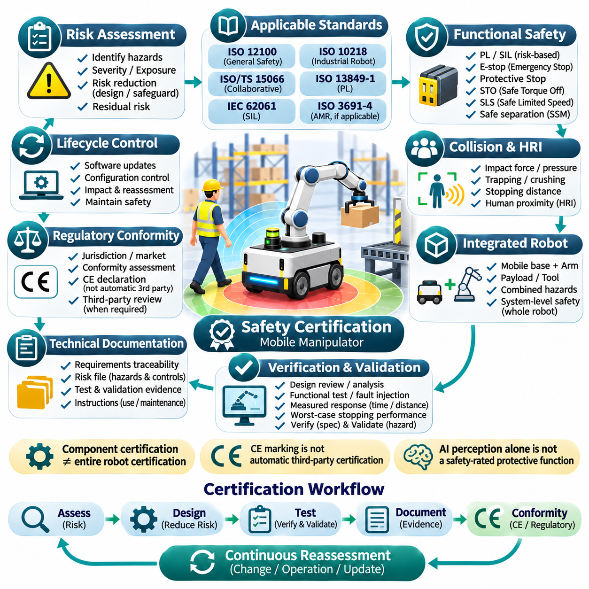
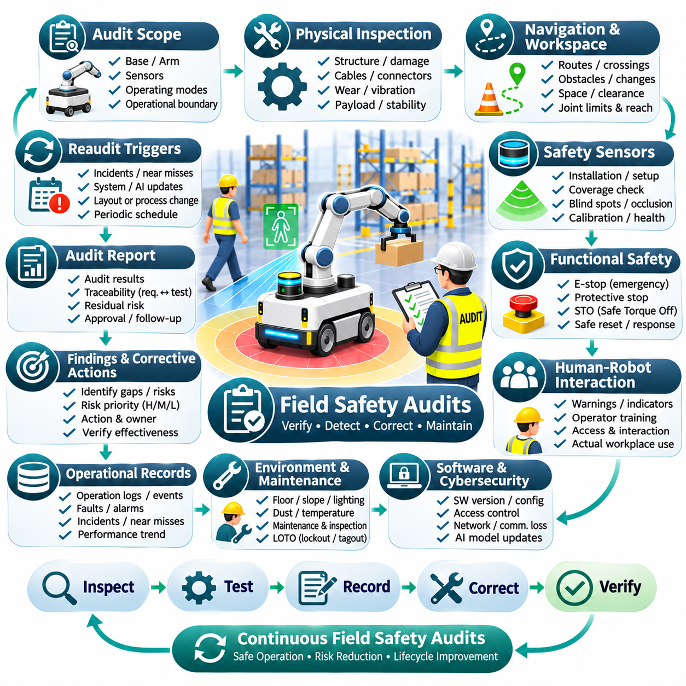
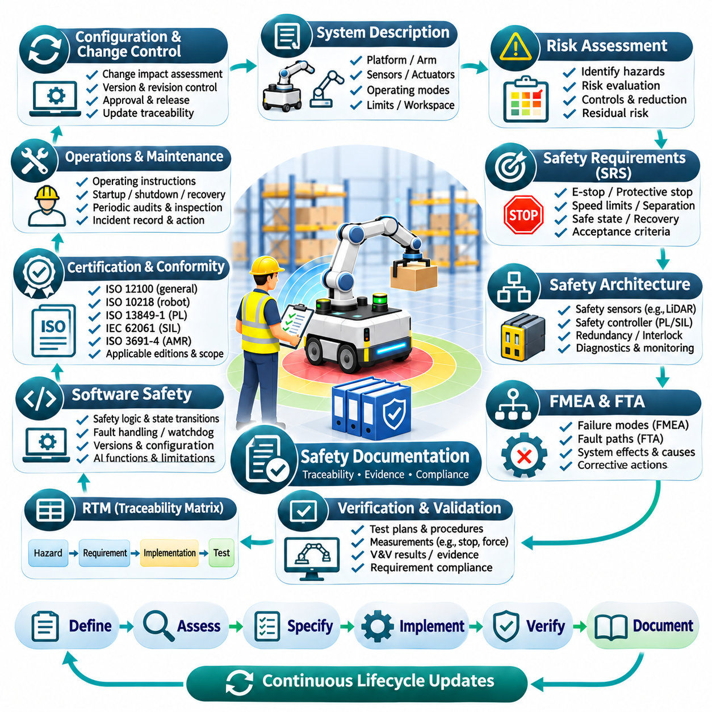

**Volume 04. Mobile Manipulation Software and Operations**

# Chapter 12. Safety Validation

## 01 Safety Validation Overview

{width="7.268055555555556in" height="7.268055555555556in"}

Safety validation is a systematic process for confirming that a mobile manipulator can operate without creating unacceptable risks to people, equipment, infrastructure, or surrounding operations. It extends beyond verifying that individual safety components function correctly. The complete robotic system, including the mobile platform, manipulator, sensors, control software, communication interfaces, and human interaction mechanisms, must be evaluated under realistic operating conditions.

Mobile manipulators introduce safety challenges because they combine autonomous navigation with robotic manipulation. The mobile base can move through shared workspaces while the arm simultaneously changes its configuration, reach, and occupied space. These movements create dynamic hazards that may not be present in conventional stationary robots or autonomous mobile robots. Safety validation must therefore consider the combined behavior of the entire platform.

A comprehensive validation strategy begins with identifying safety requirements and translating them into measurable engineering conditions. These requirements should address emergency stopping, protective stopping, speed and separation monitoring, collision avoidance, workspace limitations, and safe recovery from abnormal conditions. Each requirement must have a corresponding verification method and acceptance criterion so that safety performance can be evaluated consistently throughout development and deployment.

Functional safety testing verifies whether safety-related functions respond correctly when hazardous situations occur. Emergency stop devices, safety controllers, protective sensors, braking mechanisms, and communication monitoring functions must be tested under normal and abnormal operating conditions. Validation should examine response time, stopping distance, fault detection, system transitions, and recovery behavior. The objective is to establish that safety functions remain effective even when individual components or subsystems malfunction.

Collision testing evaluates the physical interaction between the mobile manipulator and its environment. Tests should consider collisions involving the mobile base, robotic arm, end effector, payload, and surrounding structures. Different approach directions, movement speeds, arm configurations, and contact conditions should be examined. Particular attention is required when the robot operates near people or handles objects that may create additional impact or trapping hazards.

Human-Robot Interaction (HRI) validation focuses on the safety of people sharing operational spaces with mobile manipulators. Human presence detection, approach behavior, warning indicators, restricted zones, and collaborative operating procedures must be evaluated. Testing should include realistic human movements, unexpected entry into robot workspaces, and interactions during manipulation tasks. The system must behave predictably and provide sufficient protection when human behavior differs from planned operational assumptions.

Simulation-based validation provides an efficient environment for investigating safety scenarios that may be difficult, expensive, or dangerous to reproduce physically. Digital environments can represent robot configurations, obstacles, human movements, sensor limitations, and abnormal operating conditions. Repeated simulations help identify potential failure scenarios and evaluate alternative safety strategies. However, simulation results must be supported by physical testing because differences between simulated and real-world behavior can affect safety performance.

Risk assessment establishes the foundation for prioritizing safety-related engineering activities. Potential hazards should be identified according to their possible consequences, exposure conditions, and likelihood of occurrence. The assessment should consider normal operation, foreseeable misuse, maintenance activities, software failures, sensor degradation, and unexpected environmental changes. Identified risks must be evaluated against appropriate acceptance criteria, with protective measures implemented and reassessed throughout the system lifecycle.

Failure Mode and Effects Analysis (FMEA) and Fault Tree Analysis (FTA) provide complementary approaches to understanding system failures. FMEA examines individual components and functions to identify possible failure modes, their causes, and their effects on overall operation. FTA begins with an undesirable top-level event and systematically examines the combinations of faults that could produce it. Applying both methods helps engineers connect component-level reliability with system-level safety requirements.

Safety certification evaluates whether the robot and its safety-related subsystems satisfy applicable regulatory and technical requirements. The certification process requires traceable evidence demonstrating that identified hazards have been addressed and that protective functions perform as intended. Hardware architecture, software behavior, component specifications, test results, and risk assessment records may all contribute to this evidence. Certification readiness should be considered throughout development rather than treated as a final administrative activity.

Field safety audits confirm that validated safety measures remain effective in actual deployment environments. Changes in facility layouts, traffic patterns, human activities, payload configurations, and operating procedures can introduce risks that were not present during laboratory testing. Audits should examine installed protective devices, emergency response procedures, operator training, maintenance records, and operational incidents. Findings should lead to corrective actions and, when necessary, additional testing or changes to system configuration.

Safety documentation provides the traceability required to manage safety throughout the operational lifecycle. Requirements, hazard analyses, risk assessments, FMEA and FTA results, test procedures, validation records, certification evidence, and field audit findings should be maintained in a consistent structure. Each safety requirement should be linked to its implementation and supporting verification evidence. This approach makes engineering decisions auditable and supports future modifications, maintenance activities, and system upgrades.

Safety validation is ultimately a continuous engineering activity rather than a single acceptance test. Changes to robot hardware, control algorithms, perception models, operating environments, or software versions may affect previously validated safety behavior. Regression testing and impact assessment should therefore accompany significant system modifications. By integrating functional testing, collision evaluation, HRI assessment, simulation, risk analysis, certification, and field audits, developers can establish a structured basis for deploying reliable mobile manipulation systems.

## 02 Functional Safety Testing

{width="7.268055555555556in" height="7.268055555555556in"}

Functional safety testing is a systematic engineering process used to verify that safety-related functions operate correctly under normal conditions, abnormal situations, and foreseeable system failures. For mobile manipulators, it ensures that the mobile platform, robotic arm, sensors, actuators, and safety controllers respond appropriately when hazardous conditions occur. The objective is not simply to confirm that safety devices are installed, but to demonstrate that the complete system can detect dangerous situations and transition into a safe state.

Functional safety is particularly important for mobile manipulators because their navigation and manipulation functions operate together. The mobile base can move while the robotic arm changes its position, orientation, and operating range. A failure in either subsystem may affect the safety of the entire platform. Testing must therefore consider coordinated movement, combined stopping behavior, payload effects, and interactions between navigation control and manipulation control.

Safety requirements should be established before testing begins. These requirements define the expected behavior of emergency stops, protective stops, safety-rated monitoring functions, speed limitations, braking systems, and fault detection mechanisms. Each requirement should be associated with measurable acceptance criteria, such as maximum response time, stopping distance, allowable speed, or required system state. This creates a traceable relationship between safety design decisions and verification results.

Emergency stop testing verifies that the robot can rapidly terminate hazardous motion when an operator or external safety device activates an emergency stop command. Tests should examine emergency stop buttons, wireless emergency stop devices where applicable, safety circuits, and communication paths. The mobile base and robotic arm must respond according to the defined safety architecture. Testing should also verify that releasing the emergency stop does not automatically restart motion without an intentional reset and restart procedure.

Protective stop testing evaluates the robot\'s response when safety sensors detect a potentially hazardous condition. Examples include a person entering a restricted area, an obstacle appearing within a protective field, or a safety scanner detecting an unsafe separation distance. The system should interrupt or reduce hazardous movement according to its configured safety function. Testing must confirm that protective stopping remains effective under different approach directions, robot speeds, and operating configurations.

Safety-related sensors require systematic verification because their reliability directly affects protective functions. Laser scanners, safety light curtains, safety switches, position monitoring devices, and other protective sensors should be tested for detection capability, response time, diagnostic behavior, and fault indication. Sensor obstruction, misalignment, disconnection, and communication failures should also be considered. The system must identify invalid safety inputs rather than treating missing or unreliable signals as evidence of a safe environment.

Stopping performance is another essential element of functional safety testing. The actual stopping distance depends on robot velocity, payload, floor conditions, braking characteristics, and the configuration of the robotic arm. Testing should measure stopping behavior under representative operating conditions and identify the worst credible stopping scenario. Both the mobile platform and manipulator must be evaluated because stopping one subsystem does not necessarily eliminate hazards generated by the other.

Fault injection testing examines how the system behaves when safety-related components experience abnormal conditions. Engineers can introduce controlled faults such as sensor disconnection, encoder signal loss, communication interruption, controller failure, or inconsistent input signals. The objective is to verify whether the safety architecture detects these conditions and initiates an appropriate response. Fault injection must be performed under controlled conditions with suitable protective measures to prevent unintended hazardous movement.

Communication monitoring is particularly important in distributed robotic architectures. Mobile manipulators may use multiple controllers connected through CAN, EtherCAT, Ethernet, or other communication networks. Safety-related messages must be monitored for timeout conditions, invalid data, communication loss, and unexpected state transitions. When communication becomes unreliable, the system should enter a predefined safe condition rather than continue operating using outdated commands or incomplete status information.

Safety controller validation examines the logic responsible for monitoring safety inputs and controlling protective outputs. Testing should verify input processing, interlock conditions, reset logic, diagnostic coverage, and output switching behavior. Redundant channels and diagnostic mechanisms should be evaluated where required by the selected safety architecture. The implementation must ensure that a single detected fault does not silently disable a safety function that is expected to remain operational.

Functional safety testing must also consider software and operational state transitions. Startup, initialization, autonomous navigation, manipulation, charging, maintenance, recovery, and shutdown may have different safety requirements. Engineers should verify that the robot cannot execute hazardous actions when required safety conditions are not satisfied. For example, manipulation should not begin when the mobile base is outside its permitted stability conditions or when a required protective function is unavailable.

Test procedures should define the initial configuration, operating conditions, fault scenarios, expected responses, measurement methods, and acceptance criteria. Test results should record actual response times, stopping distances, detected faults, system states, and any unexpected behavior. Failed tests must lead to root-cause analysis, corrective implementation, and repeated verification. Maintaining consistent test procedures makes it possible to compare results across different hardware versions and software releases.

Functional safety validation should be repeated whenever significant changes affect safety-related behavior. Hardware replacement, firmware modifications, controller configuration changes, sensor relocation, payload increases, and software updates may influence previously verified protective functions. Regression testing should confirm that existing safety mechanisms remain effective after these changes. The scope of retesting should be determined through an engineering impact assessment.

The final objective of functional safety testing is to establish documented evidence that safety-related functions perform according to their defined requirements. Test records, system configurations, component specifications, fault scenarios, measured results, and corrective actions should be maintained throughout the development lifecycle. This evidence supports system-level safety validation, certification activities, field deployment, and future maintenance. A disciplined testing process provides the technical foundation for operating mobile manipulators reliably in environments shared with people and industrial equipment.

## 03 Collision Testing

{width="7.268055555555556in" height="7.268055555555556in"}

Collision testing is a critical part of safety validation for mobile manipulators because it evaluates how the robot behaves when physical contact occurs with people, objects, equipment, or surrounding infrastructure. Unlike conventional stationary robots, mobile manipulators combine platform movement with articulated arm motion, creating multiple potential collision points. Testing must therefore examine the complete system, including the mobile base, robotic arm, end effector, payload, and connected mechanical structures.

The primary objective of collision testing is to determine whether potential impacts can be detected, avoided, or controlled within acceptable safety limits. Testing should establish the conditions under which contact may occur, evaluate the resulting physical forces, and verify the effectiveness of protective mechanisms. Particular attention should be given to situations where human operators share the workspace with the robot or where unexpected obstacles interfere with autonomous navigation and manipulation.

Collision scenarios should be defined according to the robot\'s operating environment and expected tasks. Typical situations include frontal collisions during navigation, side impacts in narrow passages, contact between the robotic arm and nearby structures, and accidental contact between an end effector and a human operator. Additional scenarios should consider collisions involving carried objects, unstable payloads, protruding mechanical components, and unexpected obstacles entering the robot\'s movement path.

The mobile base requires dedicated collision testing because its mass, velocity, braking characteristics, and payload directly influence impact behavior. Tests should evaluate frontal, lateral, and rear contact conditions under representative operating speeds and loading configurations. The stopping response of the platform should be measured when obstacles are detected at different distances. Variations in floor friction, wheel conditions, and braking performance should also be considered because they can significantly change the resulting stopping distance and collision severity.

Robotic arm collision testing focuses on the physical behavior of articulated joints and links during manipulation. Different arm configurations can produce significantly different collision risks because the effective mass, velocity, and mechanical leverage vary throughout the workspace. Testing should examine contact conditions at different joint positions, movement speeds, and extension distances. Particular attention should be given to configurations where the arm operates near humans, machine enclosures, shelves, or other fixed structures.

End-effector and payload collision testing is equally important because tools and carried objects can introduce additional hazards. A gripper, welding tool, inspection device, or transported object may have sharp edges, concentrated contact areas, or substantial inertia. Testing should evaluate accidental contact during approach, grasping, transportation, and release operations. The influence of payload mass, geometry, attachment stability, and tool orientation should be considered when determining the potential consequences of an impact.

Collision detection mechanisms should be evaluated under different physical and environmental conditions. Force-torque sensors, motor current monitoring, joint torque estimation, proximity sensors, laser scanners, and vision-based perception may contribute to collision detection. Testing should determine whether these mechanisms detect relevant contact events with sufficient reliability and response speed. False positives and missed detections should also be examined because both can affect operational safety and system availability.

Protective responses following collision detection must be verified as part of the complete safety process. Depending on the detected condition, the robot may need to stop the affected joint, interrupt arm movement, stop the mobile base, release a hazardous motion command, or initiate a coordinated protective stop. Testing should confirm that the selected response prevents additional hazardous movement and that the robot does not automatically resume operation before the required safety conditions are restored.

Impact force and pressure measurements provide important information about collision severity. Instrumented contact surfaces and force measurement devices can be used to evaluate impact characteristics under controlled conditions. Measurements should consider contact location, effective mass, relative velocity, contact duration, and force distribution. Different body regions and contact geometries may have different injury implications, so test conditions should reflect the intended application and relevant safety requirements.

Dynamic collision testing examines situations in which the robot and surrounding objects move simultaneously. For example, a mobile base may approach an obstacle while the robotic arm is extending toward a workstation. Such combined motion can create collision conditions that are difficult to evaluate by testing individual subsystems separately. Integrated testing should therefore examine coordinated navigation and manipulation, including transitions between driving, stopping, positioning, and object handling.

Collision testing should also investigate foreseeable abnormal operating conditions. These may include delayed sensor responses, incorrect obstacle positions, communication interruptions, unexpected payload movement, localization errors, and failures in motion coordination. Controlled fault scenarios help determine whether the robot can recognize unsafe conditions and activate appropriate protective responses. The tests should be performed in controlled environments with independent emergency stopping capabilities and suitable physical safeguards.

Test environments should reproduce the relevant characteristics of actual deployment sites. Floor materials, passage widths, workstation geometry, obstacles, lighting conditions, and human movement patterns may influence collision detection and response. Testing should include both controlled laboratory conditions and representative field environments. Repeatable test configurations are important because they allow engineers to compare collision behavior across different hardware configurations, software versions, and operating parameters.

Collision test results should be evaluated against predefined acceptance criteria established through system requirements and risk assessment. These criteria may address maximum impact forces, contact pressures, stopping distances, detection latency, and protective response times. A test should not be considered successful merely because the robot eventually stops. The complete response must demonstrate that the collision hazard is adequately controlled under the specified conditions.

All collision testing activities should be documented to maintain engineering traceability. Records should include robot configuration, payload characteristics, operating speed, contact location, test equipment, environmental conditions, measured forces, stopping behavior, and observed system responses. Unexpected results should trigger investigation and corrective actions, followed by repeated testing to verify the effectiveness of the modifications. Consistent documentation also supports subsequent safety reviews and certification activities.

Collision testing is not limited to the initial development phase. Changes in robot dimensions, payload capacity, arm configuration, end-effector design, braking systems, perception algorithms, or motion control software can introduce new collision risks. Regression testing should therefore be performed whenever modifications affect physical interaction or protective behavior. Continuous evaluation ensures that previously validated collision protection remains effective throughout the operational lifecycle.

Ultimately, collision testing provides essential evidence that a mobile manipulator can interact safely with its physical environment. By evaluating the mobile base, robotic arm, end effector, payload, collision detection mechanisms, and protective responses as an integrated system, engineers can identify weaknesses that might otherwise remain unnoticed. Combining controlled impact experiments, sensor validation, dynamic scenario testing, and field evaluation establishes a practical foundation for reducing collision-related risks in industrial and collaborative robotic applications.

## 04 HRI Validation

{width="7.268055555555556in" height="7.268055555555556in"}

Human-Robot Interaction (HRI) validation is the systematic process of evaluating whether a mobile manipulator can operate safely, predictably, and effectively in environments shared with people. It examines how the robot detects human presence, interprets human movements, responds to unexpected interactions, and communicates its operational intentions. The objective is to ensure that people can work alongside the robot without being exposed to unacceptable physical or operational risks.

Mobile manipulators introduce additional HRI challenges because they combine autonomous navigation with robotic arm movements. The mobile base may approach people while the arm simultaneously performs reaching, grasping, or transportation tasks. These combined movements create dynamic interaction zones that change continuously. HRI validation must therefore evaluate the behavior of the complete robot rather than examining navigation and manipulation safety independently.

Human detection is a fundamental component of HRI validation. Cameras, LiDAR sensors, depth sensors, and other perception technologies may be used to identify people and estimate their positions relative to the robot. Testing should evaluate detection accuracy, recognition range, response latency, and robustness under different environmental conditions. Occlusion, changing illumination, reflective surfaces, and partially visible human bodies should also be considered because they can reduce perception reliability.

Human tracking validation examines whether the robot can continuously estimate the position and movement of people within its operating environment. Tracking systems should maintain consistent identities and trajectories when people walk, stop, change direction, or move behind obstacles. Testing should include multiple people moving simultaneously and situations in which individuals cross paths. Reliable tracking helps the robot anticipate potential interactions rather than responding only after a person enters an immediate danger zone.

Human intention estimation can improve the robot\'s ability to anticipate future interactions. By analyzing movement direction, body posture, hand gestures, and surrounding task conditions, the system may estimate whether a person intends to approach, pass, interact with, or avoid the robot. Validation should examine whether these estimates remain reliable under different working conditions. Because human intentions cannot always be inferred accurately, safety-critical decisions should not depend exclusively on probabilistic intention predictions.

Proximity monitoring evaluates how the robot maintains appropriate separation from nearby people. Safety zones can be defined according to robot velocity, stopping distance, arm configuration, and the potential consequences of contact. Testing should examine whether the robot adjusts its speed or stops when a person enters a monitored area. Different zones may support normal operation, reduced-speed operation, and protective stopping. Their boundaries should be validated against actual robot response characteristics.

Human-aware navigation validation examines whether the mobile platform can move safely and naturally around people. Unlike conventional obstacle avoidance, human-aware navigation considers human movement patterns, personal space, accessibility, and interaction context. The robot should avoid sudden approaches, unnecessary close passes, and unpredictable direction changes. Testing should include narrow passages, shared workspaces, crossing pedestrians, and situations where people unexpectedly change their walking direction.

Collaborative manipulation introduces additional safety requirements because people and robotic arms may operate within overlapping workspaces. Validation should consider reaching motions, object handovers, shared assembly operations, and cooperative material handling. The robot must maintain appropriate speed, force, and separation according to the task and applicable safety requirements. Testing should also verify that the robot responds appropriately when a person enters the manipulation area unexpectedly or changes the intended handover position.

Physical interaction testing evaluates the consequences of unintended contact between the robot and a human body. Relevant scenarios include contact with the mobile base, robotic arm, end effector, and transported objects. Measurements may include contact force, pressure, impact duration, and the effective mass involved in the interaction. Test conditions should reflect the intended application and relevant safety standards. Particular attention should be given to vulnerable body regions and potential trapping or crushing situations.

Human-robot communication is another important dimension of interaction safety. Robots should provide understandable information about their operating states, movement intentions, warnings, and unexpected conditions. Visual indicators, audible signals, displays, and projected movement cues may help people anticipate robot behavior. Validation should examine whether these signals are noticeable, understandable, and consistent across different operating conditions. Communication should reduce uncertainty without creating unnecessary distractions.

Emergency interaction scenarios should be included in HRI validation. A person may unexpectedly enter the robot\'s path, reach into its workspace, obstruct a sensor, or activate an emergency stop device. The robot should recognize the relevant condition and initiate the appropriate protective response. Testing should verify that emergency stopping remains effective during simultaneous navigation and manipulation and that recovery requires the appropriate safety checks and operator authorization.

HRI validation should also consider human factors and operational usability. People may have different levels of technical experience, physical capabilities, and familiarity with robotic systems. Testing should evaluate whether operators can understand robot behavior, recognize warnings, identify hazardous situations, and intervene when necessary. Confusing interfaces, ambiguous warning signals, and unpredictable movements can increase operational risk even when individual safety components function correctly.

Experimental evaluation should use representative participants and realistic working scenarios. Controlled tests can examine human approach behavior, walking speed, interaction distance, handover procedures, and responses to robot warnings. Repeated trials help identify variations in system performance and potential limitations in human perception models. Testing involving people should be conducted under appropriate ethical, safety, and supervision procedures, with protective measures established before experiments begin.

HRI performance should be evaluated using measurable indicators. Relevant metrics include human detection accuracy, tracking reliability, minimum separation distance, response latency, protective stopping time, interaction success rate, and the frequency of unnecessary stops. These measurements should be interpreted together rather than independently. For example, high human detection accuracy does not necessarily guarantee safe operation if the robot responds too slowly or cannot stop within the required distance.

HRI validation must extend beyond laboratory experiments to representative deployment environments. Industrial facilities, warehouses, hospitals, and service environments have different human movement patterns, visibility conditions, workspace constraints, and operational expectations. Field evaluation should examine whether the robot maintains safe interaction behavior during actual workflows and whether environmental changes introduce new risks. Feedback from operators and safety personnel should contribute to continuous improvement.

Changes to perception models, navigation algorithms, manipulation trajectories, robot dimensions, and operating procedures may affect previously validated HRI behavior. Regression testing should therefore be performed whenever modifications influence human detection, separation monitoring, interaction planning, or protective responses. Operational data and incident reports can help identify emerging problems, but updates must undergo appropriate safety verification before deployment.

Ultimately, HRI validation establishes whether a mobile manipulator can share working environments with people while maintaining predictable and acceptable interaction behavior. By integrating human detection, tracking, intention estimation, proximity monitoring, human-aware navigation, collaborative manipulation, physical interaction testing, and human factors evaluation, engineers can assess the complete human-robot interaction process. This systematic approach provides an essential foundation for safe, reliable, and effective deployment of mobile manipulators in collaborative industrial and service environments.

## 05 Simulation Based Validation

{width="7.268055555555556in" height="7.268055555555556in"}

Simulation-based validation is a systematic approach to evaluating the safety and reliability of mobile manipulators through virtual experiments before and during physical deployment. It uses simulated robots, environments, sensors, and operating scenarios to examine system behavior under normal, abnormal, and potentially hazardous conditions. The primary objective is to identify safety weaknesses, evaluate protective mechanisms, and reduce the risks associated with testing complex or dangerous situations on physical equipment.

Mobile manipulators require comprehensive simulation-based validation because their mobile platforms and robotic arms operate as an integrated system. Navigation, obstacle avoidance, manipulation, human interaction, and emergency responses may influence one another. A simulated environment makes it possible to evaluate these interactions repeatedly while controlling operating conditions. Engineers can investigate scenarios that would otherwise require significant preparation, specialized equipment, or unacceptable physical risks.

A simulation environment should represent the essential characteristics of the robot and its operating workspace. The robot model should include the mobile base, wheel configuration, suspension characteristics where relevant, robotic arm, joints, end effectors, and payload properties. Environmental models should represent floors, walls, workstations, obstacles, restricted areas, and human-accessible spaces. Accurate geometric and physical representations are important because simulation results depend on how closely the virtual system reflects the actual deployment environment.

Physics-based simulation is particularly important when evaluating collision behavior and protective responses. The simulation should represent mass, inertia, friction, contact forces, joint limits, actuator behavior, and braking characteristics with sufficient accuracy for the intended analysis. Engineers can investigate how different velocities, payload configurations, and robot postures influence stopping distance and impact conditions. Although simplified physical models may be useful during early development, their limitations must be considered when interpreting safety-related results.

Sensor simulation enables the evaluation of perception and safety monitoring functions under controlled conditions. Virtual LiDAR, depth cameras, RGB cameras, proximity sensors, and other sensing devices can generate data representing different environmental situations. Testing should include sensor noise, limited detection range, occlusion, reflective surfaces, lighting variations, and measurement delays. These conditions help determine whether the robot can maintain reliable environmental awareness when sensing performance becomes degraded.

Scenario-based validation uses predefined situations to evaluate specific safety requirements. Typical scenarios include a person entering the robot\'s path, an obstacle appearing during navigation, an unexpected collision during manipulation, communication loss, emergency stopping, and incorrect localization. Each scenario should define the initial conditions, triggering events, expected system response, and acceptance criteria. Repeating the same scenario under different operating parameters makes it possible to identify weaknesses and compare alternative safety configurations.

Human-robot interaction scenarios can also be evaluated through simulation. Virtual human models can represent different walking speeds, movement directions, body positions, and approaches toward the robot. Engineers can investigate whether human detection, tracking, proximity monitoring, and speed adaptation functions operate correctly. Multiple human models and unpredictable movement patterns can help expose limitations that may not become apparent through simple obstacle-based testing.

Fault injection is another important application of simulation-based validation. Engineers can introduce virtual failures such as sensor disconnection, encoder errors, communication delays, actuator degradation, controller malfunction, and inconsistent system states. The simulated robot can then be evaluated to determine whether fault detection mechanisms recognize abnormal conditions and initiate appropriate protective responses. Fault injection provides a controlled method for examining failure scenarios that may be difficult or dangerous to reproduce on physical equipment.

Simulation-based testing should cover the complete operational lifecycle of a mobile manipulator. Startup, initialization, autonomous navigation, workstation positioning, manipulation, charging, maintenance, emergency recovery, and shutdown may introduce different safety conditions. Engineers should verify that the robot transitions correctly between operating states and does not execute hazardous actions when required safety conditions are unavailable. Particular attention should be given to transitions between navigation and manipulation because these activities often involve changes in speed, stability, and workspace occupancy.

Monte Carlo simulation and parameter variation can improve the coverage of safety validation. Instead of testing only a single predefined configuration, engineers can vary robot speed, payload mass, friction coefficients, sensor noise, communication latency, obstacle positions, and human movement patterns. Repeated randomized experiments help identify combinations of conditions that produce unexpected behavior. Statistical analysis can then reveal performance distributions, sensitive parameters, and scenarios that require additional investigation.

Digital twins can strengthen simulation-based validation by maintaining a closer relationship between virtual models and physical robotic systems. Sensor measurements, robot configurations, operational logs, and system performance data can be used to update or evaluate the digital representation. This makes it possible to reproduce actual incidents, investigate the causes of abnormal behavior, and assess proposed safety improvements before implementing them on physical equipment. The accuracy of the digital twin must nevertheless be verified against real system measurements.

Sim-to-real validation is essential because a successful simulation does not automatically guarantee safe physical operation. Differences in mechanical tolerances, friction, sensor characteristics, actuator response, communication timing, and environmental conditions can produce different results in real deployments. Engineers should compare simulated predictions with physical measurements and identify discrepancies. Calibration and model refinement should be performed when differences exceed acceptable limits.

Hardware-in-the-loop (HIL) and software-in-the-loop (SIL) testing provide intermediate validation stages between pure simulation and complete physical testing. SIL testing evaluates software components using simulated inputs and system models, while HIL testing connects actual controllers or hardware components to a simulated environment. These methods allow engineers to examine real control software, communication behavior, and hardware responses without exposing the complete robot to every hazardous scenario.

Simulation results should be evaluated against clearly defined safety requirements and measurable acceptance criteria. Relevant indicators may include collision frequency, minimum separation distance, stopping time, stopping distance, detection latency, protective response success rate, and the frequency of unexpected state transitions. Engineers should also examine whether the system consistently produces the expected response across repeated experiments and parameter variations. Passing a simulation test should be treated as supporting evidence rather than final proof of physical safety.

Validation scenarios, simulation parameters, software versions, robot models, and experimental results should be documented systematically. Each test should identify its purpose, initial conditions, environmental configuration, expected behavior, observed results, and limitations. Unexpected simulation outcomes should trigger investigation and additional experiments. Maintaining reproducible records supports engineering reviews, regression testing, risk assessment, and subsequent safety certification activities.

Simulation-based validation should be repeated whenever significant system modifications occur. Changes to robot geometry, payload capacity, motion planning, perception models, braking parameters, safety logic, or operating environments may affect previously evaluated scenarios. Regression simulation can identify whether these modifications introduce new hazards or reduce the effectiveness of existing protective functions. Updated models should be compared with physical system behavior before the revised configuration is approved for deployment.

Ultimately, simulation-based validation provides an efficient and repeatable method for investigating safety-related behavior across a wide range of operating conditions. By combining physics-based modeling, sensor simulation, scenario testing, fault injection, human interaction modeling, digital twins, and hardware-in-the-loop evaluation, engineers can identify potential hazards before they occur in physical environments. When supported by physical testing, risk assessment, and systematic documentation, simulation-based validation becomes an important foundation for developing and deploying safe and reliable mobile manipulation systems.

## 06 Risk Assessment

{width="7.268055555555556in" height="7.268055555555556in"}

Risk assessment is a systematic process for identifying hazards, evaluating potential consequences, and determining whether the risks associated with a mobile manipulator are acceptable. It provides the foundation for safety engineering throughout system development, integration, deployment, and operation. The objective is not to eliminate every possible hazard, but to identify foreseeable dangerous conditions and implement appropriate measures to reduce risks to an acceptable level.

Mobile manipulators introduce complex risk conditions because autonomous navigation and robotic manipulation operate within the same physical system. The mobile base, robotic arm, end effector, payload, sensors, and control software can interact in ways that create unexpected hazards. Risk assessment must therefore consider both individual subsystem failures and combined system behaviors. Particular attention should be given to situations in which one subsystem creates a hazard that cannot be adequately controlled by another subsystem.

Hazard identification is the first major activity in risk assessment. Engineers should examine potential hazards associated with mechanical movement, electrical power, stored energy, software failures, environmental conditions, and human interaction. Examples include unexpected robot movement, collision with people, crushing between the robot and fixed structures, dropped payloads, excessive contact forces, and failures of protective stopping mechanisms. Identification should cover normal operation, abnormal conditions, maintenance activities, and reasonably foreseeable misuse.

The operating environment has a significant influence on the risk profile of a mobile manipulator. Narrow passages, uneven floors, changing lighting conditions, reflective surfaces, shared workspaces, and unpredictable human movement can introduce additional hazards. Environmental changes may also affect localization accuracy, obstacle detection, braking performance, and manipulation stability. Risk assessment should therefore examine the actual deployment environment rather than relying exclusively on laboratory conditions or idealized operating assumptions.

Risk analysis evaluates the potential consequences and likelihood of identified hazardous events. Severity describes the extent of possible harm, while occurrence or exposure considerations help characterize how frequently people or equipment may encounter the hazard. The analysis should also consider the possibility of avoiding or limiting harm once a dangerous situation develops. These factors provide a structured basis for prioritizing risks and determining which hazards require immediate engineering attention.

Risk evaluation compares the analyzed risks against predefined acceptance criteria. Some hazards may be controlled through ordinary engineering measures, while others require additional protective functions, operational restrictions, or changes to the system architecture. Acceptance decisions should be supported by documented evidence rather than subjective judgments. Where uncertainty remains significant, engineers should adopt conservative assumptions and perform additional analysis or testing before approving the system for operation.

Risk reduction should follow a systematic engineering approach. Inherently safer design is generally preferable because it eliminates hazards or reduces their severity at the source. Examples include limiting robot speed, reducing unnecessary mechanical projections, controlling payload capacity, and designing stable operating configurations. When hazards cannot be eliminated through design, protective measures such as safety scanners, emergency stops, mechanical guards, and safety-rated monitoring functions should be introduced.

Operational controls provide an additional layer of risk reduction. These measures may include restricted operating zones, defined traffic routes, speed limitations, operator authorization, maintenance procedures, and personnel training. Warning indicators and audible alarms can improve awareness of robot movements and potentially hazardous conditions. However, administrative procedures and warnings should not replace effective engineering protections when a hazard requires automatic intervention.

Risk assessment must address the interaction between hardware, software, and safety-related control functions. Sensor failures, communication interruptions, incorrect localization, motion planning errors, and unexpected controller states may create hazardous situations. Engineers should examine how failures propagate across subsystem boundaries and whether the system can detect and contain them. Particular attention should be given to common-cause failures and situations in which multiple safety functions depend on the same sensor or communication infrastructure.

Quantitative and qualitative methods can support different aspects of risk assessment. Qualitative approaches use structured descriptions, risk matrices, engineering reviews, and expert judgment to identify and prioritize hazards. Quantitative approaches may use failure probabilities, exposure estimates, stopping distances, force measurements, and reliability data. The selected method should reflect the complexity of the system, the available evidence, and the consequences of potential failures. Combining different methods can provide a more complete understanding of system risk.

Risk assessment should be integrated with verification and validation activities. Identified hazards should be translated into specific safety requirements and corresponding test procedures. Collision testing, functional safety testing, human-robot interaction validation, and simulation-based validation provide evidence that implemented protective measures perform as intended. Test results should be compared with the original risk assumptions, and unexpected behavior should trigger reassessment of the affected hazards.

Changes throughout the system lifecycle may introduce new risks or alter existing risk levels. Hardware modifications, payload increases, software updates, changes to operating environments, and revised task procedures can affect previously established safety conditions. A formal change assessment should determine whether existing risk controls remain adequate and whether additional testing is necessary. Risk assessment should therefore be maintained as a continuous engineering activity rather than treated as a one-time development document.

Risk documentation provides traceability between identified hazards, evaluation results, protective measures, and verification evidence. Records should describe the hazard, its potential causes, possible consequences, estimated risk level, implemented controls, and remaining residual risk. Responsibilities for reviewing and approving risk-related decisions should also be clearly established. Consistent documentation supports engineering reviews, operational audits, maintenance activities, and safety certification processes.

Residual risk represents the level of risk that remains after protective measures have been implemented. It should be evaluated to determine whether further reduction is reasonably achievable and whether the remaining risk satisfies the established acceptance criteria. Residual risks must be communicated to relevant operators, maintenance personnel, and system owners. Clear information enables organizations to establish appropriate operating restrictions, training requirements, and monitoring procedures.

Ultimately, risk assessment provides the engineering framework for making informed safety decisions throughout the lifecycle of a mobile manipulator. By systematically identifying hazards, analyzing potential consequences, evaluating risk levels, implementing protective measures, and verifying their effectiveness, developers can reduce uncertainty and improve operational safety. Continuous reassessment ensures that safety controls remain appropriate as robot capabilities, operating environments, and deployment requirements evolve.

## 07 FMEA and FTA

{width="7.268055555555556in" height="7.268055555555556in"}

Failure Mode and Effects Analysis (FMEA) and Fault Tree Analysis (FTA) are systematic safety engineering methods used to identify potential failures, understand their consequences, and evaluate how individual faults or combinations of failures can lead to hazardous conditions. In mobile manipulators, these methods provide complementary perspectives on system reliability and safety. FMEA examines potential failures from individual components toward the complete system, while FTA starts with an undesirable system-level event and investigates the combinations of failures that could cause it.

Mobile manipulators contain interconnected mechanical, electrical, sensing, computing, and software subsystems. Failures in one subsystem may propagate into other functions and create unexpected operational hazards. For example, a localization failure may cause incorrect navigation, while a communication interruption may prevent the controller from receiving updated sensor information. Combining FMEA and FTA helps engineers understand these relationships and establish appropriate preventive, diagnostic, and protective measures.

FMEA begins by dividing the robot into functional units and examining each component or subsystem for potential failure modes. Typical elements include drive motors, steering actuators, robotic arm joints, encoders, LiDAR sensors, cameras, batteries, power converters, communication interfaces, and safety controllers. Each item is evaluated according to how it can fail, what causes the failure, how the failure affects local operation, and whether its consequences propagate into other parts of the system.

Failure modes describe the specific ways in which a component may lose its intended functionality. Examples include open-circuit failures, short circuits, excessive temperature, mechanical wear, encoder signal loss, sensor misalignment, incorrect measurements, communication timeouts, and software execution errors. The analysis should also consider unintended activation, delayed responses, intermittent behavior, and misleading status information. These failure modes are important because a component may appear operational while providing incorrect information or unreliable control outputs.

The effects of each failure should be examined at multiple levels. Local effects describe the immediate consequences within the affected component, while subsystem effects explain how the failure influences related functions. System-level effects identify the consequences for the complete mobile manipulator. For example, a steering actuator failure may initially cause inaccurate wheel orientation, then produce navigation errors, and eventually result in uncontrolled movement or collision risk. This hierarchical analysis helps identify failures that may initially appear minor but create significant system-level hazards.

FMEA commonly evaluates failure severity, occurrence, and detectability. Severity represents the potential consequences of a failure, occurrence estimates how frequently the failure may happen, and detectability describes how effectively the system can identify the failure before it produces serious consequences. These factors can support prioritization through a Risk Priority Number (RPN) when the selected methodology uses numerical scoring. However, RPN should not replace engineering judgment because different combinations of severity, occurrence, and detectability can produce similar numerical results while representing substantially different safety implications.

Detection mechanisms are an essential part of FMEA because early fault identification can prevent failures from developing into hazardous situations. Diagnostic methods may include sensor plausibility checks, encoder comparison, motor current monitoring, temperature monitoring, communication watchdogs, battery health monitoring, and controller self-diagnostics. Engineers should evaluate whether these mechanisms can detect faults within the time required for an appropriate protective response. A fault that is technically detectable but identified too late may still create an unacceptable hazard.

Recommended actions should be derived from the identified failure modes and their effects. These actions may include mechanical redesign, component replacement, electrical isolation, additional sensors, redundant communication paths, improved diagnostic coverage, software error handling, and protective stopping functions. The objective is to reduce failure probability, limit the consequences of failures, or improve detection capability. Corrective actions should be assigned to responsible engineering teams and verified through appropriate testing.

FTA approaches the same safety problem from a different direction. Instead of starting with individual components, it begins with a clearly defined undesirable event called the Top Event. Examples for mobile manipulators include uncontrolled robot movement, failure to stop before contacting a person, unintended robotic arm motion, loss of braking capability, dropped payloads, and failure of emergency stopping functions. The top event is then decomposed into contributing events and underlying causes through logical relationships.

Logical gates are used to represent how different events combine to produce a hazardous outcome. An OR gate indicates that any one of several contributing events may be sufficient to cause the next event. An AND gate indicates that multiple conditions must occur together before the higher-level event can happen. These relationships help engineers distinguish between independent failure paths and combinations of failures that become dangerous only when multiple protections are unavailable.

For example, a collision involving a mobile manipulator may result from an obstacle detection failure, an incorrect motion command, or an ineffective protective stopping function. Depending on the system architecture, these events may independently contribute to the top event or require combinations of additional failures. FTA makes these relationships explicit and helps identify critical paths that deserve further engineering attention. It also supports evaluation of whether existing safety mechanisms provide sufficient protection against foreseeable failure combinations.

Single-point failures deserve particular attention during FTA. A single-point failure occurs when one component or event can directly lead to a hazardous system condition without requiring another independent failure. Examples may include a shared power supply failure that disables multiple safety devices or a single controller fault that simultaneously affects navigation and protective stopping. Identifying these weaknesses helps engineers determine where additional isolation, redundancy, or independent protection is necessary.

Common-cause failures are especially important in systems that use redundant components. Two sensors or controllers may appear independent while sharing the same power source, communication network, environmental exposure, software implementation, or physical installation. A failure affecting the shared resource may disable both channels simultaneously. FMEA can identify these dependencies at the component level, while FTA can demonstrate how they contribute to system-level hazardous events.

Redundancy and fault tolerance should therefore be evaluated according to actual system independence rather than component quantity alone. Additional sensors, processors, or communication channels do not automatically guarantee improved safety. Engineers must examine electrical separation, physical installation, diagnostic independence, software diversity, and the ability to maintain a safe state following a failure. The analysis should determine whether the remaining operational functions can safely control the robot or whether a controlled shutdown is required.

FMEA and FTA become more effective when their results are continuously exchanged. FMEA identifies specific failure modes that can be incorporated into the basic events of an FTA model. Conversely, FTA may reveal combinations of failures or shared dependencies that require additional investigation in FMEA. This iterative relationship improves the completeness of the safety analysis and helps maintain consistency between component-level reliability assessments and system-level safety objectives.

These methods should also consider software and artificial intelligence components. Navigation algorithms, perception models, localization software, motion planners, and behavior management systems may generate incorrect outputs even when their hardware operates normally. FMEA can examine incorrect predictions, unstable outputs, timing failures, invalid data, and unexpected software states. FTA can investigate how these failures combine with sensor degradation, communication problems, or insufficient protective monitoring to create hazardous system behavior.

The results of FMEA and FTA should be connected to safety requirements, verification procedures, and operational controls. Critical findings may lead to additional collision tests, functional safety tests, fault injection experiments, simulation scenarios, or hardware modifications. Each identified risk should have corresponding mitigation measures and verification evidence. This traceability ensures that safety analysis produces actionable engineering improvements rather than remaining an isolated documentation exercise.

Both analyses should be updated throughout the system lifecycle. Changes to robot hardware, payload capacity, software architecture, sensor configuration, operating environments, and maintenance procedures may introduce new failure modes or change existing failure relationships. Operational incidents and maintenance records should also be reviewed to identify failure patterns that were not adequately represented during initial development. Updated analyses help ensure that protective measures remain appropriate as the system evolves.

Ultimately, FMEA and FTA provide complementary methods for understanding how failures develop and how they can affect the safety of mobile manipulators. FMEA offers detailed insight into component-level failure mechanisms and their consequences, while FTA reveals the logical combinations of events that can produce hazardous system-level outcomes. When integrated with risk assessment, functional safety testing, simulation, and continuous operational monitoring, these methods establish a structured foundation for improving system reliability, preventing hazardous failures, and maintaining safe robotic operation throughout the product lifecycle.

## 08 Safety Certification

{width="7.268055555555556in" height="7.268055555555556in"}

Safety certification establishes documented evidence that a robotic system satisfies applicable safety requirements for its intended use. In collision detection and mobile manipulation, certification activities examine mechanical hazards, control reliability, protective functions, and foreseeable human interactions. Certification cannot be achieved simply by installing safety sensors. It requires systematic risk assessment, verified engineering controls, documented testing, and conformity with relevant regulations.

The foundation of robotic safety engineering is a structured risk assessment covering the complete system lifecycle. Engineers identify hazards during installation, operation, maintenance, recovery, and foreseeable misuse. Each hazard is evaluated according to potential injury severity, exposure frequency, and possibilities for avoidance. Appropriate risk reduction measures are then selected through inherently safe design, protective safeguards, and information for use, while remaining residual risks are documented.

ISO 12100 provides general principles for machinery safety, including hazard identification, risk estimation, and risk reduction. It encourages designers to eliminate hazards through engineering decisions before relying on protective devices or operating instructions. In robotic applications, this process considers moving joints, crushing regions, sharp tools, payload instability, and unexpected motion. The resulting risk assessment guides the selection and validation of appropriate safety functions.

ISO 10218 establishes important safety requirements for industrial robots and robot applications. Its provisions address robot design, system integration, protective measures, operating modes, and safety-related control functions. Collaborative operation requires particular attention because humans and robots may share the same workspace. Before using this standard as evidence of conformity, engineers must identify the applicable edition, national adoption requirements, and responsibilities associated with system integration.

ISO/TS 15066 provides supplementary guidance for collaborative industrial robot applications, including power and force limiting and speed and separation monitoring. It addresses contact conditions and biomechanical considerations relevant to human-robot interaction. Permissible operating conditions depend on the body region, contact geometry, and application-specific risks. Compliance cannot be established simply by comparing a single force measurement against a universal threshold.

Functional safety standards address the reliability of control systems that perform protective functions. ISO 13849-1 uses Performance Levels (PL) to specify required safety-related control performance, while IEC 62061 provides a machinery functional safety framework using Safety Integrity concepts. Required performance is determined through risk assessment and supported by suitable architectures, diagnostics, component reliability, and systematic engineering measures. Validation must demonstrate that implemented safety functions satisfy their specified requirements.

Safety functions in robotic systems may include emergency stopping, protective stopping, Safe Torque Off (STO), Safe Limited Speed (SLS), and monitored separation. Each function must have a clearly defined triggering condition, response behavior, and safe state. Depending on the assessed risks, safety-rated sensors, controllers, communication interfaces, and drives may be required. A standard industrial controller or AI-based collision detector should not automatically be considered equivalent to a functionally safety-rated system.

Collision detection certification requires distinguishing operational monitoring from safety-related protection. Geometric checking, torque residual estimation, and machine learning models may improve environmental awareness and collision detection capabilities, but they do not automatically qualify as certified protective functions. Their reliability must be evaluated against the intended safety requirements. Where sufficient assurance is unavailable, independent safety-rated mechanisms should provide the required protective response.

Mobile manipulators introduce additional certification challenges because the mobile platform and robotic arm create combined hazards. Base navigation, manipulator movement, payload handling, docking, and charging can interact in unexpected ways. Depending on system classification and intended application, applicable requirements may involve ISO 10218 and ISO 3691-4. The integrated machine must be assessed as a complete system rather than relying exclusively on certificates issued for individual components.

Safety-related software development requires controlled requirements, traceability, verification, and configuration management. Developers should document protective logic, operating modes, fault handling, and interfaces between safety-related and non-safety-related systems. Software modifications can change reaction timing or invalidate previous safety assumptions. Therefore, updates to collision detection algorithms, control parameters, or communication architectures require an impact assessment and appropriate regression testing.

Verification and validation serve different but complementary purposes in safety engineering. Verification confirms that the implementation satisfies specified technical requirements, while validation determines whether the implemented safety functions adequately address the intended hazards. Activities may include design reviews, analytical calculations, fault injection, functional testing, and stopping-distance measurements. The resulting evidence should demonstrate reliable performance under representative normal and abnormal operating conditions.

Stopping performance is particularly important when collision prevention depends on maintaining protective separation. Engineers must evaluate sensor detection time, communication delay, controller processing, drive response, and mechanical braking behavior. Maximum stopping distance may vary according to robot velocity, payload, surface conditions, and mechanical configuration. Conservative assumptions and worst-case testing help establish appropriate protective field dimensions and operational speed limits.

Human-robot collaborative applications require additional evaluation of contact and proximity hazards. Risk assessment must consider transient impacts, constrained contact, accessible body regions, and potential trapping between moving and fixed structures. Force and pressure measurements may support the validation of power and force limiting functions. However, contact testing must represent realistic application conditions, and non-contact protective measures remain necessary wherever contact risks cannot be adequately controlled.

Documentation is a central part of safety certification and conformity assessment. A technical file typically contains system descriptions, risk assessments, applicable standards, safety requirements, engineering drawings, component information, verification results, and operating instructions. Traceability connects identified hazards to implemented protective measures and validation evidence. Accurate documentation also supports maintenance, modification control, operational audits, and future safety reassessment.

Regulatory conformity depends on the jurisdiction where the robotic system is placed on the market or operated. European machinery requirements, national occupational safety regulations, and applicable electrical or electromagnetic compatibility rules may impose different obligations. CE marking, where applicable, represents a manufacturer\'s declaration of conformity rather than automatic third-party certification. The appropriate conformity assessment procedure must be determined according to product classification and governing legislation.

Independent assessment can provide additional confidence in safety-related design and implementation. Accredited testing laboratories, certification organizations, and competent assessors may review technical documentation and perform relevant tests. Third-party involvement may be mandatory for certain products or conformity assessment procedures, while other systems permit manufacturer self-assessment. The scope of any certificate must be examined carefully because approval of individual components does not automatically establish conformity of the complete robotic system.

Safety certification is not a one-time engineering activity. Changes in payload, tooling, robot speed, workspace layout, software, or operating procedures can introduce new hazards and invalidate previous assumptions. Periodic inspection, preventive maintenance, incident investigation, and configuration change management help maintain safety throughout operation. Reassessment should determine whether modified conditions require additional validation, documentation updates, or renewed conformity assessment procedures.

Effective safety certification integrates risk assessment, functional safety engineering, protective system design, verification, validation, and regulatory compliance. For mobile manipulators, particular attention must be given to combined mobile-base and robotic-arm behavior, human proximity, collision response, and system-level integration. When supported by documented evidence and appropriate independent safeguards, certification activities help establish trustworthy robotic operation and sustainable industrial deployment.

## 09 Field Safety Audits

{width="7.268055555555556in" height="7.268055555555556in"}

Field safety audits provide a systematic method for verifying that mobile manipulators continue to operate safely under actual deployment conditions. While laboratory testing and formal safety validation establish initial evidence of compliance, field audits examine whether protective measures remain effective during everyday operation. They evaluate the interaction between robotic equipment, operators, surrounding infrastructure, and operational procedures. The primary objective is to identify emerging hazards, detect deviations, and maintain safety throughout the system lifecycle.

A field safety audit begins with a clear definition of the inspection scope, operational boundaries, and applicable safety requirements. Auditors should review the mobile platform, robotic arm, end effector, sensors, control systems, charging equipment, and supporting infrastructure. Different operating modes, including autonomous navigation, manipulation, manual intervention, maintenance, and emergency recovery, must be considered. The audit scope should reflect actual deployment conditions rather than relying exclusively on original design assumptions.

The physical condition of the robotic system is a fundamental part of field inspection. Auditors examine structural components, mounting interfaces, protective covers, cables, connectors, wheels, actuators, and mechanical fasteners. Particular attention should be given to damage, loosened components, abnormal vibration, overheating, and signs of mechanical wear. Payload attachment and manipulator stability should also be inspected because changes in mechanical conditions can introduce unexpected motion, dropped-object hazards, or reduced stopping performance.

Mobile navigation safety must be evaluated within the actual working environment. Auditors should examine travel routes, pedestrian crossings, narrow passages, ramps, floor openings, restricted areas, and temporary obstacles. Protective fields and navigation boundaries must correspond to the current facility layout. Changes in furniture, equipment placement, material storage, or pedestrian traffic may invalidate previously established assumptions. The audit should confirm that autonomous navigation remains within approved operational areas and that unexpected obstacles produce appropriate protective responses.

Manipulator safety inspections focus on the hazards associated with robotic arm movement and interaction with nearby objects or personnel. Joint limits, workspace restrictions, collision detection, gripping forces, and protective stopping functions should be examined during representative tasks. Auditors should identify potential crushing, trapping, impact, and shearing locations throughout the reachable workspace. Particular attention is required when the mobile platform and manipulator operate simultaneously because combined movements can create hazards that are not apparent when each subsystem is inspected independently.

Safety sensor inspections verify that protective devices remain correctly installed, configured, and operational. Laser scanners, safety cameras, emergency stop devices, proximity sensors, and other protective equipment should be checked for contamination, physical damage, obstruction, and calibration problems. Detection coverage must be evaluated against actual operating conditions, including possible blind spots and occlusions. Auditors should distinguish safety-rated protective devices from ordinary perception sensors because general-purpose cameras and AI detection models cannot automatically replace validated safety functions.

Functional safety audits examine whether safety-related control functions continue to perform according to their specified requirements. Emergency stopping, protective stopping, speed limitation, Safe Torque Off (STO), and safety interlocks should be inspected and tested using approved procedures. Response times, stopping distances, fault indications, and reset behavior must be evaluated where applicable. Emergency stop activation should prevent hazardous motion, and resetting the device must not automatically restart the robot. Testing should avoid introducing unnecessary risks to personnel or equipment.

Human-robot interaction is another essential area of field safety auditing. Auditors should observe how operators, maintenance technicians, visitors, and other personnel interact with the mobile manipulator during normal operations. Warning indicators, audible signals, access restrictions, operating modes, and manual intervention procedures should be evaluated. Personnel must understand robot movement intentions, operating status, emergency stop locations, and the limitations of protective systems. Actual workplace behavior should be compared with documented procedures to identify unsafe practices and communication gaps.

Operational procedures must be reviewed to determine whether safety requirements are consistently followed. Auditors should examine startup inspections, mission authorization, workspace clearance, manual recovery, charging, shutdown, and maintenance activities. Procedures should clearly define the responsibilities of operators, supervisors, technicians, and system administrators. Any deviation from approved procedures should be investigated to determine whether it results from insufficient training, unclear instructions, impractical workflows, or inadequate system design.

Software and configuration audits verify that deployed systems maintain approved safety settings. Changes to navigation maps, speed limits, collision thresholds, manipulator trajectories, sensor configurations, and control parameters can affect operational safety. Auditors should review software versions, configuration records, access permissions, and update histories. AI model updates and perception changes require particular attention because altered detection behavior may influence operational decisions. Safety-critical protective functions should remain independent of uncertain AI predictions wherever required by the safety architecture.

Communication and cybersecurity conditions should also be considered during field audits. Mobile manipulators depend on communication between onboard controllers, fleet management systems, operator interfaces, and external infrastructure. Network interruptions, delayed messages, corrupted commands, or unauthorized access may affect safe operation. Auditors should verify communication timeout handling, heartbeat monitoring, authentication, access control, and secure update procedures. Loss of communication must produce a response appropriate to the associated safety risk rather than allowing uncontrolled continuation.

Environmental conditions can significantly influence the effectiveness of safety measures. Dust, moisture, temperature variations, lighting conditions, electromagnetic interference, vibration, and floor friction may affect sensors, electrical equipment, braking systems, and mechanical stability. Field audits should compare actual environmental conditions with the approved operating limits. Special attention should be given to changes in industrial layouts, outdoor transitions, charging locations, and areas where environmental conditions may degrade sensor detection or braking performance.

Maintenance and energy isolation procedures must be evaluated during field safety audits. Technicians should follow appropriate shutdown, electrical isolation, residual energy control, and lockout/tagout procedures where applicable. Mechanical supports and safeguards should prevent unintended movement during inspection or component replacement. Auditors should verify that maintenance personnel have appropriate qualifications, protective equipment, and access to approved service instructions. Following maintenance, the system should undergo the required inspection and functional checks before returning to operation.

Operational records provide important evidence of safety performance over time. Auditors should review emergency stop events, protective stops, collision warnings, sensor faults, navigation failures, maintenance activities, operator interventions, and reported incidents. Repeated events may indicate underlying problems even when no injury or equipment damage has occurred. Event timestamps, robot states, sensor information, software versions, and operator actions can support investigation. Consistent recordkeeping enables organizations to identify recurring patterns and prioritize corrective measures.

Incident reporting and corrective action management are essential components of an effective field safety audit. Identified deficiencies should be classified according to their severity, potential consequences, and required response. Immediate hazards may require suspension of the affected operation until appropriate safeguards are restored. Corrective actions should identify responsible personnel, implementation deadlines, verification methods, and closure criteria. Auditors should confirm that completed actions resolve the original problem rather than merely correcting its visible symptoms.

Field safety audits should also examine whether personnel receive appropriate training and demonstrate sufficient operational competence. Training programs should address normal operation, emergency response, protective device limitations, manual recovery, charging, and maintenance safety. Competency assessments should reflect actual equipment configurations and workplace conditions. When new operators, software versions, payloads, or operating procedures are introduced, additional training or authorization may be necessary to maintain consistent safety performance.

Audit findings should be documented in a controlled report that connects observed conditions with applicable safety requirements. The report should include inspection scope, audit date, system identification, operating configuration, inspected components, test results, identified hazards, corrective actions, and approval status. Photographs, event logs, measurements, and maintenance records may provide supporting evidence. Clear traceability allows organizations to compare successive audits and demonstrate that identified safety issues have been properly addressed.

The frequency of field safety audits should reflect operational risk, equipment utilization, environmental conditions, incident history, and the extent of system modifications. High-utilization systems operating in shared human environments may require more frequent inspections than systems operating in controlled areas. Additional audits should be performed following significant incidents, hardware replacement, software modifications, facility changes, or the introduction of new tasks. Audit schedules should complement routine inspections and preventive maintenance rather than replace them.

Effective field safety auditing creates a continuous feedback process between real-world operation and safety engineering. Findings from deployment environments should inform updated risk assessments, functional safety testing, maintenance procedures, operator training, and system configuration management. Repeated observations can reveal weaknesses that were not identified during initial validation. By maintaining documented evidence, assigning clear responsibilities, and verifying corrective actions, organizations can sustain safe mobile manipulator operation and support reliable industrial deployment throughout the system lifecycle.

## 10 Safety Documentation

{width="7.268055555555556in" height="7.268055555555556in"}

Safety documentation is a structured collection of engineering records, technical specifications, test results, and operational information that demonstrates how safety requirements have been addressed throughout the lifecycle of a mobile manipulator. It establishes traceability between identified hazards, protective measures, validation activities, and operational responsibilities. Effective documentation supports safety certification, regulatory conformity, maintenance, and continuous improvement.

The documentation process should begin during the initial system design phase rather than after development has been completed. Safety objectives, intended applications, operational limitations, and applicable technical requirements should be recorded before major architectural decisions are finalized. Establishing these records early helps engineers maintain consistency between mechanical design, electrical architecture, control software, perception systems, and protective functions.

System description documents establish the technical boundaries of the mobile manipulator. They should describe the mobile platform, robotic arm, end effector, payload capacity, sensors, actuators, computing hardware, communication interfaces, and safety controllers. Operating modes, environmental limitations, workspace boundaries, and human interaction conditions should also be specified. These descriptions establish the reference configuration against which subsequent safety assessments are performed.

Risk assessment documentation records identified hazards, potential causes, estimated risk levels, protective measures, and remaining residual risks. Each hazard should have a unique identifier that allows engineers to track its status throughout development and operation. Records should distinguish between hazards eliminated through inherently safe design and those controlled through protective functions or operational restrictions. Unresolved risks must remain visible until adequately addressed.

A Safety Requirements Specification (SRS) translates risk assessment results into measurable technical requirements. It should define emergency stopping, protective stopping, speed limitations, separation monitoring, fault detection, safe states, and recovery conditions. Each safety function should have specified triggering conditions, response times, performance requirements, and acceptance criteria. These requirements provide the foundation for implementation, verification, and validation activities.

Safety architecture documentation describes how protective functions are implemented across hardware and software subsystems. It should identify safety-rated sensors, safety controllers, communication channels, drive interfaces, redundant components, and diagnostic mechanisms. Dependencies between safety-related and non-safety-related functions must be clearly explained. Architectural records help engineers evaluate whether individual failures or shared resources can compromise protective functions.

Failure Mode and Effects Analysis (FMEA) and Fault Tree Analysis (FTA) records provide evidence that potential failure mechanisms and hazardous event combinations have been systematically investigated. Documentation should include identified failure modes, contributing events, system-level consequences, diagnostic capabilities, and recommended corrective actions. Analysis assumptions, data limitations, and unresolved findings should also be recorded to support future engineering reviews.

Verification and validation documentation demonstrates whether implemented safety measures satisfy their specified requirements. Test records should include test objectives, initial conditions, equipment configurations, measurement methods, expected responses, observed results, and acceptance decisions. Functional safety testing, collision testing, human-robot interaction validation, and simulation-based validation should produce reproducible evidence linked to the relevant safety requirements.

A Requirements Traceability Matrix (RTM) establishes relationships between hazards, safety requirements, engineering implementations, and validation results. It allows engineers to determine whether each identified hazard has corresponding protective measures and supporting evidence. Traceability also helps identify incomplete tests, unresolved requirements, and affected components when system modifications occur. This reduces the possibility of safety requirements being overlooked.

Software safety documentation should describe the implementation of safety-related logic, operating state transitions, fault handling, watchdog mechanisms, and communication timeout behavior. Software versions, configuration parameters, dependencies, and approved release information should be maintained under controlled conditions. AI-based perception and planning functions should include documented limitations and clearly defined relationships with independent protective mechanisms.

Safety certification and conformity documentation should contain applicable standards, relevant regulatory requirements, component certificates, technical assessments, and supporting validation evidence. Standards such as ISO 12100, ISO 10218, ISO 13849-1, IEC 62061, and ISO 3691-4 may provide relevant requirements depending on the application. The applicable editions, assessment scope, and limitations of individual certificates must be explicitly documented.

Operational safety documentation provides instructions for personnel responsible for using and supervising mobile manipulators. It should describe approved operating conditions, startup inspections, mission execution, emergency stopping, manual intervention, recovery, charging, and shutdown procedures. Residual risks, prohibited activities, and protective device limitations must be communicated clearly. Instructions should remain consistent with the validated system configuration.

Maintenance and field safety audit records extend safety documentation into the operational lifecycle. Inspection results, component replacements, calibration activities, protective function tests, identified deficiencies, and corrective actions should be recorded systematically. Incident reports and near-miss records provide additional evidence for identifying emerging hazards. These records support periodic reassessment of safety performance under actual deployment conditions.

Configuration management and change control ensure that safety documentation remains consistent with the deployed robotic system. Changes to hardware, software, payloads, tooling, navigation maps, or operating environments should undergo documented impact assessment. Relevant risk assessments, safety requirements, and validation records must be updated when necessary. Document revisions should identify responsible personnel, approval status, and applicable system versions.

Ultimately, safety documentation provides a continuous and auditable connection between safety engineering and real-world robotic operation. By integrating risk assessments, safety requirements, architectural descriptions, failure analyses, validation evidence, certification records, operational instructions, and field audit results, organizations can maintain a consistent safety baseline. This approach supports reliable mobile manipulation and responsible lifecycle management.
