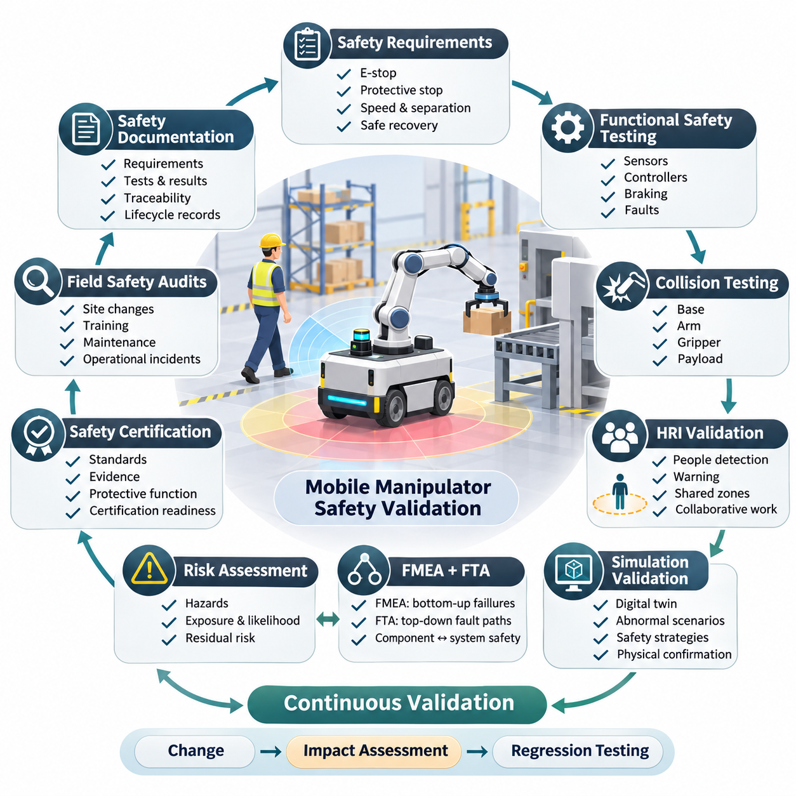
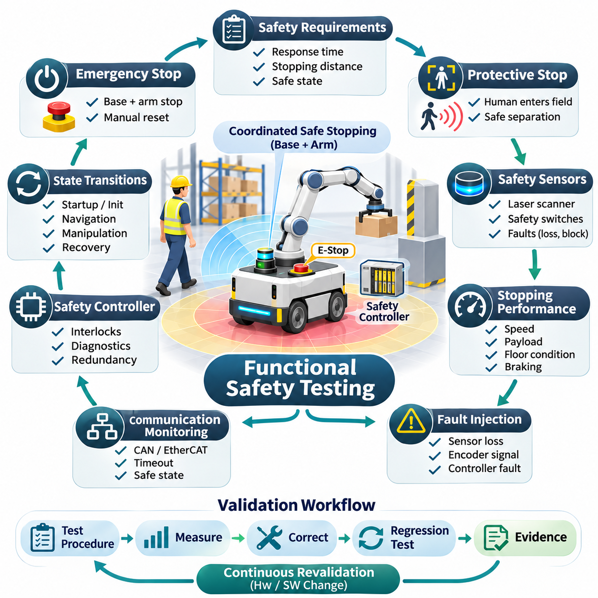
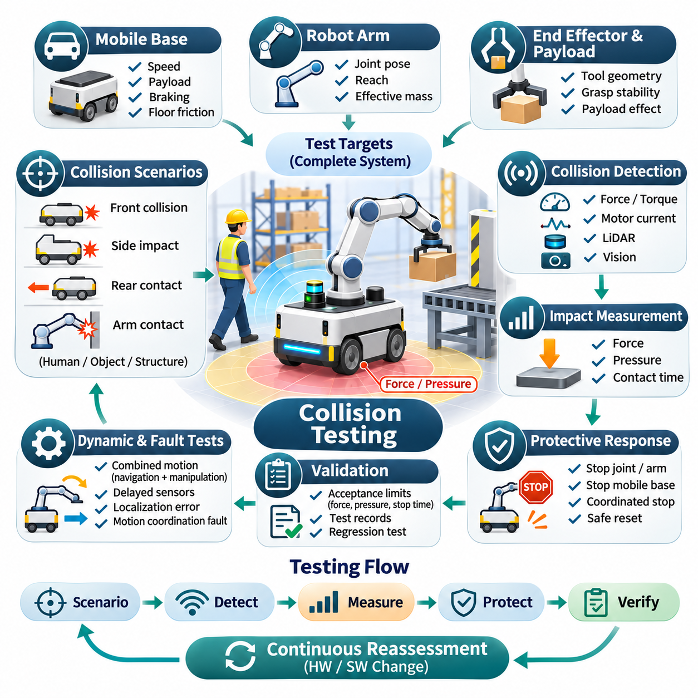
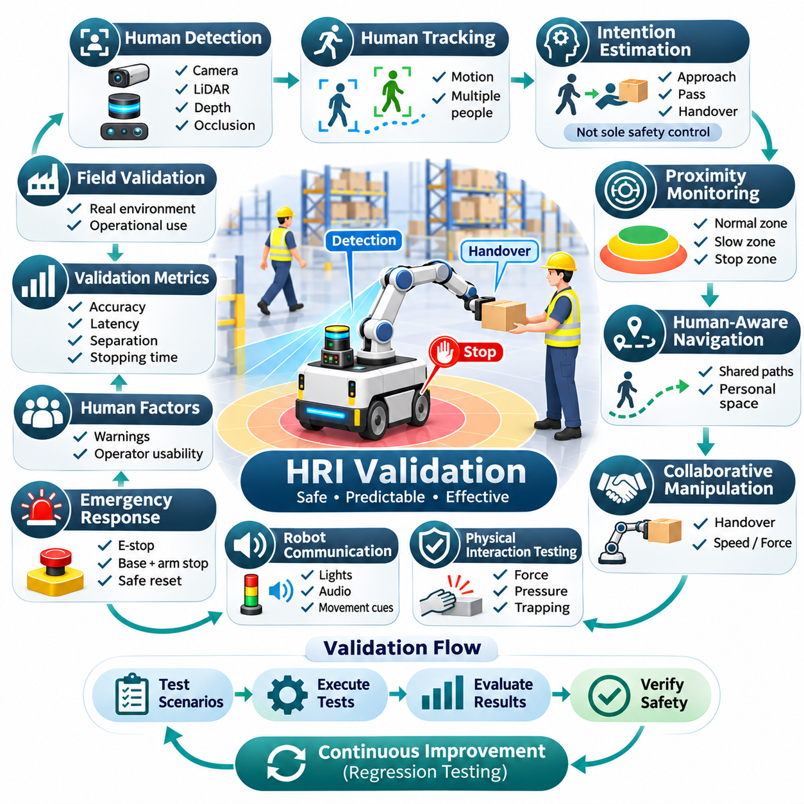
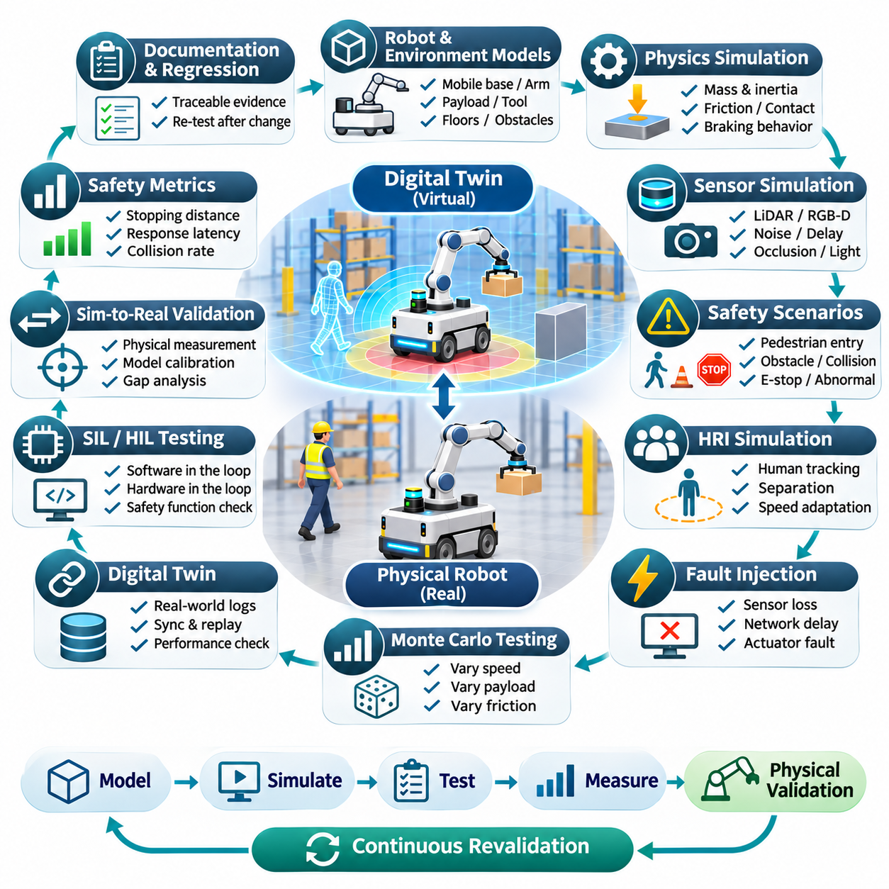
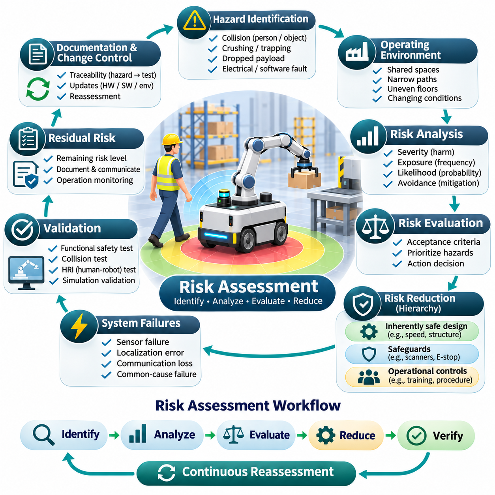
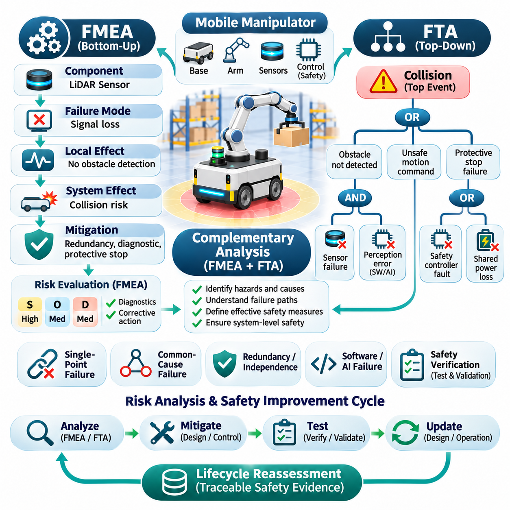
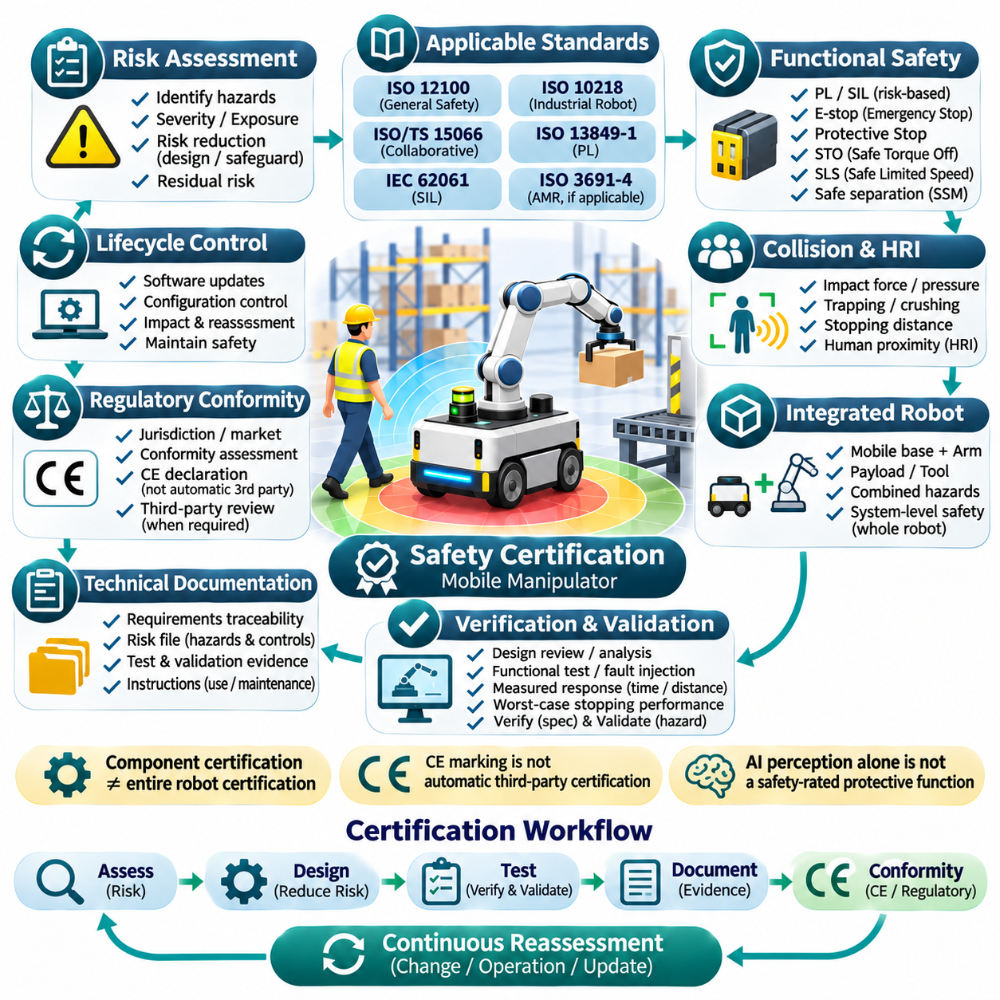
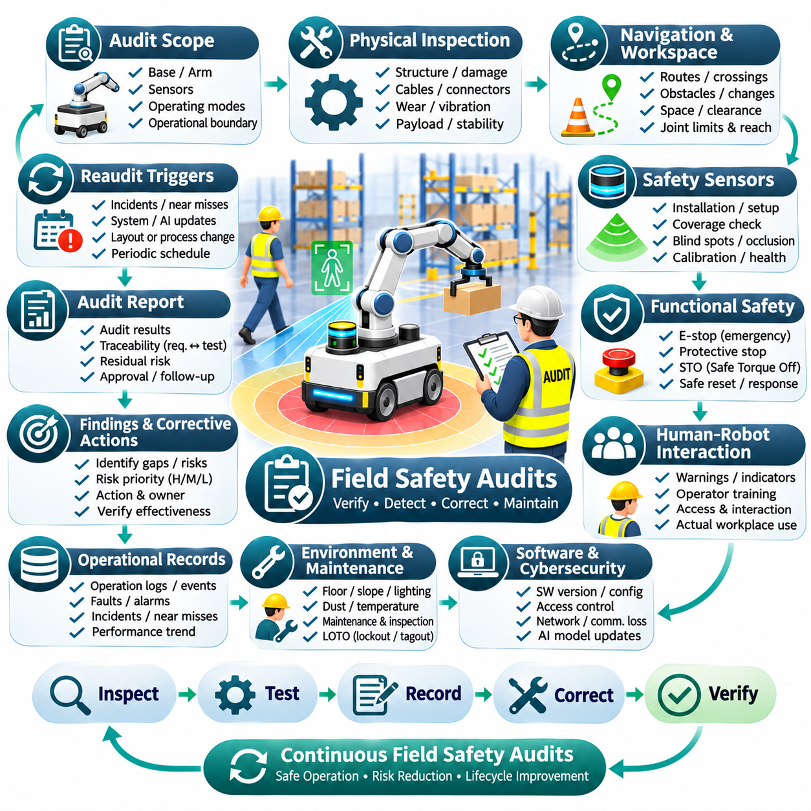
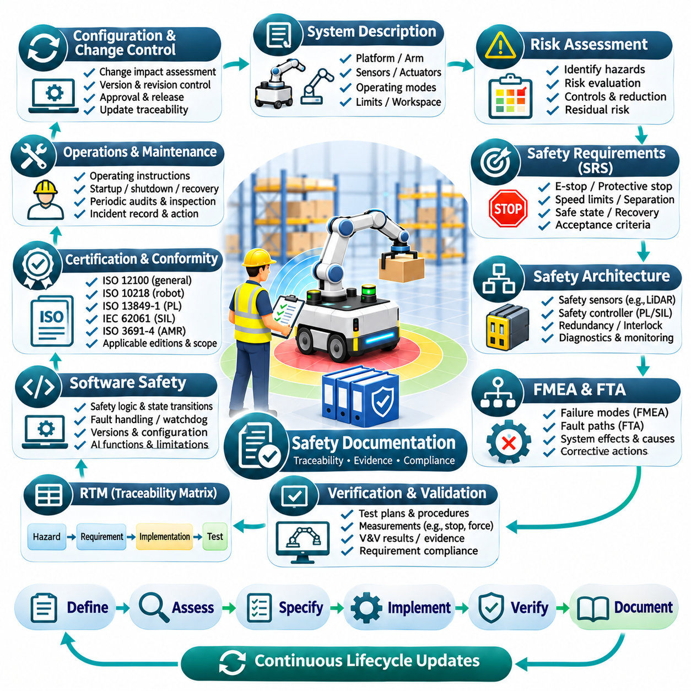

# Chapter 12. Safety Validation

## 01 Safety Validation Overview

{width="7.268055555555556in" height="7.268055555555556in"}

안전성 검증(Safety Validation)은 이동형 매니퓰레이터(Mobile Manipulator)가 사람, 장비, 기반 시설 또는 주변 작업 환경에 허용할 수 없는 위험을 초래하지 않고 작동할 수 있는지를 확인하는 체계적인 과정이다. 이는 개별 안전 구성요소가 정상적으로 작동하는지 확인하는 것 이상을 포함한다. 이동 플랫폼, 매니퓰레이터, 센서, 제어 소프트웨어, 통신 인터페이스 및 인간 상호작용 메커니즘을 포함한 전체 로봇 시스템을 실제 운용 조건에서 평가해야 한다.

이동형 매니퓰레이터는 자율주행과 로봇 조작 기능을 결합하기 때문에 고유한 안전 과제를 발생시킨다. 이동 베이스는 공유 작업 공간을 주행하는 동시에 로봇 팔은 구성, 도달 범위 및 점유 공간을 지속적으로 변경할 수 있다. 이러한 움직임은 기존의 고정형 로봇이나 자율이동로봇(AMR)에서는 발생하지 않을 수 있는 동적인 위험을 만든다. 따라서 안전성 검증에서는 전체 플랫폼의 통합된 동작을 고려해야 한다.

종합적인 검증 전략은 안전 요구사항을 식별하고 이를 측정 가능한 엔지니어링 조건으로 구체화하는 것에서 시작한다. 이러한 요구사항은 비상 정지(Emergency Stop), 보호 정지(Protective Stop), 속도 및 이격거리 모니터링(Speed and Separation Monitoring), 충돌 회피(Collision Avoidance), 작업 공간 제한(Workspace Limitation), 비정상 상황으로부터의 안전한 복구(Safe Recovery)를 다루어야 한다. 각 요구사항에는 대응하는 검증 방법과 합격 기준이 있어야 하며, 이를 통해 개발과 배포 전 과정에서 안전 성능을 일관되게 평가할 수 있다.

기능 안전 시험(Functional Safety Testing)은 위험 상황이 발생했을 때 안전 관련 기능이 올바르게 대응하는지를 검증한다. 비상 정지 장치, 안전 제어기, 보호 센서, 제동 장치 및 통신 모니터링 기능은 정상 및 비정상 작동 조건에서 시험해야 한다. 검증 과정에서는 응답 시간, 정지 거리, 고장 감지, 시스템 상태 전환 및 복구 동작을 평가해야 한다. 목표는 개별 구성요소나 하위 시스템에 오작동이 발생하더라도 안전 기능이 효과적으로 유지되는지 확인하는 것이다.

충돌 시험(Collision Testing)은 이동형 매니퓰레이터와 주변 환경 사이의 물리적 상호작용을 평가한다. 이동 베이스, 로봇 팔, 엔드 이펙터(End Effector), 적재물(Payload) 및 주변 구조물과 관련된 충돌 가능성을 고려해야 한다. 다양한 접근 방향, 이동 속도, 로봇 팔 구성 및 접촉 조건을 시험해야 한다. 특히 사람 근처에서 로봇이 작동하거나 충돌 시 추가적인 충격 또는 끼임 위험을 유발할 수 있는 물체를 취급하는 경우에는 각별한 주의가 필요하다.

인간-로봇 상호작용(Human-Robot Interaction, HRI) 검증은 이동형 매니퓰레이터와 동일한 작업 공간을 공유하는 사람의 안전에 중점을 둔다. 사람 감지, 접근 동작, 경고 표시, 제한 구역 및 협업 작업 절차를 평가해야 한다. 실제와 유사한 사람의 움직임, 로봇 작업 공간으로의 예상치 못한 진입, 조작 작업 중 발생하는 상호작용 등을 포함해야 한다. 사람의 행동이 계획된 운용 가정과 다르더라도 시스템은 예측 가능한 방식으로 동작하고 충분한 보호 기능을 제공해야 한다.

시뮬레이션 기반 검증(Simulation-Based Validation)은 실제 환경에서 재현하기 어렵거나 비용이 많이 들거나 위험할 수 있는 안전 시나리오를 조사하는 효율적인 환경을 제공한다. 디지털 환경에서는 로봇 구성, 장애물, 사람의 움직임, 센서의 한계 및 비정상 작동 조건을 모델링할 수 있다. 반복적인 시뮬레이션을 통해 잠재적인 고장 시나리오를 식별하고 다양한 안전 전략을 평가할 수 있다. 그러나 시뮬레이션 결과는 실제 시험을 통해 뒷받침되어야 한다. 시뮬레이션 환경과 실제 환경 사이의 차이가 안전 성능에 영향을 미칠 수 있기 때문이다.

위험성 평가(Risk Assessment)는 안전 관련 엔지니어링 활동의 우선순위를 결정하는 기반을 제공한다. 잠재적 위험요소는 예상되는 결과의 심각성, 노출 조건 및 발생 가능성을 기준으로 식별해야 한다. 평가 과정에서는 정상 작동뿐만 아니라 예측 가능한 오사용, 유지보수 작업, 소프트웨어 고장, 센서 성능 저하 및 예상하지 못한 환경 변화도 고려해야 한다. 식별된 위험은 적절한 허용 기준에 따라 평가해야 하며, 보호 조치를 구현한 후 시스템 수명주기 전반에 걸쳐 재평가해야 한다.

고장 형태 및 영향 분석(Failure Mode and Effects Analysis, FMEA)과 결함수 분석(Fault Tree Analysis, FTA)은 시스템 고장을 이해하기 위한 상호보완적인 접근법을 제공한다. FMEA는 개별 구성요소와 기능을 조사하여 잠재적인 고장 형태, 발생 원인 및 전체 운용에 미치는 영향을 식별한다. 반면 FTA는 바람직하지 않은 최상위 사건에서 출발하여 해당 사건을 유발할 수 있는 여러 고장의 조합을 체계적으로 분석한다. 두 가지 방법을 함께 적용하면 구성요소 수준의 신뢰성과 시스템 수준의 안전 요구사항을 연결하여 분석할 수 있다.

안전 인증(Safety Certification)은 로봇과 안전 관련 하위 시스템이 적용 가능한 규제 및 기술 요구사항을 충족하는지를 평가한다. 인증 과정에서는 식별된 위험요소가 적절히 처리되었으며 보호 기능이 의도한 대로 작동한다는 사실을 입증할 수 있는 추적 가능한 증거가 필요하다. 하드웨어 아키텍처, 소프트웨어 동작, 구성요소 사양, 시험 결과 및 위험성 평가 기록 등이 이러한 증거에 포함될 수 있다. 인증 준비는 개발의 마지막 행정 절차로 취급하기보다 개발 전 과정에서 고려해야 한다.

현장 안전 감사(Field Safety Audits)는 실제 배포 환경에서도 검증된 안전 조치가 효과적으로 유지되는지를 확인한다. 시설 배치, 교통 패턴, 사람의 활동, 적재물 구성 및 운용 절차의 변화는 실험실 시험 당시에는 존재하지 않았던 새로운 위험을 발생시킬 수 있다. 감사에서는 설치된 보호 장치, 비상 대응 절차, 작업자 교육, 유지보수 기록 및 운용 중 발생한 사고를 조사해야 한다. 감사 결과는 시정 조치로 이어져야 하며, 필요한 경우 추가 시험이나 시스템 구성 변경을 수행해야 한다.

안전 문서화(Safety Documentation)는 운용 수명주기 전반에서 안전성을 관리하는 데 필요한 추적성을 제공한다. 요구사항, 위험요소 분석, 위험성 평가, FMEA 및 FTA 결과, 시험 절차, 검증 기록, 인증 증거 및 현장 감사 결과를 일관된 구조로 관리해야 한다. 각 안전 요구사항은 실제 구현 내용 및 이를 뒷받침하는 검증 증거와 연결되어야 한다. 이러한 접근법은 엔지니어링 의사결정의 감사 가능성을 높이고 향후 시스템 변경, 유지보수 및 업그레이드를 지원한다.

안전성 검증은 궁극적으로 단일 인수 시험이 아니라 지속적인 엔지니어링 활동이다. 로봇 하드웨어, 제어 알고리즘, 인식 모델, 운용 환경 또는 소프트웨어 버전의 변경은 기존에 검증된 안전 동작에 영향을 미칠 수 있다. 따라서 중요한 시스템 변경에는 회귀 시험(Regression Testing)과 영향 평가(Impact Assessment)가 함께 수행되어야 한다. 기능 안전 시험, 충돌 평가, 인간-로봇 상호작용 평가, 시뮬레이션, 위험 분석, 안전 인증 및 현장 감사를 통합함으로써 개발자는 신뢰할 수 있는 이동형 매니퓰레이션 시스템을 배포하기 위한 체계적인 기반을 구축할 수 있다.

## 02 Functional Safety Testing

{width="7.268055555555556in" height="7.268055555555556in"}

기능 안전 시험(Functional Safety Testing)은 정상적인 조건, 비정상적인 상황 및 예측 가능한 시스템 고장 상황에서 안전 관련 기능이 올바르게 작동하는지를 검증하는 체계적인 엔지니어링 과정이다. 이동형 매니퓰레이터(Mobile Manipulator)의 경우 이동 플랫폼, 로봇 팔, 센서, 액추에이터 및 안전 제어기가 위험 상황 발생 시 적절하게 대응하는지를 확인한다. 목표는 단순히 안전 장치가 설치되어 있는지를 확인하는 것이 아니라, 전체 시스템이 위험 상황을 감지하고 안전 상태(Safe State)로 전환할 수 있음을 입증하는 것이다.

기능 안전(Functional Safety)은 이동형 매니퓰레이터의 주행 기능과 조작 기능이 함께 작동하기 때문에 특히 중요하다. 이동 베이스(Mobile Base)가 주행하는 동안 로봇 팔은 위치, 자세 및 작업 범위를 변경할 수 있다. 어느 한 하위 시스템에서 발생한 고장도 전체 플랫폼의 안전성에 영향을 미칠 수 있다. 따라서 시험에서는 주행과 조작의 연계 동작, 통합 정지 동작, 적재물의 영향 및 주행 제어와 조작 제어 사이의 상호작용을 함께 고려해야 한다.

시험을 시작하기 전에 안전 요구사항(Safety Requirements)을 수립해야 한다. 이러한 요구사항은 비상 정지(Emergency Stop), 보호 정지(Protective Stop), 안전 등급 모니터링 기능(Safety-Rated Monitoring Functions), 속도 제한, 제동 시스템 및 고장 감지 메커니즘의 예상 동작을 정의한다. 각 요구사항에는 최대 응답 시간, 정지 거리, 허용 속도 또는 필수 시스템 상태와 같은 측정 가능한 합격 기준이 연결되어야 한다. 이를 통해 안전 설계 결정과 검증 결과 사이의 추적 가능한 관계를 확보할 수 있다.

비상 정지 시험(Emergency Stop Testing)은 작업자 또는 외부 안전 장치가 비상 정지 명령을 활성화했을 때 로봇이 위험한 움직임을 신속하게 종료할 수 있는지를 검증한다. 시험에서는 비상 정지 버튼, 해당되는 경우 무선 비상 정지 장치, 안전 회로 및 통신 경로를 평가해야 한다. 이동 베이스와 로봇 팔은 정의된 안전 아키텍처(Safety Architecture)에 따라 반응해야 한다. 또한 비상 정지 상태를 해제하더라도 명시적인 리셋 및 재시작 절차 없이 로봇의 움직임이 자동으로 재개되지 않는지 확인해야 한다.

보호 정지 시험(Protective Stop Testing)은 안전 센서가 잠재적으로 위험한 상황을 감지했을 때 로봇이 어떻게 대응하는지를 평가한다. 예를 들어 사람이 제한 구역에 진입하거나, 보호 영역 내에 장애물이 나타나거나, 안전 스캐너가 안전 이격거리(Safe Separation Distance) 위반을 감지하는 상황이 포함된다. 시스템은 설정된 안전 기능에 따라 위험한 움직임을 중단하거나 감속해야 한다. 다양한 접근 방향, 로봇 속도 및 운용 구성에서 보호 정지 기능이 효과적으로 유지되는지 확인해야 한다.

안전 관련 센서는 보호 기능의 신뢰성에 직접적인 영향을 미치므로 체계적인 검증이 필요하다. 레이저 스캐너, 안전 라이트 커튼(Safety Light Curtain), 안전 스위치, 위치 모니터링 장치 및 기타 보호 센서는 감지 능력, 응답 시간, 진단 동작 및 고장 표시 기능을 시험해야 한다. 센서 가림, 정렬 불량, 연결 해제 및 통신 장애도 고려해야 한다. 시스템은 유효하지 않은 안전 입력을 감지해야 하며, 누락되거나 신뢰할 수 없는 신호를 안전한 환경이라는 증거로 간주해서는 안 된다.

정지 성능(Stopping Performance)은 기능 안전 시험의 또 다른 핵심 요소이다. 실제 정지 거리는 로봇 속도, 적재물, 바닥 상태, 제동 특성 및 로봇 팔의 구성에 따라 달라진다. 대표적인 운용 조건에서 정지 동작을 측정하고, 발생 가능한 최악의 정지 시나리오를 식별해야 한다. 이동 플랫폼과 매니퓰레이터 모두를 평가해야 한다. 한쪽 하위 시스템을 정지시키는 것만으로 다른 하위 시스템에서 발생하는 위험이 반드시 제거되는 것은 아니기 때문이다.

고장 주입 시험(Fault Injection Testing)은 안전 관련 구성요소에 비정상적인 조건이 발생했을 때 시스템이 어떻게 동작하는지를 조사한다. 엔지니어는 센서 연결 해제, 엔코더 신호 손실, 통신 중단, 제어기 고장 또는 일관성이 없는 입력 신호와 같은 고장을 통제된 방식으로 발생시킬 수 있다. 목적은 안전 아키텍처가 이러한 조건을 감지하고 적절한 대응을 시작하는지 검증하는 것이다. 고장 주입은 의도하지 않은 위험한 움직임을 방지할 수 있도록 적절한 보호 조치를 갖춘 통제된 환경에서 수행해야 한다.

통신 모니터링(Communication Monitoring)은 분산형 로봇 아키텍처(Distributed Robotic Architecture)에서 특히 중요하다. 이동형 매니퓰레이터는 CAN, EtherCAT, Ethernet 또는 기타 통신 네트워크를 통해 연결된 여러 제어기를 사용할 수 있다. 안전 관련 메시지는 타임아웃, 잘못된 데이터, 통신 손실 및 예상하지 못한 상태 전환 여부를 모니터링해야 한다. 통신 신뢰성이 저하되면 시스템은 오래된 명령이나 불완전한 상태 정보를 이용하여 계속 작동하지 않고 사전에 정의된 안전 상태로 전환해야 한다.

안전 제어기 검증(Safety Controller Validation)은 안전 입력을 모니터링하고 보호 출력을 제어하는 로직을 평가한다. 시험에서는 입력 처리, 인터록 조건(Interlock Conditions), 리셋 로직, 진단 범위(Diagnostic Coverage) 및 출력 전환 동작을 검증해야 한다. 선택한 안전 아키텍처에서 요구되는 경우 이중화 채널(Redundant Channels)과 진단 메커니즘도 평가해야 한다. 구현된 시스템은 단일 고장이 발생하더라도 지속적으로 작동해야 하는 안전 기능이 감지되지 않은 상태로 비활성화되지 않도록 보장해야 한다.

기능 안전 시험에서는 소프트웨어 및 운용 상태 전환(Operational State Transitions)도 고려해야 한다. 시작, 초기화, 자율주행, 조작, 충전, 유지보수, 복구 및 종료 과정에는 각각 서로 다른 안전 요구사항이 적용될 수 있다. 엔지니어는 필수 안전 조건이 충족되지 않은 상태에서 로봇이 위험한 동작을 수행할 수 없도록 검증해야 한다. 예를 들어 이동 베이스가 허용된 안정성 조건을 벗어났거나 필수 보호 기능을 사용할 수 없는 경우에는 조작 작업이 시작되지 않아야 한다.

시험 절차(Test Procedures)에는 초기 구성, 운용 조건, 고장 시나리오, 예상 응답, 측정 방법 및 합격 기준을 정의해야 한다. 시험 결과에는 실제 응답 시간, 정지 거리, 감지된 고장, 시스템 상태 및 예상하지 못한 동작을 기록해야 한다. 시험에 실패하면 근본 원인 분석(Root Cause Analysis)을 수행하고, 시정 조치를 구현한 후 재검증해야 한다. 일관된 시험 절차를 유지하면 서로 다른 하드웨어 버전과 소프트웨어 릴리스 간의 결과를 비교할 수 있다.

기능 안전 검증은 안전 관련 동작에 영향을 미치는 중요한 변경이 발생할 때마다 반복해야 한다. 하드웨어 교체, 펌웨어 수정, 제어기 구성 변경, 센서 위치 변경, 적재량 증가 및 소프트웨어 업데이트는 기존에 검증된 보호 기능에 영향을 미칠 수 있다. 회귀 시험(Regression Testing)을 통해 이러한 변경 이후에도 기존 안전 메커니즘이 효과적으로 유지되는지 확인해야 한다. 재시험 범위는 엔지니어링 영향 평가(Engineering Impact Assessment)를 통해 결정해야 한다.

기능 안전 시험의 최종 목표는 안전 관련 기능이 정의된 요구사항에 따라 작동한다는 문서화된 증거를 확보하는 것이다. 시험 기록, 시스템 구성, 구성요소 사양, 고장 시나리오, 측정 결과 및 시정 조치는 개발 수명주기 전반에 걸쳐 관리해야 한다. 이러한 증거는 시스템 수준의 안전성 검증, 인증 활동, 현장 배포 및 향후 유지보수를 지원한다. 체계적인 시험 프로세스는 사람 및 산업 장비와 작업 공간을 공유하는 환경에서 이동형 매니퓰레이터를 신뢰성 있게 운용하기 위한 기술적 기반을 제공한다.

## 03 Collision Testing

{width="7.268055555555556in" height="7.268055555555556in"}

충돌 시험(Collision Testing)은 이동형 매니퓰레이터(Mobile Manipulator)의 안전성 검증(Safety Validation)에서 중요한 부분으로, 로봇이 사람, 물체, 장비 또는 주변 기반 시설과 물리적으로 접촉했을 때 어떻게 동작하는지를 평가한다. 기존의 고정형 로봇과 달리 이동형 매니퓰레이터는 이동 플랫폼의 주행과 관절형 로봇 팔의 움직임을 결합하므로 여러 충돌 지점이 발생할 수 있다. 따라서 이동 베이스(Mobile Base), 로봇 팔(Robotic Arm), 엔드 이펙터(End Effector), 적재물(Payload) 및 연결된 기계 구조물을 포함한 전체 시스템을 대상으로 시험해야 한다.

충돌 시험의 주요 목적은 잠재적인 충격을 감지하고 회피하거나 허용 가능한 안전 한계 내에서 제어할 수 있는지를 확인하는 것이다. 시험에서는 접촉이 발생할 수 있는 조건을 정의하고, 그에 따른 물리적 힘을 평가하며, 보호 메커니즘의 효과를 검증해야 한다. 특히 작업자가 로봇과 동일한 작업 공간을 공유하거나 예상하지 못한 장애물이 자율주행 및 조작 작업을 방해할 수 있는 상황에 각별한 주의를 기울여야 한다.

충돌 시나리오(Collision Scenarios)는 로봇의 운용 환경과 예상 작업을 기준으로 정의해야 한다. 일반적인 상황에는 주행 중 전방 충돌, 좁은 통로에서의 측면 충돌, 로봇 팔과 주변 구조물 사이의 접촉, 엔드 이펙터와 작업자 사이의 우발적인 접촉 등이 포함된다. 또한 운반 중인 물체와의 충돌, 불안정한 적재물, 돌출된 기계 구성요소 및 로봇의 이동 경로에 갑자기 진입하는 장애물과 관련된 시나리오도 고려해야 한다.

이동 베이스는 질량, 속도, 제동 특성 및 적재물이 충격 거동에 직접적인 영향을 미치므로 별도의 충돌 시험이 필요하다. 대표적인 운용 속도와 적재 구성에서 전방, 측면 및 후방 접촉 조건을 평가해야 한다. 서로 다른 거리에서 장애물이 감지되었을 때 플랫폼의 정지 반응을 측정해야 한다. 바닥 마찰, 휠 상태 및 제동 성능의 변화도 고려해야 한다. 이러한 요소들은 실제 정지 거리와 충돌 심각도를 크게 변화시킬 수 있기 때문이다.

로봇 팔 충돌 시험(Robotic Arm Collision Testing)은 조작 중 관절과 링크의 물리적 거동에 중점을 둔다. 서로 다른 로봇 팔 구성에서는 작업 공간 전체에 걸쳐 유효 질량, 속도 및 기계적 지렛대 효과가 달라지므로 충돌 위험도 크게 달라질 수 있다. 다양한 관절 위치, 이동 속도 및 팔의 확장 거리를 고려하여 접촉 조건을 시험해야 한다. 특히 로봇 팔이 사람, 기계 외함, 선반 또는 기타 고정 구조물 근처에서 작동하는 구성에 각별한 주의를 기울여야 한다.

엔드 이펙터 및 적재물 충돌 시험(End-Effector and Payload Collision Testing)도 중요하다. 도구와 운반 물체가 추가적인 위험을 유발할 수 있기 때문이다. 그리퍼(Gripper), 용접 도구, 검사 장치 또는 운반 물체는 날카로운 모서리, 집중된 접촉 면적 또는 상당한 관성을 가질 수 있다. 접근, 파지, 운반 및 물체 해제 작업 중 발생할 수 있는 우발적인 접촉을 평가해야 한다. 충격의 잠재적 결과를 판단할 때 적재물의 질량, 형상, 장착 안정성 및 도구 방향이 미치는 영향을 고려해야 한다.

충돌 감지 메커니즘(Collision Detection Mechanisms)은 다양한 물리적 및 환경적 조건에서 평가해야 한다. 힘-토크 센서(Force-Torque Sensor), 모터 전류 모니터링(Motor Current Monitoring), 관절 토크 추정(Joint Torque Estimation), 근접 센서(Proximity Sensor), 레이저 스캐너 및 비전 기반 인식( Vision-Based Perception) 등이 충돌 감지에 활용될 수 있다. 이러한 메커니즘이 관련 접촉 상황을 충분한 신뢰성과 응답 속도로 감지하는지 확인해야 한다. 오검출(False Positive)과 미검출(False Negative)도 조사해야 한다. 두 가지 모두 운용 안전성과 시스템 가용성에 영향을 미칠 수 있기 때문이다.

충돌 감지 이후의 보호 대응(Protective Response)도 전체 안전 프로세스의 일부로 검증해야 한다. 감지된 상황에 따라 로봇은 해당 관절을 정지시키거나, 로봇 팔의 움직임을 중단하거나, 이동 베이스를 정지시키거나, 위험한 동작 명령을 취소하거나, 통합 보호 정지(Coordinated Protective Stop)를 시작해야 할 수 있다. 선택된 대응 방식이 추가적인 위험 움직임을 방지하는지 확인해야 하며, 필수 안전 조건이 복구되기 전에 로봇이 자동으로 작동을 재개하지 않는지도 검증해야 한다.

충격력과 압력 측정(Impact Force and Pressure Measurements)은 충돌의 심각도를 파악하는 데 중요한 정보를 제공한다. 제어된 조건에서 충격 특성을 평가하기 위해 계측형 접촉 표면(Instrumented Contact Surface)과 힘 측정 장치를 사용할 수 있다. 측정에서는 접촉 위치, 유효 질량, 상대 속도, 접촉 지속 시간 및 힘의 분포를 고려해야 한다. 신체 부위와 접촉 형상에 따라 부상 가능성이 다를 수 있으므로 시험 조건은 실제 적용 분야와 관련 안전 요구사항을 반영해야 한다.

동적 충돌 시험(Dynamic Collision Testing)은 로봇과 주변 물체가 동시에 움직이는 상황을 평가한다. 예를 들어 이동 베이스가 장애물에 접근하는 동안 로봇 팔이 작업대를 향해 확장될 수 있다. 이러한 복합 움직임은 개별 하위 시스템을 별도로 시험하는 것만으로는 충분히 평가하기 어려운 충돌 조건을 발생시킬 수 있다. 따라서 통합 시험에서는 주행, 정지, 위치 결정 및 물체 취급 사이의 전환을 포함하여 주행과 조작의 협조 동작을 평가해야 한다.

충돌 시험에서는 예측 가능한 비정상 운용 조건도 조사해야 한다. 여기에는 센서 응답 지연, 잘못된 장애물 위치 정보, 통신 중단, 예상하지 못한 적재물 이동, 위치 추정 오류 및 동작 조정 기능의 고장 등이 포함될 수 있다. 통제된 고장 시나리오를 통해 로봇이 안전하지 않은 조건을 인식하고 적절한 보호 대응을 활성화할 수 있는지 확인해야 한다. 이러한 시험은 독립적인 비상 정지 기능과 적절한 물리적 보호 장치를 갖춘 통제된 환경에서 수행해야 한다.

시험 환경(Test Environments)은 실제 배포 현장의 관련 특성을 재현해야 한다. 바닥 재질, 통로 폭, 작업대 형상, 장애물, 조명 조건 및 사람의 이동 패턴은 충돌 감지와 대응에 영향을 미칠 수 있다. 시험은 통제된 실험실 환경과 실제 운용 조건을 대표하는 현장 환경을 모두 포함해야 한다. 반복 가능한 시험 구성을 유지하는 것은 서로 다른 하드웨어 구성, 소프트웨어 버전 및 운용 매개변수에 따른 충돌 거동을 비교하는 데 중요하다.

충돌 시험 결과는 시스템 요구사항과 위험성 평가(Risk Assessment)를 통해 사전에 정의된 합격 기준에 따라 평가해야 한다. 이러한 기준에는 최대 충격력, 접촉 압력, 정지 거리, 감지 지연 시간 및 보호 대응 시간이 포함될 수 있다. 로봇이 최종적으로 정지했다는 사실만으로 시험이 성공했다고 판단해서는 안 된다. 전체 대응 과정에서 명시된 조건에 따라 충돌 위험이 충분히 제어되었음을 입증해야 한다.

모든 충돌 시험 활동은 엔지니어링 추적성(Engineering Traceability)을 확보할 수 있도록 문서화해야 한다. 기록에는 로봇 구성, 적재물 특성, 운용 속도, 접촉 위치, 시험 장비, 환경 조건, 측정된 힘, 정지 거동 및 관찰된 시스템 반응이 포함되어야 한다. 예상하지 못한 결과가 발생하면 원인을 조사하고 시정 조치를 수행한 후 수정 사항의 효과를 검증하기 위한 반복 시험을 진행해야 한다. 일관된 문서화는 후속 안전성 검토와 인증 활동도 지원한다.

충돌 시험은 초기 개발 단계에만 국한되지 않는다. 로봇 크기, 적재 용량, 로봇 팔 구성, 엔드 이펙터 설계, 제동 시스템, 인식 알고리즘 또는 동작 제어 소프트웨어의 변경은 새로운 충돌 위험을 유발할 수 있다. 따라서 물리적 상호작용이나 보호 동작에 영향을 미치는 변경이 발생하면 회귀 시험(Regression Testing)을 수행해야 한다. 지속적인 평가를 통해 운용 수명주기 전반에서 기존에 검증된 충돌 보호 기능이 효과적으로 유지되도록 해야 한다.

궁극적으로 충돌 시험은 이동형 매니퓰레이터가 물리적 환경과 안전하게 상호작용할 수 있음을 입증하는 필수적인 근거를 제공한다. 이동 베이스, 로봇 팔, 엔드 이펙터, 적재물, 충돌 감지 메커니즘 및 보호 대응 기능을 통합 시스템으로 평가함으로써 엔지니어는 개별 시험만으로는 발견하기 어려운 취약점을 식별할 수 있다. 제어된 충격 실험, 센서 검증, 동적 시나리오 시험 및 현장 평가를 결합하면 산업용 및 협업 로봇 응용 환경에서 충돌 관련 위험을 줄이기 위한 실질적인 기반을 구축할 수 있다.

## 04 HRI Validation

{width="7.268055555555556in" height="7.268055555555556in"}

인간-로봇 상호작용(Human-Robot Interaction, HRI) 검증은 이동형 매니퓰레이터(Mobile Manipulator)가 사람과 작업 공간을 공유하는 환경에서 안전하고 예측 가능하며 효과적으로 작동할 수 있는지를 평가하는 체계적인 과정이다. 로봇이 사람의 존재를 감지하고, 사람의 움직임을 해석하며, 예상하지 못한 상호작용에 대응하고, 자신의 작동 의도를 전달하는 방식을 검토한다. 목표는 사람들이 허용할 수 없는 물리적 또는 운용상 위험에 노출되지 않고 로봇과 함께 작업할 수 있도록 보장하는 것이다.

이동형 매니퓰레이터는 자율주행과 로봇 팔의 움직임을 결합하기 때문에 추가적인 인간-로봇 상호작용 과제를 발생시킨다. 이동 베이스(Mobile Base)가 사람에게 접근하는 동시에 로봇 팔은 도달, 파지 또는 운반 작업을 수행할 수 있다. 이러한 복합적인 움직임은 지속적으로 변화하는 동적 상호작용 영역을 형성한다. 따라서 인간-로봇 상호작용 검증에서는 주행과 조작의 안전성을 독립적으로 평가하는 것이 아니라 전체 로봇의 동작을 함께 평가해야 한다.

사람 감지(Human Detection)는 인간-로봇 상호작용 검증의 기본 구성요소이다. 카메라, LiDAR 센서, 깊이 센서 및 기타 인식 기술을 사용하여 사람을 식별하고 로봇을 기준으로 상대적인 위치를 추정할 수 있다. 시험에서는 감지 정확도, 인식 거리, 응답 지연 시간 및 다양한 환경 조건에서의 강건성을 평가해야 한다. 가림 현상(Occlusion), 조명 변화, 반사 표면 및 부분적으로만 보이는 인체도 고려해야 한다. 이러한 조건은 인식 신뢰성을 저하시킬 수 있기 때문이다.

사람 추적(Human Tracking) 검증은 로봇이 작업 환경 내 사람의 위치와 움직임을 지속적으로 추정할 수 있는지를 평가한다. 추적 시스템은 사람이 걷거나 멈추거나 방향을 바꾸거나 장애물 뒤로 이동하더라도 일관된 식별 정보와 이동 궤적을 유지해야 한다. 여러 사람이 동시에 움직이는 상황과 사람들이 서로의 이동 경로를 교차하는 상황도 시험에 포함해야 한다. 신뢰성 있는 추적 기능은 사람이 즉각적인 위험 구역에 진입한 이후에만 대응하는 것이 아니라 잠재적인 상호작용을 사전에 예측하도록 지원한다.

사람의 의도 추정(Human Intention Estimation)은 향후 상호작용을 예측하는 로봇의 능력을 향상시킬 수 있다. 시스템은 이동 방향, 신체 자세, 손동작 및 주변 작업 조건을 분석하여 사람이 로봇에 접근하거나, 로봇을 지나가거나, 상호작용하거나, 로봇을 회피하려는 의도를 추정할 수 있다. 검증에서는 이러한 추정 결과가 다양한 작업 조건에서도 신뢰성을 유지하는지 평가해야 한다. 사람의 의도를 항상 정확하게 추론할 수 있는 것은 아니므로 안전에 중요한 의사결정이 확률적인 의도 예측에만 의존해서는 안 된다.

근접 모니터링(Proximity Monitoring)은 로봇이 주변 사람과 적절한 이격거리를 유지하는지를 평가한다. 안전 구역(Safety Zones)은 로봇 속도, 정지 거리, 로봇 팔의 구성 및 접촉 시 예상되는 결과를 기준으로 정의할 수 있다. 사람이 모니터링 영역에 진입했을 때 로봇이 속도를 조절하거나 정지하는지 시험해야 한다. 일반 작동, 감속 작동 및 보호 정지(Protective Stop)를 지원하기 위해 서로 다른 구역을 설정할 수 있다. 각 구역의 경계는 실제 로봇의 응답 특성을 기준으로 검증해야 한다.

사람 인식 기반 주행(Human-Aware Navigation) 검증은 이동 플랫폼이 사람 주변에서 안전하고 자연스럽게 이동할 수 있는지를 평가한다. 기존의 일반적인 장애물 회피와 달리 사람 인식 기반 주행은 사람의 이동 패턴, 개인 공간(Personal Space), 접근성 및 상호작용 맥락을 고려한다. 로봇은 갑작스러운 접근, 불필요하게 가까운 통과 및 예측하기 어려운 방향 전환을 피해야 한다. 시험에는 좁은 통로, 공유 작업 공간, 교차하는 보행자 및 사람이 예상하지 못하게 보행 방향을 바꾸는 상황을 포함해야 한다.

협업 조작(Collaborative Manipulation)은 사람과 로봇 팔이 서로 중첩되는 작업 공간에서 작동할 수 있기 때문에 추가적인 안전 요구사항을 발생시킨다. 검증에서는 도달 동작, 물체 전달, 공동 조립 작업 및 협력적 자재 취급을 고려해야 한다. 로봇은 작업 조건과 적용 가능한 안전 요구사항에 따라 적절한 속도, 힘 및 이격거리를 유지해야 한다. 또한 사람이 예기치 않게 조작 영역에 진입하거나 예정된 물체 전달 위치를 변경했을 때 로봇이 적절하게 대응하는지도 시험해야 한다.

물리적 상호작용 시험(Physical Interaction Testing)은 로봇과 인체 사이에 의도하지 않은 접촉이 발생했을 때의 영향을 평가한다. 관련 시나리오에는 이동 베이스, 로봇 팔, 엔드 이펙터(End Effector) 및 운반 물체와의 접촉이 포함된다. 측정 항목에는 접촉력, 압력, 충격 지속 시간 및 상호작용에 관여하는 유효 질량이 포함될 수 있다. 시험 조건은 실제 적용 분야와 관련 안전 표준을 반영해야 한다. 특히 신체의 취약한 부위와 끼임 또는 압착 가능성에 각별한 주의를 기울여야 한다.

인간-로봇 의사소통(Human-Robot Communication)은 상호작용 안전성의 또 다른 중요한 요소이다. 로봇은 자신의 작동 상태, 이동 의도, 경고 및 예상하지 못한 상황에 관한 정보를 사람들이 이해할 수 있도록 제공해야 한다. 시각적 표시등, 음향 신호, 디스플레이 및 투사형 이동 안내 표시를 통해 사람들이 로봇의 동작을 예측하도록 지원할 수 있다. 검증에서는 이러한 신호가 다양한 운용 조건에서 쉽게 인지되고 이해되며 일관되게 제공되는지를 평가해야 한다. 의사소통은 불확실성을 줄이면서 불필요한 주의를 분산시키지 않아야 한다.

비상 상호작용 시나리오(Emergency Interaction Scenarios)도 인간-로봇 상호작용 검증에 포함해야 한다. 사람이 갑자기 로봇의 이동 경로에 진입하거나, 로봇의 작업 공간에 손을 넣거나, 센서를 가리거나, 비상 정지 장치를 작동시킬 수 있다. 로봇은 관련 상황을 인식하고 적절한 보호 대응을 시작해야 한다. 시험에서는 주행과 조작이 동시에 수행되는 상황에서도 비상 정지가 효과적으로 유지되는지, 그리고 복구 과정에서 적절한 안전 점검과 작업자 승인이 요구되는지를 확인해야 한다.

인간-로봇 상호작용 검증에서는 인간공학적 요소와 운용 편의성(Human Factors and Operational Usability)도 고려해야 한다. 사람마다 기술적 경험, 신체적 능력 및 로봇 시스템에 대한 친숙도가 다를 수 있다. 시험에서는 작업자가 로봇의 동작을 이해하고, 경고를 인식하며, 위험 상황을 식별하고, 필요한 경우 개입할 수 있는지를 평가해야 한다. 개별 안전 구성요소가 정상적으로 작동하더라도 혼란스러운 인터페이스, 모호한 경고 신호 및 예측하기 어려운 움직임은 운용 위험을 증가시킬 수 있다.

실험적 평가는 대표성 있는 참여자와 현실적인 작업 시나리오를 활용해야 한다. 통제된 시험에서는 사람의 접근 행동, 보행 속도, 상호작용 거리, 물체 전달 절차 및 로봇 경고에 대한 반응을 평가할 수 있다. 반복 시험은 시스템 성능의 편차와 사람 인식 모델의 잠재적인 한계를 식별하는 데 도움이 된다. 사람을 대상으로 하는 시험은 실험에 앞서 적절한 윤리적·안전적·감독 절차를 마련하고 필요한 보호 조치를 확보한 상태에서 수행해야 한다.

인간-로봇 상호작용 성능은 측정 가능한 지표를 사용하여 평가해야 한다. 주요 지표에는 사람 감지 정확도, 추적 신뢰성, 최소 이격거리, 응답 지연 시간, 보호 정지 시간, 상호작용 성공률 및 불필요한 정지 발생 빈도가 포함된다. 이러한 측정값은 개별적으로 평가하기보다 종합적으로 해석해야 한다. 예를 들어 사람 감지 정확도가 높더라도 로봇의 대응이 지나치게 느리거나 요구되는 거리 내에서 정지하지 못한다면 안전한 작동을 보장할 수 없다.

인간-로봇 상호작용 검증은 실험실 시험을 넘어 실제 배포 환경을 대표하는 조건으로 확장되어야 한다. 산업 시설, 물류 창고, 병원 및 서비스 환경은 사람의 이동 패턴, 가시성 조건, 작업 공간 제약 및 운용상의 기대가 서로 다르다. 현장 평가는 실제 작업 흐름에서 로봇이 안전한 상호작용 동작을 유지하는지, 환경 변화로 인해 새로운 위험이 발생하는지를 조사해야 한다. 작업자와 안전 담당자의 피드백은 지속적인 개선 과정에 반영되어야 한다.

인식 모델, 주행 알고리즘, 조작 궤적, 로봇 크기 및 운용 절차의 변경은 기존에 검증된 인간-로봇 상호작용 동작에 영향을 미칠 수 있다. 따라서 사람 감지, 이격거리 모니터링, 상호작용 계획 또는 보호 대응에 영향을 미치는 변경이 발생하면 회귀 시험(Regression Testing)을 수행해야 한다. 운용 데이터와 사고 보고서는 새로운 문제를 식별하는 데 도움이 될 수 있지만, 업데이트된 시스템은 배포 전에 적절한 안전성 검증을 거쳐야 한다.

궁극적으로 인간-로봇 상호작용 검증은 이동형 매니퓰레이터가 사람과 작업 환경을 공유하면서 예측 가능하고 허용 가능한 상호작용 동작을 유지할 수 있는지를 입증한다. 사람 감지, 추적, 의도 추정, 근접 모니터링, 사람 인식 기반 주행, 협업 조작, 물리적 상호작용 시험 및 인간공학적 요소 평가를 통합함으로써 엔지니어는 전체 인간-로봇 상호작용 과정을 평가할 수 있다. 이러한 체계적인 접근법은 산업 및 서비스 환경에서 이동형 매니퓰레이터를 안전하고 신뢰성 있으며 효과적으로 배포하기 위한 필수적인 기반을 제공한다.

## 05 Simulation Based Validation

{width="7.268055555555556in" height="7.268055555555556in"}

시뮬레이션 기반 검증(Simulation-Based Validation)은 가상 실험을 통해 실제 배포 전후에 이동형 매니퓰레이터(Mobile Manipulator)의 안전성과 신뢰성을 평가하는 체계적인 접근법이다. 시뮬레이션 로봇, 환경, 센서 및 운용 시나리오를 활용하여 정상, 비정상 및 잠재적으로 위험한 조건에서 시스템의 동작을 조사한다. 주요 목표는 안전상의 취약점을 식별하고 보호 메커니즘을 평가하며, 복잡하거나 위험한 상황을 실제 장비에서 시험할 때 발생할 수 있는 위험을 줄이는 것이다.

이동형 매니퓰레이터는 이동 플랫폼과 로봇 팔이 통합된 시스템으로 작동하기 때문에 종합적인 시뮬레이션 기반 검증이 필요하다. 주행, 장애물 회피, 조작, 인간 상호작용 및 비상 대응 기능은 서로 영향을 미칠 수 있다. 시뮬레이션 환경에서는 운용 조건을 통제하면서 이러한 상호작용을 반복적으로 평가할 수 있다. 엔지니어는 실제 시험에서 상당한 준비와 특수 장비가 필요하거나 허용할 수 없는 물리적 위험을 수반하는 시나리오도 조사할 수 있다.

시뮬레이션 환경은 로봇과 실제 작업 공간의 핵심적인 특성을 표현해야 한다. 로봇 모델에는 이동 베이스, 휠 구성, 필요한 경우 서스펜션 특성, 로봇 팔, 관절, 엔드 이펙터(End Effector) 및 적재물 특성이 포함되어야 한다. 환경 모델은 바닥, 벽, 작업대, 장애물, 제한 구역 및 사람이 접근할 수 있는 공간을 표현해야 한다. 가상 시스템이 실제 배포 환경을 얼마나 정확하게 반영하는지에 따라 시뮬레이션 결과가 달라지므로 정확한 기하학적 모델과 물리적 표현이 중요하다.

물리 기반 시뮬레이션(Physics-Based Simulation)은 충돌 거동과 보호 대응을 평가할 때 특히 중요하다. 시뮬레이션은 분석 목적에 필요한 수준으로 질량, 관성, 마찰, 접촉력, 관절 제한, 액추에이터 동작 및 제동 특성을 표현해야 한다. 엔지니어는 다양한 속도, 적재물 구성 및 로봇 자세가 정지 거리와 충격 조건에 미치는 영향을 조사할 수 있다. 초기 개발 단계에서는 단순화된 물리 모델이 유용할 수 있지만, 안전 관련 결과를 해석할 때는 해당 모델의 한계를 고려해야 한다.

센서 시뮬레이션(Sensor Simulation)은 통제된 조건에서 인식 및 안전 모니터링 기능을 평가할 수 있도록 지원한다. 가상 LiDAR, 깊이 카메라, RGB 카메라, 근접 센서 및 기타 센서를 통해 다양한 환경 상황을 나타내는 데이터를 생성할 수 있다. 시험에는 센서 노이즈, 제한된 감지 거리, 가림 현상, 반사 표면, 조명 변화 및 측정 지연을 포함해야 한다. 이러한 조건은 센서 성능이 저하되었을 때 로봇이 환경을 얼마나 신뢰성 있게 인식할 수 있는지 판단하는 데 도움이 된다.

시나리오 기반 검증(Scenario-Based Validation)은 사전에 정의된 상황을 활용하여 특정 안전 요구사항을 평가한다. 일반적인 시나리오에는 사람이 로봇의 이동 경로에 진입하는 상황, 주행 중 장애물이 나타나는 상황, 조작 중 예상하지 못한 충돌이 발생하는 상황, 통신 손실, 비상 정지 및 잘못된 위치 추정 등이 포함된다. 각 시나리오에는 초기 조건, 발생 이벤트, 예상되는 시스템 응답 및 합격 기준을 정의해야 한다. 동일한 시나리오를 다양한 운용 매개변수에서 반복하면 취약점을 식별하고 여러 안전 구성의 성능을 비교할 수 있다.

인간-로봇 상호작용(Human-Robot Interaction) 시나리오도 시뮬레이션을 통해 평가할 수 있다. 가상 사람 모델은 서로 다른 보행 속도, 이동 방향, 신체 위치 및 로봇 접근 방식을 표현할 수 있다. 엔지니어는 사람 감지, 추적, 근접 모니터링 및 속도 조절 기능이 올바르게 작동하는지 조사할 수 있다. 여러 사람의 가상 모델과 예측하기 어려운 이동 패턴을 활용하면 단순한 장애물 기반 시험에서는 발견되지 않을 수 있는 한계를 파악하는 데 도움이 된다.

고장 주입(Fault Injection)은 시뮬레이션 기반 검증의 또 다른 중요한 활용 분야이다. 엔지니어는 센서 연결 해제, 엔코더 오류, 통신 지연, 액추에이터 성능 저하, 제어기 오작동 및 일관성이 없는 시스템 상태와 같은 가상 고장을 발생시킬 수 있다. 이후 시뮬레이션 로봇을 평가하여 고장 감지 메커니즘이 비정상 조건을 인식하고 적절한 보호 대응을 시작하는지 확인할 수 있다. 고장 주입은 실제 장비에서 재현하기 어렵거나 위험한 고장 시나리오를 통제된 방식으로 조사할 수 있도록 한다.

시뮬레이션 기반 시험은 이동형 매니퓰레이터의 전체 운용 수명주기를 포괄해야 한다. 시작, 초기화, 자율주행, 작업대 위치 결정, 조작, 충전, 유지보수, 비상 복구 및 종료 과정에는 서로 다른 안전 조건이 적용될 수 있다. 엔지니어는 로봇이 운용 상태 사이에서 올바르게 전환하고 필수 안전 조건을 사용할 수 없는 상황에서 위험한 동작을 수행하지 않는지 검증해야 한다. 특히 주행과 조작 사이의 전환은 속도, 안정성 및 작업 공간 점유 상태가 달라지는 경우가 많으므로 각별한 주의가 필요하다.

몬테카를로 시뮬레이션(Monte Carlo Simulation)과 매개변수 변화(Parameter Variation)는 안전성 검증의 시험 범위를 확대할 수 있다. 하나의 사전 정의된 구성만 시험하는 대신 엔지니어는 로봇 속도, 적재물 질량, 마찰 계수, 센서 노이즈, 통신 지연, 장애물 위치 및 사람의 이동 패턴을 다양하게 변경할 수 있다. 무작위 조건을 적용한 반복 실험은 예상하지 못한 동작을 유발하는 조건의 조합을 식별하는 데 도움이 된다. 이후 통계 분석을 통해 성능 분포, 민감한 매개변수 및 추가 조사가 필요한 시나리오를 파악할 수 있다.

디지털 트윈(Digital Twin)은 가상 모델과 실제 로봇 시스템 사이의 연관성을 유지함으로써 시뮬레이션 기반 검증을 강화할 수 있다. 센서 측정값, 로봇 구성, 운용 로그 및 시스템 성능 데이터를 활용하여 디지털 표현을 갱신하거나 평가할 수 있다. 이를 통해 실제 사고를 재현하고 비정상 동작의 원인을 조사하며, 실제 장비에 적용하기 전에 제안된 안전 개선 사항을 평가할 수 있다. 다만 디지털 트윈의 정확성은 실제 시스템의 측정값과 비교하여 검증해야 한다.

시뮬레이션에서 실제 환경으로의 검증(Sim-to-Real Validation)은 성공적인 시뮬레이션 결과가 실제 환경에서의 안전한 작동을 자동으로 보장하지 않기 때문에 필수적이다. 기계적 공차, 마찰, 센서 특성, 액추에이터 응답, 통신 타이밍 및 환경 조건의 차이로 인해 실제 배포 환경에서는 다른 결과가 발생할 수 있다. 엔지니어는 시뮬레이션 예측 결과와 실제 측정값을 비교하고 차이를 식별해야 한다. 차이가 허용 한계를 초과하면 보정과 모델 개선을 수행해야 한다.

하드웨어 인 더 루프(Hardware-in-the-Loop, HIL)와 소프트웨어 인 더 루프(Software-in-the-Loop, SIL) 시험은 순수 시뮬레이션과 완전한 물리적 시험 사이에서 중간 단계의 검증을 제공한다. SIL 시험은 시뮬레이션 입력과 시스템 모델을 사용하여 소프트웨어 구성요소를 평가하는 반면, HIL 시험은 실제 제어기 또는 하드웨어 구성요소를 시뮬레이션 환경에 연결한다. 이러한 방법을 활용하면 모든 위험 시나리오에서 실제 로봇 전체를 노출하지 않고도 실제 제어 소프트웨어, 통신 동작 및 하드웨어 응답을 조사할 수 있다.

시뮬레이션 결과는 명확하게 정의된 안전 요구사항과 측정 가능한 합격 기준에 따라 평가해야 한다. 관련 지표에는 충돌 발생 빈도, 최소 이격거리, 정지 시간, 정지 거리, 감지 지연 시간, 보호 대응 성공률 및 예상하지 못한 상태 전환의 발생 빈도가 포함될 수 있다. 엔지니어는 반복 실험과 매개변수 변화에도 시스템이 예상된 응답을 일관되게 생성하는지 검토해야 한다. 시뮬레이션 시험의 통과는 실제 안전성을 최종적으로 입증하는 것이 아니라 이를 뒷받침하는 증거로 취급해야 한다.

검증 시나리오, 시뮬레이션 매개변수, 소프트웨어 버전, 로봇 모델 및 실험 결과를 체계적으로 문서화해야 한다. 각 시험에는 목적, 초기 조건, 환경 구성, 예상 동작, 관찰 결과 및 한계를 명시해야 한다. 예상하지 못한 시뮬레이션 결과가 발생하면 원인을 조사하고 추가 실험을 수행해야 한다. 재현 가능한 기록을 유지하면 엔지니어링 검토, 회귀 시험(Regression Testing), 위험성 평가(Risk Assessment) 및 후속 안전 인증 활동을 지원할 수 있다.

중요한 시스템 변경이 발생하면 시뮬레이션 기반 검증을 반복해야 한다. 로봇 형상, 적재 용량, 동작 계획, 인식 모델, 제동 매개변수, 안전 로직 또는 운용 환경의 변경은 기존에 평가된 시나리오에 영향을 미칠 수 있다. 회귀 시뮬레이션(Regression Simulation)을 통해 이러한 변경이 새로운 위험을 유발하거나 기존 보호 기능의 효과를 저하시키는지 식별할 수 있다. 변경된 구성이 배포 승인을 받기 전에 업데이트된 모델을 실제 시스템의 동작과 비교해야 한다.

궁극적으로 시뮬레이션 기반 검증은 다양한 운용 조건에서 안전 관련 동작을 조사할 수 있는 효율적이고 반복 가능한 방법을 제공한다. 물리 기반 모델링, 센서 시뮬레이션, 시나리오 시험, 고장 주입, 인간 상호작용 모델링, 디지털 트윈 및 하드웨어 인 더 루프 평가를 결합하면 엔지니어는 실제 환경에서 발생하기 전에 잠재적인 위험을 식별할 수 있다. 실제 시험, 위험성 평가 및 체계적인 문서화가 함께 뒷받침될 때 시뮬레이션 기반 검증은 안전하고 신뢰성 있는 이동형 매니퓰레이션 시스템을 개발하고 배포하기 위한 중요한 기반이 된다.

## 06 Risk Assessment

{width="7.268055555555556in" height="7.268055555555556in"}

위험성 평가(Risk Assessment)는 이동형 매니퓰레이터(Mobile Manipulator)와 관련된 위험요소를 식별하고, 잠재적인 결과를 평가하며, 해당 위험이 허용 가능한 수준인지를 판단하는 체계적인 과정이다. 이는 시스템 개발, 통합, 배포 및 운용 전반에 걸친 안전 엔지니어링(Safety Engineering)의 기반을 제공한다. 목표는 발생 가능한 모든 위험을 완전히 제거하는 것이 아니라, 예측 가능한 위험 상황을 식별하고 적절한 조치를 구현하여 위험을 허용 가능한 수준으로 낮추는 것이다.

이동형 매니퓰레이터는 자율주행과 로봇 조작이 동일한 물리적 시스템 내에서 작동하기 때문에 복잡한 위험 상황을 발생시킨다. 이동 베이스(Mobile Base), 로봇 팔(Robotic Arm), 엔드 이펙터(End Effector), 적재물(Payload), 센서 및 제어 소프트웨어는 서로 상호작용하면서 예상하지 못한 위험을 유발할 수 있다. 따라서 위험성 평가에서는 개별 하위 시스템의 고장뿐만 아니라 시스템 전체의 복합적인 동작도 고려해야 한다. 특히 한 하위 시스템에서 발생한 위험을 다른 하위 시스템이 충분히 제어하지 못하는 상황에 각별한 주의를 기울여야 한다.

위험요소 식별(Hazard Identification)은 위험성 평가의 첫 번째 주요 활동이다. 엔지니어는 기계적 움직임, 전력, 저장 에너지, 소프트웨어 고장, 환경 조건 및 인간 상호작용과 관련된 잠재적 위험을 조사해야 한다. 예를 들어 예상하지 못한 로봇 움직임, 사람과의 충돌, 로봇과 고정 구조물 사이의 압착, 적재물 낙하, 과도한 접촉력 및 보호 정지 메커니즘의 고장 등이 포함된다. 위험요소 식별은 정상 작동, 비정상 조건, 유지보수 작업 및 합리적으로 예측 가능한 오사용을 모두 포괄해야 한다.

운용 환경은 이동형 매니퓰레이터의 위험 특성에 상당한 영향을 미친다. 좁은 통로, 고르지 않은 바닥, 변화하는 조명 조건, 반사 표면, 공유 작업 공간 및 예측하기 어려운 사람의 움직임은 추가적인 위험을 발생시킬 수 있다. 환경 변화는 위치 추정 정확도, 장애물 감지, 제동 성능 및 조작 안정성에도 영향을 미칠 수 있다. 따라서 위험성 평가는 실험실 조건이나 이상적인 운용 가정에만 의존하지 않고 실제 배포 환경을 조사해야 한다.

위험 분석(Risk Analysis)은 식별된 위험 사건의 잠재적인 결과와 발생 가능성을 평가한다. 심각도(Severity)는 발생 가능한 피해의 정도를 나타내며, 발생 가능성 또는 노출(Exposure) 관련 요소는 사람이나 장비가 해당 위험에 얼마나 자주 노출되는지를 파악하는 데 도움이 된다. 또한 위험 상황이 발생한 이후 피해를 회피하거나 제한할 가능성도 고려해야 한다. 이러한 요소는 위험의 우선순위를 체계적으로 결정하고 즉각적인 엔지니어링 조치가 필요한 위험요소를 판단하는 기반이 된다.

위험 평가(Risk Evaluation)는 분석된 위험을 사전에 정의된 허용 기준과 비교하는 과정이다. 일부 위험은 일반적인 엔지니어링 조치로 제어할 수 있지만, 다른 위험은 추가적인 보호 기능, 운용 제한 또는 시스템 아키텍처 변경이 필요할 수 있다. 위험 수용 여부에 관한 결정은 주관적인 판단이 아니라 문서화된 증거를 바탕으로 이루어져야 한다. 불확실성이 상당히 남아 있는 경우 엔지니어는 보수적인 가정을 적용하고, 시스템의 운용을 승인하기 전에 추가 분석이나 시험을 수행해야 한다.

위험 저감(Risk Reduction)은 체계적인 엔지니어링 접근법에 따라 수행해야 한다. 본질적으로 안전한 설계(Inherently Safer Design)는 위험을 제거하거나 발생 원점에서 심각도를 낮출 수 있으므로 일반적으로 가장 바람직하다. 예를 들어 로봇 속도 제한, 불필요한 기계적 돌출부 감소, 적재 용량 제어 및 안정적인 운용 구성 설계 등이 포함된다. 설계만으로 위험을 제거할 수 없는 경우 안전 스캐너, 비상 정지 장치, 기계적 보호 구조물 및 안전 등급 모니터링 기능(Safety-Rated Monitoring Functions)과 같은 보호 조치를 도입해야 한다.

운용 제어(Operational Controls)는 추가적인 위험 저감 계층을 제공한다. 이러한 조치에는 운용 제한 구역, 지정된 이동 경로, 속도 제한, 작업자 승인, 유지보수 절차 및 작업자 교육이 포함될 수 있다. 경고 표시등과 음향 경보는 로봇의 움직임과 잠재적인 위험 상황에 대한 인식을 높일 수 있다. 그러나 자동 개입이 필요한 위험 상황에서는 행정적 절차와 경고만으로 효과적인 엔지니어링 보호 조치를 대체해서는 안 된다.

위험성 평가는 하드웨어, 소프트웨어 및 안전 관련 제어 기능 사이의 상호작용을 다루어야 한다. 센서 고장, 통신 중단, 잘못된 위치 추정, 동작 계획 오류 및 예상하지 못한 제어기 상태는 위험한 상황을 발생시킬 수 있다. 엔지니어는 고장이 하위 시스템 경계를 넘어 어떻게 전파되는지, 그리고 시스템이 이를 감지하고 통제할 수 있는지를 조사해야 한다. 특히 공통 원인 고장(Common-Cause Failure)과 여러 안전 기능이 동일한 센서 또는 통신 인프라에 의존하는 상황에 각별한 주의를 기울여야 한다.

정량적 및 정성적 방법(Quantitative and Qualitative Methods)은 위험성 평가의 다양한 측면을 지원할 수 있다. 정성적 접근법은 구조화된 설명, 위험성 매트릭스(Risk Matrix), 엔지니어링 검토 및 전문가 판단을 활용하여 위험요소를 식별하고 우선순위를 결정한다. 정량적 접근법은 고장 확률, 노출 추정값, 정지 거리, 힘 측정값 및 신뢰성 데이터를 활용할 수 있다. 선택하는 방법은 시스템의 복잡성, 확보 가능한 증거 및 잠재적 고장의 결과를 고려하여 결정해야 한다. 서로 다른 방법을 결합하면 시스템 위험을 더욱 포괄적으로 이해할 수 있다.

위험성 평가는 검증 및 확인(Verification and Validation) 활동과 통합되어야 한다. 식별된 위험요소는 구체적인 안전 요구사항과 이에 대응하는 시험 절차로 전환해야 한다. 충돌 시험(Collision Testing), 기능 안전 시험(Functional Safety Testing), 인간-로봇 상호작용 검증(HRI Validation) 및 시뮬레이션 기반 검증(Simulation-Based Validation)은 구현된 보호 조치가 의도한 대로 작동하는지를 입증하는 증거를 제공한다. 시험 결과는 기존 위험 평가의 가정과 비교해야 하며, 예상하지 못한 동작이 발견되면 해당 위험요소를 재평가해야 한다.

시스템 수명주기(System Lifecycle) 전반에서 발생하는 변경은 새로운 위험을 유발하거나 기존 위험 수준을 변화시킬 수 있다. 하드웨어 수정, 적재량 증가, 소프트웨어 업데이트, 운용 환경 변경 및 작업 절차 개정은 기존에 수립된 안전 조건에 영향을 미칠 수 있다. 공식적인 변경 영향 평가(Change Assessment)를 통해 기존 위험 제어 조치가 여전히 적절한지, 추가 시험이 필요한지를 판단해야 한다. 따라서 위험성 평가는 개발 단계에서 한 번 작성하고 종료하는 문서가 아니라 지속적인 엔지니어링 활동으로 유지해야 한다.

위험성 평가 문서화(Risk Documentation)는 식별된 위험요소, 평가 결과, 보호 조치 및 검증 증거 사이의 추적성을 제공한다. 기록에는 위험요소, 잠재적인 발생 원인, 가능한 결과, 추정된 위험 수준, 구현된 제어 조치 및 잔여 위험(Residual Risk)이 포함되어야 한다. 위험 관련 의사결정을 검토하고 승인할 책임도 명확하게 설정해야 한다. 일관된 문서화는 엔지니어링 검토, 운용 감사, 유지보수 활동 및 안전 인증 절차를 지원한다.

잔여 위험(Residual Risk)은 보호 조치를 구현한 이후에도 남아 있는 위험 수준을 의미한다. 추가적인 위험 저감이 합리적으로 가능한지, 남아 있는 위험이 설정된 허용 기준을 충족하는지를 평가해야 한다. 잔여 위험에 관한 정보는 관련 작업자, 유지보수 담당자 및 시스템 소유자에게 전달해야 한다. 명확한 정보 제공은 조직이 적절한 운용 제한, 교육 요구사항 및 모니터링 절차를 수립할 수 있도록 한다.

궁극적으로 위험성 평가는 이동형 매니퓰레이터의 수명주기 전반에서 합리적인 안전 의사결정을 내리기 위한 엔지니어링 프레임워크를 제공한다. 위험요소를 체계적으로 식별하고, 잠재적인 결과를 분석하며, 위험 수준을 평가하고, 보호 조치를 구현한 후 그 효과를 검증함으로써 개발자는 불확실성을 줄이고 운용 안전성을 향상시킬 수 있다. 지속적인 재평가를 통해 로봇의 기능, 운용 환경 및 배포 요구사항이 변화하더라도 안전 제어 조치가 적절하게 유지되도록 해야 한다.

## 07 FMEA and FTA

{width="7.268055555555556in" height="7.268055555555556in"}

고장 형태 및 영향 분석(Failure Mode and Effects Analysis, FMEA)과 결함수 분석(Fault Tree Analysis, FTA)은 잠재적인 고장을 식별하고, 그 결과를 이해하며, 개별 고장 또는 복합적인 고장 조합이 어떻게 위험한 상황으로 이어질 수 있는지를 평가하는 체계적인 안전 엔지니어링 방법이다. 이동형 매니퓰레이터(Mobile Manipulator)에서 이러한 방법은 시스템 신뢰성과 안전성을 서로 보완적인 관점에서 분석할 수 있도록 한다. FMEA는 개별 구성요소에서 전체 시스템으로 이어지는 고장을 분석하는 반면, FTA는 바람직하지 않은 시스템 수준의 사건에서 출발하여 이를 유발할 수 있는 고장 조합을 조사한다.

이동형 매니퓰레이터는 서로 연결된 기계, 전기, 센싱, 컴퓨팅 및 소프트웨어 하위 시스템으로 구성된다. 한 하위 시스템의 고장은 다른 기능으로 전파되어 예상하지 못한 운용상 위험을 발생시킬 수 있다. 예를 들어 위치 추정 고장은 잘못된 주행을 유발할 수 있으며, 통신 중단은 제어기가 갱신된 센서 정보를 수신하지 못하게 할 수 있다. FMEA와 FTA를 결합하면 엔지니어는 이러한 관계를 이해하고 적절한 예방, 진단 및 보호 조치를 수립할 수 있다.

FMEA는 로봇을 기능 단위로 분해하고 각 구성요소 또는 하위 시스템에서 발생할 수 있는 잠재적인 고장 형태를 조사하는 것으로 시작한다. 일반적인 분석 대상에는 구동 모터, 조향 액추에이터, 로봇 팔 관절, 엔코더, LiDAR 센서, 카메라, 배터리, 전력 변환기, 통신 인터페이스 및 안전 제어기가 포함된다. 각 항목에 대해 고장이 발생할 수 있는 방식, 고장의 원인, 해당 구성요소의 국부적인 작동에 미치는 영향, 그리고 그 결과가 시스템의 다른 부분으로 전파되는지를 평가한다.

고장 형태(Failure Modes)는 구성요소가 의도된 기능을 상실할 수 있는 구체적인 방식을 설명한다. 예를 들어 개방 회로 고장, 단락, 과도한 온도 상승, 기계적 마모, 엔코더 신호 손실, 센서 정렬 불량, 잘못된 측정값, 통신 타임아웃 및 소프트웨어 실행 오류 등이 있다. 또한 의도하지 않은 활성화, 응답 지연, 간헐적인 동작 및 잘못된 상태 정보 제공도 고려해야 한다. 이러한 고장 형태가 중요한 이유는 구성요소가 정상적으로 작동하는 것처럼 보이면서도 잘못된 정보나 신뢰할 수 없는 제어 출력을 제공할 수 있기 때문이다.

각 고장의 영향은 여러 수준에서 검토해야 한다. 국부적 영향(Local Effects)은 영향을 받은 구성요소 내부에서 발생하는 직접적인 결과를 설명하며, 하위 시스템 영향(Subsystem Effects)은 해당 고장이 관련 기능에 미치는 영향을 설명한다. 시스템 수준 영향(System-Level Effects)은 전체 이동형 매니퓰레이터에 미치는 결과를 식별한다. 예를 들어 조향 액추에이터의 고장은 처음에는 휠 방향의 부정확성을 유발하고, 이후 주행 오류로 이어지며, 최종적으로 제어되지 않는 움직임이나 충돌 위험을 발생시킬 수 있다. 이러한 계층적 분석은 처음에는 사소해 보이지만 시스템 수준에서 심각한 위험을 유발하는 고장을 식별하는 데 도움이 된다.

FMEA에서는 일반적으로 고장의 심각도(Severity), 발생도(Occurrence) 및 검출도(Detectability)를 평가한다. 심각도는 고장으로 인해 발생할 수 있는 결과의 중대성을 나타내며, 발생도는 해당 고장이 얼마나 자주 발생할 수 있는지를 추정한다. 검출도는 심각한 결과가 발생하기 전에 시스템이 해당 고장을 얼마나 효과적으로 식별할 수 있는지를 나타낸다. 선택한 방법론에서 수치 평가를 사용하는 경우 이러한 요소를 위험 우선순위 수(Risk Priority Number, RPN)를 통해 우선순위화할 수 있다. 그러나 심각도, 발생도 및 검출도의 서로 다른 조합이 비슷한 수치 결과를 만들면서도 실제 안전상 의미는 상당히 다를 수 있으므로 RPN이 엔지니어링 판단을 대체해서는 안 된다.

고장 감지 메커니즘(Detection Mechanisms)은 고장이 위험한 상황으로 발전하기 전에 이를 조기에 식별할 수 있으므로 FMEA의 핵심 요소이다. 진단 방법에는 센서 타당성 검사(Sensor Plausibility Checks), 엔코더 비교, 모터 전류 모니터링, 온도 모니터링, 통신 워치독(Communication Watchdog), 배터리 상태 모니터링 및 제어기 자체 진단 등이 포함될 수 있다. 엔지니어는 이러한 메커니즘이 적절한 보호 대응에 필요한 시간 내에 고장을 감지할 수 있는지 평가해야 한다. 기술적으로 감지할 수 있는 고장이라도 감지 시점이 지나치게 늦으면 여전히 허용할 수 없는 위험을 초래할 수 있다.

권고 조치(Recommended Actions)는 식별된 고장 형태와 그 영향에 근거하여 도출해야 한다. 이러한 조치에는 기계적 설계 변경, 구성요소 교체, 전기적 절연, 추가 센서 설치, 이중화된 통신 경로, 진단 범위 개선, 소프트웨어 오류 처리 및 보호 정지 기능 등이 포함될 수 있다. 목표는 고장 발생 가능성을 낮추거나, 고장의 영향을 제한하거나, 고장 감지 능력을 향상시키는 것이다. 시정 조치는 담당 엔지니어링 팀에 할당하고 적절한 시험을 통해 그 효과를 검증해야 한다.

FTA는 동일한 안전 문제에 대해 다른 방향에서 접근한다. 개별 구성요소에서 시작하는 대신 최상위 사건(Top Event)이라고 부르는 명확하게 정의된 바람직하지 않은 사건에서 출발한다. 이동형 매니퓰레이터의 최상위 사건에는 제어되지 않는 로봇 움직임, 사람과 접촉하기 전에 정지하지 못하는 상황, 의도하지 않은 로봇 팔 움직임, 제동 기능 상실, 적재물 낙하 및 비상 정지 기능의 고장 등이 포함될 수 있다. 이후 논리적 관계를 사용하여 해당 사건에 기여하는 사건과 근본 원인을 세분화한다.

논리 게이트(Logical Gates)는 서로 다른 사건이 결합하여 위험한 결과를 발생시키는 방식을 표현하는 데 사용된다. OR 게이트는 여러 기여 사건 중 어느 하나만 발생해도 다음 단계의 사건을 유발할 수 있음을 나타낸다. AND 게이트는 상위 수준의 사건이 발생하기 위해 여러 조건이 동시에 충족되어야 함을 의미한다. 이러한 관계를 통해 엔지니어는 독립적으로 위험을 유발하는 고장 경로와 여러 고장이 결합될 때만 위험해지는 고장 경로를 구분할 수 있다.

예를 들어 이동형 매니퓰레이터의 충돌은 장애물 감지 실패, 잘못된 동작 명령 또는 효과적이지 못한 보호 정지 기능으로 인해 발생할 수 있다. 시스템 아키텍처에 따라 이러한 사건은 각각 독립적으로 최상위 사건에 기여할 수도 있고, 추가적인 고장이 결합되어야 위험한 결과를 발생시킬 수도 있다. FTA는 이러한 관계를 명확하게 표현하고 추가적인 엔지니어링 검토가 필요한 핵심 경로를 식별하도록 지원한다. 또한 기존 안전 메커니즘이 예측 가능한 고장 조합에 대해 충분한 보호를 제공하는지 평가하는 데 활용할 수 있다.

단일점 고장(Single-Point Failures)은 FTA에서 특히 주의해야 한다. 단일점 고장은 추가적인 독립 고장이 발생하지 않더라도 하나의 구성요소 또는 사건만으로 위험한 시스템 상태를 직접 유발할 수 있는 경우를 의미한다. 예를 들어 여러 안전 장치를 동시에 비활성화하는 공통 전원 공급 장치의 고장이나 주행과 보호 정지 기능에 동시에 영향을 미치는 단일 제어기 고장이 이에 해당할 수 있다. 이러한 취약점을 식별하면 엔지니어는 추가적인 격리, 이중화 또는 독립적인 보호 기능이 필요한 영역을 결정할 수 있다.

공통 원인 고장(Common-Cause Failures)은 이중화 구성요소를 사용하는 시스템에서 특히 중요하다. 두 개의 센서나 제어기가 독립적으로 보이더라도 동일한 전원, 통신 네트워크, 환경적 노출 조건, 소프트웨어 구현 또는 물리적 설치 구조를 공유할 수 있다. 공유 자원에 영향을 미치는 고장은 두 채널을 동시에 비활성화할 수 있다. FMEA는 구성요소 수준에서 이러한 종속성을 식별할 수 있으며, FTA는 이러한 종속성이 시스템 수준의 위험 사건에 어떻게 기여하는지를 보여줄 수 있다.

따라서 이중화와 고장 허용성(Fault Tolerance)은 단순한 구성요소 수량이 아니라 실제 시스템의 독립성을 기준으로 평가해야 한다. 센서, 프로세서 또는 통신 채널을 추가한다고 해서 안전성이 자동으로 향상되는 것은 아니다. 엔지니어는 전기적 분리, 물리적 설치, 진단 기능의 독립성, 소프트웨어 다양성 및 고장 발생 후 안전 상태를 유지할 수 있는 능력을 검토해야 한다. 또한 고장 이후 남아 있는 운용 기능으로 로봇을 안전하게 제어할 수 있는지, 아니면 제어된 종료가 필요한지를 분석해야 한다.

FMEA와 FTA는 분석 결과를 지속적으로 상호 반영할 때 더욱 효과적이다. FMEA에서 식별된 구체적인 고장 형태는 FTA 모델의 기본 사건(Basic Events)으로 반영할 수 있다. 반대로 FTA는 FMEA에서 추가 조사가 필요한 고장 조합이나 공유 종속성을 발견할 수 있도록 한다. 이러한 반복적인 연계 관계는 안전성 분석의 완전성을 높이고 구성요소 수준의 신뢰성 평가와 시스템 수준의 안전 목표 사이의 일관성을 유지하는 데 도움이 된다.

이러한 방법은 소프트웨어 및 인공지능(AI) 구성요소도 고려해야 한다. 주행 알고리즘, 인식 모델, 위치 추정 소프트웨어, 동작 계획기 및 행동 관리 시스템은 하드웨어가 정상적으로 작동하더라도 잘못된 출력을 생성할 수 있다. FMEA는 잘못된 예측, 불안정한 출력, 타이밍 오류, 유효하지 않은 데이터 및 예상하지 못한 소프트웨어 상태를 분석할 수 있다. FTA는 이러한 고장이 센서 성능 저하, 통신 문제 또는 불충분한 보호 모니터링과 결합하여 어떻게 위험한 시스템 동작을 유발하는지 조사할 수 있다.

FMEA와 FTA의 결과는 안전 요구사항, 검증 절차 및 운용 제어와 연결되어야 한다. 주요 분석 결과는 추가적인 충돌 시험, 기능 안전 시험, 고장 주입 실험, 시뮬레이션 시나리오 또는 하드웨어 변경으로 이어질 수 있다. 각각의 식별된 위험에는 대응하는 저감 조치와 검증 증거가 마련되어야 한다. 이러한 추적성을 확보하면 안전성 분석이 독립적인 문서 작업에 머무르지 않고 실제 엔지니어링 개선으로 이어질 수 있다.

두 가지 분석은 시스템 수명주기(System Lifecycle) 전반에 걸쳐 갱신해야 한다. 로봇 하드웨어, 적재 용량, 소프트웨어 아키텍처, 센서 구성, 운용 환경 및 유지보수 절차의 변경은 새로운 고장 형태를 발생시키거나 기존 고장 간의 관계를 변화시킬 수 있다. 또한 초기 개발 단계에서 충분히 반영되지 않았던 고장 패턴을 식별하기 위해 실제 운용 사고와 유지보수 기록도 검토해야 한다. 갱신된 분석은 시스템이 발전하더라도 보호 조치가 적절하게 유지되도록 지원한다.

궁극적으로 FMEA와 FTA는 이동형 매니퓰레이터의 안전성에 영향을 미치는 고장의 발생 과정과 그 영향을 이해하기 위한 상호 보완적인 분석 방법을 제공한다. FMEA는 구성요소 수준의 고장 메커니즘과 그 결과에 대한 상세한 이해를 제공하며, FTA는 위험한 시스템 수준의 결과를 발생시킬 수 있는 사건들의 논리적 조합을 밝혀낸다. 이러한 방법을 위험성 평가(Risk Assessment), 기능 안전 시험(Functional Safety Testing), 시뮬레이션 및 지속적인 운용 모니터링과 통합하면 시스템 신뢰성을 향상시키고 위험한 고장을 예방하며 제품 수명주기 전반에 걸쳐 안전한 로봇 운용을 유지하기 위한 체계적인 기반을 구축할 수 있다.

## 08 Safety Certification

{width="7.268055555555556in" height="7.268055555555556in"}

안전 인증(Safety Certification)은 로봇 시스템이 의도된 사용 목적에 적용되는 안전 요구사항을 충족한다는 문서화된 증거를 확보하는 과정이다. 충돌 감지(Collision Detection)와 이동형 매니퓰레이션(Mobile Manipulation)에서 인증 관련 활동은 기계적 위험요소, 제어 신뢰성, 보호 기능 및 예측 가능한 인간 상호작용을 검토한다. 안전 센서를 설치하는 것만으로 인증이 달성되는 것은 아니다. 체계적인 위험성 평가(Risk Assessment), 검증된 엔지니어링 제어 조치, 문서화된 시험 및 관련 규정에 대한 적합성 확보가 필요하다.

로봇 안전 엔지니어링(Robotic Safety Engineering)의 기반은 전체 시스템 수명주기를 포괄하는 체계적인 위험성 평가이다. 엔지니어는 설치, 운용, 유지보수, 복구 및 예측 가능한 오사용 과정에서 발생할 수 있는 위험요소를 식별한다. 각 위험요소는 잠재적인 부상 심각도, 노출 빈도 및 위험 회피 가능성을 기준으로 평가한다. 이후 본질적으로 안전한 설계(Inherently Safe Design), 보호 안전장치(Protective Safeguards) 및 사용 정보(Information for Use)를 통해 적절한 위험 저감 조치를 선정하고, 잔여 위험(Residual Risks)을 문서화한다.

ISO 12100은 위험요소 식별(Hazard Identification), 위험 추정(Risk Estimation) 및 위험 저감(Risk Reduction)을 포함한 기계 안전의 일반 원칙을 제공한다. 이 표준은 보호 장치나 운용 지침에 의존하기 전에 엔지니어링 설계 결정을 통해 위험요소를 제거하도록 권장한다. 로봇 응용 분야에서는 움직이는 관절, 압착 영역, 날카로운 도구, 적재물 불안정성 및 예상하지 못한 움직임 등을 고려한다. 이를 통해 도출된 위험성 평가 결과는 적절한 안전 기능의 선정과 검증을 위한 기준이 된다.

ISO 10218은 산업용 로봇 및 로봇 응용 시스템에 대한 중요한 안전 요구사항을 규정한다. 이 표준은 로봇 설계, 시스템 통합, 보호 조치, 운용 모드 및 안전 관련 제어 기능을 다룬다. 사람과 로봇이 동일한 작업 공간을 공유할 수 있는 협업 운용(Collaborative Operation)에서는 특별한 주의가 필요하다. 이 표준을 적합성의 근거로 활용하기 전에 적용 가능한 판본, 국가별 채택 요건 및 시스템 통합에 따른 책임을 확인해야 한다.

ISO/TS 15066은 산업용 협동 로봇 응용 분야를 위한 보충 지침을 제공하며, 동력 및 힘 제한(Power and Force Limiting), 속도 및 이격거리 모니터링(Speed and Separation Monitoring) 등을 포함한다. 또한 인간-로봇 상호작용(Human-Robot Interaction)과 관련된 접촉 조건 및 생체역학적 고려사항을 다룬다. 허용 가능한 운용 조건은 신체 부위, 접촉 형상 및 응용 분야별 위험에 따라 달라진다. 단일 힘 측정값을 보편적인 임계값과 비교하는 것만으로 적합성을 입증할 수는 없다.

기능 안전 표준(Functional Safety Standards)은 보호 기능을 수행하는 제어 시스템의 신뢰성을 다룬다. ISO 13849-1은 성능 수준(Performance Level, PL)을 사용하여 안전 관련 제어 성능을 규정하며, IEC 62061은 안전 무결성(Safety Integrity) 개념을 활용한 기계 기능 안전 프레임워크를 제공한다. 요구되는 성능 수준은 위험성 평가를 통해 결정되며, 적절한 아키텍처, 진단 기능, 구성요소 신뢰성 및 체계적인 엔지니어링 조치로 뒷받침되어야 한다. 검증을 통해 구현된 안전 기능이 명시된 요구사항을 충족한다는 사실을 입증해야 한다.

로봇 시스템의 안전 기능(Safety Functions)에는 비상 정지(Emergency Stopping), 보호 정지(Protective Stopping), 안전 토크 차단(Safe Torque Off, STO), 안전 제한 속도(Safe Limited Speed, SLS) 및 모니터링 기반 이격거리 유지(Monitored Separation)가 포함될 수 있다. 각 기능에는 명확하게 정의된 작동 조건, 응답 동작 및 안전 상태(Safe State)가 설정되어야 한다. 위험 수준에 따라 안전 등급 센서, 제어기, 통신 인터페이스 및 드라이브가 필요할 수 있다. 일반 산업용 제어기나 AI 기반 충돌 감지기가 기능 안전 등급을 갖춘 시스템과 동등한 성능을 제공한다고 간주해서는 안 된다.

충돌 감지 인증(Collision Detection Certification)에서는 운용 모니터링(Operational Monitoring)과 안전 관련 보호(Safety-Related Protection)를 구분해야 한다. 기하학적 검사(Geometric Checking), 토크 잔차 추정(Torque Residual Estimation) 및 머신러닝 모델은 환경 인식과 충돌 감지 능력을 향상시킬 수 있지만, 이러한 기능이 자동으로 인증된 보호 기능의 자격을 갖추는 것은 아니다. 의도된 안전 요구사항을 기준으로 신뢰성을 평가해야 한다. 충분한 안전 보증을 확보할 수 없는 경우에는 독립적인 안전 등급 메커니즘을 통해 필요한 보호 대응을 제공해야 한다.

이동형 매니퓰레이터(Mobile Manipulator)는 이동 플랫폼과 로봇 팔이 복합적인 위험요소를 발생시키기 때문에 추가적인 인증 과제를 가진다. 베이스 주행, 매니퓰레이터 움직임, 적재물 취급, 도킹 및 충전 과정은 예상하지 못한 방식으로 상호작용할 수 있다. 시스템 분류와 의도된 응용 분야에 따라 ISO 10218 및 ISO 3691-4의 요구사항이 적용될 수 있다. 개별 구성요소에 발급된 인증서에만 의존하지 않고 통합된 기계 시스템 전체를 평가해야 한다.

안전 관련 소프트웨어 개발(Safety-Related Software Development)에는 요구사항 관리, 추적성(Traceability), 검증(Verification) 및 형상 관리(Configuration Management)가 필요하다. 개발자는 보호 로직, 운용 모드, 고장 처리 및 안전 관련 시스템과 비안전 시스템 사이의 인터페이스를 문서화해야 한다. 소프트웨어 변경은 반응 시간을 변화시키거나 기존 안전성 가정을 무효화할 수 있다. 따라서 충돌 감지 알고리즘, 제어 매개변수 또는 통신 아키텍처를 업데이트할 때는 영향 평가와 적절한 회귀 시험(Regression Testing)이 필요하다.

검증(Verification)과 확인(Validation)은 안전 엔지니어링에서 서로 다르지만 상호 보완적인 목적을 수행한다. 검증은 구현 결과가 명시된 기술적 요구사항을 충족하는지를 확인하는 과정이며, 확인은 구현된 안전 기능이 의도된 위험요소를 충분히 다루는지를 판단하는 과정이다. 관련 활동에는 설계 검토, 해석적 계산, 고장 주입(Fault Injection), 기능 시험 및 정지 거리 측정이 포함될 수 있다. 시험 증거는 대표적인 정상 및 비정상 운용 조건에서 안전 기능이 요구된 성능을 발휘한다는 사실을 입증해야 한다.

충돌 예방이 보호 이격거리(Protective Separation)에 의존하는 경우 정지 성능(Stopping Performance)이 특히 중요하다. 엔지니어는 센서 감지 시간, 통신 지연, 제어기 처리 시간, 드라이브 응답 및 기계적 제동 거동을 평가해야 한다. 최대 정지 거리는 로봇 속도, 적재물, 바닥 조건 및 로봇 구성에 따라 달라질 수 있다. 보수적인 가정과 최악 조건 시험(Worst-Case Testing)을 통해 적절한 보호 감지 영역과 운용 속도 제한을 설정할 수 있다.

인간-로봇 협업 응용 분야(Human-Robot Collaborative Applications)에서는 접촉 및 근접 위험에 대한 추가적인 평가가 필요하다. 위험성 평가는 순간적인 충격, 구속된 접촉, 신체 접근 가능 영역 및 움직이는 구조물과 고정 구조물 사이의 잠재적인 끼임 상황을 고려해야 한다. 힘과 압력 측정은 동력 및 힘 제한 기능의 검증을 지원할 수 있다. 그러나 접촉 시험은 실제 응용 조건을 반영해야 하며, 접촉 위험을 충분히 제어할 수 없는 경우에는 비접촉식 보호 조치도 반드시 유지해야 한다.

문서화(Documentation)는 안전 인증 및 적합성 평가(Conformity Assessment)의 핵심 요소이다. 기술 문서 파일(Technical File)에는 일반적으로 시스템 설명, 위험성 평가, 적용 표준, 안전 요구사항, 엔지니어링 도면, 구성요소 정보, 검증 결과 및 운용 지침이 포함된다. 추적성은 식별된 위험요소를 보호 조치 및 확인 증거와 연결한다. 정확한 문서화는 유지보수, 변경 관리, 운용 감사 및 향후 재평가도 지원한다.

규제 적합성(Regulatory Conformity)은 로봇 시스템이 시장에 출시되거나 운용되는 관할 지역에 따라 달라진다. 유럽 기계류 관련 요구사항, 국가별 산업안전 규정 및 적용 가능한 전기 또는 전자파 적합성 규정은 서로 다른 의무를 부과할 수 있다. 해당되는 경우 CE 마킹(CE Marking)은 제조업체의 적합성 선언을 의미하며, 자동으로 제3자 인증을 받았다는 뜻은 아니다. 적절한 적합성 평가 절차는 제품 분류와 적용되는 법률을 기준으로 결정해야 한다.

독립적인 평가(Independent Assessment)는 안전 관련 설계와 구현에 대한 추가적인 신뢰성을 제공할 수 있다. 공인 시험소(Accredited Testing Laboratories), 인증 기관(Certification Organizations) 및 적격 평가자는 기술 문서를 검토하고 관련 시험을 수행할 수 있다. 특정 제품이나 적합성 평가 절차에서는 제3자 참여가 의무일 수 있지만, 다른 시스템에서는 제조업체 자체 평가(Manufacturer Self-Assessment)가 허용될 수 있다. 구성요소 승인이 전체 시스템 수준의 적합성을 자동으로 입증하지는 않으므로 모든 인증서의 적용 범위를 신중하게 검토해야 한다.

안전 인증(Safety Certification)은 일회성 엔지니어링 활동이 아니다. 적재물, 툴링, 로봇 속도, 작업 공간 배치, 소프트웨어 또는 운용 절차의 변경은 새로운 위험요소를 발생시키고 기존의 안전성 가정을 무효화할 수 있다. 정기 검사, 예방 정비, 사고 조사 및 변경 관리는 운용 전반에 걸쳐 안전성을 유지하는 데 도움이 된다. 재평가를 통해 변경된 조건에 추가적인 검증, 문서 업데이트 또는 새로운 적합성 평가 절차가 필요한지를 판단해야 한다.

효과적인 안전 인증은 위험성 평가, 기능 안전 엔지니어링, 보호 시스템 설계, 검증, 확인 및 규제 적합성을 통합한다. 이동형 매니퓰레이터에서는 이동 베이스와 로봇 팔의 복합 동작, 사람과의 근접성, 충돌 대응 및 시스템 수준의 통합에 특별한 주의를 기울여야 한다. 문서화된 증거와 적절한 독립 보호 장치가 뒷받침될 때 안전 인증 활동은 신뢰할 수 있는 로봇 운용과 지속 가능한 산업 현장 배포를 위한 기반을 마련한다.

## 09 Field Safety Audits

{width="7.268055555555556in" height="7.268055555555556in"}

현장 안전 감사(Field Safety Audits)는 이동형 매니퓰레이터(Mobile Manipulator)가 실제 배포 조건에서 지속적으로 안전하게 작동하는지를 검증하기 위한 체계적인 방법을 제공한다. 실험실 시험과 공식적인 안전성 검증(Safety Validation)이 적합성에 대한 초기 증거를 확보하는 과정이라면, 현장 감사는 일상적인 운용 과정에서 보호 조치가 지속적으로 효과를 발휘하는지를 조사한다. 로봇 장비, 작업자, 주변 인프라 및 운용 절차 사이의 상호작용을 평가한다. 주요 목표는 새롭게 발생하는 위험요소를 식별하고, 기준에서 벗어난 사항을 감지하며, 시스템 수명주기 전반에 걸쳐 안전성을 유지하는 것이다.

현장 안전 감사는 검사 범위(Inspection Scope), 운용 경계(Operational Boundaries) 및 적용 가능한 안전 요구사항(Safety Requirements)을 명확하게 정의하는 것으로 시작한다. 감사 담당자는 이동 플랫폼, 로봇 팔, 엔드 이펙터(End Effector), 센서, 제어 시스템, 충전 장비 및 지원 인프라를 검토해야 한다. 자율주행, 조작, 수동 개입, 유지보수 및 비상 복구를 포함하는 다양한 운용 모드를 고려해야 한다. 감사 범위는 초기 설계 가정에만 의존하지 않고 실제 배포 조건을 반영해야 한다.

로봇 시스템의 물리적 상태(Physical Condition)는 현장 검사의 기본적인 요소이다. 감사 담당자는 구조적 구성요소, 장착 인터페이스, 보호 커버, 케이블, 커넥터, 휠, 액추에이터 및 기계적 체결부를 검사한다. 물리적 손상, 구성요소의 풀림, 비정상적인 진동, 과열 및 기계적 마모 징후에 각별한 주의를 기울여야 한다. 기계적 상태의 변화는 예상하지 못한 움직임, 물체 낙하 위험 또는 정지 성능 저하를 유발할 수 있으므로 적재물의 장착 상태와 매니퓰레이터의 안정성도 검사해야 한다.

이동 주행 안전성(Mobile Navigation Safety)은 실제 작업 환경에서 평가해야 한다. 감사 담당자는 이동 경로, 보행자 횡단 구역, 좁은 통로, 경사로, 바닥 개구부, 제한 구역 및 임시 장애물을 조사해야 한다. 보호 감지 영역(Protective Fields)과 주행 경계(Navigation Boundaries)는 현재 시설 배치와 일치해야 한다. 가구, 장비 배치, 자재 보관 또는 보행자 통행 패턴의 변화는 기존에 수립된 안전성 가정을 무효화할 수 있다. 감사에서는 자율주행이 승인된 운용 영역 내에서 이루어지는지, 예상하지 못한 장애물이 나타났을 때 적절한 보호 대응이 수행되는지를 확인해야 한다.

매니퓰레이터 안전 검사(Manipulator Safety Inspection)는 로봇 팔의 움직임과 주변 물체 또는 작업자와의 상호작용에서 발생하는 위험요소에 중점을 둔다. 대표적인 작업을 수행하는 동안 관절 제한(Joint Limits), 작업 공간 제한(Workspace Restrictions), 충돌 감지(Collision Detection), 파지력(Gripping Force) 및 보호 정지 기능(Protective Stop Functions)을 검사해야 한다. 감사 담당자는 도달 가능한 전체 작업 공간에서 압착, 끼임, 충격 및 전단 위험이 발생할 수 있는 위치를 식별해야 한다. 특히 이동 플랫폼과 매니퓰레이터가 동시에 작동할 때는 개별 하위 시스템을 독립적으로 검사하는 과정에서 발견하기 어려운 복합적인 위험이 발생할 수 있으므로 각별한 주의가 필요하다.

안전 센서 검사(Safety Sensor Inspection)는 보호 장치가 올바르게 설치 및 구성되어 있으며 정상적으로 작동하는지를 검증한다. 레이저 스캐너, 안전 카메라, 비상 정지 장치, 근접 센서 및 기타 보호 장비의 오염, 물리적 손상, 감지 방해 및 보정 문제를 확인해야 한다. 감지 범위(Detection Coverage)는 잠재적인 사각지대(Blind Spots)와 가림 현상(Occlusion)을 포함한 실제 운용 조건을 기준으로 평가해야 한다. 범용 카메라와 AI 기반 감지 모델이 검증된 안전 기능을 자동으로 대체할 수 있는 것은 아니므로 감사 담당자는 안전 등급 보호 장치(Safety-Rated Protective Devices)와 일반 인식 센서를 구분해야 한다.

기능 안전 감사(Functional Safety Audits)는 안전 관련 제어 기능이 명시된 요구사항에 따라 지속적으로 작동하는지를 조사한다. 비상 정지(Emergency Stop), 보호 정지(Protective Stop), 속도 제한(Speed Limitation), 안전 토크 차단(Safe Torque Off, STO) 및 안전 인터록(Safety Interlocks)은 승인된 절차에 따라 검사하고 시험해야 한다. 해당되는 경우 응답 시간, 정지 거리, 고장 표시 및 리셋 동작을 평가해야 한다. 비상 정지가 활성화되면 위험한 움직임이 방지되어야 하며, 해당 장치를 리셋하더라도 로봇이 자동으로 재시작되어서는 안 된다. 시험 과정에서는 작업자나 장비에 불필요한 위험이 발생하지 않도록 해야 한다.

인간-로봇 상호작용(Human-Robot Interaction, HRI)은 현장 안전 감사의 또 다른 핵심 영역이다. 감사 담당자는 정상적인 운용 과정에서 작업자, 유지보수 기술자, 방문자 및 기타 인력이 이동형 매니퓰레이터와 어떻게 상호작용하는지를 관찰해야 한다. 경고 표시등, 음향 신호, 접근 제한, 운용 모드 및 수동 개입 절차를 평가해야 한다. 관련 인력은 로봇의 이동 의도, 운용 상태, 비상 정지 장치의 위치 및 보호 시스템의 한계를 이해해야 한다. 실제 작업 현장의 행동을 문서화된 절차와 비교하여 안전하지 않은 작업 관행과 의사소통상의 문제를 식별해야 한다.

안전 요구사항이 일관되게 준수되는지를 판단하기 위해 운용 절차(Operational Procedures)를 검토해야 한다. 감사 담당자는 시작 전 검사, 임무 승인, 작업 공간 확보, 수동 복구, 충전, 종료 및 유지보수 활동을 조사해야 한다. 운용 절차에는 작업자, 감독자, 기술자 및 시스템 관리자의 책임이 명확하게 정의되어야 한다. 승인된 절차에서 벗어난 사항이 발견되면 교육 부족, 불명확한 지침, 비현실적인 작업 흐름 또는 부적절한 시스템 설계 중 어떤 요소에서 비롯되었는지를 조사해야 한다.

소프트웨어 및 구성 감사(Software and Configuration Audits)는 배포된 시스템이 승인된 안전 설정을 유지하고 있는지를 검증한다. 주행 지도, 속도 제한, 충돌 임계값, 매니퓰레이터 궤적, 센서 구성 및 제어 매개변수의 변경은 운용 안전성에 영향을 미칠 수 있다. 감사 담당자는 소프트웨어 버전, 구성 기록, 접근 권한 및 업데이트 이력을 검토해야 한다. AI 모델 업데이트와 인식 기능의 변경은 감지 동작을 변화시켜 운용 의사결정에 영향을 미칠 수 있으므로 각별한 주의가 필요하다. 안전 아키텍처에서 요구되는 경우 안전 필수 보호 기능(Safety-Critical Protective Functions)은 불확실한 AI 예측으로부터 독립적으로 유지되어야 한다.

현장 감사에서는 통신 및 사이버 보안(Communication and Cybersecurity) 조건도 고려해야 한다. 이동형 매니퓰레이터는 온보드 제어기(Onboard Controller), 플릿 관리 시스템(Fleet Management System, FMS), 작업자 인터페이스 및 외부 인프라 사이의 통신에 의존한다. 네트워크 중단, 메시지 지연, 손상된 명령 또는 승인되지 않은 접근은 안전한 작동에 영향을 미칠 수 있다. 감사 담당자는 통신 타임아웃 처리(Communication Timeout Handling), 하트비트 모니터링(Heartbeat Monitoring), 인증(Authentication), 접근 제어(Access Control) 및 보안 업데이트 절차를 검증해야 한다. 통신이 손실되면 제어되지 않은 상태로 작동을 지속하지 않고 관련 안전 위험에 적합한 대응을 수행해야 한다.

환경 조건(Environmental Conditions)은 안전 조치의 효과에 상당한 영향을 미칠 수 있다. 먼지, 습기, 온도 변화, 조명 조건, 전자기 간섭(Electromagnetic Interference, EMI), 진동 및 바닥 마찰은 센서, 전기 장비, 제동 시스템 및 기계적 안정성에 영향을 미칠 수 있다. 현장 감사에서는 실제 환경 조건을 승인된 운용 한계(Operational Limits)와 비교해야 한다. 산업 시설의 배치 변경, 실내외 전환 구역, 충전 위치 및 환경 조건으로 인해 센서 감지 또는 제동 성능이 저하될 수 있는 영역에 특별한 주의를 기울여야 한다.

현장 안전 감사에서는 유지보수 및 에너지 격리 절차(Maintenance and Energy Isolation Procedures)를 평가해야 한다. 기술자는 해당되는 경우 적절한 시스템 종료, 전기적 격리, 잔류 에너지 제어(Residual Energy Control) 및 잠금·표지 절차(Lockout/Tagout, LOTO)를 준수해야 한다. 기계적 지지 구조물과 보호 장치는 검사 또는 구성요소 교체 과정에서 의도하지 않은 움직임이 발생하는 것을 방지해야 한다. 감사 담당자는 유지보수 인력이 적절한 자격과 보호 장비를 갖추고 있으며 승인된 서비스 지침에 접근할 수 있는지를 확인해야 한다. 유지보수가 완료된 이후에는 시스템을 다시 운용하기 전에 필요한 검사와 기능 점검을 수행해야 한다.

운용 기록(Operational Records)은 시간의 경과에 따른 안전 성능을 평가하는 데 중요한 증거를 제공한다. 감사 담당자는 비상 정지 이벤트, 보호 정지, 충돌 경고, 센서 고장, 주행 실패, 유지보수 활동, 작업자 개입 및 보고된 사고를 검토해야 한다. 인명 피해나 장비 손상이 발생하지 않았더라도 반복적으로 발생하는 이벤트는 근본적인 문제가 존재함을 나타낼 수 있다. 이벤트 타임스탬프(Event Timestamps), 로봇 상태, 센서 정보, 소프트웨어 버전 및 작업자 행동은 사고 조사를 지원할 수 있다. 일관된 기록 관리를 통해 조직은 반복적으로 발생하는 패턴을 식별하고 시정 조치의 우선순위를 결정할 수 있다.

사고 보고 및 시정 조치 관리(Incident Reporting and Corrective Action Management)는 효과적인 현장 안전 감사의 핵심 구성요소이다. 식별된 결함과 미흡 사항은 심각도, 잠재적인 결과 및 필요한 대응 조치에 따라 분류해야 한다. 즉각적인 위험이 존재하는 경우 적절한 보호 장치가 복구될 때까지 해당 작업을 중단해야 할 수 있다. 시정 조치에는 담당 인력, 이행 기한, 검증 방법 및 종료 기준(Closure Criteria)이 명시되어야 한다. 감사 담당자는 완료된 조치가 단순히 외부로 드러난 증상만을 수정한 것이 아니라 근본적인 문제를 해결했는지를 확인해야 한다.

현장 안전 감사에서는 관련 인력이 적절한 교육을 받고 충분한 운용 역량(Operational Competence)을 갖추고 있는지도 조사해야 한다. 교육 프로그램에는 정상 운용, 비상 대응, 보호 장치의 한계, 수동 복구, 충전 및 유지보수 안전이 포함되어야 한다. 역량 평가(Competency Assessment)는 실제 장비 구성과 작업 환경을 반영해야 한다. 새로운 작업자, 소프트웨어 버전, 적재물 또는 운용 절차가 도입되는 경우 일관된 안전 성능을 유지하기 위해 추가 교육이나 운용 승인이 필요할 수 있다.

감사 결과(Audit Findings)는 관찰된 현장 조건과 적용 가능한 안전 요구사항을 연결하는 통제된 보고서(Controlled Report)로 문서화해야 한다. 보고서에는 검사 범위, 감사 일자, 시스템 식별 정보, 운용 구성, 검사된 구성요소, 시험 결과, 식별된 위험요소, 시정 조치 및 승인 상태가 포함되어야 한다. 사진, 이벤트 로그(Event Logs), 측정값 및 유지보수 기록은 이를 뒷받침하는 증거로 활용할 수 있다. 명확한 추적성(Traceability)을 확보하면 조직은 연속적으로 수행된 감사 결과를 비교하고 식별된 안전 문제가 적절하게 해결되었음을 입증할 수 있다.

현장 안전 감사의 수행 빈도(Audit Frequency)는 운용 위험, 장비 활용도, 환경 조건, 사고 이력 및 시스템 변경 범위를 반영해야 한다. 사람과 작업 환경을 공유하며 높은 활용도로 작동하는 시스템은 통제된 구역에서 운용되는 시스템보다 더 빈번한 검사가 필요할 수 있다. 중대한 사고, 하드웨어 교체, 소프트웨어 수정, 시설 변경 또는 새로운 작업의 도입 이후에는 추가 감사를 수행해야 한다. 감사 일정은 일상적인 검사와 예방 정비(Preventive Maintenance)를 대체하는 것이 아니라 이를 보완하도록 구성해야 한다.

효과적인 현장 안전 감사는 실제 환경에서의 운용과 안전 엔지니어링(Safety Engineering) 사이에 지속적인 피드백 프로세스(Continuous Feedback Process)를 형성한다. 실제 배포 환경에서 도출된 결과는 위험성 평가(Risk Assessment)의 갱신, 기능 안전 시험(Functional Safety Testing), 유지보수 절차, 작업자 교육 및 시스템 형상 관리(System Configuration Management)에 반영되어야 한다. 반복적인 관찰을 통해 초기 안전성 검증에서 식별되지 않았던 취약점을 발견할 수 있다. 문서화된 증거를 유지하고, 명확한 책임을 부여하며, 시정 조치의 효과를 검증함으로써 조직은 시스템 수명주기(System Lifecycle) 전반에 걸쳐 이동형 매니퓰레이터의 안전한 운용을 유지하고 신뢰성 있는 산업 현장 배포를 지원할 수 있다.

## 10 Safety Documentation

{width="7.268055555555556in" height="7.268055555555556in"}

안전 문서화(Safety Documentation)는 이동형 매니퓰레이터(Mobile Manipulator)의 전체 수명주기에서 안전 요구사항이 어떻게 충족되었는지를 입증하는 엔지니어링 기록, 기술 사양, 시험 결과 및 운용 정보를 체계적으로 정리하는 과정이다. 식별된 위험요소, 보호 조치, 검증 활동 및 운용 책임 사이의 추적성(Traceability)을 확보한다. 효과적인 문서화는 안전 인증(Safety Certification), 규제 적합성(Regulatory Conformity), 유지보수 및 지속적인 개선(Continuous Improvement)을 지원한다.

문서화 프로세스(Documentation Process)는 개발이 완료된 이후가 아니라 초기 시스템 설계 단계부터 시작되어야 한다. 주요 아키텍처 설계 결정이 확정되기 전에 안전 목표, 의도된 응용 분야, 운용 제한사항 및 적용 가능한 기술 요구사항을 기록해야 한다. 이러한 기록을 초기 단계부터 확보하면 엔지니어는 기계 설계, 전기 아키텍처, 제어 소프트웨어, 인식 시스템 및 보호 기능 사이의 일관성을 유지할 수 있다.

시스템 설명 문서(System Description Documents)는 이동형 매니퓰레이터의 기술적 경계(Technical Boundaries)를 설정한다. 이동 플랫폼, 로봇 팔, 엔드 이펙터(End Effector), 가반하중(Payload Capacity), 센서, 액추에이터, 컴퓨팅 하드웨어, 통신 인터페이스 및 안전 제어기를 설명해야 한다. 운용 모드, 환경적 제한사항, 작업 공간 경계 및 인간과의 상호작용 조건도 명시해야 한다. 이러한 설명은 이후 안전성 평가(Safety Assessment)를 수행할 때 기준이 되는 참조 구성(Reference Configuration)을 설정한다.

위험성 평가 문서(Risk Assessment Documentation)는 식별된 위험요소, 잠재적 원인, 추정 위험 수준, 보호 조치 및 잔여 위험(Residual Risks)을 기록한다. 각 위험요소에는 고유 식별자(Unique Identifier)를 부여하여 엔지니어가 개발 및 운용 과정 전반에서 해당 위험요소의 상태를 추적할 수 있도록 해야 한다. 기록에서는 본질적으로 안전한 설계(Inherently Safe Design)를 통해 제거된 위험요소와 보호 기능 또는 운용 제한을 통해 제어되는 위험요소를 구분해야 한다. 해결되지 않은 위험은 적절하게 처리될 때까지 지속적으로 확인할 수 있어야 한다.

안전 요구사항 명세서(Safety Requirements Specification, SRS)는 위험성 평가 결과를 측정 가능한 기술적 요구사항으로 변환한다. 비상 정지(Emergency Stopping), 보호 정지(Protective Stopping), 속도 제한(Speed Limitation), 이격거리 모니터링(Separation Monitoring), 고장 감지(Fault Detection), 안전 상태(Safe State) 및 복구 조건(Recovery Conditions)을 정의해야 한다. 각 안전 기능에는 작동 조건, 응답 시간, 성능 요구사항 및 합격 기준(Acceptance Criteria)이 명시되어야 한다. 이러한 요구사항은 구현(Implementation), 검증(Verification) 및 확인(Validation) 활동을 위한 기반을 제공한다.

안전 아키텍처 문서(Safety Architecture Documentation)는 하드웨어 및 소프트웨어 하위 시스템 전반에서 보호 기능이 어떻게 구현되는지를 설명한다. 안전 등급 센서(Safety-Rated Sensors), 안전 제어기(Safety Controllers), 통신 채널, 드라이브 인터페이스, 이중화 구성요소(Redundant Components) 및 진단 메커니즘(Diagnostic Mechanisms)을 식별해야 한다. 안전 관련 기능(Safety-Related Functions)과 비안전 관련 기능(Non-Safety-Related Functions) 사이의 의존 관계도 명확하게 설명해야 한다. 아키텍처 기록은 개별 고장이나 공유 자원이 보호 기능을 저해할 수 있는지를 엔지니어가 평가하는 데 도움이 된다.

고장 형태 및 영향 분석(Failure Mode and Effects Analysis, FMEA)과 결함 트리 분석(Fault Tree Analysis, FTA) 기록은 잠재적인 고장 메커니즘과 위험 사건의 조합이 체계적으로 조사되었다는 증거를 제공한다. 문서에는 식별된 고장 형태(Failure Modes), 기여 사건(Contributing Events), 시스템 수준의 결과, 진단 능력 및 권장 시정 조치(Corrective Actions)가 포함되어야 한다. 또한 향후 엔지니어링 검토를 지원하기 위해 분석 가정(Analysis Assumptions), 데이터의 한계 및 해결되지 않은 분석 결과를 기록해야 한다.

검증 및 확인 문서(Verification and Validation Documentation)는 구현된 안전 조치가 명시된 요구사항을 충족하는지를 입증한다. 시험 기록에는 시험 목적, 초기 조건, 장비 구성, 측정 방법, 예상 응답, 관찰된 결과 및 합격 여부에 대한 판단이 포함되어야 한다. 기능 안전 시험(Functional Safety Testing), 충돌 시험(Collision Testing), 인간-로봇 상호작용 검증(Human-Robot Interaction Validation) 및 시뮬레이션 기반 검증(Simulation-Based Validation)은 관련 안전 요구사항과 연결된 재현 가능한 증거(Reproducible Evidence)를 생성해야 한다.

요구사항 추적성 매트릭스(Requirements Traceability Matrix, RTM)는 위험요소, 안전 요구사항, 엔지니어링 구현 및 검증 결과 사이의 관계를 설정한다. 이를 통해 엔지니어는 식별된 각 위험요소에 대응하는 보호 조치와 이를 뒷받침하는 증거가 존재하는지를 판단할 수 있다. 추적성은 시스템 변경이 발생했을 때 완료되지 않은 시험, 해결되지 않은 요구사항 및 영향을 받는 구성요소를 식별하는 데에도 도움이 된다. 이러한 접근 방식은 안전 요구사항이 누락될 가능성을 감소시킨다.

소프트웨어 안전 문서(Software Safety Documentation)는 안전 관련 로직, 운용 상태 전이(Operating State Transitions), 고장 처리(Fault Handling), 워치독 메커니즘(Watchdog Mechanisms) 및 통신 타임아웃 동작(Communication Timeout Behavior)의 구현을 설명해야 한다. 소프트웨어 버전, 구성 매개변수(Configuration Parameters), 의존성(Dependencies) 및 승인된 릴리스 정보는 통제된 조건에서 관리되어야 한다. AI 기반 인식 및 계획 기능(AI-Based Perception and Planning Functions)은 문서화된 기술적 한계와 독립적인 보호 메커니즘 사이의 명확하게 정의된 관계를 포함해야 한다.

안전 인증 및 적합성 문서(Safety Certification and Conformity Documentation)에는 적용 가능한 표준, 관련 규제 요구사항, 구성요소 인증서, 기술 평가 및 이를 뒷받침하는 검증 증거가 포함되어야 한다. ISO 12100, ISO 10218, ISO 13849-1, IEC 62061 및 ISO 3691-4와 같은 표준은 응용 분야에 따라 관련 요구사항을 제공할 수 있다. 적용 가능한 표준의 판본(Applicable Editions), 평가 범위(Assessment Scope) 및 개별 인증서의 적용 한계를 명확하게 문서화해야 한다.

운용 안전 문서(Operational Safety Documentation)는 이동형 매니퓰레이터의 사용 및 감독을 담당하는 인력에게 필요한 지침을 제공한다. 승인된 운용 조건, 시작 전 검사, 임무 실행(Mission Execution), 비상 정지, 수동 개입(Manual Intervention), 복구, 충전 및 종료 절차를 설명해야 한다. 잔여 위험, 금지된 활동 및 보호 장치의 한계도 명확하게 전달해야 한다. 이러한 지침은 안전성이 검증된 시스템 구성(Validated System Configuration)과 일관성을 유지해야 한다.

유지보수 및 현장 안전 감사 기록(Maintenance and Field Safety Audit Records)은 안전 문서화의 범위를 실제 운용 수명주기까지 확장한다. 검사 결과, 구성요소 교체, 보정 활동(Calibration Activities), 보호 기능 시험, 식별된 미흡 사항 및 시정 조치를 체계적으로 기록해야 한다. 사고 보고서(Incident Reports)와 아차사고 기록(Near-Miss Records)은 새롭게 발생하는 위험요소를 식별하기 위한 추가적인 증거를 제공한다. 이러한 기록은 실제 배포 조건에서 안전 성능을 주기적으로 재평가하는 활동을 지원한다.

형상 관리(Configuration Management)와 변경 통제(Change Control)는 안전 문서가 실제 배포된 로봇 시스템과 일관성을 유지하도록 보장한다. 하드웨어, 소프트웨어, 적재물, 툴링(Tooling), 주행 지도 또는 운용 환경의 변경에 대해서는 문서화된 영향 평가(Impact Assessment)를 수행해야 한다. 필요한 경우 관련 위험성 평가, 안전 요구사항 및 검증 기록을 갱신해야 한다. 문서 개정(Document Revision) 과정에서는 담당 인력, 승인 상태 및 적용 가능한 시스템 버전을 명시해야 한다.

궁극적으로 안전 문서화(Safety Documentation)는 안전 엔지니어링(Safety Engineering)과 실제 환경에서의 로봇 운용 사이에 지속적이며 감사 가능한 연결 관계를 제공한다. 위험성 평가, 안전 요구사항, 아키텍처 설명, 고장 분석, 검증 증거, 인증 기록, 운용 지침 및 현장 감사 결과를 통합함으로써 조직은 일관된 안전 기준선(Safety Baseline)을 유지할 수 있다. 이러한 접근 방식은 신뢰성 있는 이동형 매니퓰레이션(Mobile Manipulation)과 책임 있는 수명주기 관리(Lifecycle Management)를 지원한다.
