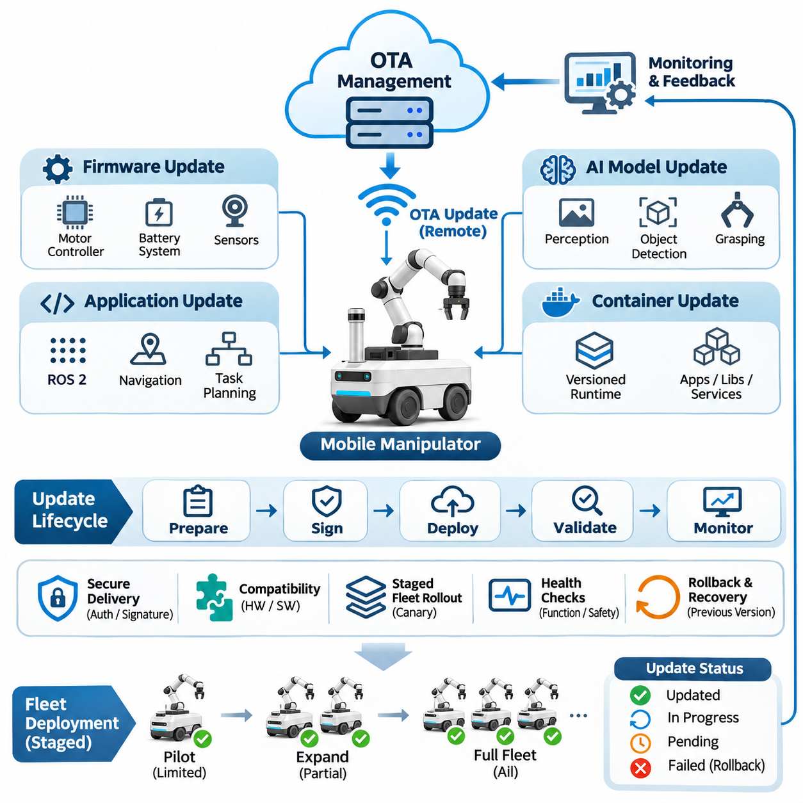
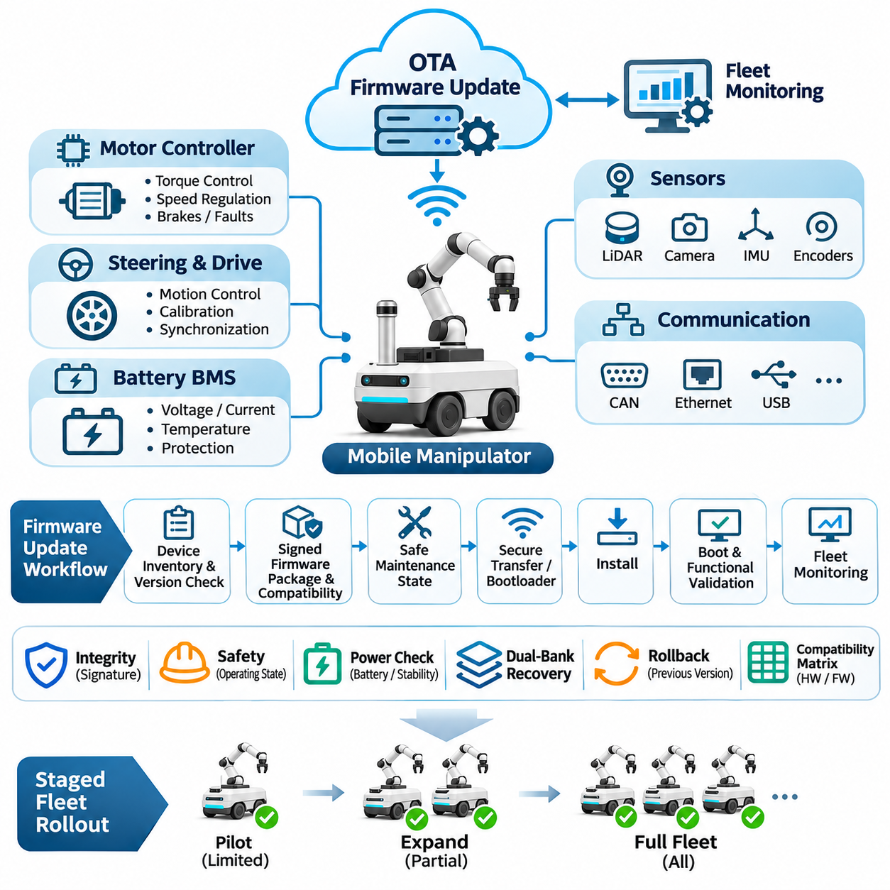
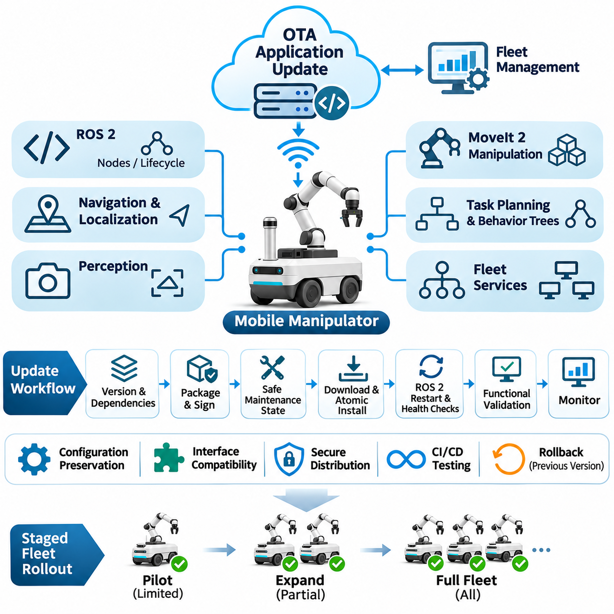
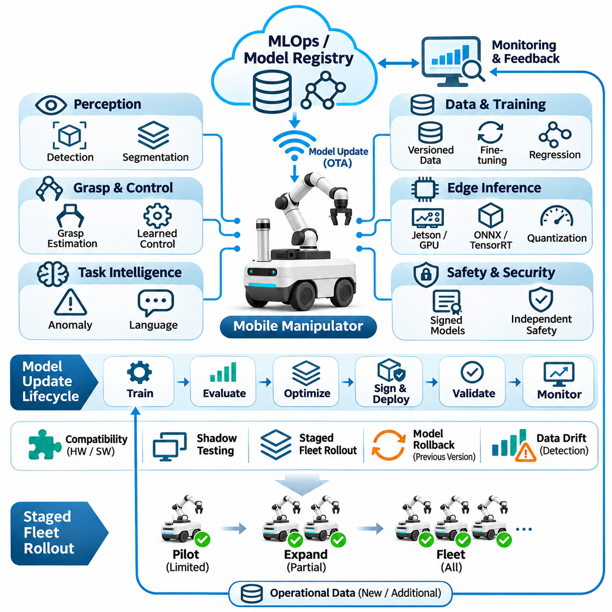
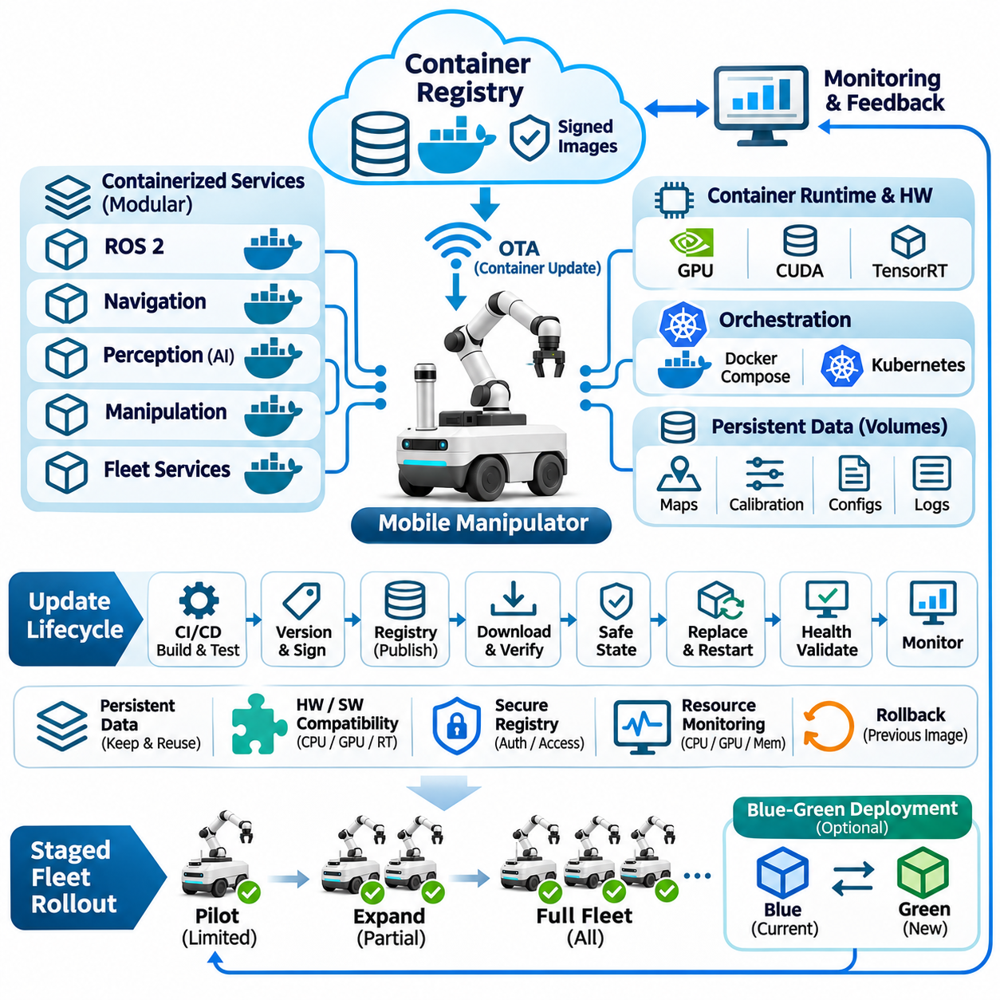
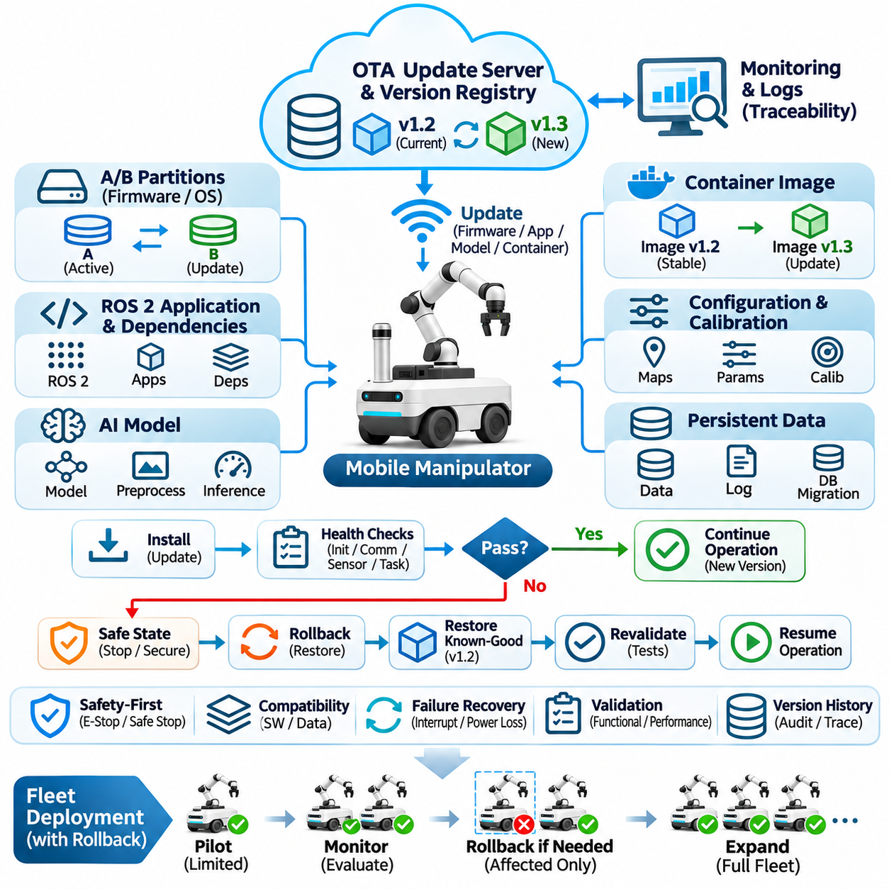
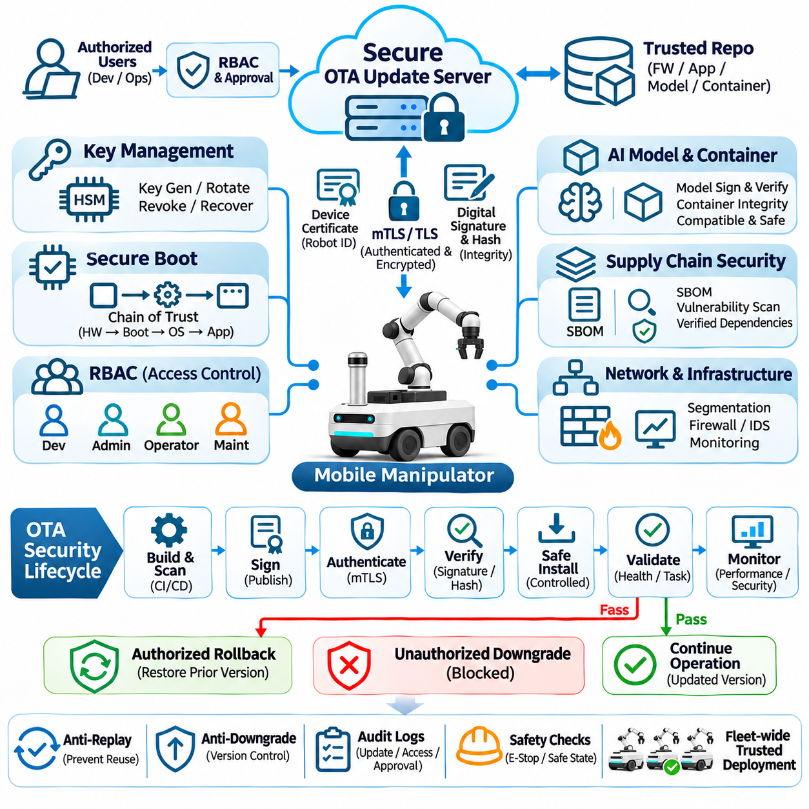
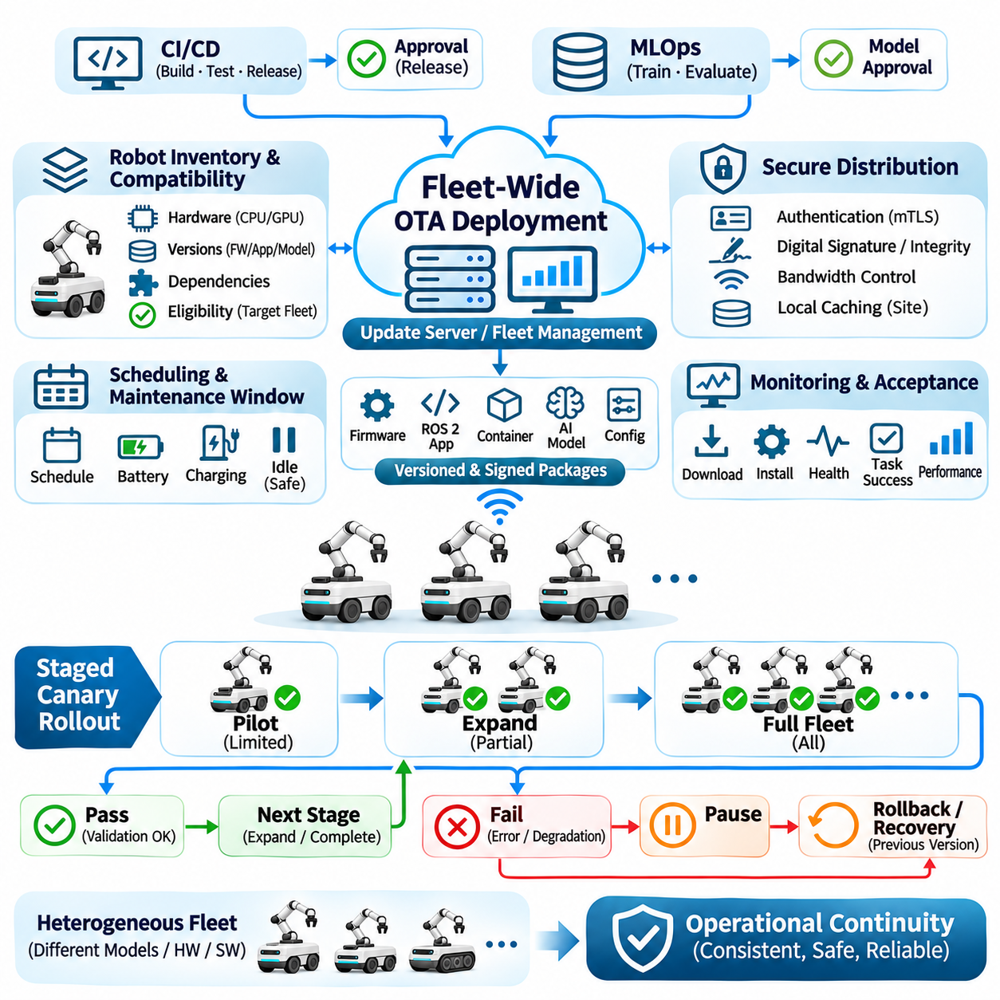
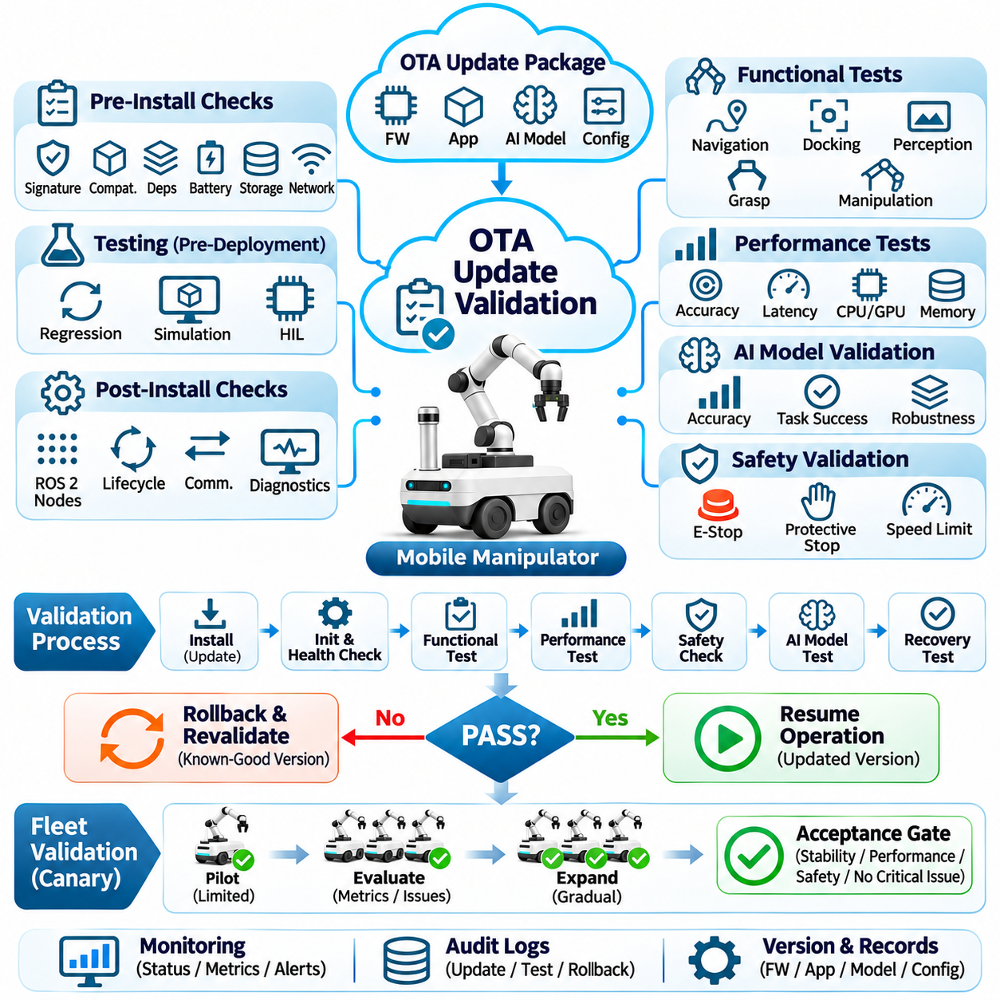
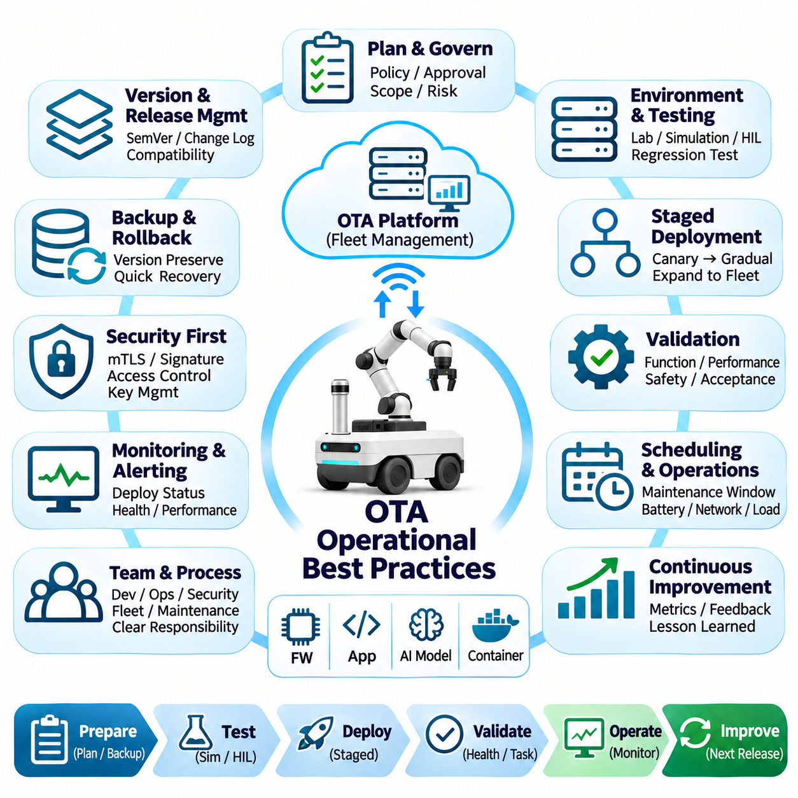

**Volume 04. Mobile Manipulation Software and Operations**

# Chapter 13. OTA Updates

## 01 OTA Overview

{width="7.268055555555556in" height="7.268055555555556in"}

Over-the-air (OTA) updates are a fundamental operational capability that allows mobile manipulators to receive software, firmware, configuration, and artificial intelligence model updates without requiring direct physical access to each robot. By using network connectivity, operators can maintain and improve deployed systems remotely. OTA mechanisms reduce maintenance effort, shorten deployment cycles, and help ensure that robots operating across multiple facilities remain consistent, secure, and up to date.

A mobile manipulator integrates multiple hardware and software components, including an autonomous mobile robot (AMR), a robotic arm, sensors, motor controllers, embedded computers, and high-level control applications. Each component may require independent updates throughout the system lifecycle. An OTA architecture must therefore support different update types while preserving compatibility between components and maintaining the overall operational integrity of the robot.

Firmware updates are particularly important because they directly affect low-level hardware operation. Motor controllers, battery management systems, embedded sensor processors, and communication interfaces may require firmware improvements to correct defects, enhance performance, or address security vulnerabilities. Since firmware failures can affect physical motion and safety functions, update procedures must include hardware compatibility checks, integrity verification, controlled installation, and recovery mechanisms.

Application updates address higher-level software components such as ROS 2 nodes, navigation systems, manipulation controllers, task planners, and fleet management interfaces. These updates may introduce new functions, improve algorithms, or correct operational defects. A reliable application update process should manage software dependencies, configuration changes, and version compatibility. It should also ensure that critical robot functions remain available or enter a controlled safe state during installation.

Artificial intelligence model updates introduce additional requirements because perception, object detection, grasp estimation, and task planning models may evolve independently of the main application software. Updated models should be evaluated against representative datasets and operational scenarios before deployment. Model versions, inference dependencies, hardware requirements, and performance characteristics must be tracked to prevent an update from reducing perception accuracy or introducing unexpected behavior.

Container-based updates provide a practical method for packaging and distributing complex robotics software environments. Applications, libraries, runtime dependencies, and supporting services can be delivered as versioned container images. This approach improves reproducibility across development, testing, and production environments. Container orchestration can also support controlled replacement, health monitoring, and recovery when an updated service fails to start or operate correctly.

A reliable OTA architecture requires a carefully designed rollback strategy. An update may fail because of interrupted communication, insufficient storage, incompatible dependencies, unexpected runtime errors, or hardware-specific problems. The robot should retain a known working software version whenever possible and automatically restore it when critical validation checks fail. Recovery procedures should also protect configuration data and operational records from unintended modification.

OTA security is essential because update infrastructure provides a pathway for modifying software on physically deployed robots. Update packages should be authenticated, digitally signed, and verified before installation. Secure communication, access control, encryption, certificate management, and software integrity checks help prevent unauthorized modifications. The system should also maintain audit records identifying package versions, deployment sources, installation results, and responsible authorization processes.

Fleet-wide deployment requires coordination across multiple robots operating in different locations and under different operational conditions. Deploying an update simultaneously to an entire fleet may introduce unnecessary operational risks. A staged deployment strategy can begin with a limited group of representative robots, evaluate their behavior, and gradually expand deployment after successful validation. Fleet management systems should track update status, compatibility, connectivity, and recovery conditions for every robot.

Update validation must extend beyond confirming that installation completed successfully. A robot should verify that its software components initialize correctly, communication interfaces operate normally, sensors provide valid information, and navigation and manipulation functions remain within expected performance limits. Safety-related functions require particular attention because software changes may influence emergency stopping, collision detection, speed limitations, and human-robot interaction.

Effective OTA operations require coordination between software engineering, cybersecurity, fleet management, and field maintenance processes. Organizations should define update approval procedures, maintenance windows, version management policies, deployment monitoring, and incident response responsibilities. By combining staged deployment, automated validation, secure distribution, and reliable rollback, OTA updates become a controlled lifecycle management capability rather than simply a mechanism for remotely installing new software.

## 02 Firmware Updates

{width="7.268055555555556in" height="7.268055555555556in"}

Firmware updates are a critical part of maintaining the reliability, performance, and safety of mobile manipulators throughout their operational lifecycle. Firmware controls the low-level behavior of embedded hardware, including motor controllers, steering systems, battery management systems, sensor interfaces, and communication devices. Updating firmware allows manufacturers to correct defects, improve control performance, introduce hardware capabilities, and address security vulnerabilities without physically replacing electronic components.

A mobile manipulator typically contains multiple embedded devices from different manufacturers, each operating with its own firmware architecture and update requirements. The autonomous mobile robot (AMR), robotic arm, motor drivers, encoders, LiDAR sensors, cameras, and battery management system may all require independent firmware management. An effective update architecture must identify these devices, maintain their firmware versions, and coordinate updates while preserving compatibility across the integrated robotic platform.

Firmware updates should begin with a clearly defined hardware inventory and version management process. Each device should have an identifiable model number, hardware revision, current firmware version, supported update interface, and compatibility requirements. This information allows the update management system to determine whether a firmware package is appropriate for a particular robot. Maintaining accurate device records also simplifies troubleshooting and prevents incompatible firmware from being installed on different hardware revisions.

Motor controller firmware requires particular attention because it directly influences the physical movement of the mobile platform and robotic arm. Updates may improve velocity regulation, torque control, position accuracy, encoder processing, communication reliability, and fault detection. However, changes to motor control algorithms can alter acceleration, deceleration, braking behavior, and dynamic response. Therefore, motor controller firmware should be validated under representative operating conditions before being deployed to production robots.

Firmware updates for steering and drive systems are equally important in mobile manipulation platforms. Differential drive, mecanum, omnidirectional, and four-wheel-steering configurations may use different control strategies and embedded communication protocols. An update that modifies steering calibration, wheel synchronization, or motion control parameters can affect navigation accuracy and stability. The update process should preserve essential calibration information and verify that the robot maintains its expected movement characteristics after installation.

Battery management system firmware is responsible for monitoring cell voltage, current, temperature, charging conditions, and protection mechanisms. Updates may improve battery diagnostics, state-of-charge estimation, communication with the robot controller, and thermal protection behavior. Because battery protection functions are safety-critical, firmware changes must be carefully evaluated to ensure that overvoltage, undervoltage, overcurrent, and overtemperature protections remain effective throughout normal operation and abnormal conditions.

Sensor firmware updates can improve measurement accuracy, communication stability, synchronization, and data processing. LiDAR sensors, cameras, inertial measurement units (IMUs), force-torque sensors, and joint encoders may receive updates that modify internal filtering or measurement behavior. Such changes can influence downstream perception, localization, motion planning, and manipulation algorithms. Consequently, sensor firmware updates should include verification of data formats, timestamps, coordinate conventions, calibration parameters, and communication interfaces.

The firmware update mechanism must support the communication interfaces available on each embedded device. Common interfaces include Controller Area Network (CAN), CANopen, Ethernet, USB, serial communication, and manufacturer-specific programming interfaces. Some devices support remote bootloaders, while others require a dedicated firmware programming mode. The update manager must understand these differences and provide appropriate communication, device identification, package transfer, and installation procedures for each hardware category.

A reliable firmware package should contain the firmware binary, device identification information, version metadata, compatibility constraints, integrity information, and installation instructions. The package should also identify the expected hardware revision and any required intermediate firmware versions. Before installation, the robot should verify that the package matches the target device and that the binary has not been corrupted or modified. These checks reduce the risk of installing an incompatible or incomplete firmware image.

Firmware installation should be performed under controlled operating conditions. A mobile manipulator should normally stop its mission, move to an approved maintenance state, and ensure that its manipulator and mobile base are secured before an update begins. Battery capacity, power stability, communication quality, and available storage should be checked in advance. Devices should not be updated while performing critical manipulation tasks or moving through shared workspaces where an unexpected interruption could create operational hazards.

The update procedure should account for the possibility of communication interruption or power failure. If an update is interrupted while the firmware is being written, the embedded device may become temporarily or permanently unavailable. Bootloader-based recovery, dual-bank firmware storage, and protected recovery partitions can reduce this risk. Where supported, the device should retain a previously validated firmware image so that the system can restore normal operation if the new version fails to initialize.

Firmware compatibility must also be considered across interconnected devices. For example, a motor controller update may change communication messages, parameter definitions, or diagnostic codes expected by the main robot controller. Similarly, an updated sensor firmware version may modify data timing or interface behavior used by perception software. A compatibility matrix should therefore document supported combinations of firmware, hardware, communication protocols, and application software versions.

After installation, the robot should execute a structured firmware validation procedure. The system should confirm that the device boots correctly, reports the expected firmware version, communicates with the main controller, and provides valid diagnostic information. Functional tests should verify relevant hardware behavior, including motor response, steering accuracy, braking, sensor measurements, and battery monitoring. The validation scope should reflect the hardware affected by the update and the potential consequences of failure.

Firmware updates should be integrated with the robot\'s safety architecture rather than treated as ordinary software installation tasks. Safety-related controllers, emergency stop circuits, braking mechanisms, speed monitoring, and protective sensor functions require special consideration. An update must not unintentionally disable or weaken established safety functions. Where safety-certified components are involved, the update process should follow the manufacturer\'s approved procedures and preserve the applicable safety configuration and certification assumptions.

Security is another fundamental requirement of firmware management. Firmware packages should be obtained from trusted sources, authenticated before installation, and protected against unauthorized modification. Digital signatures, secure boot mechanisms, encrypted communication, and access control can help establish trust throughout the update process. The robot should also record the package source, firmware version, installation time, verification result, and authorization information to support security audits and incident investigations.

In a fleet environment, firmware deployment should be coordinated according to hardware configuration and operational priorities. Robots may contain different controller revisions, sensor models, and embedded devices even when they belong to the same product family. The fleet management system should identify eligible robots, distribute compatible packages, monitor installation progress, and report failures. A staged rollout using a small representative group before broader deployment helps identify unexpected hardware or operational issues.

Firmware lifecycle management requires continuous monitoring and disciplined version control. Organizations should maintain records of released firmware packages, known defects, compatibility information, installation history, and supported recovery procedures. When a new firmware release becomes available, engineers should evaluate its benefits, risks, hardware requirements, and operational impact before approving deployment. Previous validated versions should remain available according to the organization\'s recovery and maintenance policies.

Ultimately, firmware updates provide the foundation for maintaining the embedded hardware layer of a mobile manipulator. Their successful implementation depends on accurate device identification, compatibility management, secure package distribution, controlled installation, functional validation, and reliable recovery mechanisms. By integrating firmware management into the broader OTA architecture, organizations can improve hardware reliability, reduce field maintenance requirements, and maintain consistent operation across individual robots and large robotic fleets.

## 03 Application Updates

{width="7.268055555555556in" height="7.268055555555556in"}

Application updates are an essential part of maintaining and improving mobile manipulator software throughout its operational lifecycle. Unlike firmware updates, which modify low-level embedded hardware behavior, application updates primarily affect the software responsible for navigation, perception, manipulation, task planning, communication, and fleet coordination. They allow developers to introduce new capabilities, correct software defects, improve operational efficiency, and maintain compatibility with evolving hardware and infrastructure without physically accessing deployed robots.

A mobile manipulator typically operates through an integrated software stack consisting of the Robot Operating System 2 (ROS 2), navigation software, motion planning frameworks, robot controllers, perception applications, behavior trees, and fleet management services. Each component may be developed and maintained independently, but their interactions must remain consistent. An application update architecture should therefore manage individual software packages while preserving system-level compatibility and ensuring that the complete robot continues to operate reliably.

Application updates may involve individual ROS 2 nodes, software libraries, executable programs, configuration files, communication interfaces, and system services. For example, developers may update a localization node to improve positioning accuracy, modify a navigation application to handle dynamic obstacles, or improve a manipulation controller to increase grasping precision. These changes should be packaged and distributed according to their dependencies and operational requirements rather than treated as unrelated files.

Version management is fundamental to reliable application updates. Each software component should maintain an identifiable version number, release history, dependency information, and compatibility requirements. Semantic Versioning (SemVer) provides a useful convention by distinguishing major, minor, and patch releases. Major versions may introduce incompatible interface changes, minor versions add backward-compatible functionality, and patch versions primarily correct defects. Consistent version management helps engineers identify changes and maintain reproducible software environments.

Software dependencies must be evaluated before an application update is deployed. A ROS 2 application may depend on specific middleware versions, message definitions, shared libraries, device drivers, and external services. Updating one component without considering these dependencies can cause compilation failures, communication errors, or unexpected runtime behavior. Dependency manifests and compatibility records should therefore be maintained so that the update system can determine whether a new application version is suitable for the target robot.

Application packaging provides a controlled method for distributing software across different robotic platforms. ROS 2 packages, Debian packages, executable bundles, and container images can be used depending on the deployment architecture. Packages should include the required executable files, configuration resources, metadata, and dependency declarations. Standardized packaging reduces differences between development and production environments and makes software installation, version tracking, and maintenance more predictable.

Configuration management is another important consideration because application behavior depends on parameters that may vary between robots and operating environments. Navigation speed limits, sensor topics, coordinate frames, robot descriptions, motion planning parameters, and network settings should be managed separately from application binaries whenever practical. During an update, existing site-specific configurations should be preserved or migrated through a controlled process. This prevents a software release from unintentionally overwriting validated operational settings.

Application updates should be coordinated with the robot\'s operational state. Before installation, the robot should complete or safely suspend its current mission, stop unnecessary motion, and transition to an appropriate maintenance or update state. Manipulator joints should be placed in a safe condition, and the mobile platform should remain stationary when required. The update manager should also verify available storage, power stability, network connectivity, and the absence of conflicting installation processes before proceeding.

A reliable installation mechanism should minimize service interruption and protect the robot from partially applied updates. Where possible, application packages should be downloaded and verified before replacing the currently active software. Atomic deployment techniques can help ensure that the system switches from an existing application version to a new version only after the required files and dependencies are ready. If installation or initialization fails, the robot should retain access to a previously validated software environment.

Application updates must also consider the interaction between multiple software components. For example, a navigation update may influence task planning, while a modification to a robot description may affect MoveIt 2 motion planning and collision checking. Changes to ROS 2 message definitions or service interfaces may require corresponding updates in other nodes. Integration testing should therefore verify communication, interface compatibility, lifecycle behavior, and the complete execution of representative robot missions.

After installation, the robot should perform application-level health checks to confirm that updated services initialize and operate correctly. The system should verify ROS 2 node availability, topic communication, service responses, action execution, and diagnostic status. Functional tests should cover relevant capabilities such as localization, autonomous navigation, obstacle avoidance, arm motion, grasp execution, and task completion. Application logs and runtime metrics can provide additional evidence that the new software version behaves as expected.

Application updates should follow a staged deployment strategy when multiple robots are involved. A representative robot can receive the new version first, allowing engineers to evaluate its behavior under actual operating conditions. After successful testing, the update can be distributed to a larger group and eventually to the entire fleet. Deployment monitoring should identify installation progress, failed services, abnormal resource consumption, and changes in operational performance. This approach limits the impact of unexpected software defects.

Security must be incorporated into the complete application update process. Software packages should originate from trusted repositories or authorized distribution servers, and their integrity should be verified before installation. Digital signatures, secure communication, access control, and authenticated deployment requests help prevent unauthorized software modifications. The system should also maintain records of package versions, deployment approvals, installation results, and software changes to support auditing and cybersecurity incident investigations.

Application updates should be integrated with continuous integration and continuous delivery (CI/CD) practices. Developers can automatically build software packages, execute unit tests, perform integration testing, and evaluate deployment readiness whenever application changes are introduced. Automated pipelines improve consistency and reduce manual errors. However, passing software tests alone does not guarantee safe robot operation. Hardware-in-the-loop testing, simulation, and representative field validation remain important before approving releases for production environments.

For ROS 2-based mobile manipulators, lifecycle management provides an additional mechanism for controlling application transitions. Lifecycle nodes can be configured, activated, deactivated, and cleaned up according to defined operational procedures. During an update, dependent nodes may need to be stopped in a controlled sequence and restarted after the new software is installed. This coordinated lifecycle management helps prevent partially initialized systems and inconsistent communication between application components.

Operational traceability is essential for long-term application maintenance. The system should record which software versions are installed on each robot, when updates occurred, which packages were changed, and whether post-installation validation succeeded. These records help engineers reproduce field problems, compare performance between software releases, and determine whether an operational incident is related to a recent update. Maintaining a clear release history also supports technical support, maintenance planning, and software lifecycle governance.

Ultimately, application updates provide a controlled mechanism for continuously improving the functional capabilities of mobile manipulators. Their successful implementation depends on structured version management, dependency control, standardized packaging, configuration preservation, secure distribution, controlled installation, and comprehensive validation. When integrated with ROS 2 architecture, fleet management, automated software pipelines, and operational monitoring, application updates enable robotic systems to evolve while maintaining reliability, compatibility, and predictable behavior in real-world environments.

## 04 AI Model Updates

{width="7.268055555555556in" height="7.268055555555556in"}

AI model updates are an essential part of maintaining and improving the intelligence of mobile manipulators throughout their operational lifecycle. Unlike firmware and application updates, which primarily modify embedded hardware behavior and software functionality, AI model updates change the learned capabilities used for perception, object recognition, localization, grasp estimation, motion prediction, and task understanding. They allow robotic systems to adapt to new objects, environments, and operating conditions without requiring complete software redevelopment or hardware replacement.

A mobile manipulator may use multiple AI models for different operational functions. Vision models identify objects and estimate their positions, segmentation models distinguish relevant regions, grasp detection networks evaluate candidate grasp configurations, and learning-based controllers support complex manipulation behaviors. Additional models may perform anomaly detection, human activity recognition, or natural language instruction interpretation. An AI model update architecture must manage these independent models while maintaining compatibility with the robot\'s perception, planning, and control pipelines.

Model version management is fundamental to reliable AI deployment. Each model should have a unique identifier, version number, training dataset reference, architecture description, framework version, and performance evaluation record. A model registry provides a centralized location for storing trained models and their associated metadata. This makes it possible to identify which model is deployed on each robot, reproduce previous experiments, compare model releases, and determine whether a particular update is suitable for a specific robotic application.

AI model updates should follow a controlled development and validation process. New models may be produced through additional training, fine-tuning, transfer learning, or retraining with newly collected operational data. Before deployment, the model should be evaluated against representative validation datasets and relevant performance metrics. For perception applications, these metrics may include accuracy, precision, recall, and mean average precision. For grasping and manipulation, evaluation should also consider grasp success rate, positional accuracy, task completion rate, and robustness under different environmental conditions.

Dataset management plays an important role in determining whether an updated model improves real-world performance. Newly collected data may contain previously unseen objects, lighting conditions, viewpoints, backgrounds, sensor noise, and environmental variations. Dataset versioning should preserve the relationship between training data, validation data, model parameters, and evaluation results. Data quality checks should identify incorrect annotations, duplicated samples, class imbalance, and distribution changes that could negatively influence model behavior.

An important challenge in AI model updates is preventing catastrophic forgetting. When a model is fine-tuned using only newly collected data, it may lose previously learned capabilities or perform poorly on established tasks. A balanced training strategy should preserve representative historical samples while incorporating new operational data. Regression testing should compare the updated model against previous versions across both existing and newly introduced scenarios to ensure that improvements do not introduce unacceptable performance degradation.

Model compatibility must be considered across different edge computing platforms. Mobile manipulators may use NVIDIA Jetson devices, industrial GPU computers, or other embedded inference systems with different computational capabilities. A model developed on a high-performance training workstation may require optimization before deployment to an edge device. Model conversion, quantization, pruning, and inference acceleration can reduce memory consumption and computational requirements while maintaining acceptable prediction quality and real-time performance.

AI model deployment should also consider runtime dependencies and inference frameworks. Models may be developed using PyTorch or TensorFlow and deployed through ONNX Runtime, TensorRT, or other supported inference engines. Differences in framework versions, numerical precision, preprocessing operations, and hardware acceleration can affect model outputs. Therefore, the deployment pipeline should verify that the converted model produces sufficiently consistent results with the original model and satisfies the latency and resource requirements of the target robot.

A reliable model update process should support controlled deployment and replacement of existing models. Before activation, the robot should download the model package, verify its integrity, check hardware compatibility, and confirm that sufficient storage and memory are available. The new model should be loaded and tested without immediately removing the currently validated version. Where possible, model switching should occur during a controlled operational transition to prevent interruptions to perception, navigation, or manipulation tasks.

Staged deployment is particularly valuable when updating AI models across a fleet of mobile manipulators. A new model can initially be installed on a small number of representative robots operating under controlled conditions. Engineers can monitor prediction quality, inference latency, resource utilization, and task success before expanding deployment. Shadow evaluation can also allow a new model to process operational inputs alongside the existing model without directly controlling robot behavior. This provides additional evidence about model performance before full activation.

AI model updates require reliable rollback mechanisms because improved benchmark performance does not necessarily guarantee better field performance. Changes in environmental conditions, sensor characteristics, object distributions, or inference behavior may cause an updated model to fail unexpectedly. The robot should retain the previous validated model and its configuration so that it can restore the earlier version when monitoring identifies unacceptable degradation. Model rollback should also preserve associated preprocessing parameters and inference settings.

Security and integrity are essential throughout the AI model update lifecycle. Model packages should be obtained from trusted repositories, authenticated before deployment, and protected against unauthorized modification. Digital signatures, encrypted communication, access control, and model artifact verification help protect the deployment process. Organizations should also maintain records of model provenance, training data references, approval decisions, deployment targets, and update results to support auditing and AI governance.

AI model updates must be evaluated from a safety perspective when model outputs influence physical robot behavior. Changes to object detection, human recognition, grasp estimation, or environmental perception may affect navigation decisions and manipulator trajectories. Updated models should therefore undergo scenario-based testing, simulation, and controlled field validation. Safety-critical functions should not depend exclusively on an AI model when deterministic protection mechanisms or independently validated safety systems are required.

Continuous model monitoring provides feedback for future updates. Operational systems can collect information about inference confidence, prediction distributions, execution failures, task completion rates, and environmental changes. These observations may reveal data drift or model degradation that was not apparent during initial validation. However, newly collected operational data should not automatically become training data without appropriate quality checks, privacy controls, annotation procedures, and approval.

Ultimately, AI model updates enable mobile manipulators to improve their perception, decision-making, and manipulation capabilities throughout their operational lifecycle. Effective implementation requires model versioning, dataset management, systematic evaluation, edge optimization, secure distribution, staged deployment, and reliable rollback. When integrated with MLOps, ROS 2, fleet management, and operational monitoring, AI model updates provide a sustainable mechanism for evolving robotic intelligence while preserving system reliability, safety, and consistent performance in real-world environments.

## 05 Container Based Updates

{width="7.268055555555556in" height="7.268055555555556in"}

Container-based updates provide a reliable and reproducible approach to distributing and maintaining software across mobile manipulators. Instead of installing individual applications, libraries, and runtime dependencies separately, software components are packaged into containers that include the required execution environment. This approach simplifies software deployment, reduces dependency conflicts, and improves consistency between development, testing, and production systems. Containers also allow robotic applications to be updated independently without rebuilding the entire operating system.

A mobile manipulator typically operates multiple software services, including ROS 2 nodes, navigation systems, perception applications, motion planning components, robot controllers, and fleet communication services. These components may require different libraries, runtime environments, and software versions. Containerization provides isolation between services while allowing them to communicate through defined interfaces. This architecture makes it easier to maintain complex robotic software and deploy updates without unintentionally affecting unrelated components.

Docker is commonly used to package and execute containerized applications. A Docker image contains the application code, required libraries, runtime dependencies, and configuration resources needed to execute a service. Running instances of these images are called containers. By maintaining versioned images, developers can distribute identical software environments across different robots. This reduces differences caused by manually installing packages or configuring dependencies on individual embedded computers.

Container images should be designed around clearly defined software responsibilities. For example, navigation, perception, manipulation, and monitoring services may be maintained as separate containers. This modular approach allows an individual service to receive an update without requiring every other application to be replaced. However, service boundaries should reflect actual architectural dependencies. Excessive fragmentation can increase communication overhead, configuration complexity, and operational management requirements.

Container image versioning is essential for maintaining deployment consistency. Each image should have an identifiable name, version tag, build reference, and associated software release information. Development, testing, and production environments should use explicitly defined image versions rather than relying on mutable tags such as latest. This ensures that engineers can identify exactly which software package is running on each robot and reproduce the same environment when investigating operational problems.

Container registries provide centralized storage and distribution for container images. Organizations may use public registries, private registries, or internally managed repositories depending on security and operational requirements. Before deployment, the update system should identify the appropriate image for the target robot and verify its availability, integrity, and compatibility. Registry access policies should also control which developers and deployment services can publish, modify, or retrieve production images.

A container-based update process generally begins by building a new image through an automated software pipeline. The build process collects application source code, dependencies, configuration resources, and runtime components into a deployable image. Automated tests should verify that the image can be built successfully, that its services initialize correctly, and that its interfaces remain compatible with other robotic components. Once validation is complete, the approved image can be published to the designated container registry.

Before installation, the robot should download the required image and verify its integrity. The update manager should check available storage, network connectivity, memory requirements, hardware compatibility, and the operational state of the robot. Large container images may require considerable bandwidth and storage, particularly when they contain GPU libraries, perception frameworks, or machine learning runtimes. Image compression, layer reuse, and incremental distribution can reduce unnecessary data transfers.

Container deployment requires careful management of persistent data. Containers are generally designed to be replaceable, and their internal writable storage may be removed when a container is recreated. However, robotic systems must preserve important information such as calibration parameters, maps, configuration files, mission records, and operational logs. Persistent volumes and external configuration storage should therefore be used to separate important data from replaceable application containers. This prevents software updates from unintentionally destroying operational information.

Container orchestration can coordinate the deployment and operation of multiple services. Docker Compose may be sufficient for relatively simple robotic systems, while Kubernetes or other orchestration platforms may be appropriate for larger and more complex deployments. These mechanisms can define service dependencies, startup sequences, environment variables, network connections, and restart policies. For mobile manipulators, orchestration should remain sufficiently lightweight to operate within the computational and storage limitations of embedded platforms.

A container update should be performed while preserving the robot\'s operational safety. Before replacing a running service, the system should determine whether the affected application is controlling navigation, manipulating objects, processing safety-related information, or communicating with other robots. Critical operations should be completed or safely suspended before the relevant container is stopped. Services should be restarted in an appropriate order so that dependent applications do not operate with unavailable or partially initialized components.

Health checks are important for determining whether an updated container is functioning correctly. The system should verify that the container starts successfully, required processes remain active, communication interfaces are available, and application-specific diagnostics report acceptable conditions. Resource monitoring should also examine CPU utilization, GPU utilization, memory consumption, storage usage, and execution latency. A container that starts successfully may still experience runtime failures or consume excessive resources, so operational validation must extend beyond startup confirmation.

Container-based deployment should support controlled replacement and recovery. Blue-green deployment can maintain an existing application environment while preparing a new version separately, allowing the system to switch between versions after validation. Rolling updates can replace services progressively when the architecture supports independent instances. For robotic applications that cannot operate multiple instances simultaneously, an offline maintenance transition may be more appropriate. The deployment strategy should reflect the robot\'s real-time requirements and available computational resources.

Rollback capability is essential when an updated container introduces unexpected behavior. The previous validated image should remain available so that the update manager can restore the earlier software environment. Rollback should also restore compatible configuration files, environment variables, and service definitions when these have changed. Version records should identify the image previously deployed and the reason for recovery. These mechanisms reduce service interruption and simplify the investigation of software-related failures.

Security must be integrated into container image development and distribution. Images should originate from trusted base images and approved repositories. Software dependencies should be checked for known vulnerabilities, unnecessary packages should be removed, and container execution privileges should be restricted. Image signing, digest verification, authenticated registry access, and encrypted communication help protect the update process against unauthorized modification. Secrets such as access tokens and certificates should be managed separately rather than embedded directly into container images.

GPU-enabled robotic applications introduce additional considerations for container-based updates. Perception and manipulation workloads may depend on NVIDIA CUDA, TensorRT, GPU drivers, and specialized runtime libraries. The container environment must remain compatible with the host operating system, installed GPU drivers, and embedded computing platform. Updating a container cannot independently replace every host-level dependency. Therefore, the deployment architecture should clearly distinguish between software managed inside containers and components that require separate host or firmware updates.

Fleet-wide container updates should be coordinated according to robot configuration and operational availability. Different robots may use different GPU models, memory capacities, sensor configurations, or application versions. The fleet management system should identify eligible robots, distribute compatible images, monitor deployment progress, and report failures. A staged rollout should begin with representative robots before expanding to the remaining fleet. This approach helps identify hardware-specific compatibility problems and unexpected resource requirements before they affect large-scale operations.

Container-based updates should be integrated with continuous integration and continuous delivery (CI/CD) and MLOps pipelines. Application images, AI inference services, and supporting components can be built, tested, versioned, and distributed through automated workflows. Model artifacts may also be mounted into containers or included in controlled image releases, depending on deployment requirements. Separating application images from independently updated model artifacts can reduce unnecessary image rebuilding and provide greater flexibility for AI lifecycle management.

Ultimately, container-based updates provide a structured foundation for maintaining complex mobile manipulator software environments. Their effectiveness depends on modular application architecture, reproducible image construction, version control, persistent data management, secure registries, resource monitoring, deployment orchestration, and reliable recovery procedures. When integrated with ROS 2, OTA infrastructure, fleet management, and automated software pipelines, containerization enables consistent software maintenance across individual robots and distributed robotic fleets while reducing deployment complexity and operational risk.

## 06 Rollback Strategies

{width="7.268055555555556in" height="7.268055555555556in"}

Rollback strategies are essential for maintaining the reliability and operational continuity of mobile manipulators during over-the-air (OTA) updates. An update may introduce software defects, hardware incompatibilities, unexpected performance degradation, or failures that were not detected during development and testing. Rollback provides a controlled mechanism for restoring a previously validated system configuration when a new firmware, application, AI model, or container image fails to operate correctly. It reduces recovery time and prevents unsuccessful updates from causing prolonged operational interruptions.

A mobile manipulator contains multiple interconnected software and hardware components, including the autonomous mobile robot (AMR), robotic arm, sensors, embedded controllers, ROS 2 applications, perception models, and fleet management services. A failure in one updated component may affect other parts of the system. Therefore, rollback strategies should consider component dependencies and system-level compatibility rather than simply restoring an individual software package. The recovery architecture should identify which components must be reverted together to restore a consistent operating environment.

Version preservation is the foundation of an effective rollback mechanism. Before applying an update, the system should retain the currently validated firmware, application packages, AI models, container images, and relevant configuration files. Each version should be associated with identifiable metadata, including release information, compatibility requirements, installation history, and validation results. Maintaining these records allows the update manager to identify a known-good configuration and restore it when the newly deployed version fails.

A/B partitioning is one approach to improving recovery reliability for embedded computing platforms. The system maintains two software partitions, with one partition operating the current validated environment while the other receives the new update. After installation, the robot can boot from the updated partition and execute initialization and health checks. If the new environment fails to start or does not satisfy validation requirements, the bootloader can select the previous working partition. This approach reduces the risk of leaving the robot with an unusable operating system after an interrupted update.

Application-level rollback provides another recovery mechanism for ROS 2-based robotic systems. When an updated navigation node, manipulation controller, or task planning service produces unexpected behavior, the update manager can restore the previous application package and its compatible dependencies. However, application rollback must consider changes to message definitions, service interfaces, configuration parameters, and shared libraries. Restoring only the executable package may not be sufficient if other components have already been modified to depend on the new interface.

AI model rollback requires particular attention because model behavior depends on both the trained parameters and the associated inference environment. A new perception model may reduce object detection accuracy under specific lighting conditions, while an updated grasp estimation model may generate unreliable grasp configurations. The system should retain previous validated model artifacts, preprocessing parameters, inference settings, and framework compatibility information. When performance monitoring identifies unacceptable degradation, the robot should restore the previous model configuration without unnecessarily replacing unrelated application software.

Container-based rollback can simplify recovery by restoring a previously validated container image. Container registries should retain approved image versions together with their associated configuration and deployment metadata. When a newly deployed container fails its health checks or exhibits unexpected runtime behavior, the deployment system can stop the affected instance and restart the previous image. Persistent data and external configuration should be managed separately so that restoring an application image does not unintentionally overwrite important operational records.

Configuration rollback is equally important because software updates may modify parameters that influence robot behavior. Navigation maps, localization settings, sensor calibration values, motion planning parameters, network configurations, and safety-related settings may be changed during system updates. Before applying modifications, the update manager should preserve the previous configuration and identify its relationship with the corresponding software version. During recovery, compatible configuration files should be restored together with the software to avoid inconsistent system behavior.

Rollback decisions should be based on clearly defined failure detection and validation criteria. The robot should monitor application initialization, communication availability, sensor status, controller responses, resource consumption, and task execution results after an update. If critical health checks fail or operational metrics exceed predefined limits, the system should prevent further deployment and initiate the appropriate recovery procedure. Automated rollback can reduce operator intervention, but critical recovery decisions should remain traceable and subject to defined operational policies.

Safety must remain the highest priority during rollback operations. If an update failure affects navigation, braking, manipulation control, or human safety monitoring, the robot should transition to an appropriate safe state before attempting recovery. Physical movement should be prevented when the control system cannot guarantee predictable behavior. Emergency stopping, protective monitoring, and independent safety mechanisms should remain available throughout the recovery process. Rollback itself must never introduce additional hazards by restarting incompatible components or restoring unsafe configurations.

Distributed robotic fleets require coordinated rollback strategies because multiple robots may receive updates at different times and operate under different environmental conditions. The fleet management system should maintain the software version and deployment status of each robot. If a new release produces unexpected problems, further deployment can be suspended while affected robots are evaluated. Depending on the severity of the issue, rollback may be applied to selected robots or to the entire affected deployment group. This prevents a local software defect from developing into a fleet-wide operational problem.

Rollback procedures should also account for data consistency and changes to persistent storage. Some application updates may modify databases, mission records, configuration formats, or operational metadata. Restoring an older software version may not be sufficient if the associated data has already been converted into a newer format. Database backups, migration records, backward-compatible data structures, and controlled recovery procedures should therefore be included in the update architecture. These measures help prevent data corruption and preserve the information required for continued operation.

Every rollback event should generate a detailed operational record. The record should identify the affected robot, previous and new software versions, update time, detected failure, recovery action, validation results, and final operational status. Diagnostic logs and relevant performance measurements should also be preserved for engineering analysis. These records help developers identify recurring defects, evaluate update reliability, and improve future release procedures. They also provide traceability for maintenance activities and operational incident investigations.

Rollback mechanisms must be tested before they are relied upon in production environments. Testing should include interrupted downloads, power failures, incomplete installations, incompatible software versions, failed initialization, and communication loss during deployment. Engineers should verify that the previous validated environment can be restored and that essential robot functions remain available after recovery. Simulation and hardware-in-the-loop testing can provide additional evidence before rollback procedures are approved for field operation.

Ultimately, rollback strategies provide an essential recovery foundation for safe and reliable OTA management of mobile manipulators. Their effectiveness depends on version preservation, component dependency management, automated health monitoring, configuration recovery, data consistency, and systematic validation. By integrating rollback mechanisms with firmware updates, application deployment, AI model management, container orchestration, and fleet management, organizations can reduce the operational risks of software evolution and maintain reliable robotic services even when updates fail.

## 07 OTA Security

{width="7.268055555555556in" height="7.268055555555556in"}

OTA security is a fundamental requirement for protecting mobile manipulators throughout their operational lifecycle. Over-the-air (OTA) updates allow software, firmware, and artificial intelligence models to be modified remotely, but they also introduce potential cybersecurity risks. An attacker who gains control of the update infrastructure could distribute malicious firmware, replace application packages, or modify AI models. Therefore, OTA security must ensure that every update is authorized, authenticated, verified, and delivered through a trusted process.

A mobile manipulator contains multiple interconnected components, including the autonomous mobile robot (AMR), robotic arm, embedded controllers, sensors, edge computers, ROS 2 applications, and fleet management systems. Each component may have different communication interfaces, software dependencies, and security requirements. An effective OTA security architecture must protect the complete update lifecycle, from software development and package generation to distribution, installation, validation, and recovery.

Authentication is the first important security mechanism in OTA infrastructure. The update server must verify the identity of robots requesting updates, while robots must verify that update requests originate from authorized management systems. Mutual Transport Layer Security (mTLS) can establish authenticated communication between robots and update servers. Certificate-based authentication provides a mechanism for identifying devices and controlling which systems are permitted to distribute or receive software packages.

Digital signatures are essential for verifying the authenticity and integrity of update packages. Before an update is installed, the robot should verify the package signature using a trusted public key. This process confirms that the package was signed by an authorized software publisher and has not been modified after signing. Cryptographic hash functions can additionally verify file integrity by comparing calculated hashes with trusted reference values. Updates that fail signature or integrity verification must be rejected.

Secure communication protects update packages and operational information while they are transmitted across networks. Encryption prevents unauthorized parties from reading sensitive information, while authenticated communication helps prevent interception and modification of update traffic. Transport Layer Security (TLS) is commonly used to protect communication between robots, update servers, and fleet management infrastructure. Certificate validation, secure key storage, and appropriate cryptographic configurations are necessary to maintain communication security.

Key management is another critical part of OTA security. Private signing keys, encryption keys, device certificates, and authentication credentials must be protected throughout their lifecycle. Private signing keys should remain within controlled security environments, preferably using Hardware Security Modules (HSMs) or equivalent protected storage. Organizations should define procedures for key generation, distribution, rotation, expiration, revocation, and recovery. Compromised credentials must be invalidated promptly to prevent unauthorized updates.

Secure boot provides additional protection by verifying software integrity during the robot startup process. The bootloader checks whether the operating system and other protected software components have been authorized before execution. A chain of trust can extend this verification from hardware-supported root keys through the bootloader and operating system to critical applications. This mechanism helps prevent unauthorized firmware or modified system software from executing, even when an attacker has obtained access to persistent storage.

Access control ensures that only authorized users and services can initiate, approve, or manage OTA operations. Role-Based Access Control (RBAC) can distinguish software developers, system administrators, fleet operators, and maintenance personnel according to their responsibilities. For example, an operator may monitor update progress without having permission to publish new firmware packages. Critical production deployments should require appropriate authorization and approval records to reduce the risk of accidental or malicious software distribution.

The OTA infrastructure itself must be protected against cybersecurity threats. Update servers, container registries, software repositories, and deployment management services should operate within controlled network environments. Firewalls, network segmentation, intrusion detection, and security monitoring can reduce unauthorized access and limit the impact of compromised services. Production update infrastructure should be separated from development environments so that experimental software cannot be distributed directly to operational robots without approval.

Software supply chain security is particularly important because robotic applications depend on numerous external libraries, middleware packages, drivers, and container images. A compromised third-party dependency may introduce malicious code into an otherwise legitimate update package. Organizations should maintain software bills of materials (SBOMs), verify dependency sources, scan packages for known vulnerabilities, and control the use of external repositories. Reproducible builds and controlled release pipelines can further improve the traceability and integrity of distributed software.

AI model security requires additional consideration because model artifacts can influence perception, decision-making, and physical robot behavior. An unauthorized model replacement could reduce object detection accuracy, manipulate grasp estimation, or introduce unsafe predictions. Model packages should therefore undergo authentication, integrity verification, and deployment approval. Organizations should also maintain model provenance, training dataset references, evaluation results, and version histories to establish confidence in the origin and suitability of deployed models.

Container security must also be incorporated into the OTA architecture. Container images should originate from trusted base images and approved registries, with their signatures and cryptographic digests verified before deployment. Containers should operate with the minimum privileges necessary, and unnecessary system capabilities should be disabled. Vulnerability scanning, dependency management, and regular base image maintenance help reduce exposure to known security weaknesses. Sensitive credentials should be supplied through secure secret management mechanisms rather than embedded in container images.

OTA security must address replay attacks, unauthorized downgrades, and installation of outdated software versions. An attacker may attempt to reinstall an older firmware version containing known vulnerabilities even when the update package is correctly signed. Version counters, signed release metadata, secure timestamps, and anti-rollback policies can help prevent such attacks. However, controlled rollback to a previously validated version must remain possible when operational recovery is required. Security policies should distinguish authorized recovery procedures from unauthorized software downgrades.

Logging and audit mechanisms provide visibility into OTA security operations. The system should record update requests, device identities, authentication results, package signatures, software versions, approval decisions, installation events, and validation outcomes. Centralized security monitoring can identify unusual activities, repeated authentication failures, unexpected update attempts, and suspicious changes in deployment behavior. These records support incident investigation, compliance activities, and continuous improvement of the security architecture.

Security validation should be performed before and after OTA deployment. Testing should include signature verification, certificate validation, access control enforcement, interrupted communication, corrupted packages, unauthorized update attempts, and recovery from failed installations. Penetration testing and vulnerability assessments can identify weaknesses in update servers, communication interfaces, and embedded devices. Security validation should also confirm that emergency stopping, protective monitoring, and other safety-related functions remain operational during update and recovery procedures.

Ultimately, OTA security must be treated as an integrated part of mobile manipulator system architecture rather than an isolated software protection mechanism. Its effectiveness depends on strong authentication, digital signatures, secure communication, key management, access control, secure boot, supply chain protection, and continuous monitoring. By combining these mechanisms with controlled deployment, update validation, and rollback strategies, organizations can maintain the integrity of robotic software, prevent unauthorized modifications, and ensure trustworthy operation across individual robots and distributed fleets.

## 08 Fleet Wide Deployment

{width="7.268055555555556in" height="7.268055555555556in"}

Fleet-wide OTA deployment is the process of distributing software, firmware, configuration changes, and artificial intelligence models across multiple mobile manipulators through a centralized update infrastructure. Unlike updating an individual robot, fleet-wide deployment must coordinate different hardware configurations, software versions, network conditions, and operational schedules. Its primary objective is to maintain consistent software environments across the fleet while minimizing service interruptions, deployment risks, and maintenance costs.

A mobile manipulator fleet may contain robots with different computing platforms, sensors, motor controllers, robotic arms, and application configurations. Even robots belonging to the same product family may have different hardware revisions or software dependencies. Therefore, fleet-wide deployment requires accurate device identification and configuration management. The fleet management system should maintain a complete inventory of deployed robots, including hardware specifications, firmware versions, application versions, AI models, and current operational status.

Centralized OTA management provides the foundation for coordinating large-scale updates. A central management server maintains approved software packages, deployment policies, compatibility information, and update schedules. Individual robots communicate with this infrastructure to receive update instructions, download packages, and report installation results. This architecture provides a unified management interface and allows administrators to monitor deployment progress without accessing each robot individually.

Before initiating a fleet-wide deployment, the update management system should identify eligible robots and evaluate their compatibility with the new release. Hardware revisions, embedded computing capabilities, storage availability, software dependencies, and existing configurations must be considered. Robots that do not satisfy the required conditions should be excluded from the deployment until compatibility issues are resolved. This prevents incompatible updates from affecting operational robots.

Staged deployment is an effective strategy for reducing the risks associated with large-scale updates. Instead of updating every robot simultaneously, the deployment process begins with a small representative group. These robots receive the new release and operate under monitored conditions. Engineers evaluate installation success, application stability, resource utilization, and task execution performance before approving the next deployment stage. This gradual approach allows unexpected problems to be detected before they affect the entire fleet.

Canary deployment provides a more controlled form of staged rollout. A limited number of robots receive the update first and serve as early indicators of software quality under real operating conditions. Their performance is compared with robots still running the previous version. If the updated robots demonstrate acceptable behavior, deployment can expand to additional groups. If failures or performance degradation occur, the rollout can be suspended while engineers investigate the problem.

Deployment scheduling must consider the operational availability of each robot. Robots performing critical production tasks should not receive disruptive updates during important mission periods. The fleet management system can coordinate maintenance windows according to workload, battery condition, charging schedules, and task assignments. Updates may be scheduled when robots are idle, connected to charging stations, or operating within designated maintenance areas. This reduces the impact of software deployment on production activities.

Network management is another important consideration in fleet-wide OTA operations. Large fleets may contain robots distributed across different facilities with varying wireless network conditions. Simultaneous downloads can generate excessive network traffic and affect other operational services. Deployment systems should support bandwidth management, download scheduling, interrupted transfer recovery, and controlled distribution rates. Where appropriate, local distribution servers or caching mechanisms can reduce repeated downloads from centralized infrastructure.

Software package distribution should use consistent version management and compatibility policies. Each release should have an identifiable version, approved deployment scope, required dependencies, and associated validation results. The deployment manager should ensure that every robot receives the correct firmware, application package, container image, or AI model. Maintaining explicit version records also makes it possible to identify robots that have not completed an update and distinguish them from robots operating with intentionally different software configurations.

Fleet-wide updates should support multiple deployment strategies depending on the type of software being modified. Firmware updates may require individual device-level procedures and controlled power conditions. Application updates may involve restarting selected ROS 2 services, while container-based updates can replace independent software environments. AI model updates may require additional memory and GPU resources during model loading and validation. The deployment infrastructure should coordinate these differences rather than applying one generic procedure to every update type.

Deployment monitoring provides continuous visibility into update execution across the fleet. The management system should collect information about download progress, installation status, reboot events, application initialization, health checks, and validation results. Dashboards can display successful updates, pending installations, failed deployments, and robots requiring manual intervention. This information allows operators to identify abnormal deployment patterns and respond before local failures become widespread operational problems.

A reliable fleet-wide deployment architecture must include rollback and recovery capabilities. If an update introduces unexpected failures, the system should be able to suspend further distribution and restore previously validated software versions on affected robots. Rollback decisions should consider hardware compatibility, application dependencies, configuration changes, and operational safety. The fleet manager should maintain records of previous software versions and recovery results so that affected robots can return to a consistent operating environment.

Security must be maintained throughout fleet-wide deployment. Update packages should be authenticated and digitally signed before installation, and robots should communicate with authorized update servers through secure channels. Device identities, access permissions, certificate validity, and deployment approvals must be managed centrally. The system should also record which software versions were distributed to individual robots and whether installation and integrity verification succeeded. These controls reduce the risk of unauthorized updates and provide traceability across the entire fleet.

Fleet-wide deployment should integrate with continuous integration and continuous delivery (CI/CD) processes. New software releases should pass automated build, testing, compatibility, and security checks before becoming eligible for fleet distribution. Deployment policies can then define the target robot groups, rollout stages, maintenance windows, and acceptance conditions. Integration with MLOps also allows updated AI models to be evaluated and distributed through controlled release procedures while maintaining model version consistency.

Operational performance should be evaluated after each deployment stage. Important measurements include task completion rate, navigation reliability, localization accuracy, manipulation success, communication stability, and computational resource consumption. Comparing these measurements before and after an update helps determine whether the new release provides the expected improvements. Engineers should also examine differences between robot groups to identify hardware-specific issues or environmental conditions that influence software behavior.

Ultimately, fleet-wide OTA deployment transforms software maintenance from an individual robot activity into a coordinated operational management capability. Its effectiveness depends on centralized version management, accurate robot inventories, compatibility control, staged rollout, deployment scheduling, network management, continuous monitoring, security, and reliable rollback. When integrated with ROS 2, fleet management systems, MLOps, and automated software delivery pipelines, fleet-wide deployment enables organizations to maintain consistent, secure, and continuously improving mobile manipulator operations across multiple robots and facilities.

## 09 Update Validation

{width="7.268055555555556in" height="7.268055555555556in"}

Update validation is a critical process for ensuring that over-the-air (OTA) updates do not compromise the functionality, reliability, performance, or safety of mobile manipulators. Successful installation alone does not guarantee that an updated system will operate correctly. Validation must establish that firmware, applications, AI models, and configuration changes satisfy predefined requirements and remain compatible with the integrated robotic platform.

The update validation process should begin before deployment through a structured evaluation of software changes and their potential operational impact. Engineers should identify affected components, hardware dependencies, communication interfaces, and safety-related functions. Validation requirements should reflect the scope and complexity of the update, with more comprehensive testing required for changes that directly influence physical robot behavior.

Pre-installation validation ensures that an update package is suitable for the target robot. The update manager should verify package authenticity, digital signatures, firmware compatibility, application dependencies, hardware revisions, and available computational resources. Battery condition, storage capacity, network connectivity, and operational readiness should also be evaluated to prevent installation under unsuitable conditions.

Software regression testing is essential for determining whether an update negatively affects previously validated functionality. Existing test cases should evaluate navigation, localization, perception, manipulation, task planning, and communication services. The results should be compared with established performance baselines. Regression testing helps identify unintended interactions between updated components and existing software modules.

Simulation-based validation allows engineers to evaluate updated software within a virtual representation of the robot and its operating environment. Navigation scenarios, obstacle avoidance, manipulation trajectories, and task execution can be tested without exposing physical equipment or personnel to unnecessary risks. Simulation also supports repeatable testing of unusual operating conditions that may be difficult to reproduce in the field.

Hardware-in-the-loop (HIL) testing extends validation by incorporating physical controllers, sensors, and embedded computing devices into a controlled test environment. Updated software can interact with actual hardware while selected environmental conditions are simulated. This approach helps identify communication errors, timing inconsistencies, controller incompatibilities, and hardware-specific failures that purely software-based testing may not reveal.

Post-installation validation should begin with system initialization and automated health checks. The robot must verify that the expected software versions are active, required processes are running, communication interfaces are available, and hardware components respond correctly. For ROS 2 systems, validation should also examine node availability, lifecycle states, topic communication, service responses, and diagnostic information.

Functional validation determines whether the updated robot can perform its intended operational tasks. Representative tests should include autonomous navigation, precision docking, object detection, grasp execution, manipulator motion, and mission completion. Engineers should evaluate individual functions and integrated workflows because a component may operate correctly in isolation while introducing failures during coordinated mobile manipulation.

Performance validation examines whether an update satisfies established computational and operational requirements. Relevant measurements include navigation accuracy, positioning error, manipulation success rate, inference latency, control loop timing, CPU utilization, GPU utilization, and memory consumption. Updated software should remain within acceptable performance limits under representative workloads and environmental conditions.

AI model validation requires particular attention because learned behavior may change after an update. Updated perception and grasp estimation models should be evaluated using representative datasets and real-world scenarios. Accuracy, precision, recall, inference latency, and task success rates should be compared with previous model versions. Testing should also examine unfamiliar objects, environmental variations, and potential performance degradation on existing tasks.

Safety validation is especially important when updates affect robot motion, braking, collision detection, or human-robot interaction. Engineers should verify that applicable emergency stopping, protective stopping, speed limitation, and safety monitoring functions remain effective. Changes affecting safety-related components should undergo appropriate risk assessment and revalidation before the robot is authorized to resume normal operation.

Failure recovery validation establishes whether the robotic system can recover from unsuccessful updates. Testing should include interrupted downloads, power loss, corrupted packages, failed initialization, and incompatible software versions. Rollback mechanisms must restore a previously approved combination of software and configuration data. Recovery should also be followed by functional and safety checks before the robot returns to service.

Fleet-level validation extends the evaluation process across robots with different hardware revisions, computing platforms, sensor configurations, and operating environments. A representative group should receive the update before broader deployment. Operational measurements and failure reports should be compared across updated and non-updated robots, allowing deployment managers to identify configuration-specific problems and suspend further distribution when acceptance criteria are not met.

Validation results should be collected and maintained as part of the OTA management infrastructure. Records should identify the robot, update package, software version, test environment, acceptance criteria, measured results, detected failures, and approval status. Automated reporting can improve consistency across deployment stages. Historical validation records also support engineering investigations, maintenance planning, security audits, and future release decisions.

Ultimately, update validation transforms OTA deployment from a software installation mechanism into a controlled engineering and operational assurance process. By integrating pre-installation checks, regression testing, simulation, hardware-in-the-loop testing, functional evaluation, safety verification, and recovery testing, organizations can systematically reduce deployment risks while maintaining reliable and predictable mobile manipulator operations throughout the system lifecycle.

## 10 Operational Best Practices

{width="7.268055555555556in" height="7.268055555555556in"}

Operational best practices for over-the-air (OTA) updates establish a systematic approach to maintaining the reliability, security, safety, and availability of mobile manipulators throughout their operational lifecycle. Building upon firmware updates, application updates, AI model management, rollback strategies, and fleet-wide deployment, these practices provide general engineering guidance that can be adapted to specific robotic platforms and industrial environments.

Organizations should establish a standardized OTA management policy that defines how software releases are developed, evaluated, approved, distributed, installed, and monitored. The policy should specify responsibilities for software developers, system administrators, fleet operators, safety engineers, and maintenance personnel. Clearly defined responsibilities and approval procedures reduce operational uncertainty and prevent unauthorized or uncontrolled software modifications.

Comprehensive asset and version management is fundamental to reliable OTA operations. Every robot should have a unique identifier associated with its hardware configuration, firmware versions, installed applications, container images, AI models, and calibration parameters. Maintaining a centralized configuration inventory allows operators to identify compatible update packages, detect configuration inconsistencies, and establish traceability throughout the system lifecycle.

Software releases should follow structured version management and documentation practices. Each release should include version identifiers, release notes, compatibility requirements, known limitations, configuration changes, and recovery instructions. Semantic versioning can help distinguish major functional changes from minor improvements and corrective patches. Consistent release documentation enables operators to understand the potential impact of an update before deployment.

OTA deployment should be integrated with continuous integration and continuous delivery (CI/CD) pipelines. Automated build processes, unit testing, integration testing, vulnerability scanning, and regression testing should evaluate software before it becomes eligible for operational deployment. Firmware, applications, container images, and AI models should pass predefined acceptance criteria before being transferred to approved production repositories.

A separate staging environment should be maintained to evaluate updates before they are introduced into production systems. This environment should reproduce representative hardware configurations, software dependencies, network conditions, and operational workflows. Simulation, digital twins, and hardware-in-the-loop testing can support systematic evaluation while reducing risks to physical equipment, personnel, and ongoing production activities.

Controlled deployment scheduling is essential for minimizing operational disruptions. Updates should normally be performed during designated maintenance windows when robots are available and production demands are relatively low. The fleet management system should consider task priorities, battery conditions, charging schedules, and equipment availability. Robots should reach an appropriate safe state before updates that interrupt control functions are initiated.

Staged rollout and canary deployment should be preferred over simultaneous fleet-wide installation. An initial group of representative robots should receive the update and operate under enhanced monitoring. Deployment should expand only after predefined functional, performance, and safety acceptance criteria have been satisfied. Automatic suspension mechanisms should prevent further distribution when significant failures or unexpected performance degradation are detected.

Reliable network and resource management should be incorporated into OTA operations. Update packages should support integrity verification and resumable transfers where technically feasible. Bandwidth limitations, storage capacity, battery requirements, and computational resource availability must be considered before installation. Local caching and scheduled downloads can reduce network congestion when large software packages must be distributed across multiple facilities.

Security should remain an integral part of every operational update procedure. Organizations should use authenticated communication, digitally signed packages, trusted repositories, protected signing keys, and role-based access control. Security credentials should be periodically reviewed and rotated according to established policies. Update infrastructure should also be monitored for unauthorized access, suspicious deployment activities, and potential software supply chain threats.

Rollback and disaster recovery procedures must be established before an update is released. Previously validated software versions, compatible configuration files, calibration data, and essential operational records should remain available for recovery. Automated rollback may be appropriate when predefined failure conditions are detected. However, recovery procedures must ensure that software restoration does not introduce additional compatibility problems or unsafe physical behavior.

Continuous monitoring should extend beyond successful package installation. Operators should evaluate system initialization, ROS 2 node availability, communication stability, hardware diagnostics, resource utilization, and mission execution performance. Comparing operational measurements before and after deployment helps identify unexpected changes in robot behavior. Centralized dashboards and automated alerts can improve the visibility of emerging problems across distributed robotic fleets.

OTA operations should also incorporate formal incident management and continuous improvement. When failures occur, operators should record affected robots, software versions, environmental conditions, diagnostic information, recovery actions, and operational consequences. Root cause analysis can identify weaknesses in software testing, compatibility management, deployment policies, or infrastructure design. Identified improvements should be incorporated into subsequent release procedures.

Ultimately, operational best practices transform OTA updates into a disciplined lifecycle management capability rather than an occasional software maintenance activity. By combining standardized policies, secure distribution, automated validation, controlled deployment, continuous monitoring, and reliable recovery mechanisms, organizations can maintain predictable mobile manipulator behavior while supporting continuous software evolution and long-term operational sustainability.
