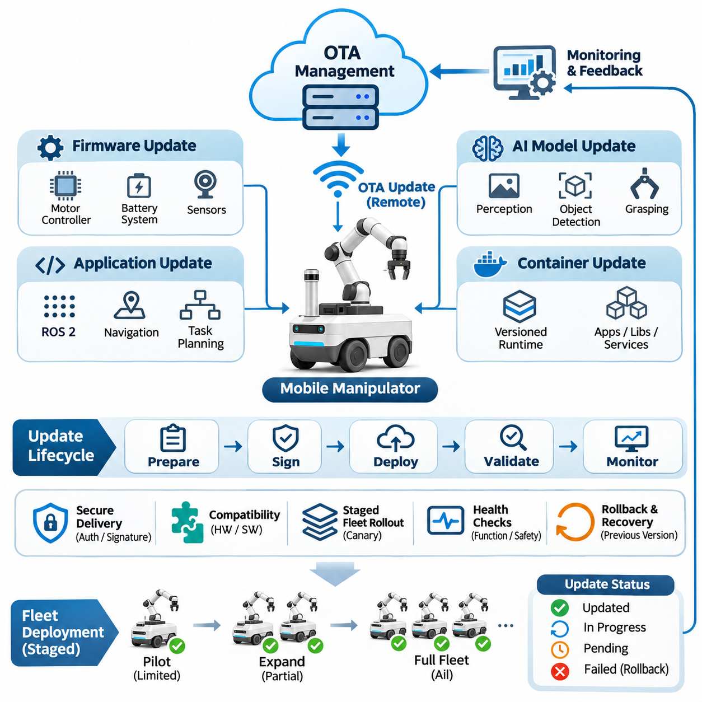
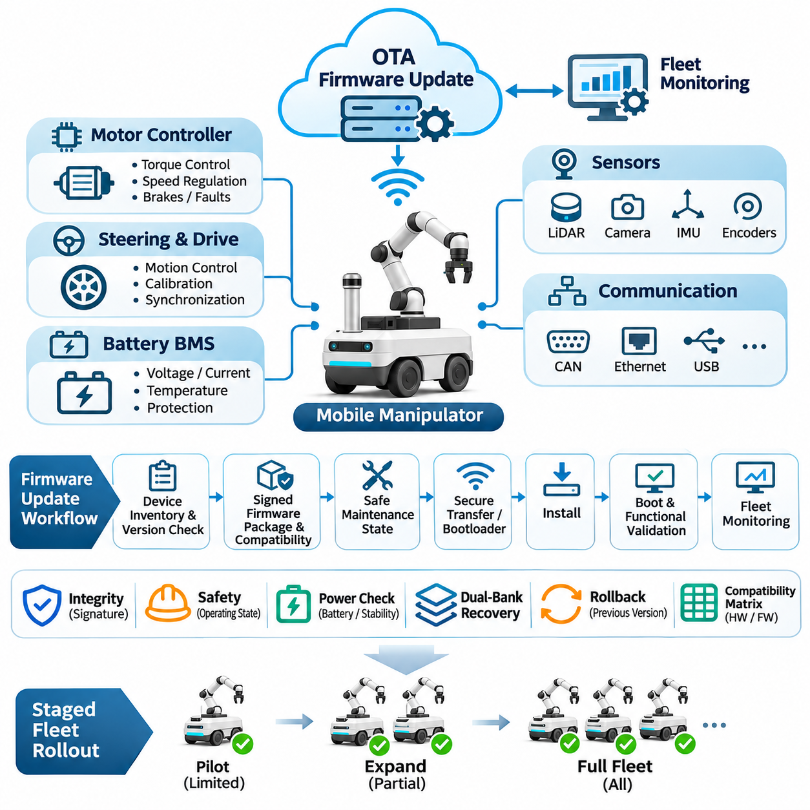
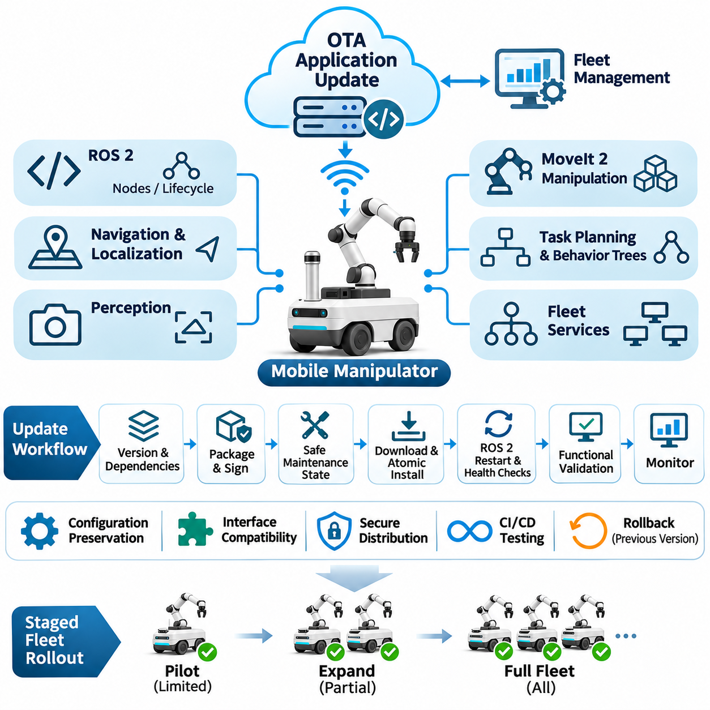
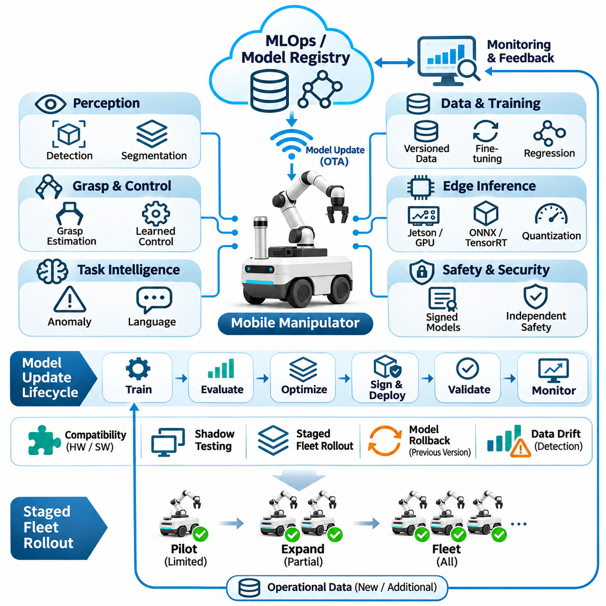
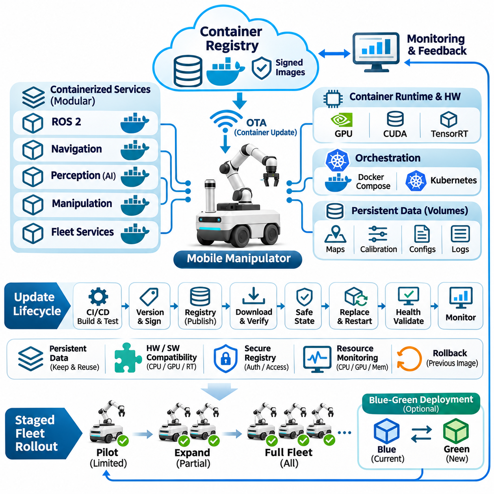
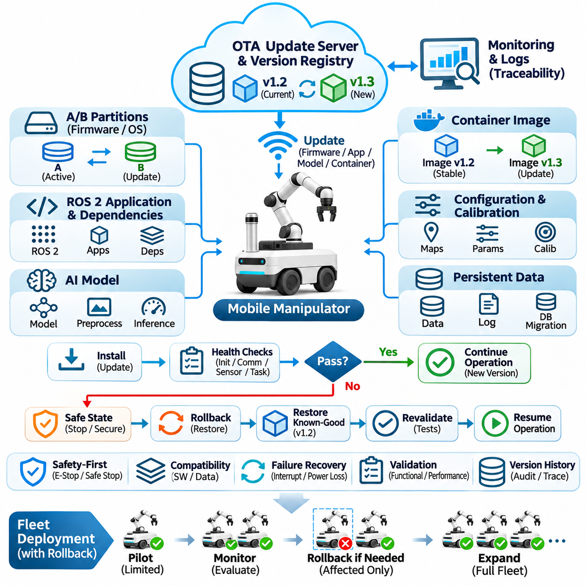
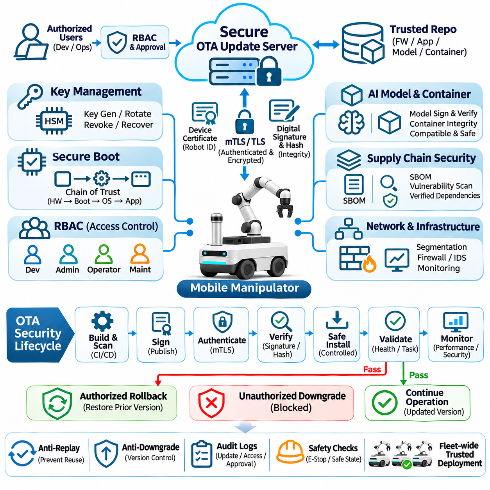
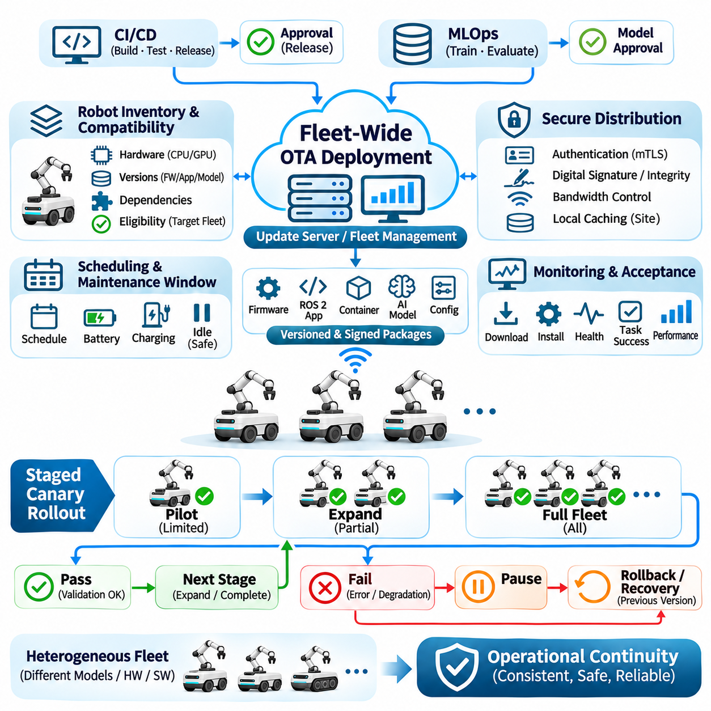
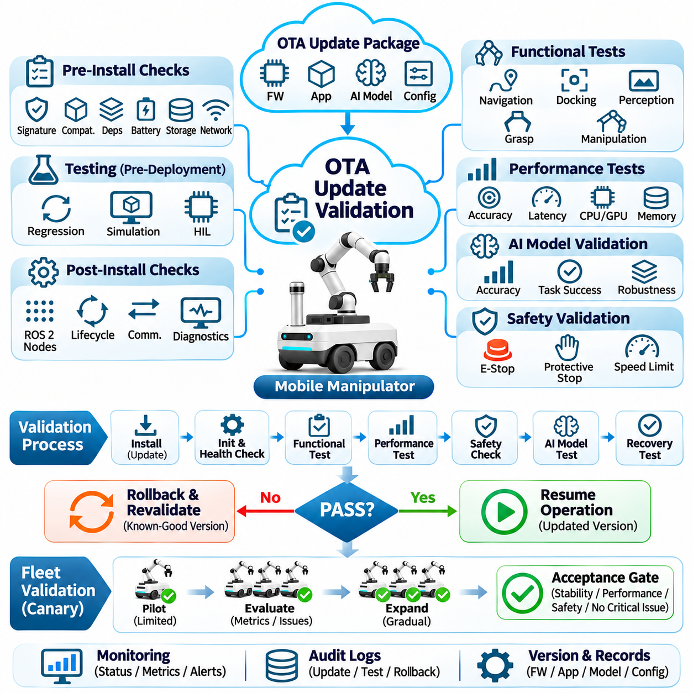
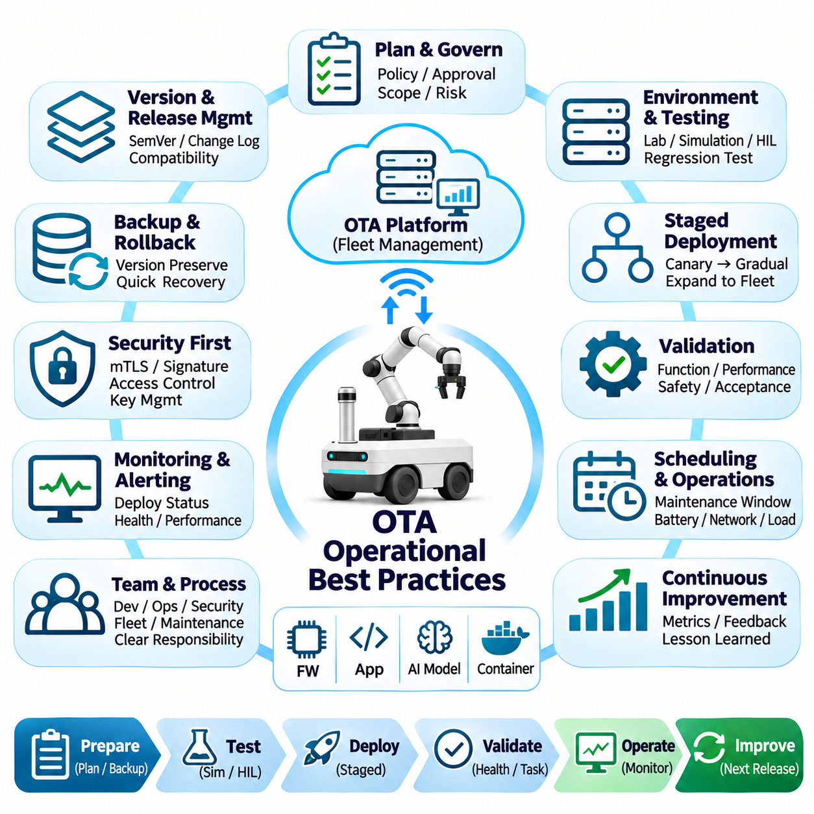

# Chapter 13. OTA Updates

## 01 OTA Overview

{width="7.268055555555556in" height="7.268055555555556in"}

무선 업데이트(Over-the-Air, OTA)는 이동형 매니퓰레이터(Mobile Manipulator)가 각 로봇에 직접 물리적으로 접근하지 않고도 소프트웨어(Software), 펌웨어(Firmware), 설정(Configuration), 인공지능 모델(AI Model) 업데이트를 받을 수 있도록 하는 핵심 운영 기능이다. 네트워크 연결을 활용하면 운영자는 배치된 로봇을 원격으로 유지보수하고 개선할 수 있다. OTA 메커니즘은 유지보수 작업을 줄이고 배포 주기를 단축하며, 여러 시설에서 운영되는 로봇이 일관되고 최신 상태를 유지하도록 지원한다.

이동형 매니퓰레이터는 자율이동로봇(Autonomous Mobile Robot, AMR), 로봇 팔(Robot Arm), 센서(Sensor), 모터 제어기(Motor Controller), 임베디드 컴퓨터(Embedded Computer), 상위 제어 애플리케이션(High-Level Control Application) 등 다양한 하드웨어 및 소프트웨어 구성요소를 통합한다. 각 구성요소는 시스템 수명주기(System Lifecycle) 동안 독립적인 업데이트가 필요할 수 있다. 따라서 OTA 아키텍처(OTA Architecture)는 시스템의 전반적인 운영 무결성(Operational Integrity)을 유지하면서 다양한 업데이트 유형을 지원하고 구성요소 간 호환성을 보장해야 한다.

펌웨어 업데이트(Firmware Update)는 하위 수준의 하드웨어 동작에 직접적인 영향을 미치므로 특히 중요하다. 모터 제어기(Motor Controller), 배터리 관리 시스템(Battery Management System), 임베디드 센서 프로세서(Embedded Sensor Processor), 통신 인터페이스(Communication Interface)는 결함 수정, 성능 향상 또는 보안 취약점 해결을 위해 펌웨어 업데이트가 필요할 수 있다. 펌웨어 오류는 물리적인 움직임과 안전 기능에 영향을 줄 수 있으므로, 업데이트 절차에는 하드웨어 호환성 검사, 무결성 검증(Integrity Verification), 제어된 설치 및 복구 메커니즘이 포함되어야 한다.

애플리케이션 업데이트(Application Update)는 ROS 2 노드(Node), 내비게이션 시스템(Navigation System), 매니퓰레이션 제어기(Manipulation Controller), 작업 계획기(Task Planner), 플릿 관리 인터페이스(Fleet Management Interface)와 같은 상위 수준의 소프트웨어 구성요소를 대상으로 한다. 이러한 업데이트는 새로운 기능을 도입하거나 알고리즘을 개선하고 운영상의 결함을 수정할 수 있다. 신뢰할 수 있는 애플리케이션 업데이트 프로세스는 소프트웨어 의존성(Software Dependency), 설정 변경 및 버전 호환성을 관리해야 한다. 또한 설치 과정에서도 핵심 로봇 기능을 계속 사용할 수 있도록 하거나, 제어된 안전 상태(Safe State)로 전환되도록 보장해야 한다.

인공지능 모델 업데이트(AI Model Update)는 인식(Perception), 객체 탐지(Object Detection), 파지 추정(Grasp Estimation), 작업 계획(Task Planning) 모델이 주요 애플리케이션 소프트웨어와 독립적으로 발전할 수 있다는 점에서 추가적인 요구사항을 발생시킨다. 업데이트된 모델은 배포 전에 대표성 있는 데이터셋(Representative Dataset)과 운영 시나리오(Operational Scenario)를 기반으로 평가해야 한다. 모델 버전, 추론 의존성(Inference Dependency), 하드웨어 요구사항 및 성능 특성을 추적하여 업데이트로 인해 인식 정확도가 저하되거나 예상하지 못한 동작이 발생하지 않도록 해야 한다.

컨테이너 기반 업데이트(Container-Based Update)는 복잡한 로봇 소프트웨어 환경을 패키징하고 배포하기 위한 실용적인 방법이다. 애플리케이션, 라이브러리(Library), 런타임 의존성(Runtime Dependency) 및 지원 서비스(Supporting Service)를 버전이 지정된 컨테이너 이미지(Container Image)로 제공할 수 있다. 이러한 접근 방식은 개발, 테스트 및 운영 환경 전반에서 재현성(Reproducibility)을 향상시킨다. 컨테이너 오케스트레이션(Container Orchestration)은 업데이트된 서비스의 제어된 교체, 상태 모니터링(Health Monitoring) 및 시작이나 작동에 실패했을 때의 복구도 지원할 수 있다.

신뢰할 수 있는 OTA 아키텍처에는 신중하게 설계된 롤백 전략(Rollback Strategy)이 필요하다. 업데이트는 통신 중단, 저장 공간 부족, 의존성 비호환성, 예상하지 못한 런타임 오류 또는 하드웨어별 문제로 인해 실패할 수 있다. 중요한 검증 검사에서 실패가 확인되면 로봇은 가능한 경우 정상적으로 작동했던 기존 소프트웨어 버전을 유지하거나 자동으로 복원해야 한다. 복구 절차는 또한 설정 데이터(Configuration Data)와 운영 기록(Operational Record)이 의도치 않게 변경되지 않도록 보호해야 한다.

OTA 보안(OTA Security)은 업데이트 인프라가 물리적으로 배치된 로봇의 소프트웨어를 수정할 수 있는 경로를 제공하므로 필수적이다. 업데이트 패키지는 설치 전에 인증되고 디지털 서명(Digital Signature) 및 검증 절차를 거쳐야 한다. 보안 통신(Secure Communication), 접근 제어(Access Control), 암호화(Encryption), 인증서 관리(Certificate Management), 소프트웨어 무결성 검사(Software Integrity Check)는 무단 변경을 방지하는 데 도움이 된다. 또한 시스템은 패키지 버전, 배포 출처, 설치 결과 및 승인 책임자를 식별할 수 있는 감사 기록(Audit Record)을 유지해야 한다.

플릿 전체 배포(Fleet-Wide Deployment)는 서로 다른 위치와 운영 조건에서 작동하는 여러 로봇 간의 조정을 필요로 한다. 전체 플릿에 업데이트를 동시에 배포하면 불필요한 운영 위험이 발생할 수 있다. 단계적 배포 전략(Staged Deployment Strategy)은 대표성을 갖는 소수의 로봇을 대상으로 시작하여 동작을 평가하고, 검증이 성공한 후 배포 범위를 점진적으로 확대할 수 있다. 플릿 관리 시스템(Fleet Management System)은 모든 로봇의 업데이트 상태, 호환성, 연결 상태 및 복구 조건을 추적해야 한다.

업데이트 검증(Update Validation)은 설치가 성공적으로 완료되었는지 확인하는 수준을 넘어야 한다. 로봇은 소프트웨어 구성요소가 정상적으로 초기화되는지, 통신 인터페이스가 정상적으로 작동하는지, 센서가 유효한 정보를 제공하는지, 내비게이션 및 매니퓰레이션 기능이 예상된 성능 범위 내에 있는지를 확인해야 한다. 안전 관련 기능(Safety-Related Function)은 소프트웨어 변경이 비상 정지(Emergency Stop), 충돌 감지(Collision Detection), 속도 제한(Speed Limitation), 인간-로봇 상호작용(Human-Robot Interaction)에 영향을 미칠 수 있으므로 특별한 주의가 필요하다.

효과적인 OTA 운영(OTA Operations)을 위해서는 소프트웨어 엔지니어링(Software Engineering), 사이버 보안(Cybersecurity), 플릿 관리(Fleet Management), 현장 유지보수(Field Maintenance) 프로세스 간의 협력이 필요하다. 조직은 업데이트 승인 절차, 유지보수 시간대(Maintenance Window), 버전 관리 정책(Version Management Policy), 배포 모니터링 및 사고 대응 책임을 정의해야 한다. 단계적 배포, 자동화된 검증, 안전한 업데이트 배포 및 신뢰할 수 있는 롤백을 결합하면 OTA 업데이트는 단순히 소프트웨어를 원격으로 설치하는 수단을 넘어 로봇의 전체 수명주기를 관리하는 체계적인 운영 역량으로 발전할 수 있다.

## 02 Firmware Updates

{width="7.268055555555556in" height="7.268055555555556in"}

펌웨어 업데이트(Firmware Update)는 이동형 매니퓰레이터(Mobile Manipulator)의 전체 운영 수명주기(Operational Lifecycle)에 걸쳐 신뢰성(Reliability), 성능(Performance), 안전성(Safety)을 유지하는 데 중요한 역할을 한다. 펌웨어는 모터 제어기(Motor Controller), 조향 시스템(Steering System), 배터리 관리 시스템(Battery Management System), 센서 인터페이스(Sensor Interface), 통신 장치(Communication Device) 등을 포함한 임베디드 하드웨어(Embedded Hardware)의 하위 수준 동작을 제어한다. 펌웨어 업데이트를 통해 제조업체는 전자 부품을 물리적으로 교체하지 않고도 결함을 수정하고, 제어 성능을 개선하며, 하드웨어 기능을 확장하고, 보안 취약점을 해결할 수 있다.

이동형 매니퓰레이터는 일반적으로 서로 다른 제조업체의 다양한 임베디드 장치를 포함하며, 각 장치는 자체적인 펌웨어 아키텍처와 업데이트 요구사항을 갖는다. 자율이동로봇(Autonomous Mobile Robot, AMR), 로봇 팔(Robot Arm), 모터 드라이버(Motor Driver), 엔코더(Encoder), LiDAR 센서, 카메라(Camera), 배터리 관리 시스템(Battery Management System)은 각각 독립적인 펌웨어 관리가 필요할 수 있다. 효과적인 업데이트 아키텍처(Update Architecture)는 이러한 장치를 식별하고 펌웨어 버전을 관리하며, 통합 로봇 플랫폼(Integrated Robotic Platform) 전체의 호환성을 유지하면서 업데이트를 조정해야 한다.

펌웨어 업데이트는 명확하게 정의된 하드웨어 인벤토리(Hardware Inventory)와 버전 관리 프로세스(Version Management Process)에서 시작해야 한다. 각 장치는 식별 가능한 모델 번호, 하드웨어 리비전(Hardware Revision), 현재 펌웨어 버전, 지원되는 업데이트 인터페이스(Update Interface), 호환성 요구사항을 갖추어야 한다. 이러한 정보는 업데이트 관리 시스템(Update Management System)이 특정 로봇에 적합한 펌웨어 패키지(Firmware Package)인지를 판단할 수 있도록 한다. 정확한 장치 기록을 유지하면 문제 해결이 간소화되며, 서로 다른 하드웨어 리비전에 호환되지 않는 펌웨어가 설치되는 것을 방지할 수 있다.

모터 제어기 펌웨어(Motor Controller Firmware)는 이동 플랫폼과 로봇 팔의 물리적 움직임에 직접적인 영향을 미치므로 특히 주의해야 한다. 업데이트를 통해 속도 조절(Velocity Regulation), 토크 제어(Torque Control), 위치 정확도(Position Accuracy), 엔코더 처리(Encoder Processing), 통신 신뢰성(Communication Reliability), 고장 감지(Fault Detection)를 개선할 수 있다. 그러나 모터 제어 알고리즘의 변경은 가속, 감속, 제동 동작 및 동적 응답(Dynamic Response)에 변화를 발생시킬 수 있다. 따라서 모터 제어기 펌웨어는 실제 운영 조건을 대표하는 환경에서 검증한 후 운영 중인 로봇에 배포해야 한다.

이동형 매니퓰레이션 플랫폼(Mobile Manipulation Platform)에서는 조향 및 구동 시스템(Steering and Drive System)의 펌웨어 업데이트도 마찬가지로 중요하다. 차동 구동(Differential Drive), 메카넘 구동(Mecanum Drive), 전방향 구동(Omnidirectional Drive), 4륜 조향(Four-Wheel Steering) 구성은 서로 다른 제어 전략과 임베디드 통신 프로토콜(Embedded Communication Protocol)을 사용할 수 있다. 조향 보정(Steering Calibration), 휠 동기화(Wheel Synchronization), 동작 제어(Motion Control) 매개변수를 변경하는 업데이트는 내비게이션 정확도와 주행 안정성에 영향을 줄 수 있다. 업데이트 프로세스는 핵심 보정 정보를 보존하고 설치 후 로봇이 기존에 기대했던 주행 특성을 유지하는지 검증해야 한다.

배터리 관리 시스템 펌웨어(Battery Management System Firmware)는 셀 전압(Cell Voltage), 전류(Current), 온도(Temperature), 충전 상태(Charging Condition), 보호 메커니즘(Protection Mechanism)을 모니터링하는 역할을 한다. 업데이트를 통해 배터리 진단(Battery Diagnostics), 충전 상태 추정(State-of-Charge Estimation), 로봇 제어기와의 통신, 열 보호(Thermal Protection) 기능을 개선할 수 있다. 배터리 보호 기능은 안전에 매우 중요하므로, 펌웨어 변경 후에도 과전압(Overvoltage), 저전압(Undervoltage), 과전류(Overcurrent), 과온도(Overtemperature) 보호 기능이 정상 운전 및 비정상 상황에서 모두 유효하게 유지되는지 신중하게 평가해야 한다.

센서 펌웨어 업데이트(Sensor Firmware Update)는 측정 정확도(Measurement Accuracy), 통신 안정성(Communication Stability), 동기화(Synchronization), 데이터 처리(Data Processing)를 개선할 수 있다. LiDAR 센서, 카메라, 관성측정장치(Inertial Measurement Unit, IMU), 힘-토크 센서(Force-Torque Sensor), 관절 엔코더(Joint Encoder)는 내부 필터링이나 측정 동작을 변경하는 업데이트를 받을 수 있다. 이러한 변경은 후속 인식(Perception), 위치 추정(Localization), 모션 계획(Motion Planning), 매니퓰레이션 알고리즘(Manipulation Algorithm)에 영향을 줄 수 있다. 따라서 센서 펌웨어 업데이트에는 데이터 형식(Data Format), 타임스탬프(Timestamp), 좌표계 규약(Coordinate Convention), 보정 매개변수(Calibration Parameter), 통신 인터페이스에 대한 검증이 포함되어야 한다.

펌웨어 업데이트 메커니즘(Firmware Update Mechanism)은 각 임베디드 장치에서 사용할 수 있는 통신 인터페이스를 지원해야 한다. 일반적인 인터페이스에는 CAN(Controller Area Network), CANopen, Ethernet, USB, 직렬 통신(Serial Communication), 제조업체별 프로그래밍 인터페이스(Manufacturer-Specific Programming Interface)가 포함된다. 일부 장치는 원격 부트로더(Remote Bootloader)를 지원하지만, 다른 장치는 전용 펌웨어 프로그래밍 모드(Firmware Programming Mode)로 전환해야 한다. 업데이트 관리자는 이러한 차이를 이해하고 각 하드웨어 유형에 적합한 통신, 장치 식별, 패키지 전송 및 설치 절차를 제공해야 한다.

신뢰할 수 있는 펌웨어 패키지(Firmware Package)는 펌웨어 바이너리(Firmware Binary), 장치 식별 정보(Device Identification Information), 버전 메타데이터(Version Metadata), 호환성 제약조건(Compatibility Constraint), 무결성 정보(Integrity Information), 설치 지침(Installation Instruction)을 포함해야 한다. 또한 해당 패키지는 적용 가능한 하드웨어 리비전과 필요한 중간 펌웨어 버전을 명시해야 한다. 설치 전에 로봇은 패키지가 대상 장치와 일치하는지, 바이너리가 손상되거나 변경되지 않았는지 검증해야 한다. 이러한 검사는 호환되지 않거나 불완전한 펌웨어 이미지(Firmware Image)가 설치될 위험을 줄여준다.

펌웨어 설치(Firmware Installation)는 통제된 운영 조건에서 수행해야 한다. 이동형 매니퓰레이터는 일반적으로 임무를 중단하고 승인된 유지보수 상태(Maintenance State)로 이동해야 하며, 업데이트가 시작되기 전에 매니퓰레이터와 이동 플랫폼이 안전하게 고정되어 있는지 확인해야 한다. 배터리 용량, 전원 안정성(Power Stability), 통신 품질(Communication Quality), 사용 가능한 저장 공간을 사전에 점검해야 한다. 예상치 못한 중단이 운영상 위험을 초래할 수 있는 상황에서는 로봇이 중요한 매니퓰레이션 작업을 수행하거나 사람과 공유하는 작업 공간을 이동하는 동안 장치를 업데이트해서는 안 된다.

업데이트 절차는 통신 중단이나 전원 장애(Power Failure)의 가능성을 고려해야 한다. 펌웨어 기록 중 업데이트가 중단되면 임베디드 장치를 일시적으로 또는 영구적으로 사용할 수 없게 될 수 있다. 부트로더 기반 복구(Bootloader-Based Recovery), 이중 뱅크 펌웨어 저장(Dual-Bank Firmware Storage), 보호된 복구 파티션(Recovery Partition)은 이러한 위험을 줄일 수 있다. 지원되는 경우 장치는 이전에 검증된 펌웨어 이미지를 유지하여 새로운 버전이 초기화에 실패하면 시스템이 정상 작동 상태를 복원할 수 있도록 해야 한다.

펌웨어 호환성(Firmware Compatibility)은 상호 연결된 장치 간에도 고려해야 한다. 예를 들어 모터 제어기 업데이트는 메인 로봇 제어기가 사용하는 통신 메시지, 매개변수 정의 또는 진단 코드를 변경할 수 있다. 마찬가지로 업데이트된 센서 펌웨어 버전은 인식 소프트웨어가 사용하는 데이터 타이밍이나 인터페이스 동작을 변경할 수 있다. 따라서 호환성 매트릭스(Compatibility Matrix)는 지원되는 펌웨어, 하드웨어, 통신 프로토콜 및 애플리케이션 소프트웨어 버전의 조합을 문서화해야 한다.

설치 후 로봇은 체계적인 펌웨어 검증 절차(Firmware Validation Procedure)를 실행해야 한다. 시스템은 장치가 정상적으로 부팅되는지, 예상한 펌웨어 버전을 보고하는지, 메인 제어기와 통신하는지, 유효한 진단 정보를 제공하는지 확인해야 한다. 기능 시험(Functional Test)은 모터 응답, 조향 정확도, 제동, 센서 측정, 배터리 모니터링 등 관련 하드웨어의 동작을 검증해야 한다. 검증 범위는 업데이트의 영향을 받는 하드웨어와 장애 발생 시 예상되는 결과를 고려하여 결정해야 한다.

펌웨어 업데이트는 일반적인 소프트웨어 설치 작업으로 취급해서는 안 되며, 로봇의 안전 아키텍처(Safety Architecture)에 통합해야 한다. 안전 관련 제어기(Safety-Related Controller), 비상 정지 회로(Emergency Stop Circuit), 제동 메커니즘(Braking Mechanism), 속도 모니터링(Speed Monitoring), 보호 센서 기능(Protective Sensor Function)은 특별한 고려가 필요하다. 업데이트로 인해 기존 안전 기능이 의도치 않게 비활성화되거나 약화되어서는 안 된다. 안전 인증을 받은 구성요소가 포함된 경우 업데이트 프로세스는 제조업체가 승인한 절차를 따르고 해당 안전 구성과 인증의 전제조건을 유지해야 한다.

보안(Security)은 펌웨어 관리의 또 다른 기본 요구사항이다. 펌웨어 패키지는 신뢰할 수 있는 출처에서 확보하고, 설치 전에 인증하며, 무단 변경으로부터 보호해야 한다. 디지털 서명(Digital Signature), 보안 부팅(Secure Boot), 암호화 통신(Encrypted Communication), 접근 제어(Access Control)는 업데이트 전 과정에서 신뢰성을 확보하는 데 도움이 된다. 또한 로봇은 보안 감사(Security Audit)와 사고 조사(Incident Investigation)를 지원하기 위해 패키지 출처, 펌웨어 버전, 설치 시간, 검증 결과 및 승인 정보를 기록해야 한다.

플릿 환경(Fleet Environment)에서는 하드웨어 구성과 운영 우선순위에 따라 펌웨어 배포를 조정해야 한다. 동일한 제품군에 속하더라도 로봇마다 서로 다른 제어기 리비전, 센서 모델 및 임베디드 장치가 포함될 수 있다. 플릿 관리 시스템(Fleet Management System)은 업데이트 대상 로봇을 식별하고 호환 가능한 패키지를 배포하며 설치 진행 상황을 모니터링하고 실패 상황을 보고해야 한다. 광범위한 배포에 앞서 대표성을 갖는 소규모 로봇 그룹을 대상으로 단계적 배포(Staged Rollout)를 수행하면 예상하지 못한 하드웨어 및 운영상의 문제를 식별하는 데 도움이 된다.

펌웨어 수명주기 관리(Firmware Lifecycle Management)에는 지속적인 모니터링과 체계적인 버전 관리가 필요하다. 조직은 배포된 펌웨어 패키지, 알려진 결함, 호환성 정보, 설치 이력 및 지원되는 복구 절차에 관한 기록을 유지해야 한다. 새로운 펌웨어 버전이 출시되면 엔지니어는 배포를 승인하기 전에 기대 효과, 위험, 하드웨어 요구사항 및 운영상 영향을 평가해야 한다. 이전에 검증된 버전은 조직의 복구 및 유지보수 정책에 따라 계속 사용할 수 있도록 보관해야 한다.

궁극적으로 펌웨어 업데이트는 이동형 매니퓰레이터의 임베디드 하드웨어 계층(Embedded Hardware Layer)을 유지관리하는 기반을 제공한다. 성공적인 구현을 위해서는 정확한 장치 식별, 호환성 관리, 안전한 패키지 배포, 통제된 설치, 기능 검증 및 신뢰할 수 있는 복구 메커니즘이 필요하다. 펌웨어 관리를 전체 OTA 아키텍처에 통합함으로써 조직은 하드웨어 신뢰성을 향상시키고 현장 유지보수 요구사항을 줄이며 개별 로봇과 대규모 로봇 플릿 전반에서 일관된 운영을 유지할 수 있다.

## 03 Application Updates

{width="7.268055555555556in" height="7.268055555555556in"}

애플리케이션 업데이트(Application Update)는 이동형 매니퓰레이터(Mobile Manipulator)의 운영 수명주기(Operational Lifecycle) 전반에 걸쳐 소프트웨어를 유지하고 개선하는 데 필수적인 요소이다. 하위 수준의 임베디드 하드웨어 동작을 변경하는 펌웨어 업데이트(Firmware Update)와 달리, 애플리케이션 업데이트는 주로 내비게이션(Navigation), 인식(Perception), 매니퓰레이션(Manipulation), 작업 계획(Task Planning), 통신(Communication), 플릿 협조(Fleet Coordination)를 담당하는 소프트웨어에 영향을 미친다. 이를 통해 개발자는 배치된 로봇에 물리적으로 접근하지 않고도 새로운 기능을 도입하고, 소프트웨어 결함을 수정하며, 운영 효율성을 개선하고, 변화하는 하드웨어 및 인프라와의 호환성을 유지할 수 있다.

이동형 매니퓰레이터는 일반적으로 로봇 운영체제 2(Robot Operating System 2, ROS 2), 내비게이션 소프트웨어(Navigation Software), 모션 계획 프레임워크(Motion Planning Framework), 로봇 제어기(Robot Controller), 인식 애플리케이션(Perception Application), 행동 트리(Behavior Tree), 플릿 관리 서비스(Fleet Management Service)로 구성된 통합 소프트웨어 스택(Integrated Software Stack)을 통해 작동한다. 각 구성요소는 독립적으로 개발 및 유지관리될 수 있지만, 구성요소 간 상호작용은 일관성을 유지해야 한다. 따라서 애플리케이션 업데이트 아키텍처(Application Update Architecture)는 개별 소프트웨어 패키지를 관리하는 동시에 시스템 수준의 호환성을 보존하고 로봇 전체가 신뢰성 있게 계속 작동하도록 해야 한다.

애플리케이션 업데이트는 개별 ROS 2 노드(Node), 소프트웨어 라이브러리(Software Library), 실행 프로그램(Executable Program), 설정 파일(Configuration File), 통신 인터페이스(Communication Interface), 시스템 서비스(System Service)를 대상으로 할 수 있다. 예를 들어 개발자는 위치 추정 정확도를 개선하기 위해 위치 추정 노드(Localization Node)를 업데이트하거나, 동적 장애물(Dynamic Obstacle)을 처리하도록 내비게이션 애플리케이션을 수정하거나, 파지 정밀도(Grasping Precision)를 높이기 위해 매니퓰레이션 제어기를 개선할 수 있다. 이러한 변경사항은 서로 무관한 파일로 취급하기보다는 의존성과 운영 요구사항에 따라 패키징하고 배포해야 한다.

버전 관리(Version Management)는 신뢰할 수 있는 애플리케이션 업데이트의 기본 요소이다. 각 소프트웨어 구성요소는 식별 가능한 버전 번호, 릴리스 이력(Release History), 의존성 정보(Dependency Information), 호환성 요구사항을 유지해야 한다. 시맨틱 버저닝(Semantic Versioning, SemVer)은 주 버전(Major Version), 부 버전(Minor Version), 패치 버전(Patch Version)을 구분하는 유용한 규칙을 제공한다. 주 버전은 호환되지 않는 인터페이스 변경을 도입할 수 있고, 부 버전은 하위 호환성을 유지하는 새로운 기능을 추가하며, 패치 버전은 주로 결함을 수정한다. 일관된 버전 관리는 엔지니어가 변경사항을 식별하고 재현 가능한 소프트웨어 환경(Reproducible Software Environment)을 유지하는 데 도움이 된다.

애플리케이션 업데이트를 배포하기 전에 소프트웨어 의존성(Software Dependency)을 평가해야 한다. ROS 2 애플리케이션은 특정 미들웨어 버전(Middleware Version), 메시지 정의(Message Definition), 공유 라이브러리(Shared Library), 장치 드라이버(Device Driver), 외부 서비스(External Service)에 의존할 수 있다. 이러한 의존성을 고려하지 않고 하나의 구성요소만 업데이트하면 컴파일 오류, 통신 오류 또는 예상하지 못한 런타임 동작(Runtime Behavior)이 발생할 수 있다. 따라서 업데이트 시스템이 새로운 애플리케이션 버전이 대상 로봇에 적합한지 판단할 수 있도록 의존성 명세서(Dependency Manifest)와 호환성 기록(Compatibility Record)을 유지해야 한다.

소프트웨어 패키징(Software Packaging)은 서로 다른 로봇 플랫폼에 소프트웨어를 배포하기 위한 통제된 방법을 제공한다. 배포 아키텍처에 따라 ROS 2 패키지, Debian 패키지, 실행 파일 번들(Executable Bundle), 컨테이너 이미지(Container Image)를 사용할 수 있다. 패키지에는 필요한 실행 파일, 설정 리소스(Configuration Resource), 메타데이터(Metadata), 의존성 선언(Dependency Declaration)이 포함되어야 한다. 표준화된 패키징은 개발 환경과 운영 환경 간의 차이를 줄이고 소프트웨어 설치, 버전 추적 및 유지보수를 더욱 예측 가능하게 만든다.

설정 관리(Configuration Management) 역시 중요한 고려사항이다. 애플리케이션의 동작은 로봇과 운영 환경에 따라 달라질 수 있는 매개변수에 영향을 받기 때문이다. 내비게이션 속도 제한, 센서 토픽(Sensor Topic), 좌표 프레임(Coordinate Frame), 로봇 설명(Robot Description), 모션 계획 매개변수(Motion Planning Parameter), 네트워크 설정(Network Setting)은 가능한 경우 애플리케이션 바이너리(Application Binary)와 분리하여 관리해야 한다. 업데이트 과정에서는 기존의 현장별 설정(Site-Specific Configuration)을 보존하거나 통제된 절차를 통해 마이그레이션(Migration)해야 한다. 이를 통해 새로운 소프트웨어 릴리스가 검증된 운영 설정을 의도치 않게 덮어쓰는 문제를 방지할 수 있다.

애플리케이션 업데이트는 로봇의 운영 상태(Operational State)에 맞춰 조정해야 한다. 설치 전에 로봇은 현재 임무를 완료하거나 안전하게 일시 중단하고, 불필요한 움직임을 정지한 후 적절한 유지보수 상태(Maintenance State) 또는 업데이트 상태(Update State)로 전환해야 한다. 필요한 경우 매니퓰레이터 관절(Manipulator Joint)을 안전한 상태로 배치하고 이동 플랫폼(Mobile Platform)을 정지 상태로 유지해야 한다. 업데이트 관리자는 설치를 진행하기 전에 사용 가능한 저장 공간, 전원 안정성, 네트워크 연결 상태 및 충돌하는 설치 프로세스가 없는지 확인해야 한다.

신뢰할 수 있는 설치 메커니즘(Installation Mechanism)은 서비스 중단을 최소화하고 부분적으로 적용된 업데이트로부터 로봇을 보호해야 한다. 가능한 경우 현재 활성화된 소프트웨어를 교체하기 전에 애플리케이션 패키지를 다운로드하고 검증해야 한다. 원자적 배포 기법(Atomic Deployment Technique)은 필요한 파일과 의존성이 모두 준비된 이후에만 기존 애플리케이션 버전에서 새로운 버전으로 전환하도록 지원한다. 설치 또는 초기화에 실패하면 로봇은 이전에 검증된 소프트웨어 환경에 접근할 수 있는 상태를 유지해야 한다.

애플리케이션 업데이트는 여러 소프트웨어 구성요소 간의 상호작용도 고려해야 한다. 예를 들어 내비게이션 업데이트는 작업 계획(Task Planning)에 영향을 미칠 수 있으며, 로봇 설명(Robot Description)의 변경은 MoveIt 2 모션 계획(Motion Planning)과 충돌 검사(Collision Checking)에 영향을 줄 수 있다. ROS 2 메시지 정의 또는 서비스 인터페이스(Service Interface)의 변경은 다른 노드의 업데이트를 필요로 할 수 있다. 따라서 통합 테스트(Integration Testing)를 통해 통신, 인터페이스 호환성, 수명주기 동작(Lifecycle Behavior), 대표적인 로봇 임무의 전체 실행 과정을 검증해야 한다.

설치가 완료된 후 로봇은 업데이트된 서비스가 정상적으로 초기화되고 작동하는지 확인하기 위해 애플리케이션 수준의 상태 검사(Application-Level Health Check)를 수행해야 한다. 시스템은 ROS 2 노드의 가용성, 토픽 통신, 서비스 응답, 액션 실행(Action Execution), 진단 상태(Diagnostic Status)를 확인해야 한다. 기능 테스트(Functional Test)는 위치 추정, 자율주행(Autonomous Navigation), 장애물 회피(Obstacle Avoidance), 로봇 팔 동작(Arm Motion), 파지 실행(Grasp Execution), 작업 완료(Task Completion) 등 관련 기능을 포함해야 한다. 애플리케이션 로그(Application Log)와 런타임 지표(Runtime Metric)는 새로운 소프트웨어 버전이 예상대로 동작하는지 확인할 수 있는 추가적인 근거를 제공한다.

여러 로봇이 관련된 경우 애플리케이션 업데이트는 단계적 배포 전략(Staged Deployment Strategy)을 따라야 한다. 대표성을 갖는 로봇 한 대에 먼저 새로운 버전을 적용하여 실제 운영 조건에서 동작을 평가할 수 있다. 테스트가 성공적으로 완료되면 업데이트를 더 큰 로봇 그룹에 배포하고 최종적으로 전체 플릿(Fleet)에 확대할 수 있다. 배포 모니터링(Deployment Monitoring)은 설치 진행 상황, 서비스 실패, 비정상적인 자원 소비 및 운영 성능의 변화를 식별해야 한다. 이러한 접근 방식은 예상하지 못한 소프트웨어 결함이 미치는 영향을 제한한다.

보안(Security)은 전체 애플리케이션 업데이트 프로세스에 통합되어야 한다. 소프트웨어 패키지는 신뢰할 수 있는 저장소(Trusted Repository) 또는 승인된 배포 서버(Authorized Distribution Server)에서 제공되어야 하며, 설치 전에 무결성을 검증해야 한다. 디지털 서명(Digital Signature), 보안 통신(Secure Communication), 접근 제어(Access Control), 인증된 배포 요청(Authenticated Deployment Request)은 무단 소프트웨어 변경을 방지하는 데 도움이 된다. 또한 시스템은 감사(Auditing)와 사이버 보안 사고 조사(Cybersecurity Incident Investigation)를 지원하기 위해 패키지 버전, 배포 승인, 설치 결과 및 소프트웨어 변경사항을 기록해야 한다.

애플리케이션 업데이트는 지속적 통합 및 지속적 배포(Continuous Integration and Continuous Delivery, CI/CD) 방식과 통합해야 한다. 개발자는 애플리케이션 변경사항이 도입될 때마다 소프트웨어 패키지를 자동으로 빌드하고, 단위 테스트(Unit Test)를 실행하며, 통합 테스트를 수행하고, 배포 준비 상태(Deployment Readiness)를 평가할 수 있다. 자동화된 파이프라인(Automated Pipeline)은 일관성을 향상시키고 수작업으로 인한 오류를 줄인다. 그러나 소프트웨어 테스트를 통과했다는 사실만으로 로봇의 안전한 작동이 보장되는 것은 아니다. 실제 운영 환경에 릴리스를 승인하기 전에 하드웨어 인 더 루프(Hardware-in-the-Loop) 테스트, 시뮬레이션(Simulation), 대표적인 현장 검증(Field Validation)을 수행하는 것이 여전히 중요하다.

ROS 2 기반 이동형 매니퓰레이터에서는 수명주기 관리(Lifecycle Management)를 통해 애플리케이션 전환을 추가적으로 제어할 수 있다. 수명주기 노드(Lifecycle Node)는 정의된 운영 절차에 따라 설정(Configure), 활성화(Activate), 비활성화(Deactivate), 정리(Cleanup) 상태로 전환할 수 있다. 업데이트 중에는 새로운 소프트웨어가 설치된 후 재시작할 수 있도록 종속된 노드를 정해진 순서에 따라 제어된 방식으로 중지해야 할 수 있다. 이러한 조정된 수명주기 관리는 부분적으로 초기화된 시스템과 애플리케이션 구성요소 간의 일관되지 않은 통신을 방지하는 데 도움이 된다.

장기적인 애플리케이션 유지보수를 위해서는 운영 추적성(Operational Traceability)이 필수적이다. 시스템은 각 로봇에 설치된 소프트웨어 버전, 업데이트 시점, 변경된 패키지, 설치 후 검증의 성공 여부를 기록해야 한다. 이러한 기록은 엔지니어가 현장 문제를 재현하고, 소프트웨어 릴리스 간의 성능을 비교하며, 운영 사고가 최근 업데이트와 관련되어 있는지 판단하는 데 도움이 된다. 명확한 릴리스 이력을 유지하면 기술 지원(Technical Support), 유지보수 계획(Maintenance Planning), 소프트웨어 수명주기 거버넌스(Software Lifecycle Governance)도 지원할 수 있다.

궁극적으로 애플리케이션 업데이트는 이동형 매니퓰레이터의 기능을 지속적으로 개선하기 위한 통제된 메커니즘을 제공한다. 성공적인 구현을 위해서는 체계적인 버전 관리, 의존성 제어, 표준화된 패키징, 설정 보존, 안전한 배포, 통제된 설치 및 종합적인 검증이 필요하다. ROS 2 아키텍처, 플릿 관리, 자동화된 소프트웨어 파이프라인 및 운영 모니터링과 통합하면 애플리케이션 업데이트를 통해 실제 운영 환경에서 신뢰성, 호환성 및 예측 가능한 동작을 유지하면서 로봇 시스템을 지속적으로 발전시킬 수 있다.

## 04 AI Model Updates

{width="7.268055555555556in" height="7.268055555555556in"}

인공지능 모델 업데이트(AI Model Update)는 이동형 매니퓰레이터(Mobile Manipulator)의 운영 수명주기(Operational Lifecycle) 전반에 걸쳐 지능을 유지하고 개선하는 데 필수적인 요소이다. 주로 임베디드 하드웨어 동작과 소프트웨어 기능을 변경하는 펌웨어 및 애플리케이션 업데이트와 달리, 인공지능 모델 업데이트는 인식(Perception), 객체 인식(Object Recognition), 위치 추정(Localization), 파지 추정(Grasp Estimation), 동작 예측(Motion Prediction), 작업 이해(Task Understanding)에 사용되는 학습된 기능을 변경한다. 이를 통해 로봇 시스템은 전체 소프트웨어를 재개발하거나 하드웨어를 교체하지 않고도 새로운 객체, 환경 및 운영 조건에 적응할 수 있다.

이동형 매니퓰레이터는 서로 다른 운영 기능을 위해 여러 인공지능 모델을 사용할 수 있다. 비전 모델(Vision Model)은 객체를 식별하고 위치를 추정하며, 분할 모델(Segmentation Model)은 관련 영역을 구분하고, 파지 탐지 네트워크(Grasp Detection Network)는 후보 파지 구성을 평가하며, 학습 기반 제어기(Learning-Based Controller)는 복잡한 매니퓰레이션 동작을 지원한다. 추가적인 모델은 이상 탐지(Anomaly Detection), 인간 활동 인식(Human Activity Recognition), 자연어 명령 해석(Natural Language Instruction Interpretation)을 수행할 수 있다. 인공지능 모델 업데이트 아키텍처(AI Model Update Architecture)는 이러한 독립적인 모델을 관리하는 동시에 로봇의 인식, 계획 및 제어 파이프라인과의 호환성을 유지해야 한다.

모델 버전 관리(Model Version Management)는 신뢰할 수 있는 인공지능 배포(AI Deployment)의 기본 요소이다. 각 모델은 고유 식별자, 버전 번호, 학습 데이터셋 참조 정보(Training Dataset Reference), 아키텍처 설명(Architecture Description), 프레임워크 버전(Framework Version), 성능 평가 기록(Performance Evaluation Record)을 유지해야 한다. 모델 레지스트리(Model Registry)는 학습된 모델과 관련 메타데이터를 저장하는 중앙 집중식 위치를 제공한다. 이를 통해 각 로봇에 어떤 모델이 배포되어 있는지 식별하고, 이전 실험을 재현하며, 모델 릴리스를 비교하고, 특정 업데이트가 특정 로봇 애플리케이션에 적합한지 판단할 수 있다.

인공지능 모델 업데이트는 통제된 개발 및 검증 프로세스(Development and Validation Process)를 따라야 한다. 새로운 모델은 새롭게 수집된 운영 데이터를 활용한 추가 학습(Additional Training), 미세 조정(Fine-Tuning), 전이 학습(Transfer Learning) 또는 재학습(Retraining)을 통해 생성할 수 있다. 배포 전에 모델은 대표성 있는 검증 데이터셋(Validation Dataset)과 관련 성능 지표(Performance Metric)를 기준으로 평가해야 한다. 인식 애플리케이션에서는 정확도(Accuracy), 정밀도(Precision), 재현율(Recall), 평균 정밀도(Mean Average Precision)가 평가 지표에 포함될 수 있다. 파지 및 매니퓰레이션에서는 다양한 환경 조건에서의 파지 성공률(Grasp Success Rate), 위치 정확도(Positional Accuracy), 작업 완료율(Task Completion Rate), 강건성(Robustness)도 고려해야 한다.

데이터셋 관리(Dataset Management)는 업데이트된 모델이 실제 환경에서 성능을 개선하는지 판단하는 데 중요한 역할을 한다. 새롭게 수집된 데이터에는 이전에 관찰되지 않았던 객체, 조명 조건, 시점(Viewpoint), 배경, 센서 노이즈(Sensor Noise), 환경적 변동이 포함될 수 있다. 데이터셋 버전 관리(Dataset Versioning)는 학습 데이터, 검증 데이터, 모델 매개변수(Model Parameter), 평가 결과 간의 관계를 보존해야 한다. 데이터 품질 검사(Data Quality Check)는 잘못된 주석(Annotation), 중복 샘플(Duplicated Sample), 클래스 불균형(Class Imbalance), 모델 동작에 부정적인 영향을 줄 수 있는 데이터 분포 변화(Distribution Change)를 식별해야 한다.

인공지능 모델 업데이트에서 중요한 과제 중 하나는 파국적 망각(Catastrophic Forgetting)을 방지하는 것이다. 새롭게 수집된 데이터만 사용하여 모델을 미세 조정하면 이전에 학습한 기능을 잃거나 기존 작업에서 성능이 저하될 수 있다. 균형 잡힌 학습 전략(Balanced Training Strategy)은 새로운 운영 데이터를 통합하면서 대표성 있는 과거 샘플을 보존해야 한다. 회귀 테스트(Regression Testing)는 기존 및 새롭게 추가된 시나리오 모두에서 업데이트된 모델을 이전 버전과 비교하여 성능 개선이 허용할 수 없는 성능 저하를 초래하지 않는지 확인해야 한다.

모델 호환성(Model Compatibility)은 서로 다른 엣지 컴퓨팅 플랫폼(Edge Computing Platform)을 고려하여 관리해야 한다. 이동형 매니퓰레이터는 서로 다른 연산 능력을 가진 NVIDIA Jetson 장치, 산업용 GPU 컴퓨터(Industrial GPU Computer) 또는 기타 임베디드 추론 시스템(Embedded Inference System)을 사용할 수 있다. 고성능 학습 워크스테이션(Training Workstation)에서 개발된 모델은 엣지 장치(Edge Device)에 배포하기 전에 최적화가 필요할 수 있다. 모델 변환(Model Conversion), 양자화(Quantization), 가지치기(Pruning), 추론 가속(Inference Acceleration)은 예측 품질과 실시간 성능을 허용 가능한 수준으로 유지하면서 메모리 사용량과 연산 요구사항을 줄일 수 있다.

인공지능 모델 배포(AI Model Deployment)는 런타임 의존성(Runtime Dependency)과 추론 프레임워크(Inference Framework)도 고려해야 한다. 모델은 PyTorch 또는 TensorFlow를 사용하여 개발하고 ONNX Runtime, TensorRT 또는 기타 지원되는 추론 엔진(Inference Engine)을 통해 배포할 수 있다. 프레임워크 버전, 수치 정밀도(Numerical Precision), 전처리 작업(Preprocessing Operation), 하드웨어 가속(Hardware Acceleration)의 차이는 모델 출력에 영향을 줄 수 있다. 따라서 배포 파이프라인(Deployment Pipeline)은 변환된 모델이 원본 모델과 충분히 일관된 결과를 생성하고 대상 로봇의 지연 시간(Latency) 및 자원 요구사항을 충족하는지 검증해야 한다.

신뢰할 수 있는 모델 업데이트 프로세스(Model Update Process)는 기존 모델의 통제된 배포와 교체를 지원해야 한다. 활성화 전에 로봇은 모델 패키지(Model Package)를 다운로드하고 무결성을 검증하며, 하드웨어 호환성을 확인하고, 충분한 저장 공간과 메모리가 확보되어 있는지 점검해야 한다. 새로운 모델은 현재 검증된 버전을 즉시 제거하지 않고 로드하여 테스트해야 한다. 가능한 경우 인식, 내비게이션 또는 매니퓰레이션 작업의 중단을 방지하기 위해 통제된 운영 상태 전환 과정에서 모델 교체(Model Switching)를 수행해야 한다.

이동형 매니퓰레이터 플릿(Fleet) 전체에 인공지능 모델을 업데이트할 때는 단계적 배포(Staged Deployment)가 특히 유용하다. 새로운 모델은 처음에 통제된 조건에서 작동하는 소수의 대표적인 로봇에 설치할 수 있다. 엔지니어는 배포 범위를 확대하기 전에 예측 품질(Prediction Quality), 추론 지연 시간(Inference Latency), 자원 활용률(Resource Utilization), 작업 성공 여부(Task Success)를 모니터링할 수 있다. 섀도 평가(Shadow Evaluation)를 활용하면 새로운 모델이 기존 모델과 함께 운영 입력을 처리하면서도 로봇 동작을 직접 제어하지 않도록 할 수 있다. 이를 통해 전체 활성화 전에 모델 성능에 관한 추가적인 근거를 확보할 수 있다.

인공지능 모델 업데이트에는 신뢰할 수 있는 롤백 메커니즘(Rollback Mechanism)이 필요하다. 벤치마크 성능이 향상되었다고 해서 반드시 현장 성능도 개선되는 것은 아니기 때문이다. 환경 조건, 센서 특성, 객체 분포 또는 추론 동작의 변화로 인해 업데이트된 모델이 예상치 못하게 실패할 수 있다. 모니터링을 통해 허용할 수 없는 성능 저하가 확인되면 로봇은 이전에 검증된 모델과 해당 설정을 보존하여 이전 버전을 복원할 수 있어야 한다. 모델 롤백은 관련 전처리 매개변수(Preprocessing Parameter)와 추론 설정(Inference Setting)도 함께 보존해야 한다.

인공지능 모델 업데이트 수명주기(AI Model Update Lifecycle) 전반에서 보안과 무결성(Security and Integrity)은 필수적이다. 모델 패키지는 신뢰할 수 있는 저장소(Trusted Repository)에서 확보하고, 배포 전에 인증하며, 무단 변경으로부터 보호해야 한다. 디지털 서명(Digital Signature), 암호화 통신(Encrypted Communication), 접근 제어(Access Control), 모델 산출물 검증(Model Artifact Verification)은 배포 프로세스를 보호하는 데 도움이 된다. 조직은 감사(Auditing)와 인공지능 거버넌스(AI Governance)를 지원하기 위해 모델 출처(Model Provenance), 학습 데이터 참조 정보, 승인 결정, 배포 대상 및 업데이트 결과에 관한 기록도 유지해야 한다.

인공지능 모델의 출력이 로봇의 물리적 동작에 영향을 미치는 경우 모델 업데이트는 안전성 관점(Safety Perspective)에서도 평가해야 한다. 객체 탐지(Object Detection), 사람 인식(Human Recognition), 파지 추정(Grasp Estimation), 환경 인식(Environmental Perception)의 변경은 내비게이션 결정과 매니퓰레이터 궤적(Manipulator Trajectory)에 영향을 줄 수 있다. 따라서 업데이트된 모델은 시나리오 기반 테스트(Scenario-Based Testing), 시뮬레이션(Simulation), 통제된 현장 검증(Controlled Field Validation)을 거쳐야 한다. 결정론적 보호 메커니즘(Deterministic Protection Mechanism)이나 독립적으로 검증된 안전 시스템(Independently Validated Safety System)이 필요한 경우, 안전 필수 기능(Safety-Critical Function)이 인공지능 모델에만 의존해서는 안 된다.

지속적인 모델 모니터링(Continuous Model Monitoring)은 향후 업데이트를 위한 피드백을 제공한다. 운영 시스템은 추론 신뢰도(Inference Confidence), 예측 분포(Prediction Distribution), 실행 실패(Execution Failure), 작업 완료율(Task Completion Rate), 환경 변화를 나타내는 정보를 수집할 수 있다. 이러한 관찰 결과는 초기 검증 단계에서 확인되지 않았던 데이터 드리프트(Data Drift) 또는 모델 성능 저하(Model Degradation)를 발견하는 데 도움이 된다. 그러나 새롭게 수집된 운영 데이터를 적절한 품질 검사, 개인정보 보호 제어(Privacy Control), 주석 처리 절차(Annotation Procedure), 승인 과정 없이 자동으로 학습 데이터로 사용해서는 안 된다.

궁극적으로 인공지능 모델 업데이트는 이동형 매니퓰레이터가 운영 수명주기 전반에 걸쳐 인식, 의사결정 및 매니퓰레이션 기능을 개선할 수 있도록 한다. 효과적인 구현을 위해서는 모델 버전 관리, 데이터셋 관리, 체계적인 평가, 엣지 최적화(Edge Optimization), 안전한 배포, 단계적 적용 및 신뢰할 수 있는 롤백이 필요하다. 이를 MLOps, ROS 2, 플릿 관리(Fleet Management), 운영 모니터링(Operational Monitoring)과 통합하면 실제 환경에서 시스템의 신뢰성, 안전성 및 일관된 성능을 유지하면서 로봇 지능(Robotic Intelligence)을 지속적으로 발전시킬 수 있다.

## 05 Container Based Updates

{width="7.268055555555556in" height="7.268055555555556in"}

컨테이너 기반 업데이트(Container-Based Update)는 이동형 매니퓰레이터(Mobile Manipulator) 전반에 걸쳐 소프트웨어를 배포하고 유지관리하기 위한 신뢰성과 재현성이 높은 접근 방식을 제공한다. 개별 애플리케이션, 라이브러리 및 런타임 의존성을 각각 설치하는 대신, 필요한 실행 환경을 포함한 컨테이너(Container)에 소프트웨어 구성요소를 패키징한다. 이러한 접근 방식은 소프트웨어 배포를 간소화하고 의존성 충돌(Dependency Conflict)을 줄이며 개발, 테스트 및 운영 시스템 간의 일관성을 향상시킨다. 또한 컨테이너를 활용하면 전체 운영체제를 다시 구축하지 않고도 로봇 애플리케이션을 독립적으로 업데이트할 수 있다.

이동형 매니퓰레이터는 일반적으로 ROS 2 노드(Node), 내비게이션 시스템(Navigation System), 인식 애플리케이션(Perception Application), 모션 계획 구성요소(Motion Planning Component), 로봇 제어기(Robot Controller), 플릿 통신 서비스(Fleet Communication Service) 등 여러 소프트웨어 서비스를 운영한다. 이러한 구성요소는 서로 다른 라이브러리, 런타임 환경 및 소프트웨어 버전을 필요로 할 수 있다. 컨테이너화(Containerization)는 정의된 인터페이스를 통해 서비스 간 통신을 허용하면서 각 서비스의 실행 환경을 격리한다. 이러한 아키텍처는 복잡한 로봇 소프트웨어를 더욱 쉽게 유지관리하고 관련 없는 다른 구성요소에 의도치 않은 영향을 주지 않으면서 업데이트를 배포할 수 있도록 한다.

Docker는 컨테이너화된 애플리케이션을 패키징하고 실행하는 데 일반적으로 사용된다. Docker 이미지는 서비스를 실행하는 데 필요한 애플리케이션 코드, 라이브러리, 런타임 의존성 및 설정 리소스를 포함한다. 이러한 이미지가 실행된 인스턴스를 컨테이너라고 한다. 버전이 관리되는 이미지를 유지하면 개발자는 서로 다른 로봇에 동일한 소프트웨어 환경을 배포할 수 있다. 이를 통해 개별 임베디드 컴퓨터에 패키지를 수동으로 설치하거나 의존성을 설정하는 과정에서 발생하는 차이를 줄일 수 있다.

컨테이너 이미지는 명확하게 정의된 소프트웨어 책임을 기준으로 설계해야 한다. 예를 들어 내비게이션, 인식, 매니퓰레이션 및 모니터링 서비스는 각각 별도의 컨테이너로 유지관리할 수 있다. 이러한 모듈식 접근 방식(Modular Approach)을 사용하면 다른 모든 애플리케이션을 교체하지 않고도 특정 서비스에 대한 업데이트를 수행할 수 있다. 그러나 서비스 경계는 실제 아키텍처의 의존성을 반영해야 한다. 지나치게 세분화하면 통신 오버헤드(Communication Overhead), 설정 복잡성 및 운영 관리 요구사항이 증가할 수 있다.

컨테이너 이미지 버전 관리(Container Image Versioning)는 일관된 배포를 유지하는 데 필수적이다. 각 이미지는 식별 가능한 이름, 버전 태그(Version Tag), 빌드 참조 정보(Build Reference), 관련 소프트웨어 릴리스 정보를 가져야 한다. 개발, 테스트 및 운영 환경에서는 변경 가능한 태그인 latest에 의존하기보다 명시적으로 정의된 이미지 버전을 사용해야 한다. 이를 통해 엔지니어는 각 로봇에서 정확히 어떤 소프트웨어 패키지가 실행되고 있는지 식별하고 운영 문제를 조사할 때 동일한 환경을 재현할 수 있다.

컨테이너 레지스트리(Container Registry)는 컨테이너 이미지를 중앙에서 저장하고 배포하는 기능을 제공한다. 조직은 보안 및 운영 요구사항에 따라 공개 레지스트리(Public Registry), 비공개 레지스트리(Private Registry) 또는 내부 관리 저장소(Internally Managed Repository)를 사용할 수 있다. 배포 전에 업데이트 시스템은 대상 로봇에 적합한 이미지를 식별하고 해당 이미지의 가용성, 무결성 및 호환성을 검증해야 한다. 레지스트리 접근 정책(Registry Access Policy)은 어떤 개발자와 배포 서비스가 운영용 이미지를 게시, 수정 또는 가져올 수 있는지도 통제해야 한다.

컨테이너 기반 업데이트 프로세스(Container-Based Update Process)는 일반적으로 자동화된 소프트웨어 파이프라인(Automated Software Pipeline)을 통해 새로운 이미지를 빌드하는 과정에서 시작된다. 빌드 프로세스는 애플리케이션 소스 코드, 의존성, 설정 리소스 및 런타임 구성요소를 수집하여 배포 가능한 이미지로 통합한다. 자동화된 테스트는 이미지가 정상적으로 빌드되는지, 서비스가 올바르게 초기화되는지, 다른 로봇 구성요소와의 인터페이스 호환성이 유지되는지 검증해야 한다. 검증이 완료되면 승인된 이미지를 지정된 컨테이너 레지스트리에 게시할 수 있다.

설치 전에 로봇은 필요한 이미지를 다운로드하고 무결성을 검증해야 한다. 업데이트 관리자는 사용 가능한 저장 공간, 네트워크 연결, 메모리 요구사항, 하드웨어 호환성 및 로봇의 운영 상태를 확인해야 한다. GPU 라이브러리, 인식 프레임워크 또는 머신러닝 런타임을 포함하는 대형 컨테이너 이미지는 상당한 대역폭과 저장 공간을 요구할 수 있다. 이미지 압축(Image Compression), 레이어 재사용(Layer Reuse), 증분 배포(Incremental Distribution)를 활용하면 불필요한 데이터 전송을 줄일 수 있다.

컨테이너 배포(Container Deployment)에서는 영구 데이터(Persistent Data)를 신중하게 관리해야 한다. 컨테이너는 일반적으로 교체할 수 있도록 설계되며, 컨테이너가 다시 생성될 때 내부 쓰기 가능 저장소(Internal Writable Storage)가 제거될 수 있다. 그러나 로봇 시스템은 보정 매개변수(Calibration Parameter), 지도(Map), 설정 파일(Configuration File), 임무 기록(Mission Record), 운영 로그(Operational Log)와 같은 중요한 정보를 보존해야 한다. 따라서 영구 볼륨(Persistent Volume)과 외부 설정 저장소(External Configuration Storage)를 사용하여 중요한 데이터를 교체 가능한 애플리케이션 컨테이너와 분리해야 한다. 이를 통해 소프트웨어 업데이트가 운영 정보를 의도치 않게 삭제하는 문제를 방지할 수 있다.

컨테이너 오케스트레이션(Container Orchestration)은 여러 서비스의 배포와 운영을 조정할 수 있다. 비교적 단순한 로봇 시스템에는 Docker Compose가 충분할 수 있으며, 규모가 크고 복잡한 배포에는 Kubernetes 또는 기타 오케스트레이션 플랫폼이 적합할 수 있다. 이러한 메커니즘은 서비스 의존성, 시작 순서, 환경 변수(Environment Variable), 네트워크 연결 및 재시작 정책(Restart Policy)을 정의할 수 있다. 이동형 매니퓰레이터에서는 임베디드 플랫폼의 연산 및 저장 공간 제약 내에서 작동할 수 있도록 오케스트레이션 구조를 충분히 경량화해야 한다.

컨테이너 업데이트는 로봇의 운영 안전성을 유지하면서 수행해야 한다. 실행 중인 서비스를 교체하기 전에 시스템은 해당 애플리케이션이 내비게이션을 제어하는지, 객체를 매니퓰레이션하는지, 안전 관련 정보를 처리하는지, 다른 로봇과 통신하는지 판단해야 한다. 영향을 받는 서비스가 중지되기 전에 중요한 작업을 완료하거나 안전하게 일시 중단해야 한다. 종속 애플리케이션이 사용할 수 없거나 부분적으로 초기화된 구성요소와 함께 작동하지 않도록 적절한 순서에 따라 서비스를 재시작해야 한다.

상태 검사(Health Check)는 업데이트된 컨테이너가 정상적으로 작동하는지 판단하는 데 중요하다. 시스템은 컨테이너가 성공적으로 시작되는지, 필요한 프로세스가 계속 활성화되어 있는지, 통신 인터페이스를 사용할 수 있는지, 애플리케이션별 진단 결과가 허용 가능한 상태인지 확인해야 한다. 자원 모니터링(Resource Monitoring)은 CPU 사용률, GPU 사용률, 메모리 소비량, 저장 공간 사용량 및 실행 지연 시간(Execution Latency)도 검사해야 한다. 컨테이너가 성공적으로 시작되더라도 런타임 오류가 발생하거나 과도한 자원을 소비할 수 있으므로 운영 검증은 시작 여부 확인을 넘어 수행되어야 한다.

컨테이너 기반 배포는 통제된 교체와 복구를 지원해야 한다. 블루-그린 배포(Blue-Green Deployment)는 새로운 버전을 별도로 준비하는 동안 기존 애플리케이션 환경을 유지하여 검증 후 두 버전 간 전환을 가능하게 한다. 롤링 업데이트(Rolling Update)는 아키텍처가 독립적인 인스턴스를 지원하는 경우 서비스를 점진적으로 교체할 수 있다. 여러 인스턴스를 동시에 운영할 수 없는 로봇 애플리케이션에는 오프라인 유지보수 전환(Offline Maintenance Transition)이 더 적합할 수 있다. 배포 전략은 로봇의 실시간 요구사항과 사용 가능한 연산 자원을 고려하여 결정해야 한다.

업데이트된 컨테이너가 예상하지 못한 동작을 유발할 경우 롤백 기능(Rollback Capability)은 필수적이다. 이전에 검증된 이미지를 계속 사용할 수 있도록 유지하여 업데이트 관리자가 기존 소프트웨어 환경을 복원할 수 있어야 한다. 롤백 과정에서는 설정 파일, 환경 변수 및 서비스 정의가 변경되었다면 호환 가능한 이전 설정도 함께 복원해야 한다. 버전 기록에는 이전에 배포된 이미지와 복구를 수행한 이유가 명시되어야 한다. 이러한 메커니즘은 서비스 중단을 줄이고 소프트웨어 관련 장애의 원인을 조사하는 과정을 간소화한다.

보안(Security)은 컨테이너 이미지 개발 및 배포 과정에 통합되어야 한다. 이미지는 신뢰할 수 있는 기본 이미지(Trusted Base Image)와 승인된 저장소에서 제공되어야 한다. 소프트웨어 의존성은 알려진 취약점이 있는지 검사하고, 불필요한 패키지는 제거하며, 컨테이너 실행 권한은 제한해야 한다. 이미지 서명(Image Signing), 다이제스트 검증(Digest Verification), 인증된 레지스트리 접근(Authenticated Registry Access), 암호화 통신(Encrypted Communication)은 무단 변경으로부터 업데이트 프로세스를 보호하는 데 도움이 된다. 접근 토큰(Access Token)과 인증서(Certificate)와 같은 비밀 정보(Secret)는 컨테이너 이미지 내부에 직접 포함하지 않고 별도로 관리해야 한다.

GPU를 사용하는 로봇 애플리케이션은 컨테이너 기반 업데이트와 관련하여 추가적인 고려사항이 있다. 인식 및 매니퓰레이션 작업 부하는 NVIDIA CUDA, TensorRT, GPU 드라이버 및 특수 런타임 라이브러리에 의존할 수 있다. 컨테이너 환경은 호스트 운영체제(Host Operating System), 설치된 GPU 드라이버 및 임베디드 컴퓨팅 플랫폼과 호환되어야 한다. 컨테이너 업데이트만으로 모든 호스트 수준의 의존성을 독립적으로 교체할 수는 없다. 따라서 배포 아키텍처는 컨테이너 내부에서 관리되는 소프트웨어와 별도의 호스트 또는 펌웨어 업데이트가 필요한 구성요소를 명확하게 구분해야 한다.

플릿 전체 컨테이너 업데이트(Fleet-Wide Container Update)는 로봇 구성과 운영 가용성에 따라 조정해야 한다. 로봇마다 GPU 모델, 메모리 용량, 센서 구성 및 애플리케이션 버전이 다를 수 있다. 플릿 관리 시스템(Fleet Management System)은 업데이트 대상 로봇을 식별하고 호환되는 이미지를 배포하며 배포 진행 상황을 모니터링하고 실패를 보고해야 한다. 단계적 배포(Staged Rollout)는 대표적인 로봇부터 시작하여 나머지 플릿으로 확대해야 한다. 이러한 접근 방식은 대규모 운영에 영향을 미치기 전에 하드웨어별 호환성 문제와 예상하지 못한 자원 요구사항을 식별하는 데 도움이 된다.

컨테이너 기반 업데이트는 지속적 통합 및 지속적 배포(Continuous Integration and Continuous Delivery, CI/CD) 및 MLOps 파이프라인과 통합해야 한다. 애플리케이션 이미지, 인공지능 추론 서비스(AI Inference Service), 지원 구성요소는 자동화된 워크플로(Automated Workflow)를 통해 빌드, 테스트, 버전 관리 및 배포할 수 있다. 배포 요구사항에 따라 모델 산출물(Model Artifact)을 컨테이너에 마운트하거나 통제된 이미지 릴리스에 포함할 수도 있다. 애플리케이션 이미지와 독립적으로 업데이트되는 모델 산출물을 분리하면 불필요한 이미지 재빌드를 줄이고 인공지능 수명주기 관리(AI Lifecycle Management)의 유연성을 높일 수 있다.

궁극적으로 컨테이너 기반 업데이트는 복잡한 이동형 매니퓰레이터 소프트웨어 환경을 유지관리하기 위한 체계적인 기반을 제공한다. 그 효과는 모듈식 애플리케이션 아키텍처, 재현 가능한 이미지 생성(Reproducible Image Construction), 버전 관리, 영구 데이터 관리, 안전한 레지스트리, 자원 모니터링, 배포 오케스트레이션 및 신뢰할 수 있는 복구 절차에 달려 있다. 이를 ROS 2, OTA 인프라, 플릿 관리 및 자동화된 소프트웨어 파이프라인과 통합하면 개별 로봇과 분산된 로봇 플릿 전반에서 일관된 소프트웨어 유지보수를 구현하고 배포 복잡성과 운영 위험을 줄일 수 있다.

## 06 Rollback Strategies

{width="7.268055555555556in" height="7.268055555555556in"}

롤백 전략(Rollback Strategy)은 무선 업데이트(Over-the-Air, OTA) 과정에서 이동형 매니퓰레이터(Mobile Manipulator)의 신뢰성과 운영 연속성(Operational Continuity)을 유지하는 데 필수적이다. 업데이트는 개발 및 테스트 단계에서 발견되지 않은 소프트웨어 결함, 하드웨어 비호환성, 예상하지 못한 성능 저하 또는 시스템 장애를 발생시킬 수 있다. 롤백은 새로운 펌웨어(Firmware), 애플리케이션(Application), 인공지능 모델(AI Model) 또는 컨테이너 이미지(Container Image)가 정상적으로 작동하지 않을 때 이전에 검증된 시스템 구성을 복원하는 통제된 메커니즘을 제공한다. 이를 통해 복구 시간을 단축하고 실패한 업데이트로 인해 장시간 운영이 중단되는 것을 방지할 수 있다.

이동형 매니퓰레이터는 자율이동로봇(Autonomous Mobile Robot, AMR), 로봇 팔(Robot Arm), 센서(Sensor), 임베디드 제어기(Embedded Controller), ROS 2 애플리케이션(Application), 인식 모델(Perception Model), 플릿 관리 서비스(Fleet Management Service) 등 서로 연결된 여러 하드웨어 및 소프트웨어 구성요소로 이루어진다. 하나의 업데이트된 구성요소에서 발생한 장애는 시스템의 다른 부분에도 영향을 미칠 수 있다. 따라서 롤백 전략은 개별 소프트웨어 패키지만 복원하는 것이 아니라 구성요소 간 의존성과 시스템 수준의 호환성을 고려해야 한다. 복구 아키텍처(Recovery Architecture)는 일관된 운영 환경을 복원하기 위해 어떤 구성요소를 함께 되돌려야 하는지 식별할 수 있어야 한다.

버전 보존(Version Preservation)은 효과적인 롤백 메커니즘의 기반이다. 업데이트를 적용하기 전에 시스템은 현재 검증된 펌웨어, 애플리케이션 패키지, 인공지능 모델, 컨테이너 이미지 및 관련 설정 파일을 보존해야 한다. 각 버전에는 릴리스 정보, 호환성 요구사항, 설치 이력 및 검증 결과를 포함한 식별 가능한 메타데이터(Metadata)가 연결되어야 한다. 이러한 기록을 유지하면 업데이트 관리자는 정상 작동이 확인된 구성(Known-Good Configuration)을 식별하고 새롭게 배포된 버전이 실패했을 때 이를 복원할 수 있다.

A/B 파티셔닝(A/B Partitioning)은 임베디드 컴퓨팅 플랫폼(Embedded Computing Platform)의 복구 신뢰성을 향상시키는 방법 중 하나이다. 시스템은 두 개의 소프트웨어 파티션을 유지하며, 한 파티션에서는 현재 검증된 운영 환경이 작동하고 다른 파티션에는 새로운 업데이트가 설치된다. 설치가 완료되면 로봇은 업데이트된 파티션으로 부팅하여 초기화 및 상태 검사를 수행할 수 있다. 새로운 환경이 시작되지 않거나 검증 요구사항을 충족하지 못하면 부트로더(Bootloader)가 이전에 정상적으로 작동했던 파티션을 선택할 수 있다. 이러한 접근 방식은 업데이트 중단 후 로봇이 사용할 수 없는 운영체제 상태로 남을 위험을 줄여준다.

애플리케이션 수준 롤백(Application-Level Rollback)은 ROS 2 기반 로봇 시스템을 위한 또 다른 복구 메커니즘을 제공한다. 업데이트된 내비게이션 노드(Navigation Node), 매니퓰레이션 제어기(Manipulation Controller) 또는 작업 계획 서비스(Task Planning Service)가 예상하지 못한 동작을 발생시키면 업데이트 관리자는 이전 애플리케이션 패키지와 호환되는 의존성을 복원할 수 있다. 그러나 애플리케이션 롤백은 메시지 정의(Message Definition), 서비스 인터페이스(Service Interface), 설정 매개변수(Configuration Parameter), 공유 라이브러리(Shared Library)의 변경을 고려해야 한다. 다른 구성요소가 이미 새로운 인터페이스에 의존하도록 수정되었다면 실행 파일 패키지만 복원하는 것으로는 충분하지 않을 수 있다.

인공지능 모델 롤백(AI Model Rollback)은 모델 동작이 학습된 매개변수와 관련 추론 환경(Inference Environment)에 모두 의존하므로 특별한 주의가 필요하다. 새로운 인식 모델(Perception Model)은 특정 조명 조건에서 객체 탐지 정확도를 낮출 수 있으며, 업데이트된 파지 추정 모델(Grasp Estimation Model)은 신뢰할 수 없는 파지 구성을 생성할 수 있다. 시스템은 이전에 검증된 모델 산출물(Model Artifact), 전처리 매개변수(Preprocessing Parameter), 추론 설정(Inference Setting), 프레임워크 호환성 정보를 보존해야 한다. 성능 모니터링에서 허용할 수 없는 성능 저하가 확인되면 로봇은 관련 없는 애플리케이션 소프트웨어를 불필요하게 교체하지 않고 이전 모델 구성을 복원해야 한다.

컨테이너 기반 롤백(Container-Based Rollback)은 이전에 검증된 컨테이너 이미지를 복원함으로써 복구 과정을 간소화할 수 있다. 컨테이너 레지스트리(Container Registry)는 승인된 이미지 버전과 관련 설정 및 배포 메타데이터를 함께 보존해야 한다. 새롭게 배포된 컨테이너가 상태 검사(Health Check)에 실패하거나 예상하지 못한 런타임 동작(Runtime Behavior)을 보이면 배포 시스템은 영향을 받은 인스턴스를 중지하고 이전 이미지를 다시 실행할 수 있다. 영구 데이터(Persistent Data)와 외부 설정(External Configuration)은 별도로 관리하여 애플리케이션 이미지를 복원하는 과정에서 중요한 운영 기록이 의도치 않게 덮어쓰이지 않도록 해야 한다.

설정 롤백(Configuration Rollback) 역시 중요하다. 소프트웨어 업데이트는 로봇 동작에 영향을 미치는 매개변수를 변경할 수 있기 때문이다. 내비게이션 지도(Navigation Map), 위치 추정 설정(Localization Setting), 센서 보정값(Sensor Calibration Value), 모션 계획 매개변수(Motion Planning Parameter), 네트워크 구성(Network Configuration), 안전 관련 설정(Safety-Related Setting)은 시스템 업데이트 과정에서 변경될 수 있다. 업데이트 관리자는 설정을 수정하기 전에 이전 구성을 보존하고 해당 설정과 관련 소프트웨어 버전 간의 관계를 식별해야 한다. 복구 과정에서는 일관되지 않은 시스템 동작을 방지하기 위해 호환되는 설정 파일을 소프트웨어와 함께 복원해야 한다.

롤백 여부는 명확하게 정의된 장애 감지(Failure Detection) 및 검증 기준(Validation Criteria)에 따라 결정해야 한다. 로봇은 업데이트 후 애플리케이션 초기화, 통신 가용성, 센서 상태, 제어기 응답, 자원 소비량 및 작업 실행 결과를 모니터링해야 한다. 핵심 상태 검사에 실패하거나 운영 지표(Operational Metric)가 사전에 정의된 한계를 초과하면 시스템은 추가 배포를 중단하고 적절한 복구 절차를 시작해야 한다. 자동화된 롤백(Automated Rollback)은 운영자의 개입을 줄일 수 있지만, 중요한 복구 결정은 추적 가능해야 하며 정의된 운영 정책(Operational Policy)의 적용을 받아야 한다.

롤백 작업 중에도 안전성(Safety)은 최우선으로 유지되어야 한다. 업데이트 실패가 내비게이션, 제동, 매니퓰레이션 제어 또는 인간 안전 모니터링(Human Safety Monitoring)에 영향을 미치면 로봇은 복구를 시도하기 전에 적절한 안전 상태(Safe State)로 전환해야 한다. 제어 시스템이 예측 가능한 동작을 보장할 수 없는 경우 물리적인 움직임을 방지해야 한다. 비상 정지(Emergency Stop), 보호 모니터링(Protective Monitoring), 독립적인 안전 메커니즘(Independent Safety Mechanism)은 복구 과정 전반에서 계속 사용할 수 있어야 한다. 롤백 과정에서 호환되지 않는 구성요소를 재시작하거나 안전하지 않은 설정을 복원하여 추가적인 위험을 발생시켜서는 안 된다.

분산 로봇 플릿(Distributed Robotic Fleet)은 여러 로봇이 서로 다른 시점에 업데이트를 받고 각기 다른 환경 조건에서 작동할 수 있으므로 조정된 롤백 전략이 필요하다. 플릿 관리 시스템(Fleet Management System)은 각 로봇의 소프트웨어 버전과 배포 상태를 유지해야 한다. 새로운 릴리스에서 예상하지 못한 문제가 발생하면 영향을 받는 로봇을 평가하는 동안 추가 배포를 중단할 수 있어야 한다. 문제의 심각도에 따라 일부 로봇 또는 영향을 받은 전체 배포 그룹에 롤백을 적용할 수 있다. 이를 통해 국부적인 소프트웨어 결함이 플릿 전체의 운영 문제로 확대되는 것을 방지할 수 있다.

롤백 절차는 데이터 일관성(Data Consistency)과 영구 저장소(Persistent Storage)의 변경도 고려해야 한다. 일부 애플리케이션 업데이트는 데이터베이스, 임무 기록, 설정 형식 또는 운영 메타데이터를 변경할 수 있다. 이전 소프트웨어 버전을 복원하더라도 관련 데이터가 이미 새로운 형식으로 변환되었다면 충분하지 않을 수 있다. 따라서 데이터베이스 백업(Database Backup), 마이그레이션 기록(Migration Record), 하위 호환 데이터 구조(Backward-Compatible Data Structure), 통제된 복구 절차를 업데이트 아키텍처에 포함해야 한다. 이러한 조치는 데이터 손상을 방지하고 지속적인 운영에 필요한 정보를 보존하는 데 도움이 된다.

모든 롤백 이벤트는 상세한 운영 기록(Operational Record)을 생성해야 한다. 기록에는 영향을 받은 로봇, 이전 및 새로운 소프트웨어 버전, 업데이트 시간, 감지된 장애, 복구 조치, 검증 결과 및 최종 운영 상태가 포함되어야 한다. 엔지니어링 분석을 위해 진단 로그(Diagnostic Log)와 관련 성능 측정값도 보존해야 한다. 이러한 기록은 개발자가 반복적으로 발생하는 결함을 식별하고, 업데이트 신뢰성을 평가하며, 향후 릴리스 절차를 개선하는 데 도움이 된다. 또한 유지보수 활동과 운영 사고 조사(Operational Incident Investigation)를 위한 추적성(Traceability)을 제공한다.

롤백 메커니즘은 실제 운영 환경에서 사용하기 전에 반드시 테스트해야 한다. 테스트에는 다운로드 중단, 전원 장애, 불완전한 설치, 소프트웨어 버전 비호환성, 초기화 실패 및 배포 중 통신 손실이 포함되어야 한다. 엔지니어는 이전에 검증된 운영 환경을 복원할 수 있는지, 복구 후에도 필수 로봇 기능을 사용할 수 있는지 확인해야 한다. 시뮬레이션(Simulation)과 하드웨어 인 더 루프(Hardware-in-the-Loop) 테스트는 현장 운영을 위한 롤백 절차를 승인하기 전에 추가적인 검증 근거를 제공할 수 있다.

궁극적으로 롤백 전략은 이동형 매니퓰레이터의 안전하고 신뢰할 수 있는 OTA 관리를 위한 필수적인 복구 기반을 제공한다. 롤백의 효과는 버전 보존, 구성요소 의존성 관리, 자동화된 상태 모니터링, 설정 복구, 데이터 일관성 및 체계적인 검증에 달려 있다. 롤백 메커니즘을 펌웨어 업데이트, 애플리케이션 배포, 인공지능 모델 관리, 컨테이너 오케스트레이션(Container Orchestration), 플릿 관리와 통합하면 조직은 소프트웨어 발전에 따른 운영 위험을 줄이고 업데이트가 실패하더라도 신뢰할 수 있는 로봇 서비스를 지속적으로 유지할 수 있다.

## 07 OTA Security

{width="7.268055555555556in" height="7.268055555555556in"}

무선 업데이트 보안(Over-the-Air Security, OTA Security)은 이동형 매니퓰레이터(Mobile Manipulator)의 운영 수명주기(Operational Lifecycle) 전반에 걸쳐 시스템을 보호하기 위한 기본적인 요구사항이다. 무선 업데이트(OTA)는 소프트웨어, 펌웨어 및 인공지능 모델을 원격으로 변경할 수 있도록 하지만, 동시에 잠재적인 사이버 보안 위험(Cybersecurity Risk)도 발생시킨다. 공격자가 업데이트 인프라를 장악하면 악성 펌웨어를 배포하거나 애플리케이션 패키지를 교체하고 인공지능 모델을 변조할 수 있다. 따라서 OTA 보안은 모든 업데이트가 승인되고, 인증 및 검증되며, 신뢰할 수 있는 절차를 통해 전달되도록 보장해야 한다.

이동형 매니퓰레이터는 자율이동로봇(Autonomous Mobile Robot, AMR), 로봇 팔(Robot Arm), 임베디드 제어기(Embedded Controller), 센서(Sensor), 엣지 컴퓨터(Edge Computer), ROS 2 애플리케이션(ROS 2 Application), 플릿 관리 시스템(Fleet Management System) 등 서로 연결된 여러 구성요소로 이루어진다. 각 구성요소는 서로 다른 통신 인터페이스, 소프트웨어 의존성 및 보안 요구사항을 가질 수 있다. 효과적인 OTA 보안 아키텍처(OTA Security Architecture)는 소프트웨어 개발과 패키지 생성부터 배포, 설치, 검증 및 복구에 이르기까지 전체 업데이트 수명주기(Update Lifecycle)를 보호해야 한다.

인증(Authentication)은 OTA 인프라에서 가장 중요한 보안 메커니즘 중 하나이다. 업데이트 서버(Update Server)는 업데이트를 요청하는 로봇의 신원을 확인해야 하며, 로봇은 업데이트 요청이 승인된 관리 시스템(Authorized Management System)에서 전달되었는지 검증해야 한다. 상호 전송 계층 보안(Mutual Transport Layer Security, mTLS)은 로봇과 업데이트 서버 사이에 인증된 통신을 설정할 수 있다. 인증서 기반 인증(Certificate-Based Authentication)은 장치를 식별하고 소프트웨어 패키지를 배포하거나 수신할 수 있는 시스템을 통제하는 수단을 제공한다.

디지털 서명(Digital Signature)은 업데이트 패키지의 진위성과 무결성(Integrity)을 검증하는 데 필수적이다. 업데이트를 설치하기 전에 로봇은 신뢰할 수 있는 공개키(Trusted Public Key)를 사용하여 패키지 서명을 검증해야 한다. 이 과정은 해당 패키지가 승인된 소프트웨어 게시자에 의해 서명되었으며 서명 이후 변경되지 않았음을 확인한다. 암호화 해시 함수(Cryptographic Hash Function)를 사용하면 계산된 해시값을 신뢰할 수 있는 기준값과 비교하여 파일 무결성을 추가로 검증할 수 있다. 서명 또는 무결성 검증에 실패한 업데이트는 반드시 거부해야 한다.

보안 통신(Secure Communication)은 네트워크를 통해 전송되는 업데이트 패키지와 운영 정보를 보호한다. 암호화(Encryption)는 권한이 없는 제3자가 민감한 정보를 읽는 것을 방지하며, 인증된 통신은 업데이트 트래픽의 가로채기와 변조를 방지하는 데 도움이 된다. 전송 계층 보안(Transport Layer Security, TLS)은 로봇, 업데이트 서버 및 플릿 관리 인프라 간의 통신을 보호하기 위해 일반적으로 사용된다. 통신 보안을 유지하려면 인증서 검증, 안전한 키 저장 및 적절한 암호화 설정이 필요하다.

키 관리(Key Management)는 OTA 보안의 또 다른 핵심 요소이다. 개인 서명키(Private Signing Key), 암호화 키(Encryption Key), 장치 인증서(Device Certificate), 인증 자격 증명(Authentication Credential)은 전체 수명주기 동안 안전하게 보호되어야 한다. 개인 서명키는 통제된 보안 환경에 보관해야 하며, 가능하면 하드웨어 보안 모듈(Hardware Security Module, HSM) 또는 이에 준하는 보호 저장소를 사용해야 한다. 조직은 키 생성, 배포, 교체, 만료, 폐기 및 복구 절차를 정의해야 한다. 자격 증명이 침해되면 무단 업데이트를 방지하기 위해 해당 자격 증명을 신속하게 무효화해야 한다.

보안 부팅(Secure Boot)은 로봇의 시작 과정에서 소프트웨어 무결성을 검증하여 추가적인 보호 기능을 제공한다. 부트로더(Bootloader)는 운영체제와 기타 보호 대상 소프트웨어 구성요소가 실행되기 전에 승인된 소프트웨어인지 확인한다. 신뢰 체인(Chain of Trust)은 하드웨어 기반 루트 키(Root Key)에서 부트로더와 운영체제를 거쳐 핵심 애플리케이션까지 검증 범위를 확장할 수 있다. 이러한 메커니즘은 공격자가 영구 저장소(Persistent Storage)에 접근했더라도 승인되지 않은 펌웨어나 변조된 시스템 소프트웨어가 실행되는 것을 방지하는 데 도움이 된다.

접근 제어(Access Control)는 승인된 사용자와 서비스만 OTA 작업을 시작하거나 승인하고 관리할 수 있도록 보장한다. 역할 기반 접근 제어(Role-Based Access Control, RBAC)를 사용하면 소프트웨어 개발자, 시스템 관리자, 플릿 운영자 및 유지보수 담당자의 책임에 따라 권한을 구분할 수 있다. 예를 들어 운영자는 업데이트 진행 상황을 모니터링할 수 있지만 새로운 펌웨어 패키지를 게시할 권한은 갖지 않도록 설정할 수 있다. 운영 환경에 대한 중요한 배포에는 우발적이거나 악의적인 소프트웨어 배포 위험을 줄이기 위해 적절한 승인과 승인 기록이 요구되어야 한다.

OTA 인프라 자체도 사이버 보안 위협으로부터 보호해야 한다. 업데이트 서버, 컨테이너 레지스트리(Container Registry), 소프트웨어 저장소(Software Repository), 배포 관리 서비스(Deployment Management Service)는 통제된 네트워크 환경에서 운영해야 한다. 방화벽(Firewall), 네트워크 세분화(Network Segmentation), 침입 탐지(Intrusion Detection), 보안 모니터링(Security Monitoring)은 무단 접근을 줄이고 서비스가 침해되었을 때 그 영향을 제한할 수 있다. 운영 환경의 업데이트 인프라는 개발 환경과 분리하여 실험용 소프트웨어가 승인 없이 운영 중인 로봇에 직접 배포되지 않도록 해야 한다.

소프트웨어 공급망 보안(Software Supply Chain Security)은 로봇 애플리케이션이 다수의 외부 라이브러리, 미들웨어 패키지, 드라이버 및 컨테이너 이미지에 의존하기 때문에 특히 중요하다. 침해된 타사 의존성(Third-Party Dependency)은 정상적인 업데이트 패키지에 악성 코드를 포함시킬 수 있다. 조직은 소프트웨어 자재 명세서(Software Bill of Materials, SBOM)를 유지하고, 의존성 출처를 검증하며, 알려진 취약점이 있는지 패키지를 검사하고, 외부 저장소의 사용을 통제해야 한다. 재현 가능한 빌드(Reproducible Build)와 통제된 릴리스 파이프라인(Release Pipeline)은 배포되는 소프트웨어의 추적성과 무결성을 더욱 향상시킬 수 있다.

인공지능 모델 보안(AI Model Security)은 모델 산출물이 인식, 의사결정 및 로봇의 물리적 동작에 영향을 미칠 수 있으므로 추가적인 고려가 필요하다. 승인되지 않은 모델 교체는 객체 탐지 정확도를 낮추거나 파지 추정을 조작하고 안전하지 않은 예측을 발생시킬 수 있다. 따라서 모델 패키지는 인증, 무결성 검증 및 배포 승인을 거쳐야 한다. 조직은 배포된 모델의 출처와 적합성에 대한 신뢰를 확보하기 위해 모델 출처 정보(Model Provenance), 학습 데이터셋 참조 정보, 평가 결과 및 버전 이력도 유지해야 한다.

컨테이너 보안(Container Security) 역시 OTA 아키텍처에 통합해야 한다. 컨테이너 이미지는 신뢰할 수 있는 기본 이미지(Trusted Base Image)와 승인된 레지스트리에서 제공되어야 하며, 배포 전에 이미지 서명과 암호화 다이제스트(Cryptographic Digest)를 검증해야 한다. 컨테이너는 필요한 최소한의 권한으로 실행해야 하며 불필요한 시스템 기능은 비활성화해야 한다. 취약점 검사(Vulnerability Scanning), 의존성 관리 및 기본 이미지의 정기적인 유지보수는 알려진 보안 취약점에 대한 노출을 줄이는 데 도움이 된다. 민감한 자격 증명은 컨테이너 이미지 내부에 포함하지 않고 안전한 비밀 정보 관리 메커니즘(Secure Secret Management Mechanism)을 통해 제공해야 한다.

OTA 보안은 재전송 공격(Replay Attack), 무단 다운그레이드(Unauthorized Downgrade), 오래된 소프트웨어 버전의 설치 문제도 해결해야 한다. 공격자는 업데이트 패키지가 정상적으로 서명되어 있더라도 알려진 취약점을 포함하는 이전 펌웨어 버전을 다시 설치하려고 시도할 수 있다. 버전 카운터(Version Counter), 서명된 릴리스 메타데이터(Signed Release Metadata), 보안 타임스탬프(Secure Timestamp), 롤백 방지 정책(Anti-Rollback Policy)은 이러한 공격을 방지하는 데 도움이 된다. 그러나 운영상 복구가 필요한 경우 이전에 검증된 버전으로의 통제된 롤백은 계속 허용되어야 한다. 보안 정책은 승인된 복구 절차와 무단 소프트웨어 다운그레이드를 명확하게 구분해야 한다.

로깅 및 감사 메커니즘(Logging and Audit Mechanism)은 OTA 보안 운영에 대한 가시성을 제공한다. 시스템은 업데이트 요청, 장치 신원, 인증 결과, 패키지 서명, 소프트웨어 버전, 승인 결정, 설치 이벤트 및 검증 결과를 기록해야 한다. 중앙 집중식 보안 모니터링(Centralized Security Monitoring)은 비정상적인 활동, 반복적인 인증 실패, 예상하지 못한 업데이트 시도 및 의심스러운 배포 동작의 변화를 식별할 수 있다. 이러한 기록은 보안 사고 조사(Incident Investigation), 규정 준수 활동(Compliance Activity), 보안 아키텍처의 지속적인 개선을 지원한다.

보안 검증(Security Validation)은 OTA 배포 전후에 수행해야 한다. 테스트에는 서명 검증, 인증서 검증, 접근 제어 적용 여부, 통신 중단, 손상된 패키지, 무단 업데이트 시도 및 설치 실패 후 복구가 포함되어야 한다. 침투 테스트(Penetration Testing)와 취약점 평가(Vulnerability Assessment)는 업데이트 서버, 통신 인터페이스 및 임베디드 장치의 보안 취약점을 식별할 수 있다. 또한 보안 검증을 통해 업데이트 및 복구 절차 중에도 비상 정지(Emergency Stop), 보호 모니터링(Protective Monitoring) 및 기타 안전 관련 기능이 정상적으로 작동하는지 확인해야 한다.

궁극적으로 OTA 보안은 개별적인 소프트웨어 보호 메커니즘이 아니라 이동형 매니퓰레이터 시스템 아키텍처(System Architecture)에 통합된 요소로 취급해야 한다. OTA 보안의 효과는 강력한 인증, 디지털 서명, 보안 통신, 키 관리, 접근 제어, 보안 부팅, 공급망 보호 및 지속적인 모니터링에 달려 있다. 이러한 메커니즘을 통제된 배포, 업데이트 검증 및 롤백 전략과 결합하면 조직은 로봇 소프트웨어의 무결성을 유지하고 무단 변경을 방지하며 개별 로봇과 분산된 플릿 전체에서 신뢰할 수 있는 운영을 보장할 수 있다.

## 08 Fleet Wide Deployment

{width="7.268055555555556in" height="7.268055555555556in"}

플릿 전체 OTA 배포(Fleet-Wide OTA Deployment)는 중앙 집중식 업데이트 인프라(Centralized Update Infrastructure)를 통해 여러 이동형 매니퓰레이터(Mobile Manipulator)에 소프트웨어, 펌웨어, 설정 변경사항 및 인공지능 모델을 배포하는 프로세스이다. 개별 로봇을 업데이트하는 것과 달리 플릿 전체 배포는 서로 다른 하드웨어 구성, 소프트웨어 버전, 네트워크 조건 및 운영 일정을 조정해야 한다. 주요 목적은 서비스 중단, 배포 위험 및 유지보수 비용을 최소화하면서 플릿 전체에서 일관된 소프트웨어 환경을 유지하는 것이다.

이동형 매니퓰레이터 플릿에는 서로 다른 컴퓨팅 플랫폼, 센서, 모터 제어기, 로봇 팔 및 애플리케이션 설정을 사용하는 로봇이 포함될 수 있다. 동일한 제품군에 속하는 로봇이라도 하드웨어 리비전이나 소프트웨어 의존성이 서로 다를 수 있다. 따라서 플릿 전체 배포에는 정확한 장치 식별(Device Identification)과 구성 관리(Configuration Management)가 필요하다. 플릿 관리 시스템(Fleet Management System)은 배치된 모든 로봇의 하드웨어 사양, 펌웨어 버전, 애플리케이션 버전, 인공지능 모델 및 현재 운영 상태를 포함하는 전체 인벤토리를 유지해야 한다.

중앙 집중식 OTA 관리(Centralized OTA Management)는 대규모 업데이트를 조정하기 위한 기반을 제공한다. 중앙 관리 서버(Central Management Server)는 승인된 소프트웨어 패키지, 배포 정책, 호환성 정보 및 업데이트 일정을 관리한다. 개별 로봇은 해당 인프라와 통신하여 업데이트 지시를 받고, 패키지를 다운로드하며, 설치 결과를 보고한다. 이러한 아키텍처는 통합 관리 인터페이스(Unified Management Interface)를 제공하며 관리자가 각 로봇에 개별적으로 접근하지 않고도 배포 진행 상황을 모니터링할 수 있도록 한다.

플릿 전체 배포를 시작하기 전에 업데이트 관리 시스템(Update Management System)은 업데이트 대상 로봇을 식별하고 새로운 릴리스와의 호환성을 평가해야 한다. 하드웨어 리비전, 임베디드 컴퓨팅 성능, 저장 공간 가용성, 소프트웨어 의존성 및 기존 설정을 고려해야 한다. 요구조건을 충족하지 못하는 로봇은 호환성 문제가 해결될 때까지 배포 대상에서 제외해야 한다. 이를 통해 호환되지 않는 업데이트가 운영 중인 로봇에 영향을 미치는 것을 방지할 수 있다.

단계적 배포(Staged Deployment)는 대규모 업데이트와 관련된 위험을 줄이는 효과적인 전략이다. 모든 로봇을 동시에 업데이트하는 대신 소규모의 대표적인 로봇 그룹부터 배포 프로세스를 시작한다. 해당 로봇에는 새로운 릴리스를 적용하고 모니터링되는 조건에서 운영한다. 엔지니어는 다음 배포 단계를 승인하기 전에 설치 성공 여부, 애플리케이션 안정성, 자원 활용률 및 작업 실행 성능을 평가한다. 이러한 점진적 접근 방식은 예상하지 못한 문제가 전체 플릿에 영향을 미치기 전에 발견할 수 있도록 한다.

카나리 배포(Canary Deployment)는 단계적 배포를 더욱 통제된 방식으로 수행하는 전략이다. 제한된 수의 로봇에 먼저 업데이트를 적용하여 실제 운영 조건에서 소프트웨어 품질을 조기에 평가한다. 해당 로봇의 성능은 이전 버전을 계속 실행하는 로봇과 비교한다. 업데이트된 로봇이 허용 가능한 동작을 보이면 추가 그룹으로 배포를 확대할 수 있다. 장애나 성능 저하가 발생하면 엔지니어가 문제를 조사하는 동안 배포를 중단할 수 있다.

배포 일정(Deployment Scheduling)은 각 로봇의 운영 가용성을 고려해야 한다. 중요한 생산 작업을 수행하는 로봇은 핵심 임무 수행 시간에 서비스 중단을 유발하는 업데이트를 받아서는 안 된다. 플릿 관리 시스템은 작업 부하, 배터리 상태, 충전 일정 및 작업 할당에 따라 유지보수 시간대(Maintenance Window)를 조정할 수 있다. 로봇이 유휴 상태이거나 충전 스테이션에 연결되어 있거나 지정된 유지보수 구역에서 작동할 때 업데이트를 예약할 수 있다. 이를 통해 소프트웨어 배포가 생산 활동에 미치는 영향을 줄일 수 있다.

네트워크 관리(Network Management)는 플릿 전체 OTA 운영에서 고려해야 할 또 다른 중요한 요소이다. 대규모 플릿에는 서로 다른 시설에 분산되어 있으며 무선 네트워크 조건도 서로 다른 로봇이 포함될 수 있다. 동시에 다운로드를 수행하면 과도한 네트워크 트래픽이 발생하여 다른 운영 서비스에 영향을 줄 수 있다. 배포 시스템은 대역폭 관리(Bandwidth Management), 다운로드 일정 관리, 중단된 전송의 복구 및 통제된 배포 속도를 지원해야 한다. 필요한 경우 로컬 배포 서버(Local Distribution Server)나 캐싱 메커니즘(Caching Mechanism)을 활용하여 중앙 인프라에서 반복적으로 다운로드하는 데이터의 양을 줄일 수 있다.

소프트웨어 패키지 배포(Software Package Distribution)는 일관된 버전 관리 및 호환성 정책을 사용해야 한다. 각 릴리스에는 식별 가능한 버전, 승인된 배포 범위, 필수 의존성 및 관련 검증 결과가 포함되어야 한다. 배포 관리자는 모든 로봇이 올바른 펌웨어, 애플리케이션 패키지, 컨테이너 이미지 또는 인공지능 모델을 수신하도록 보장해야 한다. 명시적인 버전 기록을 유지하면 업데이트를 완료하지 못한 로봇을 식별하고 의도적으로 서로 다른 소프트웨어 구성을 사용하는 로봇과 구분할 수 있다.

플릿 전체 업데이트는 변경 대상 소프트웨어의 유형에 따라 여러 배포 전략을 지원해야 한다. 펌웨어 업데이트는 개별 장치 수준의 절차와 통제된 전원 조건을 필요로 할 수 있다. 애플리케이션 업데이트는 선택된 ROS 2 서비스를 재시작하는 과정을 포함할 수 있으며, 컨테이너 기반 업데이트는 독립적인 소프트웨어 환경을 교체할 수 있다. 인공지능 모델 업데이트는 모델 로딩 및 검증 과정에서 추가적인 메모리와 GPU 자원을 요구할 수 있다. 배포 인프라는 모든 업데이트 유형에 하나의 일반적인 절차를 적용하기보다 이러한 차이를 조정해야 한다.

배포 모니터링(Deployment Monitoring)은 플릿 전체의 업데이트 실행 상황을 지속적으로 파악할 수 있는 가시성을 제공한다. 관리 시스템은 다운로드 진행 상황, 설치 상태, 재부팅 이벤트, 애플리케이션 초기화, 상태 검사 및 검증 결과에 관한 정보를 수집해야 한다. 대시보드(Dashboard)는 업데이트 성공, 대기 중인 설치, 실패한 배포 및 수동 개입이 필요한 로봇을 표시할 수 있다. 이러한 정보를 통해 운영자는 비정상적인 배포 패턴을 식별하고 국부적인 장애가 광범위한 운영 문제로 확대되기 전에 대응할 수 있다.

신뢰할 수 있는 플릿 전체 배포 아키텍처에는 롤백 및 복구 기능(Rollback and Recovery Capability)이 포함되어야 한다. 업데이트로 인해 예상하지 못한 장애가 발생하면 시스템은 추가 배포를 중단하고 영향을 받은 로봇의 이전에 검증된 소프트웨어 버전을 복원할 수 있어야 한다. 롤백 결정은 하드웨어 호환성, 애플리케이션 의존성, 설정 변경 및 운영 안전성을 고려해야 한다. 플릿 관리자는 이전 소프트웨어 버전과 복구 결과를 기록하여 영향을 받은 로봇이 일관된 운영 환경으로 복귀할 수 있도록 해야 한다.

플릿 전체 배포 과정에서도 보안을 유지해야 한다. 업데이트 패키지는 설치 전에 인증되고 디지털 서명(Digital Signature)을 검증해야 하며, 로봇은 보안 채널(Secure Channel)을 통해 승인된 업데이트 서버와 통신해야 한다. 장치 신원, 접근 권한, 인증서 유효성 및 배포 승인은 중앙에서 관리해야 한다. 또한 시스템은 어떤 소프트웨어 버전이 개별 로봇에 배포되었는지, 설치 및 무결성 검증이 성공적으로 완료되었는지를 기록해야 한다. 이러한 통제는 무단 업데이트의 위험을 줄이고 플릿 전체의 추적성(Traceability)을 제공한다.

플릿 전체 배포는 지속적 통합 및 지속적 배포(Continuous Integration and Continuous Delivery, CI/CD) 프로세스와 통합해야 한다. 새로운 소프트웨어 릴리스는 플릿 배포 대상으로 승인되기 전에 자동화된 빌드, 테스트, 호환성 및 보안 검사를 통과해야 한다. 이후 배포 정책은 대상 로봇 그룹, 배포 단계, 유지보수 시간대 및 승인 조건을 정의할 수 있다. MLOps와의 통합은 모델 버전의 일관성을 유지하면서 업데이트된 인공지능 모델을 통제된 릴리스 절차를 통해 평가하고 배포할 수 있도록 한다.

각 배포 단계가 완료된 후에는 운영 성능(Operational Performance)을 평가해야 한다. 주요 측정 항목에는 작업 완료율(Task Completion Rate), 내비게이션 신뢰성(Navigation Reliability), 위치 추정 정확도(Localization Accuracy), 매니퓰레이션 성공률(Manipulation Success Rate), 통신 안정성(Communication Stability), 컴퓨팅 자원 소비량(Computational Resource Consumption)이 포함된다. 업데이트 전후의 이러한 측정값을 비교하면 새로운 릴리스가 기대한 개선 효과를 제공하는지 판단할 수 있다. 엔지니어는 로봇 그룹 간의 차이도 분석하여 하드웨어별 문제나 소프트웨어 동작에 영향을 미치는 환경 조건을 식별해야 한다.

궁극적으로 플릿 전체 OTA 배포는 소프트웨어 유지보수를 개별 로봇의 작업에서 통합된 운영 관리 역량으로 발전시킨다. 그 효과는 중앙 집중식 버전 관리, 정확한 로봇 인벤토리, 호환성 제어, 단계적 배포, 배포 일정 관리, 네트워크 관리, 지속적인 모니터링, 보안 및 신뢰할 수 있는 롤백에 달려 있다. 이를 ROS 2, 플릿 관리 시스템, MLOps 및 자동화된 소프트웨어 배포 파이프라인과 통합하면 조직은 여러 로봇과 시설 전반에서 일관되고 안전하며 지속적으로 개선되는 이동형 매니퓰레이터 운영 환경을 유지할 수 있다.

## 09 Update Validation

{width="7.268055555555556in" height="7.268055555555556in"}

업데이트 검증(Update Validation)은 무선 업데이트(Over-the-Air, OTA)가 이동형 매니퓰레이터(Mobile Manipulator)의 기능성(Functionality), 신뢰성(Reliability), 성능(Performance) 및 안전성(Safety)을 저해하지 않도록 보장하기 위한 핵심 프로세스이다. 설치가 성공적으로 완료되었다는 사실만으로 업데이트된 시스템의 정상적인 작동이 보장되는 것은 아니다. 검증 과정에서는 펌웨어, 애플리케이션, 인공지능 모델 및 설정 변경사항이 사전에 정의된 요구사항을 충족하고 통합 로봇 플랫폼(Integrated Robotic Platform)과의 호환성을 유지하는지 확인해야 한다.

업데이트 검증 프로세스는 배포 전에 소프트웨어 변경사항과 잠재적인 운영 영향을 체계적으로 평가하는 과정에서 시작해야 한다. 엔지니어는 영향을 받는 구성요소, 하드웨어 의존성(Hardware Dependency), 통신 인터페이스(Communication Interface) 및 안전 관련 기능(Safety-Related Function)을 식별해야 한다. 검증 요구사항(Validation Requirement)은 업데이트의 범위와 복잡성을 반영해야 하며, 로봇의 물리적 동작에 직접적인 영향을 미치는 변경사항에 대해서는 더욱 포괄적인 테스트가 필요하다.

설치 전 검증(Pre-Installation Validation)은 업데이트 패키지가 대상 로봇에 적합한지 확인하는 과정이다. 업데이트 관리자는 패키지 진위성(Package Authenticity), 디지털 서명(Digital Signature), 펌웨어 호환성(Firmware Compatibility), 애플리케이션 의존성(Application Dependency), 하드웨어 리비전(Hardware Revision) 및 사용 가능한 컴퓨팅 자원을 검증해야 한다. 또한 부적절한 조건에서 설치가 진행되는 것을 방지하기 위해 배터리 상태, 저장 공간 용량, 네트워크 연결 상태 및 운영 준비 상태(Operational Readiness)를 평가해야 한다.

소프트웨어 회귀 테스트(Software Regression Testing)는 업데이트가 이전에 검증된 기능에 부정적인 영향을 미치는지 판단하는 데 필수적이다. 기존 테스트 케이스(Test Case)를 활용하여 내비게이션(Navigation), 위치 추정(Localization), 인식(Perception), 매니퓰레이션(Manipulation), 작업 계획(Task Planning) 및 통신 서비스(Communication Service)를 평가해야 한다. 평가 결과는 기존에 설정된 성능 기준선(Performance Baseline)과 비교해야 한다. 회귀 테스트는 업데이트된 구성요소와 기존 소프트웨어 모듈 사이에서 발생하는 의도하지 않은 상호작용을 식별하는 데 도움이 된다.

시뮬레이션 기반 검증(Simulation-Based Validation)은 엔지니어가 로봇과 운영 환경을 가상으로 구현한 환경에서 업데이트된 소프트웨어를 평가할 수 있도록 한다. 물리적 장비나 작업자를 불필요한 위험에 노출하지 않고도 내비게이션 시나리오(Navigation Scenario), 장애물 회피(Obstacle Avoidance), 매니퓰레이션 궤적(Manipulation Trajectory) 및 작업 실행(Task Execution)을 테스트할 수 있다. 또한 시뮬레이션은 실제 현장에서 재현하기 어려운 비정상적인 운영 조건에 대한 반복적인 테스트를 지원한다.

하드웨어 인 더 루프 테스트(Hardware-in-the-Loop Testing, HIL)는 실제 제어기, 센서 및 임베디드 컴퓨팅 장치를 통제된 테스트 환경에 통합하여 검증 범위를 확장한다. 업데이트된 소프트웨어는 선택된 환경 조건이 시뮬레이션되는 동안 실제 하드웨어와 상호작용할 수 있다. 이러한 접근 방식은 순수 소프트웨어 기반 테스트(Software-Based Testing)만으로 발견하기 어려운 통신 오류(Communication Error), 타이밍 불일치(Timing Inconsistency), 제어기 비호환성(Controller Incompatibility) 및 하드웨어별 장애(Hardware-Specific Failure)를 식별하는 데 도움이 된다.

설치 후 검증(Post-Installation Validation)은 시스템 초기화(System Initialization)와 자동화된 상태 검사(Automated Health Check)에서 시작해야 한다. 로봇은 예상된 소프트웨어 버전이 활성화되어 있는지, 필요한 프로세스가 실행 중인지, 통신 인터페이스를 사용할 수 있는지, 하드웨어 구성요소가 정상적으로 응답하는지 확인해야 한다. ROS 2 기반 시스템에서는 노드 가용성(Node Availability), 수명주기 상태(Lifecycle State), 토픽 통신(Topic Communication), 서비스 응답(Service Response) 및 진단 정보(Diagnostic Information)도 검증해야 한다.

기능 검증(Functional Validation)은 업데이트된 로봇이 의도된 운영 작업을 수행할 수 있는지 판단하는 과정이다. 대표적인 테스트에는 자율주행(Autonomous Navigation), 정밀 도킹(Precision Docking), 객체 탐지(Object Detection), 파지 실행(Grasp Execution), 매니퓰레이터 동작(Manipulator Motion) 및 임무 완료(Mission Completion)가 포함되어야 한다. 개별 구성요소가 독립적으로 정상 작동하더라도 협조된 이동형 매니퓰레이션 과정에서 장애를 발생시킬 수 있으므로, 엔지니어는 개별 기능과 통합 워크플로(Integrated Workflow)를 모두 평가해야 한다.

성능 검증(Performance Validation)은 업데이트가 기존에 설정된 연산 및 운영 요구사항을 충족하는지 평가하는 과정이다. 관련 측정 항목에는 내비게이션 정확도(Navigation Accuracy), 위치 오차(Positioning Error), 매니퓰레이션 성공률(Manipulation Success Rate), 추론 지연 시간(Inference Latency), 제어 루프 타이밍(Control Loop Timing), CPU 사용률(CPU Utilization), GPU 사용률(GPU Utilization) 및 메모리 소비량(Memory Consumption)이 포함된다. 업데이트된 소프트웨어는 대표적인 작업 부하와 환경 조건에서 허용 가능한 성능 한계(Performance Limit) 이내로 작동해야 한다.

인공지능 모델 검증(AI Model Validation)은 업데이트 이후 학습된 동작 특성이 변경될 수 있으므로 특별한 주의가 필요하다. 업데이트된 인식 모델(Perception Model)과 파지 추정 모델(Grasp Estimation Model)은 대표성 있는 데이터셋과 실제 환경 시나리오를 활용하여 평가해야 한다. 정확도(Accuracy), 정밀도(Precision), 재현율(Recall), 추론 지연 시간(Inference Latency) 및 작업 성공률(Task Success Rate)은 이전 모델 버전과 비교해야 한다. 또한 테스트에서는 익숙하지 않은 객체, 환경적 변화 및 기존 작업에서 발생할 수 있는 잠재적인 성능 저하(Performance Degradation)를 평가해야 한다.

안전 검증(Safety Validation)은 업데이트가 로봇 동작, 제동, 충돌 감지 또는 인간-로봇 상호작용(Human-Robot Interaction)에 영향을 미치는 경우 특히 중요하다. 엔지니어는 적용 대상인 비상 정지(Emergency Stop), 보호 정지(Protective Stop), 속도 제한(Speed Limitation) 및 안전 모니터링(Safety Monitoring) 기능이 계속 유효하게 작동하는지 검증해야 한다. 안전 관련 구성요소(Safety-Related Component)에 영향을 미치는 변경사항은 로봇의 정상 운영 재개가 승인되기 전에 적절한 위험성 평가(Risk Assessment)와 재검증(Revalidation)을 거쳐야 한다.

장애 복구 검증(Failure Recovery Validation)은 로봇 시스템이 실패한 업데이트로부터 정상적으로 복구할 수 있는지 확인하는 과정이다. 테스트에는 다운로드 중단(Interrupted Download), 전원 손실(Power Loss), 손상된 패키지(Corrupted Package), 초기화 실패(Initialization Failure) 및 호환되지 않는 소프트웨어 버전이 포함되어야 한다. 롤백 메커니즘(Rollback Mechanism)은 이전에 승인된 소프트웨어와 설정 데이터의 조합을 복원할 수 있어야 한다. 또한 로봇이 운영에 복귀하기 전에 복구 이후의 기능 검사(Functional Check)와 안전 검사(Safety Check)를 수행해야 한다.

플릿 수준 검증(Fleet-Level Validation)은 서로 다른 하드웨어 리비전, 컴퓨팅 플랫폼, 센서 구성 및 운영 환경을 갖는 여러 로봇으로 평가 프로세스를 확장한다. 광범위한 배포에 앞서 대표성을 갖는 로봇 그룹에 먼저 업데이트를 적용해야 한다. 업데이트된 로봇과 업데이트되지 않은 로봇 간의 운영 측정값 및 장애 보고서(Failure Report)를 비교해야 한다. 이를 통해 배포 관리자는 특정 구성에 따른 문제(Configuration-Specific Issue)를 식별하고 승인 기준(Acceptance Criteria)이 충족되지 않을 경우 추가 배포를 중단할 수 있다.

검증 결과(Validation Result)는 OTA 관리 인프라(OTA Management Infrastructure)의 일부로 수집하고 유지관리해야 한다. 기록에는 대상 로봇, 업데이트 패키지, 소프트웨어 버전, 테스트 환경(Test Environment), 승인 기준, 측정 결과, 감지된 장애 및 승인 상태(Approval Status)가 포함되어야 한다. 자동화된 보고(Automated Reporting)는 여러 배포 단계에서 검증 결과의 일관성을 향상시킬 수 있다. 과거 검증 기록(Historical Validation Record)은 엔지니어링 조사, 유지보수 계획(Maintenance Planning), 보안 감사(Security Audit) 및 향후 릴리스 결정(Release Decision)도 지원한다.

궁극적으로 업데이트 검증은 OTA 배포를 단순한 소프트웨어 설치 메커니즘에서 통제된 엔지니어링 및 운영 보증 프로세스(Engineering and Operational Assurance Process)로 발전시킨다. 설치 전 검사, 회귀 테스트, 시뮬레이션, 하드웨어 인 더 루프 테스트, 기능 평가(Functional Evaluation), 안전성 검증(Safety Verification) 및 복구 테스트(Recovery Testing)를 통합함으로써 조직은 배포 위험(Deployment Risk)을 체계적으로 줄이고 시스템 수명주기(System Lifecycle) 전반에 걸쳐 신뢰할 수 있고 예측 가능한 이동형 매니퓰레이터 운영을 유지할 수 있다.

## 10 Operational Best Practices

{width="7.268055555555556in" height="7.268055555555556in"}

무선 업데이트 운영 모범 사례(Over-the-Air Update Operational Best Practices)는 이동형 매니퓰레이터(Mobile Manipulator)의 운영 수명주기(Operational Lifecycle) 전반에 걸쳐 신뢰성(Reliability), 보안성(Security), 안전성(Safety) 및 가용성(Availability)을 유지하기 위한 체계적인 접근 방식을 확립한다. 펌웨어 업데이트(Firmware Update), 애플리케이션 업데이트(Application Update), 인공지능 모델 관리(AI Model Management), 롤백 전략(Rollback Strategy) 및 플릿 전체 배포(Fleet-Wide Deployment)를 기반으로 이러한 모범 사례는 특정 로봇 플랫폼과 산업 환경에 적용할 수 있는 일반적인 엔지니어링 지침을 제공한다.

조직은 소프트웨어 릴리스(Software Release)가 개발, 평가, 승인, 배포, 설치 및 모니터링되는 방식을 정의하는 표준화된 OTA 관리 정책(OTA Management Policy)을 수립해야 한다. 이러한 정책은 소프트웨어 개발자(Software Developer), 시스템 관리자(System Administrator), 플릿 운영자(Fleet Operator), 안전 엔지니어(Safety Engineer) 및 유지보수 담당자(Maintenance Personnel)의 책임을 명시해야 한다. 명확하게 정의된 책임과 승인 절차(Approval Procedure)는 운영 불확실성을 줄이고 승인되지 않았거나 통제되지 않은 소프트웨어 변경을 방지한다.

포괄적인 자산 및 버전 관리(Asset and Version Management)는 신뢰할 수 있는 OTA 운영을 위한 기본 요소이다. 모든 로봇은 하드웨어 구성(Hardware Configuration), 펌웨어 버전(Firmware Version), 설치된 애플리케이션, 컨테이너 이미지(Container Image), 인공지능 모델(AI Model) 및 보정 매개변수(Calibration Parameter)와 연계된 고유 식별자(Unique Identifier)를 가져야 한다. 중앙 집중식 구성 인벤토리(Centralized Configuration Inventory)를 유지하면 운영자가 호환 가능한 업데이트 패키지를 식별하고 구성 불일치를 감지하며 시스템 수명주기 전반에 걸쳐 추적성(Traceability)을 확보할 수 있다.

소프트웨어 릴리스는 체계적인 버전 관리(Version Management) 및 문서화(Documentation) 절차를 따라야 한다. 각 릴리스에는 버전 식별자(Version Identifier), 릴리스 노트(Release Note), 호환성 요구사항(Compatibility Requirement), 알려진 제한사항(Known Limitation), 설정 변경사항(Configuration Change) 및 복구 지침(Recovery Instruction)이 포함되어야 한다. 의미적 버전 관리(Semantic Versioning)는 주요 기능 변경과 부수적인 개선사항 및 오류 수정 패치(Corrective Patch)를 구분하는 데 도움이 된다. 일관된 릴리스 문서화는 운영자가 배포 전에 업데이트의 잠재적인 영향을 이해할 수 있도록 한다.

OTA 배포는 지속적 통합 및 지속적 전달(Continuous Integration and Continuous Delivery, CI/CD) 파이프라인과 통합해야 한다. 자동화된 빌드 프로세스(Automated Build Process), 단위 테스트(Unit Testing), 통합 테스트(Integration Testing), 취약점 검사(Vulnerability Scanning) 및 회귀 테스트(Regression Testing)를 통해 소프트웨어가 운영 환경의 배포 대상이 되기 전에 평가해야 한다. 펌웨어, 애플리케이션, 컨테이너 이미지 및 인공지능 모델은 승인된 운영 저장소(Production Repository)로 이전되기 전에 사전에 정의된 승인 기준(Acceptance Criteria)을 충족해야 한다.

업데이트를 실제 운영 시스템에 적용하기 전에 평가할 수 있도록 별도의 사전 운영 환경(Staging Environment)을 유지해야 한다. 이러한 환경은 대표적인 하드웨어 구성, 소프트웨어 의존성(Software Dependency), 네트워크 조건 및 운영 워크플로(Operational Workflow)를 재현해야 한다. 시뮬레이션(Simulation), 디지털 트윈(Digital Twin) 및 하드웨어 인 더 루프 테스트(Hardware-in-the-Loop Testing, HIL)는 물리적 장비, 작업자 및 진행 중인 생산 활동에 대한 위험을 줄이면서 체계적인 평가를 지원할 수 있다.

통제된 배포 일정 관리(Controlled Deployment Scheduling)는 운영 중단을 최소화하기 위해 필수적이다. 업데이트는 일반적으로 로봇을 유지보수에 사용할 수 있고 생산 수요가 상대적으로 낮은 지정된 유지보수 시간대(Maintenance Window)에 수행해야 한다. 플릿 관리 시스템(Fleet Management System)은 작업 우선순위(Task Priority), 배터리 상태(Battery Condition), 충전 일정(Charging Schedule) 및 장비 가용성(Equipment Availability)을 고려해야 한다. 제어 기능을 중단시키는 업데이트를 시작하기 전에 로봇은 적절한 안전 상태(Safe State)에 도달해야 한다.

플릿 전체에 대한 동시 설치보다는 단계적 배포(Staged Rollout)와 카나리 배포(Canary Deployment)를 우선적으로 적용해야 한다. 대표성을 갖는 초기 로봇 그룹에 먼저 업데이트를 적용하고 강화된 모니터링(Enhanced Monitoring) 환경에서 운영해야 한다. 배포는 사전에 정의된 기능적, 성능적 및 안전 관련 승인 기준을 충족한 이후에만 확대해야 한다. 심각한 장애나 예상하지 못한 성능 저하(Performance Degradation)가 감지되면 자동 배포 중단 메커니즘(Automatic Suspension Mechanism)을 통해 추가 배포를 방지해야 한다.

신뢰할 수 있는 네트워크 및 자원 관리(Network and Resource Management)는 OTA 운영에 통합되어야 한다. 기술적으로 가능한 경우 업데이트 패키지는 무결성 검증(Integrity Verification) 및 중단 후 재개 가능한 전송(Resumable Transfer)을 지원해야 한다. 설치 전에 대역폭 제한(Bandwidth Limitation), 저장 공간 용량(Storage Capacity), 배터리 요구사항(Battery Requirement) 및 컴퓨팅 자원 가용성(Computational Resource Availability)을 고려해야 한다. 대용량 소프트웨어 패키지를 여러 시설에 배포해야 하는 경우 로컬 캐싱(Local Caching)과 예약 다운로드(Scheduled Download)를 활용하여 네트워크 혼잡(Network Congestion)을 줄일 수 있다.

보안(Security)은 모든 운영 업데이트 절차의 필수적인 요소로 유지되어야 한다. 조직은 인증된 통신(Authenticated Communication), 디지털 서명된 패키지(Digitally Signed Package), 신뢰할 수 있는 저장소(Trusted Repository), 보호된 서명키(Protected Signing Key) 및 역할 기반 접근 제어(Role-Based Access Control, RBAC)를 사용해야 한다. 보안 자격 증명(Security Credential)은 수립된 정책에 따라 정기적으로 검토하고 교체해야 한다. 또한 업데이트 인프라에서 무단 접근(Unauthorized Access), 의심스러운 배포 활동 및 잠재적인 소프트웨어 공급망 위협(Software Supply Chain Threat)이 발생하는지 지속적으로 모니터링해야 한다.

롤백 및 재해 복구 절차(Rollback and Disaster Recovery Procedure)는 업데이트가 릴리스되기 전에 수립되어야 한다. 이전에 검증된 소프트웨어 버전, 호환 가능한 설정 파일(Configuration File), 보정 데이터(Calibration Data) 및 필수 운영 기록(Operational Record)은 복구에 사용할 수 있도록 유지해야 한다. 사전에 정의된 장애 조건(Failure Condition)이 감지되면 자동 롤백(Automated Rollback)을 적용하는 것이 적절할 수 있다. 그러나 복구 절차는 소프트웨어 복원(Software Restoration)이 추가적인 호환성 문제나 안전하지 않은 물리적 동작을 유발하지 않도록 보장해야 한다.

지속적인 모니터링(Continuous Monitoring)은 업데이트 패키지의 성공적인 설치 이후에도 수행되어야 한다. 운영자는 시스템 초기화(System Initialization), ROS 2 노드 가용성(Node Availability), 통신 안정성(Communication Stability), 하드웨어 진단(Hardware Diagnostics), 자원 활용률(Resource Utilization) 및 임무 실행 성능(Mission Execution Performance)을 평가해야 한다. 배포 전후의 운영 측정값을 비교하면 로봇 동작에서 발생하는 예상하지 못한 변화를 식별할 수 있다. 중앙 집중식 대시보드(Centralized Dashboard)와 자동 경보(Automated Alert)는 분산된 로봇 플릿 전체에서 새롭게 발생하는 문제에 대한 가시성(Visibility)을 향상시킬 수 있다.

OTA 운영에는 공식적인 사고 관리(Incident Management)와 지속적인 개선(Continuous Improvement)도 포함되어야 한다. 장애가 발생하면 운영자는 영향을 받은 로봇, 소프트웨어 버전, 환경 조건(Environmental Condition), 진단 정보(Diagnostic Information), 복구 조치(Recovery Action) 및 운영상 결과(Operational Consequence)를 기록해야 한다. 근본 원인 분석(Root Cause Analysis, RCA)은 소프트웨어 테스트, 호환성 관리(Compatibility Management), 배포 정책(Deployment Policy) 또는 인프라 설계(Infrastructure Design)의 취약점을 식별할 수 있다. 확인된 개선사항은 이후의 릴리스 절차에 반영해야 한다.

궁극적으로 운영 모범 사례는 OTA 업데이트를 간헐적인 소프트웨어 유지보수 활동이 아니라 체계적인 수명주기 관리 역량(Lifecycle Management Capability)으로 발전시킨다. 표준화된 정책(Standardized Policy), 보안 배포(Secure Distribution), 자동화된 검증(Automated Validation), 통제된 배포(Controlled Deployment), 지속적인 모니터링(Continuous Monitoring) 및 신뢰할 수 있는 복구 메커니즘(Reliable Recovery Mechanism)을 결합함으로써 조직은 예측 가능한 이동형 매니퓰레이터의 동작을 유지하는 동시에 지속적인 소프트웨어 발전(Continuous Software Evolution)과 장기적인 운영 지속가능성(Long-Term Operational Sustainability)을 확보할 수 있다.
