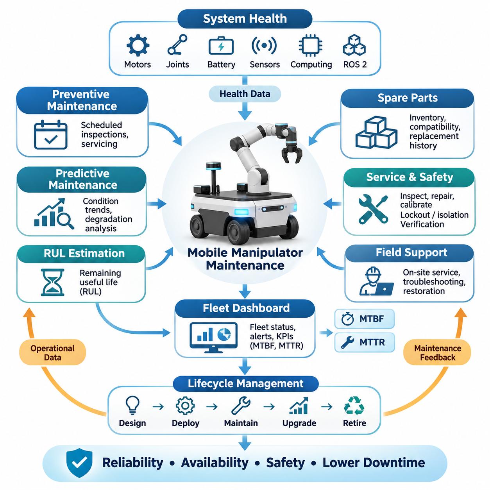
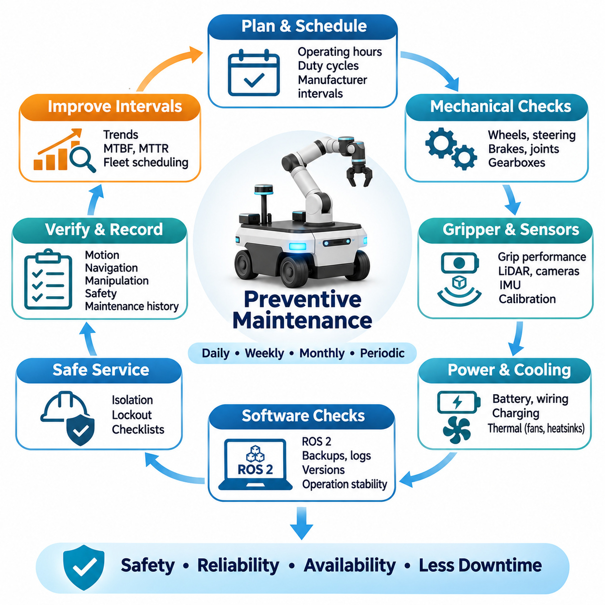
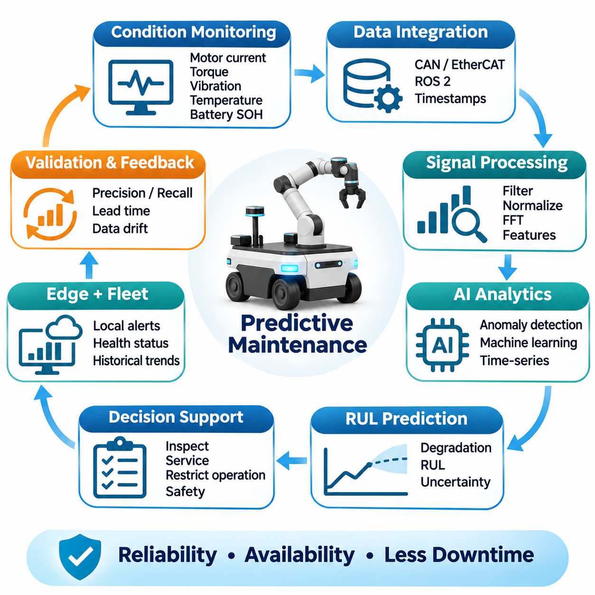
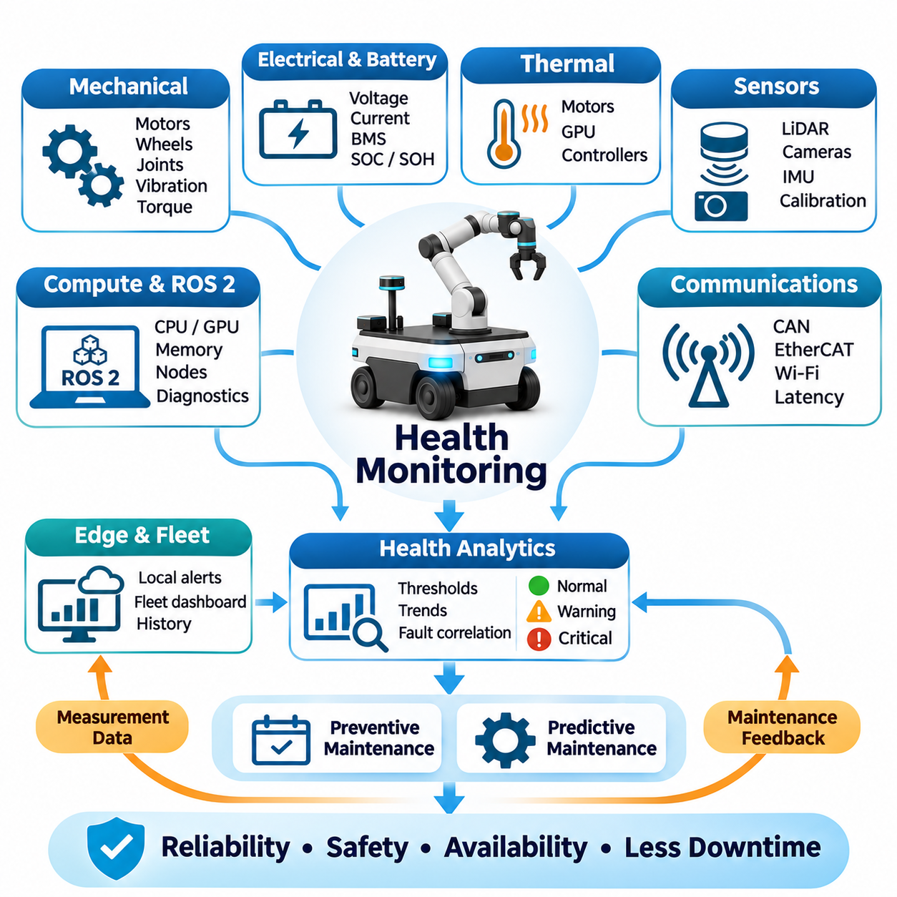
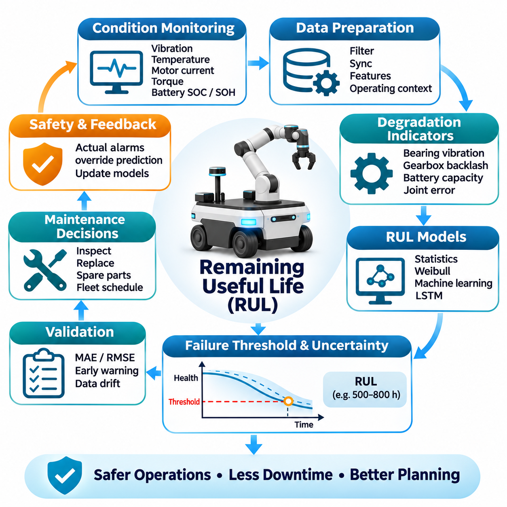
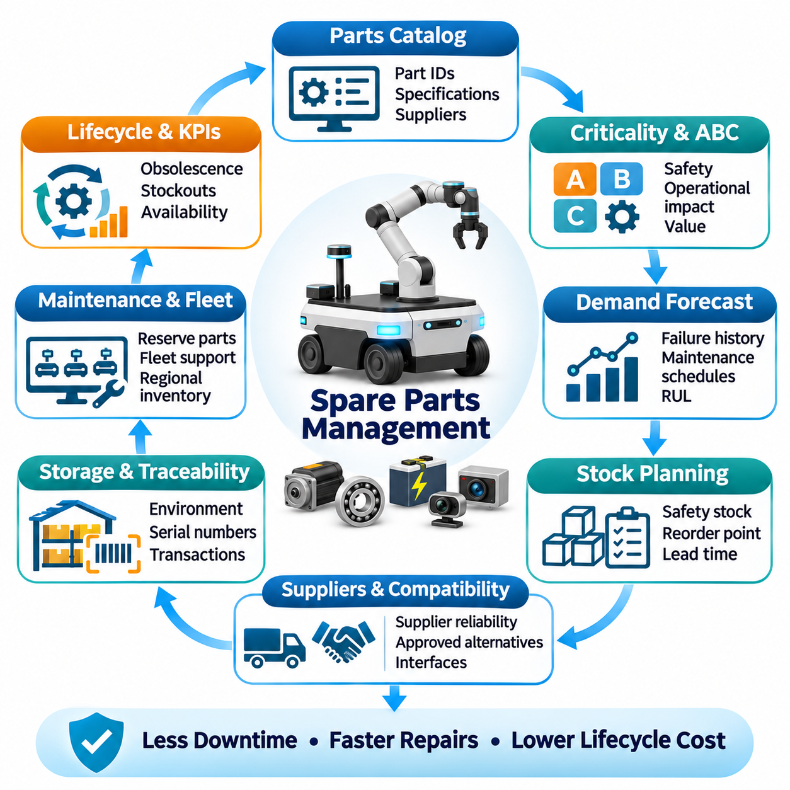
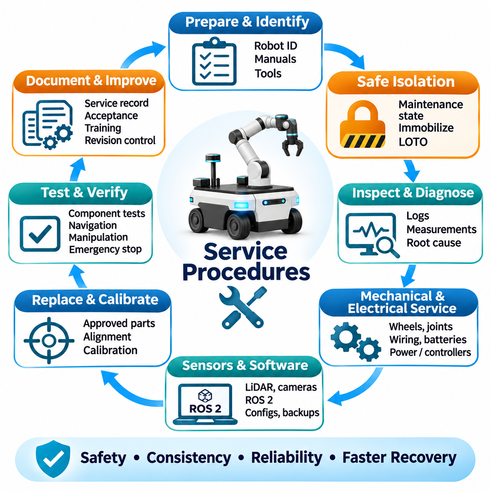
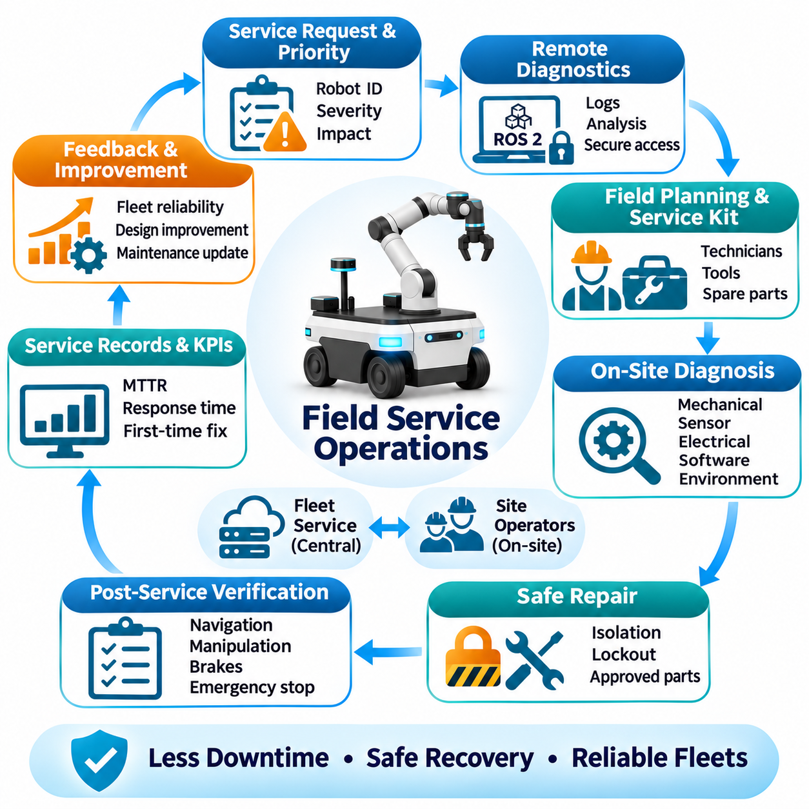
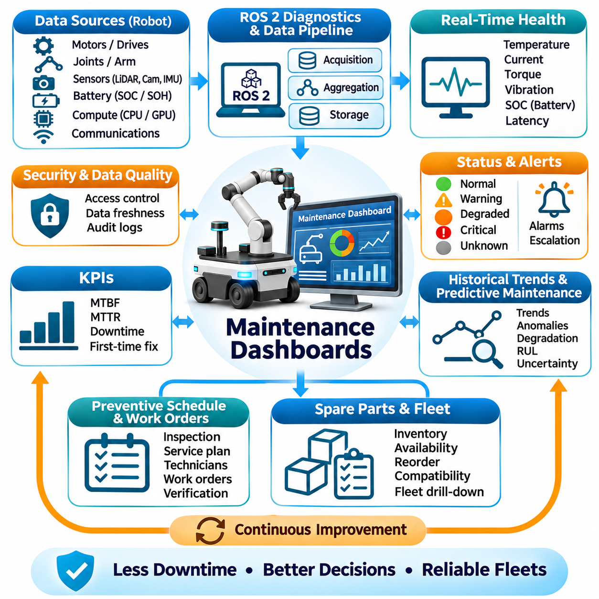
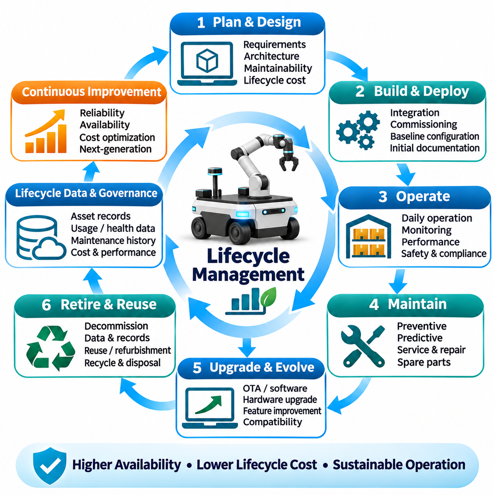

**Volume 04. Mobile Manipulation Software and Operations**

# Chapter 14. Maintenance

## 01 Maintenance Overview

{width="7.268055555555556in" height="7.268055555555556in"}

Maintenance is a fundamental operational discipline for mobile manipulators because these systems combine autonomous mobile robots, robotic arms, sensors, actuators, computing platforms, communication networks, and software services into one integrated system. Unlike conventional industrial machines, mobile manipulators operate across changing environments and perform both navigation and physical manipulation. Their maintenance must therefore address mechanical reliability, electrical integrity, software stability, sensing accuracy, and operational safety throughout the system lifecycle.

The primary objective of maintenance is to preserve system availability, functional performance, and operational safety while minimizing unexpected failures and service interruptions. A maintenance strategy should not focus exclusively on repairing damaged components. It should establish a continuous process for identifying degradation, evaluating equipment condition, preventing failures, and restoring normal operation. This approach improves equipment reliability and supports predictable operation in industrial, logistics, healthcare, and service environments.

A mobile manipulator contains several interconnected maintenance domains. The mobile platform requires inspection of drive motors, steering mechanisms, wheels, suspension components, brakes, batteries, and charging systems. The robotic arm requires attention to joints, gearboxes, bearings, encoders, cables, end effectors, and force-control mechanisms. Sensors such as LiDAR, cameras, IMUs, force-torque sensors, and tactile devices must maintain their calibration and measurement accuracy to support reliable autonomous behavior.

Electrical and computing components introduce additional maintenance requirements. Power distribution units, motor controllers, embedded computers, communication interfaces, cooling systems, and network connections must operate within their specified conditions. Dust accumulation, excessive temperature, vibration, electrical noise, and unstable power supplies can gradually reduce component reliability. Regular inspection and monitoring help identify these conditions before they develop into system-level failures or unexpected operational interruptions.

Software maintenance is equally important because mobile manipulators depend on complex software architectures. ROS 2 nodes, communication middleware, navigation algorithms, motion planners, behavior trees, fleet management services, and AI models must remain compatible and operational. Software updates can introduce dependency conflicts, configuration changes, or unexpected behavior. Maintenance procedures should therefore include version management, configuration backups, regression testing, and controlled deployment to ensure that software modifications do not compromise existing functions.

An effective maintenance program combines preventive maintenance and predictive maintenance. Preventive maintenance uses predefined schedules, operating hours, inspection intervals, and manufacturer recommendations to perform servicing before failures occur. Predictive maintenance uses operational data, sensor measurements, historical failures, and degradation patterns to estimate when components may require attention. These approaches are complementary: scheduled servicing establishes a reliable baseline, while condition-based analysis helps adjust maintenance activities according to actual equipment conditions.

Health monitoring provides the operational information required for effective maintenance decisions. A mobile manipulator can continuously collect motor temperatures, current consumption, battery voltage, joint positions, vibration measurements, controller status, communication quality, and sensor diagnostic information. These measurements can be converted into equipment health indicators and operational alerts. By examining trends rather than relying only on individual alarm events, maintenance teams can identify gradual deterioration and distinguish temporary disturbances from persistent equipment problems.

Remaining Useful Life (RUL) estimation extends health monitoring by estimating how much operating time a component may have before reaching a defined failure or replacement threshold. Historical operating records, degradation models, environmental conditions, and current sensor measurements can support these estimates. However, RUL predictions should be treated as probabilistic engineering information rather than guaranteed failure dates. Their accuracy depends on data quality, operating conditions, component characteristics, and the availability of representative failure histories.

Spare parts management is another essential element of maintenance operations. Mobile manipulators contain components with different replacement costs, procurement lead times, failure probabilities, and operational importance. Critical items such as motor controllers, batteries, sensors, actuators, communication modules, and mechanical transmission components should be managed according to their impact on system availability. Appropriate inventory levels reduce repair delays, while component identification, compatibility records, and replacement histories help prevent incorrect part selection.

Service procedures establish a consistent method for inspecting, repairing, replacing, calibrating, and validating equipment. Each procedure should identify the required tools, personnel qualifications, safety precautions, diagnostic steps, replacement criteria, and post-service verification activities. Particular attention is necessary when servicing moving mechanisms, electrical power systems, batteries, and robotic arms. Lockout and isolation procedures should prevent unexpected movement or electrical activation during maintenance, and restored systems should undergo appropriate functional and safety checks.

Field service operations extend maintenance activities beyond controlled laboratory environments. Mobile manipulators may operate in warehouses, manufacturing facilities, hospitals, and other locations where environmental conditions and accessibility vary significantly. Service teams must consider transportation, remote diagnostics, replacement-part availability, site access, operational schedules, and coordination with local personnel. Remote support can reduce unnecessary travel by enabling engineers to examine diagnostic logs, review system status, and guide authorized technicians through troubleshooting procedures.

Maintenance dashboards provide a centralized view of equipment condition and service activities. They can present operational hours, component temperatures, battery health, diagnostic alarms, maintenance schedules, unresolved failures, spare-part availability, and service histories. For fleet deployments, dashboards should support comparisons across multiple robots and identify recurring problems associated with specific models, components, software versions, or operating environments. This information helps maintenance managers prioritize resources and evaluate the overall reliability of the fleet.

Lifecycle management connects maintenance activities with the complete operational lifespan of a mobile manipulator. It begins with component selection and system commissioning, continues through routine operation and periodic servicing, and eventually addresses component replacement, system refurbishment, technology upgrades, and equipment retirement. Maintenance records provide valuable evidence for determining whether continued repair is economically and technically appropriate. Lifecycle decisions should consider reliability, operating costs, safety requirements, spare-part availability, and the remaining support period of critical technologies.

Maintenance performance should be evaluated through measurable operational indicators. Mean Time Between Failures (MTBF) helps characterize reliability, while Mean Time To Repair (MTTR) measures the time required to restore equipment after a failure. Availability, maintenance cost per operating hour, preventive maintenance compliance, repeat failure rates, and spare-part utilization provide additional information about maintenance effectiveness. These indicators should be interpreted together because improving one metric does not necessarily improve overall system performance.

A mature maintenance architecture also requires systematic documentation and feedback. Every inspection, failure, repair, replacement, calibration, and software modification should generate a traceable maintenance record. These records allow engineering teams to investigate recurring failures, identify design weaknesses, improve maintenance intervals, and refine diagnostic algorithms. Feedback from field service operations should also be communicated to hardware developers, software engineers, suppliers, and system integrators to support continuous product improvement.

Ultimately, maintenance should be treated as an integrated engineering and operational function rather than an isolated repair activity. By combining preventive servicing, predictive analysis, health monitoring, spare-parts planning, standardized service procedures, and lifecycle management, organizations can maintain reliable mobile manipulation systems throughout their operational lives. A well-designed maintenance strategy reduces downtime, improves safety, controls ownership costs, and creates the foundation for scalable, sustainable robot fleet operations.

## 02 Preventive Maintenance

{width="7.268055555555556in" height="7.268055555555556in"}

Preventive maintenance is a systematic approach to maintaining mobile manipulators by performing inspections, servicing, adjustments, and component replacements at predefined intervals before failures occur. Its primary purpose is to reduce unexpected downtime, preserve equipment reliability, and maintain safe operating conditions throughout the robot\'s service life. Unlike corrective maintenance, which responds to failures after they happen, preventive maintenance identifies potential deterioration early and addresses it through planned maintenance activities.

Mobile manipulators require preventive maintenance because their operation combines autonomous navigation, robotic manipulation, perception, communication, and computing functions. Continuous movement, repetitive joint operations, payload variations, environmental exposure, and electrical loading gradually affect component conditions. Even minor deterioration in a wheel assembly, robot joint, sensor, or communication interface can influence overall system performance. Preventive maintenance therefore considers the mobile platform, manipulator, sensors, electrical systems, and software as interconnected maintenance targets.

A preventive maintenance program should begin with a comprehensive inventory of maintainable components and their operating requirements. Each component should have an identifiable maintenance specification describing its inspection criteria, service interval, replacement conditions, and applicable safety precautions. Manufacturer recommendations provide an initial reference, but actual maintenance intervals should also reflect operating hours, duty cycles, payloads, environmental conditions, and historical failure records. This approach creates a maintenance schedule that reflects the actual operating characteristics of each robot.

Mechanical maintenance is one of the most important activities for mobile manipulators. The mobile platform requires regular inspection of wheels, tires, steering mechanisms, drive motors, gearboxes, bearings, suspension components, brakes, and mechanical fasteners. Technicians should examine abnormal noise, excessive vibration, looseness, wear, leakage, and changes in mechanical resistance. For four-wheel-drive and four-wheel-steering platforms, wheel alignment, steering accuracy, drive synchronization, and mechanical clearance should also be checked to preserve stable navigation and maneuverability.

The robotic arm requires a separate preventive maintenance schedule because its joints and transmission mechanisms experience repeated mechanical loading. Gearboxes, bearings, harmonic drives, reducers, joint motors, brakes, and encoder assemblies should be inspected according to operating hours and manufacturer specifications. Excessive backlash, temperature increases, abnormal vibration, and unexpected positioning errors may indicate mechanical degradation. Joint calibration and motion verification should be performed periodically to maintain positioning accuracy, repeatability, and reliable execution of manipulation tasks.

End effectors and grippers also require regular inspection because they directly interact with objects and workpieces. Mechanical fingers, gripping surfaces, pneumatic actuators, electric drives, vacuum systems, tool changers, and mounting interfaces can deteriorate through repeated contact and loading. Maintenance personnel should examine gripping force, mechanical alignment, actuator response, cable connections, and tool attachment conditions. Functional testing with representative objects helps confirm that the end effector can maintain reliable gripping and release performance.

Sensor maintenance is essential for preserving autonomous navigation and manipulation accuracy. LiDAR units, RGB cameras, depth cameras, IMUs, force-torque sensors, and other perception devices should be inspected for contamination, physical damage, loose mounting, and cable deterioration. Optical surfaces must be cleaned using appropriate procedures, while sensor mounting positions and calibration parameters should be verified periodically. Changes in sensor alignment or measurement quality can affect localization, obstacle detection, object recognition, and robotic grasping performance.

Electrical and power system maintenance should focus on battery condition, connectors, wiring harnesses, power distribution units, motor controllers, circuit protection, and charging equipment. Technicians should inspect cable insulation, connector retention, abnormal heating, corrosion, and signs of electrical damage. Battery inspections should follow manufacturer-approved procedures and consider voltage balance, temperature, charging behavior, and physical condition. Electrical isolation and appropriate safety precautions are essential before performing maintenance on energized or high-voltage components.

Thermal management is another important preventive maintenance activity. Embedded computers, GPU platforms, motor controllers, power electronics, and battery systems generate heat during operation. Cooling fans, heat sinks, ventilation openings, and thermal interfaces should be inspected for dust accumulation, restricted airflow, and abnormal operating temperatures. Poor thermal management can cause performance degradation, unexpected shutdowns, accelerated component aging, and reduced system availability. Cleaning and cooling system servicing should therefore be incorporated into scheduled maintenance activities.

Software and computing infrastructure also require preventive maintenance. ROS 2 environments, communication middleware, navigation software, motion planning services, behavior trees, fleet management applications, and AI inference systems should be checked for operational stability and configuration consistency. Maintenance activities may include log inspection, storage cleanup, backup verification, dependency validation, database maintenance, and communication diagnostics. Software versions and system configurations should be documented so that recovery can be performed consistently if an update or configuration change introduces unexpected behavior.

Preventive maintenance intervals should be established according to component characteristics and operational intensity. Daily inspections may focus on visible damage, cleaning, battery status, emergency stop devices, and basic functional checks. Weekly or monthly activities may include mechanical fastener inspection, wheel condition assessment, sensor cleaning, cable inspection, and verification of manipulator operation. Longer maintenance intervals may include gearbox inspection, calibration, battery performance evaluation, electrical testing, and detailed software diagnostics. These intervals should be adjusted according to manufacturer requirements and actual operating conditions rather than applied uniformly to every component.

A standardized maintenance checklist helps ensure that technicians perform inspections consistently and do not overlook important tasks. Each checklist should identify the component, inspection method, acceptance criteria, required tools, maintenance frequency, and responsible personnel. Inspection results should distinguish normal conditions, minor abnormalities, and conditions requiring corrective action. Standardized checklists also support maintenance training, quality assurance, and consistent service execution across multiple robots and deployment locations.

Maintenance activities must be performed under appropriate safety procedures. Before servicing a mobile manipulator, the robot should be placed in a defined maintenance state, and unintended movement must be prevented. The mobile platform should be immobilized, the manipulator should be placed in a mechanically stable position, and electrical or pneumatic energy sources should be isolated when required. Lockout and tagout procedures should be applied where appropriate. After maintenance, technicians should verify that protective devices, emergency stops, brakes, and safety-related functions operate correctly before returning the robot to service.

Maintenance documentation provides the historical information required to improve preventive maintenance effectiveness. Each inspection and service activity should record the robot identifier, operating hours, component condition, maintenance date, technician, replaced parts, detected abnormalities, and verification results. These records make it possible to identify recurring deterioration, compare component performance, and evaluate whether existing maintenance intervals are appropriate. A traceable maintenance history also supports warranty management, supplier communication, quality investigations, and lifecycle cost analysis.

For multi-robot deployments, preventive maintenance should be coordinated through a centralized fleet maintenance process. Maintenance managers need visibility into robot operating hours, scheduled service activities, current equipment conditions, and maintenance completion status. Robots can be assigned maintenance windows according to workload, battery condition, task priorities, and operational availability. Coordinated scheduling helps prevent several robots from becoming unavailable simultaneously and allows maintenance resources and spare parts to be allocated more efficiently.

Preventive maintenance should also include post-maintenance verification before a robot returns to normal operation. Mechanical servicing should be followed by appropriate motion tests, while sensor servicing should include measurement and calibration checks where necessary. Electrical maintenance should include relevant power and protection checks, and software maintenance should include functional and communication tests. The final verification should confirm that navigation, manipulation, safety functions, and mission execution remain consistent with the established operational requirements.

The effectiveness of preventive maintenance can be evaluated using measurable performance indicators. Maintenance compliance rate indicates whether scheduled activities are completed on time, while equipment availability measures the proportion of time that robots remain operational. MTBF, MTTR, recurring failure frequency, maintenance cost, and unplanned downtime provide additional information about reliability and maintenance efficiency. These indicators should be reviewed periodically to identify ineffective inspection intervals, recurring component problems, and opportunities for maintenance process improvement.

Preventive maintenance should not remain a fixed schedule that ignores operational experience. Inspection findings, failure records, component replacement histories, and equipment performance trends should continuously influence maintenance planning. If a component repeatedly deteriorates earlier than expected, its inspection frequency or replacement criteria may need adjustment. Conversely, components demonstrating stable performance under controlled conditions may support more efficient maintenance intervals when permitted by manufacturer recommendations and safety requirements.

Ultimately, preventive maintenance provides the operational foundation for reliable mobile manipulator deployment. By systematically inspecting mechanical assemblies, maintaining sensors, protecting electrical systems, verifying software infrastructure, and documenting service activities, organizations can reduce unexpected failures and extend equipment service life. Integrating preventive maintenance into daily operations improves safety, increases system availability, controls maintenance costs, and establishes a consistent foundation for managing mobile manipulator fleets across industrial and service environments.

## 03 Predictive Maintenance

{width="7.268055555555556in" height="7.268055555555556in"}

Predictive maintenance is a data-driven maintenance approach that estimates the future condition of equipment and identifies potential failures before they occur. Unlike preventive maintenance, which performs servicing at predefined intervals, predictive maintenance uses actual operating conditions, sensor measurements, historical records, and analytical models to determine when maintenance is necessary. Its primary objective is to minimize unexpected failures while avoiding unnecessary component replacements and maintenance activities.

Mobile manipulators are particularly suitable for predictive maintenance because they contain multiple mechanical, electrical, computational, and sensing components that continuously generate operational data. Drive motors, steering actuators, robotic joints, batteries, gearboxes, bearings, and cooling systems exhibit measurable changes as they age or experience mechanical stress. By continuously observing these changes, maintenance systems can identify early degradation and estimate the probability of component failure.

The foundation of predictive maintenance is condition monitoring, which collects and evaluates information about equipment behavior during normal operation. Typical measurements include motor current, temperature, vibration, rotational speed, joint torque, battery voltage, charging characteristics, and communication performance. These measurements provide information about component health and operating conditions. Continuous monitoring makes it possible to identify abnormal patterns that may not be visible during occasional manual inspections.

Sensor integration plays an important role in collecting reliable maintenance data. Industrial sensors, embedded controllers, motor drives, battery management systems, and robot joint controllers can provide measurements through communication interfaces such as CAN, EtherCAT, Ethernet, and ROS 2 topics. These data sources should be synchronized and associated with accurate timestamps, robot identifiers, operating modes, and component information. Consistent data collection enables meaningful comparisons across operating periods and different robot units.

Vibration analysis is particularly useful for monitoring rotating and mechanical components. Bearings, gearboxes, drive motors, and robotic joint transmissions can develop characteristic vibration patterns when mechanical degradation occurs. Changes in vibration amplitude, frequency distribution, and spectral characteristics may indicate imbalance, misalignment, looseness, bearing damage, or gear wear. Frequency-domain analysis using Fast Fourier Transform (FFT) can help identify periodic mechanical abnormalities that are difficult to detect through visual inspection alone.

Motor current and torque monitoring provide additional information about mechanical loading and actuator condition. Increased current consumption under comparable operating conditions may indicate friction, excessive mechanical resistance, bearing deterioration, or abnormal payload conditions. Similarly, changes in joint torque during repeated manipulation tasks may reveal transmission problems or unexpected mechanical loads. These measurements should be interpreted together with robot velocity, acceleration, payload, and operating mode to avoid confusing normal workload variations with actual equipment degradation.

Thermal monitoring is another important predictive maintenance technique. Motors, motor controllers, batteries, embedded computers, and power electronics generate heat during operation. Persistent temperature increases may indicate deteriorating cooling performance, excessive electrical loading, increased mechanical friction, or component aging. Temperature measurements should be evaluated against operating conditions and manufacturer-defined limits. Monitoring temperature trends over time can provide early warnings before thermal abnormalities develop into component failures.

Battery predictive maintenance is especially important for autonomous mobile robots because battery degradation directly affects mission duration and fleet availability. Battery voltage, current, temperature, charging cycles, discharge depth, internal resistance, and estimated State of Health (SOH) provide useful information about battery condition. Changes in charging behavior or voltage response may indicate capacity degradation or cell imbalance. Predictive models can use these measurements to estimate battery deterioration and support replacement planning before operational performance becomes unacceptable.

Data preprocessing is essential before applying predictive maintenance algorithms. Raw measurements may contain noise, missing values, communication interruptions, sensor drift, and abnormal readings caused by temporary operating conditions. Data filtering, normalization, synchronization, outlier detection, and feature extraction help improve data quality. Features such as moving averages, vibration statistics, temperature gradients, current peaks, and operating-cycle counts can provide more useful representations of equipment condition than unprocessed sensor streams.

Machine learning can improve predictive maintenance by identifying relationships between operating conditions and equipment degradation. Supervised learning algorithms can be trained using historical operating data labeled with known component conditions or failure events. Classification models can estimate whether a component is operating normally or exhibiting abnormal behavior, while regression models can estimate degradation levels or future performance indicators. Algorithms such as Random Forest, Gradient Boosting, Support Vector Machines, and neural networks can be applied depending on data availability and problem complexity.

Anomaly detection is useful when historical failure data are limited or incomplete. Instead of requiring extensive examples of known failures, anomaly detection models learn the normal operating patterns of equipment and identify deviations from those patterns. Statistical thresholds, clustering methods, Isolation Forest, and autoencoder-based approaches can detect unusual combinations of temperature, vibration, current, and torque measurements. Detected anomalies should be evaluated in their operational context because unusual behavior does not always indicate an imminent mechanical failure.

Time-series analysis provides another approach for understanding gradual equipment deterioration. Historical measurements can reveal long-term trends, periodic variations, and changes associated with operating cycles. Forecasting models can estimate future temperature levels, vibration intensity, battery degradation, or actuator performance. Recurrent Neural Networks (RNNs), Long Short-Term Memory (LSTM) networks, and temporal convolutional models may be used when sufficient sequential data are available. However, model complexity should be balanced against computational resources and prediction reliability.

Remaining Useful Life (RUL) prediction is one of the most important applications of predictive maintenance. It estimates the remaining operating time or number of operating cycles before a component reaches a predefined failure threshold. RUL models can combine historical degradation patterns, current condition measurements, operating intensity, and environmental information. The resulting prediction supports maintenance scheduling and replacement planning. Since degradation processes vary between components and operating environments, RUL estimates should include uncertainty rather than being treated as exact failure dates.

Predictive maintenance for mobile manipulators should consider the interaction between the mobile platform and robotic arm. For example, increased vibration during navigation may influence the mechanical loading of the manipulator, while repeated high-payload operations may affect joint temperatures and transmission wear. Changes in platform stability, wheel condition, or localization performance may also influence manipulation accuracy. Evaluating these relationships helps identify system-level degradation rather than examining individual components in isolation.

Predictive maintenance models should be integrated with the robot software architecture and fleet management infrastructure. ROS 2 nodes can collect equipment measurements, calculate health indicators, and publish diagnostic information to monitoring services. Edge computers can perform real-time preprocessing and anomaly detection, while centralized servers can store historical data and execute computationally intensive analysis. This distributed architecture allows robots to detect immediate abnormalities locally while fleet-level systems identify long-term trends across multiple machines.

Maintenance decision support converts predictive analysis into practical operational actions. When a model detects abnormal behavior, the system should evaluate the severity, confidence, potential operational impact, and urgency of the condition. Minor deviations may require continued monitoring, while significant abnormalities may trigger inspection requests or restrictions on specific operations. Critical conditions should activate appropriate safety responses and prevent continued operation when necessary. Maintenance recommendations should be understandable to technicians and supported by relevant measurements and diagnostic evidence.

Predictive maintenance must also be evaluated through systematic model validation. Historical datasets should be separated into training, validation, and test periods to prevent information leakage from future operating conditions into model training. Evaluation metrics may include precision, recall, F1-score, false alarm rate, detection lead time, and RUL prediction error. In practical applications, the cost of missed failures and unnecessary maintenance should also be considered. A model with high classification accuracy may still be unsuitable if it produces too many false alarms or fails to provide sufficient warning time.

Data quality and model reliability are critical challenges in predictive maintenance. Failure events may be rare, operating conditions may change, and different robot units may exhibit different degradation characteristics. Changes in payload, floor conditions, ambient temperature, maintenance history, and software configurations can influence sensor measurements. Predictive models should therefore be monitored for data drift and performance degradation. Periodic retraining, model validation, version control, and controlled deployment help maintain reliable predictions throughout the equipment lifecycle.

Cybersecurity and data governance should be incorporated into predictive maintenance infrastructure. Equipment health information may contain operationally sensitive data, and communication interfaces can introduce security risks if not properly protected. Authentication, encrypted communication, access control, secure data storage, and audit logging should be applied to relevant systems. Model updates and diagnostic software changes should follow controlled release procedures to prevent unauthorized modifications or unreliable maintenance decisions.

The economic value of predictive maintenance should be evaluated through its effect on operational availability and total maintenance expenditure. Avoiding unexpected failures can reduce emergency repair costs, production interruptions, and secondary equipment damage. At the same time, condition-based servicing can reduce unnecessary inspections and premature component replacement. Useful performance indicators include unplanned downtime, maintenance cost per operating hour, failure prediction lead time, maintenance intervention frequency, MTBF, and MTTR.

Ultimately, predictive maintenance transforms maintenance operations from reactive troubleshooting into condition-based and data-driven decision-making. By combining sensor integration, condition monitoring, signal processing, machine learning, anomaly detection, and remaining useful life estimation, organizations can identify equipment deterioration before it causes serious operational problems. For mobile manipulators, this approach improves reliability, supports intelligent maintenance scheduling, reduces unnecessary service activities, and provides a foundation for scalable and efficient autonomous robot fleet operations.

## 04 Health Monitoring

{width="7.268055555555556in" height="7.268055555555556in"}

Health monitoring is a continuous process of observing, collecting, and analyzing operational information to evaluate the condition and performance of mobile manipulators. Its primary purpose is to provide real-time visibility into the health of mechanical, electrical, computational, and sensing components. By identifying abnormal operating conditions and gradual performance changes, health monitoring helps operators and maintenance engineers detect potential problems early, reduce unexpected failures, and maintain reliable robot operations throughout the equipment lifecycle.

Mobile manipulators require comprehensive health monitoring because their operation depends on the coordinated performance of autonomous mobile platforms, robotic arms, sensors, actuators, batteries, embedded computers, and communication systems. A failure or degradation in one subsystem can influence the behavior of other components and affect overall mission execution. Health monitoring should therefore evaluate individual component conditions as well as system-level performance to provide an integrated understanding of equipment reliability.

A health monitoring architecture begins with the identification of critical operating parameters for each subsystem. The mobile platform may require monitoring of motor temperature, wheel speed, steering position, drive current, battery voltage, and braking status. The robotic arm requires joint position, velocity, torque, motor temperature, and controller status measurements. Sensors, computing devices, communication interfaces, and power systems should also provide diagnostic information that can be used to evaluate their operational conditions.

Sensor-based monitoring provides the fundamental data required for equipment health assessment. Temperature sensors, current sensors, voltage monitors, vibration sensors, encoders, and internal controller diagnostics can continuously generate information about component behavior. These measurements should be collected with consistent timestamps and associated with specific robots and components. Reliable sensor integration enables the monitoring system to distinguish normal operating variations from abnormal conditions that may indicate equipment deterioration.

Mechanical health monitoring focuses on identifying changes in the physical behavior of moving components. Drive motors, steering mechanisms, wheels, bearings, gearboxes, robotic joints, and end effectors can experience wear, looseness, excessive friction, and mechanical deformation. Vibration measurements, motor current, joint torque, positioning errors, and operating temperature provide useful indicators of mechanical condition. Combining these measurements helps maintenance engineers identify abnormalities that may not be immediately visible during routine inspections.

Electrical health monitoring evaluates the condition of power distribution systems, motor controllers, batteries, connectors, wiring harnesses, and charging equipment. Important parameters include supply voltage, current consumption, electrical temperature, charging behavior, power fluctuations, and controller fault codes. Unexpected voltage drops or increased current consumption may indicate electrical resistance, connection problems, excessive loading, or component degradation. Continuous monitoring helps identify electrical abnormalities before they develop into operational interruptions.

Battery health monitoring is particularly important for autonomous mobile manipulators because battery performance directly affects mission duration and operational availability. Battery Management Systems (BMS) can provide information about cell voltage, pack temperature, charging current, discharge current, and State of Charge (SOC). State of Health (SOH) estimates provide additional information about long-term battery degradation. Monitoring charging and discharging patterns helps identify abnormal cell behavior, reduced capacity, temperature irregularities, and potential battery replacement requirements.

Thermal health monitoring evaluates temperature conditions across motors, controllers, batteries, embedded computers, GPU modules, and power electronics. Excessive temperature can accelerate component aging, reduce computing performance, and trigger protective shutdown mechanisms. Temperature measurements should be compared with manufacturer specifications and historical operating patterns. Monitoring temperature trends under comparable workloads can reveal cooling problems, abnormal electrical loading, or mechanical friction before thermal conditions reach critical limits.

Sensor health monitoring is necessary to maintain reliable perception and autonomous behavior. LiDAR, RGB cameras, depth cameras, IMUs, force-torque sensors, and other perception devices may experience contamination, calibration drift, communication interruptions, or hardware degradation. Monitoring systems should evaluate sensor availability, measurement consistency, communication status, timestamp accuracy, and diagnostic indicators. Sensor health information is particularly important because inaccurate measurements can affect localization, obstacle detection, object recognition, grasp planning, and manipulation accuracy.

Computing and software health monitoring focuses on embedded processors, GPU devices, operating systems, ROS 2 nodes, communication middleware, and application services. Important indicators include CPU utilization, GPU utilization, memory consumption, storage capacity, processing latency, node availability, software exceptions, and communication errors. Monitoring these parameters helps identify resource exhaustion, unexpected process termination, excessive processing delays, and software instability that could interfere with autonomous navigation or manipulation tasks.

Communication health monitoring evaluates the reliability and performance of data exchange between robot subsystems and external infrastructure. Mobile manipulators may use CAN, EtherCAT, Ethernet, Wi-Fi, and other communication technologies to connect sensors, actuators, controllers, fleet management systems, and remote operation platforms. Communication latency, packet loss, connection stability, message frequency, and transmission errors should be monitored continuously. Communication degradation can affect coordinated motion, remote supervision, fleet scheduling, and mission execution.

ROS 2 provides a flexible software framework for implementing distributed health monitoring. Individual nodes can collect diagnostic information from hardware drivers, controllers, sensors, and application services. Standardized diagnostic messages and topic-based communication allow different subsystems to publish their operating conditions to monitoring applications. Diagnostic aggregation nodes can combine information from multiple components and generate system-level health assessments. This architecture supports modular monitoring and allows additional diagnostic capabilities to be integrated as the robot evolves.

Health monitoring requires a structured method for interpreting collected measurements. Individual sensor values may fluctuate during normal operation because of changes in payload, velocity, acceleration, environmental temperature, and task requirements. Fixed thresholds can identify clearly abnormal conditions, but they may generate unnecessary warnings when operating conditions vary significantly. More advanced monitoring approaches can incorporate statistical baselines, operating modes, historical trends, and relationships between multiple measurements to improve diagnostic reliability.

Health indicators provide a simplified representation of component and system conditions. These indicators can combine temperature, vibration, current consumption, positioning accuracy, communication quality, and diagnostic events into meaningful equipment status information. A monitoring system may classify conditions as normal, warning, degraded, or critical according to predefined operational criteria. Each classification should correspond to an appropriate response, such as continued monitoring, maintenance inspection, restricted operation, or controlled shutdown.

Health monitoring should also support event detection and fault diagnosis. When abnormal behavior is identified, the system should record relevant measurements, timestamps, operating conditions, and associated diagnostic messages. Correlating information from multiple subsystems can help identify the underlying cause of a problem. For example, increased motor current combined with abnormal vibration and temperature may indicate mechanical resistance rather than an isolated electrical issue. Such correlation reduces diagnostic ambiguity and helps maintenance personnel select appropriate corrective actions.

For multi-robot deployments, centralized health monitoring provides fleet-wide operational visibility. Fleet management systems can collect health information from individual robots and present equipment conditions through centralized dashboards. Maintenance managers can compare robot availability, battery health, component temperatures, communication quality, and diagnostic events across the fleet. This information supports maintenance prioritization, resource allocation, operational scheduling, and the identification of recurring problems affecting specific robot models or deployment environments.

Edge computing can improve health monitoring by processing important diagnostic information directly on the robot. Embedded computers can calculate health indicators, detect threshold violations, and identify abnormal operating patterns without continuously transmitting all raw sensor data to centralized servers. This reduces communication requirements and enables faster responses to local equipment problems. Centralized infrastructure can subsequently store historical information and perform more computationally intensive analysis across multiple robots.

Health monitoring data should be maintained as structured historical records. Each record should include the robot identifier, component identifier, timestamp, operating mode, measurement values, diagnostic status, and relevant maintenance events. Historical records allow engineers to compare current conditions with previous operating periods and evaluate long-term changes in equipment performance. Data retention and access policies should also consider cybersecurity, operational confidentiality, and the requirements of maintenance investigations.

The effectiveness of health monitoring should be evaluated using measurable operational indicators. Useful metrics include diagnostic coverage, abnormal event detection rate, false alarm rate, monitoring availability, fault detection latency, and the frequency of undetected failures. These indicators help determine whether the monitoring architecture provides sufficient visibility into critical components. Regular evaluation also identifies sensors that require recalibration, diagnostic rules that need adjustment, and monitoring functions that should be expanded.

Health monitoring should be integrated with preventive maintenance and predictive maintenance processes. Preventive maintenance uses monitoring information to verify that components remain within acceptable operating conditions, while predictive maintenance analyzes historical and current measurements to estimate future degradation. Health monitoring provides the continuous operational evidence required by both approaches. Integrating these functions creates a consistent maintenance process in which abnormal conditions can trigger inspections, diagnostic analysis, and planned component replacement.

Ultimately, health monitoring establishes the operational visibility required for reliable mobile manipulator management. By continuously evaluating mechanical, electrical, sensing, computing, battery, and communication conditions, organizations can identify abnormalities before they significantly affect system performance. Integration with ROS 2, edge computing, fleet management, and maintenance infrastructure transforms diagnostic information into actionable operational knowledge. This approach improves equipment reliability, supports timely maintenance decisions, reduces unexpected downtime, and strengthens the foundation for scalable autonomous robot operations.

## 05 Remaining Useful Life

{width="7.268055555555556in" height="7.268055555555556in"}

Remaining Useful Life (RUL) estimation is a predictive maintenance technique that estimates how much operating time or how many operating cycles remain before a component reaches a predefined failure or replacement condition. Its primary purpose is to support maintenance planning by identifying when equipment is likely to require servicing or replacement. Instead of relying exclusively on fixed maintenance intervals, RUL estimation uses equipment condition, historical operating data, degradation patterns, and predictive models to make maintenance decisions based on actual component health.

For mobile manipulators, RUL estimation is particularly important because multiple mechanical, electrical, and electronic components experience different degradation processes. Drive motors, steering actuators, wheel bearings, gearboxes, robotic joints, batteries, sensors, and computing devices have different operating characteristics and service lives. Their degradation depends on operating hours, payload, movement frequency, environmental conditions, temperature, vibration, and maintenance history. RUL estimation helps determine the remaining service life of these components and supports coordinated maintenance across the complete robot system.

The foundation of RUL estimation is the understanding of component degradation. Equipment does not necessarily fail suddenly; many components experience gradual changes in performance before reaching a critical condition. Bearing wear, gearbox backlash, battery capacity reduction, motor temperature increases, and actuator positioning errors are examples of measurable degradation indicators. By observing these changes over time, maintenance systems can identify degradation trajectories and estimate how quickly a component is approaching its operational limits.

Condition monitoring provides the measurements required for RUL estimation. Sensors and embedded controllers collect operating information such as vibration, temperature, motor current, torque, rotational speed, battery voltage, and joint positioning accuracy. These measurements should be associated with operating hours, task cycles, payload conditions, and environmental information. Combining equipment measurements with operational context helps distinguish normal workload variations from persistent degradation and improves the reliability of remaining life predictions.

A useful concept in RUL estimation is the degradation indicator, which represents the condition of a component through one or more measurable parameters. For example, increasing bearing vibration may indicate progressive mechanical wear, while decreasing battery capacity may indicate electrochemical aging. A gearbox may exhibit increasing backlash, and a motor may require progressively higher current to produce comparable torque. These indicators should be selected according to component failure mechanisms and validated against actual inspection and replacement records.

Degradation modeling describes how component condition changes as equipment operates. Some components exhibit approximately gradual degradation, while others remain stable for extended periods before experiencing accelerated deterioration. Environmental conditions, operating loads, manufacturing variations, and maintenance activities can significantly influence these patterns. A suitable degradation model should therefore reflect the physical characteristics of the component rather than assuming that all equipment follows the same linear aging process.

Statistical approaches provide an important foundation for estimating remaining useful life. Regression models can estimate future degradation values from historical measurements, while probability distributions can represent uncertainty in component failure times. Weibull distributions are commonly used to characterize equipment lifetime and failure behavior. Survival analysis can also estimate the probability that a component will continue operating beyond a specified time. These approaches are particularly useful when failure records are incomplete or when maintenance decisions require an explicit representation of uncertainty.

Machine learning provides additional capabilities for RUL prediction by identifying complex relationships between operating conditions and degradation patterns. Supervised learning models can be trained using historical sensor measurements and known component lifetimes. Random Forest, Gradient Boosting, Support Vector Regression, and neural networks can estimate remaining operating time or degradation levels. Model selection should consider the available dataset, component characteristics, computational requirements, and the interpretability needed by maintenance engineers.

Deep learning methods can analyze sequential sensor measurements to identify long-term degradation patterns. Recurrent Neural Networks (RNNs) and Long Short-Term Memory (LSTM) networks can learn temporal relationships between operating conditions and component deterioration. Temporal convolutional networks and Transformer-based models may also be applied when sufficient historical data are available. However, complex models do not automatically provide more reliable predictions. Their performance must be evaluated using independent operating data and realistic failure scenarios.

Battery RUL estimation is a particularly important application for mobile robots. Battery degradation is influenced by charging cycles, depth of discharge, operating temperature, charging current, and storage conditions. Battery Management Systems can provide measurements such as cell voltage, pack temperature, current, State of Charge (SOC), and State of Health (SOH). By analyzing capacity reduction and changes in internal resistance, predictive models can estimate when a battery is likely to fall below the capacity required for normal robot operation.

Mechanical component RUL estimation requires different degradation indicators depending on the component. Bearing lifetime estimation may use vibration amplitude, frequency-domain characteristics, rotational speed, and operating temperature. Gearbox lifetime estimation may consider backlash, lubrication condition, torque variation, and vibration patterns. Robotic joint degradation may be evaluated using positioning errors, motor current, joint temperature, and repeated motion performance. These component-specific indicators help improve prediction accuracy and provide more meaningful maintenance recommendations.

The concept of a failure threshold is essential for calculating RUL. A component is considered to have reached the end of its useful life when its condition crosses a predefined operational, performance, or safety limit. This threshold may be based on manufacturer specifications, engineering requirements, inspection criteria, or experimentally validated degradation limits. It should not be interpreted as the point at which catastrophic failure must occur. Instead, it represents the condition beyond which continued operation is no longer considered acceptable for the intended application.

RUL estimation must account for uncertainty because component degradation is affected by changing operating conditions and unpredictable events. Two nominally identical components may experience different service lives because of variations in loading, temperature, manufacturing quality, and maintenance history. Consequently, RUL predictions should ideally provide an estimated range or probability distribution rather than a single deterministic value. Confidence intervals and prediction uncertainty help maintenance managers make decisions that account for operational risk.

Data preparation is critical for reliable RUL estimation. Historical sensor measurements may contain noise, missing values, communication interruptions, inconsistent sampling intervals, and incorrect timestamps. Data preprocessing should include synchronization, filtering, normalization, outlier handling, and feature extraction. Operating records should also distinguish between normal operation, maintenance periods, component replacements, and abnormal events. Without reliable historical records, even sophisticated prediction models may produce misleading results.

RUL model training requires representative degradation and failure data. Training datasets should cover different operating conditions, component variations, payload levels, and environmental environments. Data from multiple robot units can improve generalization, but differences between hardware versions and operating configurations must be considered. Training and testing should be separated by time or equipment unit when appropriate to prevent data leakage. Models should be evaluated on operating conditions that resemble their intended deployment environment.

Model performance should be evaluated using metrics appropriate for remaining life prediction. Mean Absolute Error (MAE) and Root Mean Squared Error (RMSE) measure numerical prediction errors, while prediction accuracy within an acceptable time range provides information about practical usefulness. Early prediction capability is also important because maintenance teams need sufficient warning time to obtain replacement components and schedule servicing. Evaluation should consider both overestimation and underestimation because their operational consequences are different.

Integration with ROS 2 and fleet management systems allows RUL estimates to become part of normal robot operations. Diagnostic nodes can collect equipment measurements and publish component health indicators, while edge computers execute local prediction models. Centralized fleet infrastructure can aggregate historical data and compare RUL estimates across multiple robots. This architecture enables maintenance managers to identify components approaching their replacement thresholds and coordinate maintenance activities according to fleet workload and resource availability.

RUL estimation can improve spare parts management and maintenance scheduling. If a critical component is predicted to approach its replacement threshold, the maintenance system can initiate procurement or reserve an available spare part. Maintenance activities can then be coordinated with planned operational downtime, reducing unexpected service interruptions. For robot fleets, prioritization can consider predicted remaining life, component criticality, replacement lead time, and the operational importance of each robot.

RUL predictions should be integrated with safety and operational decision-making. A component with a low predicted remaining life may require restricted operation, additional inspection, or planned replacement. However, a high RUL estimate should not override an actual safety alarm, visible damage, or a manufacturer-defined replacement requirement. Safety-critical components should follow their applicable inspection and replacement procedures regardless of the predicted remaining life. Predictive models provide decision support rather than replacing established safety controls.

Continuous model monitoring is necessary because prediction performance may change as equipment ages or operating conditions evolve. Changes in payload, operating speed, ambient temperature, maintenance practices, and hardware configurations can create data drift. Prediction errors should be reviewed against actual inspection findings and component replacement outcomes. Periodic retraining, model version management, validation, and controlled deployment help maintain reliable RUL estimation throughout the robot lifecycle.

Ultimately, Remaining Useful Life estimation transforms equipment degradation information into actionable maintenance planning. By combining condition monitoring, degradation modeling, statistical analysis, machine learning, and uncertainty estimation, organizations can make more informed decisions about inspection, servicing, and component replacement. For mobile manipulators, RUL estimation improves equipment utilization, supports spare parts planning, reduces unexpected downtime, and contributes to safer and more efficient fleet operations.

## 06 Spare Parts Management

{width="7.268055555555556in" height="7.268055555555556in"}

Spare parts management is a critical component of mobile manipulator maintenance because equipment availability depends not only on reliable hardware but also on the timely availability of replacement components. Its primary objective is to ensure that essential parts can be identified, procured, stored, and delivered when maintenance or repair activities require them. Effective spare parts management reduces repair delays, prevents prolonged equipment downtime, controls inventory costs, and supports continuous robot operations throughout the equipment lifecycle.

Mobile manipulators contain a diverse range of mechanical, electrical, electronic, and computing components that may require replacement during operation. Typical spare parts include drive motors, steering actuators, wheels, bearings, gearboxes, robotic joint components, grippers, sensors, batteries, motor controllers, communication modules, cables, and embedded computing devices. Each component has different failure characteristics, replacement costs, procurement lead times, and operational importance. Inventory planning must therefore consider the specific characteristics of each component rather than applying identical stocking policies to all parts.

The foundation of spare parts management is the establishment of a structured component inventory. Every maintainable component should have a unique part number, manufacturer information, model designation, technical specifications, compatibility requirements, and supplier information. The inventory database should also maintain information about component locations, available quantities, minimum stock levels, procurement lead times, and replacement histories. Accurate component identification prevents incorrect part selection and improves coordination between maintenance engineers, procurement teams, suppliers, and system integrators.

Component criticality assessment helps determine which spare parts require priority management. Components that directly affect robot mobility, manipulation capability, power distribution, or safety functions generally require greater attention than noncritical accessories. A failure in a motor controller or steering actuator may disable an entire robot, while the failure of a secondary indicator may have limited operational impact. Criticality assessment should consider failure probability, operational consequences, repair complexity, replacement lead time, and the availability of alternative components.

ABC analysis is a useful inventory management method for classifying spare parts according to their inventory value. High-value components require careful purchasing and stock control, while lower-value components may be maintained in larger quantities when their replacement demand is frequent. However, inventory value alone is insufficient for robotics applications. A relatively inexpensive component can be operationally critical if its absence prevents a robot from returning to service. Combining ABC analysis with criticality assessment provides a more balanced approach to inventory prioritization.

Demand forecasting supports the determination of appropriate spare parts quantities. Historical failure records, preventive maintenance schedules, operating hours, fleet size, component replacement frequency, and manufacturer recommendations can be used to estimate future demand. Predictive maintenance information and Remaining Useful Life (RUL) estimates provide additional opportunities to anticipate replacement requirements. Demand forecasting should account for uncertainty because component failures may occur irregularly and actual operating conditions may differ from historical patterns.

Safety stock provides protection against unexpected demand and procurement delays. Critical components with long supplier lead times may require additional inventory to prevent prolonged equipment downtime. The required safety stock should reflect demand variability, supplier reliability, replenishment time, and the operational consequences of stock shortages. Excessive safety stock increases storage costs and ties up capital, while insufficient inventory increases the risk of extended repair interruptions. Inventory policies should balance these competing considerations.

Reorder point management determines when replacement components should be purchased. A reorder point can be established using expected consumption during procurement lead time and an additional safety stock allowance. When available inventory reaches this threshold, the procurement process should be initiated. Minimum stock levels, maximum stock levels, and economic order quantities can further support purchasing decisions. Automated inventory alerts help maintenance and procurement teams respond before critical components become unavailable.

Supplier management is essential because mobile manipulator components may come from multiple manufacturers and specialized suppliers. Procurement teams should evaluate supplier reliability, product quality, delivery performance, technical support, warranty conditions, and long-term product availability. Components with limited suppliers or long manufacturing lead times require particular attention. Maintaining qualified alternative suppliers and approved equivalent components can reduce procurement risks, provided that technical compatibility and safety requirements are properly verified.

Component compatibility management is especially important for integrated robotic systems. Replacement components must satisfy mechanical dimensions, electrical ratings, communication protocols, software interfaces, and performance requirements. A physically compatible motor or sensor may still introduce problems if its control interface, calibration characteristics, or firmware differs from the original component. Engineering approval and compatibility verification should therefore be completed before alternative components are introduced into an operational robot.

Warehouse organization and storage conditions influence spare parts quality and availability. Components should be stored in clearly identified locations with appropriate environmental protection and handling procedures. Electronic devices may require protection against electrostatic discharge, moisture, and temperature variations. Batteries require manufacturer-approved storage conditions and periodic condition checks. Mechanical components should be protected against corrosion, contamination, and physical damage. Proper labeling, packaging, and inventory location records reduce retrieval errors and prevent avoidable component deterioration.

Inventory traceability provides visibility into the movement and usage of spare parts. Each transaction should record the component identifier, quantity, storage location, transaction date, supplier, receiving information, and associated robot or maintenance activity. Serial numbers and batch identifiers should be recorded for components where traceability is important. This information supports warranty investigations, quality analysis, supplier evaluation, and identification of recurring component failures across multiple robots.

Spare parts management should be integrated with maintenance management systems. When a robot generates a maintenance request or a technician identifies a component requiring replacement, the maintenance system should verify inventory availability and reserve the required part. If the component is unavailable, procurement activities can be initiated automatically or assigned to the responsible purchasing team. Integration between maintenance records and inventory databases provides a consistent view of equipment condition, replacement demand, and available resources.

For multi-robot deployments, fleet-level spare parts management improves inventory efficiency and operational continuity. A centralized inventory system can monitor component consumption across multiple robots and deployment locations. Maintenance managers can identify frequently replaced components, compare failure patterns between robot units, and distribute available spare parts according to operational priorities. Regional warehouses or local service inventories may be established when transportation time significantly affects repair response. Fleet-wide demand aggregation can also improve purchasing efficiency and supplier negotiations.

Standardization and modular design can reduce spare parts complexity. Using common motors, sensors, connectors, controllers, and mechanical interfaces across multiple robot models reduces the number of different components that must be stocked. Modular hardware architectures also allow technicians to replace complete functional units rather than performing complicated component-level repairs in the field. However, standardization should not compromise technical performance, safety requirements, or application-specific functionality. Approved component configurations should be documented and maintained under engineering change control.

Obsolete component management is another important consideration for long-term robot operations. Electronic components, embedded computers, communication devices, and industrial sensors may become unavailable because of product discontinuation or changes in manufacturer support policies. Maintenance organizations should monitor product lifecycle announcements and identify components approaching end-of-life status. Last-time purchases, qualified replacement products, hardware redesign, and software compatibility assessments can help reduce the operational risks associated with component obsolescence.

The effectiveness of spare parts management should be evaluated using measurable performance indicators. Useful metrics include inventory turnover, stockout frequency, spare parts availability, procurement lead time, inventory carrying cost, emergency purchasing frequency, and maintenance delays caused by unavailable components. The service level of critical spare parts is particularly important because even a small inventory shortage can result in significant operational disruption. Regular performance reviews help organizations optimize inventory policies and identify opportunities for cost reduction.

Ultimately, spare parts management transforms component inventory from a passive storage activity into an integrated operational resource. By combining component classification, criticality assessment, demand forecasting, safety stock planning, supplier management, inventory traceability, and maintenance system integration, organizations can ensure that essential replacement components are available when required. For mobile manipulators, effective spare parts management reduces downtime, improves maintenance responsiveness, controls lifecycle costs, and provides a reliable foundation for scalable robot fleet operations.

## 07 Service Procedures

{width="7.268055555555556in" height="7.268055555555556in"}

Service procedures establish standardized methods for inspecting, diagnosing, repairing, replacing, calibrating, and verifying mobile manipulator components. Their primary objective is to ensure that maintenance activities are performed consistently, safely, and efficiently by qualified personnel. A well-defined service procedure reduces maintenance errors, improves repair quality, and ensures that equipment is restored to its specified operational condition. Standardized procedures also support repeatable maintenance practices across different robots, technicians, and deployment environments.

Mobile manipulators require comprehensive service procedures because they integrate mechanical structures, drive systems, robotic arms, sensors, electrical equipment, batteries, and computing platforms. Each subsystem has different maintenance requirements and potential failure mechanisms. Service procedures should therefore define the appropriate inspection methods, diagnostic tools, repair techniques, replacement criteria, and verification requirements for each component. They should also address interactions between subsystems to prevent maintenance activities from introducing secondary problems.

A service procedure should begin with a clear identification of the maintenance task and the affected equipment. The robot identifier, component model, software version, operating hours, maintenance history, and reported symptoms should be reviewed before work begins. Technicians should consult the applicable technical documentation, wiring diagrams, mechanical specifications, and manufacturer recommendations. This preparation helps establish the correct maintenance scope and ensures that the required tools, replacement parts, and safety resources are available.

Safety preparation is a fundamental part of every service procedure. Before maintenance begins, the robot should be removed from normal operation and placed in a defined maintenance state. The mobile platform must be immobilized, and the robotic arm should be positioned to prevent unexpected movement or mechanical instability. Electrical power, pneumatic pressure, and other stored energy sources should be isolated when required. Lockout and Tagout (LOTO) procedures should be applied to prevent accidental activation while technicians are working on the equipment.

Initial inspection provides an overview of the equipment condition before detailed maintenance begins. Technicians should examine visible mechanical damage, loose fasteners, cable deterioration, connector conditions, abnormal temperatures, fluid leakage, and contamination. Operational logs and diagnostic records should also be reviewed to identify previous alarms or recurring problems. Recording the initial condition provides a reference for subsequent repair activities and helps distinguish pre-existing defects from issues introduced during maintenance.

Systematic fault diagnosis is necessary to identify the actual cause of equipment problems. A reported symptom does not always indicate the component responsible for the failure. For example, inaccurate robot positioning may result from encoder problems, mechanical backlash, incorrect calibration, communication delays, or control software configuration. Technicians should use diagnostic measurements, controller logs, sensor data, and controlled functional tests to isolate the underlying cause before replacing components or modifying system configurations.

Mechanical service procedures should address the mobile platform and robotic arm separately while considering their mechanical integration. Mobile platform maintenance may involve wheel replacement, steering mechanism adjustment, gearbox inspection, bearing replacement, brake servicing, and structural fastener verification. Robotic arm maintenance may involve joint inspection, reducer servicing, backlash evaluation, motor replacement, encoder adjustment, and cable routing. All mechanical work should follow specified torque values, alignment requirements, lubrication instructions, and assembly tolerances.

Electrical service procedures should cover power distribution, wiring harnesses, connectors, motor controllers, circuit protection, batteries, and charging systems. Technicians should verify electrical continuity, insulation condition, connector integrity, grounding, and supply voltage according to the applicable specifications. Damaged cables and connectors should be replaced using approved components with appropriate electrical ratings. Battery servicing requires particular attention to isolation, temperature, voltage conditions, and manufacturer-approved handling procedures to prevent electrical hazards.

Sensor service procedures are essential for maintaining perception and localization accuracy. LiDAR units, RGB cameras, depth cameras, IMUs, force-torque sensors, and other sensing devices should be inspected for physical damage, contamination, mounting instability, and communication problems. After cleaning, replacement, or mechanical adjustment, sensor alignment and calibration should be verified. Technicians should also confirm that sensor data are correctly received by the robot software and that measurements remain consistent with the expected operating environment.

Software service procedures address problems involving operating systems, ROS 2 nodes, communication middleware, navigation software, motion planning, behavior trees, and application services. Technicians should inspect software logs, node availability, configuration files, dependency versions, communication status, and resource utilization. Before modifying software, existing configurations and relevant data should be backed up. Software repairs and configuration changes should be documented, tested, and validated to avoid introducing compatibility problems or unexpected changes in robot behavior.

Component replacement procedures should define how defective parts are removed and how approved replacement components are installed. Replacement parts must satisfy mechanical, electrical, communication, and software compatibility requirements. Technicians should verify part numbers, hardware revisions, firmware versions, connector configurations, and calibration requirements before installation. After replacement, fastening conditions, electrical connections, communication interfaces, and mechanical clearances should be checked to ensure that the new component is correctly integrated into the robot.

Calibration procedures are required whenever maintenance activities affect measurement accuracy or mechanical reference conditions. Wheel encoders, steering angles, IMUs, LiDAR sensors, cameras, robot joint encoders, and force-torque sensors may require recalibration after replacement, adjustment, or mechanical disturbance. Calibration should follow defined reference conditions and validated procedures. The resulting parameters should be recorded and associated with the robot configuration so that subsequent maintenance and performance evaluations can use consistent reference information.

Post-service verification confirms that maintenance activities have successfully restored the required equipment functions. Mechanical repairs should be followed by appropriate movement and positioning tests, while electrical repairs should include power integrity and protection checks. Sensor maintenance should include measurement and communication verification, and software changes should undergo functional and regression testing. The final verification should cover navigation, manipulation, emergency stop functions, braking behavior, communication, and other relevant safety functions before the robot returns to normal operation.

Functional testing should progress from controlled individual component checks to integrated system operation. Technicians can initially verify individual motors, steering actuators, joints, sensors, and communication interfaces under controlled conditions. After these checks are successful, integrated tests should evaluate coordinated navigation, robotic manipulation, object interaction, and mission execution. Testing should use appropriate payloads and representative operating conditions while maintaining safe separation from personnel and surrounding equipment.

Service procedures should also define acceptance criteria for determining whether maintenance work is complete. These criteria may include positioning accuracy, joint repeatability, motor temperature, vibration levels, electrical measurements, communication performance, sensor calibration accuracy, and safety function operation. Acceptance limits should be based on engineering specifications and manufacturer requirements rather than subjective judgments. If a component fails verification, additional diagnosis or corrective maintenance should be performed before the equipment is released.

Maintenance documentation provides traceability for all service activities. Each service record should include the robot identifier, maintenance task, reported problem, diagnostic findings, work performed, replaced components, calibration results, software changes, technician information, and final verification outcome. Photographs, measurement records, diagnostic logs, and test results can provide additional evidence when necessary. Consistent documentation supports future troubleshooting, warranty claims, reliability analysis, and maintenance planning.

Service procedures should distinguish between routine maintenance, corrective repair, and major component replacement. Routine maintenance generally involves inspection, cleaning, lubrication, adjustment, and functional verification. Corrective repair addresses identified faults and restores normal functionality. Major replacement activities may require additional engineering approval, system reconfiguration, calibration, and integrated validation. Defining these service categories helps organizations assign appropriate personnel, allocate resources, and establish realistic maintenance schedules.

Technician qualifications and training are important for maintaining service quality. Personnel should understand the mechanical, electrical, software, and safety characteristics of the systems they maintain. Specialized activities involving batteries, power electronics, robotic joints, and safety-related equipment may require additional technical qualifications. Training should include diagnostic methods, equipment handling, documentation requirements, emergency procedures, and the correct use of maintenance tools. Competency assessments help ensure that technicians can perform assigned tasks reliably.

For multi-robot deployments, standardized service procedures enable consistent maintenance across different locations and technical teams. Common procedures, component identification rules, diagnostic methods, and acceptance criteria reduce variations in service quality. Centralized maintenance documentation allows engineering teams to compare repair outcomes and identify recurring technical problems. Feedback from field technicians should be incorporated into procedure revisions so that maintenance instructions evolve with operational experience and hardware improvements.

Service procedure management should include document version control and engineering change management. Hardware revisions, software updates, manufacturer recommendations, and newly identified failure mechanisms may require changes to existing maintenance instructions. Each procedure should have an identifiable revision, approval status, effective date, and applicable equipment configuration. Technicians should always use the currently approved version to avoid inconsistencies between maintenance activities and system specifications.

Ultimately, standardized service procedures transform maintenance activities into controlled and repeatable engineering processes. By combining safety preparation, systematic diagnosis, mechanical and electrical servicing, software maintenance, component replacement, calibration, and post-service verification, organizations can maintain mobile manipulators in a reliable operational condition. Consistent documentation, technician training, and procedure management further improve maintenance quality, reduce repair errors, and support safe and efficient robot fleet operations.

## 08 Field Service Operations

{width="7.268055555555556in" height="7.268055555555556in"}

Field service operations provide maintenance, repair, inspection, and technical support for mobile manipulators deployed in actual operating environments. Their primary objective is to restore equipment functionality efficiently while minimizing operational downtime and ensuring safety. Unlike maintenance performed in controlled workshops, field service must address environmental constraints, limited tools, restricted access, and varying site conditions. Effective field service operations therefore require coordinated technical personnel, diagnostic resources, replacement components, and standardized service procedures.

Mobile manipulators operate in warehouses, manufacturing facilities, hospitals, logistics centers, and other environments where equipment availability directly affects operational productivity. When a robot experiences a mechanical failure, sensor malfunction, electrical problem, or software issue, maintenance teams must respond without unnecessarily disrupting surrounding operations. Field service operations establish the organizational and technical capabilities required to diagnose problems, perform repairs, verify system functionality, and return robots to service.

Field service planning begins with understanding the deployment environment and the operational requirements of the robot. Maintenance teams should identify equipment locations, operating schedules, access restrictions, safety requirements, available infrastructure, and the technical capabilities of local personnel. Information about robot configurations, installed components, software versions, and maintenance histories should also be available before service activities begin. Proper preparation reduces diagnostic delays and ensures that technicians arrive with appropriate tools and replacement parts.

Service request management provides a structured process for handling maintenance incidents. Requests may originate from operators, automated diagnostic systems, fleet management platforms, or remote monitoring services. Each request should include the robot identifier, reported symptoms, diagnostic information, operating conditions, and operational impact. Service requests can then be classified according to severity and urgency, allowing maintenance managers to prioritize critical failures and allocate available technicians efficiently.

Remote diagnostics can significantly improve field service efficiency by allowing engineers to investigate equipment problems before traveling to the deployment site. Robot controllers, ROS 2 diagnostic nodes, system logs, sensor measurements, and communication records can provide useful information about abnormal operating conditions. Remote engineers can analyze these records, identify possible failure causes, and determine whether a problem can be resolved through software configuration changes or requires physical intervention. This approach reduces unnecessary site visits and improves repair preparation.

Remote assistance should be supported by reliable communication infrastructure and appropriate cybersecurity controls. Authorized engineers may access diagnostic dashboards, maintenance logs, system configuration information, and approved remote operation interfaces. Authentication, encrypted communication, access permissions, and audit records are necessary to protect operational systems. Remote access should follow defined authorization procedures, and safety-critical maintenance activities should never depend solely on an unverified remote connection.

Field technicians require portable diagnostic equipment and service tools appropriate for the deployed robot configuration. Typical resources include laptops, network adapters, electrical measurement instruments, calibration devices, mechanical tools, replacement cables, and approved spare components. Diagnostic software should provide access to controller status, sensor information, motor conditions, ROS 2 nodes, and communication interfaces. Standardized service kits help technicians perform common repairs without repeatedly returning to central maintenance facilities.

On-site fault diagnosis requires a systematic approach because the same operational symptom may result from different underlying causes. A navigation failure may originate from LiDAR contamination, localization errors, wheel damage, communication interruptions, or software configuration problems. Similarly, manipulation inaccuracies may result from mechanical backlash, sensor calibration errors, joint control problems, or changes in the payload. Technicians should combine physical inspection, diagnostic logs, measurement tools, and controlled functional tests to identify the actual cause.

Environmental conditions introduce additional challenges for field service operations. Dust, moisture, temperature variations, vibration, electromagnetic interference, and uneven flooring can influence robot performance and component reliability. Maintenance teams should evaluate whether environmental exposure contributed to the reported problem and determine whether additional protection or operational adjustments are necessary. Repairs must use suitable materials and components that satisfy the environmental requirements of the deployment location.

Field repairs should follow standardized service procedures and approved safety practices. Before maintenance begins, the robot must be placed in a safe maintenance state, and unintended movement or electrical activation must be prevented. Technicians should isolate relevant energy sources, secure moving components, and apply appropriate lockout procedures. Repairs involving batteries, power electronics, robotic joints, and safety-related components require particular attention to manufacturer instructions and personnel qualifications.

Replacement component availability is essential for reducing field repair time. Maintenance teams should carry frequently required spare parts based on historical failure records, equipment criticality, and procurement lead times. Critical components such as motor controllers, sensors, actuators, communication devices, and power modules may require dedicated field inventory. Replacement parts must be checked for mechanical, electrical, firmware, and software compatibility before installation. Incorrect substitutions can introduce additional failures or compromise system safety.

After field repairs, technicians must verify that the robot has returned to its required operational condition. Verification should include mechanical inspection, electrical checks, sensor validation, communication testing, and software diagnostics as appropriate. Integrated functional tests should confirm navigation, obstacle detection, manipulation, braking, emergency stop behavior, and mission execution. The robot should not return to normal operation until all relevant acceptance criteria have been satisfied and unresolved safety issues have been addressed.

Field service operations should also include clear communication with local operators and facility managers. Maintenance activities may affect production schedules, material movement, pedestrian access, and other automated systems. Service teams should communicate expected downtime, work areas, operational restrictions, and equipment return conditions. Coordination with local personnel helps prevent conflicts between maintenance activities and ongoing site operations while improving the overall service experience.

For large robot deployments, centralized service coordination supports consistent maintenance across multiple facilities. A service management system can maintain records of open requests, technician assignments, repair progress, replacement parts, and equipment availability. Maintenance managers can monitor response times, unresolved incidents, repeated failures, and service workloads. Centralized coordination also helps distribute technical resources according to regional demand and operational priorities.

Field service performance should be evaluated using measurable service indicators. Mean Time To Repair (MTTR), response time, first-time fix rate, service completion rate, equipment availability, repeat repair frequency, and maintenance cost per incident provide useful information about service effectiveness. The first-time fix rate is particularly important because repeated visits increase transportation costs and extend equipment downtime. Performance analysis can identify weaknesses in diagnostic procedures, spare parts planning, technician training, and service resource allocation.

Maintenance records generated during field service should be integrated with the organization\'s maintenance and asset management systems. Each record should identify the robot, reported failure, diagnostic findings, repair activities, replaced components, software changes, technician, service duration, and verification results. Photographs, measurement records, and diagnostic logs can provide additional evidence. Consistent documentation enables engineering teams to analyze recurring problems and improve future maintenance procedures.

Field service feedback is also valuable for improving robot design and system reliability. Repeated failures may reveal weaknesses in mechanical structures, component selection, cable routing, environmental protection, software diagnostics, or service accessibility. Engineering teams should review field reports and communicate relevant findings to hardware developers, software engineers, suppliers, and system integrators. This feedback loop helps transform operational experience into design improvements and more effective maintenance strategies.

Ultimately, field service operations connect maintenance engineering with the practical requirements of deployed mobile manipulators. By combining remote diagnostics, structured service management, qualified technicians, portable tools, spare parts availability, standardized repair procedures, and post-service verification, organizations can restore equipment efficiently in diverse operating environments. Effective field service improves system availability, reduces operational disruption, controls maintenance costs, and supports reliable scaling of autonomous mobile manipulator fleets.

## 09 Maintenance Dashboards

{width="7.268055555555556in" height="7.268055555555556in"}

Maintenance dashboards provide a centralized interface for monitoring equipment health, maintenance activities, diagnostic events, and service performance across mobile manipulator systems. Their primary objective is to transform operational and maintenance data into actionable information that supports timely decision-making. Effective dashboards enable operators, maintenance engineers, and fleet managers to identify emerging problems, prioritize interventions, and maintain equipment availability.

Mobile manipulators generate operational information from drive systems, robotic joints, sensors, batteries, embedded computers, and communication interfaces. These data sources often operate independently and produce different types of measurements and diagnostic messages. A maintenance dashboard integrates this information into a unified monitoring environment, allowing users to evaluate individual component conditions and understand their influence on overall system reliability.

The architecture of a maintenance dashboard typically consists of data acquisition, communication interfaces, data processing, storage, analytical services, and user interfaces. Robot controllers and embedded computers collect operational measurements, while centralized servers aggregate information from multiple robots. Historical databases maintain equipment records, and analytical services calculate health indicators, maintenance requirements, and performance metrics.

ROS 2 provides a flexible foundation for integrating robot diagnostic information into maintenance dashboards. Hardware drivers, sensor nodes, motor controllers, navigation services, and manipulation applications can publish diagnostic messages through standardized communication interfaces. Diagnostic aggregation services organize these messages according to subsystem categories, while middleware gateways transfer relevant information to centralized maintenance platforms.

Real-time health monitoring is a fundamental dashboard capability. Important operating parameters include motor temperature, drive current, joint torque, vibration, battery voltage, sensor availability, computing resource utilization, and communication latency. Each parameter should be evaluated against defined operational limits. The dashboard should also indicate measurement timestamps and connectivity status to prevent outdated information from being interpreted as current equipment health.

Health status visualization simplifies the interpretation of complex diagnostic information. Components and robots can be classified into normal, warning, degraded, critical, and unknown conditions according to predefined criteria. Color indicators, numerical measurements, and descriptive status messages can communicate equipment conditions efficiently. However, summarized health scores should not conceal individual critical faults or unavailable diagnostic information.

Historical trend analysis enables maintenance engineers to identify gradual equipment degradation. Time-series measurements of motor current, vibration, temperature, battery capacity, and positioning accuracy can reveal changes that are difficult to recognize through individual observations. Dashboard filtering should allow users to compare operating periods, workload conditions, robot identifiers, and component histories to distinguish persistent deterioration from temporary operational variations.

Predictive maintenance dashboards incorporate analytical results that estimate future equipment conditions. Anomaly scores, degradation indicators, failure probabilities, and Remaining Useful Life (RUL) estimates can help maintenance teams anticipate component replacement requirements. Predictions should include uncertainty, model version information, and supporting diagnostic evidence. Predicted equipment health must never override actual safety alarms or mandatory maintenance requirements.

Preventive maintenance management should be integrated into the dashboard to provide visibility into scheduled inspections and servicing activities. Maintenance calendars can organize upcoming tasks according to operating hours, calendar intervals, duty cycles, and manufacturer requirements. Overdue activities, completion records, and assigned technicians should be clearly identified. This functionality supports maintenance compliance and reduces the likelihood of overlooked service requirements.

Alarm and event management enables maintenance personnel to respond efficiently to abnormal equipment conditions. Diagnostic events should contain timestamps, robot identifiers, affected components, severity classifications, and descriptive fault information. Alarm deduplication, persistence thresholds, and escalation rules can reduce unnecessary notifications. Acknowledging an alarm should record operator awareness without incorrectly indicating that the underlying fault has been resolved.

Maintenance dashboards should support work order management and field service operations. When a diagnostic event requires physical intervention, authorized personnel can create a service request containing fault descriptions, equipment information, maintenance priorities, and supporting measurements. Work orders should track technician assignments, repair progress, replacement components, verification results, and equipment release status throughout the maintenance process.

Spare parts inventory integration improves the connection between equipment health and maintenance readiness. Dashboards can display available replacement components, reserved quantities, minimum stock levels, procurement lead times, and anticipated replacement demand. Combining inventory information with predictive maintenance results allows managers to identify potential shortages before scheduled repairs. Component compatibility and approved replacement configurations should also remain accessible.

Fleet-level dashboards provide centralized visibility across multiple robots and deployment locations. Maintenance managers can compare equipment availability, component conditions, unresolved alarms, service requirements, and maintenance workloads. Drill-down functionality should allow users to move from fleet-wide summaries to individual robots, subsystems, and components. Standardized identifiers and measurement definitions are essential for meaningful comparisons between different equipment units.

Key Performance Indicators (KPIs) provide quantitative measures of maintenance effectiveness. Common indicators include Mean Time Between Failures (MTBF), Mean Time To Repair (MTTR), equipment availability, unplanned downtime, preventive maintenance compliance, first-time fix rate, and maintenance cost per operating hour. Each indicator should have a consistent calculation method, reporting period, and data source to support reliable performance evaluation.

Dashboard reliability depends on data quality, cybersecurity, and operational governance. Missing measurements, inconsistent timestamps, communication interruptions, and incorrect component identifiers can produce misleading assessments. Authentication, role-based access control, encrypted communication, and audit logging help protect maintenance information. Dashboard services should also be monitored for data freshness, processing errors, storage capacity, and system availability.

Ultimately, maintenance dashboards integrate preventive maintenance, predictive maintenance, health monitoring, remaining useful life estimation, spare parts management, and field service operations into a unified decision-support environment. By connecting equipment diagnostics with maintenance workflows and fleet-level analytics, organizations can reduce unexpected downtime, improve resource allocation, control lifecycle costs, and support reliable mobile manipulator operations.

The technical explanations and implementation recommendations above expand upon the supplied chapter outline, which defines the section organization but does not prescribe a specific dashboard architecture or implementation platform.

## 10 Lifecycle Management

{width="7.268055555555556in" height="7.268055555555556in"}

Lifecycle management provides a systematic approach to managing mobile manipulators throughout their entire operational lifespan, from initial design and manufacturing to deployment, maintenance, modernization, and eventual retirement. Its primary objective is to maximize equipment reliability, operational availability, safety, and economic value while controlling the total cost of ownership. Effective lifecycle management connects engineering decisions with long-term operational requirements.

The lifecycle of a mobile manipulator encompasses hardware, software, artificial intelligence models, communication infrastructure, and supporting operational systems. These elements often have different service lifetimes and replacement cycles. Mechanical structures may remain operational for many years, while batteries, computing devices, sensors, and software frameworks may require more frequent upgrades. Lifecycle planning must account for these differences and their technical dependencies.

Lifecycle management begins during the system design and development phase. Engineering teams should consider maintainability, modularity, component accessibility, software compatibility, and long-term spare parts availability before finalizing the robot architecture. Design for Maintainability (DfM) and Design for Serviceability (DfS) reduce the complexity of future maintenance activities and help extend the useful operational life of equipment without requiring extensive system redesign.

Asset identification and configuration management establish the foundation for lifecycle traceability. Each robot should have a unique identifier associated with its hardware configuration, component serial numbers, firmware versions, software dependencies, calibration parameters, and maintenance history. Configuration baselines should be maintained throughout the equipment lifecycle so that engineering teams can determine the exact technical condition of each deployed robot and associated subsystem.

During deployment and commissioning, lifecycle management establishes initial operational reference conditions. Acceptance test results, sensor calibration records, positioning accuracy, battery capacity, motor performance, and safety validation results should be documented. These baseline measurements provide reference information for subsequent health monitoring, degradation analysis, and maintenance decisions. Accurate initial records improve the reliability of long-term performance evaluations.

Preventive and predictive maintenance strategies play complementary roles in extending equipment service life. Preventive maintenance addresses scheduled inspections, lubrication, cleaning, calibration, and component servicing. Predictive maintenance uses operational measurements and analytical models to identify emerging degradation patterns. Combining these approaches allows organizations to balance maintenance costs, component utilization, failure risk, and operational availability.

Component lifecycle management requires continuous evaluation of mechanical wear, electrical degradation, and environmental exposure. Wheels, bearings, gearboxes, robotic joints, cables, connectors, and end effectors may deteriorate according to operating hours, loading conditions, and duty cycles. Maintenance teams should track component installation dates, accumulated usage, repair histories, and replacement intervals to support condition-based maintenance and accurate spare parts forecasting.

Battery lifecycle management is particularly important because battery degradation directly influences robot operating duration, charging frequency, and mission availability. Battery Management Systems (BMS) provide measurements related to voltage, temperature, charging cycles, State of Charge (SOC), and State of Health (SOH). These measurements support replacement planning, charging strategy optimization, and the identification of abnormal degradation or potentially hazardous operating conditions.

Software lifecycle management addresses operating systems, ROS 2 distributions, middleware, device drivers, navigation frameworks, motion planning libraries, and application software. Software components require regular security updates, compatibility assessments, regression testing, and dependency management. Long-term support strategies should prevent deployed robots from becoming dependent on unsupported software environments that introduce cybersecurity vulnerabilities or operational limitations.

Artificial intelligence model lifecycle management includes model deployment, performance monitoring, dataset management, retraining, validation, version control, and retirement. Changes in lighting, object characteristics, environmental conditions, and operational workflows may reduce model effectiveness over time. Organizations should monitor model accuracy, inference latency, resource consumption, and data drift while maintaining validated model versions and appropriate rollback capabilities.

Technology obsolescence management addresses components and software products that are discontinued, unsupported, or increasingly difficult to procure. Maintenance teams should monitor supplier product roadmaps, End of Life (EOL) announcements, security support periods, and alternative component availability. Proactive replacement planning reduces the risk of extended equipment downtime caused by unavailable components or incompatible technological upgrades.

Hardware modernization and system upgrades can extend the operational lifespan of mobile manipulators without requiring complete equipment replacement. Upgrades may include more efficient computing platforms, improved perception sensors, higher-capacity batteries, advanced motor controllers, and enhanced communication interfaces. Each modification should undergo compatibility assessment, engineering change management, calibration, performance verification, and applicable safety revalidation before operational deployment.

Total Cost of Ownership (TCO) provides an economic framework for evaluating lifecycle decisions. Acquisition costs represent only part of the overall investment required to operate mobile manipulators. Maintenance labor, replacement components, energy consumption, software licensing, infrastructure, technical support, and operational downtime contribute to lifecycle expenditure. Long-term cost analysis helps organizations determine whether continued maintenance, refurbishment, modernization, or replacement is economically justified.

Equipment retirement and decommissioning represent the final stages of lifecycle management. Robots that no longer satisfy operational, economic, or safety requirements should be removed from service through controlled procedures. Decommissioning should address energy isolation, secure data removal, software credential revocation, reusable component recovery, battery recycling, and environmentally responsible disposal in accordance with applicable regulatory requirements.

Ultimately, lifecycle management integrates asset management, equipment health monitoring, maintenance planning, technology upgrades, configuration control, and economic analysis into a continuous engineering process. Operational feedback should inform future robot designs, procurement decisions, and maintenance strategies. This integrated approach extends equipment service life, reduces long-term operational risks, improves investment efficiency, and supports the sustainable expansion of mobile manipulator fleets.
