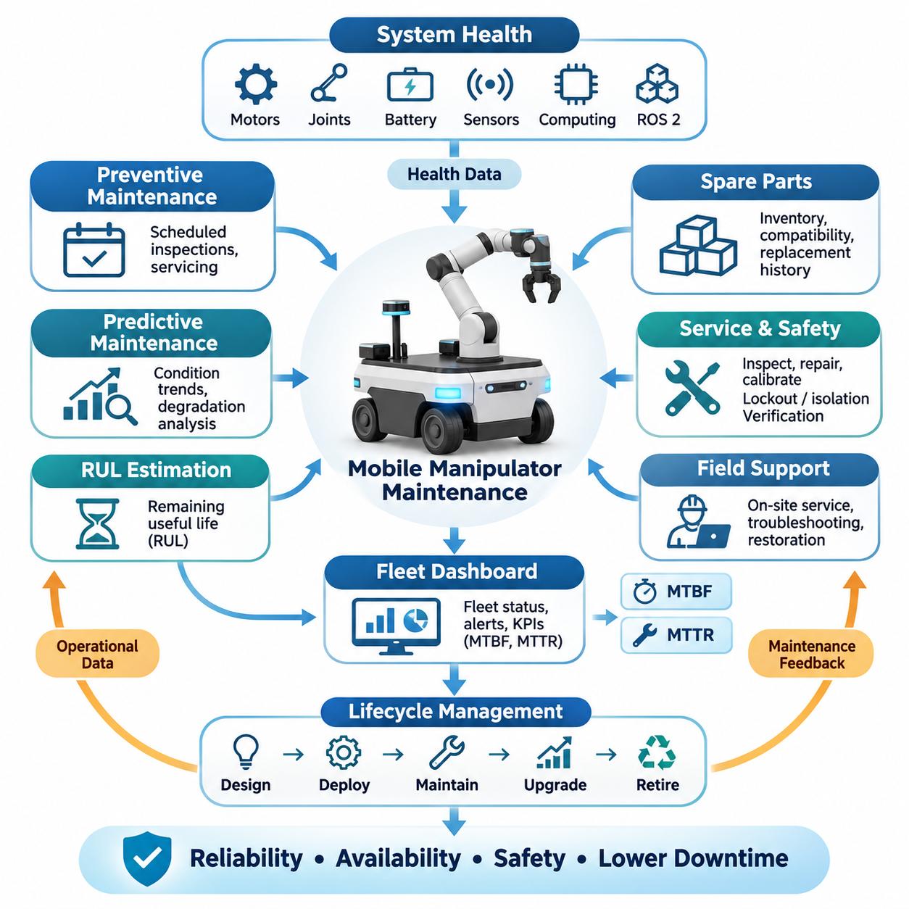
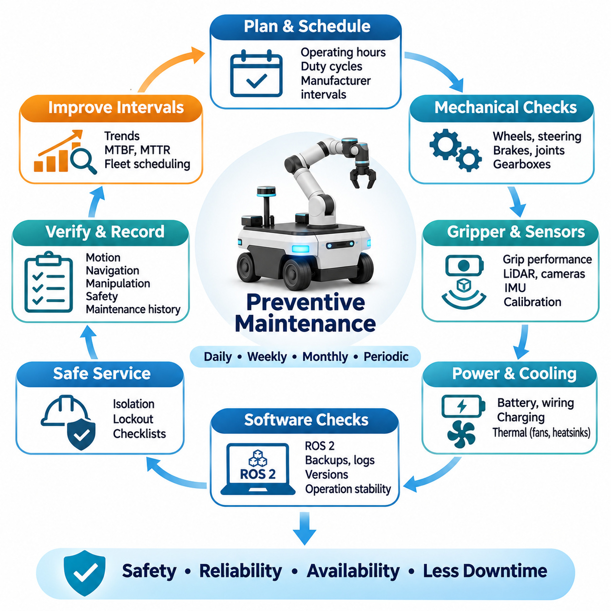
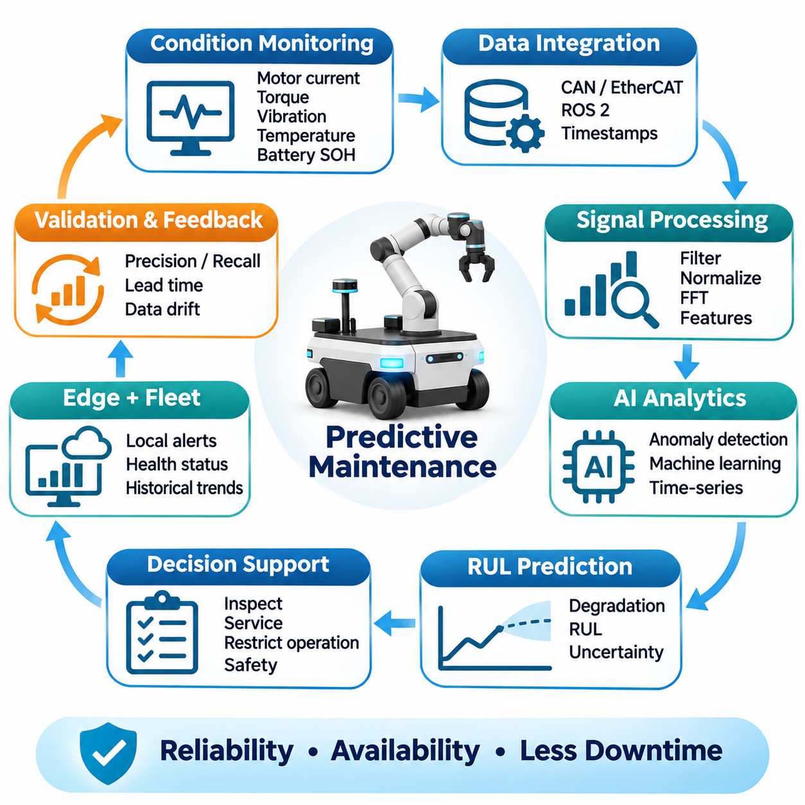
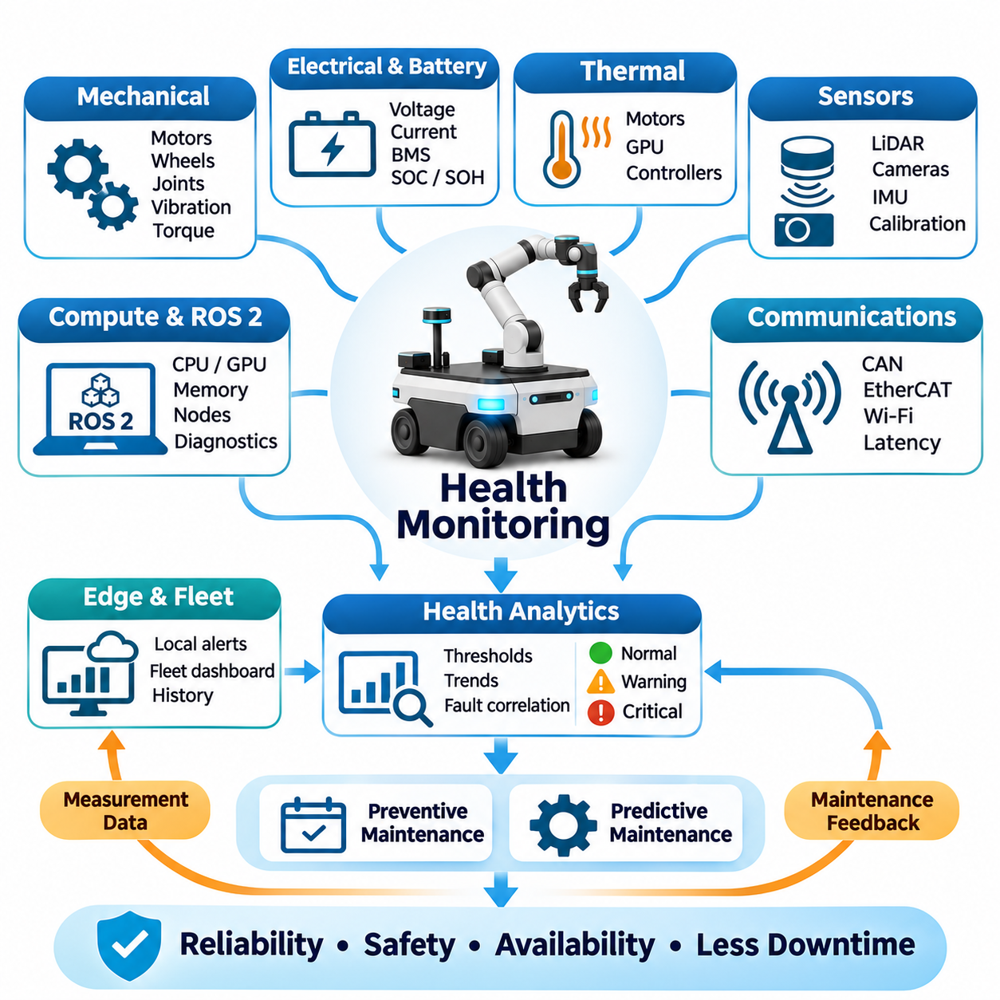
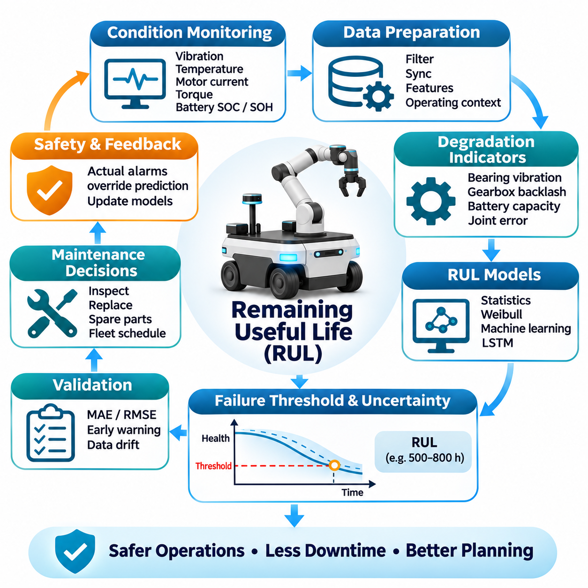
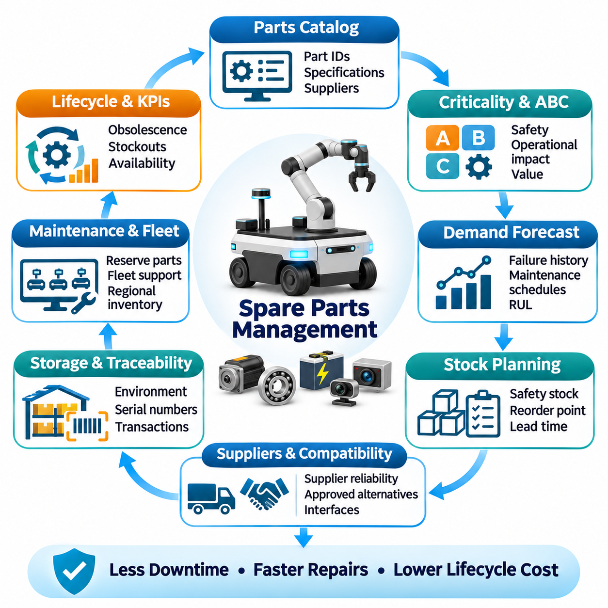
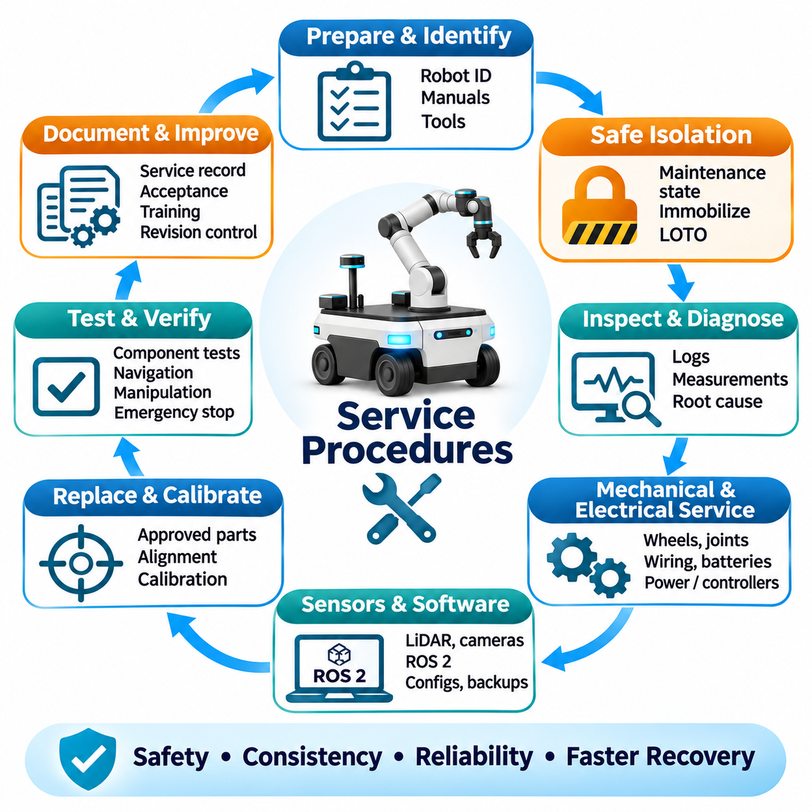
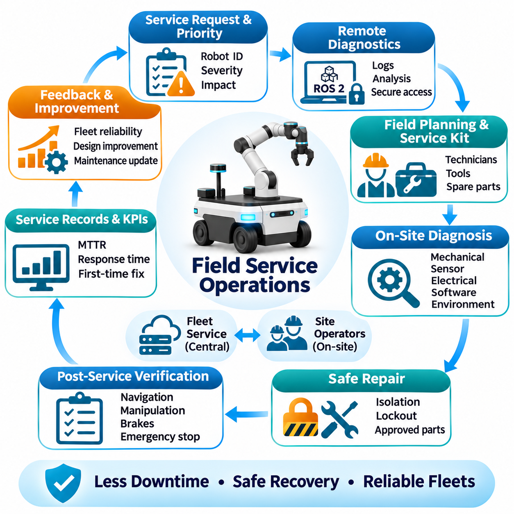
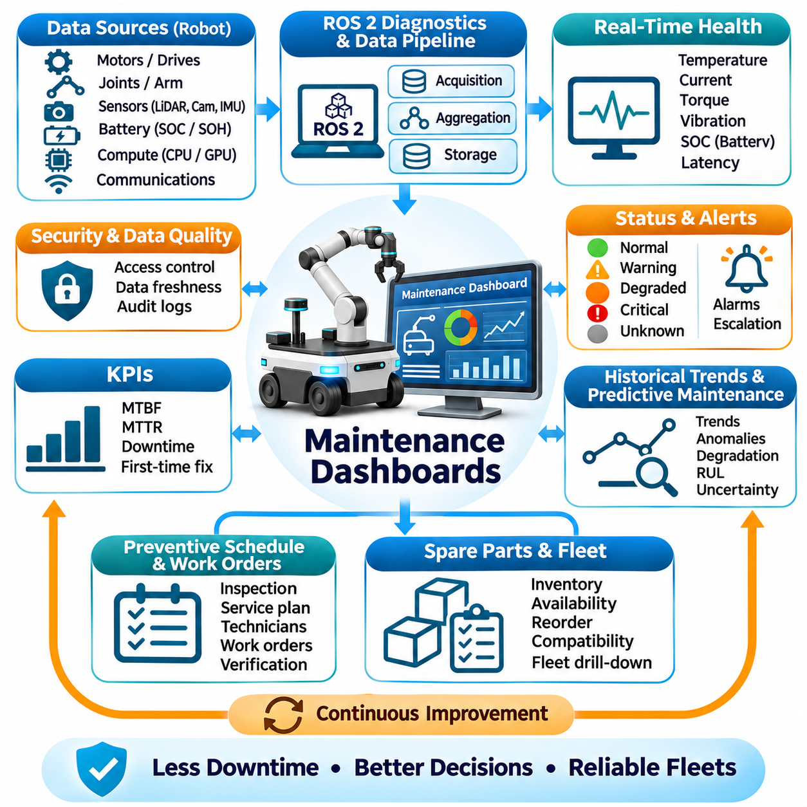
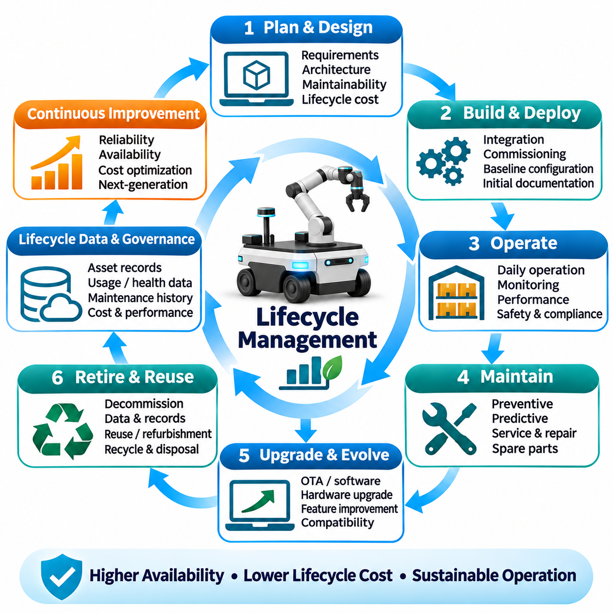

# Chapter 14. Maintenance

## 01 Maintenance Overview

{width="7.268055555555556in" height="7.268055555555556in"}

모바일 매니퓰레이터(Mobile Manipulator)의 유지보수(Maintenance)는 이동형 로봇(Autonomous Mobile Robot), 로봇 팔(Robotic Arm), 센서(Sensors), 액추에이터(Actuators), 컴퓨팅 플랫폼(Computing Platforms), 통신 네트워크(Communication Networks), 소프트웨어 서비스(Software Services)가 하나의 통합 시스템으로 구성되어 있기 때문에 필수적인 운영 관리 분야이다. 기존 산업용 기계와 달리 모바일 매니퓰레이터는 변화하는 환경에서 작동하며 이동과 물리적 조작을 모두 수행한다. 따라서 유지보수는 시스템 수명주기(System Lifecycle) 전반에 걸쳐 기계적 신뢰성(Mechanical Reliability), 전기적 무결성(Electrical Integrity), 소프트웨어 안정성(Software Stability), 센싱 정확도(Sensing Accuracy), 운영 안전성(Operational Safety)을 함께 관리해야 한다.

유지보수의 주요 목표는 예상치 못한 고장과 서비스 중단을 최소화하면서 시스템 가용성(System Availability), 기능적 성능(Functional Performance), 운영 안전성(Operational Safety)을 유지하는 것이다. 유지보수 전략은 손상된 부품을 수리하는 데만 집중해서는 안 된다. 고장 발생 전에 성능 저하를 식별하고, 장비 상태를 평가하며, 고장을 예방하고, 정상적인 작동 상태를 복구하는 지속적인 프로세스를 구축해야 한다. 이러한 접근 방식은 장비 신뢰성을 향상시키고 산업, 물류, 의료 및 서비스 환경에서 예측 가능한 운영을 지원한다.

모바일 매니퓰레이터는 서로 연결된 여러 유지보수 영역으로 구성된다. 이동 플랫폼(Mobile Platform)은 구동 모터(Drive Motors), 조향 메커니즘(Steering Mechanisms), 바퀴(Wheels), 서스펜션 구성요소(Suspension Components), 브레이크(Brakes), 배터리(Batteries), 충전 시스템(Charging Systems)의 점검이 필요하다. 로봇 팔(Robotic Arm)은 관절(Joints), 기어박스(Gearboxes), 베어링(Bearings), 엔코더(Encoders), 케이블(Cables), 엔드 이펙터(End Effectors), 힘 제어 메커니즘(Force-Control Mechanisms)에 대한 관리가 필요하다. LiDAR, 카메라(Cameras), IMU, 힘-토크 센서(Force-Torque Sensors), 촉각 센서(Tactile Sensors)와 같은 센서는 안정적인 자율 동작을 지원하기 위해 교정 상태와 측정 정확도를 유지해야 한다.

전기 및 컴퓨팅 구성요소(Electrical and Computing Components)는 추가적인 유지보수 요구사항을 발생시킨다. 전력 분배 장치(Power Distribution Units), 모터 컨트롤러(Motor Controllers), 임베디드 컴퓨터(Embedded Computers), 통신 인터페이스(Communication Interfaces), 냉각 시스템(Cooling Systems), 네트워크 연결(Network Connections)은 지정된 작동 조건에서 정상적으로 동작해야 한다. 먼지 축적, 과도한 온도, 진동, 전기적 노이즈, 불안정한 전원 공급은 구성요소의 신뢰성을 점진적으로 저하시킬 수 있다. 정기적인 점검과 모니터링은 이러한 문제가 시스템 수준의 고장이나 예상치 못한 운영 중단으로 발전하기 전에 식별하는 데 도움이 된다.

소프트웨어 유지보수(Software Maintenance) 역시 중요하다. 모바일 매니퓰레이터는 복잡한 소프트웨어 아키텍처에 의존하기 때문이다. ROS 2 노드(Nodes), 통신 미들웨어(Communication Middleware), 내비게이션 알고리즘(Navigation Algorithms), 모션 플래너(Motion Planners), 행동 트리(Behavior Trees), 플릿 관리 서비스(Fleet Management Services), AI 모델(AI Models)은 지속적으로 호환성과 안정성을 유지해야 한다. 소프트웨어 업데이트는 의존성 충돌(Dependency Conflicts), 설정 변경(Configuration Changes), 예상하지 못한 동작을 유발할 수 있다. 따라서 소프트웨어 변경으로 기존 기능이 손상되지 않도록 버전 관리(Version Management), 설정 백업(Configuration Backups), 회귀 테스트(Regression Testing), 통제된 배포(Controlled Deployment)를 유지보수 절차에 포함해야 한다.

효과적인 유지보수 프로그램은 예방정비(Preventive Maintenance)와 예지정비(Predictive Maintenance)를 결합한다. 예방정비는 고장이 발생하기 전에 제조업체의 권장사항, 사전 정의된 일정, 운전 시간, 점검 주기에 따라 정비를 수행한다. 예지정비는 운영 데이터, 센서 측정값, 과거 고장 이력, 성능 저하 패턴을 활용하여 구성요소에 정비가 필요한 시점을 추정한다. 두 접근 방식은 상호 보완적이다. 정기적인 정비는 안정적인 기준 상태를 확보하고, 상태 기반 분석(Condition-Based Analysis)은 실제 장비 상태에 따라 유지보수 활동을 조정할 수 있도록 지원한다.

상태 모니터링(Health Monitoring)은 효과적인 유지보수 의사결정에 필요한 운영 정보를 제공한다. 모바일 매니퓰레이터는 모터 온도, 전류 소비량, 배터리 전압, 관절 위치, 진동 측정값, 컨트롤러 상태, 통신 품질, 센서 진단 정보를 지속적으로 수집할 수 있다. 이러한 측정값은 장비 상태 지표(Equipment Health Indicators)와 운영 경보(Operational Alerts)로 변환할 수 있다. 개별 경보 이벤트에만 의존하지 않고 추세를 분석하면 유지보수 담당자는 점진적인 성능 저하를 식별하고 일시적인 이상 현상과 지속적인 장비 문제를 구분할 수 있다.

잔여 수명(Remaining Useful Life, RUL) 추정은 구성요소가 정의된 고장 또는 교체 기준에 도달하기까지 남아 있는 작동 시간을 예측함으로써 상태 모니터링을 확장한다. 과거 운전 기록, 성능 저하 모델(Degradation Models), 환경 조건, 현재 센서 측정값은 이러한 추정에 활용될 수 있다. 그러나 RUL 예측은 확정적인 고장 발생 날짜가 아니라 확률적인 엔지니어링 정보로 취급해야 한다. 예측 정확도는 데이터 품질, 작동 조건, 구성요소의 특성, 대표성 있는 고장 이력의 확보 여부에 따라 달라진다.

예비 부품 관리(Spare Parts Management)는 유지보수 운영의 또 다른 핵심 요소이다. 모바일 매니퓰레이터에는 교체 비용, 조달 소요 시간, 고장 확률, 운영상 중요도가 서로 다른 구성요소가 포함된다. 모터 컨트롤러, 배터리, 센서, 액추에이터, 통신 모듈, 기계식 동력 전달 구성요소와 같은 핵심 부품은 시스템 가용성에 미치는 영향을 기준으로 관리해야 한다. 적절한 재고 수준은 수리 지연을 줄이며, 부품 식별 정보, 호환성 기록, 교체 이력은 잘못된 부품 선택을 방지하는 데 도움이 된다.

서비스 절차(Service Procedures)는 장비의 점검, 수리, 교체, 교정, 검증을 일관된 방식으로 수행하기 위한 기준을 제공한다. 각 절차에는 필요한 도구, 작업자 자격, 안전 예방조치, 진단 단계, 교체 기준, 정비 후 검증 활동이 명시되어야 한다. 특히 움직이는 기구부, 전력 시스템, 배터리, 로봇 팔을 정비할 때는 각별한 주의가 필요하다. 유지보수 중 예기치 않은 움직임이나 전기적 활성화를 방지하기 위해 잠금 및 에너지 차단 절차(Lockout and Isolation Procedures)를 적용해야 한다. 시스템을 다시 가동하기 전에는 적절한 기능 및 안전 검사를 수행해야 한다.

현장 서비스 운영(Field Service Operations)은 통제된 실험실 환경을 넘어 실제 운영 현장에서 유지보수 활동을 수행하는 영역이다. 모바일 매니퓰레이터는 창고, 제조 시설, 병원 및 기타 다양한 장소에서 작동하며, 각 환경의 조건과 접근성이 서로 다를 수 있다. 서비스 팀은 장비 운송, 원격 진단, 교체 부품 확보, 현장 접근, 운영 일정, 현지 담당자와의 협업을 고려해야 한다. 원격 지원(Remote Support)은 엔지니어가 진단 로그를 확인하고 시스템 상태를 검토하며 승인된 기술자에게 문제 해결 절차를 안내할 수 있도록 하여 불필요한 현장 방문을 줄일 수 있다.

유지보수 대시보드(Maintenance Dashboards)는 장비 상태와 서비스 활동을 중앙에서 확인할 수 있는 환경을 제공한다. 대시보드에는 운전 시간, 구성요소 온도, 배터리 상태, 진단 경보, 유지보수 일정, 미해결 고장, 예비 부품 가용성, 서비스 이력 등이 표시될 수 있다. 플릿 단위로 로봇을 운영하는 환경에서는 여러 로봇의 상태를 비교하고 특정 모델, 구성요소, 소프트웨어 버전 또는 운영 환경과 관련된 반복적인 문제를 식별할 수 있어야 한다. 이러한 정보는 유지보수 관리자가 자원을 우선순위에 따라 배분하고 전체 플릿의 신뢰성을 평가하는 데 도움이 된다.

수명주기 관리(Lifecycle Management)는 모바일 매니퓰레이터의 전체 운영 수명에 걸쳐 유지보수 활동을 연결한다. 이는 구성요소 선정과 시스템 시운전에서 시작하여 정기적인 운영과 주기적인 정비를 거치며, 최종적으로 구성요소 교체, 시스템 개조 및 성능 개선, 기술 업그레이드, 장비 폐기까지 포함한다. 유지보수 기록은 장비를 계속 수리하여 사용하는 것이 경제적·기술적으로 적절한지 판단하는 데 중요한 근거를 제공한다. 수명주기 의사결정에서는 신뢰성, 운영 비용, 안전 요구사항, 예비 부품 가용성, 핵심 기술의 잔여 지원 기간을 함께 고려해야 한다.

유지보수 성능은 측정 가능한 운영 지표를 통해 평가해야 한다. 평균 고장 간격(Mean Time Between Failures, MTBF)은 시스템 신뢰성을 평가하는 데 사용되며, 평균 수리 시간(Mean Time To Repair, MTTR)은 고장 발생 후 장비를 복구하는 데 필요한 시간을 측정한다. 가용성(Availability), 운전 시간당 유지보수 비용(Maintenance Cost per Operating Hour), 예방정비 준수율(Preventive Maintenance Compliance), 반복 고장률(Repeat Failure Rates), 예비 부품 사용률(Spare Parts Utilization)도 유지보수 효과를 평가하는 추가 지표로 활용할 수 있다. 하나의 지표를 개선했다고 해서 전체 시스템 성능이 반드시 향상되는 것은 아니므로 이러한 지표는 종합적으로 해석해야 한다.

성숙한 유지보수 아키텍처는 체계적인 문서화와 피드백 체계도 필요로 한다. 모든 점검, 고장, 수리, 교체, 교정, 소프트웨어 변경은 추적 가능한 유지보수 기록으로 남겨야 한다. 이러한 기록을 통해 엔지니어링 팀은 반복적인 고장을 조사하고, 설계상의 취약점을 식별하며, 유지보수 주기를 개선하고, 진단 알고리즘을 고도화할 수 있다. 현장 서비스 운영에서 얻은 피드백은 하드웨어 개발자, 소프트웨어 엔지니어, 공급업체, 시스템 통합업체에도 전달되어 지속적인 제품 개선을 지원해야 한다.

궁극적으로 유지보수는 독립적인 수리 활동이 아니라 통합된 엔지니어링 및 운영 기능으로 다루어야 한다. 예방정비, 예지 분석(Predictive Analysis), 상태 모니터링, 예비 부품 계획, 표준화된 서비스 절차, 수명주기 관리를 결합하면 조직은 모바일 매니퓰레이션 시스템의 전체 운영 기간 동안 안정적인 성능을 유지할 수 있다. 체계적으로 설계된 유지보수 전략은 가동 중단 시간을 줄이고, 안전성을 향상시키며, 총소유비용(Total Cost of Ownership)을 관리하고, 확장 가능하며 지속 가능한 로봇 플릿 운영의 기반을 마련한다.

## 02 Preventive Maintenance

{width="7.268055555555556in" height="7.268055555555556in"}

예방정비(Preventive Maintenance)는 고장이 발생하기 전에 사전에 정의된 주기에 따라 점검, 정비, 조정 및 구성요소 교체를 수행함으로써 모바일 매니퓰레이터(Mobile Manipulator)를 관리하는 체계적인 접근 방식이다. 주요 목적은 예상치 못한 가동 중단을 줄이고, 장비의 신뢰성을 유지하며, 로봇의 전체 서비스 수명(Service Life) 동안 안전한 작동 조건을 확보하는 것이다. 고장 발생 이후에 대응하는 사후정비(Corrective Maintenance)와 달리 예방정비는 잠재적인 성능 저하를 조기에 식별하고 계획된 유지보수 활동을 통해 문제를 해결한다.

모바일 매니퓰레이터는 자율주행, 로봇 조작, 인식, 통신 및 컴퓨팅 기능을 결합하여 작동하기 때문에 예방정비가 필요하다. 지속적인 이동, 반복적인 관절 작동, 페이로드 변화, 환경적 노출, 전기적 부하는 시간이 지남에 따라 구성요소의 상태에 영향을 미친다. 휠 어셈블리, 로봇 관절, 센서 또는 통신 인터페이스의 사소한 성능 저하도 전체 시스템 성능에 영향을 줄 수 있다. 따라서 예방정비는 이동 플랫폼, 매니퓰레이터, 센서, 전기 시스템 및 소프트웨어를 서로 연결된 유지보수 대상으로 고려해야 한다.

예방정비 프로그램은 유지보수가 필요한 구성요소와 해당 작동 요구사항을 포괄적으로 목록화하는 것부터 시작해야 한다. 각 구성요소에는 점검 기준, 정비 주기, 교체 조건 및 적용 가능한 안전 예방조치를 설명하는 식별 가능한 유지보수 사양이 마련되어야 한다. 제조업체의 권장사항은 초기 기준으로 활용할 수 있지만, 실제 유지보수 주기는 운전 시간, 작업 부하율(Duty Cycle), 페이로드, 환경 조건 및 과거 고장 기록도 반영해야 한다. 이러한 접근 방식은 각 로봇의 실제 작동 특성을 반영하는 유지보수 일정을 수립할 수 있도록 한다.

기계적 유지보수(Mechanical Maintenance)는 모바일 매니퓰레이터에서 가장 중요한 활동 중 하나이다. 이동 플랫폼은 휠, 타이어, 조향 메커니즘, 구동 모터, 기어박스, 베어링, 서스펜션 구성요소, 브레이크 및 기계적 체결부에 대한 정기적인 점검이 필요하다. 기술자는 비정상적인 소음, 과도한 진동, 체결부 풀림, 마모, 누유 및 기계적 저항의 변화를 확인해야 한다. 4륜 구동 및 4륜 조향 플랫폼의 경우 안정적인 주행과 기동성을 유지하기 위해 휠 정렬, 조향 정확도, 구동 동기화 및 기계적 간극도 점검해야 한다.

로봇 팔(Robotic Arm)은 반복적인 기계적 하중을 받기 때문에 별도의 예방정비 일정을 수립해야 한다. 기어박스, 베어링, 하모닉 드라이브(Harmonic Drives), 감속기(Reducers), 관절 모터, 브레이크 및 엔코더 어셈블리는 운전 시간과 제조업체 사양에 따라 점검해야 한다. 과도한 백래시(Backlash), 온도 상승, 비정상적인 진동 및 예상하지 못한 위치 오차는 기계적 성능 저하를 나타낼 수 있다. 위치 정확도, 반복 정밀도 및 조작 작업의 안정적인 실행을 유지하기 위해 관절 교정과 동작 검증을 주기적으로 수행해야 한다.

엔드 이펙터(End Effectors)와 그리퍼(Grippers)는 물체 및 작업물과 직접 접촉하기 때문에 정기적인 점검이 필요하다. 기계식 핑거, 그리핑 표면, 공압 액추에이터, 전동 구동부, 진공 시스템, 툴 체인저(Tool Changers) 및 장착 인터페이스는 반복적인 접촉과 하중으로 인해 성능이 저하될 수 있다. 유지보수 담당자는 파지력, 기계적 정렬, 액추에이터 응답, 케이블 연결 및 공구 체결 상태를 점검해야 한다. 대표적인 물체를 사용한 기능 시험은 엔드 이펙터가 안정적인 파지 및 해제 성능을 유지하는지 확인하는 데 도움이 된다.

센서 유지보수(Sensor Maintenance)는 자율주행과 조작 정확도를 유지하는 데 필수적이다. LiDAR, RGB 카메라, 깊이 카메라(Depth Cameras), IMU, 힘-토크 센서(Force-Torque Sensors) 및 기타 인식 장치는 오염, 물리적 손상, 장착부 풀림 및 케이블 열화 여부를 점검해야 한다. 광학 표면은 적절한 절차에 따라 청소해야 하며, 센서 장착 위치와 교정 파라미터(Calibration Parameters)도 주기적으로 확인해야 한다. 센서 정렬이나 측정 품질의 변화는 위치 추정(Localization), 장애물 감지, 객체 인식 및 로봇 파지 성능에 영향을 줄 수 있다.

전기 및 전력 시스템 유지보수(Electrical and Power System Maintenance)는 배터리 상태, 커넥터, 배선 하네스(Wiring Harnesses), 전력 분배 장치, 모터 컨트롤러, 회로 보호 장치 및 충전 장비에 중점을 두어야 한다. 기술자는 케이블 절연 상태, 커넥터 체결 상태, 비정상적인 발열, 부식 및 전기적 손상 흔적을 점검해야 한다. 배터리 점검은 제조업체가 승인한 절차를 따라야 하며 전압 균형, 온도, 충전 동작 및 물리적 상태를 고려해야 한다. 전기 시스템을 정비하기 전에는 적절한 전기적 절연과 안전 예방조치를 반드시 적용해야 한다.

열 관리(Thermal Management) 역시 중요한 예방정비 활동이다. 임베디드 컴퓨터, GPU 플랫폼, 모터 컨트롤러, 전력 전자 장치 및 배터리 시스템은 작동 중 열을 발생시킨다. 냉각 팬, 히트싱크, 환기구 및 열전달 인터페이스는 먼지 축적, 공기 흐름 제한 및 비정상적인 작동 온도 여부를 점검해야 한다. 부적절한 열 관리는 성능 저하, 예상하지 못한 시스템 종료, 구성요소의 노화 가속 및 시스템 가용성 감소를 유발할 수 있다. 따라서 정기적인 유지보수 활동에 청소와 냉각 시스템 정비를 포함해야 한다.

소프트웨어 및 컴퓨팅 인프라(Software and Computing Infrastructure)도 예방정비가 필요하다. ROS 2 환경, 통신 미들웨어, 내비게이션 소프트웨어, 모션 플래닝 서비스, 행동 트리, 플릿 관리 애플리케이션 및 AI 추론 시스템은 운영 안정성과 설정 일관성을 확인해야 한다. 유지보수 활동에는 로그 검사, 저장 공간 정리, 백업 검증, 의존성 확인, 데이터베이스 관리 및 통신 진단 등이 포함될 수 있다. 업데이트나 설정 변경으로 예상하지 못한 동작이 발생했을 때 일관된 방식으로 복구할 수 있도록 소프트웨어 버전과 시스템 설정을 문서화해야 한다.

예방정비 주기는 구성요소의 특성과 운영 강도를 기준으로 수립해야 한다. 일일 점검은 육안 손상, 청소 상태, 배터리 상태, 비상 정지 장치 및 기본적인 기능 검증에 중점을 둘 수 있다. 주간 또는 월간 점검에는 기계적 체결부 검사, 휠 상태 평가, 센서 청소, 케이블 점검 및 매니퓰레이터 작동 검증이 포함될 수 있다. 더 긴 주기의 정비에는 기어박스 검사, 교정, 배터리 성능 평가, 전기적 시험 및 상세한 소프트웨어 진단이 포함될 수 있다. 이러한 주기는 모든 구성요소에 일률적으로 적용하기보다는 제조업체 요구사항과 실제 운영 조건에 따라 조정해야 한다.

표준화된 유지보수 체크리스트(Standardized Maintenance Checklist)는 기술자가 일관된 방식으로 점검을 수행하고 중요한 작업을 누락하지 않도록 지원한다. 각 체크리스트에는 구성요소, 점검 방법, 합격 기준, 필요한 도구, 유지보수 주기 및 담당자가 명시되어야 한다. 점검 결과는 정상 상태, 경미한 이상 상태, 시정 조치가 필요한 상태로 구분하여 기록해야 한다. 표준화된 체크리스트는 유지보수 교육, 품질 보증(Quality Assurance) 및 여러 로봇과 배치 현장에 걸친 일관된 서비스 수행도 지원한다.

유지보수 활동은 적절한 안전 절차에 따라 수행해야 한다. 모바일 매니퓰레이터를 정비하기 전에 로봇을 명확하게 정의된 유지보수 상태로 전환하고 의도하지 않은 움직임이 발생하지 않도록 해야 한다. 이동 플랫폼은 움직이지 않도록 고정하고, 매니퓰레이터는 기계적으로 안정된 위치에 배치하며, 필요한 경우 전기 및 공압 에너지원을 차단해야 한다. 적절한 경우 잠금 및 표지 절차(Lockout and Tagout)를 적용해야 한다. 정비가 완료된 후에는 로봇을 다시 가동하기 전에 보호 장치, 비상 정지 장치, 브레이크 및 안전 관련 기능이 정상적으로 작동하는지 확인해야 한다.

유지보수 문서화(Maintenance Documentation)는 예방정비의 효과를 개선하는 데 필요한 이력 정보를 제공한다. 각 점검 및 정비 활동에는 로봇 식별 정보, 운전 시간, 구성요소 상태, 유지보수 날짜, 기술자, 교체 부품, 발견된 이상 사항 및 검증 결과를 기록해야 한다. 이러한 기록을 통해 반복적인 성능 저하를 식별하고, 구성요소 성능을 비교하며, 기존 유지보수 주기가 적절한지 평가할 수 있다. 추적 가능한 유지보수 이력은 보증 관리, 공급업체와의 협의, 품질 조사 및 수명주기 비용 분석도 지원한다.

다중 로봇 운영 환경에서는 중앙 집중식 플릿 유지보수 프로세스를 통해 예방정비를 조정해야 한다. 유지보수 관리자는 로봇 운전 시간, 예정된 정비 활동, 현재 장비 상태 및 유지보수 완료 현황을 확인할 수 있어야 한다. 로봇은 작업 부하, 배터리 상태, 작업 우선순위 및 운영 가용성을 고려하여 유지보수 시간에 배정할 수 있다. 체계적인 일정 관리는 여러 로봇이 동시에 운영 불가능한 상태가 되는 것을 방지하고, 유지보수 자원과 예비 부품을 더욱 효율적으로 배분할 수 있도록 한다.

예방정비에는 로봇을 정상 운영에 복귀시키기 전의 정비 후 검증(Post-Maintenance Verification)도 포함해야 한다. 기계적 정비 후에는 적절한 동작 시험을 수행하고, 센서 정비 후에는 필요한 경우 측정 및 교정 상태를 확인해야 한다. 전기 시스템 정비 후에는 관련 전원 및 보호 기능을 점검하고, 소프트웨어 정비 후에는 기능 및 통신 시험을 수행해야 한다. 최종 검증을 통해 내비게이션, 조작, 안전 기능 및 임무 실행이 기존 운영 요구사항과 일치하는지 확인해야 한다.

예방정비의 효과는 측정 가능한 성능 지표를 활용하여 평가할 수 있다. 유지보수 준수율(Maintenance Compliance Rate)은 예정된 정비 활동이 정해진 시간 내에 완료되었는지를 나타내며, 장비 가용성(Equipment Availability)은 로봇이 정상적으로 운영 가능한 시간의 비율을 측정한다. 평균 고장 간격(Mean Time Between Failures, MTBF), 평균 수리 시간(Mean Time To Repair, MTTR), 반복 고장 빈도, 유지보수 비용 및 비계획 가동 중단 시간도 신뢰성과 유지보수 효율성을 평가하는 추가 지표로 활용할 수 있다. 이러한 지표는 비효율적인 점검 주기, 반복적인 구성요소 문제 및 유지보수 프로세스 개선 기회를 식별하기 위해 주기적으로 검토해야 한다.

예방정비는 운영 경험을 무시하는 고정된 일정으로 유지되어서는 안 된다. 점검 결과, 고장 기록, 구성요소 교체 이력 및 장비 성능 추세를 지속적으로 유지보수 계획에 반영해야 한다. 특정 구성요소가 예상보다 빠르게 반복적으로 열화된다면 점검 빈도나 교체 기준을 조정해야 할 수 있다. 반대로 통제된 조건에서 안정적인 성능을 보이는 구성요소는 제조업체 권장사항과 안전 요구사항이 허용하는 범위에서 보다 효율적인 유지보수 주기를 적용할 수 있다.

궁극적으로 예방정비는 모바일 매니퓰레이터의 안정적인 운영과 배치를 위한 기반을 제공한다. 기계 어셈블리를 체계적으로 점검하고, 센서를 유지관리하며, 전기 시스템을 보호하고, 소프트웨어 인프라를 검증하며, 정비 활동을 문서화함으로써 조직은 예상하지 못한 고장을 줄이고 장비의 서비스 수명을 연장할 수 있다. 예방정비를 일상적인 운영에 통합하면 안전성이 향상되고 시스템 가용성이 증가하며 유지보수 비용을 관리할 수 있다. 또한 산업 및 서비스 환경 전반에서 모바일 매니퓰레이터 플릿을 체계적으로 관리하기 위한 일관된 기반을 구축할 수 있다.

## 03 Predictive Maintenance

{width="7.268055555555556in" height="7.268055555555556in"}

예지정비(Predictive Maintenance)는 장비의 미래 상태를 추정하고 고장이 발생하기 전에 잠재적인 고장을 식별하는 데이터 기반 유지보수 접근 방식이다. 사전에 정해진 주기에 따라 정비를 수행하는 예방정비(Preventive Maintenance)와 달리, 예지정비는 실제 작동 상태, 센서 측정값, 과거 이력 및 분석 모델을 활용하여 유지보수가 필요한 시점을 결정한다. 주요 목적은 불필요한 부품 교체와 유지보수 활동을 줄이면서 예상하지 못한 고장을 최소화하는 것이다.

모바일 매니퓰레이터(Mobile Manipulator)는 지속적으로 운영 데이터를 생성하는 여러 기계, 전기, 컴퓨팅 및 센싱 구성요소를 포함하므로 예지정비에 특히 적합하다. 구동 모터(Drive Motors), 조향 액추에이터(Steering Actuators), 로봇 관절(Robotic Joints), 배터리(Batteries), 기어박스(Gearboxes), 베어링(Bearings), 냉각 시스템(Cooling Systems)은 노화되거나 기계적 스트레스를 받을 때 측정 가능한 변화를 나타낸다. 이러한 변화를 지속적으로 관찰하면 유지보수 시스템은 초기 성능 저하를 식별하고 구성요소의 고장 가능성을 추정할 수 있다.

예지정비의 기반은 상태 모니터링(Condition Monitoring)이며, 이는 정상적인 작동 중 장비의 동작과 관련된 정보를 수집하고 평가한다. 일반적인 측정 항목에는 모터 전류, 온도, 진동, 회전 속도, 관절 토크, 배터리 전압, 충전 특성 및 통신 성능이 포함된다. 이러한 측정값은 구성요소의 상태와 작동 조건에 대한 정보를 제공한다. 지속적인 모니터링을 통해 간헐적인 수동 점검만으로는 발견하기 어려운 비정상적인 패턴을 식별할 수 있다.

센서 통합(Sensor Integration)은 신뢰할 수 있는 유지보수 데이터를 수집하는 데 중요한 역할을 한다. 산업용 센서, 임베디드 컨트롤러, 모터 드라이브, 배터리 관리 시스템(Battery Management Systems), 로봇 관절 컨트롤러는 CAN, EtherCAT, Ethernet 및 ROS 2 토픽(Topics)과 같은 통신 인터페이스를 통해 측정값을 제공할 수 있다. 이러한 데이터 소스는 정확한 타임스탬프, 로봇 식별 정보, 작동 모드 및 구성요소 정보와 연계하여 동기화해야 한다. 일관된 데이터 수집은 서로 다른 운영 기간과 여러 로봇 장치 간의 의미 있는 비교를 가능하게 한다.

진동 분석(Vibration Analysis)은 회전 및 기계 구성요소를 모니터링하는 데 특히 유용하다. 베어링, 기어박스, 구동 모터 및 로봇 관절의 동력 전달 장치는 기계적 열화가 발생할 때 특징적인 진동 패턴을 나타낼 수 있다. 진동 진폭, 주파수 분포 및 스펙트럼 특성의 변화는 불균형, 정렬 불량, 체결부 풀림, 베어링 손상 또는 기어 마모를 나타낼 수 있다. 고속 푸리에 변환(Fast Fourier Transform, FFT)을 이용한 주파수 영역 분석(Frequency-Domain Analysis)은 육안 검사만으로는 발견하기 어려운 주기적인 기계적 이상을 식별하는 데 도움이 된다.

모터 전류와 토크 모니터링(Motor Current and Torque Monitoring)은 기계적 부하와 액추에이터 상태에 대한 추가적인 정보를 제공한다. 유사한 작동 조건에서 전류 소비량이 증가하면 마찰, 과도한 기계적 저항, 베어링 열화 또는 비정상적인 페이로드 조건을 나타낼 수 있다. 마찬가지로 반복적인 조작 작업 중 관절 토크의 변화는 동력 전달 장치의 문제나 예상하지 못한 기계적 부하를 드러낼 수 있다. 이러한 측정값은 정상적인 작업량 변화와 실제 장비 열화를 혼동하지 않도록 로봇의 속도, 가속도, 페이로드 및 작동 모드와 함께 해석해야 한다.

열 모니터링(Thermal Monitoring)은 또 다른 중요한 예지정비 기술이다. 모터, 모터 컨트롤러, 배터리, 임베디드 컴퓨터 및 전력 전자 장치는 작동 중 열을 발생시킨다. 지속적인 온도 상승은 냉각 성능 저하, 과도한 전기적 부하, 기계적 마찰 증가 또는 구성요소 노화를 나타낼 수 있다. 온도 측정값은 작동 조건 및 제조업체가 정의한 한계값을 기준으로 평가해야 한다. 시간에 따른 온도 추세를 모니터링하면 열적 이상이 구성요소 고장으로 발전하기 전에 조기 경고를 제공할 수 있다.

배터리 예지정비(Battery Predictive Maintenance)는 배터리 열화가 임무 수행 시간과 플릿 가용성에 직접적인 영향을 미치기 때문에 자율이동로봇에서 특히 중요하다. 배터리 전압, 전류, 온도, 충전 사이클, 방전 깊이, 내부 저항 및 배터리 건강 상태(State of Health, SOH)는 배터리 상태를 파악하는 데 유용한 정보를 제공한다. 충전 동작이나 전압 응답의 변화는 용량 저하 또는 셀 불균형을 나타낼 수 있다. 예측 모델은 이러한 측정값을 활용하여 배터리 열화를 추정하고 운영 성능이 허용할 수 없는 수준으로 떨어지기 전에 교체 계획을 수립하도록 지원할 수 있다.

예지정비 알고리즘을 적용하기 전에는 데이터 전처리(Data Preprocessing)가 필수적이다. 원시 측정값에는 노이즈, 결측값, 통신 중단, 센서 드리프트(Sensor Drift), 일시적인 작동 조건으로 인해 발생하는 비정상적인 측정값이 포함될 수 있다. 데이터 필터링, 정규화, 동기화, 이상치 탐지 및 특징 추출(Feature Extraction)은 데이터 품질을 향상시키는 데 도움이 된다. 이동 평균, 진동 통계량, 온도 변화율, 전류 피크 및 작동 사이클 횟수와 같은 특징은 처리되지 않은 센서 데이터보다 장비 상태를 더욱 유용하게 표현할 수 있다.

머신러닝(Machine Learning)은 작동 조건과 장비 열화 사이의 관계를 식별함으로써 예지정비 성능을 향상시킬 수 있다. 지도학습(Supervised Learning) 알고리즘은 알려진 구성요소 상태나 고장 이벤트로 라벨링된 과거 운영 데이터를 활용하여 학습할 수 있다. 분류 모델(Classification Models)은 구성요소가 정상적으로 작동하는지 또는 비정상적인 상태를 나타내는지 추정할 수 있으며, 회귀 모델(Regression Models)은 열화 수준이나 미래의 성능 지표를 추정할 수 있다. 랜덤 포레스트(Random Forest), 그래디언트 부스팅(Gradient Boosting), 서포트 벡터 머신(Support Vector Machines), 신경망(Neural Networks) 등의 알고리즘은 데이터 가용성과 문제의 복잡성에 따라 적용할 수 있다.

이상 탐지(Anomaly Detection)는 과거 고장 데이터가 제한적이거나 불완전한 경우에 유용하다. 광범위한 고장 사례를 요구하는 대신, 이상 탐지 모델은 장비의 정상적인 작동 패턴을 학습하고 해당 패턴에서 벗어나는 현상을 식별한다. 통계적 임계값, 클러스터링 방법(Clustering Methods), 아이솔레이션 포레스트(Isolation Forest), 오토인코더 기반 접근 방식(Autoencoder-Based Approaches)은 온도, 진동, 전류 및 토크 측정값의 비정상적인 조합을 탐지할 수 있다. 그러나 비정상적인 동작이 항상 임박한 기계적 고장을 의미하는 것은 아니므로 탐지된 이상은 실제 운영 상황과 함께 평가해야 한다.

시계열 분석(Time-Series Analysis)은 장비의 점진적인 열화를 이해하기 위한 또 다른 접근 방식이다. 과거 측정값을 분석하면 장기적인 추세, 주기적인 변화 및 작동 사이클과 관련된 변화를 확인할 수 있다. 예측 모델(Forecasting Models)은 미래의 온도 수준, 진동 강도, 배터리 열화 또는 액추에이터 성능을 추정할 수 있다. 충분한 순차 데이터가 확보된 경우 순환 신경망(Recurrent Neural Networks, RNNs), 장단기 메모리(Long Short-Term Memory, LSTM) 네트워크 및 시간적 합성곱 모델(Temporal Convolutional Models)을 사용할 수 있다. 그러나 모델의 복잡성은 가용 컴퓨팅 자원과 예측 신뢰성 사이의 균형을 고려해야 한다.

잔여 수명(Remaining Useful Life, RUL) 예측은 예지정비의 가장 중요한 응용 분야 중 하나이다. 이는 구성요소가 사전에 정의된 고장 임계값에 도달하기까지 남아 있는 작동 시간 또는 작동 사이클 수를 추정한다. RUL 모델은 과거 열화 패턴, 현재 상태 측정값, 작동 강도 및 환경 정보를 결합할 수 있다. 예측 결과는 유지보수 일정 수립과 교체 계획을 지원한다. 열화 과정은 구성요소와 작동 환경에 따라 달라지므로 RUL 추정값은 정확한 고장 발생 날짜로 취급하지 않고 불확실성을 포함해야 한다.

모바일 매니퓰레이터의 예지정비는 이동 플랫폼과 로봇 팔 사이의 상호작용도 고려해야 한다. 예를 들어 주행 중 진동 증가는 매니퓰레이터의 기계적 하중에 영향을 줄 수 있으며, 고하중을 반복적으로 사용하는 작업은 관절 온도와 동력 전달 장치의 마모에 영향을 미칠 수 있다. 플랫폼 안정성, 휠 상태 또는 위치 추정 성능의 변화도 조작 정확도에 영향을 줄 수 있다. 이러한 관계를 평가하면 개별 구성요소를 독립적으로 분석하는 것을 넘어 시스템 수준의 열화를 식별할 수 있다.

예지정비 모델은 로봇 소프트웨어 아키텍처 및 플릿 관리 인프라와 통합해야 한다. ROS 2 노드는 장비 측정값을 수집하고 상태 지표를 계산하며 진단 정보를 모니터링 서비스에 발행할 수 있다. 엣지 컴퓨터(Edge Computers)는 실시간 전처리와 이상 탐지를 수행할 수 있으며, 중앙 서버(Centralized Servers)는 과거 데이터를 저장하고 연산량이 많은 분석을 실행할 수 있다. 이러한 분산 아키텍처를 통해 로봇은 즉각적인 이상을 로컬에서 탐지하는 동시에 플릿 수준의 시스템은 여러 장비에 걸친 장기적인 추세를 식별할 수 있다.

유지보수 의사결정 지원(Maintenance Decision Support)은 예측 분석 결과를 실제 운영 조치로 전환한다. 모델이 비정상적인 동작을 탐지하면 시스템은 해당 상태의 심각도, 예측 신뢰도, 잠재적인 운영 영향 및 대응 시급성을 평가해야 한다. 경미한 편차는 지속적인 모니터링이 필요할 수 있으며, 심각한 이상은 점검 요청이나 특정 작업에 대한 제한을 유발할 수 있다. 위험도가 높은 상태에서는 적절한 안전 대응을 활성화하고 필요한 경우 로봇의 지속적인 작동을 방지해야 한다. 유지보수 권고사항은 기술자가 이해할 수 있어야 하며 관련 측정값과 진단 근거를 포함해야 한다.

예지정비는 체계적인 모델 검증(Model Validation)을 통해서도 평가해야 한다. 과거 데이터셋은 미래의 운영 조건에 관한 정보가 모델 학습 과정에 유입되는 데이터 누출(Data Leakage)을 방지하기 위해 학습, 검증 및 테스트 기간으로 분리해야 한다. 평가 지표에는 정밀도(Precision), 재현율(Recall), F1 점수(F1-Score), 오경보율(False Alarm Rate), 고장 탐지 선행 시간(Detection Lead Time), RUL 예측 오차가 포함될 수 있다. 실제 적용에서는 고장을 놓쳤을 때 발생하는 비용과 불필요한 유지보수 비용도 고려해야 한다. 분류 정확도가 높은 모델이라도 오경보가 지나치게 많거나 충분한 사전 경고 시간을 제공하지 못한다면 실제 운영에 적합하지 않을 수 있다.

데이터 품질과 모델 신뢰성(Data Quality and Model Reliability)은 예지정비의 핵심적인 과제이다. 고장 이벤트는 드물게 발생할 수 있고, 작동 조건은 변할 수 있으며, 서로 다른 로봇 장치는 각기 다른 열화 특성을 나타낼 수 있다. 페이로드, 바닥 상태, 주변 온도, 유지보수 이력 및 소프트웨어 설정의 변화는 센서 측정값에 영향을 줄 수 있다. 따라서 예측 모델은 데이터 드리프트(Data Drift)와 성능 저하를 지속적으로 모니터링해야 한다. 주기적인 재학습, 모델 검증, 버전 관리 및 통제된 배포는 장비 수명주기 전반에 걸쳐 신뢰할 수 있는 예측 성능을 유지하는 데 도움이 된다.

사이버보안과 데이터 거버넌스(Cybersecurity and Data Governance)는 예지정비 인프라에 포함해야 한다. 장비 상태 정보에는 운영상 민감한 데이터가 포함될 수 있으며, 통신 인터페이스는 적절하게 보호되지 않을 경우 보안 위험을 초래할 수 있다. 관련 시스템에는 인증, 암호화 통신, 접근 제어, 안전한 데이터 저장 및 감사 로그(Audit Logging)를 적용해야 한다. 무단 변경이나 신뢰할 수 없는 유지보수 의사결정을 방지하기 위해 모델 업데이트와 진단 소프트웨어 변경도 통제된 배포 절차를 따라야 한다.

예지정비의 경제적 가치는 운영 가용성과 전체 유지보수 지출에 미치는 영향을 통해 평가해야 한다. 예상하지 못한 고장을 방지하면 긴급 수리 비용, 생산 중단 및 2차 장비 손상을 줄일 수 있다. 동시에 상태 기반 정비(Condition-Based Servicing)는 불필요한 점검과 조기 부품 교체를 감소시킬 수 있다. 유용한 성능 지표에는 비계획 가동 중단 시간, 운전 시간당 유지보수 비용, 고장 예측 선행 시간, 유지보수 개입 빈도, 평균 고장 간격(MTBF) 및 평균 수리 시간(MTTR)이 포함된다.

궁극적으로 예지정비는 유지보수 운영을 사후적인 문제 해결 방식에서 상태 기반의 데이터 중심 의사결정 방식으로 전환한다. 센서 통합, 상태 모니터링, 신호 처리, 머신러닝, 이상 탐지 및 잔여 수명 추정을 결합함으로써 조직은 장비의 성능 저하가 심각한 운영 문제를 일으키기 전에 이를 식별할 수 있다. 모바일 매니퓰레이터에서 이러한 접근 방식은 신뢰성을 향상시키고, 지능적인 유지보수 일정 수립을 지원하며, 불필요한 정비 활동을 줄이고, 확장 가능하고 효율적인 자율 로봇 플릿 운영의 기반을 제공한다.

## 04 Health Monitoring

{width="7.268055555555556in" height="7.268055555555556in"}

상태 모니터링(Health Monitoring)은 모바일 매니퓰레이터(Mobile Manipulator)의 상태와 성능을 평가하기 위해 운영 정보를 지속적으로 관찰하고 수집하며 분석하는 프로세스이다. 주요 목적은 기계, 전기, 컴퓨팅 및 센싱 구성요소의 상태를 실시간으로 파악할 수 있도록 하는 것이다. 비정상적인 작동 조건과 점진적인 성능 변화를 식별함으로써 상태 모니터링은 운영자와 유지보수 엔지니어가 잠재적인 문제를 조기에 발견하고 예상하지 못한 고장을 줄이며 장비 수명주기(Equipment Lifecycle) 전반에 걸쳐 안정적인 로봇 운영을 유지하도록 지원한다.

모바일 매니퓰레이터는 자율이동 플랫폼, 로봇 팔, 센서, 액추에이터, 배터리, 임베디드 컴퓨터 및 통신 시스템의 협력적인 성능에 의존하기 때문에 포괄적인 상태 모니터링이 필요하다. 하나의 하위 시스템에서 발생한 고장이나 성능 저하는 다른 구성요소의 동작에도 영향을 미치고 전체 임무 수행에 문제를 일으킬 수 있다. 따라서 상태 모니터링은 개별 구성요소의 상태뿐만 아니라 시스템 수준의 성능도 평가하여 장비 신뢰성을 통합적으로 파악할 수 있도록 해야 한다.

상태 모니터링 아키텍처(Health Monitoring Architecture)는 각 하위 시스템의 핵심 작동 파라미터를 식별하는 것부터 시작한다. 이동 플랫폼은 모터 온도, 휠 속도, 조향 위치, 구동 전류, 배터리 전압 및 제동 상태를 모니터링해야 한다. 로봇 팔은 관절 위치, 속도, 토크, 모터 온도 및 컨트롤러 상태를 측정해야 한다. 센서, 컴퓨팅 장치, 통신 인터페이스 및 전력 시스템도 작동 상태를 평가하는 데 활용할 수 있는 진단 정보를 제공해야 한다.

센서 기반 모니터링(Sensor-Based Monitoring)은 장비 상태 평가에 필요한 기본 데이터를 제공한다. 온도 센서, 전류 센서, 전압 모니터, 진동 센서, 엔코더 및 내부 컨트롤러 진단 기능은 구성요소의 동작에 관한 정보를 지속적으로 생성할 수 있다. 이러한 측정값은 일관된 타임스탬프와 함께 수집하고 특정 로봇 및 구성요소와 연결해야 한다. 신뢰할 수 있는 센서 통합은 모니터링 시스템이 정상적인 작동 변동과 장비 열화를 나타낼 수 있는 비정상적인 상태를 구분할 수 있도록 한다.

기계적 상태 모니터링(Mechanical Health Monitoring)은 움직이는 구성요소의 물리적 동작 변화를 식별하는 데 중점을 둔다. 구동 모터, 조향 메커니즘, 휠, 베어링, 기어박스, 로봇 관절 및 엔드 이펙터는 마모, 체결부 풀림, 과도한 마찰 및 기계적 변형을 경험할 수 있다. 진동 측정값, 모터 전류, 관절 토크, 위치 오차 및 작동 온도는 기계적 상태를 파악하는 데 유용한 지표를 제공한다. 이러한 측정값을 결합하면 정기적인 육안 검사만으로는 즉시 발견하기 어려운 이상 상태를 유지보수 엔지니어가 식별할 수 있다.

전기적 상태 모니터링(Electrical Health Monitoring)은 전력 분배 시스템, 모터 컨트롤러, 배터리, 커넥터, 배선 하네스 및 충전 장비의 상태를 평가한다. 주요 파라미터에는 공급 전압, 전류 소비량, 전기적 온도, 충전 동작, 전력 변동 및 컨트롤러 오류 코드가 포함된다. 예상하지 못한 전압 강하나 전류 소비량 증가는 전기적 저항, 연결 문제, 과도한 부하 또는 구성요소의 성능 저하를 나타낼 수 있다. 지속적인 모니터링은 전기적 이상이 운영 중단으로 발전하기 전에 이를 식별하는 데 도움이 된다.

배터리 상태 모니터링(Battery Health Monitoring)은 배터리 성능이 임무 수행 시간과 운영 가용성에 직접적인 영향을 미치기 때문에 자율이동 모바일 매니퓰레이터에서 특히 중요하다. 배터리 관리 시스템(Battery Management Systems, BMS)은 셀 전압, 팩 온도, 충전 전류, 방전 전류 및 충전 상태(State of Charge, SOC)에 관한 정보를 제공할 수 있다. 건강 상태(State of Health, SOH) 추정값은 장기적인 배터리 열화에 관한 추가 정보를 제공한다. 충전 및 방전 패턴을 모니터링하면 비정상적인 셀 동작, 용량 감소, 온도 이상 및 잠재적인 배터리 교체 필요성을 식별할 수 있다.

열 상태 모니터링(Thermal Health Monitoring)은 모터, 컨트롤러, 배터리, 임베디드 컴퓨터, GPU 모듈 및 전력 전자 장치의 온도 상태를 평가한다. 과도한 온도는 구성요소의 노화를 가속하고 컴퓨팅 성능을 저하시키며 보호 기능에 의한 시스템 종료를 유발할 수 있다. 온도 측정값은 제조업체 사양 및 과거 작동 패턴과 비교해야 한다. 유사한 작업 부하 조건에서 온도 추세를 모니터링하면 열 관리 문제, 비정상적인 전기적 부하 또는 기계적 마찰을 식별하여 온도가 위험한 한계에 도달하기 전에 대응할 수 있다.

센서 상태 모니터링(Sensor Health Monitoring)은 안정적인 인식과 자율 동작을 유지하는 데 필요하다. LiDAR, RGB 카메라, 깊이 카메라(Depth Cameras), IMU, 힘-토크 센서(Force-Torque Sensors) 및 기타 인식 장치는 오염, 교정 드리프트(Calibration Drift), 통신 중단 또는 하드웨어 성능 저하를 경험할 수 있다. 모니터링 시스템은 센서 가용성, 측정 일관성, 통신 상태, 타임스탬프 정확도 및 진단 지표를 평가해야 한다. 부정확한 측정값은 위치 추정(Localization), 장애물 감지, 객체 인식, 파지 계획(Grasp Planning) 및 조작 정확도에 영향을 줄 수 있으므로 센서 상태 정보는 특히 중요하다.

컴퓨팅 및 소프트웨어 상태 모니터링(Computing and Software Health Monitoring)은 임베디드 프로세서, GPU 장치, 운영체제, ROS 2 노드, 통신 미들웨어 및 애플리케이션 서비스를 대상으로 한다. 주요 지표에는 CPU 사용률, GPU 사용률, 메모리 사용량, 저장 공간, 처리 지연 시간, 노드 가용성, 소프트웨어 예외 및 통신 오류가 포함된다. 이러한 파라미터를 모니터링하면 자원 고갈, 예상하지 못한 프로세스 종료, 과도한 처리 지연 및 소프트웨어 불안정을 식별할 수 있으며, 이는 자율주행이나 조작 작업에 영향을 미치는 문제를 예방하는 데 도움이 된다.

통신 상태 모니터링(Communication Health Monitoring)은 로봇 하위 시스템과 외부 인프라 사이의 데이터 교환 신뢰성과 성능을 평가한다. 모바일 매니퓰레이터는 센서, 액추에이터, 컨트롤러, 플릿 관리 시스템 및 원격 운영 플랫폼을 연결하기 위해 CAN, EtherCAT, Ethernet, Wi-Fi 및 기타 통신 기술을 사용할 수 있다. 통신 지연 시간, 패킷 손실, 연결 안정성, 메시지 전송 빈도 및 전송 오류를 지속적으로 모니터링해야 한다. 통신 성능 저하는 협조 동작, 원격 감독, 플릿 스케줄링 및 임무 수행에 영향을 줄 수 있다.

ROS 2는 분산형 상태 모니터링을 구현하기 위한 유연한 소프트웨어 프레임워크를 제공한다. 개별 노드는 하드웨어 드라이버, 컨트롤러, 센서 및 애플리케이션 서비스로부터 진단 정보를 수집할 수 있다. 표준화된 진단 메시지와 토픽 기반 통신을 통해 서로 다른 하위 시스템은 작동 상태를 모니터링 애플리케이션에 발행할 수 있다. 진단 정보 통합 노드(Diagnostic Aggregation Nodes)는 여러 구성요소의 정보를 결합하고 시스템 수준의 상태 평가를 생성할 수 있다. 이러한 아키텍처는 모듈식 모니터링을 지원하며 로봇이 발전함에 따라 추가적인 진단 기능을 통합할 수 있도록 한다.

상태 모니터링은 수집된 측정값을 해석하기 위한 체계적인 방법이 필요하다. 개별 센서 값은 페이로드, 속도, 가속도, 주변 온도 및 작업 요구사항의 변화로 인해 정상적인 작동 중에도 변동할 수 있다. 고정 임계값(Fixed Thresholds)은 명확한 이상 상태를 식별할 수 있지만 작동 조건이 크게 변하는 경우 불필요한 경고를 발생시킬 수 있다. 보다 발전된 모니터링 방식은 통계적 기준값, 작동 모드, 과거 추세 및 여러 측정값 사이의 관계를 반영하여 진단 신뢰성을 향상시킬 수 있다.

상태 지표(Health Indicators)는 구성요소와 시스템의 상태를 간결하게 표현한다. 이러한 지표는 온도, 진동, 전류 소비량, 위치 정확도, 통신 품질 및 진단 이벤트를 결합하여 의미 있는 장비 상태 정보를 생성할 수 있다. 모니터링 시스템은 사전에 정의된 운영 기준에 따라 상태를 정상(Normal), 경고(Warning), 성능 저하(Degraded), 위험(Critical)으로 분류할 수 있다. 각 분류는 지속적인 모니터링, 유지보수 점검, 제한된 작동 또는 통제된 시스템 종료와 같은 적절한 대응과 연결되어야 한다.

상태 모니터링은 이벤트 탐지(Event Detection)와 고장 진단(Fault Diagnosis)도 지원해야 한다. 비정상적인 동작이 식별되면 시스템은 관련 측정값, 타임스탬프, 작동 조건 및 관련 진단 메시지를 기록해야 한다. 여러 하위 시스템의 정보를 연관 분석하면 문제의 근본 원인을 식별하는 데 도움이 된다. 예를 들어 모터 전류 증가가 비정상적인 진동 및 온도 상승과 함께 나타난다면 독립적인 전기적 문제보다는 기계적 저항 증가를 나타낼 수 있다. 이러한 상관관계 분석은 진단의 모호성을 줄이고 유지보수 담당자가 적절한 시정 조치를 선택하도록 지원한다.

다중 로봇 운영 환경에서는 중앙 집중식 상태 모니터링(Centralized Health Monitoring)을 통해 전체 플릿의 운영 상태를 파악할 수 있다. 플릿 관리 시스템(Fleet Management Systems)은 개별 로봇의 상태 정보를 수집하고 중앙 집중식 대시보드를 통해 장비 상태를 제공할 수 있다. 유지보수 관리자는 플릿 전체의 로봇 가용성, 배터리 상태, 구성요소 온도, 통신 품질 및 진단 이벤트를 비교할 수 있다. 이러한 정보는 유지보수 우선순위 설정, 자원 배분, 운영 일정 수립 및 특정 로봇 모델이나 배치 환경에 영향을 미치는 반복적인 문제의 식별을 지원한다.

엣지 컴퓨팅(Edge Computing)은 중요한 진단 정보를 로봇 내부에서 직접 처리함으로써 상태 모니터링 성능을 향상시킬 수 있다. 임베디드 컴퓨터는 중앙 서버로 모든 원시 센서 데이터를 지속적으로 전송하지 않고도 상태 지표를 계산하고 임계값 위반을 탐지하며 비정상적인 작동 패턴을 식별할 수 있다. 이는 통신 요구사항을 줄이고 로컬 장비 문제에 더 빠르게 대응할 수 있도록 한다. 이후 중앙 집중식 인프라는 과거 정보를 저장하고 여러 로봇에 걸친 연산량이 많은 분석을 수행할 수 있다.

상태 모니터링 데이터는 구조화된 과거 기록으로 관리해야 한다. 각 기록에는 로봇 식별 정보, 구성요소 식별 정보, 타임스탬프, 작동 모드, 측정값, 진단 상태 및 관련 유지보수 이벤트가 포함되어야 한다. 과거 기록을 활용하면 엔지니어는 현재 상태를 이전 운영 기간과 비교하고 장비 성능의 장기적인 변화를 평가할 수 있다. 데이터 보존 및 접근 정책은 사이버보안, 운영 기밀성 및 유지보수 조사 요구사항도 고려해야 한다.

상태 모니터링의 효과는 측정 가능한 운영 지표를 활용하여 평가해야 한다. 유용한 지표에는 진단 범위(Diagnostic Coverage), 비정상 이벤트 탐지율(Abnormal Event Detection Rate), 오경보율(False Alarm Rate), 모니터링 가용성(Monitoring Availability), 고장 탐지 지연 시간(Fault Detection Latency) 및 미탐지 고장 빈도가 포함된다. 이러한 지표는 모니터링 아키텍처가 핵심 구성요소에 대해 충분한 가시성을 제공하는지 판단하는 데 도움이 된다. 정기적인 평가는 재교정이 필요한 센서, 조정이 필요한 진단 규칙 및 확장해야 하는 모니터링 기능을 식별하는 데도 활용할 수 있다.

상태 모니터링은 예방정비(Preventive Maintenance) 및 예지정비(Predictive Maintenance) 프로세스와 통합해야 한다. 예방정비는 모니터링 정보를 활용하여 구성요소가 허용 가능한 작동 조건을 유지하는지 확인하며, 예지정비는 과거 및 현재 측정값을 분석하여 미래의 성능 저하를 추정한다. 상태 모니터링은 두 가지 접근 방식에 필요한 지속적인 운영 근거를 제공한다. 이러한 기능을 통합하면 비정상적인 상태가 점검, 진단 분석 및 계획된 구성요소 교체로 이어지는 일관된 유지보수 프로세스를 구축할 수 있다.

궁극적으로 상태 모니터링은 모바일 매니퓰레이터를 안정적으로 관리하는 데 필요한 운영 가시성을 확보한다. 기계, 전기, 센싱, 컴퓨팅, 배터리 및 통신 상태를 지속적으로 평가함으로써 조직은 시스템 성능에 심각한 영향을 미치기 전에 이상 상태를 식별할 수 있다. ROS 2, 엣지 컴퓨팅, 플릿 관리 및 유지보수 인프라와의 통합은 진단 정보를 실행 가능한 운영 지식으로 전환한다. 이러한 접근 방식은 장비 신뢰성을 향상시키고 적시에 유지보수 의사결정을 내릴 수 있도록 지원하며, 예상하지 못한 가동 중단을 줄이고 확장 가능한 자율 로봇 운영의 기반을 강화한다.

## 05 Remaining Useful Life

{width="7.268055555555556in" height="7.268055555555556in"}

잔여 수명(Remaining Useful Life, RUL) 추정은 구성요소가 사전에 정의된 고장 또는 교체 조건에 도달하기까지 남아 있는 작동 시간이나 작동 사이클 수를 예측하는 예지정비(Predictive Maintenance) 기술이다. 주요 목적은 장비에 정비 또는 교체가 필요할 것으로 예상되는 시점을 식별하여 유지보수 계획을 지원하는 것이다. 고정된 유지보수 주기에만 의존하는 대신, RUL 추정은 장비 상태, 과거 운영 데이터, 열화 패턴 및 예측 모델을 활용하여 실제 구성요소 상태에 기반한 유지보수 의사결정을 가능하게 한다.

모바일 매니퓰레이터(Mobile Manipulator)에서는 여러 기계, 전기 및 전자 구성요소가 서로 다른 열화 과정을 경험하기 때문에 RUL 추정이 특히 중요하다. 구동 모터, 조향 액추에이터, 휠 베어링, 기어박스, 로봇 관절, 배터리, 센서 및 컴퓨팅 장치는 각각 서로 다른 작동 특성과 사용 수명을 가진다. 이러한 구성요소의 열화는 운전 시간, 페이로드, 이동 빈도, 환경 조건, 온도, 진동 및 유지보수 이력에 영향을 받는다. RUL 추정은 이러한 구성요소의 잔여 서비스 수명을 판단하고 전체 로봇 시스템의 통합적인 유지보수를 지원한다.

RUL 추정의 기반은 구성요소 열화(Component Degradation)에 대한 이해이다. 장비는 반드시 갑작스럽게 고장 나는 것은 아니며, 많은 구성요소는 임계 상태에 도달하기 전에 점진적인 성능 변화를 경험한다. 베어링 마모, 기어박스 백래시 증가, 배터리 용량 감소, 모터 온도 상승 및 액추에이터 위치 오차는 측정 가능한 열화 지표의 사례이다. 이러한 변화를 시간에 따라 관찰하면 유지보수 시스템은 열화 진행 경로(Degradation Trajectory)를 식별하고 구성요소가 작동 한계에 얼마나 빠르게 접근하는지 추정할 수 있다.

상태 모니터링(Condition Monitoring)은 RUL 추정에 필요한 측정값을 제공한다. 센서와 임베디드 컨트롤러는 진동, 온도, 모터 전류, 토크, 회전 속도, 배터리 전압 및 관절 위치 정확도와 같은 작동 정보를 수집한다. 이러한 측정값은 운전 시간, 작업 사이클, 페이로드 조건 및 환경 정보와 연계해야 한다. 장비 측정값과 운영 상황 정보를 결합하면 정상적인 작업 부하 변동과 지속적인 성능 저하를 구분할 수 있으며, 잔여 수명 예측의 신뢰성을 향상시킬 수 있다.

RUL 추정에서 중요한 개념은 열화 지표(Degradation Indicator)이다. 이는 하나 이상의 측정 가능한 파라미터를 통해 구성요소의 상태를 표현한다. 예를 들어 베어링 진동이 증가하면 점진적인 기계적 마모를 나타낼 수 있으며, 배터리 용량 감소는 전기화학적 노화를 의미할 수 있다. 기어박스는 백래시가 증가할 수 있고, 모터는 유사한 토크를 생성하기 위해 점점 더 많은 전류를 요구할 수 있다. 이러한 지표는 구성요소의 고장 메커니즘을 기준으로 선정하고 실제 점검 및 교체 기록을 통해 검증해야 한다.

열화 모델링(Degradation Modeling)은 장비가 작동하는 동안 구성요소의 상태가 어떻게 변화하는지 설명한다. 일부 구성요소는 비교적 일정한 속도로 열화되지만, 다른 구성요소는 장기간 안정적인 상태를 유지하다가 이후 급격하게 성능이 저하될 수 있다. 환경 조건, 작동 부하, 제조 편차 및 유지보수 활동은 이러한 패턴에 상당한 영향을 미친다. 따라서 적절한 열화 모델은 모든 장비가 동일한 선형 노화 과정을 따른다고 가정하기보다 해당 구성요소의 물리적 특성을 반영해야 한다.

통계적 접근 방식(Statistical Approaches)은 잔여 수명 추정을 위한 중요한 기반을 제공한다. 회귀 모델(Regression Models)은 과거 측정값을 바탕으로 미래의 열화 수준을 추정할 수 있으며, 확률 분포(Probability Distributions)는 구성요소의 고장 발생 시간에 대한 불확실성을 표현할 수 있다. 와이블 분포(Weibull Distribution)는 장비 수명과 고장 특성을 분석하는 데 일반적으로 사용된다. 생존 분석(Survival Analysis)은 특정 시간이 지난 후에도 구성요소가 계속 작동할 확률을 추정할 수 있다. 이러한 접근 방식은 고장 기록이 불완전하거나 유지보수 의사결정에서 불확실성을 명시적으로 고려해야 하는 경우에 특히 유용하다.

머신러닝(Machine Learning)은 작동 조건과 열화 패턴 사이의 복잡한 관계를 식별하여 RUL 예측 기능을 확장한다. 지도학습 모델(Supervised Learning Models)은 과거 센서 측정값과 알려진 구성요소 수명 데이터를 활용하여 학습할 수 있다. 랜덤 포레스트(Random Forest), 그래디언트 부스팅(Gradient Boosting), 서포트 벡터 회귀(Support Vector Regression) 및 신경망(Neural Networks)은 잔여 작동 시간이나 열화 수준을 추정할 수 있다. 모델 선정 시에는 확보된 데이터셋, 구성요소 특성, 컴퓨팅 요구사항 및 유지보수 엔지니어에게 필요한 해석 가능성을 고려해야 한다.

딥러닝(Deep Learning) 방법은 순차적인 센서 측정값을 분석하여 장기적인 열화 패턴을 식별할 수 있다. 순환 신경망(Recurrent Neural Networks, RNNs)과 장단기 메모리(Long Short-Term Memory, LSTM) 네트워크는 작동 조건과 구성요소 열화 사이의 시간적 관계를 학습할 수 있다. 충분한 과거 데이터가 확보된 경우 시간적 합성곱 네트워크(Temporal Convolutional Networks)와 트랜스포머 기반 모델(Transformer-Based Models)도 적용할 수 있다. 그러나 복잡한 모델이 자동으로 더 신뢰할 수 있는 예측 결과를 제공하는 것은 아니다. 독립적인 운영 데이터와 현실적인 고장 시나리오를 활용하여 모델 성능을 평가해야 한다.

배터리 RUL 추정(Battery RUL Estimation)은 모바일 로봇에서 특히 중요한 응용 분야이다. 배터리 열화는 충전 사이클, 방전 깊이(Depth of Discharge), 작동 온도, 충전 전류 및 보관 조건의 영향을 받는다. 배터리 관리 시스템(Battery Management Systems)은 셀 전압, 팩 온도, 전류, 충전 상태(State of Charge, SOC) 및 건강 상태(State of Health, SOH)와 같은 측정값을 제공할 수 있다. 용량 감소와 내부 저항의 변화를 분석함으로써 예측 모델은 배터리가 정상적인 로봇 작동에 필요한 용량 이하로 떨어질 시점을 추정할 수 있다.

기계적 구성요소의 RUL 추정(Mechanical Component RUL Estimation)은 구성요소의 종류에 따라 서로 다른 열화 지표를 필요로 한다. 베어링 수명 추정에는 진동 진폭, 주파수 영역 특성, 회전 속도 및 작동 온도를 활용할 수 있다. 기어박스 수명 추정에는 백래시, 윤활 상태, 토크 변화 및 진동 패턴을 고려할 수 있다. 로봇 관절의 열화는 위치 오차, 모터 전류, 관절 온도 및 반복 동작 성능을 통해 평가할 수 있다. 이러한 구성요소별 지표는 예측 정확도를 향상시키고 보다 실질적인 유지보수 권고사항을 제공한다.

고장 임계값(Failure Threshold)의 개념은 RUL 계산에 필수적이다. 구성요소의 상태가 사전에 정의된 운영, 성능 또는 안전 한계를 초과하면 해당 구성요소는 유효 수명에 도달한 것으로 판단한다. 이러한 임계값은 제조업체 사양, 엔지니어링 요구사항, 검사 기준 또는 실험적으로 검증된 열화 한계를 기반으로 설정할 수 있다. 이는 치명적인 고장이 반드시 발생하는 시점으로 해석해서는 안 된다. 대신 해당 용도에서 지속적인 작동이 더 이상 허용되지 않는 상태를 의미한다.

RUL 추정은 구성요소 열화가 변화하는 작동 조건과 예측하기 어려운 사건의 영향을 받기 때문에 불확실성을 고려해야 한다. 동일한 사양을 가진 두 구성요소도 부하, 온도, 제조 품질 및 유지보수 이력의 차이로 인해 서로 다른 서비스 수명을 가질 수 있다. 따라서 RUL 예측은 하나의 결정론적 수치만 제공하기보다 추정 범위나 확률 분포를 제공하는 것이 바람직하다. 신뢰 구간(Confidence Intervals)과 예측 불확실성(Prediction Uncertainty)은 유지보수 관리자가 운영 위험을 고려하여 의사결정을 내리는 데 도움이 된다.

데이터 준비(Data Preparation)는 신뢰할 수 있는 RUL 추정에 매우 중요하다. 과거 센서 측정값에는 노이즈, 결측값, 통신 중단, 불규칙한 샘플링 간격 및 부정확한 타임스탬프가 포함될 수 있다. 데이터 전처리에는 동기화, 필터링, 정규화, 이상치 처리 및 특징 추출을 포함해야 한다. 운영 기록은 정상 작동, 유지보수 기간, 구성요소 교체 및 비정상 이벤트도 구분해야 한다. 신뢰할 수 있는 과거 기록이 확보되지 않으면 정교한 예측 모델을 사용하더라도 잘못된 결과가 발생할 수 있다.

RUL 모델 학습(Model Training)에는 대표성 있는 열화 및 고장 데이터가 필요하다. 학습 데이터셋은 다양한 작동 조건, 구성요소 편차, 페이로드 수준 및 환경 조건을 포함해야 한다. 여러 로봇 장치에서 수집한 데이터는 모델의 일반화 성능을 향상시킬 수 있지만 하드웨어 버전과 운영 설정의 차이를 고려해야 한다. 데이터 누출(Data Leakage)을 방지하기 위해 적절한 경우 학습 데이터와 테스트 데이터를 시간 또는 장비 단위로 분리해야 한다. 모델은 실제 배치 환경과 유사한 작동 조건에서 평가해야 한다.

모델 성능은 잔여 수명 예측에 적합한 지표를 활용하여 평가해야 한다. 평균 절대 오차(Mean Absolute Error, MAE)와 평균 제곱근 오차(Root Mean Squared Error, RMSE)는 수치적 예측 오차를 측정하며, 허용 가능한 시간 범위 내의 예측 정확도는 실제 활용 가능성을 보여준다. 유지보수 팀이 교체 부품을 확보하고 정비 일정을 계획할 수 있도록 충분한 사전 경고 시간을 제공하는 조기 예측 능력도 중요하다. 과대 추정과 과소 추정은 운영상 결과가 서로 다르므로 두 가지 모두 고려하여 평가해야 한다.

ROS 2 및 플릿 관리 시스템(Fleet Management Systems)과의 통합을 통해 RUL 추정값을 로봇의 일반적인 운영 프로세스에 포함할 수 있다. 진단 노드(Diagnostic Nodes)는 장비 측정값을 수집하고 구성요소 상태 지표를 발행할 수 있으며, 엣지 컴퓨터(Edge Computers)는 로컬 예측 모델을 실행할 수 있다. 중앙 집중식 플릿 인프라는 과거 데이터를 통합하고 여러 로봇의 RUL 추정값을 비교할 수 있다. 이러한 아키텍처를 통해 유지보수 관리자는 교체 임계값에 접근하는 구성요소를 식별하고 플릿의 작업량과 자원 가용성에 따라 유지보수 활동을 조정할 수 있다.

RUL 추정은 예비 부품 관리(Spare Parts Management)와 유지보수 일정 수립(Maintenance Scheduling)을 개선할 수 있다. 핵심 구성요소가 교체 임계값에 근접할 것으로 예측되면 유지보수 시스템은 부품 조달을 시작하거나 사용 가능한 예비 부품을 확보할 수 있다. 이후 계획된 운영 중단 시간에 맞춰 유지보수 활동을 조정함으로써 예상하지 못한 서비스 중단을 줄일 수 있다. 로봇 플릿에서는 예측 잔여 수명, 구성요소 중요도, 교체 부품 조달 소요 시간 및 각 로봇의 운영상 중요도를 고려하여 유지보수 우선순위를 결정할 수 있다.

RUL 예측은 안전 및 운영 의사결정(Safety and Operational Decision-Making)과 통합해야 한다. 잔여 수명이 낮게 예측된 구성요소는 작동 제한, 추가 점검 또는 계획된 교체가 필요할 수 있다. 그러나 높은 RUL 추정값이 실제 안전 경보, 육안으로 확인된 손상 또는 제조업체가 정의한 교체 요구사항보다 우선해서는 안 된다. 안전 핵심 구성요소(Safety-Critical Components)는 예측된 잔여 수명과 관계없이 적용 가능한 검사 및 교체 절차를 따라야 한다. 예측 모델은 의사결정을 지원하는 수단이며 기존의 안전 제어 기능을 대체하지 않는다.

장비가 노후화되거나 작동 조건이 변화함에 따라 예측 성능이 달라질 수 있으므로 지속적인 모델 모니터링(Continuous Model Monitoring)이 필요하다. 페이로드, 작동 속도, 주변 온도, 유지보수 방식 및 하드웨어 구성의 변화는 데이터 드리프트(Data Drift)를 유발할 수 있다. 예측 오차는 실제 점검 결과 및 구성요소 교체 결과와 비교하여 검토해야 한다. 주기적인 재학습, 모델 버전 관리, 검증 및 통제된 배포는 로봇 수명주기 전반에 걸쳐 신뢰할 수 있는 RUL 추정을 유지하는 데 도움이 된다.

궁극적으로 잔여 수명(RUL) 추정은 장비 열화 정보를 실행 가능한 유지보수 계획으로 전환한다. 상태 모니터링, 열화 모델링, 통계 분석, 머신러닝 및 불확실성 추정을 결합함으로써 조직은 점검, 정비 및 구성요소 교체에 관한 보다 합리적인 의사결정을 내릴 수 있다. 모바일 매니퓰레이터에서 RUL 추정은 장비 활용도를 향상시키고, 예비 부품 계획을 지원하며, 예상하지 못한 가동 중단을 줄이고, 보다 안전하고 효율적인 로봇 플릿 운영에 기여한다.

## 06 Spare Parts Management

{width="7.268055555555556in" height="7.268055555555556in"}

예비 부품 관리(Spare Parts Management)는 장비 가용성이 안정적인 하드웨어뿐만 아니라 교체 부품의 적시 확보에도 달려 있기 때문에 모바일 매니퓰레이터(Mobile Manipulator) 유지보수의 핵심 요소이다. 주요 목적은 유지보수나 수리 작업에 필요한 시점에 필수 부품을 식별하고, 조달하며, 보관하고, 공급할 수 있도록 하는 것이다. 효과적인 예비 부품 관리는 수리 지연을 줄이고 장기간의 장비 가동 중단을 방지하며 재고 비용을 관리하고 장비 수명주기(Equipment Lifecycle) 전반에 걸쳐 지속적인 로봇 운영을 지원한다.

모바일 매니퓰레이터는 운영 중 교체가 필요할 수 있는 다양한 기계, 전기, 전자 및 컴퓨팅 구성요소를 포함한다. 일반적인 예비 부품에는 구동 모터, 조향 액추에이터, 휠, 베어링, 기어박스, 로봇 관절 구성요소, 그리퍼, 센서, 배터리, 모터 컨트롤러, 통신 모듈, 케이블 및 임베디드 컴퓨팅 장치가 포함된다. 각 구성요소는 서로 다른 고장 특성, 교체 비용, 조달 소요 시간 및 운영상 중요도를 가진다. 따라서 재고 계획은 모든 부품에 동일한 재고 정책을 적용하기보다 각 구성요소의 구체적인 특성을 고려해야 한다.

예비 부품 관리의 기반은 체계적인 구성요소 재고 목록(Component Inventory)을 구축하는 것이다. 유지보수가 가능한 모든 구성요소에는 고유한 부품 번호, 제조업체 정보, 모델 명칭, 기술 사양, 호환성 요구사항 및 공급업체 정보가 부여되어야 한다. 재고 데이터베이스에는 구성요소의 보관 위치, 가용 수량, 최소 재고 수준, 조달 소요 시간 및 교체 이력도 관리해야 한다. 정확한 구성요소 식별은 잘못된 부품 선택을 방지하고 유지보수 엔지니어, 구매 담당자, 공급업체 및 시스템 통합업체 간의 협업을 향상시킨다.

구성요소 중요도 평가(Component Criticality Assessment)는 어떤 예비 부품을 우선적으로 관리해야 하는지 결정하는 데 도움이 된다. 로봇의 이동성, 조작 능력, 전력 분배 또는 안전 기능에 직접적인 영향을 미치는 구성요소는 일반적으로 비핵심 액세서리보다 더 높은 관리 우선순위를 가져야 한다. 모터 컨트롤러나 조향 액추에이터의 고장은 로봇 전체의 작동을 불가능하게 만들 수 있지만, 보조 표시 장치의 고장은 운영에 미치는 영향이 제한적일 수 있다. 중요도 평가는 고장 확률, 운영상 영향, 수리 복잡성, 교체 소요 시간 및 대체 구성요소의 가용성을 고려해야 한다.

ABC 분석(ABC Analysis)은 재고 가치를 기준으로 예비 부품을 분류하는 유용한 재고 관리 방법이다. 고가 구성요소는 신중한 구매와 재고 관리가 필요하며, 저가 구성요소는 교체 수요가 빈번한 경우 더 많은 수량을 확보할 수 있다. 그러나 재고 가치만으로는 로봇 시스템의 요구사항을 충분히 반영할 수 없다. 상대적으로 저렴한 구성요소라도 해당 부품이 없으면 로봇을 다시 가동할 수 없는 경우 운영상 핵심 부품이 될 수 있다. ABC 분석과 중요도 평가를 결합하면 보다 균형 잡힌 재고 우선순위 관리가 가능하다.

수요 예측(Demand Forecasting)은 적절한 예비 부품 수량을 결정하는 데 도움이 된다. 과거 고장 기록, 예방정비 일정, 운전 시간, 플릿 규모, 구성요소 교체 빈도 및 제조업체 권장사항을 활용하여 미래 수요를 추정할 수 있다. 예지정비(Predictive Maintenance) 정보와 잔여 수명(Remaining Useful Life, RUL) 추정값은 교체 요구사항을 사전에 예측할 수 있는 추가적인 기회를 제공한다. 구성요소 고장은 불규칙적으로 발생할 수 있고 실제 작동 조건이 과거 패턴과 다를 수 있으므로 수요 예측에는 불확실성을 반영해야 한다.

안전 재고(Safety Stock)는 예상하지 못한 수요와 조달 지연으로부터 운영을 보호한다. 공급업체의 조달 소요 시간이 긴 핵심 구성요소는 장기간의 장비 가동 중단을 방지하기 위해 추가 재고가 필요할 수 있다. 필요한 안전 재고는 수요 변동성, 공급업체 신뢰성, 재보충 소요 시간 및 재고 부족으로 인한 운영상 영향을 반영하여 결정해야 한다. 과도한 안전 재고는 보관 비용을 증가시키고 자본을 묶어두는 반면, 재고가 부족하면 수리 지연이 장기화될 위험이 커진다. 재고 정책은 이러한 상충 요소 사이에서 적절한 균형을 유지해야 한다.

재주문점 관리(Reorder Point Management)는 교체 부품을 언제 구매해야 하는지 결정한다. 재주문점은 조달 소요 시간 동안 예상되는 소비량과 추가적인 안전 재고를 기준으로 설정할 수 있다. 가용 재고가 이 임계값에 도달하면 구매 절차를 시작해야 한다. 최소 재고 수준, 최대 재고 수준 및 경제적 주문량(Economic Order Quantity)도 구매 의사결정을 지원할 수 있다. 자동화된 재고 경보는 핵심 구성요소의 재고가 부족해지기 전에 유지보수 및 구매 담당자가 대응할 수 있도록 한다.

공급업체 관리(Supplier Management)는 모바일 매니퓰레이터의 구성요소가 여러 제조업체와 전문 공급업체로부터 조달될 수 있기 때문에 필수적이다. 구매 담당자는 공급업체의 신뢰성, 제품 품질, 납기 성능, 기술 지원, 보증 조건 및 장기적인 제품 공급 가능성을 평가해야 한다. 공급업체가 제한적이거나 제조 소요 시간이 긴 구성요소는 특별한 관리가 필요하다. 기술적 호환성과 안전 요구사항을 적절하게 검증한다는 전제하에 자격을 갖춘 대체 공급업체와 승인된 동등 부품을 확보하면 조달 위험을 줄일 수 있다.

구성요소 호환성 관리(Component Compatibility Management)는 통합 로봇 시스템에서 특히 중요하다. 교체 부품은 기계적 치수, 전기적 정격, 통신 프로토콜, 소프트웨어 인터페이스 및 성능 요구사항을 충족해야 한다. 물리적으로 호환되는 모터나 센서라도 제어 인터페이스, 교정 특성 또는 펌웨어가 기존 구성요소와 다르면 문제가 발생할 수 있다. 따라서 대체 구성요소를 실제 운영 로봇에 적용하기 전에 엔지니어링 승인과 호환성 검증을 완료해야 한다.

창고 구성과 보관 조건(Warehouse Organization and Storage Conditions)은 예비 부품의 품질과 가용성에 영향을 미친다. 구성요소는 명확하게 식별된 위치에 보관하고 적절한 환경 보호 및 취급 절차를 적용해야 한다. 전자 장치는 정전기 방전(Electrostatic Discharge), 습기 및 온도 변화로부터 보호해야 할 수 있다. 배터리는 제조업체가 승인한 보관 조건을 준수하고 주기적으로 상태를 점검해야 한다. 기계 부품은 부식, 오염 및 물리적 손상으로부터 보호해야 한다. 적절한 라벨링, 포장 및 재고 위치 기록은 부품 검색 오류를 줄이고 불필요한 구성요소 열화를 방지한다.

재고 추적성(Inventory Traceability)은 예비 부품의 이동과 사용 내역을 파악할 수 있도록 한다. 각 재고 거래에는 구성요소 식별 정보, 수량, 보관 위치, 거래 날짜, 공급업체, 입고 정보 및 관련 로봇 또는 유지보수 활동을 기록해야 한다. 추적성이 중요한 구성요소에는 일련번호(Serial Number)와 배치 식별 정보(Batch Identifier)를 기록해야 한다. 이러한 정보는 보증 조사, 품질 분석, 공급업체 평가 및 여러 로봇에서 반복적으로 발생하는 구성요소 고장의 식별을 지원한다.

예비 부품 관리는 유지보수 관리 시스템(Maintenance Management Systems)과 통합해야 한다. 로봇에서 유지보수 요청이 발생하거나 기술자가 교체가 필요한 구성요소를 확인하면 유지보수 시스템은 재고 가용성을 확인하고 필요한 부품을 예약해야 한다. 구성요소를 확보할 수 없는 경우 구매 절차를 자동으로 시작하거나 담당 구매팀에 할당할 수 있다. 유지보수 기록과 재고 데이터베이스를 통합하면 장비 상태, 교체 수요 및 가용 자원을 일관된 관점에서 관리할 수 있다.

다중 로봇 운영 환경에서는 플릿 수준의 예비 부품 관리(Fleet-Level Spare Parts Management)를 통해 재고 효율성과 운영 연속성을 향상시킬 수 있다. 중앙 집중식 재고 시스템은 여러 로봇과 배치 현장에서 발생하는 구성요소 소비량을 모니터링할 수 있다. 유지보수 관리자는 빈번하게 교체되는 구성요소를 식별하고, 로봇 장치 간의 고장 패턴을 비교하며, 운영 우선순위에 따라 가용 예비 부품을 배분할 수 있다. 운송 시간이 수리 대응에 상당한 영향을 미치는 경우 지역 창고나 현장 서비스 재고를 구축할 수 있다. 플릿 전체의 수요를 통합하면 구매 효율성과 공급업체 협상력도 향상될 수 있다.

표준화와 모듈식 설계(Standardization and Modular Design)는 예비 부품 관리의 복잡성을 줄일 수 있다. 여러 로봇 모델에서 공통 모터, 센서, 커넥터, 컨트롤러 및 기계적 인터페이스를 사용하면 확보하고 관리해야 하는 서로 다른 구성요소의 수를 줄일 수 있다. 모듈식 하드웨어 아키텍처를 적용하면 기술자가 현장에서 복잡한 개별 부품 수리를 수행하는 대신 완전한 기능 단위를 교체할 수도 있다. 그러나 표준화가 기술적 성능, 안전 요구사항 또는 응용 분야별 기능을 저해해서는 안 된다. 승인된 구성요소 구성은 문서화하고 엔지니어링 변경 관리(Engineering Change Control)에 따라 유지해야 한다.

단종 구성요소 관리(Obsolete Component Management)는 장기간 로봇을 운영할 때 고려해야 할 또 다른 중요한 요소이다. 전자 부품, 임베디드 컴퓨터, 통신 장치 및 산업용 센서는 제품 단종이나 제조업체 지원 정책의 변경으로 공급이 중단될 수 있다. 유지보수 조직은 제품 수명주기 관련 공지를 모니터링하고 단종이 예상되는 구성요소를 식별해야 한다. 최종 구매(Last-Time Purchase), 검증된 대체 제품, 하드웨어 재설계 및 소프트웨어 호환성 평가를 통해 구성요소 단종과 관련된 운영 위험을 줄일 수 있다.

예비 부품 관리의 효과는 측정 가능한 성능 지표를 활용하여 평가해야 한다. 유용한 지표에는 재고 회전율(Inventory Turnover), 재고 부족 발생 빈도(Stockout Frequency), 예비 부품 가용성(Spare Parts Availability), 조달 소요 시간(Procurement Lead Time), 재고 유지 비용(Inventory Carrying Cost), 긴급 구매 빈도 및 부품 부족으로 인한 유지보수 지연이 포함된다. 핵심 예비 부품의 서비스 수준(Service Level)은 특히 중요하다. 소량의 재고 부족만으로도 심각한 운영 중단이 발생할 수 있기 때문이다. 정기적인 성과 검토는 조직이 재고 정책을 최적화하고 비용 절감 기회를 식별하는 데 도움이 된다.

궁극적으로 예비 부품 관리는 구성요소 재고를 단순한 보관 활동에서 통합된 운영 자원으로 전환한다. 구성요소 분류, 중요도 평가, 수요 예측, 안전 재고 계획, 공급업체 관리, 재고 추적성 및 유지보수 시스템 통합을 결합하면 조직은 필수 교체 부품을 필요한 시점에 확보할 수 있다. 모바일 매니퓰레이터에서 효과적인 예비 부품 관리는 가동 중단 시간을 줄이고 유지보수 대응력을 향상시키며 수명주기 비용을 관리하고 확장 가능한 로봇 플릿 운영을 위한 신뢰성 있는 기반을 제공한다.

## 07 Service Procedures

{width="7.268055555555556in" height="7.268055555555556in"}

서비스 절차(Service Procedures)는 모바일 매니퓰레이터(Mobile Manipulator) 구성요소를 검사하고, 진단하며, 수리하고, 교체하고, 교정하며, 검증하기 위한 표준화된 방법을 수립한다. 주요 목적은 자격을 갖춘 담당자가 유지보수 작업을 일관되고 안전하며 효율적으로 수행하도록 하는 것이다. 명확하게 정의된 서비스 절차는 유지보수 오류를 줄이고 수리 품질을 향상시키며 장비가 지정된 작동 상태로 복구되도록 한다. 표준화된 절차는 서로 다른 로봇, 기술자 및 배치 환경 전반에 걸쳐 반복 가능한 유지보수 방식을 지원한다.

모바일 매니퓰레이터는 기계 구조물, 구동 시스템, 로봇 팔, 센서, 전기 장비, 배터리 및 컴퓨팅 플랫폼을 통합하므로 포괄적인 서비스 절차가 필요하다. 각 하위 시스템은 서로 다른 유지보수 요구사항과 잠재적인 고장 메커니즘을 가진다. 따라서 서비스 절차는 각 구성요소에 적합한 검사 방법, 진단 도구, 수리 기술, 교체 기준 및 검증 요구사항을 정의해야 한다. 또한 유지보수 작업이 2차적인 문제를 유발하지 않도록 하위 시스템 간의 상호작용도 고려해야 한다.

서비스 절차는 유지보수 작업과 영향을 받는 장비를 명확하게 식별하는 것부터 시작해야 한다. 작업을 시작하기 전에 로봇 식별 정보, 구성요소 모델, 소프트웨어 버전, 작동 시간, 유지보수 이력 및 보고된 증상을 검토해야 한다. 기술자는 관련 기술 문서, 배선도, 기계적 사양 및 제조업체 권장사항을 확인해야 한다. 이러한 준비 과정은 올바른 유지보수 범위를 설정하고 필요한 도구, 교체 부품 및 안전 자원을 확보하는 데 도움이 된다.

안전 준비(Safety Preparation)는 모든 서비스 절차의 기본 요소이다. 유지보수를 시작하기 전에 로봇을 정상 운영에서 분리하고 사전에 정의된 유지보수 상태로 전환해야 한다. 이동 플랫폼은 움직이지 않도록 고정해야 하며, 로봇 팔은 예상하지 못한 움직임이나 기계적 불안정성을 방지할 수 있는 위치에 배치해야 한다. 필요한 경우 전력, 공압 압력 및 기타 저장 에너지원은 격리해야 한다. 기술자가 장비를 작업하는 동안 우발적인 작동이 발생하지 않도록 잠금 및 표지 절차(Lockout and Tagout, LOTO)를 적용해야 한다.

초기 검사(Initial Inspection)는 세부적인 유지보수를 시작하기 전에 장비 상태를 전반적으로 파악하는 과정이다. 기술자는 눈에 보이는 기계적 손상, 체결부 풀림, 케이블 열화, 커넥터 상태, 비정상적인 온도, 유체 누출 및 오염 여부를 확인해야 한다. 이전 경보나 반복적인 문제를 식별하기 위해 운영 로그와 진단 기록도 검토해야 한다. 초기 상태를 기록하면 이후 수리 작업의 비교 기준을 확보할 수 있으며, 기존 결함과 유지보수 과정에서 새롭게 발생한 문제를 구분하는 데 도움이 된다.

체계적인 고장 진단(Systematic Fault Diagnosis)은 장비 문제의 실제 원인을 식별하는 데 필요하다. 보고된 증상이 항상 고장을 일으킨 구성요소를 의미하는 것은 아니다. 예를 들어 로봇 위치 오차는 엔코더 문제, 기계적 백래시, 부정확한 교정, 통신 지연 또는 제어 소프트웨어 설정으로 인해 발생할 수 있다. 기술자는 구성요소를 교체하거나 시스템 설정을 변경하기 전에 진단 측정값, 컨트롤러 로그, 센서 데이터 및 통제된 기능 시험을 활용하여 근본 원인을 분리하고 확인해야 한다.

기계적 서비스 절차(Mechanical Service Procedures)는 이동 플랫폼과 로봇 팔을 각각 다루면서 두 시스템의 기계적 통합 관계도 고려해야 한다. 이동 플랫폼 유지보수에는 휠 교체, 조향 메커니즘 조정, 기어박스 검사, 베어링 교체, 브레이크 정비 및 구조물 체결부 검증이 포함될 수 있다. 로봇 팔 유지보수에는 관절 검사, 감속기 정비, 백래시 평가, 모터 교체, 엔코더 조정 및 케이블 배선 작업이 포함될 수 있다. 모든 기계적 작업은 지정된 체결 토크, 정렬 요구사항, 윤활 지침 및 조립 공차를 따라야 한다.

전기적 서비스 절차(Electrical Service Procedures)는 전력 분배, 배선 하네스, 커넥터, 모터 컨트롤러, 회로 보호 장치, 배터리 및 충전 시스템을 다루어야 한다. 기술자는 해당 사양에 따라 전기적 연속성, 절연 상태, 커넥터 무결성, 접지 및 공급 전압을 확인해야 한다. 손상된 케이블과 커넥터는 적절한 전기적 정격을 갖춘 승인된 구성요소로 교체해야 한다. 배터리 정비는 전기적 위험을 방지하기 위해 전원 격리, 온도, 전압 상태 및 제조업체가 승인한 취급 절차에 특별한 주의를 기울여야 한다.

센서 서비스 절차(Sensor Service Procedures)는 인식 및 위치 추정 정확도를 유지하는 데 필수적이다. LiDAR 장치, RGB 카메라, 깊이 카메라(Depth Cameras), IMU, 힘-토크 센서(Force-Torque Sensors) 및 기타 센싱 장치는 물리적 손상, 오염, 장착 불안정성 및 통신 문제를 검사해야 한다. 청소, 교체 또는 기계적 조정 후에는 센서 정렬과 교정 상태를 검증해야 한다. 또한 센서 데이터가 로봇 소프트웨어에 올바르게 전달되는지, 측정값이 예상되는 운영 환경과 일치하는지도 확인해야 한다.

소프트웨어 서비스 절차(Software Service Procedures)는 운영체제, ROS 2 노드, 통신 미들웨어, 내비게이션 소프트웨어, 모션 플래닝, 행동 트리(Behavior Trees) 및 애플리케이션 서비스와 관련된 문제를 다룬다. 기술자는 소프트웨어 로그, 노드 가용성, 설정 파일, 의존성 버전, 통신 상태 및 자원 사용률을 검사해야 한다. 소프트웨어를 수정하기 전에 기존 설정과 관련 데이터를 백업해야 한다. 소프트웨어 수리와 설정 변경은 호환성 문제나 예상하지 못한 로봇 동작의 변화를 방지하기 위해 문서화하고 테스트 및 검증해야 한다.

구성요소 교체 절차(Component Replacement Procedures)는 결함이 있는 부품을 제거하고 승인된 교체 부품을 설치하는 방법을 정의해야 한다. 교체 부품은 기계적, 전기적, 통신 및 소프트웨어 호환성 요구사항을 충족해야 한다. 기술자는 설치 전에 부품 번호, 하드웨어 리비전, 펌웨어 버전, 커넥터 구성 및 교정 요구사항을 확인해야 한다. 교체 후에는 새로운 구성요소가 로봇에 올바르게 통합되었는지 확인하기 위해 체결 상태, 전기 연결, 통신 인터페이스 및 기계적 간극을 점검해야 한다.

유지보수 작업이 측정 정확도나 기계적 기준 조건에 영향을 미치는 경우 교정 절차(Calibration Procedures)가 필요하다. 휠 엔코더, 조향각, IMU, LiDAR 센서, 카메라, 로봇 관절 엔코더 및 힘-토크 센서는 교체, 조정 또는 기계적 외란 이후 재교정이 필요할 수 있다. 교정은 정의된 기준 조건과 검증된 절차에 따라 수행해야 한다. 교정 결과 파라미터는 로봇 설정 정보와 연계하여 기록해야 하며, 이를 통해 후속 유지보수 및 성능 평가에서도 일관된 기준 정보를 활용할 수 있다.

서비스 후 검증(Post-Service Verification)은 유지보수 작업을 통해 장비의 필수 기능이 성공적으로 복구되었는지 확인하는 과정이다. 기계적 수리 후에는 적절한 이동 및 위치 결정 시험을 수행해야 하며, 전기적 수리 후에는 전원 무결성과 보호 기능을 점검해야 한다. 센서 유지보수에는 측정 및 통신 검증이 포함되어야 하며, 소프트웨어 변경에는 기능 시험과 회귀 테스트(Regression Testing)가 필요하다. 로봇을 정상 운영으로 복귀시키기 전에 내비게이션, 조작, 비상 정지 기능, 제동 동작, 통신 및 기타 관련 안전 기능을 최종적으로 검증해야 한다.

기능 시험(Functional Testing)은 통제된 개별 구성요소 검사에서 통합 시스템 운영 시험으로 단계적으로 진행해야 한다. 기술자는 먼저 통제된 환경에서 개별 모터, 조향 액추에이터, 관절, 센서 및 통신 인터페이스를 검증할 수 있다. 이러한 검사가 성공적으로 완료되면 통합 시험을 통해 협조 내비게이션, 로봇 조작, 객체 상호작용 및 임무 수행을 평가해야 한다. 시험은 적절한 페이로드와 실제 운영을 대표하는 조건에서 수행하되, 작업자 및 주변 장비와의 안전한 이격 거리를 유지해야 한다.

서비스 절차는 유지보수 작업의 완료 여부를 판단하기 위한 승인 기준(Acceptance Criteria)도 정의해야 한다. 이러한 기준에는 위치 결정 정확도, 관절 반복 정밀도, 모터 온도, 진동 수준, 전기적 측정값, 통신 성능, 센서 교정 정확도 및 안전 기능 작동 상태가 포함될 수 있다. 승인 한계는 주관적인 판단이 아니라 엔지니어링 사양과 제조업체 요구사항을 기반으로 설정해야 한다. 구성요소가 검증에 실패하면 장비를 인도하기 전에 추가 진단이나 시정 유지보수를 수행해야 한다.

유지보수 문서화(Maintenance Documentation)는 모든 서비스 활동의 추적성을 제공한다. 각 서비스 기록에는 로봇 식별 정보, 유지보수 작업, 보고된 문제, 진단 결과, 수행한 작업, 교체된 구성요소, 교정 결과, 소프트웨어 변경사항, 기술자 정보 및 최종 검증 결과가 포함되어야 한다. 필요한 경우 사진, 측정 기록, 진단 로그 및 시험 결과를 추가적인 증거로 확보할 수 있다. 일관된 문서화는 향후 문제 해결, 보증 청구, 신뢰성 분석 및 유지보수 계획을 지원한다.

서비스 절차는 정기 유지보수(Routine Maintenance), 시정 수리(Corrective Repair) 및 주요 구성요소 교체(Major Component Replacement)를 구분해야 한다. 정기 유지보수는 일반적으로 검사, 청소, 윤활, 조정 및 기능 검증을 포함한다. 시정 수리는 확인된 고장을 해결하고 정상적인 기능을 복구하는 작업이다. 주요 구성요소 교체는 추가적인 엔지니어링 승인, 시스템 재설정, 교정 및 통합 검증이 필요할 수 있다. 이러한 서비스 유형을 구분하면 조직은 적절한 담당자를 배정하고 자원을 할당하며 현실적인 유지보수 일정을 수립할 수 있다.

기술자의 자격과 교육(Technician Qualifications and Training)은 서비스 품질을 유지하는 데 중요하다. 담당자는 자신이 유지보수하는 시스템의 기계적, 전기적, 소프트웨어 및 안전 특성을 이해해야 한다. 배터리, 전력 전자 장치, 로봇 관절 및 안전 관련 장비를 다루는 전문 작업에는 추가적인 기술 자격이 필요할 수 있다. 교육에는 진단 방법, 장비 취급, 문서화 요구사항, 비상 절차 및 유지보수 도구의 올바른 사용법이 포함되어야 한다. 역량 평가(Competency Assessment)는 기술자가 배정된 작업을 신뢰성 있게 수행할 수 있도록 지원한다.

다중 로봇 배치 환경에서는 표준화된 서비스 절차를 통해 서로 다른 위치와 기술팀 간의 일관된 유지보수가 가능하다. 공통 절차, 구성요소 식별 규칙, 진단 방법 및 승인 기준은 서비스 품질의 편차를 줄인다. 중앙 집중식 유지보수 문서화를 통해 엔지니어링 팀은 수리 결과를 비교하고 반복적으로 발생하는 기술적 문제를 식별할 수 있다. 현장 기술자의 피드백은 절차 개정에 반영해야 하며, 이를 통해 유지보수 지침이 운영 경험과 하드웨어 개선에 따라 발전하도록 해야 한다.

서비스 절차 관리(Service Procedure Management)에는 문서 버전 관리(Document Version Control)와 엔지니어링 변경 관리(Engineering Change Management)가 포함되어야 한다. 하드웨어 리비전, 소프트웨어 업데이트, 제조업체 권장사항 및 새롭게 확인된 고장 메커니즘은 기존 유지보수 지침의 변경을 요구할 수 있다. 각 절차에는 식별 가능한 개정 번호, 승인 상태, 적용 시작일 및 해당 장비 설정이 명시되어야 한다. 기술자는 유지보수 활동과 시스템 사양 간의 불일치를 방지하기 위해 항상 현재 승인된 버전을 사용해야 한다.

궁극적으로 표준화된 서비스 절차는 유지보수 활동을 통제 가능하고 반복 가능한 엔지니어링 프로세스로 전환한다. 안전 준비, 체계적인 진단, 기계 및 전기 정비, 소프트웨어 유지보수, 구성요소 교체, 교정 및 서비스 후 검증을 결합함으로써 조직은 모바일 매니퓰레이터를 신뢰할 수 있는 운영 상태로 유지할 수 있다. 일관된 문서화, 기술자 교육 및 절차 관리는 유지보수 품질을 더욱 향상시키고 수리 오류를 줄이며 안전하고 효율적인 로봇 플릿 운영을 지원한다.

## 08 Field Service Operations

{width="7.268055555555556in" height="7.268055555555556in"}

현장 서비스 운영(Field Service Operations)은 실제 운영 환경에 배치된 모바일 매니퓰레이터(Mobile Manipulator)에 대해 유지보수, 수리, 검사 및 기술 지원을 제공하는 활동이다. 주요 목적은 안전을 보장하면서 운영 중단 시간을 최소화하고 장비 기능을 효율적으로 복구하는 것이다. 통제된 작업장에서 수행하는 유지보수와 달리 현장 서비스는 환경적 제약, 제한된 도구, 접근성 문제 및 다양한 현장 조건에 대응해야 한다. 따라서 효과적인 현장 서비스 운영에는 기술 인력, 진단 자원, 교체 부품 및 표준화된 서비스 절차의 체계적인 협력이 필요하다.

모바일 매니퓰레이터는 창고, 제조 시설, 병원, 물류 센터 및 기타 환경에서 운영되며, 장비 가용성은 운영 생산성에 직접적인 영향을 미친다. 로봇에서 기계적 고장, 센서 오작동, 전기적 문제 또는 소프트웨어 문제가 발생하면 유지보수 팀은 주변 운영을 불필요하게 방해하지 않으면서 대응해야 한다. 현장 서비스 운영은 문제를 진단하고 수리를 수행하며 시스템 기능을 검증하고 로봇을 다시 운영에 투입하는 데 필요한 조직적·기술적 역량을 구축한다.

현장 서비스 계획(Field Service Planning)은 배치 환경과 로봇의 운영 요구사항을 이해하는 것부터 시작한다. 유지보수 팀은 장비 위치, 운영 일정, 접근 제한사항, 안전 요구사항, 사용 가능한 인프라 및 현장 인력의 기술 역량을 파악해야 한다. 서비스 활동을 시작하기 전에 로봇 구성, 설치된 구성요소, 소프트웨어 버전 및 유지보수 이력에 관한 정보도 확보해야 한다. 적절한 사전 준비는 진단 지연을 줄이고 기술자가 필요한 도구와 교체 부품을 가지고 현장에 도착할 수 있도록 한다.

서비스 요청 관리(Service Request Management)는 유지보수 사고를 처리하기 위한 체계적인 프로세스를 제공한다. 요청은 운영자, 자동화된 진단 시스템, 플릿 관리 플랫폼 또는 원격 모니터링 서비스에서 발생할 수 있다. 각 요청에는 로봇 식별 정보, 보고된 증상, 진단 정보, 작동 조건 및 운영상 영향이 포함되어야 한다. 이후 서비스 요청을 심각도와 긴급성에 따라 분류하여 유지보수 관리자가 핵심 고장의 우선순위를 정하고 가용 기술 인력을 효율적으로 배정할 수 있도록 한다.

원격 진단(Remote Diagnostics)은 엔지니어가 배치 현장으로 이동하기 전에 장비 문제를 조사할 수 있도록 하여 현장 서비스 효율성을 크게 향상시킬 수 있다. 로봇 컨트롤러, ROS 2 진단 노드, 시스템 로그, 센서 측정값 및 통신 기록은 비정상적인 작동 상태에 관한 유용한 정보를 제공한다. 원격 엔지니어는 이러한 기록을 분석하고 가능한 고장 원인을 식별하며 소프트웨어 설정 변경으로 문제를 해결할 수 있는지 또는 물리적인 개입이 필요한지 판단할 수 있다. 이러한 접근 방식은 불필요한 현장 방문을 줄이고 수리 준비의 효율성을 향상시킨다.

원격 지원(Remote Assistance)은 신뢰할 수 있는 통신 인프라와 적절한 사이버보안 통제를 기반으로 제공되어야 한다. 승인된 엔지니어는 진단 대시보드, 유지보수 로그, 시스템 설정 정보 및 승인된 원격 운영 인터페이스에 접근할 수 있다. 운영 시스템을 보호하기 위해 인증, 암호화된 통신, 접근 권한 및 감사 기록이 필요하다. 원격 접근은 정의된 승인 절차를 따라야 하며, 안전 핵심 유지보수 작업은 검증되지 않은 원격 연결에만 의존해서는 안 된다.

현장 기술자(Field Technicians)는 배치된 로봇 구성에 적합한 휴대용 진단 장비와 서비스 도구를 갖추어야 한다. 일반적인 장비에는 노트북, 네트워크 어댑터, 전기 측정 장비, 교정 장치, 기계 공구, 교체용 케이블 및 승인된 예비 부품이 포함된다. 진단 소프트웨어는 컨트롤러 상태, 센서 정보, 모터 상태, ROS 2 노드 및 통신 인터페이스에 접근할 수 있어야 한다. 표준화된 서비스 키트(Standardized Service Kits)를 활용하면 기술자는 중앙 유지보수 시설로 반복해서 돌아가지 않고도 일반적인 수리 작업을 수행할 수 있다.

현장 고장 진단(On-Site Fault Diagnosis)은 동일한 운영 증상이 서로 다른 근본 원인에서 발생할 수 있기 때문에 체계적인 접근이 필요하다. 내비게이션 실패는 LiDAR 오염, 위치 추정 오류, 휠 손상, 통신 중단 또는 소프트웨어 설정 문제에서 비롯될 수 있다. 마찬가지로 조작 정확도 저하는 기계적 백래시, 센서 교정 오류, 관절 제어 문제 또는 페이로드 변화로 인해 발생할 수 있다. 기술자는 실제 원인을 식별하기 위해 물리적 검사, 진단 로그, 측정 도구 및 통제된 기능 시험을 결합하여 활용해야 한다.

환경 조건(Environmental Conditions)은 현장 서비스 운영에 추가적인 어려움을 발생시킨다. 먼지, 습기, 온도 변화, 진동, 전자기 간섭 및 불균일한 바닥은 로봇의 성능과 구성요소 신뢰성에 영향을 미칠 수 있다. 유지보수 팀은 환경 노출이 보고된 문제의 원인으로 작용했는지 평가하고 추가적인 보호 조치나 운영 조건 조정이 필요한지 판단해야 한다. 수리에는 배치 장소의 환경 요구사항을 충족하는 적절한 재료와 구성요소를 사용해야 한다.

현장 수리(Field Repairs)는 표준화된 서비스 절차와 승인된 안전 관행을 따라야 한다. 유지보수를 시작하기 전에 로봇을 안전한 유지보수 상태로 전환하고 의도하지 않은 움직임이나 전기적 작동을 방지해야 한다. 기술자는 관련 에너지원을 격리하고 움직이는 구성요소를 고정하며 적절한 잠금 절차를 적용해야 한다. 배터리, 전력 전자 장치, 로봇 관절 및 안전 관련 구성요소를 다루는 수리 작업은 제조업체 지침과 작업자의 자격 요건에 특별한 주의를 기울여야 한다.

교체 부품의 가용성(Replacement Component Availability)은 현장 수리 시간을 줄이는 데 필수적이다. 유지보수 팀은 과거 고장 기록, 장비 중요도 및 조달 소요 시간을 기반으로 자주 필요한 예비 부품을 확보해야 한다. 모터 컨트롤러, 센서, 액추에이터, 통신 장치 및 전력 모듈과 같은 핵심 구성요소는 별도의 현장 재고로 관리할 필요가 있다. 교체 부품은 설치 전에 기계적, 전기적, 펌웨어 및 소프트웨어 호환성을 확인해야 한다. 잘못된 대체품을 사용하면 추가적인 고장이 발생하거나 시스템 안전성이 저하될 수 있다.

현장 수리 이후에는 기술자가 로봇이 요구되는 운영 상태로 복귀했는지 검증해야 한다. 검증에는 필요한 범위에 따라 기계적 검사, 전기적 점검, 센서 검증, 통신 시험 및 소프트웨어 진단이 포함되어야 한다. 통합 기능 시험(Integrated Functional Tests)은 내비게이션, 장애물 감지, 조작, 제동, 비상 정지 동작 및 임무 수행을 확인해야 한다. 관련 승인 기준이 모두 충족되고 해결되지 않은 안전 문제가 없는 경우에만 로봇을 정상 운영으로 복귀시켜야 한다.

현장 서비스 운영은 현장 운영자 및 시설 관리자와의 명확한 의사소통도 포함해야 한다. 유지보수 활동은 생산 일정, 자재 이동, 보행자 접근 및 기타 자동화 시스템에 영향을 미칠 수 있다. 서비스 팀은 예상 가동 중단 시간, 작업 구역, 운영 제한사항 및 장비 복귀 조건을 전달해야 한다. 현장 인력과의 협업은 유지보수 활동과 진행 중인 현장 운영 사이의 충돌을 방지하고 전반적인 서비스 경험을 향상시킨다.

대규모 로봇 배치 환경에서는 중앙 집중식 서비스 조정(Centralized Service Coordination)을 통해 여러 시설에서 일관된 유지보수를 수행할 수 있다. 서비스 관리 시스템은 미처리 요청, 기술자 배정, 수리 진행 상황, 교체 부품 및 장비 가용성에 관한 기록을 유지할 수 있다. 유지보수 관리자는 대응 시간, 미해결 사고, 반복적인 고장 및 서비스 업무량을 모니터링할 수 있다. 중앙 집중식 조정은 지역별 수요와 운영 우선순위에 따라 기술 자원을 배분하는 데도 도움이 된다.

현장 서비스 성능(Field Service Performance)은 측정 가능한 서비스 지표를 활용하여 평가해야 한다. 평균 수리 시간(Mean Time To Repair, MTTR), 대응 시간(Response Time), 최초 방문 수리율(First-Time Fix Rate), 서비스 완료율(Service Completion Rate), 장비 가용성(Equipment Availability), 반복 수리 빈도 및 사고당 유지보수 비용은 서비스 효과를 평가하는 데 유용한 정보를 제공한다. 최초 방문 수리율은 특히 중요하다. 반복적인 현장 방문은 운송 비용을 증가시키고 장비 가동 중단 시간을 연장하기 때문이다. 성능 분석을 통해 진단 절차, 예비 부품 계획, 기술자 교육 및 서비스 자원 배분의 취약점을 식별할 수 있다.

현장 서비스 중 생성된 유지보수 기록은 조직의 유지보수 및 자산 관리 시스템과 통합해야 한다. 각 기록에는 로봇, 보고된 고장, 진단 결과, 수리 활동, 교체된 구성요소, 소프트웨어 변경사항, 담당 기술자, 서비스 소요 시간 및 검증 결과가 포함되어야 한다. 사진, 측정 기록 및 진단 로그는 추가적인 증거로 활용할 수 있다. 일관된 문서화는 엔지니어링 팀이 반복적으로 발생하는 문제를 분석하고 향후 유지보수 절차를 개선할 수 있도록 한다.

현장 서비스 피드백(Field Service Feedback)은 로봇 설계와 시스템 신뢰성을 향상시키는 데도 유용하다. 반복적인 고장은 기계 구조, 구성요소 선정, 케이블 배선, 환경 보호, 소프트웨어 진단 또는 서비스 접근성의 취약점을 드러낼 수 있다. 엔지니어링 팀은 현장 보고서를 검토하고 관련 결과를 하드웨어 개발자, 소프트웨어 엔지니어, 공급업체 및 시스템 통합업체와 공유해야 한다. 이러한 피드백 순환 구조(Feedback Loop)는 운영 경험을 설계 개선과 더욱 효과적인 유지보수 전략으로 전환하는 데 도움이 된다.

궁극적으로 현장 서비스 운영은 유지보수 엔지니어링과 실제 배치된 모바일 매니퓰레이터의 운영 요구사항을 연결한다. 원격 진단, 체계적인 서비스 관리, 자격을 갖춘 기술자, 휴대용 도구, 예비 부품 가용성, 표준화된 수리 절차 및 서비스 후 검증을 결합함으로써 조직은 다양한 운영 환경에서 장비를 효율적으로 복구할 수 있다. 효과적인 현장 서비스는 시스템 가용성을 향상시키고 운영 중단을 줄이며 유지보수 비용을 관리하고 자율이동 모바일 매니퓰레이터 플릿의 안정적인 확장을 지원한다.

## 09 Maintenance Dashboards

{width="7.268055555555556in" height="7.268055555555556in"}

유지보수 대시보드(Maintenance Dashboards)는 모바일 매니퓰레이터(Mobile Manipulator) 시스템 전반의 장비 상태, 유지보수 활동, 진단 이벤트 및 서비스 성능을 모니터링하기 위한 중앙 집중식 인터페이스를 제공한다. 주요 목적은 운영 및 유지보수 데이터를 적시에 의사결정을 지원할 수 있는 실행 가능한 정보(Actionable Information)로 변환하는 것이다. 효과적인 대시보드는 운영자, 유지보수 엔지니어 및 플릿 관리자가 잠재적인 문제를 식별하고, 유지보수 개입의 우선순위를 결정하며, 장비 가용성을 유지할 수 있도록 한다.

모바일 매니퓰레이터는 구동 시스템, 로봇 관절, 센서, 배터리, 임베디드 컴퓨터 및 통신 인터페이스에서 다양한 운영 정보를 생성한다. 이러한 데이터 소스(Data Sources)는 독립적으로 작동하는 경우가 많으며 서로 다른 유형의 측정값과 진단 메시지를 생성한다. 유지보수 대시보드는 이러한 정보를 통합된 모니터링 환경(Unified Monitoring Environment)으로 결합하여 사용자가 개별 구성요소의 상태를 평가하고 전체 시스템 신뢰성에 미치는 영향을 파악할 수 있도록 한다.

유지보수 대시보드의 아키텍처(Architecture)는 일반적으로 데이터 수집, 통신 인터페이스, 데이터 처리, 저장소, 분석 서비스 및 사용자 인터페이스로 구성된다. 로봇 컨트롤러와 임베디드 컴퓨터는 작동 측정값을 수집하며, 중앙 집중식 서버는 여러 로봇에서 생성된 정보를 통합한다. 이력 데이터베이스(Historical Database)는 장비 기록을 유지하며, 분석 서비스(Analytical Services)는 건강 상태 지표, 유지보수 요구사항 및 성능 지표를 계산한다.

ROS 2는 로봇 진단 정보를 유지보수 대시보드에 통합하기 위한 유연한 기반을 제공한다. 하드웨어 드라이버, 센서 노드, 모터 컨트롤러, 내비게이션 서비스 및 조작 애플리케이션은 표준화된 통신 인터페이스를 통해 진단 메시지(Diagnostic Messages)를 발행할 수 있다. 진단 통합 서비스(Diagnostic Aggregation Services)는 하위 시스템의 분류에 따라 이러한 메시지를 체계적으로 구성하며, 미들웨어 게이트웨이(Middleware Gateways)는 관련 정보를 중앙 집중식 유지보수 플랫폼으로 전송한다.

실시간 건강 상태 모니터링(Real-Time Health Monitoring)은 유지보수 대시보드의 기본 기능이다. 주요 작동 파라미터에는 모터 온도, 구동 전류, 관절 토크, 진동, 배터리 전압, 센서 가용성, 컴퓨팅 자원 사용률 및 통신 지연시간이 포함된다. 각 파라미터는 정의된 작동 한계(Operational Limits)를 기준으로 평가해야 한다. 또한 오래된 정보가 현재 장비 상태로 잘못 해석되는 것을 방지하기 위해 대시보드에는 측정 타임스탬프(Timestamps)와 연결 상태(Connectivity Status)를 표시해야 한다.

건강 상태 시각화(Health Status Visualization)는 복잡한 진단 정보를 쉽게 해석할 수 있도록 한다. 구성요소와 로봇은 사전에 정의된 기준에 따라 정상(Normal), 경고(Warning), 성능 저하(Degraded), 심각(Critical) 및 상태 불명(Unknown)으로 분류할 수 있다. 색상 표시기, 수치 측정값 및 설명형 상태 메시지는 장비 상태를 효율적으로 전달할 수 있다. 그러나 종합 건강 상태 점수(Health Scores)로 인해 개별적인 심각한 고장이나 확보할 수 없는 진단 정보가 가려져서는 안 된다.

이력 추세 분석(Historical Trend Analysis)은 유지보수 엔지니어가 점진적인 장비 열화를 식별할 수 있도록 한다. 모터 전류, 진동, 온도, 배터리 용량 및 위치 결정 정확도에 관한 시계열 측정값(Time-Series Measurements)은 개별적인 관찰만으로는 인식하기 어려운 변화를 보여줄 수 있다. 대시보드 필터링(Dashboard Filtering)은 사용자가 운영 기간, 작업 부하 조건, 로봇 식별 정보 및 구성요소 이력을 비교하여 지속적인 성능 저하와 일시적인 운영 변동을 구분할 수 있도록 해야 한다.

예지정비 대시보드(Predictive Maintenance Dashboards)는 미래 장비 상태를 추정하는 분석 결과를 통합한다. 이상 점수(Anomaly Scores), 열화 지표(Degradation Indicators), 고장 확률(Failure Probabilities) 및 잔여 수명(Remaining Useful Life, RUL) 추정값은 유지보수 팀이 구성요소 교체 요구사항을 사전에 예측하는 데 도움이 된다. 예측 결과에는 불확실성, 모델 버전 정보 및 이를 뒷받침하는 진단 증거가 포함되어야 한다. 예측된 장비 상태가 실제 안전 경보나 의무적인 유지보수 요구사항보다 우선해서는 안 된다.

예방정비 관리(Preventive Maintenance Management)는 예정된 검사 및 정비 활동을 파악할 수 있도록 대시보드에 통합해야 한다. 유지보수 일정표(Maintenance Calendars)는 작동 시간, 달력 기준 주기, 작동 사이클(Duty Cycles) 및 제조업체 요구사항에 따라 예정된 작업을 체계적으로 구성할 수 있다. 기한이 초과된 작업, 완료 기록 및 배정된 기술자는 명확하게 식별되어야 한다. 이러한 기능은 유지보수 규정 준수(Maintenance Compliance)를 지원하고 필수 정비 요구사항이 누락될 가능성을 줄인다.

경보 및 이벤트 관리(Alarm and Event Management)는 유지보수 담당자가 비정상적인 장비 상태에 효율적으로 대응할 수 있도록 한다. 진단 이벤트에는 타임스탬프, 로봇 식별 정보, 영향을 받는 구성요소, 심각도 분류 및 설명형 고장 정보가 포함되어야 한다. 중복 경보 제거(Alarm Deduplication), 지속 시간 임계값(Persistence Thresholds) 및 단계적 대응 규칙(Escalation Rules)은 불필요한 알림을 줄일 수 있다. 경보 확인(Alarm Acknowledgment)은 운영자가 경보를 인지했다는 사실을 기록해야 하며, 근본적인 고장이 해결된 것으로 잘못 표시되어서는 안 된다.

유지보수 대시보드는 작업 지시 관리(Work Order Management)와 현장 서비스 운영(Field Service Operations)을 지원해야 한다. 진단 이벤트에 물리적인 개입이 필요한 경우 승인된 담당자는 고장 설명, 장비 정보, 유지보수 우선순위 및 이를 뒷받침하는 측정값이 포함된 서비스 요청을 생성할 수 있다. 작업 지시서(Work Orders)는 전체 유지보수 프로세스에서 기술자 배정, 수리 진행 상황, 교체 구성요소, 검증 결과 및 장비 운영 복귀 상태를 추적해야 한다.

예비 부품 재고 통합(Spare Parts Inventory Integration)은 장비 상태와 유지보수 준비 상태 사이의 연계성을 향상시킨다. 대시보드는 사용 가능한 교체 부품, 예약 수량, 최소 재고 수준, 조달 소요 시간 및 예상 교체 수요를 표시할 수 있다. 재고 정보와 예지정비 결과를 결합하면 관리자는 예정된 수리 작업 이전에 잠재적인 부품 부족을 식별할 수 있다. 구성요소 호환성(Component Compatibility)과 승인된 교체 부품 구성에 관한 정보도 지속적으로 접근할 수 있어야 한다.

플릿 수준 대시보드(Fleet-Level Dashboards)는 여러 로봇과 배치 현장에 대한 중앙 집중식 가시성을 제공한다. 유지보수 관리자는 장비 가용성, 구성요소 상태, 미해결 경보, 유지보수 요구사항 및 유지보수 작업량을 비교할 수 있다. 상세 탐색 기능(Drill-Down Functionality)은 사용자가 전체 플릿의 요약 정보에서 개별 로봇, 하위 시스템 및 구성요소 수준으로 이동하여 세부 정보를 확인할 수 있도록 해야 한다. 서로 다른 장비 간의 의미 있는 비교를 위해서는 표준화된 식별 정보와 측정 기준이 필수적이다.

핵심 성과 지표(Key Performance Indicators, KPIs)는 유지보수 효과에 대한 정량적인 측정 기준을 제공한다. 일반적인 지표에는 평균 고장 간격(Mean Time Between Failures, MTBF), 평균 수리 시간(Mean Time To Repair, MTTR), 장비 가용성(Equipment Availability), 비계획 가동 중단 시간(Unplanned Downtime), 예방정비 준수율(Preventive Maintenance Compliance), 최초 방문 수리율(First-Time Fix Rate) 및 작동 시간당 유지보수 비용(Maintenance Cost per Operating Hour)이 포함된다. 신뢰할 수 있는 성과 평가를 위해 각 지표는 일관된 계산 방법, 보고 기간 및 데이터 소스를 사용해야 한다.

대시보드의 신뢰성은 데이터 품질(Data Quality), 사이버보안(Cybersecurity) 및 운영 거버넌스(Operational Governance)에 달려 있다. 측정값 누락, 일관되지 않은 타임스탬프, 통신 중단 및 부정확한 구성요소 식별 정보는 잘못된 상태 평가를 유발할 수 있다. 인증(Authentication), 역할 기반 접근 제어(Role-Based Access Control, RBAC), 암호화된 통신 및 감사 로그(Audit Logging)는 유지보수 정보를 보호하는 데 도움이 된다. 또한 대시보드 서비스 자체에 대해서도 데이터 최신성(Data Freshness), 처리 오류, 저장 용량 및 시스템 가용성을 모니터링해야 한다.

궁극적으로 유지보수 대시보드는 예방정비(Preventive Maintenance), 예지정비(Predictive Maintenance), 건강 상태 모니터링(Health Monitoring), 잔여 수명 추정(Remaining Useful Life Estimation), 예비 부품 관리(Spare Parts Management) 및 현장 서비스 운영(Field Service Operations)을 통합된 의사결정 지원 환경(Decision-Support Environment)으로 결합한다. 장비 진단을 유지보수 작업 흐름(Maintenance Workflows) 및 플릿 수준 분석(Fleet-Level Analytics)과 연결함으로써 조직은 예상하지 못한 가동 중단 시간을 줄이고, 자원 배분을 개선하며, 수명주기 비용을 관리하고, 신뢰성 있는 모바일 매니퓰레이터 운영을 지원할 수 있다.

위의 기술적 설명과 구현 권고사항은 제공된 장 구성(Chapter Outline)을 기반으로 확장한 내용이다. 제공된 구조는 각 절의 구성을 정의하지만 특정 대시보드 아키텍처(Dashboard Architecture)나 구현 플랫폼(Implementation Platform)을 지정하지는 않는다.

## 10 Lifecycle Management

{width="7.268055555555556in" height="7.268055555555556in"}

수명주기 관리(Lifecycle Management)는 초기 설계 및 제조부터 배치, 유지보수, 현대화 및 최종 폐기에 이르기까지 모바일 매니퓰레이터(Mobile Manipulator)의 전체 운영 수명에 걸쳐 체계적으로 관리하기 위한 접근 방식을 제공한다. 주요 목적은 총소유비용(Total Cost of Ownership, TCO)을 관리하면서 장비 신뢰성, 운영 가용성, 안전성 및 경제적 가치를 극대화하는 것이다. 효과적인 수명주기 관리는 엔지니어링 의사결정과 장기적인 운영 요구사항을 연결한다.

모바일 매니퓰레이터의 수명주기는 하드웨어, 소프트웨어, 인공지능 모델, 통신 인프라 및 운영 지원 시스템을 포함한다. 이러한 요소들은 서로 다른 사용 수명과 교체 주기를 가지는 경우가 많다. 기계 구조물은 수년 동안 정상적으로 작동할 수 있지만, 배터리, 컴퓨팅 장치, 센서 및 소프트웨어 프레임워크는 더욱 빈번한 업그레이드가 필요할 수 있다. 수명주기 계획(Lifecycle Planning)은 이러한 차이와 기술적 의존성을 고려해야 한다.

수명주기 관리는 시스템 설계 및 개발 단계에서 시작된다. 엔지니어링 팀은 로봇 아키텍처를 확정하기 전에 유지보수성(Maintainability), 모듈성(Modularity), 구성요소 접근성(Component Accessibility), 소프트웨어 호환성 및 장기적인 예비 부품 가용성을 고려해야 한다. 유지보수성을 고려한 설계(Design for Maintainability, DfM)와 서비스성을 고려한 설계(Design for Serviceability, DfS)는 향후 유지보수 활동의 복잡성을 줄이고 대규모 시스템 재설계 없이 장비의 유효 운영 수명을 연장하는 데 도움이 된다.

자산 식별(Asset Identification)과 형상 관리(Configuration Management)는 수명주기 추적성(Lifecycle Traceability)의 기반을 구축한다. 각 로봇에는 하드웨어 구성, 구성요소 일련번호, 펌웨어 버전, 소프트웨어 의존성, 교정 파라미터 및 유지보수 이력과 연계된 고유 식별자가 있어야 한다. 장비의 전체 수명주기에 걸쳐 형상 기준선(Configuration Baselines)을 유지함으로써 엔지니어링 팀은 배치된 개별 로봇과 관련 하위 시스템의 정확한 기술적 상태를 파악할 수 있다.

배치(Deployment) 및 시운전(Commissioning) 단계에서 수명주기 관리는 초기 운영 기준 조건을 설정한다. 인수 시험(Acceptance Test) 결과, 센서 교정 기록, 위치 결정 정확도, 배터리 용량, 모터 성능 및 안전 검증 결과를 문서화해야 한다. 이러한 기준 측정값(Baseline Measurements)은 이후의 상태 모니터링, 열화 분석 및 유지보수 의사결정을 위한 참조 정보를 제공한다. 정확한 초기 기록은 장기적인 성능 평가의 신뢰성을 향상시킨다.

예방정비(Preventive Maintenance)와 예지정비(Predictive Maintenance) 전략은 장비의 사용 수명을 연장하는 데 상호 보완적인 역할을 수행한다. 예방정비는 예정된 검사, 윤활, 청소, 교정 및 구성요소 정비를 다룬다. 예지정비는 작동 측정값과 분석 모델을 활용하여 초기 열화 패턴(Degradation Patterns)을 식별한다. 이러한 접근 방식을 결합하면 조직은 유지보수 비용, 구성요소 활용도, 고장 위험 및 운영 가용성 사이의 균형을 유지할 수 있다.

구성요소 수명주기 관리(Component Lifecycle Management)는 기계적 마모, 전기적 열화 및 환경 노출에 대한 지속적인 평가를 필요로 한다. 휠, 베어링, 기어박스, 로봇 관절, 케이블, 커넥터 및 엔드 이펙터(End Effectors)는 작동 시간, 부하 조건 및 작동 사이클(Duty Cycles)에 따라 열화될 수 있다. 유지보수 팀은 상태 기반 유지보수(Condition-Based Maintenance)와 정확한 예비 부품 수요 예측(Spare Parts Forecasting)을 지원하기 위해 구성요소 설치 날짜, 누적 사용량, 수리 이력 및 교체 주기를 추적해야 한다.

배터리 수명주기 관리(Battery Lifecycle Management)는 배터리 열화가 로봇의 작동 지속 시간, 충전 빈도 및 임무 가용성에 직접적인 영향을 미치기 때문에 특히 중요하다. 배터리 관리 시스템(Battery Management System, BMS)은 전압, 온도, 충전 사이클, 충전 상태(State of Charge, SOC) 및 건강 상태(State of Health, SOH)와 관련된 측정값을 제공한다. 이러한 측정값은 배터리 교체 계획, 충전 전략 최적화 및 비정상적인 열화 또는 잠재적으로 위험한 작동 조건의 식별을 지원한다.

소프트웨어 수명주기 관리(Software Lifecycle Management)는 운영체제, ROS 2 배포판, 미들웨어, 장치 드라이버, 내비게이션 프레임워크, 모션 플래닝 라이브러리 및 애플리케이션 소프트웨어를 다룬다. 소프트웨어 구성요소에는 정기적인 보안 업데이트, 호환성 평가, 회귀 테스트(Regression Testing) 및 의존성 관리(Dependency Management)가 필요하다. 장기 지원(Long-Term Support, LTS) 전략은 배치된 로봇이 사이버보안 취약점이나 운영상의 제약을 유발하는 지원 종료 소프트웨어 환경에 의존하지 않도록 해야 한다.

인공지능 모델 수명주기 관리(AI Model Lifecycle Management)는 모델 배치, 성능 모니터링, 데이터셋 관리, 재학습, 검증, 버전 관리 및 모델 사용 종료를 포함한다. 조명, 객체 특성, 환경 조건 및 운영 작업 흐름의 변화는 시간이 지남에 따라 모델의 효과를 저하시킬 수 있다. 조직은 검증된 모델 버전과 적절한 롤백(Rollback) 기능을 유지하면서 모델 정확도, 추론 지연시간(Inference Latency), 자원 소비량 및 데이터 드리프트(Data Drift)를 모니터링해야 한다.

기술 노후화 관리(Technology Obsolescence Management)는 생산이 중단되거나 기술 지원이 종료되거나 조달이 점차 어려워지는 구성요소 및 소프트웨어 제품을 다룬다. 유지보수 팀은 공급업체의 제품 로드맵(Product Roadmaps), 제품 수명 종료(End of Life, EOL) 발표, 보안 지원 기간 및 대체 구성요소의 가용성을 모니터링해야 한다. 선제적인 교체 계획(Proactive Replacement Planning)은 구성요소의 조달 불가 또는 호환되지 않는 기술 업그레이드로 인해 장비 가동 중단 시간이 장기화될 위험을 줄인다.

하드웨어 현대화(Hardware Modernization)와 시스템 업그레이드(System Upgrades)는 장비 전체를 교체하지 않고도 모바일 매니퓰레이터의 운영 수명을 연장할 수 있다. 업그레이드에는 더욱 효율적인 컴퓨팅 플랫폼, 개선된 인식 센서, 고용량 배터리, 고성능 모터 컨트롤러 및 향상된 통신 인터페이스가 포함될 수 있다. 각 변경사항은 실제 운영에 적용하기 전에 호환성 평가, 엔지니어링 변경 관리(Engineering Change Management), 교정, 성능 검증 및 해당되는 안전 재검증(Safety Revalidation) 절차를 거쳐야 한다.

총소유비용(Total Cost of Ownership, TCO)은 수명주기 의사결정을 평가하기 위한 경제적 프레임워크를 제공한다. 초기 구매 비용은 모바일 매니퓰레이터를 운영하는 데 필요한 전체 투자 비용의 일부에 불과하다. 유지보수 인건비, 교체 구성요소, 에너지 소비, 소프트웨어 라이선스, 인프라, 기술 지원 및 운영 중단 시간은 수명주기 지출(Lifecycle Expenditure)을 구성한다. 장기 비용 분석(Long-Term Cost Analysis)은 지속적인 유지보수, 장비 재정비(Refurbishment), 현대화 또는 교체가 경제적으로 타당한지 판단하는 데 도움이 된다.

장비 사용 종료(Equipment Retirement)와 운영 해제(Decommissioning)는 수명주기 관리의 마지막 단계를 나타낸다. 운영적, 경제적 또는 안전 요구사항을 더 이상 충족하지 못하는 로봇은 통제된 절차를 통해 운영에서 제외해야 한다. 운영 해제 과정에는 관련 규제 요구사항에 따른 에너지원 격리(Energy Isolation), 안전한 데이터 삭제(Secure Data Removal), 소프트웨어 인증 자격 증명 폐기(Credential Revocation), 재사용 가능한 구성요소 회수, 배터리 재활용 및 환경적으로 책임 있는 폐기 처리가 포함되어야 한다.

궁극적으로 수명주기 관리는 자산 관리(Asset Management), 장비 상태 모니터링(Equipment Health Monitoring), 유지보수 계획(Maintenance Planning), 기술 업그레이드(Technology Upgrades), 형상 통제(Configuration Control) 및 경제성 분석(Economic Analysis)을 지속적인 엔지니어링 프로세스로 통합한다. 운영 피드백(Operational Feedback)은 향후 로봇 설계, 조달 의사결정 및 유지보수 전략에 반영되어야 한다. 이러한 통합적 접근 방식은 장비의 사용 수명을 연장하고, 장기적인 운영 위험을 줄이며, 투자 효율성을 향상시키고, 모바일 매니퓰레이터 플릿(Mobile Manipulator Fleet)의 지속 가능한 확장을 지원한다.
