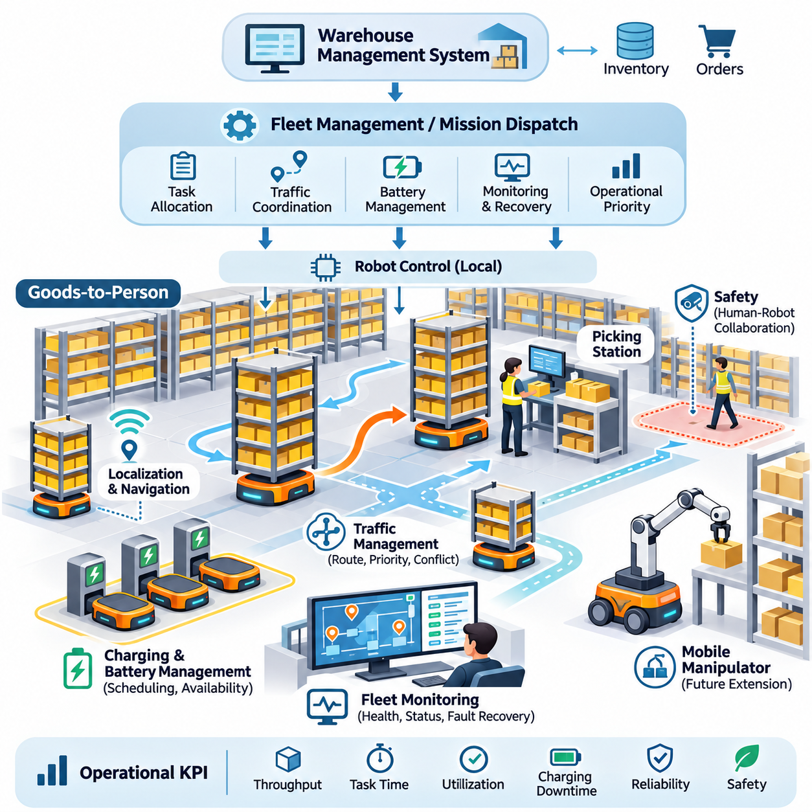
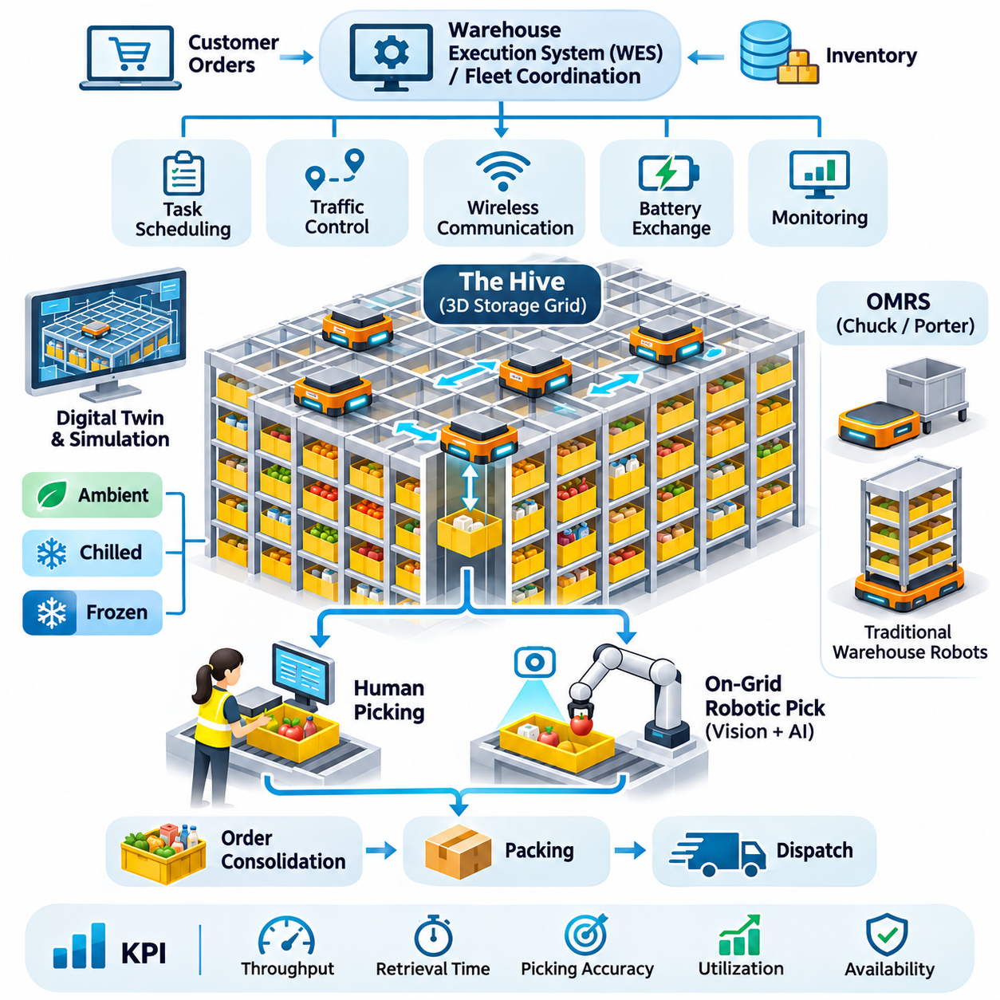
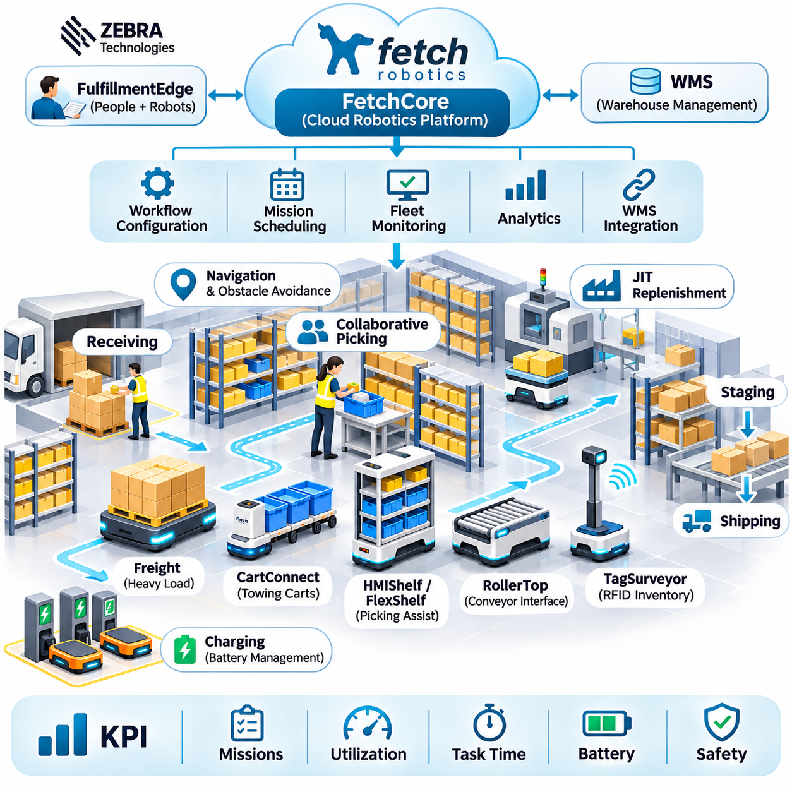
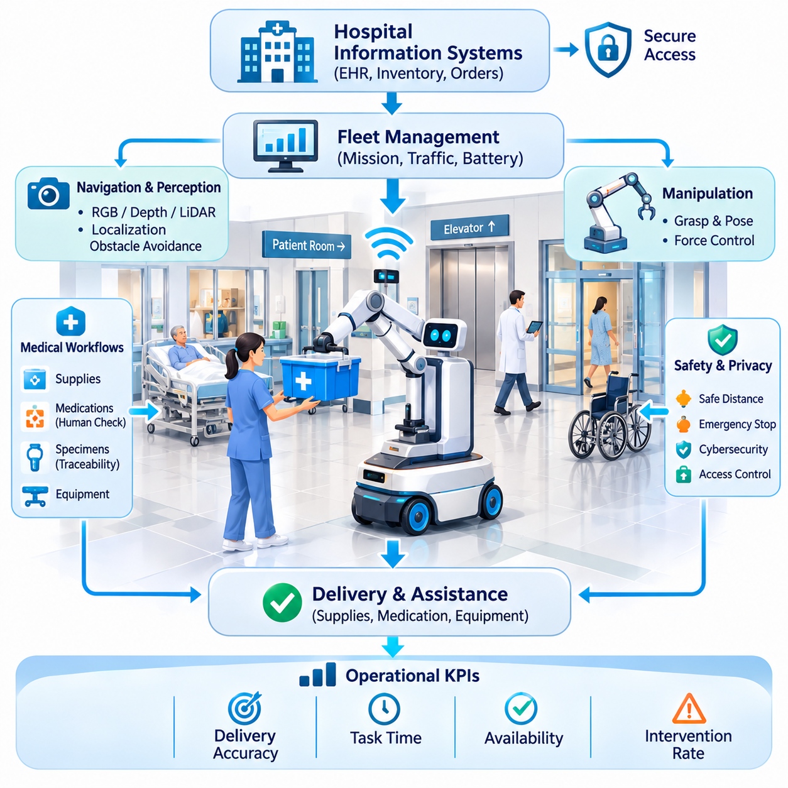
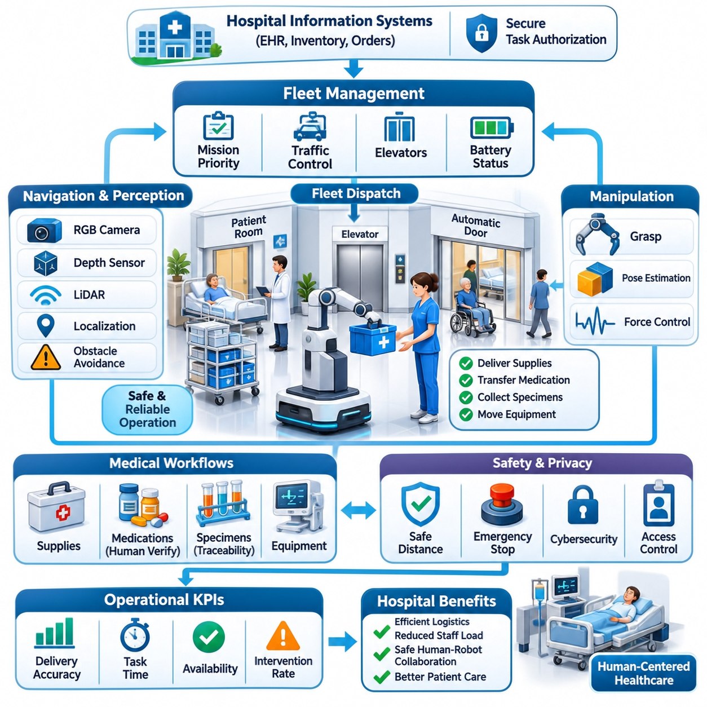
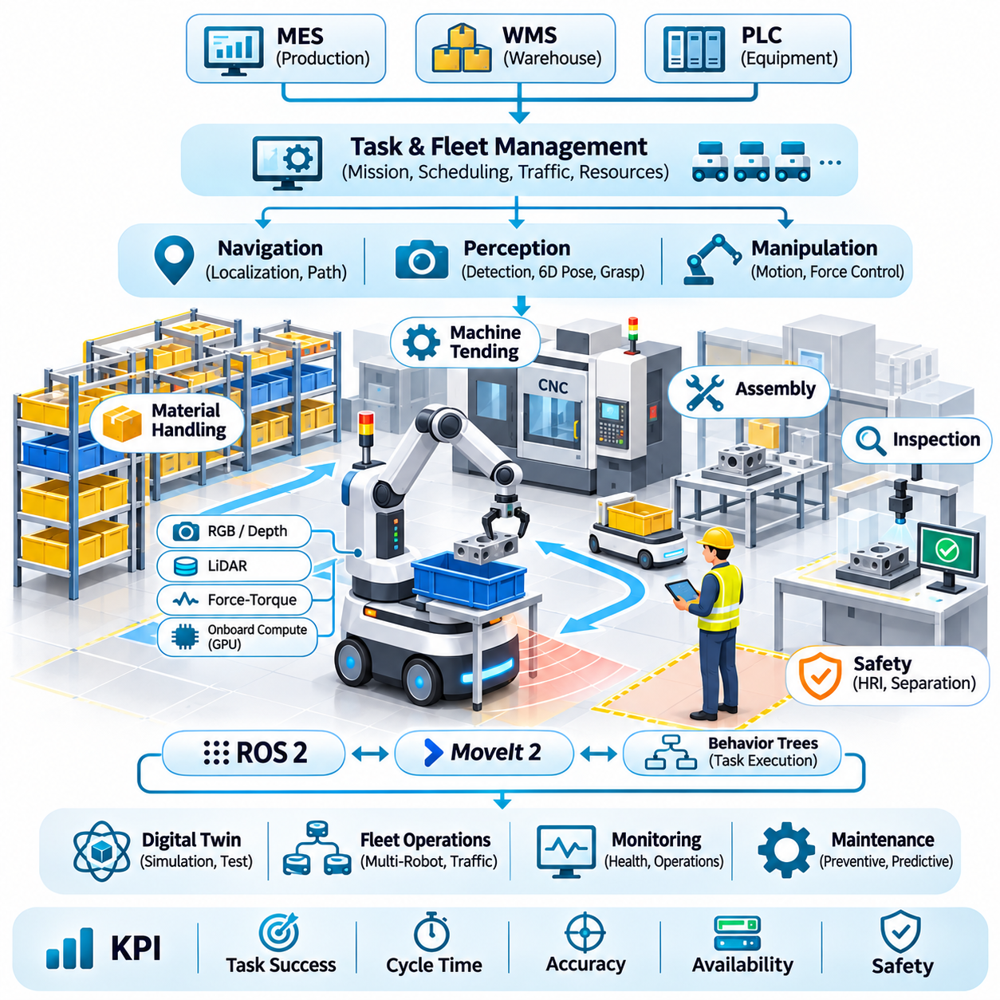
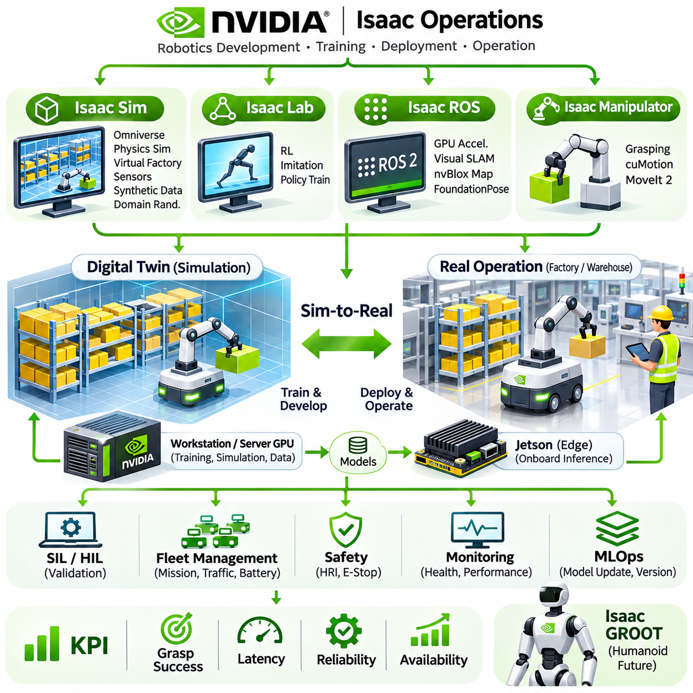
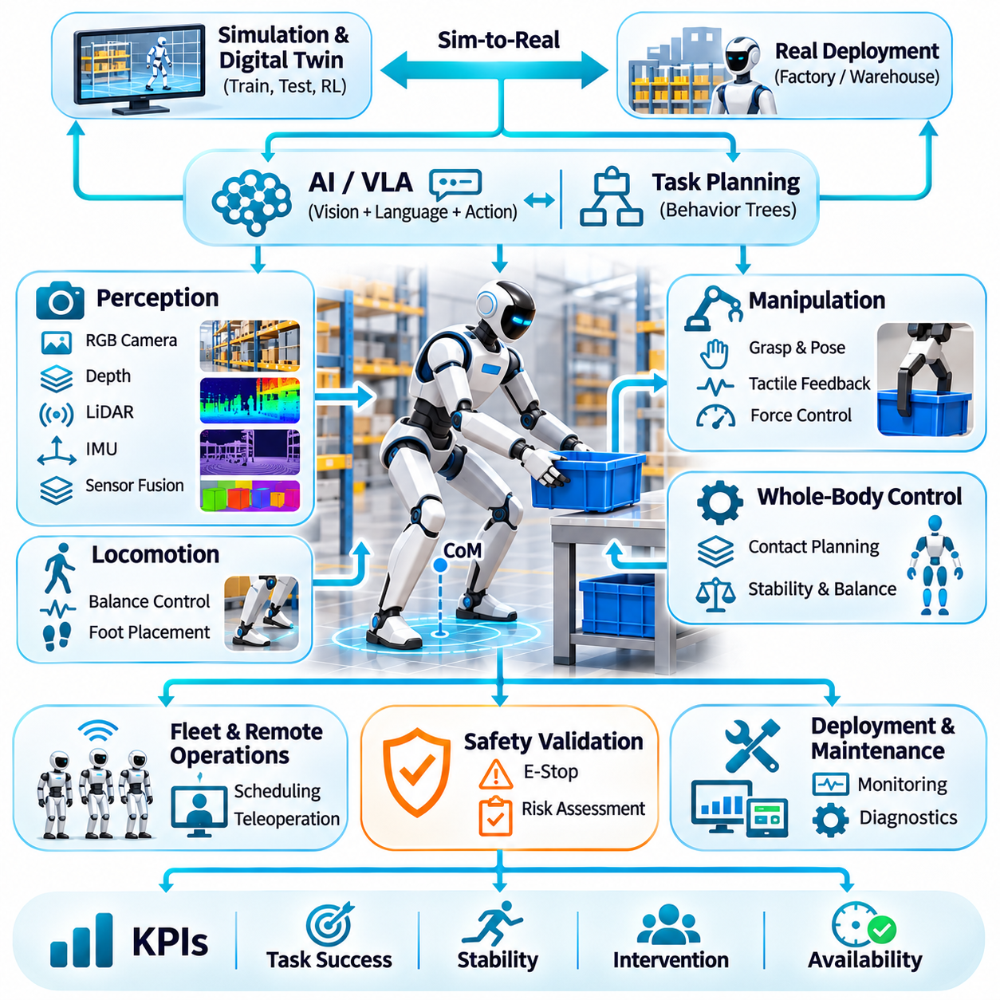

**Volume 04. Mobile Manipulation Software and Operations**

# Chapter 15. Case Studies

## 01 Amazon Robotics Fleet

{width="7.268055555555556in" height="7.268055555555556in"}

Amazon Robotics demonstrates how large-scale autonomous mobile robot fleets can transform warehouse operations by coordinating hundreds or thousands of mobile robots within a shared logistics environment. Its automation strategy integrates mobile platforms, inventory storage systems, centralized fleet coordination, warehouse management software, and human operators. Rather than treating each robot as an independent machine, the system operates as an interconnected logistics network in which individual robots continuously contribute to overall warehouse throughput.

A major milestone in Amazon\'s robotics development was the acquisition of Kiva Systems in 2012. The underlying technology introduced a goods-to-person model in which autonomous mobile robots transport movable storage pods to stationary picking stations. This approach significantly reduces the distance that warehouse employees must walk and allows inventory locations to be reorganized dynamically. The resulting architecture became a foundation for Amazon\'s broader warehouse automation strategy.

In a typical goods-to-person operation, inventory is stored in movable shelving units or pods distributed throughout a warehouse. Mobile drive units travel underneath compatible storage structures, lift them, and transport them to designated workstations. Human employees or automated picking systems retrieve the required products while the robot handles transportation. After the picking operation is completed, the mobile platform returns the storage unit to an appropriate location.

The fleet management system plays a central role in coordinating these operations. It receives transportation requests, evaluates robot availability, assigns missions, and manages the movement of multiple robots across shared warehouse infrastructure. Task allocation considers factors such as robot location, workload, battery status, destination accessibility, and operational priority. Effective fleet management minimizes unnecessary travel and improves the utilization of available robotic resources.

Task dispatching is closely connected to inventory management and warehouse execution software. When an order requires products from different storage locations, the system determines which pods should be retrieved and which workstations should process the requested items. Multiple transportation tasks can be scheduled simultaneously, allowing robots to execute independent missions while maintaining coordination with the overall order fulfillment process.

Traffic management becomes increasingly important as fleet size increases. Warehouse environments contain narrow passages, intersections, storage areas, charging stations, and workstation entrances. If several robots attempt to occupy the same region simultaneously, congestion and deadlocks may occur. Fleet coordination therefore requires route planning, traffic reservations, movement prioritization, and conflict resolution. These mechanisms help maintain continuous material flow while preventing unnecessary robot stops.

Robot localization and navigation provide the foundation for reliable fleet operations. Mobile platforms must estimate their positions relative to warehouse maps and maintain sufficient localization accuracy when approaching storage structures and workstations. Environmental landmarks, onboard sensors, motion estimation, and map-based navigation support autonomous movement. The fleet system uses this operational information to coordinate robot destinations and monitor mission progress.

Battery management is another essential component of large-scale fleet operation. Robots consume energy while transporting inventory, accelerating, navigating, and waiting for assigned tasks. Charging must therefore be coordinated with mission scheduling rather than treated as an isolated maintenance activity. A fleet management system can consider battery state, expected task duration, charging availability, and workload distribution when deciding whether a robot should continue working or return for charging.

Operational reliability depends on continuous monitoring of robot health and mission execution. Fleet monitoring systems collect information about robot availability, localization quality, navigation failures, battery conditions, communication status, and task completion. When a robot encounters an obstacle or experiences a technical problem, the system can reassign its pending tasks and prevent the failure from unnecessarily interrupting the entire warehouse operation.

Human operators remain important even in highly automated warehouses. Employees supervise picking activities, resolve exceptional situations, replenish inventory, and respond to operational alerts. The interaction between people and robots requires clear safety procedures, predictable robot behavior, accessible workstations, and effective monitoring interfaces. Physical separation, obstacle detection, emergency stopping, and controlled operating zones contribute to safe collaboration between human workers and autonomous mobile platforms.

The scalability of Amazon Robotics illustrates the importance of separating individual robot control from fleet-level decision-making. Each mobile platform handles local navigation, motion control, sensor processing, and immediate obstacle responses. Higher-level software manages mission assignment, inventory transportation, traffic coordination, and operational priorities. This hierarchical architecture allows warehouse operators to expand robotic capacity without redesigning every robot\'s internal control system.

Fleet performance should be evaluated through operational indicators rather than the number of deployed robots alone. Important measurements include completed transportation missions, order fulfillment throughput, average task duration, robot utilization, travel distance, charging downtime, congestion frequency, and system availability. These indicators reveal whether additional robots genuinely improve warehouse productivity or simply introduce greater traffic and coordination overhead.

The Amazon Robotics model also demonstrates the value of integrating physical automation with enterprise software. Warehouse management systems determine what inventory must be processed, while fleet management software coordinates how mobile robots transport the required storage units. Workstation software manages picking activities, and operational monitoring provides visibility into the overall process. This integration creates a continuous information flow between inventory decisions, transportation execution, and order fulfillment.

From a mobile manipulation perspective, the goods-to-person architecture represents an important foundation for more advanced robotic operations. Conventional mobile drive units primarily transport storage structures, whereas mobile manipulators combine autonomous navigation with robotic arms, end effectors, visual perception, and object-level manipulation. Extending warehouse automation toward mobile manipulation requires additional coordination between base positioning, arm motion planning, grasp execution, collision avoidance, and task-level control.

The transition toward mobile manipulation introduces new challenges in shared workspace management. A mobile manipulator must position its base accurately before executing an arm trajectory, while ensuring that the combined robot configuration remains collision-free. Fleet-level task allocation must also consider manipulation capabilities, payload limits, tool availability, and workstation compatibility. Consequently, future warehouse automation systems will require closer integration between fleet management, task planning, and manipulation software.

Another important lesson concerns graceful degradation and fault recovery. A large robotic fleet should continue operating when individual robots become unavailable. Failed missions should be detected, affected tasks should be reassigned when possible, and restricted areas should be handled without compromising the safety of other robots. This requires fault isolation, mission state management, recovery procedures, and reliable communication between robot-level and fleet-level software components.

The broader engineering lesson from Amazon Robotics is that successful warehouse automation depends on coordinated system design rather than isolated improvements in robot hardware. Navigation accuracy, task scheduling, traffic management, inventory software, charging infrastructure, human interaction, and operational analytics must work together. For developers of mobile manipulation systems, this case provides a practical reference for designing scalable fleet architectures that connect autonomous mobility with increasingly sophisticated manipulation capabilities.

## 02 Ocado Automation System

{width="7.268055555555556in" height="7.268055555555556in"}

Ocado\'s automation system demonstrates how large-scale robotic coordination, intelligent warehouse infrastructure, and software-driven logistics can be integrated into a highly automated grocery fulfillment operation. Its approach combines robotic storage and retrieval, centralized fleet management, order processing, inventory control, and warehouse execution software. The system is designed to handle large volumes of customer orders while maintaining operational efficiency, accurate inventory management, and reliable fulfillment performance.

The central component of Ocado\'s warehouse automation is its proprietary three-dimensional storage grid, commonly known as the Hive. Thousands of storage containers are arranged within a dense grid structure, while specialized retrieval robots travel along tracks across its upper surface. These robots lift, lower, and transport storage containers to designated workstations. This design enables high-density vertical storage and reduces the need for conventional warehouse aisles

The retrieval robots operate as a coordinated fleet rather than as independent autonomous agents making all operational decisions locally. A centralized Warehouse Execution System (WES) determines which containers must be retrieved, assigns transportation tasks, and coordinates robot movements. The system continuously updates operational decisions using real-time information about robot positions, storage locations, workstation availability, and order priorities. This architecture resembles an air traffic control system designed for a dense robotic environment

The storage and retrieval process begins when customer orders are received and translated into warehouse execution tasks. The software identifies the required products, determines their storage locations, and schedules the retrieval of corresponding containers. Robots then transport these containers to picking workstations, where products are selected and placed into customer order containers. Multiple orders can be processed simultaneously, allowing the warehouse to maintain high throughput while coordinating thousands of individual movements.

A distinctive characteristic of the Ocado system is its three-dimensional storage density. Unlike conventional warehouses, where mobile robots travel along extensive floor-level aisles, the Hive uses vertically arranged storage locations and a compact movement grid. Retrieval robots access containers stored at different depths by moving or temporarily relocating containers above the target position. The system must therefore coordinate not only horizontal robot movement but also the sequence of storage access operations. This approach improves space utilization while introducing additional requirements for scheduling and traffic coordination.

Fleet coordination requires precise control of robot movements across shared tracks. The WES continuously evaluates available routes, assigns retrieval missions, and manages potential conflicts between robots. Because many robots operate simultaneously within a relatively compact area, even small scheduling inefficiencies can create congestion and reduce throughput. The control architecture must balance shortest-path routing, task priority, storage accessibility, workstation demand, and overall fleet utilization to maintain efficient operation.

Communication infrastructure is essential for reliable coordination. The system must exchange operational information with thousands of robotic endpoints while maintaining predictable response times. Ocado has developed proprietary wireless communication technology to support its robotic operations. Its cloud-oriented software architecture also integrates warehouse execution services with cloud infrastructure and large-scale operational analytics. This combination supports centralized coordination, continuous data processing, and scalable management of complex fulfillment operations

Order fulfillment requires more than retrieving storage containers. The system must coordinate product picking, order consolidation, packing, and dispatch. Human-operated picking stations and robotic picking technologies can coexist within the same fulfillment architecture. Robotic arms use computer vision, advanced sensing, and artificial intelligence to identify products and perform picking operations. These systems are particularly valuable when handling diverse grocery products with different shapes, dimensions, packaging materials, and physical properties

Ocado\'s On-Grid Robotic Pick technology extends warehouse automation from container transportation to individual product manipulation. Robotic arms identify suitable products within storage containers and transfer them into customer order containers. Computer vision and machine learning support object recognition, grasp selection, and manipulation under varying conditions. The system is designed to handle products without requiring every item to be individually programmed in advance, although product characteristics and handling suitability remain important operational considerations

Battery management is another important part of the robotic architecture. Continuous operation requires robots to maintain sufficient energy while executing retrieval missions throughout the warehouse. Ocado employs automated battery exchange infrastructure that allows robots to replace depleted batteries without lengthy conventional charging interruptions. The charging infrastructure coordinates battery availability and exchange operations to reduce downtime and maintain fleet capacity during demanding fulfillment periods

Warehouse automation must also accommodate the different environmental requirements of grocery products. Ambient, chilled, and frozen products require different storage and handling conditions. Ocado\'s Customer Fulfillment Centres integrate these operational environments while coordinating inventory movement and order preparation. The software must consider product location, temperature requirements, storage availability, and order completion sequences to ensure that products are handled appropriately throughout the fulfillment process

Digital twins and simulation are important engineering tools in the development and optimization of Ocado\'s automation systems. A digital representation of the warehouse can model storage configurations, robot movement, workstation capacity, and operational demand. Engineers can evaluate alternative layouts, identify potential bottlenecks, and estimate system performance before implementing physical changes. Simulation also supports the evaluation of complex fleet interactions that would be difficult, expensive, or disruptive to investigate directly in an operational warehouse

Ocado\'s automation strategy also extends beyond its highly specialized grid-based fulfillment centres. Its Ocado Mobile Robot System (OMRS) combines autonomous mobile robots with intelligent software for traditional warehouse environments. Platforms such as Chuck support picking workflows by guiding associates and reducing unnecessary walking, while Porter transports heavier pallets and cages. Ocado IQ coordinates tasks and robot operations, demonstrating how the company\'s automation capabilities can be applied to facilities that do not use the proprietary Hive infrastructure

The operational performance of an Ocado-style automation system should be evaluated through several interconnected indicators. Important metrics include order fulfillment throughput, retrieval time, robot utilization, picking accuracy, workstation productivity, battery exchange frequency, inventory accessibility, and system availability. These measurements help engineers identify whether performance limitations originate from storage density, robot traffic, picking capacity, software scheduling, or downstream packing operations. Optimizing the complete fulfillment process is more important than maximizing the speed of an individual robot.

Reliability engineering is particularly important because centralized coordination introduces dependencies between software, communication networks, robots, storage infrastructure, and workstations. A communication interruption or software failure may affect multiple robots even when their mechanical systems remain operational. The architecture therefore requires fault detection, controlled recovery, operational monitoring, redundant infrastructure, and procedures for handling unavailable robots. Effective fault management should isolate individual failures and preserve as much warehouse functionality as possible.

From a mobile manipulation perspective, Ocado provides an important example of how autonomous transportation, intelligent perception, robotic picking, and centralized task coordination can be combined into a unified operational system. Its architecture demonstrates that manipulation performance depends not only on the robotic arm but also on accurate product presentation, workstation integration, inventory information, and task scheduling. These principles are directly relevant to the development of mobile manipulators for industrial logistics and automated material handling.

The most important engineering lesson from Ocado is that large-scale warehouse automation must be designed as an integrated cyber-physical system. Robotic platforms, storage infrastructure, communication networks, AI algorithms, warehouse execution software, and business applications must operate as coordinated components. The system\'s success depends on optimizing the complete flow from inventory storage to customer order dispatch rather than improving individual automation components in isolation. This approach provides a valuable reference for designing scalable mobile manipulation and multi-robot systems in modern industrial environments.

## 03 Fetch Robotics Operations

{width="7.268055555555556in" height="7.268055555555556in"}

Fetch Robotics provides an important case study of autonomous mobile robot (AMR) operations in industrial logistics, warehouse automation, and material handling. Its approach focuses on combining autonomous navigation, fleet management, cloud-based coordination, and flexible robotic platforms to automate the movement of materials within dynamic working environments. Rather than relying on fixed conveyor systems or permanently installed automation infrastructure, Fetch Robotics introduced mobile solutions that can adapt to changing facility layouts and operational requirements.

Fetch Robotics developed a broad portfolio of AMR platforms designed for different material-handling requirements. Its product family included Freight platforms for heavy material transportation, CartConnect robots for moving carts, HMIShelf and FlexShelf platforms for container and order picking, RollerTop systems for conveyor integration, and TagSurveyor robots for automated inventory tracking. This diversity demonstrates how a common autonomous navigation and fleet management architecture can support multiple warehouse workflows

A key component of Fetch Robotics was FetchCore, its cloud-based enterprise robotics platform. FetchCore provided centralized robot management, workflow configuration, mission scheduling, operational monitoring, and integration with warehouse systems. Operators could define workflows using visual configuration tools rather than developing complex robot programs from scratch. This approach reduced deployment complexity and allowed facilities to adapt automation workflows as production and logistics requirements changed

FetchCore also supported the coordination of heterogeneous robot fleets and operational workflows. Different robot models could perform transportation, picking assistance, inventory inspection, and material replenishment within the same facility. The software provided a common operational interface for managing robot activities and collecting information from deployed platforms. This architecture reduced the need to treat every material-handling process as an isolated automation project.

Autonomous navigation was fundamental to Fetch Robotics operations. Its mobile platforms used onboard sensors and environmental mapping to navigate through existing warehouse and manufacturing environments. Unlike traditional automated guided vehicles that often depend on magnetic tape, fixed tracks, or predefined infrastructure, AMRs can dynamically plan routes based on their understanding of the environment. This flexibility allows robots to respond to changing obstacles, temporary storage arrangements, and human activity while maintaining autonomous operation.

The deployment philosophy emphasized minimizing changes to existing facilities. Fetch AMRs were designed to operate without extensive infrastructure modifications, allowing companies to introduce mobile automation into warehouses and manufacturing plants with relatively limited preparation. Operators could configure facility maps and workflows through FetchCore, enabling deployment without constructing dedicated conveyor networks or permanently installing navigation infrastructure. This approach made incremental automation more practical for organizations with changing operational requirements

Collaborative picking was an important application of Fetch Robotics technology. In this workflow, warehouse employees concentrate on identifying and collecting products while AMRs transport containers, carts, or other material-handling equipment. The robot follows an assigned picking mission and provides a mobile destination for collected products. This reduces unnecessary walking and manual transportation, allowing employees to spend more time performing value-added picking activities.

The integration between Fetch AMRs and Zebra FulfillmentEdge demonstrated how robot operations could be coordinated with human workflows. FulfillmentEdge combines warehouse management information, worker activity, and mobile robot availability to determine appropriate next actions. It can coordinate multiple workers and robots across piece, case, and pallet picking operations. This integration also supports zone picking and wave picking, allowing warehouse operators to optimize multiple customer orders simultaneously

Fetch Robotics also supported manufacturing material replenishment and just-in-time delivery. In these applications, mobile robots transport components, raw materials, and work-in-progress items from storage locations to production lines. The objective is to ensure that manufacturing stations receive the required materials at the appropriate time without maintaining excessive inventory at each workstation. By coordinating robot missions with production requirements, facilities can improve material availability and reduce unnecessary manual transportation.

The same mobile automation architecture can support receiving, putaway, staging, consolidation, cross-docking, and reverse logistics. Robots can transport incoming materials to designated storage locations, deliver containers to production areas, and move completed products toward packing or dispatch operations. They can also support recycling collection and packaging material removal. This flexibility is important because warehouse automation requirements extend beyond a single transportation workflow

Inventory visibility was another significant application. Fetch\'s TagSurveyor platform was designed to automate RFID-based inventory tracking within facilities. Mobile robots can travel through designated areas and collect inventory identification information without requiring employees to manually inspect every storage location. The collected information can support inventory reconciliation, asset visibility, and identification of discrepancies between recorded and actual stock positions. Integrating mobile sensing with fleet operations extends AMR capabilities beyond transportation into warehouse intelligence

Operational monitoring and analytics provide important information for improving fleet performance. FetchCore can use information collected from robot sensors and operational activities to provide visibility into facility conditions and workflow execution. Relevant measurements include completed missions, robot utilization, travel distance, task completion time, battery status, navigation interruptions, and workflow productivity. These indicators help operators identify bottlenecks and determine whether additional robots, revised routes, or modified task assignments would improve overall performance

Safety is essential when mobile robots operate alongside employees and conventional material-handling equipment. Fetch platforms incorporate autonomous obstacle detection, navigation monitoring, and safety-related control functions to support operation in shared environments. Robot speed, stopping behavior, route selection, and interaction with people must be considered together. Facilities must also establish appropriate traffic rules, operating zones, emergency procedures, and maintenance practices. Safety validation should cover both individual robot behavior and the combined operation of the entire fleet.

Scalability is another important characteristic of the Fetch Robotics approach. Companies can begin with a limited number of AMRs assigned to repetitive transportation tasks and gradually expand deployment as operational benefits become clear. Additional robots can be introduced into existing workflows through fleet management software rather than requiring a complete redesign of the facility. However, increasing fleet size also introduces new requirements for traffic coordination, wireless communication capacity, charging infrastructure, mission scheduling, and operational supervision.

Fetch Robotics became part of Zebra Technologies following its acquisition in 2021. The acquisition connected Fetch\'s autonomous mobile robots and FetchCore cloud robotics platform with Zebra\'s broader enterprise technology portfolio, including mobile computing, barcode scanning, workflow management, and warehouse execution solutions. This combination demonstrated the strategic value of integrating physical robotic automation with enterprise information systems and frontline worker technologies

From a mobile manipulation perspective, Fetch Robotics provides an important reference for separating autonomous transportation from higher-level manipulation tasks. Its AMRs demonstrate how mobile platforms can transport materials, support human picking, and coordinate with warehouse software. A more advanced mobile manipulator can extend these capabilities by integrating robotic arms, visual perception, grasp planning, and object-level interaction. The underlying fleet architecture can then coordinate not only transportation missions but also manipulation tasks requiring specific tools, payload capabilities, and workstation configurations.

The Fetch Robotics case also highlights the importance of designing flexible automation around existing operational processes. Successful deployment requires understanding material flow, worker responsibilities, inventory organization, and production schedules before selecting robot configurations. A technically capable AMR does not automatically improve productivity if its assigned workflow creates additional waiting time or unnecessary movement. Effective automation therefore begins with process analysis and continues through integration, measurement, and operational optimization.

The most important engineering lesson from Fetch Robotics is that scalable industrial automation requires a combination of flexible mobile platforms, accessible fleet management software, cloud-based coordination, and human-centered workflow design. Its approach demonstrates how autonomous robots can be introduced incrementally into existing facilities without depending entirely on fixed automation infrastructure. For developers of mobile manipulators and multi-robot systems, Fetch Robotics provides a valuable reference for integrating autonomous mobility, fleet coordination, enterprise software, and collaborative industrial operations.

## 04 Hospital Mobile Manipulators

{width="7.268055555555556in" height="7.268055555555556in"}

{width="7.268055555555556in" height="7.268055555555556in"}

Hospital mobile manipulators demonstrate how autonomous mobile platforms and robotic manipulation technologies can support healthcare operations in complex, human-centered environments. Unlike conventional industrial robots operating in controlled production areas, hospital robots must navigate corridors, elevators, patient rooms, treatment areas, and shared public spaces. Their applications include medical supply transportation, medication handling, equipment delivery, specimen collection, and assistance with repetitive logistical tasks. These systems aim to reduce staff workload while improving operational efficiency and service reliability.

A hospital mobile manipulator combines an autonomous mobile robot (AMR), a robotic arm, perception sensors, an end effector, and an integrated control system. The mobile base provides navigation and transportation capabilities, while the robotic arm enables physical interaction with objects and surrounding infrastructure. Cameras, LiDAR, depth sensors, and force-torque sensors support environmental perception and manipulation. Integration of these components allows the robot to perform tasks that require both autonomous movement and object-level interaction.

Hospital environments introduce unique navigation challenges. Corridors may become crowded with patients, visitors, medical staff, wheelchairs, and movable equipment. Robots must recognize dynamic obstacles, maintain safe distances, and adapt their movement to unpredictable human behavior. Autonomous navigation therefore requires reliable localization, obstacle detection, dynamic path planning, and continuous environmental monitoring. Predictable movement and appropriate interaction with people are as important as navigation accuracy.

Medical supply transportation is one of the most practical applications of hospital mobile robotics. Robots can transport consumables, surgical instruments, medical equipment, linens, and other supplies between central storage areas and clinical departments. A mobile manipulator extends this capability by allowing robotic arms to interact with storage cabinets, containers, delivery interfaces, and designated transfer locations. This reduces repetitive transportation activities performed by healthcare personnel.

Medication logistics requires particularly careful system design. Medication containers must be associated with the correct patient, destination, and delivery schedule. Mobile manipulators can support the physical handling of designated medication packages, but medication identification, authorization, and dispensing decisions must remain governed by validated hospital information systems and clinical procedures. Secure access control, traceability, and human verification are essential when robotic systems interact with medication storage and delivery infrastructure.

Specimen collection and laboratory logistics represent another potential application. Hospitals continuously transport blood samples, tissue specimens, diagnostic materials, and laboratory containers between clinical departments and testing facilities. Mobile robots can coordinate scheduled collection and delivery missions while maintaining information about container identity and destination. Manipulation capabilities can support standardized container transfer, although biological safety, packaging integrity, contamination prevention, and chain-of-custody requirements must be addressed.

Hospital mobile manipulators can also assist with equipment handling. Medical devices such as infusion pumps, portable monitors, and diagnostic instruments frequently need to be moved between departments. A robot equipped with an appropriate gripper can potentially retrieve, transport, and position compatible equipment. However, manipulation must account for different object geometries, mechanical interfaces, weight distributions, and delicate components. The robot must also recognize situations in which human assistance is necessary.

Patient-room interaction introduces additional complexity. A mobile manipulator may be used to retrieve supplies, deliver personal items, or interact with designated storage and service interfaces. However, direct physical interaction with patients requires substantially higher safety requirements than ordinary warehouse manipulation. Contact forces, unexpected patient movement, medical equipment connections, and individual patient conditions must be considered. Robots intended for patient assistance therefore require carefully validated interaction capabilities and clearly defined operational boundaries.

Perception systems provide the information required for safe navigation and manipulation. RGB cameras support object recognition and scene understanding, while depth cameras and LiDAR provide spatial information for localization and obstacle detection. Advanced perception models can identify medical supplies, containers, equipment, and designated interaction areas. Sensor fusion improves environmental understanding, particularly when lighting conditions, reflective surfaces, or partially occluded objects affect individual sensors.

Manipulation planning must be coordinated with mobile navigation. Before an arm retrieves an object, the mobile base must reach a suitable position and establish a stable configuration. The planning system must evaluate the robot\'s reachable workspace, object pose, grasp configuration, and potential collisions with nearby furniture or medical equipment. Force-controlled manipulation and compliant motion can improve interaction with objects that require careful handling. These capabilities are particularly important when operating around fragile medical instruments and equipment.

Hospital information systems provide the operational context for robotic missions. Integration with hospital management systems, electronic health records, inventory platforms, and laboratory information systems can support task assignment and delivery tracking. However, robots should receive only the information necessary to perform their assigned tasks. Authentication, authorization, encrypted communication, audit logging, and privacy protection are essential because hospital environments contain sensitive patient and operational information.

Fleet management becomes important when multiple robots operate across different hospital departments. A centralized fleet management system can allocate transportation and manipulation tasks according to robot availability, battery condition, payload capability, destination, and mission priority. Traffic management must coordinate shared corridors, elevators, doors, charging stations, and transfer areas. Scheduling should also consider clinical priorities so that urgent medical deliveries are not delayed by routine transportation missions.

Elevator and automatic door integration is particularly important for multi-floor hospital operations. Robots must communicate with building management systems to request elevator access, identify destination floors, and coordinate entry and exit procedures. The system must verify that the elevator is available and that the robot can enter safely without interfering with patients or staff. Reliable building infrastructure integration enables mobile manipulators to operate as part of the hospital\'s wider logistics network.

Human-robot interaction (HRI) is a fundamental design requirement in healthcare environments. Patients and healthcare workers must understand the robot\'s intentions, movement patterns, and operational status. Visual indicators, display interfaces, audio notifications, and predictable navigation behavior can improve interaction. Robots should avoid obstructing emergency routes, respect patient privacy, and respond appropriately when people approach or request assistance. Human-centered design is essential for building trust and achieving acceptance among hospital personnel.

Safety validation must address both mobile navigation and robotic manipulation. Risk assessment should consider collisions, dropped objects, unintended contact, equipment interference, cybersecurity threats, and failures in communication or control. Emergency stopping, restricted operating zones, safe speed limits, collision detection, and controlled recovery procedures should be incorporated into the system architecture. Validation must cover normal operations, exceptional situations, and interactions with patients and healthcare workers.

Operational performance should be measured using indicators such as successful mission completion, delivery accuracy, transportation time, robot availability, manipulation success rate, battery utilization, and human intervention frequency. Additional measurements may include corridor congestion, elevator waiting time, equipment retrieval time, and workflow disruption. These indicators help hospital administrators determine whether mobile manipulation improves staff productivity and service quality without introducing additional operational complexity.

The most important engineering lesson from hospital mobile manipulators is that healthcare automation must prioritize safety, reliability, interoperability, and human-centered operation. A successful system is not simply a mobile robot equipped with a robotic arm. It is an integrated platform connecting autonomous navigation, intelligent perception, manipulation planning, hospital information systems, fleet management, and validated safety procedures. This case provides an important reference for developing mobile manipulation systems capable of operating in complex environments where technical performance and human well-being must remain equally important.

## 05 Industrial Mobile Manipulation

{width="7.268055555555556in" height="7.268055555555556in"}

Industrial mobile manipulation represents an important development in industrial automation because it combines autonomous mobile robots (AMRs) with robotic arms to perform transportation and physical manipulation within manufacturing and logistics environments. Unlike conventional industrial robots installed at fixed workstations, mobile manipulators can move between different operational areas and interact with objects at multiple locations. This capability enables flexible automation of material handling, machine tending, assembly assistance, inspection, and production support.

A typical industrial mobile manipulation system consists of a mobile base, an articulated robotic arm, an end effector, perception sensors, an onboard computing platform, and an integrated control architecture. The mobile base provides autonomous transportation, while the robotic arm performs object handling and manipulation. Cameras, LiDAR, depth sensors, and force-torque sensors provide environmental information and feedback. The integration of these components allows a single robotic platform to perform multiple tasks across a shared industrial workspace.

Manufacturing material handling is one of the most common applications. Mobile manipulators can retrieve components from storage locations, transport them to production stations, and position them for subsequent manufacturing operations. They can also collect completed products and deliver them to inspection, packaging, or temporary storage areas. By combining transportation and manipulation, these systems reduce the need for separate conveyor infrastructure and fixed robotic cells, providing greater flexibility when production layouts change.

Machine tending is another important industrial application. A mobile manipulator can approach CNC machines, injection molding equipment, or other automated production systems and perform loading and unloading operations. The robot positions its mobile base near the machine, establishes a suitable working configuration, opens an accessible interface when supported, and transfers workpieces using an appropriate gripper. Reliable machine tending requires precise positioning, coordinated arm motion, machine communication, and verification of loading and unloading conditions.

In assembly operations, mobile manipulators can transport components between workstations and perform selected assembly tasks. Examples include placing components into fixtures, inserting connectors, positioning mechanical parts, and handling tools. The robotic system must account for dimensional tolerances, object orientation, insertion forces, and fixture alignment. Force control and compliant manipulation are particularly valuable when components require controlled physical contact rather than simple pick-and-place movements.

Industrial inspection and quality assurance provide additional opportunities for mobile manipulation. A mobile platform can travel to different inspection locations while its robotic arm positions cameras, measurement devices, or contact sensors near target objects. Vision systems can identify defects, verify component presence, and evaluate assembly conditions. By integrating mobile navigation with inspection equipment, manufacturers can perform measurements across multiple workstations without installing dedicated inspection robots at every location.

Warehouse and production logistics can also benefit from mobile manipulators. Robots can retrieve containers, transfer individual components, organize materials, and support replenishment operations. Unlike conventional AMRs that primarily transport complete carts or pallets, mobile manipulators can interact directly with individual objects. This capability is particularly useful when materials are stored in shelves, bins, or workstations that require physical picking and placement.

Perception is a fundamental capability in industrial mobile manipulation. The robot must identify objects, estimate their positions and orientations, recognize obstacles, and understand the surrounding workspace. RGB cameras provide visual information, while depth sensors and LiDAR support spatial reconstruction and localization. Object detection, six-dimensional pose estimation, and grasp detection enable the system to determine how an object should be approached and manipulated. Reliable perception is especially important when object positions vary between production cycles.

Mobile base positioning and robotic arm motion must be coordinated through whole-body planning. The mobile platform must reach a location where the arm can access the target object without exceeding its reachable workspace or creating an unstable configuration. The planning system must consider base pose, arm joint limits, collision constraints, payload, and the geometry of nearby equipment. A suitable base position can significantly reduce unnecessary arm movement and improve manipulation accuracy.

Motion planning systems such as MoveIt 2 can support robotic arm trajectory generation, inverse kinematics, collision checking, and manipulation planning. For mobile manipulators, these capabilities must be integrated with autonomous navigation and mobile base control. The system may need to reposition the base when an object cannot be reached from its current location. Coordinating navigation and manipulation within a unified task execution architecture improves operational efficiency and reduces failed manipulation attempts.

Task planning determines how industrial operations are decomposed into executable actions. A manufacturing mission may involve navigating to a storage location, identifying a component, grasping it, transporting it to a machine, placing it into a fixture, and confirming successful completion. Behavior Trees can organize these actions into reusable execution structures while managing conditions, failures, retries, and recovery procedures. This approach makes complex industrial workflows easier to monitor and maintain.

Integration with industrial automation infrastructure is essential for reliable operation. Mobile manipulators may communicate with programmable logic controllers (PLCs), manufacturing execution systems (MES), warehouse management systems (WMS), and industrial equipment through standardized interfaces. These connections allow the robot to receive production tasks, confirm machine readiness, exchange process information, and report task completion. ROS 2 can provide the robotics middleware, while industrial communication protocols support integration with existing manufacturing systems.

Human-robot collaboration is increasingly important in flexible manufacturing environments. Mobile manipulators may operate near workers who perform inspection, assembly, material preparation, and other production activities. The robot must recognize human presence, maintain appropriate separation, and respond safely to unexpected movement. Visual indicators, audible notifications, controlled speed, and collaborative operating modes can improve interaction. The system should also provide clear information about its current task and intended movement.

Safety engineering must consider the combined behavior of the mobile base and robotic arm. Potential hazards include collisions during navigation, unexpected arm movement, dropped payloads, crushing points, and interference with production equipment. Safety architecture should incorporate emergency stopping, protective sensing, speed and separation monitoring where appropriate, safe motion limits, and controlled recovery procedures. Risk assessment must evaluate the complete mobile manipulation system rather than treating the mobile platform and robotic arm as independent machines.

Fleet management becomes important when multiple mobile manipulators operate within the same manufacturing facility. A fleet management system can assign missions according to robot availability, payload capacity, arm configuration, tool compatibility, battery condition, and task priority. Traffic management coordinates movement through shared corridors and work areas, while resource allocation ensures that specialized robots are assigned to tasks they can perform. Multi-robot coordination can further support cooperative transportation and distributed production workflows.

Digital twins and simulation can reduce the complexity and cost of industrial deployment. Engineers can create virtual representations of robots, production equipment, workstations, and factory environments to evaluate navigation and manipulation tasks before physical implementation. Simulation supports collision analysis, reachability assessment, cycle-time estimation, and workflow optimization. Digital twins can also compare predicted behavior with actual operating data, helping engineers identify performance deviations and improve system configurations.

Industrial mobile manipulation requires continuous monitoring and maintenance throughout its operational lifecycle. Important indicators include mission completion rate, manipulation success rate, positioning accuracy, cycle time, payload utilization, battery consumption, and system availability. Monitoring mechanical wear, sensor performance, communication quality, and actuator conditions helps identify potential failures before they interrupt production. Preventive maintenance and predictive diagnostics are therefore essential for maintaining reliable operation.

The economic value of industrial mobile manipulation depends on more than the initial reduction in labor requirements. Manufacturers must evaluate equipment costs, integration effort, operational flexibility, production throughput, maintenance expenses, and return on investment. Mobile manipulators are particularly attractive when production layouts change frequently, multiple workstations require similar handling operations, or fixed automation would require substantial infrastructure investment. Their value increases when one platform can perform several different tasks throughout its operating schedule.

The most important engineering lesson from industrial mobile manipulation is that autonomous transportation and robotic manipulation must be designed as one coordinated operational capability. Navigation, perception, localization, motion planning, task execution, industrial communication, fleet management, and safety validation must operate together. Successful deployment requires understanding the production process and selecting appropriate combinations of mobile platforms, robotic arms, end effectors, and software architectures. This integrated approach provides a foundation for flexible manufacturing systems in which mobile manipulators can adapt to changing production requirements while maintaining reliable and safe industrial operations.

## 06 NVIDIA Isaac Operations

{width="7.268055555555556in" height="7.268055555555556in"}

NVIDIA Isaac represents an integrated robotics development platform designed to accelerate the development, simulation, training, deployment, and operation of intelligent robotic systems. It combines GPU-accelerated computing, robotics software, artificial intelligence models, simulation frameworks, and reference workflows. The platform supports autonomous mobile robots (AMRs), robotic arms, mobile manipulators, and humanoid robots. Its importance lies in connecting virtual development environments with physical robotic systems through a consistent software and computing ecosystem

A central characteristic of NVIDIA Isaac is its integration with the Robot Operating System 2 (ROS 2) ecosystem. Isaac ROS provides optimized robotics packages that extend conventional ROS 2 applications with NVIDIA GPU acceleration and specialized AI capabilities. Developers can retain familiar ROS 2 communication mechanisms, nodes, topics, services, and actions while integrating accelerated perception, localization, mapping, object recognition, and motion planning. This approach allows robotics teams to improve computational performance without replacing their entire software architecture.

NVIDIA Isaac Sim provides the simulation environment for developing and validating robotic applications. Built on NVIDIA Omniverse technologies, it supports physically based simulation, realistic rendering, sensor modeling, and virtual representations of robots and industrial environments. Engineers can import robot descriptions, CAD assets, and USD-based scenes, configure physical properties, and evaluate robot behavior under different operating conditions. This enables development teams to identify mechanical, perception, and navigation problems before deploying physical hardware

Simulation is particularly valuable for mobile manipulation because these systems combine navigation, perception, and physical interaction. Engineers can reproduce warehouse layouts, manufacturing stations, storage structures, and human operating zones inside Isaac Sim. Virtual robots can execute navigation and manipulation tasks while simulated cameras, LiDAR sensors, and depth sensors provide environmental observations. Developers can evaluate collision avoidance, workspace accessibility, object recognition, grasping, and trajectory execution within repeatable experimental conditions.

Synthetic data generation is another important capability of the Isaac ecosystem. Real-world robotics datasets are expensive to collect and may not adequately represent rare environmental conditions or unusual object configurations. Isaac Sim can generate synthetic images, depth information, segmentation masks, and other annotated sensor outputs using controlled virtual environments. Domain randomization can vary lighting, object positions, materials, backgrounds, and sensor configurations. These datasets can support training and evaluation of perception models while reducing dependence on manually collected real-world data.

NVIDIA Isaac Lab extends the simulation environment toward robot learning and policy development. It provides reusable environments and workflows for reinforcement learning and imitation learning. Developers can train robot policies across multiple simulated environments and evaluate their performance under different initial conditions. This approach is particularly relevant to locomotion, manipulation, grasping, and other tasks that require learning complex relationships between observations and physical actions. Isaac Lab complements Isaac Sim by providing structured learning workflows rather than replacing the underlying simulation environment.

Isaac ROS provides accelerated software components for perception and navigation. Visual SLAM supports simultaneous localization and mapping using camera information, while nvBlox can construct three-dimensional environmental representations from RGB-D and LiDAR data. These capabilities help mobile robots estimate their positions, recognize environmental changes, and generate navigation costmaps that include previously unseen obstacles. GPU acceleration is particularly useful when robots must process high-resolution sensor information while maintaining responsive navigation behavior.

Object perception and pose estimation are essential for robotic manipulation. NVIDIA\'s FoundationPose technology supports six-dimensional object pose estimation and tracking, including objects that may not have been encountered during conventional model-specific training. Combined with visual perception and depth information, pose estimation enables a robot to determine an object\'s position and orientation relative to its coordinate frames. This information can be used by grasp planning and manipulation systems to select suitable interaction configurations and execute object-level tasks.

NVIDIA Isaac Manipulator provides a development foundation for AI-powered robotic arms that perceive and interact with their environments. Built on Isaac ROS, it connects perception, pose estimation, grasping, and accelerated motion planning capabilities. A mobile manipulation system can use these components to identify objects, calculate grasp configurations, generate arm trajectories, and execute pick-and-place operations. However, successful deployment still requires robot-specific calibration, mechanical configuration, end-effector integration, collision models, and validation of the complete mobile base and arm system.

Motion planning is another important part of NVIDIA Isaac operations. Isaac ROS cuMotion provides CUDA-accelerated motion planning by evaluating multiple trajectory optimization solutions in parallel. This can improve planning performance for robotic arms operating in complex environments with collision constraints. Its integration with MoveIt 2 allows developers to incorporate accelerated planning into established ROS 2 manipulation architectures. For mobile manipulators, motion planning must also consider the position of the mobile base, the arm\'s reachable workspace, surrounding obstacles, and the stability of the complete robot configuration.

The development workflow typically connects simulation, learning, software integration, and physical deployment. Engineers first prepare robot models and virtual environments, then evaluate perception and motion planning components within simulation. AI models can be trained or optimized using real and synthetic datasets before being integrated into ROS 2 applications. The resulting software is subsequently deployed to physical robots for hardware testing and operational validation. This workflow helps identify differences between simulated and real behavior before the system enters production.

Edge computing is essential for deploying Isaac-based applications on physical robots. NVIDIA Jetson platforms provide GPU-accelerated computing for onboard perception, localization, inference, and robotic decision-making. More computationally demanding workloads can use workstation or server-class NVIDIA GPUs during development, model training, and simulation. Separating development and training workloads from real-time onboard execution allows robotic systems to maintain responsive operation while benefiting from more powerful computing infrastructure during development.

The transition from simulation to physical deployment is commonly described as Sim-to-Real. Although simulated environments provide repeatable development conditions, physical robots experience sensor noise, mechanical tolerances, lighting variations, unexpected obstacles, and communication delays. Engineers must therefore validate localization accuracy, perception reliability, grasp success, trajectory execution, and control stability using real hardware. Systematic comparison between simulated predictions and measured operational behavior helps identify model inaccuracies and improve deployment reliability.

NVIDIA Isaac also supports software-in-the-loop and hardware-in-the-loop testing. Software-in-the-loop testing connects simulation environments with external robotics software to evaluate system behavior without requiring physical hardware for every experiment. Hardware-in-the-loop testing introduces actual computing hardware or selected physical components into the validation process. These methods allow engineers to test communication, control timing, sensor processing, and software integration under increasingly realistic conditions before full-scale deployment.

Production operation requires additional infrastructure beyond the Isaac development platform itself. Robot fleets need mission scheduling, task allocation, traffic coordination, battery management, health monitoring, and operator supervision. These functions are generally provided by application-specific fleet management systems and enterprise software integrated with the robot\'s ROS 2 architecture. NVIDIA Isaac can provide accelerated perception, navigation, and manipulation capabilities within each robot, while external fleet management software coordinates multiple robots and their operational responsibilities.

Operational monitoring is necessary to maintain consistent performance after deployment. Engineers should monitor GPU utilization, CPU load, memory consumption, sensor processing latency, localization quality, perception confidence, motion planning time, and communication reliability. Manipulation-specific indicators include grasp success rate, object pose accuracy, collision frequency, and task completion time. Monitoring these measurements helps identify whether performance degradation originates from computing limitations, environmental changes, sensor failures, or software integration problems.

Model lifecycle management is equally important when AI-based perception and manipulation are deployed in production. Training datasets, model versions, inference configurations, and deployment packages should be maintained under controlled version management. Updated models must be evaluated against representative validation datasets and operational scenarios before being distributed to physical robots. Rollback procedures should be available when an update causes unexpected behavior. This approach connects NVIDIA Isaac development workflows with established MLOps and robotics software engineering practices.

The broader NVIDIA robotics ecosystem also includes Isaac GR00T, which focuses on humanoid robot development and general-purpose robot foundation models. Its development direction highlights the increasing importance of combining perception, reasoning, learning, and physical action within unified robotic systems. Although humanoid robotics introduces different mechanical and control requirements from industrial mobile manipulators, the underlying development principles of simulation, synthetic data, model training, accelerated inference, and real-world validation remain relevant across both domains

The most important engineering lesson from NVIDIA Isaac operations is that modern robotics development requires a continuous connection between simulation, AI development, accelerated computing, software integration, and physical deployment. Isaac Sim supports virtual development and testing, Isaac Lab enables robot learning, Isaac ROS provides accelerated ROS 2 capabilities, and Isaac Manipulator supports advanced robotic manipulation. When these technologies are integrated with appropriate edge computing, fleet management, safety engineering, and operational monitoring, they provide a foundation for developing scalable and intelligent mobile manipulation systems.

## 07 Humanoid Operations Preview

{width="7.268055555555556in" height="7.268055555555556in"}

Humanoid robots represent an emerging direction in mobile manipulation, combining human-like physical structures with autonomous perception, locomotion, manipulation, and intelligent decision-making. Unlike conventional industrial robots designed for specific workstations, humanoid robots are intended to operate in environments originally designed for people. Their potential applications include manufacturing, warehouse operations, material handling, equipment inspection, facility maintenance, and service activities. Their operational value comes from the ability to navigate human environments and interact with tools, objects, and infrastructure designed for human use.

A typical humanoid robot consists of a humanoid body structure, articulated legs, a torso, two robotic arms, multi-fingered hands, perception sensors, and onboard computing systems. The mechanical architecture determines the robot\'s degrees of freedom, payload capacity, reachable workspace, and movement capabilities. Cameras, depth sensors, inertial measurement units, force-torque sensors, and joint encoders provide information about the environment and the robot\'s physical state. Integrating these components requires coordinated hardware, software, and control architectures.

Locomotion is one of the most fundamental capabilities of humanoid robots. Unlike wheeled mobile manipulators, humanoids must maintain dynamic balance while walking, turning, stepping over obstacles, and recovering from disturbances. Their control systems coordinate joint trajectories, foot placement, body posture, and center-of-mass movement. Whole-body control enables the robot to distribute motion across multiple joints while maintaining balance and satisfying physical constraints. Reliable locomotion is essential before humanoids can perform complex manipulation tasks in unstructured environments.

Perception systems allow humanoid robots to understand their surroundings and interact with objects. RGB cameras provide visual information for object recognition and scene understanding, while depth sensors and LiDAR support spatial perception. Inertial measurement units and joint sensors contribute to state estimation and body awareness. Sensor fusion combines these information sources to estimate environmental geometry, identify obstacles, recognize manipulation targets, and maintain awareness of the robot\'s own configuration. Perception must remain reliable under changing lighting, occlusion, and dynamic environmental conditions.

Humanoid manipulation extends conventional robotic arm operations through coordinated use of the upper body, arms, wrists, and hands. Robots can potentially grasp tools, open doors, operate switches, handle containers, and manipulate objects with different geometries. Multi-fingered hands provide additional flexibility but introduce substantial control complexity. Successful manipulation requires accurate object pose estimation, grasp planning, force control, tactile feedback, and coordinated finger movement. The robot must also account for its body balance when handling objects or applying external forces.

Whole-body manipulation is particularly important when humanoids interact with large or heavy objects. A robot may need to adjust its foot positions, torso orientation, arm configuration, and center of mass simultaneously while lifting or moving an object. Unlike fixed-base manipulators, humanoids cannot assume that their supporting structure remains stationary during manipulation. Whole-body motion planning must therefore consider contact stability, joint limits, payload distribution, friction, and potential loss of balance. This creates a close relationship between locomotion planning and manipulation planning.

Task planning determines how high-level objectives are translated into executable robotic actions. A task such as collecting a component may require the robot to identify the target, navigate to its location, establish a stable posture, reach the object, grasp it, and deliver it to a destination. Hierarchical task planning and behavior-based execution can organize these activities into manageable operations. Behavior Trees and task-and-motion planning approaches can coordinate navigation, perception, manipulation, and recovery while handling changing environmental conditions.

Foundation models and vision-language-action models are expected to influence humanoid operations significantly. These models connect visual observations, natural-language instructions, and physical actions within a unified learning framework. A human operator may describe a task using ordinary language, while the robot interprets the instruction, identifies relevant objects, determines an action sequence, and generates appropriate control commands. However, foundation models must operate within validated safety constraints, and their outputs require verification before physical execution. Reliable operation also depends on task-specific data, evaluation, and appropriate fallback mechanisms.

Simulation and digital twins provide essential development environments for humanoid robotics. Physics-based simulation enables engineers to evaluate walking, balancing, object manipulation, collision behavior, and recovery strategies without repeatedly using physical hardware. Digital representations of robot bodies, sensors, environments, and contact interactions support systematic testing. Simulation can also generate synthetic training data and enable reinforcement learning across multiple scenarios. These capabilities reduce development costs and help identify unstable behaviors before real-world deployment.

Sim-to-Real transfer remains a major challenge because physical humanoid robots experience conditions that are difficult to reproduce perfectly in simulation. Differences in friction, actuator response, sensor noise, mechanical tolerances, and contact dynamics can significantly affect performance. Policies trained in simulation must therefore be validated and adapted using real-world measurements. Domain randomization, system identification, sensor calibration, and progressive hardware testing can reduce the gap between simulated and physical behavior. Reliable deployment requires continuous comparison between predicted and observed robot performance.

Fleet management and multi-robot coordination will become increasingly important as humanoid robots move from individual demonstrations toward practical industrial deployments. Multiple robots may share manufacturing areas, warehouses, and service environments while performing different tasks. Fleet management systems can allocate missions based on robot availability, physical capabilities, payload limits, battery conditions, and task priorities. Traffic management, shared workspace coordination, and resource scheduling will be necessary to prevent conflicts and maintain efficient operations.

Remote operations and human-in-the-loop control will remain important even when humanoid robots achieve advanced autonomy. Complex manipulation tasks, unexpected failures, and ambiguous situations may require human supervision or teleoperation. Operators need access to camera feeds, robot status information, task progress, and diagnostic data. Latency management is particularly important when remote control involves dynamic balance or physical interaction. A practical operational architecture should combine autonomous execution with human intervention and controlled recovery procedures.

Safety validation is a fundamental requirement for humanoid deployment. Bipedal locomotion, articulated limbs, powerful actuators, and physical interaction create risks involving falls, collisions, crushing, dropped objects, and unintended contact. Safety engineering must consider mechanical design, control behavior, environmental perception, emergency stopping, and operational restrictions. Risk assessment, functional safety testing, collision evaluation, and human-robot interaction validation should cover both individual robot capabilities and complete operational scenarios. Safety cannot depend exclusively on the reliability of AI models.

Field deployment requires additional engineering beyond laboratory demonstrations. Facilities must be evaluated for floor conditions, access routes, workspace dimensions, lighting, communication coverage, and interaction with existing equipment. Commissioning should verify locomotion, manipulation, localization, communication, and recovery behavior under realistic operating conditions. Operators and maintenance personnel require appropriate training, while incident response procedures and operational monitoring must be established before regular production use. Successful deployment depends on matching robot capabilities to actual workplace requirements.

Operational maintenance and lifecycle management are equally important for long-term humanoid operation. Walking and manipulation impose repeated mechanical loads on joints, actuators, transmissions, batteries, and structural components. Continuous health monitoring can detect abnormal temperatures, excessive vibration, actuator degradation, and changes in power consumption. Preventive and predictive maintenance help reduce unexpected downtime, while spare parts management and standardized service procedures support fleet availability. AI model updates and software changes must also be validated to avoid introducing new operational risks.

Humanoid operations should ultimately be evaluated through measurable engineering and business indicators. Relevant metrics include walking stability, task completion rate, manipulation success, payload capacity, cycle time, energy consumption, intervention frequency, system availability, and safety incidents. Performance should be evaluated across complete workflows rather than isolated demonstrations. A robot that successfully performs one manipulation task in a controlled environment may still be unsuitable for continuous industrial operation if it requires frequent intervention or cannot maintain consistent performance.

The most important engineering perspective is that humanoid robots should be developed as integrated autonomous systems rather than simply as human-shaped mechanical platforms. Their practical operation depends on the coordination of locomotion, perception, whole-body control, manipulation, task planning, simulation, AI learning, fleet management, remote supervision, safety validation, and maintenance. The future of humanoid robotics will depend not only on improving individual capabilities but also on making these capabilities reliable, measurable, maintainable, and economically useful in real operational environments.
