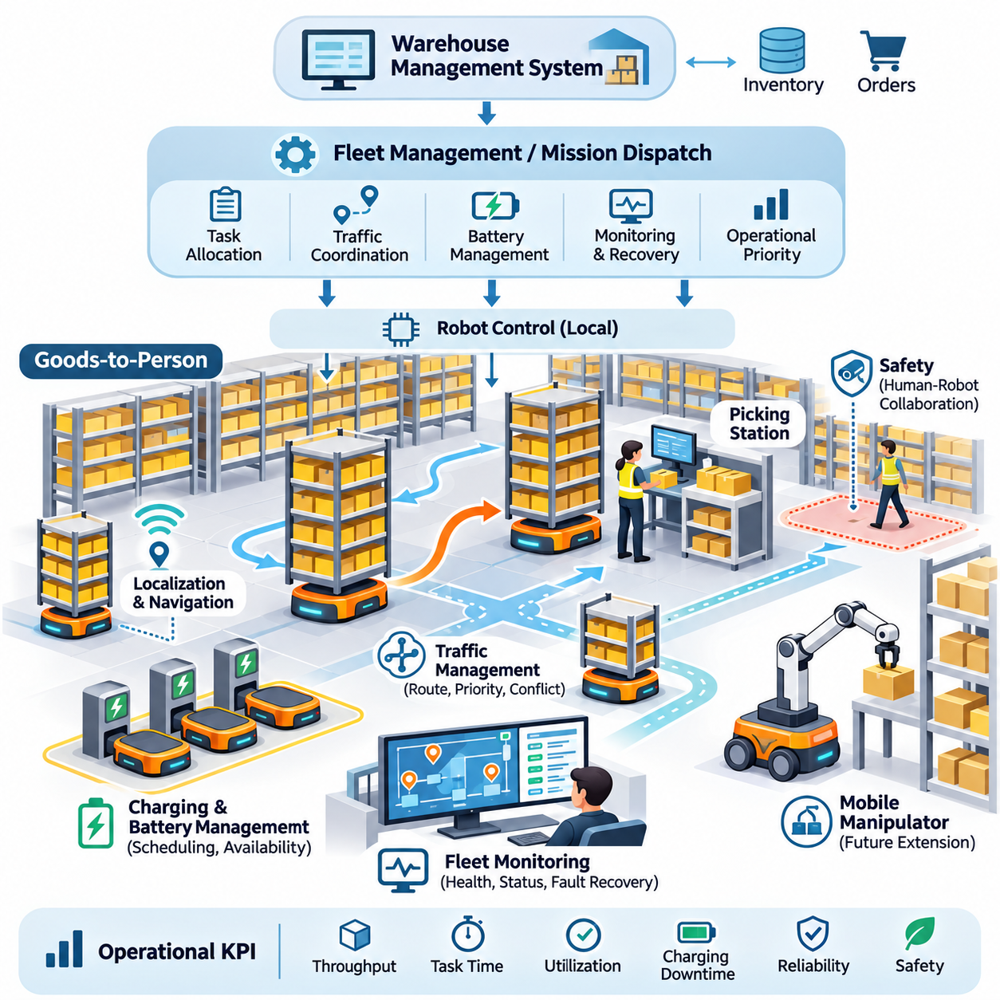
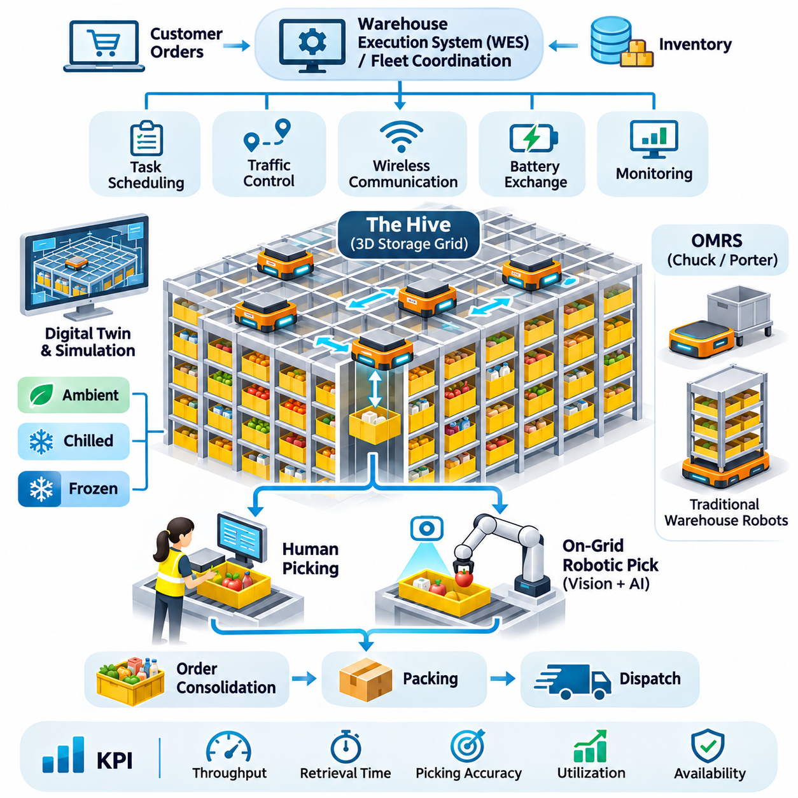
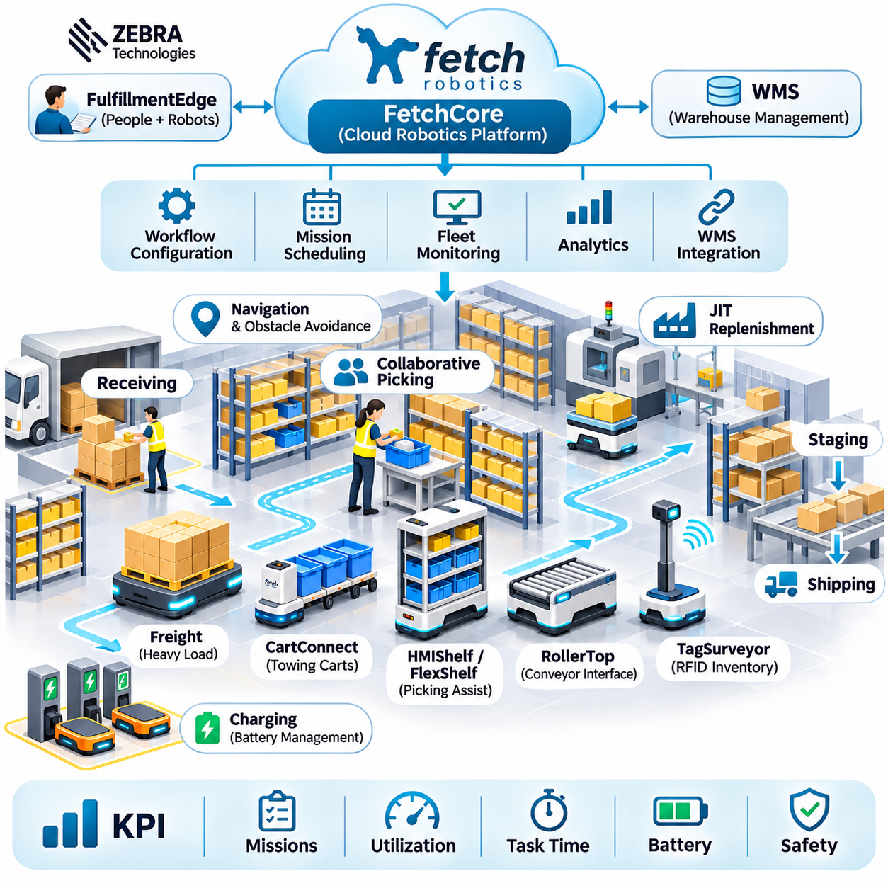
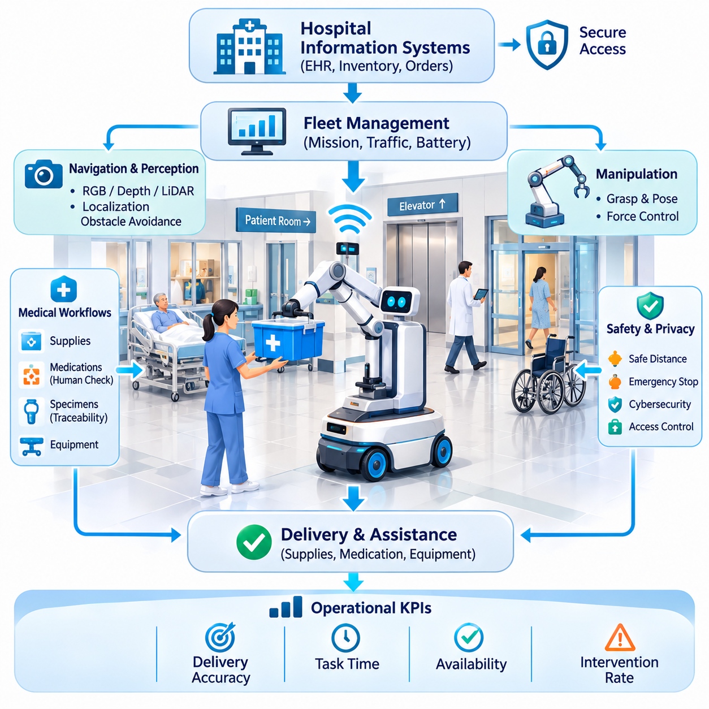
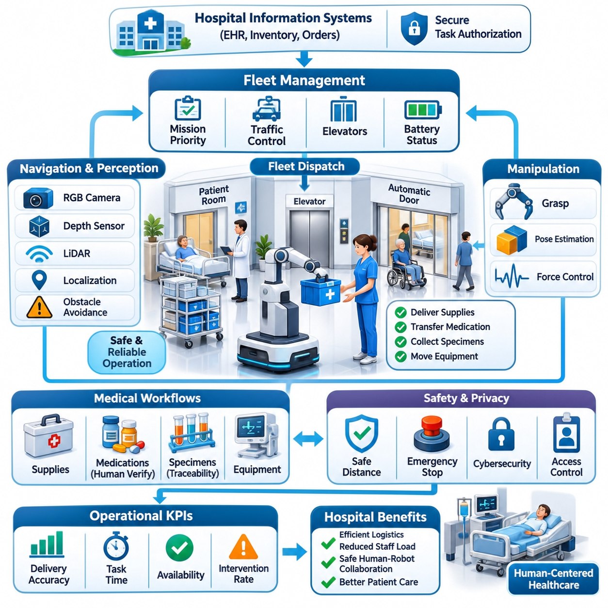
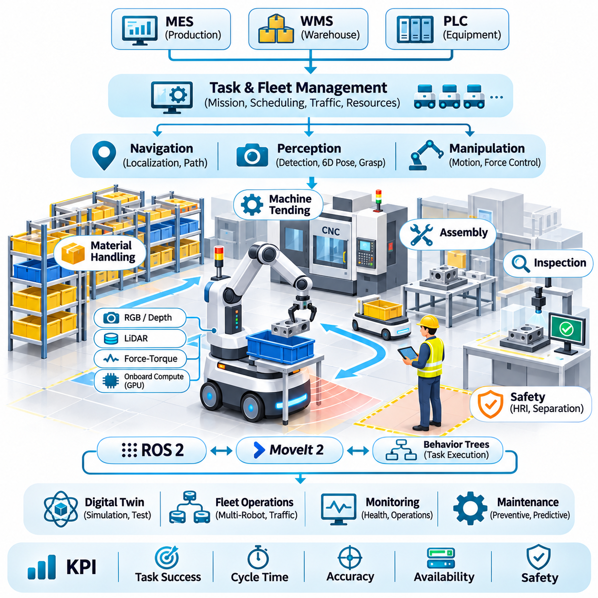
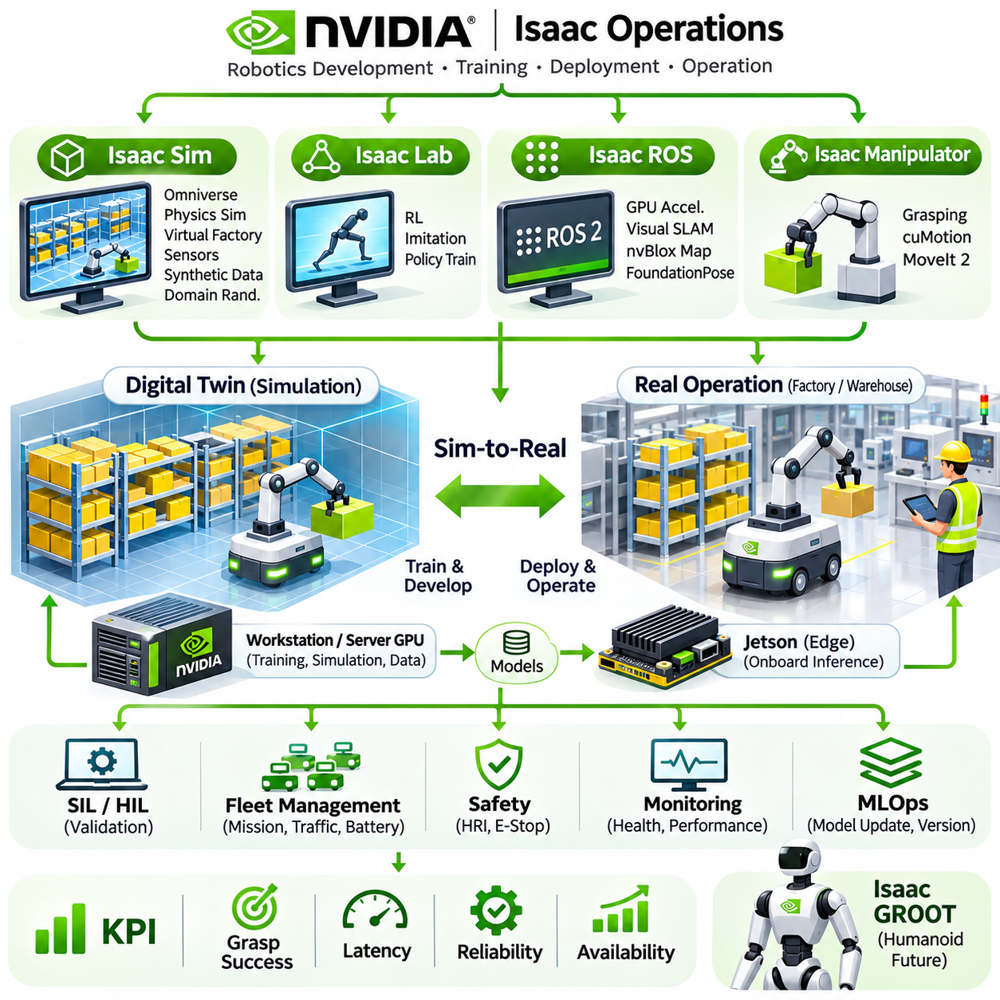
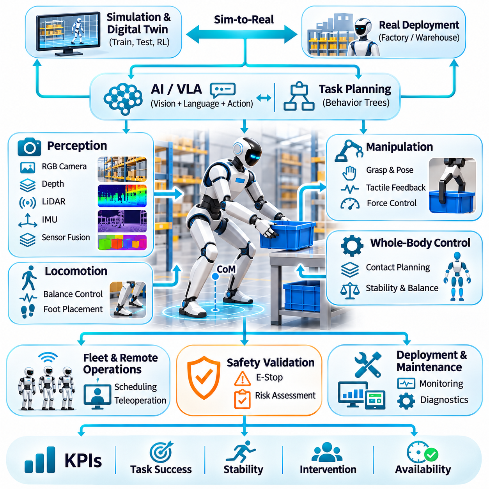

# Chapter 15. Case Studies

## 01 Amazon Robotics Fleet

{width="7.268055555555556in" height="7.268055555555556in"}

Amazon Robotics(아마존 로보틱스)는 대규모 자율이동로봇(Autonomous Mobile Robot, AMR) 플릿(Fleet)이 공유 물류 환경에서 수백 대 또는 수천 대의 모바일 로봇을 어떻게 조율하여 창고 운영을 혁신할 수 있는지를 보여준다. 아마존의 자동화 전략은 모바일 플랫폼, 재고 보관 시스템, 중앙 집중식 플릿 조정 소프트웨어, 창고 관리 소프트웨어, 인간 작업자를 통합한다. 각 로봇을 독립적인 장비로 취급하는 대신, 개별 로봇이 전체 창고의 처리량에 지속적으로 기여하는 상호 연결된 물류 네트워크로 시스템을 운영한다.

아마존 로보틱스 발전의 중요한 이정표는 2012년 Kiva Systems 인수였다. 이 회사의 핵심 기술은 자율이동로봇이 이동식 보관 포드(Pod)를 고정된 피킹 스테이션(Picking Station)으로 운반하는 상품-작업자 이동(Goods-to-Person) 모델을 도입했다. 이 방식은 창고 직원이 이동해야 하는 거리를 크게 줄이고 재고 위치를 동적으로 재구성할 수 있도록 한다. 이러한 아키텍처는 이후 아마존의 광범위한 창고 자동화 전략의 기반이 되었다.

일반적인 상품-작업자 이동(Goods-to-Person) 작업에서는 이동식 선반 또는 포드에 재고를 보관하고 이를 창고 곳곳에 배치한다. 모바일 구동 장치(Mobile Drive Unit)는 호환되는 보관 구조물 아래로 이동하여 해당 구조물을 들어 올린 다음 지정된 작업 스테이션으로 운반한다. 작업자 또는 자동화된 피킹 시스템이 필요한 제품을 꺼내는 동안 로봇은 운송 작업을 담당한다. 피킹 작업이 완료되면 모바일 플랫폼은 보관 구조물을 적절한 위치로 되돌려 놓는다.

플릿 관리 시스템(Fleet Management System)은 이러한 작업을 조정하는 핵심적인 역할을 담당한다. 플릿 관리 시스템은 운송 요청을 수신하고 로봇의 가용성을 평가하며 임무를 할당하고, 공유 창고 인프라 내에서 여러 로봇의 이동을 관리한다. 작업 할당 과정에서는 로봇의 위치, 작업 부하, 배터리 상태, 목적지 접근성, 운영 우선순위 등을 고려한다. 효과적인 플릿 관리는 불필요한 이동을 최소화하고 가용 로봇 자원의 활용률을 향상시킨다.

작업 분배(Task Dispatching)는 재고 관리 및 창고 실행 소프트웨어(Warehouse Execution Software)와 밀접하게 연계된다. 하나의 주문을 처리하기 위해 여러 보관 위치에서 제품을 가져와야 하는 경우, 시스템은 어떤 포드를 회수하고 어떤 작업 스테이션에서 요청된 제품을 처리할 것인지 결정한다. 여러 운송 작업을 동시에 스케줄링할 수 있으므로 로봇들은 서로 독립적인 임무를 수행하면서도 전체 주문 처리 프로세스와의 조율을 유지할 수 있다.

플릿 규모가 증가할수록 교통 관리(Traffic Management)의 중요성도 커진다. 창고 환경에는 좁은 통로, 교차로, 보관 구역, 충전 스테이션, 작업 스테이션 진입 구역 등이 존재한다. 여러 로봇이 동시에 동일한 공간을 점유하려고 하면 혼잡과 교착 상태(Deadlock)가 발생할 수 있다. 따라서 플릿 조정에는 경로 계획, 교통 구역 예약, 이동 우선순위 지정, 충돌 해결 기능이 필요하다. 이러한 메커니즘은 불필요한 로봇 정지를 방지하면서 지속적인 물류 흐름을 유지하는 데 도움을 준다.

로봇의 위치 추정(Localization)과 자율주행(Navigation)은 안정적인 플릿 운영의 기반을 제공한다. 모바일 플랫폼은 창고 지도(Map)를 기준으로 자신의 위치를 추정하고 보관 구조물 및 작업 스테이션에 접근할 때 충분한 위치 정밀도를 유지해야 한다. 환경 랜드마크, 온보드 센서, 이동 추정, 지도 기반 자율주행 기술이 자율적인 이동을 지원한다. 플릿 시스템은 이러한 운영 정보를 활용하여 로봇의 목적지를 조정하고 임무 진행 상황을 모니터링한다.

배터리 관리(Battery Management) 역시 대규모 플릿 운영에서 필수적인 요소이다. 로봇은 재고를 운반하고 가속하며 주행하고 작업을 기다리는 동안 에너지를 소비한다. 따라서 충전은 독립적인 유지보수 작업으로 취급하기보다는 임무 스케줄링과 연계하여 관리해야 한다. 플릿 관리 시스템은 로봇의 배터리 잔량, 예상 작업 시간, 충전 설비의 가용성, 작업 부하 분산 등을 고려하여 로봇이 작업을 계속할지 또는 충전을 위해 복귀할지 결정할 수 있다.

운영 신뢰성은 로봇 상태와 임무 실행에 대한 지속적인 모니터링에 달려 있다. 플릿 모니터링 시스템은 로봇의 가용성, 위치 추정 품질, 자율주행 실패, 배터리 상태, 통신 상태, 작업 완료 여부 등에 관한 정보를 수집한다. 로봇이 장애물을 만나거나 기술적인 문제를 경험하면 시스템은 해당 로봇에 남아 있는 작업을 다른 로봇에 재할당할 수 있다. 이를 통해 개별 로봇의 고장이 전체 창고 운영을 불필요하게 중단시키는 상황을 방지할 수 있다.

고도로 자동화된 창고에서도 인간 작업자는 여전히 중요한 역할을 담당한다. 직원들은 피킹 작업을 감독하고 예외 상황을 해결하며 재고를 보충하고 운영 경보에 대응한다. 사람과 로봇의 상호작용(Human-Robot Interaction, HRI)을 위해서는 명확한 안전 절차, 예측 가능한 로봇 동작, 접근하기 쉬운 작업 스테이션, 효과적인 모니터링 인터페이스가 필요하다. 물리적 작업 구역 분리, 장애물 감지, 비상 정지, 통제된 운영 구역은 인간 작업자와 자율이동로봇 간의 안전한 협업에 기여한다.

Amazon Robotics의 확장성은 개별 로봇 제어와 플릿 수준 의사결정을 분리하는 것이 얼마나 중요한지를 보여준다. 각 모바일 플랫폼은 자체적인 위치 추정, 모션 제어, 센서 처리, 즉각적인 장애물 대응을 담당한다. 상위 수준의 소프트웨어는 임무 할당, 재고 운송, 교통 조정, 운영 우선순위를 관리한다. 이러한 계층형 아키텍처(Hierarchical Architecture)를 적용하면 창고 운영자는 모든 로봇의 내부 제어 시스템을 재설계하지 않고도 로봇 운영 규모를 확장할 수 있다.

플릿 성능은 단순히 배치된 로봇의 대수만으로 평가해서는 안 되며, 실제 운영 지표를 기준으로 평가해야 한다. 중요한 측정 항목에는 완료된 운송 임무 수, 주문 처리량, 평균 작업 소요 시간, 로봇 활용률, 이동 거리, 충전으로 인한 가동 중단 시간, 교통 혼잡 빈도, 시스템 가용성 등이 포함된다. 이러한 지표는 추가적인 로봇이 실제로 창고 생산성을 향상시키는지, 아니면 단순히 교통량과 조정 오버헤드만 증가시키는지를 파악하는 데 도움을 준다.

Amazon Robotics 모델은 물리적 자동화와 기업용 소프트웨어를 통합하는 것의 가치도 보여준다. 창고 관리 시스템(Warehouse Management System, WMS)은 어떤 재고를 처리해야 하는지 결정하고, 플릿 관리 소프트웨어(Fleet Management Software)는 모바일 로봇이 필요한 보관 구조물을 어떻게 운반할 것인지 조정한다. 작업 스테이션 소프트웨어는 피킹 작업을 관리하며, 운영 모니터링 시스템은 전체 프로세스에 대한 가시성을 제공한다. 이러한 통합을 통해 재고 의사결정, 운송 실행, 주문 처리 사이에 지속적인 정보 흐름이 형성된다.

모바일 매니퓰레이션(Mobile Manipulation)의 관점에서 상품-작업자 이동 아키텍처는 더욱 발전된 로봇 작업을 위한 중요한 기반이 된다. 기존의 모바일 구동 장치는 주로 보관 구조물을 운반하지만, 모바일 매니퓰레이터는 자율주행 기능에 로봇 팔, 엔드이펙터(End Effector), 시각적 인식, 객체 수준의 조작 기능을 결합한다. 창고 자동화를 모바일 매니퓰레이션으로 확장하려면 이동 플랫폼의 위치 결정, 팔의 모션 계획, 파지 실행, 충돌 회피, 작업 수준 제어 간의 추가적인 조정이 필요하다.

모바일 매니퓰레이션으로 전환하면 공유 작업 공간(Shared Workspace) 관리와 관련된 새로운 과제가 발생한다. 모바일 매니퓰레이터는 팔의 궤적을 실행하기 전에 베이스를 정확하게 위치시켜야 하며, 동시에 로봇 전체 구성에서 충돌이 발생하지 않도록 해야 한다. 플릿 수준의 작업 할당에서도 매니퓰레이션 기능, 페이로드 한계, 도구 가용성, 작업 스테이션과의 호환성을 고려해야 한다. 따라서 미래의 창고 자동화 시스템에는 플릿 관리, 작업 계획, 매니퓰레이션 소프트웨어 간의 더욱 긴밀한 통합이 요구된다.

또 다른 중요한 교훈은 점진적 성능 저하(Graceful Degradation)와 장애 복구(Fault Recovery)의 중요성이다. 대규모 로봇 플릿은 일부 로봇을 사용할 수 없는 상황에서도 운영을 지속할 수 있어야 한다. 실패한 임무를 감지하고 영향을 받은 작업을 가능한 경우 다른 로봇에 재할당하며, 다른 로봇의 안전을 저해하지 않으면서 제한 구역을 관리해야 한다. 이를 위해서는 고장 격리(Fault Isolation), 임무 상태 관리, 복구 절차, 로봇 수준과 플릿 수준 소프트웨어 구성 요소 간의 안정적인 통신이 필요하다.

Amazon Robotics 사례가 제공하는 가장 중요한 엔지니어링 교훈은 성공적인 창고 자동화가 개별 로봇 하드웨어의 개선이 아니라 통합적인 시스템 설계에 달려 있다는 점이다. 자율주행 정밀도, 작업 스케줄링, 교통 관리, 재고 소프트웨어, 충전 인프라, 인간과의 상호작용, 운영 분석이 모두 유기적으로 작동해야 한다. 모바일 매니퓰레이션 시스템 개발자에게 이 사례는 자율 이동 기능과 점점 더 정교해지는 매니퓰레이션 기능을 연결하는 확장 가능한 플릿 아키텍처를 설계하기 위한 실질적인 참고 사례를 제공한다.

## 02 Ocado Automation System

{width="7.268055555555556in" height="7.268055555555556in"}

Ocado의 자동화 시스템(Ocado Automation System)은 대규모 로봇 조정(Robotic Coordination), 지능형 창고 인프라(Intelligent Warehouse Infrastructure), 소프트웨어 기반 물류(Software-Driven Logistics)를 고도로 자동화된 식료품 주문 처리 운영에 통합한 사례를 보여준다. 이 시스템은 로봇 기반 보관 및 회수, 중앙 집중식 플릿 관리(Fleet Management), 주문 처리, 재고 관리, 창고 실행 소프트웨어(Warehouse Execution Software)를 결합한다. 고객 주문을 대량으로 처리하면서도 운영 효율성, 정확한 재고 관리, 안정적인 주문 처리 성능을 유지하도록 설계되었다.

Ocado 창고 자동화의 핵심 구성 요소는 일반적으로 Hive라고 불리는 독자적인 3차원 보관 그리드(Three-Dimensional Storage Grid)이다. 수천 개의 보관 컨테이너가 고밀도 그리드 구조에 배치되고, 특수 설계된 회수 로봇(Retrieval Robot)이 상부 트랙을 따라 이동한다. 이 로봇들은 보관 컨테이너를 들어 올리고 내리며 지정된 작업 스테이션으로 운반한다. 이러한 설계는 수직 공간을 활용한 고밀도 보관을 가능하게 하고 기존 창고 통로의 필요성을 줄인다.

회수 로봇은 모든 운영 의사결정을 독립적으로 수행하는 자율 에이전트가 아니라, 조정된 플릿으로 작동한다. 중앙 집중식 창고 실행 시스템(Warehouse Execution System, WES)은 어떤 컨테이너를 회수해야 하는지 결정하고 운송 작업을 할당하며 로봇의 이동을 조정한다. 시스템은 로봇 위치, 보관 위치, 작업 스테이션의 가용성, 주문 우선순위 등에 관한 실시간 정보를 활용하여 운영 의사결정을 지속적으로 갱신한다. 이러한 아키텍처는 밀집된 로봇 환경을 위한 항공 교통 관제 시스템(Air Traffic Control System)과 유사하다.

주문 처리(Order Fulfillment)는 고객 주문을 접수하고 이를 창고 실행 작업으로 변환하는 과정에서 시작된다. 소프트웨어는 필요한 제품을 식별하고 해당 제품의 보관 위치를 확인하며 관련 컨테이너의 회수를 스케줄링한다. 이후 로봇은 해당 컨테이너를 피킹 작업 스테이션(Picking Workstation)으로 운반하고, 작업자는 제품을 선택하여 고객 주문용 컨테이너에 배치한다. 여러 주문을 동시에 처리할 수 있으므로 개별 이동 작업을 조정하면서도 높은 처리량을 유지할 수 있다.

Ocado 시스템의 독특한 특징은 3차원 보관 밀도(Three-Dimensional Storage Density)이다. 기존 창고에서는 모바일 로봇이 넓은 바닥 통로를 따라 이동하지만, Hive는 수직으로 배열된 보관 위치와 공간 효율적인 이동 그리드를 활용한다. 회수 로봇은 목표 컨테이너 위에 놓인 다른 컨테이너를 이동시키거나 일시적으로 재배치하여 서로 다른 깊이에 저장된 컨테이너에 접근한다. 따라서 시스템은 로봇의 수평 이동뿐만 아니라 보관 공간에 접근하는 작업 순서도 조정해야 한다. 이러한 방식은 공간 활용률을 높이는 동시에 스케줄링과 교통 조정에 추가적인 요구사항을 발생시킨다.

플릿 조정(Fleet Coordination)을 위해서는 공유 트랙에서 로봇의 이동을 정밀하게 제어해야 한다. WES는 사용 가능한 경로를 지속적으로 평가하고 회수 임무를 할당하며 로봇 간의 잠재적인 충돌을 관리한다. 비교적 제한된 공간에서 다수의 로봇이 동시에 작동하기 때문에 작은 스케줄링 비효율성도 혼잡을 유발하고 처리량을 감소시킬 수 있다. 제어 아키텍처는 효율적인 운영을 유지하기 위해 최단 경로, 작업 우선순위, 보관 위치 접근성, 작업 스테이션의 수요, 전체 플릿 활용률 간의 균형을 유지해야 한다.

통신 인프라(Communication Infrastructure)는 안정적인 로봇 조정에 필수적이다. 시스템은 수천 개의 로봇 단말과 운영 정보를 교환하면서 예측 가능한 응답 시간을 유지해야 한다. Ocado는 로봇 운영을 지원하기 위해 독자적인 무선 통신 기술을 개발했다. 또한 클라우드 지향 소프트웨어 아키텍처(Cloud-Oriented Software Architecture)를 통해 창고 실행 서비스와 클라우드 인프라 및 대규모 운영 분석을 통합한다. 이러한 조합은 중앙 집중식 조정, 지속적인 데이터 처리, 복잡한 주문 처리 운영의 확장 가능한 관리를 지원한다.

주문 처리는 단순히 보관 컨테이너를 회수하는 것 이상의 작업을 요구한다. 시스템은 제품 피킹, 주문 통합, 포장, 출고를 조정해야 한다. 사람이 작업하는 피킹 스테이션과 로봇 기반 피킹 기술은 동일한 주문 처리 아키텍처 내에서 함께 운영될 수 있다. 로봇 팔은 컴퓨터 비전(Computer Vision), 첨단 센싱(Advanced Sensing), 인공지능(Artificial Intelligence)을 활용하여 제품을 식별하고 피킹 작업을 수행한다. 이러한 시스템은 형태, 크기, 포장재, 물리적 특성이 서로 다른 다양한 식료품을 취급할 때 특히 유용하다.

Ocado의 On-Grid Robotic Pick 기술은 창고 자동화의 범위를 컨테이너 운송에서 개별 제품 조작으로 확장한다. 로봇 팔은 보관 컨테이너 내부의 적합한 제품을 식별하고 이를 고객 주문용 컨테이너로 옮긴다. 컴퓨터 비전과 머신러닝(Machine Learning)은 다양한 조건에서 객체 인식, 파지 위치 선정, 매니퓰레이션(Manipulation)을 지원한다. 모든 제품을 사전에 개별 프로그래밍하지 않고도 취급할 수 있도록 설계되었지만, 제품의 물리적 특성과 취급 적합성은 여전히 중요한 운영 고려사항이다.

배터리 관리(Battery Management)는 로봇 아키텍처의 또 다른 중요한 요소이다. 지속적인 운영을 위해서는 로봇이 창고 전체에서 회수 임무를 수행하는 동안 충분한 에너지를 유지해야 한다. Ocado는 기존의 장시간 충전으로 인한 운영 중단을 줄이기 위해 로봇이 배터리를 자동으로 교체할 수 있는 인프라를 활용한다. 충전 인프라는 배터리 가용성과 교체 작업을 조정하여 로봇의 가동 중단 시간을 줄이고 수요가 높은 시간대에도 플릿 운영 능력을 유지한다.

창고 자동화는 식료품의 서로 다른 환경적 보관 요구사항도 충족해야 한다. 상온, 냉장, 냉동 제품은 각각 다른 보관 및 취급 조건을 필요로 한다. Ocado의 고객 주문 처리 센터(Customer Fulfillment Centre)는 이러한 운영 환경을 통합하면서 재고 이동과 주문 준비를 조정한다. 소프트웨어는 제품 위치, 온도 요구사항, 보관 공간의 가용성, 주문 완료 순서를 고려하여 전체 주문 처리 과정에서 제품이 적절하게 취급되도록 해야 한다.

디지털 트윈(Digital Twin)과 시뮬레이션(Simulation)은 Ocado 자동화 시스템의 개발 및 최적화를 위한 중요한 엔지니어링 도구이다. 창고의 디지털 표현을 통해 보관 구조, 로봇 이동, 작업 스테이션의 처리 용량, 운영 수요를 모델링할 수 있다. 엔지니어는 다양한 레이아웃을 평가하고 잠재적인 병목 구간을 식별하며 물리적 변경을 적용하기 전에 시스템 성능을 추정할 수 있다. 또한 시뮬레이션은 실제 운영 환경에서 직접 검증하기 어렵거나 비용이 많이 들고 운영에 지장을 줄 수 있는 복잡한 플릿 상호작용을 평가하는 데 활용된다.

Ocado의 자동화 전략은 고도로 특화된 그리드 기반 주문 처리 센터를 넘어 확장되고 있다. Ocado Mobile Robot System(OMRS)은 기존 창고 환경에서도 지능형 소프트웨어와 자율이동로봇을 결합한다. Chuck과 같은 플랫폼은 작업자를 안내하고 불필요한 이동을 줄여 피킹 작업 흐름을 지원하며, Porter는 더 무거운 팔레트와 운송 케이지를 운반한다. Ocado IQ는 작업과 로봇 운영을 조정하며, 이를 통해 독자적인 Hive 인프라를 사용하지 않는 시설에도 Ocado의 자동화 기술을 적용할 수 있음을 보여준다.

Ocado 방식의 자동화 시스템은 여러 상호 연관된 운영 지표를 통해 평가해야 한다. 주요 지표에는 주문 처리량, 컨테이너 회수 시간, 로봇 활용률, 피킹 정확도, 작업 스테이션 생산성, 배터리 교체 빈도, 재고 접근성, 시스템 가용성이 포함된다. 이러한 측정값은 성능 제한의 원인이 보관 밀도, 로봇 교통량, 피킹 처리 용량, 소프트웨어 스케줄링, 후속 포장 작업 중 어디에 있는지 파악하는 데 도움을 준다. 개별 로봇의 속도를 최대화하는 것보다 전체 주문 처리 프로세스를 최적화하는 것이 더 중요하다.

중앙 집중식 조정 구조에서는 소프트웨어, 통신 네트워크, 로봇, 보관 인프라, 작업 스테이션 간의 의존성이 발생하므로 신뢰성 엔지니어링(Reliability Engineering)이 특히 중요하다. 로봇의 기계적 시스템이 정상적으로 작동하더라도 통신 장애나 소프트웨어 오류가 여러 로봇에 영향을 줄 수 있다. 따라서 아키텍처에는 고장 감지, 통제된 복구, 운영 모니터링, 이중화 인프라, 사용 불가능한 로봇에 대응하기 위한 절차가 필요하다. 효과적인 장애 관리는 개별적인 고장을 격리하고 가능한 한 많은 창고 기능을 유지해야 한다.

모바일 매니퓰레이션(Mobile Manipulation)의 관점에서 Ocado는 자율 운송, 지능형 인식, 로봇 피킹, 중앙 집중식 작업 조정을 하나의 통합 운영 시스템으로 결합한 중요한 사례를 제공한다. 이 아키텍처는 매니퓰레이션 성능이 로봇 팔에만 의존하는 것이 아니라 정확한 제품 배치, 작업 스테이션 통합, 재고 정보, 작업 스케줄링에도 영향을 받는다는 점을 보여준다. 이러한 원리는 산업 물류 및 자동화된 자재 취급을 위한 모바일 매니퓰레이터 개발에 직접적으로 활용할 수 있다.

Ocado 사례의 가장 중요한 엔지니어링 교훈은 대규모 창고 자동화가 통합된 사이버-물리 시스템(Cyber-Physical System)으로 설계되어야 한다는 점이다. 로봇 플랫폼, 보관 인프라, 통신 네트워크, 인공지능 알고리즘, 창고 실행 소프트웨어, 비즈니스 애플리케이션이 모두 조정된 구성 요소로 작동해야 한다. 시스템의 성공은 개별 자동화 구성 요소를 독립적으로 개선하는 것이 아니라 재고 보관부터 고객 주문 출고까지 전체 물류 흐름을 최적화하는 데 달려 있다. 이러한 접근 방식은 현대 산업 환경에서 확장 가능한 모바일 매니퓰레이션 및 다중 로봇 시스템(Multi-Robot System)을 설계하기 위한 중요한 참고 사례를 제공한다.

## 03 Fetch Robotics Operations

{width="7.268055555555556in" height="7.268055555555556in"}

Fetch Robotics(Fetch Robotics)는 산업 물류(Industrial Logistics), 창고 자동화(Warehouse Automation), 자재 취급(Material Handling) 분야에서 자율이동로봇(Autonomous Mobile Robot, AMR)을 운영한 중요한 사례를 제공한다. Fetch Robotics의 접근 방식은 자율주행(Autonomous Navigation), 플릿 관리(Fleet Management), 클라우드 기반 조정(Cloud-Based Coordination), 유연한 로봇 플랫폼(Flexible Robotic Platform)을 결합하여 변화하는 작업 환경에서 자재 이동을 자동화하는 데 중점을 둔다. 고정식 컨베이어 시스템이나 영구적으로 설치된 자동화 인프라에 의존하는 대신, 변화하는 시설 배치와 운영 요구사항에 적응할 수 있는 모바일 솔루션을 도입했다.

Fetch Robotics는 서로 다른 자재 취급 요구사항을 충족하도록 설계된 다양한 AMR 플랫폼 제품군을 개발했다. 제품군에는 중량물 운송을 위한 Freight 플랫폼, 카트 이동을 위한 CartConnect 로봇, 컨테이너 및 주문 피킹을 지원하는 HMIShelf와 FlexShelf 플랫폼, 컨베이어 통합을 위한 RollerTop 시스템, 자동 재고 추적을 위한 TagSurveyor 로봇 등이 포함되었다. 이러한 제품 다양성은 공통된 자율주행 및 플릿 관리 아키텍처가 여러 창고 작업 흐름을 지원할 수 있음을 보여준다.

Fetch Robotics의 핵심 구성 요소는 클라우드 기반 엔터프라이즈 로봇 플랫폼(Cloud-Based Enterprise Robotics Platform)인 FetchCore였다. FetchCore는 중앙 집중식 로봇 관리, 작업 흐름 구성, 임무 스케줄링, 운영 모니터링, 창고 시스템과의 통합 기능을 제공했다. 운영자는 복잡한 로봇 프로그램을 처음부터 개발하지 않고도 시각적 구성 도구를 사용하여 작업 흐름을 정의할 수 있었다. 이러한 접근 방식은 구축의 복잡성을 줄이고 생산 및 물류 요구사항이 변화할 때 시설의 자동화 작업 흐름을 조정할 수 있도록 했다.

FetchCore는 이기종 로봇 플릿(Heterogeneous Robot Fleet)과 운영 작업 흐름의 조정도 지원했다. 서로 다른 로봇 모델이 동일한 시설에서 운송, 피킹 지원, 재고 검사, 자재 보충 작업을 수행할 수 있었다. 소프트웨어는 로봇 활동을 관리하고 배치된 플랫폼으로부터 정보를 수집하기 위한 공통 운영 인터페이스를 제공했다. 이러한 아키텍처는 각 자재 취급 프로세스를 독립적인 자동화 프로젝트로 취급해야 하는 필요성을 줄였다.

자율주행(Autonomous Navigation)은 Fetch Robotics 운영의 핵심 기반이었다. 모바일 플랫폼은 온보드 센서(Onboard Sensor)와 환경 지도(Environmental Mapping)를 활용하여 기존 창고 및 제조 환경에서 자율적으로 이동했다. 일반적으로 자기 테이프, 고정 트랙, 사전에 정의된 인프라에 의존하는 기존 무인운반차(Automated Guided Vehicle, AGV)와 달리, AMR은 환경에 대한 자체 인식을 바탕으로 경로를 동적으로 계획할 수 있다. 이러한 유연성은 로봇이 자율적인 운영을 유지하면서 변화하는 장애물, 임시 보관 배치, 작업자의 활동에 대응할 수 있도록 한다.

도입 전략은 기존 시설의 변경을 최소화하는 데 중점을 두었다. Fetch AMR은 대규모 인프라 변경 없이 기존 창고와 제조 공장에서 작동하도록 설계되었다. 이를 통해 기업은 비교적 제한적인 준비만으로 모바일 자동화를 도입할 수 있었다. 운영자는 FetchCore를 통해 시설 지도와 작업 흐름을 구성할 수 있었으며, 전용 컨베이어 네트워크를 구축하거나 영구적인 주행 인프라를 설치하지 않고도 시스템을 배치할 수 있었다. 이러한 접근 방식은 운영 요구사항이 지속적으로 변화하는 조직에서 단계적인 자동화를 더욱 실용적으로 만들었다.

협업형 피킹(Collaborative Picking)은 Fetch Robotics 기술의 중요한 적용 분야였다. 이러한 작업 흐름에서 창고 직원은 제품을 식별하고 수집하는 데 집중하고, AMR은 컨테이너, 카트 또는 기타 자재 취급 장비를 운반한다. 로봇은 할당된 피킹 임무를 수행하면서 수집된 제품을 적재할 수 있는 이동식 목적지를 제공한다. 이를 통해 불필요한 보행과 수작업 운송을 줄이고 직원이 부가가치가 높은 피킹 작업에 더 많은 시간을 할애할 수 있도록 한다.

Fetch AMR과 Zebra FulfillmentEdge의 통합은 로봇 운영을 인간 작업자의 업무 흐름과 조정할 수 있음을 보여주었다. FulfillmentEdge는 창고 관리 정보, 작업자 활동, 모바일 로봇의 가용성을 결합하여 적절한 다음 작업을 결정한다. 또한 개별 제품 피킹, 박스 단위 피킹, 팔레트 피킹 작업 전반에서 여러 작업자와 로봇을 조정할 수 있다. 이러한 통합은 구역별 피킹(Zone Picking)과 웨이브 피킹(Wave Picking)도 지원하여 창고 운영자가 여러 고객 주문을 동시에 최적화할 수 있도록 한다.

Fetch Robotics는 제조 공장의 자재 보충(Material Replenishment)과 적시 공급(Just-in-Time Delivery)도 지원했다. 이러한 응용 분야에서 모바일 로봇은 보관 장소에서 생산 라인으로 부품, 원자재, 재공품(Work-in-Progress)을 운반한다. 목표는 각 작업 스테이션에 과도한 재고를 보관하지 않으면서도 필요한 시점에 제조 설비가 적절한 자재를 공급받도록 하는 것이다. 로봇 임무를 생산 요구사항과 조정함으로써 시설은 자재 가용성을 향상시키고 불필요한 수작업 운송을 줄일 수 있다.

동일한 모바일 자동화 아키텍처는 입고(Receiving), 적치(Putaway), 임시 보관(Staging), 주문 통합(Consolidation), 크로스도킹(Cross-Docking), 역물류(Reverse Logistics)에도 활용될 수 있다. 로봇은 입고된 자재를 지정된 보관 위치로 운반하고, 컨테이너를 생산 구역으로 전달하며, 완제품을 포장 또는 출고 작업으로 이동시킬 수 있다. 또한 재활용품 수거와 포장재 제거 작업도 지원할 수 있다. 이러한 유연성은 창고 자동화 요구사항이 단일 운송 작업을 넘어 다양한 작업으로 확장된다는 점에서 중요하다.

재고 가시성(Inventory Visibility) 역시 중요한 적용 분야였다. Fetch의 TagSurveyor 플랫폼은 시설 내 RFID 기반 재고 추적(RFID-Based Inventory Tracking)을 자동화하도록 설계되었다. 모바일 로봇은 지정된 구역을 이동하면서 직원이 모든 보관 위치를 직접 확인하지 않고도 재고 식별 정보를 수집할 수 있다. 수집된 정보는 재고 대조(Inventory Reconciliation), 자산 가시성(Asset Visibility), 시스템에 기록된 재고 위치와 실제 재고 위치 간의 불일치 식별을 지원한다. 모바일 센싱을 플릿 운영과 통합하면 AMR의 기능을 단순 운송에서 창고 지능화로 확장할 수 있다.

운영 모니터링과 분석(Operational Monitoring and Analytics)은 플릿 성능 개선을 위한 중요한 정보를 제공한다. FetchCore는 로봇 센서와 운영 활동에서 수집된 정보를 활용하여 시설의 상태와 작업 실행 상황을 파악할 수 있도록 한다. 관련 측정 항목에는 완료된 임무 수, 로봇 활용률, 이동 거리, 작업 완료 시간, 배터리 상태, 자율주행 중단 횟수, 작업 생산성 등이 포함된다. 이러한 지표는 운영자가 병목 구간을 식별하고 추가 로봇 도입, 경로 변경, 작업 할당 수정이 전체 성능을 향상시킬 수 있는지 판단하는 데 도움을 준다.

로봇이 직원 및 기존 자재 취급 장비와 함께 작동할 때 안전(Safety)은 필수적인 요소이다. Fetch 플랫폼은 공유 작업 환경에서의 운영을 지원하기 위해 자율 장애물 감지, 주행 모니터링, 안전 관련 제어 기능을 통합한다. 로봇의 속도, 정지 동작, 경로 선택, 사람과의 상호작용을 종합적으로 고려해야 한다. 시설은 적절한 교통 규칙, 운영 구역, 비상 대응 절차, 유지보수 방안도 수립해야 한다. 안전 검증(Safety Validation)은 개별 로봇의 동작뿐만 아니라 전체 플릿의 통합 운영도 포함해야 한다.

확장성(Scalability)은 Fetch Robotics 접근 방식의 또 다른 중요한 특징이다. 기업은 반복적인 운송 작업을 수행하는 소수의 AMR로 시작하여 운영 효과가 확인되면 점진적으로 도입 규모를 확대할 수 있다. 추가 로봇은 시설 전체를 재설계하지 않고도 플릿 관리 소프트웨어를 통해 기존 작업 흐름에 통합할 수 있다. 그러나 플릿 규모가 증가하면 교통 조정, 무선 통신 용량, 충전 인프라, 임무 스케줄링, 운영 감독과 관련된 새로운 요구사항도 발생한다.

Fetch Robotics는 2021년 Zebra Technologies에 인수되었다. 이번 인수는 Fetch의 자율이동로봇과 FetchCore 클라우드 로봇 플랫폼을 Zebra의 모바일 컴퓨팅, 바코드 스캐닝, 작업 흐름 관리, 창고 실행 솔루션을 포함한 광범위한 엔터프라이즈 기술 포트폴리오와 연결했다. 이러한 결합은 물리적 로봇 자동화를 엔터프라이즈 정보 시스템 및 현장 작업자 기술과 통합하는 것이 갖는 전략적 가치를 보여주었다.

모바일 매니퓰레이션(Mobile Manipulation)의 관점에서 Fetch Robotics는 자율 운송과 상위 수준의 매니퓰레이션 작업을 분리하는 중요한 참고 사례를 제공한다. Fetch의 AMR은 자재 운송, 작업자의 피킹 지원, 창고 소프트웨어와의 연동이 어떻게 이루어질 수 있는지를 보여준다. 더욱 발전된 모바일 매니퓰레이터는 여기에 로봇 팔, 시각적 인식(Visual Perception), 파지 계획(Grasp Planning), 객체 수준 상호작용(Object-Level Interaction)을 통합하여 이러한 기능을 확장할 수 있다. 이때 기존 플릿 아키텍처는 운송 임무뿐만 아니라 특정 도구, 페이로드 능력, 작업 스테이션 구성을 요구하는 매니퓰레이션 작업까지 조정할 수 있다.

Fetch Robotics 사례는 기존 운영 프로세스를 중심으로 유연한 자동화를 설계하는 것이 중요하다는 점도 강조한다. 성공적인 시스템 도입을 위해서는 로봇 구성을 선택하기 전에 자재 흐름, 작업자의 역할, 재고 배치, 생산 일정을 이해해야 한다. 기술적으로 뛰어난 AMR이라도 할당된 작업 흐름이 추가적인 대기 시간이나 불필요한 이동을 발생시킨다면 생산성을 자동으로 향상시키지는 못한다. 따라서 효과적인 자동화는 프로세스 분석에서 시작하여 시스템 통합, 성능 측정, 운영 최적화로 이어져야 한다.

Fetch Robotics 사례의 가장 중요한 엔지니어링 교훈은 확장 가능한 산업 자동화를 위해 유연한 모바일 플랫폼, 접근하기 쉬운 플릿 관리 소프트웨어, 클라우드 기반 조정, 인간 중심의 작업 흐름 설계가 결합되어야 한다는 점이다. 이 접근 방식은 고정식 자동화 인프라에 전적으로 의존하지 않고도 기존 시설에 자율 로봇을 단계적으로 도입할 수 있음을 보여준다. 모바일 매니퓰레이터와 다중 로봇 시스템(Multi-Robot System)을 개발하는 엔지니어에게 Fetch Robotics는 자율 이동, 플릿 조정, 엔터프라이즈 소프트웨어, 협업형 산업 운영을 통합하기 위한 중요한 참고 사례를 제공한다.

## 04 Hospital Mobile Manipulators

{width="7.268055555555556in" height="7.268055555555556in"}

{width="7.268055555555556in" height="7.268055555555556in"}

병원 모바일 매니퓰레이터(Hospital Mobile Manipulator)는 자율이동 플랫폼(Autonomous Mobile Platform)과 로봇 매니퓰레이션 기술(Robotic Manipulation Technology)이 복잡하고 인간 중심적인 의료 환경에서 어떻게 의료 운영을 지원할 수 있는지를 보여준다. 통제된 생산 구역에서 작동하는 기존 산업용 로봇과 달리, 병원 로봇은 복도, 엘리베이터, 환자 병실, 치료 구역, 공용 공간 등을 자율적으로 이동해야 한다. 주요 적용 분야에는 의료용품 운송, 의약품 취급, 의료 장비 전달, 검체 수집, 반복적인 물류 작업 지원 등이 포함된다. 이러한 시스템은 의료진의 업무 부담을 줄이는 동시에 운영 효율성과 서비스 신뢰성을 향상시키는 것을 목표로 한다.

병원 모바일 매니퓰레이터는 자율이동로봇(Autonomous Mobile Robot, AMR), 로봇 팔(Robotic Arm), 인식 센서(Perception Sensor), 엔드이펙터(End Effector), 통합 제어 시스템(Integrated Control System)을 결합한다. 모바일 베이스(Mobile Base)는 자율주행과 운송 기능을 제공하고, 로봇 팔은 객체 및 주변 인프라와 물리적으로 상호작용할 수 있도록 한다. 카메라, 라이다(LiDAR), 깊이 센서(Depth Sensor), 힘-토크 센서(Force-Torque Sensor)는 환경 인식과 매니퓰레이션을 지원한다. 이러한 구성 요소를 통합하면 자율 이동과 객체 수준의 조작이 모두 필요한 작업을 수행할 수 있다.

병원 환경은 자율주행에 고유한 어려움을 제공한다. 복도에는 환자, 방문객, 의료진, 휠체어, 이동식 장비 등이 혼재할 수 있다. 로봇은 동적인 장애물을 인식하고 안전거리를 유지하며 예측하기 어려운 사람의 행동에 맞춰 이동을 조정해야 한다. 따라서 자율주행에는 안정적인 위치 추정(Localization), 장애물 감지(Obstacle Detection), 동적 경로 계획(Dynamic Path Planning), 지속적인 환경 모니터링(Environmental Monitoring)이 필요하다. 사람과의 상호작용을 고려한 예측 가능한 이동은 자율주행 정밀도만큼 중요하다.

의료용품 운송(Medical Supply Transportation)은 병원 모바일 로봇의 가장 실용적인 적용 분야 중 하나이다. 로봇은 소모품, 수술 도구, 의료 장비, 린넨(Linen) 및 기타 물품을 중앙 보관 구역에서 임상 부서로 운송할 수 있다. 모바일 매니퓰레이터는 로봇 팔을 통해 보관 캐비닛, 컨테이너, 배송 인터페이스, 지정된 인계 위치와 상호작용함으로써 이러한 기능을 확장한다. 이를 통해 의료진이 반복적으로 수행하는 운송 업무를 줄일 수 있다.

의약품 물류(Medication Logistics)는 특히 신중한 시스템 설계를 요구한다. 의약품 컨테이너는 정확한 환자, 목적지, 배송 일정과 연결되어야 한다. 모바일 매니퓰레이터는 지정된 의약품 패키지의 물리적 취급을 지원할 수 있지만, 의약품 식별, 사용 승인, 조제 결정은 검증된 병원 정보 시스템과 임상 절차의 통제를 받아야 한다. 의약품 보관 및 배송 인프라와 로봇 시스템이 상호작용할 때는 접근 제어(Access Control), 추적 가능성(Traceability), 사람의 확인 절차(Human Verification)가 필수적이다.

검체 수집(Specimen Collection)과 검사실 물류(Laboratory Logistics)도 또 다른 잠재적 적용 분야이다. 병원에서는 혈액 샘플, 조직 검체, 진단 재료, 검사실 컨테이너 등을 임상 부서와 검사 시설 사이에서 지속적으로 운송한다. 모바일 로봇은 컨테이너의 식별 정보와 목적지를 유지하면서 정기적인 수집 및 배송 임무를 조정할 수 있다. 매니퓰레이션 기능은 표준화된 컨테이너 이송을 지원할 수 있지만, 생물학적 안전성(Biological Safety), 포장 무결성(Packaging Integrity), 오염 방지(Contamination Prevention), 검체 인계 및 관리 이력(Chain of Custody)을 반드시 고려해야 한다.

병원 모바일 매니퓰레이터는 의료 장비 취급(Equipment Handling)도 지원할 수 있다. 수액 펌프(Infusion Pump), 휴대용 모니터(Portable Monitor), 진단 장비와 같은 의료기기는 여러 부서 사이에서 자주 이동해야 한다. 적절한 그리퍼(Gripper)를 장착한 로봇은 호환되는 장비를 회수하고 운반하며 지정된 위치에 배치할 수 있다. 그러나 매니퓰레이션 과정에서는 서로 다른 객체의 형상, 기계적 인터페이스, 무게 분포, 민감한 구성 요소를 고려해야 한다. 또한 로봇은 사람의 지원이 필요한 상황을 인식할 수 있어야 한다.

환자 병실에서의 상호작용(Patient-Room Interaction)은 추가적인 복잡성을 유발한다. 모바일 매니퓰레이터는 의료용품 회수, 개인 물품 전달, 지정된 보관 및 서비스 인터페이스와의 상호작용에 활용될 수 있다. 그러나 환자와 직접 물리적으로 상호작용하는 작업은 일반적인 창고 매니퓰레이션보다 훨씬 높은 안전 요구사항을 필요로 한다. 접촉력, 예기치 않은 환자의 움직임, 의료 장비 연결 상태, 개별 환자의 건강 상태를 고려해야 한다. 따라서 환자 지원을 목적으로 하는 로봇은 신중하게 검증된 상호작용 기능과 명확하게 정의된 운영 범위를 갖추어야 한다.

인식 시스템(Perception System)은 안전한 자율주행과 매니퓰레이션에 필요한 정보를 제공한다. RGB 카메라는 객체 인식과 장면 이해(Scene Understanding)를 지원하고, 깊이 카메라와 라이다는 위치 추정 및 장애물 감지를 위한 공간 정보를 제공한다. 고급 인식 모델(Advanced Perception Model)은 의료용품, 컨테이너, 장비, 지정된 상호작용 구역을 식별할 수 있다. 센서 융합(Sensor Fusion)은 조명 조건, 반사 표면, 부분적으로 가려진 객체 등이 개별 센서의 성능에 영향을 미치는 상황에서 환경 이해도를 향상시킨다.

매니퓰레이션 계획(Manipulation Planning)은 모바일 자율주행과 연계되어야 한다. 로봇 팔이 객체를 회수하기 전에 모바일 베이스는 적절한 위치에 도달하고 안정적인 자세를 확보해야 한다. 계획 시스템은 로봇의 작업 공간(Workspace), 객체의 자세(Object Pose), 파지 구성(Grasp Configuration), 주변 가구나 의료 장비와의 잠재적 충돌을 평가해야 한다. 힘 제어 매니퓰레이션(Force-Controlled Manipulation)과 순응 운동(Compliant Motion)은 신중한 취급이 필요한 객체와의 상호작용을 향상시킬 수 있다. 이러한 기능은 파손되기 쉬운 의료 기기와 장비 주변에서 작업할 때 특히 중요하다.

병원 정보 시스템(Hospital Information System)은 로봇 임무 수행에 필요한 운영 정보를 제공한다. 병원 관리 시스템, 전자의무기록(Electronic Health Record), 재고 관리 플랫폼, 검사실 정보 시스템(Laboratory Information System)과의 통합은 작업 할당과 배송 추적을 지원할 수 있다. 그러나 로봇에는 할당된 작업을 수행하는 데 필요한 정보만 제공해야 한다. 병원 환경에는 민감한 환자 정보와 운영 정보가 포함되어 있으므로 인증(Authentication), 권한 부여(Authorization), 암호화 통신(Encrypted Communication), 감사 로그(Audit Logging), 개인정보 보호(Privacy Protection)가 필수적이다.

여러 로봇이 서로 다른 병원 부서에서 작동할 경우 플릿 관리(Fleet Management)가 중요해진다. 중앙 집중식 플릿 관리 시스템은 로봇의 가용성, 배터리 상태, 페이로드 능력, 목적지, 임무 우선순위에 따라 운송 및 매니퓰레이션 작업을 할당할 수 있다. 교통 관리는 공유 복도, 엘리베이터, 출입문, 충전 스테이션, 물품 인계 구역을 조정해야 한다. 또한 정기적인 운송 임무로 인해 긴급 의료용품 배송이 지연되지 않도록 임상적 우선순위를 고려한 스케줄링이 필요하다.

다층 병원 운영에서는 엘리베이터 및 자동문 통합(Elevator and Automatic Door Integration)이 특히 중요하다. 로봇은 건물 관리 시스템(Building Management System)과 통신하여 엘리베이터 이용을 요청하고 목적지 층을 지정하며 승하차 절차를 조정해야 한다. 시스템은 엘리베이터의 사용 가능 여부와 환자 또는 의료진의 이동을 방해하지 않으면서 로봇이 안전하게 탑승할 수 있는지를 확인해야 한다. 안정적인 건물 인프라 통합은 모바일 매니퓰레이터가 병원 전체 물류 네트워크의 일부로 작동할 수 있도록 한다.

인간-로봇 상호작용(Human-Robot Interaction, HRI)은 의료 환경에서 근본적으로 중요한 설계 요구사항이다. 환자와 의료진은 로봇의 의도, 이동 패턴, 운영 상태를 이해할 수 있어야 한다. 시각적 표시 장치, 디스플레이 인터페이스, 음성 알림, 예측 가능한 자율주행 동작은 상호작용을 향상시킬 수 있다. 로봇은 응급 이동 경로를 방해하지 않고 환자의 개인정보를 존중하며 사람이 접근하거나 도움을 요청할 때 적절하게 대응해야 한다. 인간 중심 설계(Human-Centered Design)는 의료진의 신뢰와 시스템 수용성을 확보하는 데 필수적이다.

안전 검증(Safety Validation)은 모바일 자율주행과 로봇 매니퓰레이션을 모두 다루어야 한다. 위험성 평가는 충돌, 객체 낙하, 의도하지 않은 접촉, 의료 장비 간섭, 사이버 보안 위협, 통신 또는 제어 시스템의 고장을 고려해야 한다. 비상 정지(Emergency Stop), 제한된 운영 구역(Restricted Operating Zone), 안전 속도 제한(Safe Speed Limit), 충돌 감지(Collision Detection), 통제된 복구 절차(Controlled Recovery Procedure)를 시스템 아키텍처에 포함해야 한다. 검증 과정에서는 정상 운영뿐만 아니라 예외 상황과 환자 및 의료진과의 상호작용도 평가해야 한다.

운영 성능은 임무 완료 성공률, 배송 정확도, 운송 시간, 로봇 가용성, 매니퓰레이션 성공률, 배터리 활용률, 사람의 개입 빈도 등의 지표를 사용하여 측정해야 한다. 추가적인 측정 항목에는 복도 혼잡도, 엘리베이터 대기 시간, 장비 회수 시간, 작업 흐름 중단 빈도 등이 포함될 수 있다. 이러한 지표는 병원 관리자가 모바일 매니퓰레이션이 추가적인 운영 복잡성을 유발하지 않으면서 의료진의 생산성과 서비스 품질을 향상시키는지 판단하는 데 도움을 준다.

병원 모바일 매니퓰레이터의 가장 중요한 엔지니어링 교훈은 의료 자동화가 안전성, 신뢰성, 상호운용성(Interoperability), 인간 중심 운영을 최우선으로 고려해야 한다는 점이다. 성공적인 시스템은 단순히 로봇 팔을 장착한 모바일 로봇이 아니다. 자율주행, 지능형 인식, 매니퓰레이션 계획, 병원 정보 시스템, 플릿 관리, 검증된 안전 절차를 연결하는 통합 플랫폼이다. 이 사례는 기술적 성능과 인간의 건강 및 안전이 동등하게 중요한 복잡한 환경에서 작동할 수 있는 모바일 매니퓰레이션 시스템을 개발하기 위한 중요한 참고 사례를 제공한다.

## 05 Industrial Mobile Manipulation

{width="7.268055555555556in" height="7.268055555555556in"}

산업용 모바일 매니퓰레이션(Industrial Mobile Manipulation)은 자율이동로봇(Autonomous Mobile Robot, AMR)과 로봇 팔(Robotic Arm)을 결합하여 제조 및 물류 환경에서 운송과 물리적 조작을 수행하는 산업 자동화의 중요한 발전 형태이다. 고정된 작업 스테이션에 설치되는 기존 산업용 로봇과 달리, 모바일 매니퓰레이터(Mobile Manipulator)는 서로 다른 운영 구역 사이를 이동하면서 여러 위치의 객체와 상호작용할 수 있다. 이러한 기능을 통해 자재 취급, 기계 관리(Machine Tending), 조립 지원, 검사, 생산 지원 등의 작업을 유연하게 자동화할 수 있다.

일반적인 산업용 모바일 매니퓰레이션 시스템은 모바일 베이스(Mobile Base), 다관절 로봇 팔(Articulated Robotic Arm), 엔드이펙터(End Effector), 인식 센서(Perception Sensor), 온보드 컴퓨팅 플랫폼(Onboard Computing Platform), 통합 제어 아키텍처(Integrated Control Architecture)로 구성된다. 모바일 베이스는 자율 운송 기능을 제공하고, 로봇 팔은 객체 취급과 매니퓰레이션을 수행한다. 카메라, 라이다(LiDAR), 깊이 센서(Depth Sensor), 힘-토크 센서(Force-Torque Sensor)는 환경 정보와 피드백을 제공한다. 이러한 구성 요소를 통합하면 하나의 로봇 플랫폼이 공유 산업 작업 공간에서 여러 작업을 수행할 수 있다.

제조 자재 취급(Manufacturing Material Handling)은 가장 일반적인 적용 분야 중 하나이다. 모바일 매니퓰레이터는 보관 장소에서 부품을 회수하고 생산 스테이션으로 운반한 다음 후속 제조 작업을 위해 적절한 위치에 배치할 수 있다. 또한 완성된 제품을 수거하여 검사, 포장 또는 임시 보관 구역으로 전달할 수 있다. 운송과 매니퓰레이션을 결합함으로써 별도의 컨베이어 인프라와 고정형 로봇 셀에 대한 필요성을 줄이고 생산 레이아웃이 변경될 때 더 높은 유연성을 제공한다.

기계 관리(Machine Tending)는 또 다른 중요한 산업 적용 분야이다. 모바일 매니퓰레이터는 CNC 공작기계, 사출성형 장비 또는 기타 자동화 생산 설비에 접근하여 소재의 투입과 배출 작업을 수행할 수 있다. 로봇은 기계 근처에 모바일 베이스를 위치시키고 적절한 작업 자세를 확보한 다음, 지원되는 경우 접근 가능한 인터페이스를 개방하고 적합한 그리퍼(Gripper)를 사용하여 가공물을 이송한다. 안정적인 기계 관리 작업을 위해서는 정밀한 위치 결정, 로봇 팔의 동작 조정, 기계와의 통신, 소재 투입 및 배출 상태에 대한 검증이 필요하다.

조립 작업(Assembly Operations)에서 모바일 매니퓰레이터는 작업 스테이션 사이에서 부품을 운반하고 선택적인 조립 작업을 수행할 수 있다. 적용 사례에는 부품을 고정 지그(Fixture)에 배치하는 작업, 커넥터 삽입, 기계 부품 위치 결정, 공구 취급 등이 포함된다. 로봇 시스템은 치수 공차, 객체 방향, 삽입력, 지그 정렬 상태를 고려해야 한다. 부품을 단순히 집어 옮기는 것이 아니라 제어된 물리적 접촉이 필요한 경우에는 힘 제어(Force Control)와 순응형 매니퓰레이션(Compliant Manipulation)이 특히 유용하다.

산업 검사(Industrial Inspection)와 품질 보증(Quality Assurance)도 모바일 매니퓰레이션의 추가적인 적용 분야이다. 모바일 플랫폼은 서로 다른 검사 위치로 이동하고, 로봇 팔을 이용하여 카메라, 측정 장치, 접촉식 센서를 대상 객체 가까이에 배치할 수 있다. 비전 시스템(Vision System)은 결함을 식별하고 부품의 존재 여부를 확인하며 조립 상태를 평가할 수 있다. 모바일 자율주행과 검사 장비를 통합하면 모든 위치에 전용 검사 로봇을 설치하지 않고도 여러 작업 스테이션에서 측정을 수행할 수 있다.

창고 및 생산 물류(Warehouse and Production Logistics) 역시 모바일 매니퓰레이터를 통해 이점을 얻을 수 있다. 로봇은 컨테이너를 회수하고 개별 부품을 이송하며 자재를 정리하고 보충 작업을 지원할 수 있다. 주로 카트나 팔레트 전체를 운반하는 기존 AMR과 달리, 모바일 매니퓰레이터는 개별 객체와 직접 상호작용할 수 있다. 이러한 기능은 선반, 빈(Bin), 개별 작업 스테이션처럼 물리적인 피킹과 배치가 필요한 장소에 자재가 보관된 경우 특히 유용하다.

인식(Perception)은 산업용 모바일 매니퓰레이션의 근본적인 기능이다. 로봇은 객체를 식별하고 위치와 방향을 추정하며 장애물을 인식하고 주변 작업 공간을 이해해야 한다. RGB 카메라는 시각 정보를 제공하고, 깊이 센서와 라이다는 공간 재구성과 위치 추정을 지원한다. 객체 검출(Object Detection), 6차원 자세 추정(6D Pose Estimation), 파지 검출(Grasp Detection)을 통해 시스템은 객체에 어떻게 접근하고 조작해야 하는지 결정할 수 있다. 특히 생산 주기마다 객체의 위치가 달라지는 환경에서는 안정적인 인식 성능이 중요하다.

모바일 베이스 위치 결정과 로봇 팔의 움직임은 전신 계획(Whole-Body Planning)을 통해 조정되어야 한다. 모바일 플랫폼은 로봇 팔의 작업 공간을 벗어나거나 불안정한 자세를 유발하지 않으면서 대상 객체에 접근할 수 있는 위치에 도달해야 한다. 계획 시스템은 베이스 자세(Base Pose), 로봇 팔의 관절 한계(Joint Limits), 충돌 제약조건(Collision Constraints), 페이로드(Payload), 주변 장비의 형상을 고려해야 한다. 적절한 베이스 위치를 선정하면 불필요한 로봇 팔의 움직임을 줄이고 매니퓰레이션 정밀도를 향상시킬 수 있다.

MoveIt 2와 같은 모션 계획 시스템(Motion Planning System)은 로봇 팔의 궤적 생성, 역기구학(Inverse Kinematics), 충돌 검사(Collision Checking), 매니퓰레이션 계획을 지원할 수 있다. 모바일 매니퓰레이터에서는 이러한 기능을 자율주행 및 모바일 베이스 제어와 통합해야 한다. 현재 위치에서 객체에 접근할 수 없는 경우 시스템은 베이스의 위치를 다시 조정해야 할 수도 있다. 자율주행과 매니퓰레이션을 통합된 작업 실행 아키텍처(Task Execution Architecture) 안에서 조정하면 운영 효율성을 향상시키고 매니퓰레이션 실패를 줄일 수 있다.

작업 계획(Task Planning)은 산업 운영을 실행 가능한 동작으로 분해하는 방법을 결정한다. 제조 임무에는 보관 위치로 이동하기, 부품 식별하기, 부품 파지하기, 기계로 운반하기, 고정 지그에 배치하기, 작업 완료 여부 확인하기 등이 포함될 수 있다. 행동 트리(Behavior Tree)는 이러한 동작을 재사용 가능한 실행 구조로 구성하고 조건, 오류, 재시도, 복구 절차를 관리할 수 있다. 이러한 접근 방식은 복잡한 산업 작업 흐름을 더욱 쉽게 모니터링하고 유지보수할 수 있도록 한다.

안정적인 운영을 위해서는 산업 자동화 인프라(Industrial Automation Infrastructure)와의 통합이 필수적이다. 모바일 매니퓰레이터는 프로그래머블 로직 컨트롤러(Programmable Logic Controller, PLC), 제조 실행 시스템(Manufacturing Execution System, MES), 창고 관리 시스템(Warehouse Management System, WMS), 산업용 장비와 표준화된 인터페이스를 통해 통신할 수 있다. 이러한 연결을 통해 로봇은 생산 작업을 수신하고 기계의 준비 상태를 확인하며 공정 정보를 교환하고 작업 완료를 보고할 수 있다. ROS 2는 로봇 미들웨어(Robotics Middleware)를 제공하고, 산업용 통신 프로토콜(Industrial Communication Protocol)은 기존 제조 시스템과의 통합을 지원할 수 있다.

유연한 제조 환경에서는 인간-로봇 협업(Human-Robot Collaboration)이 점점 더 중요해지고 있다. 모바일 매니퓰레이터는 검사, 조립, 자재 준비 및 기타 생산 활동을 수행하는 작업자 주변에서 작동할 수 있다. 로봇은 사람의 존재를 인식하고 적절한 거리를 유지하며 예상하지 못한 움직임에 안전하게 대응해야 한다. 시각적 표시 장치, 음성 알림, 제어된 속도, 협동 운전 모드는 상호작용을 향상시킬 수 있다. 또한 시스템은 현재 수행 중인 작업과 예정된 이동에 관한 명확한 정보를 제공해야 한다.

안전 엔지니어링(Safety Engineering)은 모바일 베이스와 로봇 팔의 통합 동작을 모두 고려해야 한다. 잠재적인 위험에는 자율주행 중 충돌, 예기치 않은 로봇 팔의 움직임, 페이로드 낙하, 협착 지점, 생산 설비와의 간섭 등이 포함된다. 안전 아키텍처(Safety Architecture)에는 비상 정지(Emergency Stop), 보호 센싱(Protective Sensing), 필요한 경우 속도 및 이격거리 모니터링(Speed and Separation Monitoring), 안전 동작 한계(Safe Motion Limit), 통제된 복구 절차가 포함되어야 한다. 위험성 평가는 모바일 플랫폼과 로봇 팔을 독립적인 장비로 취급하는 것이 아니라 전체 모바일 매니퓰레이션 시스템을 대상으로 수행해야 한다.

동일한 제조 시설에서 여러 대의 모바일 매니퓰레이터가 작동하면 플릿 관리(Fleet Management)가 중요해진다. 플릿 관리 시스템은 로봇의 가용성, 페이로드 용량, 로봇 팔 구성, 도구 호환성, 배터리 상태, 작업 우선순위에 따라 임무를 할당할 수 있다. 교통 관리(Traffic Management)는 공유 통로와 작업 구역에서의 이동을 조정하고, 자원 할당(Resource Allocation)은 특정 작업을 수행할 수 있는 전문 로봇이 해당 임무를 담당하도록 한다. 다중 로봇 조정(Multi-Robot Coordination)은 협력 운송과 분산형 생산 작업 흐름도 지원할 수 있다.

디지털 트윈(Digital Twin)과 시뮬레이션(Simulation)은 산업 현장 도입의 복잡성과 비용을 줄일 수 있다. 엔지니어는 로봇, 생산 장비, 작업 스테이션, 공장 환경을 가상으로 표현하여 실제 구현 전에 자율주행과 매니퓰레이션 작업을 평가할 수 있다. 시뮬레이션은 충돌 분석, 도달 가능성 평가(Reachability Assessment), 사이클 타임 추정(Cycle-Time Estimation), 작업 흐름 최적화를 지원한다. 디지털 트윈은 예측된 동작과 실제 운영 데이터를 비교하여 엔지니어가 성능 편차를 식별하고 시스템 구성을 개선하는 데에도 활용될 수 있다.

산업용 모바일 매니퓰레이션은 전체 운영 수명주기(Operational Lifecycle)에 걸쳐 지속적인 모니터링과 유지보수를 요구한다. 주요 성능 지표에는 임무 완료율, 매니퓰레이션 성공률, 위치 결정 정밀도, 사이클 타임, 페이로드 활용률, 배터리 소비량, 시스템 가용성이 포함된다. 기계적 마모, 센서 성능, 통신 품질, 액추에이터 상태를 모니터링하면 생산 중단이 발생하기 전에 잠재적인 고장을 식별할 수 있다. 따라서 안정적인 운영을 유지하기 위해서는 예방 정비(Preventive Maintenance)와 예측 진단(Predictive Diagnostics)이 필수적이다.

산업용 모바일 매니퓰레이션의 경제적 가치는 초기 인건비 절감만으로 평가할 수 없다. 제조업체는 장비 비용, 시스템 통합 노력, 운영 유연성, 생산 처리량, 유지보수 비용, 투자수익률(Return on Investment)을 종합적으로 평가해야 한다. 특히 생산 레이아웃이 자주 변경되거나 여러 작업 스테이션에서 유사한 취급 작업이 필요하거나 고정형 자동화에 상당한 인프라 투자가 요구되는 경우 모바일 매니퓰레이터는 높은 활용 가치를 제공한다. 하나의 플랫폼이 운영 일정 내에서 여러 작업을 수행할 수 있을 때 그 경제적 가치는 더욱 커진다.

산업용 모바일 매니퓰레이션의 가장 중요한 엔지니어링 교훈은 자율 운송과 로봇 매니퓰레이션을 하나의 통합된 운영 기능으로 설계해야 한다는 점이다. 자율주행, 인식, 위치 추정, 모션 계획, 작업 실행, 산업용 통신, 플릿 관리, 안전 검증이 유기적으로 작동해야 한다. 성공적인 시스템 도입을 위해서는 생산 프로세스를 충분히 이해하고 모바일 플랫폼, 로봇 팔, 엔드이펙터, 소프트웨어 아키텍처를 적절하게 조합해야 한다. 이러한 통합적 접근 방식은 모바일 매니퓰레이터가 변화하는 생산 요구사항에 적응하면서도 안정적이고 안전한 산업 운영을 유지할 수 있는 유연한 제조 시스템의 기반을 제공한다.

## 06 NVIDIA Isaac Operations

{width="7.268055555555556in" height="7.268055555555556in"}

NVIDIA Isaac은 지능형 로봇 시스템의 개발, 시뮬레이션, 학습, 배포, 운영을 가속화하기 위해 설계된 통합 로봇 개발 플랫폼(Integrated Robotics Development Platform)이다. GPU 가속 컴퓨팅(GPU-Accelerated Computing), 로봇 소프트웨어, 인공지능 모델, 시뮬레이션 프레임워크, 참조 작업 흐름(Reference Workflow)을 결합한다. 이 플랫폼은 자율이동로봇(Autonomous Mobile Robot, AMR), 로봇 팔(Robotic Arm), 모바일 매니퓰레이터(Mobile Manipulator), 휴머노이드 로봇(Humanoid Robot)을 지원한다. 핵심적인 가치는 일관된 소프트웨어 및 컴퓨팅 생태계를 통해 가상 개발 환경과 실제 로봇 시스템을 연결하는 데 있다.

NVIDIA Isaac의 핵심적인 특징은 로봇 운영체제 2(Robot Operating System 2, ROS 2) 생태계와의 통합이다. Isaac ROS는 NVIDIA GPU 가속과 특화된 인공지능 기능을 통해 기존 ROS 2 애플리케이션을 확장하는 최적화된 로봇 소프트웨어 패키지를 제공한다. 개발자는 기존 ROS 2 통신 메커니즘, 노드, 토픽, 서비스, 액션을 유지하면서 가속화된 인식, 위치 추정, 지도 작성, 객체 인식, 모션 계획 기능을 통합할 수 있다. 이러한 접근 방식은 로봇 개발팀이 전체 소프트웨어 아키텍처를 교체하지 않고도 컴퓨팅 성능을 향상시킬 수 있도록 한다.

NVIDIA Isaac Sim은 로봇 애플리케이션을 개발하고 검증하기 위한 시뮬레이션 환경을 제공한다. NVIDIA Omniverse 기술을 기반으로 물리 기반 시뮬레이션(Physics-Based Simulation), 사실적인 렌더링(Realistic Rendering), 센서 모델링(Sensor Modeling), 로봇 및 산업 환경의 가상 표현 기능을 지원한다. 엔지니어는 로봇 모델, CAD 에셋, USD 기반 장면을 가져오고 물리적 속성을 설정하여 다양한 운영 조건에서 로봇의 동작을 평가할 수 있다. 이를 통해 개발팀은 실제 하드웨어를 배치하기 전에 기계적 문제, 인식 문제, 자율주행 문제를 식별할 수 있다.

시뮬레이션은 자율주행, 인식, 물리적 상호작용을 결합하는 모바일 매니퓰레이션(Mobile Manipulation) 분야에서 특히 유용하다. 엔지니어는 Isaac Sim 내부에 창고 레이아웃, 제조 작업 스테이션, 보관 구조물, 작업자 운영 구역을 재현할 수 있다. 가상 로봇은 자율주행 및 매니퓰레이션 작업을 수행하고, 시뮬레이션된 카메라, 라이다(LiDAR), 깊이 센서는 환경 정보를 제공한다. 개발자는 반복 가능한 실험 조건에서 충돌 회피, 작업 공간 접근성, 객체 인식, 파지, 궤적 실행을 평가할 수 있다.

합성 데이터 생성(Synthetic Data Generation)은 Isaac 생태계의 또 다른 중요한 기능이다. 실제 로봇 데이터셋은 수집 비용이 높으며, 드물게 발생하는 환경 조건이나 특이한 객체 배치를 충분히 반영하지 못할 수 있다. Isaac Sim은 통제된 가상 환경을 활용하여 합성 이미지, 깊이 정보, 분할 마스크(Segmentation Mask), 기타 주석이 포함된 센서 데이터를 생성할 수 있다. 도메인 랜덤화(Domain Randomization)를 통해 조명, 객체 위치, 재질, 배경, 센서 구성을 다양하게 변경할 수 있다. 이러한 데이터셋은 인식 모델의 학습과 평가를 지원하며 실제 환경에서 수작업으로 수집해야 하는 데이터에 대한 의존성을 줄일 수 있다.

NVIDIA Isaac Lab은 로봇 학습과 정책 개발(Robot Learning and Policy Development)을 위해 시뮬레이션 환경을 확장한다. 강화학습(Reinforcement Learning)과 모방학습(Imitation Learning)을 위한 재사용 가능한 환경과 작업 흐름을 제공한다. 개발자는 여러 시뮬레이션 환경에서 로봇 정책(Robot Policy)을 학습하고 서로 다른 초기 조건에서 성능을 평가할 수 있다. 이러한 접근 방식은 관측값과 물리적 동작 사이의 복잡한 관계를 학습해야 하는 보행, 매니퓰레이션, 파지 및 기타 작업에 특히 적합하다. Isaac Lab은 기본 시뮬레이션 환경을 대체하는 것이 아니라 체계적인 학습 작업 흐름을 제공함으로써 Isaac Sim을 보완한다.

Isaac ROS는 인식 및 자율주행을 위한 가속 소프트웨어 구성 요소를 제공한다. 시각 SLAM(Visual Simultaneous Localization and Mapping)은 카메라 정보를 사용하여 동시 위치 추정 및 지도 작성을 지원하며, nvBlox는 RGB-D 및 라이다 데이터를 이용하여 3차원 환경 표현을 생성할 수 있다. 이러한 기능은 모바일 로봇이 자신의 위치를 추정하고 환경 변화를 인식하며 이전에 관측되지 않은 장애물을 포함하는 자율주행 비용 지도(Costmap)를 생성하도록 지원한다. 로봇이 높은 해상도의 센서 정보를 처리하면서도 신속하게 반응하는 자율주행 동작을 유지해야 하는 경우 GPU 가속은 특히 유용하다.

객체 인식(Object Perception)과 자세 추정(Pose Estimation)은 로봇 매니퓰레이션에 필수적이다. NVIDIA의 FoundationPose 기술은 기존의 객체별 모델 학습 과정에서 접하지 않았던 객체를 포함하여 6차원 객체 자세 추정(6D Object Pose Estimation)과 추적을 지원한다. 시각적 인식 및 깊이 정보와 결합하면 로봇은 객체의 위치와 방향을 자신의 좌표 프레임을 기준으로 파악할 수 있다. 이러한 정보는 파지 계획(Grasp Planning)과 매니퓰레이션 시스템에서 적절한 상호작용 구성을 선택하고 객체 수준의 작업을 수행하는 데 활용될 수 있다.

NVIDIA Isaac Manipulator는 주변 환경을 인식하고 상호작용하는 AI 기반 로봇 팔(AI-Powered Robotic Arm)의 개발 기반을 제공한다. Isaac ROS를 기반으로 인식, 자세 추정, 파지, 가속 모션 계획 기능을 연결한다. 모바일 매니퓰레이션 시스템은 이러한 구성 요소를 활용하여 객체를 식별하고 파지 구성을 계산하며 로봇 팔의 궤적을 생성하고 픽앤플레이스(Pick-and-Place) 작업을 수행할 수 있다. 그러나 실제 배포를 위해서는 로봇별 보정, 기계적 구성, 엔드이펙터 통합, 충돌 모델, 모바일 베이스와 로봇 팔 전체 시스템에 대한 검증이 여전히 필요하다.

모션 계획(Motion Planning)은 NVIDIA Isaac 운영의 또 다른 중요한 구성 요소이다. Isaac ROS cuMotion은 여러 궤적 최적화 해법을 병렬로 평가하여 CUDA 가속 모션 계획을 제공한다. 이를 통해 충돌 제약조건이 존재하는 복잡한 환경에서 작동하는 로봇 팔의 계획 성능을 향상시킬 수 있다. MoveIt 2와의 통합을 통해 개발자는 기존 ROS 2 매니퓰레이션 아키텍처에 가속 모션 계획 기능을 적용할 수 있다. 모바일 매니퓰레이터에서는 모바일 베이스의 위치, 로봇 팔의 도달 가능 작업 공간, 주변 장애물, 로봇 전체 구성의 안정성도 모션 계획에 반영해야 한다.

일반적인 개발 작업 흐름은 시뮬레이션, 학습, 소프트웨어 통합, 실제 하드웨어 배포를 연결한다. 엔지니어는 먼저 로봇 모델과 가상 환경을 준비한 다음 시뮬레이션에서 인식 및 모션 계획 구성 요소를 평가한다. AI 모델은 실제 데이터와 합성 데이터셋을 사용하여 학습하거나 최적화한 후 ROS 2 애플리케이션에 통합할 수 있다. 이후 완성된 소프트웨어를 실제 로봇에 배포하여 하드웨어 테스트와 운영 검증을 수행한다. 이러한 작업 흐름은 시스템이 실제 생산 환경에 투입되기 전에 시뮬레이션과 실제 동작 사이의 차이를 식별하는 데 도움을 준다.

엣지 컴퓨팅(Edge Computing)은 Isaac 기반 애플리케이션을 실제 로봇에 배포하는 데 필수적이다. NVIDIA Jetson 플랫폼은 온보드 인식, 위치 추정, 추론, 로봇 의사결정을 위한 GPU 가속 컴퓨팅을 제공한다. 더 높은 컴퓨팅 성능이 필요한 작업은 개발, 모델 학습, 시뮬레이션 과정에서 워크스테이션 또는 서버급 NVIDIA GPU를 활용할 수 있다. 개발 및 학습 작업과 실시간 온보드 실행 작업을 분리하면 로봇 시스템은 개발 과정에서 더욱 강력한 컴퓨팅 인프라의 이점을 활용하면서도 신속한 운영 응답성을 유지할 수 있다.

시뮬레이션에서 실제 환경으로 전환하는 과정은 일반적으로 Sim-to-Real이라고 한다. 가상 환경은 반복 가능한 개발 조건을 제공하지만 실제 로봇은 센서 노이즈, 기계적 공차, 조명 변화, 예기치 않은 장애물, 통신 지연을 경험한다. 따라서 엔지니어는 실제 하드웨어를 사용하여 위치 추정 정확도, 인식 신뢰성, 파지 성공률, 궤적 실행, 제어 안정성을 검증해야 한다. 시뮬레이션 예측값과 실제 운영 동작을 체계적으로 비교하면 모델의 부정확성을 식별하고 실제 배포의 신뢰성을 향상시킬 수 있다.

NVIDIA Isaac은 소프트웨어 인더 루프(Software-in-the-Loop) 및 하드웨어 인더 루프(Hardware-in-the-Loop) 테스트도 지원한다. 소프트웨어 인더 루프 테스트는 물리적 하드웨어를 매번 사용하지 않고도 시뮬레이션 환경과 외부 로봇 소프트웨어를 연결하여 시스템 동작을 평가한다. 하드웨어 인더 루프 테스트는 실제 컴퓨팅 하드웨어 또는 일부 물리적 구성 요소를 검증 과정에 포함한다. 이러한 방법을 통해 엔지니어는 실제 환경과 점점 더 유사한 조건에서 통신, 제어 타이밍, 센서 처리, 소프트웨어 통합을 테스트한 후 전체 시스템을 배포할 수 있다.

실제 생산 환경에서 운영하기 위해서는 Isaac 개발 플랫폼 자체를 넘어서는 추가적인 인프라가 필요하다. 로봇 플릿에는 임무 스케줄링, 작업 할당, 교통 조정, 배터리 관리, 상태 모니터링, 운영자 감독 기능이 필요하다. 이러한 기능은 일반적으로 로봇의 ROS 2 아키텍처와 통합되는 애플리케이션별 플릿 관리 시스템과 엔터프라이즈 소프트웨어를 통해 제공된다. NVIDIA Isaac은 각 로봇 내부에서 가속된 인식, 자율주행, 매니퓰레이션 기능을 제공하고, 외부 플릿 관리 소프트웨어는 여러 로봇과 각 로봇의 운영 책임을 조정할 수 있다.

배포 이후에도 일관된 성능을 유지하기 위해서는 운영 모니터링(Operational Monitoring)이 필요하다. 엔지니어는 GPU 사용률, CPU 부하, 메모리 소비량, 센서 처리 지연시간, 위치 추정 품질, 인식 신뢰도, 모션 계획 시간, 통신 신뢰성을 모니터링해야 한다. 매니퓰레이션 관련 지표에는 파지 성공률, 객체 자세 정확도, 충돌 빈도, 작업 완료 시간이 포함된다. 이러한 측정값을 모니터링하면 성능 저하의 원인이 컴퓨팅 자원의 한계, 환경 변화, 센서 고장, 소프트웨어 통합 문제 중 어디에 있는지 식별할 수 있다.

AI 기반 인식 및 매니퓰레이션을 실제 생산 환경에 배포할 때는 모델 수명주기 관리(Model Lifecycle Management)도 중요하다. 학습 데이터셋, 모델 버전, 추론 설정, 배포 패키지는 통제된 버전 관리 체계에서 유지해야 한다. 업데이트된 모델은 실제 운영 환경을 대표하는 검증 데이터셋과 운영 시나리오를 기준으로 평가한 후 실제 로봇에 배포해야 한다. 업데이트로 인해 예상하지 못한 동작이 발생하면 이전 버전으로 복구할 수 있는 롤백 절차(Rollback Procedure)를 마련해야 한다. 이러한 접근 방식은 NVIDIA Isaac 개발 작업 흐름을 기존 MLOps 및 로봇 소프트웨어 엔지니어링 관행과 연결한다.

NVIDIA 로봇 생태계에는 휴머노이드 로봇 개발과 범용 로봇 파운데이션 모델(General-Purpose Robot Foundation Model)에 중점을 둔 Isaac GR00T도 포함된다. 이 개발 방향은 인식, 추론, 학습, 물리적 동작을 통합된 로봇 시스템 안에서 결합하는 것이 점점 더 중요해지고 있음을 보여준다. 휴머노이드 로봇은 산업용 모바일 매니퓰레이터와 다른 기계적 및 제어 요구사항을 갖지만, 시뮬레이션, 합성 데이터, 모델 학습, 가속 추론, 실제 환경 검증이라는 기본 개발 원칙은 두 분야 모두에 적용될 수 있다.

NVIDIA Isaac 운영의 가장 중요한 엔지니어링 교훈은 현대 로봇 개발에 시뮬레이션, AI 개발, 가속 컴퓨팅, 소프트웨어 통합, 실제 하드웨어 배포 간의 지속적인 연결이 필요하다는 점이다. Isaac Sim은 가상 개발과 테스트를 지원하고, Isaac Lab은 로봇 학습을 지원하며, Isaac ROS는 가속된 ROS 2 기능을 제공하고, Isaac Manipulator는 고급 로봇 매니퓰레이션을 지원한다. 이러한 기술을 적절한 엣지 컴퓨팅, 플릿 관리, 안전 엔지니어링, 운영 모니터링과 통합하면 확장 가능하고 지능적인 모바일 매니퓰레이션 시스템을 개발하기 위한 기반을 제공할 수 있다.

## 07 Humanoid Operations Preview

{width="7.268055555555556in" height="7.268055555555556in"}

휴머노이드 로봇(Humanoid Robot)은 인간과 유사한 물리적 구조에 자율 인식, 보행, 매니퓰레이션, 지능형 의사결정 기능을 결합한 새로운 로봇 기술의 발전 방향을 보여준다. 특정 작업 스테이션에 맞게 설계된 기존 산업용 로봇과 달리, 휴머노이드 로봇은 사람을 위해 설계된 환경에서 작동하도록 개발되고 있다. 잠재적인 적용 분야에는 제조, 창고 운영, 자재 취급, 설비 검사, 시설 유지보수, 서비스 활동 등이 포함된다. 휴머노이드 로봇의 운영상 가치는 인간 중심 환경에서 이동하고 사람을 위해 설계된 도구, 객체, 인프라와 상호작용할 수 있다는 데 있다.

일반적인 휴머노이드 로봇은 인간형 신체 구조(Humanoid Body Structure), 관절형 다리(Articulated Legs), 몸통(Torso), 두 개의 로봇 팔(Robotic Arms), 다지 손(Multi-Fingered Hands), 인식 센서(Perception Sensors), 온보드 컴퓨팅 시스템(Onboard Computing Systems)으로 구성된다. 기계적 아키텍처(Mechanical Architecture)는 로봇의 자유도(Degrees of Freedom), 페이로드 용량(Payload Capacity), 작업 도달 범위(Reachable Workspace), 이동 능력을 결정한다. 카메라, 깊이 센서(Depth Sensors), 관성측정장치(Inertial Measurement Unit, IMU), 힘-토크 센서(Force-Torque Sensors), 관절 엔코더(Joint Encoders)는 환경과 로봇의 물리적 상태에 관한 정보를 제공한다. 이러한 구성 요소를 통합하려면 하드웨어, 소프트웨어, 제어 아키텍처 간의 유기적인 연계가 필요하다.

보행(Locomotion)은 휴머노이드 로봇의 가장 근본적인 기능 중 하나이다. 바퀴형 모바일 매니퓰레이터와 달리 휴머노이드는 보행, 회전, 장애물 넘기, 외란으로부터의 복구 과정에서 동적 균형(Dynamic Balance)을 유지해야 한다. 제어 시스템은 관절 궤적, 발의 착지 위치, 신체 자세, 무게중심 이동을 조정한다. 전신 제어(Whole-Body Control)는 물리적 제약조건을 만족하면서 여러 관절에 움직임을 분산시킬 수 있도록 한다. 비정형 환경에서 복잡한 매니퓰레이션 작업을 수행하기 위해서는 안정적인 보행 기능이 선행되어야 한다.

인식 시스템(Perception System)은 휴머노이드 로봇이 주변 환경을 이해하고 객체와 상호작용할 수 있도록 한다. RGB 카메라는 객체 인식과 장면 이해(Scene Understanding)를 위한 시각 정보를 제공하며, 깊이 센서와 라이다(LiDAR)는 공간 인식을 지원한다. 관성측정장치와 관절 센서는 상태 추정(State Estimation)과 신체 인식(Body Awareness)에 기여한다. 센서 융합(Sensor Fusion)은 이러한 정보원을 결합하여 환경의 기하학적 구조를 추정하고 장애물을 식별하며 매니퓰레이션 대상을 인식하고 로봇 자신의 구성을 파악하도록 한다. 조명 변화, 객체 가림(Occlusion), 동적인 환경 조건에서도 인식의 신뢰성을 유지해야 한다.

휴머노이드 매니퓰레이션(Humanoid Manipulation)은 상체, 팔, 손목, 손을 협조적으로 활용함으로써 기존 로봇 팔의 작업 범위를 확장한다. 로봇은 공구를 잡고, 문을 열고, 스위치를 조작하며, 컨테이너를 취급하고, 다양한 형상의 객체를 조작할 수 있다. 다지 손(Multi-Fingered Hand)은 추가적인 유연성을 제공하지만 상당한 제어 복잡성을 유발한다. 성공적인 매니퓰레이션을 위해서는 정확한 객체 자세 추정(Object Pose Estimation), 파지 계획(Grasp Planning), 힘 제어(Force Control), 촉각 피드백(Tactile Feedback), 협조적인 손가락 움직임이 필요하다. 또한 객체를 취급하거나 외력을 가할 때 신체 균형이 유지되는지도 고려해야 한다.

전신 매니퓰레이션(Whole-Body Manipulation)은 휴머노이드가 크거나 무거운 객체와 상호작용할 때 특히 중요하다. 로봇은 객체를 들어 올리거나 이동하는 동안 발의 위치, 몸통 방향, 팔의 구성, 무게중심을 동시에 조정해야 할 수 있다. 고정형 베이스를 사용하는 매니퓰레이터와 달리 휴머노이드는 매니퓰레이션 중에도 지지 구조가 정지해 있다고 가정할 수 없다. 따라서 전신 동작 계획(Whole-Body Motion Planning)은 접촉 안정성(Contact Stability), 관절 한계(Joint Limits), 페이로드 분포(Payload Distribution), 마찰력, 균형 상실 가능성을 고려해야 한다. 이러한 특성은 보행 계획과 매니퓰레이션 계획 사이에 긴밀한 연계가 필요하다는 점을 보여준다.

작업 계획(Task Planning)은 상위 수준의 목표를 실행 가능한 로봇 동작으로 변환하는 역할을 한다. 부품을 수집하는 작업은 대상 식별, 대상 위치로 이동, 안정적인 자세 확보, 객체에 접근, 파지, 목적지로 전달하는 일련의 과정을 포함할 수 있다. 계층적 작업 계획(Hierarchical Task Planning)과 행동 기반 실행(Behavior-Based Execution)은 이러한 활동을 관리 가능한 작업으로 구성할 수 있다. 행동 트리(Behavior Trees)와 작업-모션 계획(Task-and-Motion Planning) 접근 방식은 변화하는 환경 조건에 대응하면서 자율주행, 인식, 매니퓰레이션, 복구 절차를 조정할 수 있다.

파운데이션 모델(Foundation Model)과 시각-언어-행동 모델(Vision-Language-Action Model, VLA Model)은 휴머노이드 운영에 상당한 영향을 미칠 것으로 예상된다. 이러한 모델은 시각적 관측, 자연어 지시, 물리적 동작을 통합된 학습 프레임워크 안에서 연결한다. 사람은 일상적인 언어로 작업을 설명하고, 로봇은 지시를 해석하여 관련 객체를 식별하고 동작 순서를 결정한 후 적절한 제어 명령을 생성할 수 있다. 그러나 파운데이션 모델은 검증된 안전 제약조건 내에서 작동해야 하며, 실제 물리적 실행 전에 모델의 출력에 대한 검증이 필요하다. 안정적인 운영을 위해서는 작업별 데이터, 성능 평가, 적절한 대체 및 복구 메커니즘도 필요하다.

시뮬레이션(Simulation)과 디지털 트윈(Digital Twin)은 휴머노이드 로봇 개발에 필수적인 환경을 제공한다. 물리 기반 시뮬레이션(Physics-Based Simulation)을 통해 엔지니어는 실제 하드웨어를 반복적으로 사용하지 않고도 보행, 균형 유지, 객체 매니퓰레이션, 충돌 동작, 복구 전략을 평가할 수 있다. 로봇 신체, 센서, 환경, 접촉 상호작용에 대한 가상 표현은 체계적인 테스트를 지원한다. 시뮬레이션은 합성 학습 데이터(Synthetic Training Data)를 생성하고 다양한 시나리오에서 강화학습(Reinforcement Learning)을 수행하는 데에도 활용될 수 있다. 이러한 기능은 개발 비용을 줄이고 실제 환경에 배포하기 전에 불안정한 동작을 식별하는 데 도움을 준다.

Sim-to-Real 전환은 시뮬레이션에서 완벽하게 재현하기 어려운 조건을 실제 휴머노이드 로봇이 경험하기 때문에 여전히 중요한 과제로 남아 있다. 마찰, 액추에이터 응답, 센서 노이즈, 기계적 공차, 접촉 동역학의 차이는 로봇 성능에 상당한 영향을 미칠 수 있다. 따라서 시뮬레이션에서 학습된 정책(Policy)은 실제 환경의 측정 데이터를 활용하여 검증하고 적응시켜야 한다. 도메인 랜덤화(Domain Randomization), 시스템 식별(System Identification), 센서 보정(Sensor Calibration), 단계적인 하드웨어 테스트는 시뮬레이션과 실제 동작 사이의 차이를 줄일 수 있다. 안정적인 배포를 위해서는 예측된 로봇 동작과 실제 관측된 성능을 지속적으로 비교해야 한다.

휴머노이드 로봇이 개별 시연 단계를 넘어 실제 산업 현장에 적용되기 시작하면 플릿 관리(Fleet Management)와 다중 로봇 협조(Multi-Robot Coordination)가 점점 더 중요해질 것이다. 여러 대의 로봇은 제조 구역, 창고, 서비스 환경을 공유하면서 서로 다른 작업을 수행할 수 있다. 플릿 관리 시스템은 로봇의 가용성, 물리적 작업 능력, 페이로드 한계, 배터리 상태, 작업 우선순위에 따라 임무를 할당할 수 있다. 충돌을 방지하고 효율적인 운영을 유지하기 위해서는 교통 관리(Traffic Management), 공유 작업 공간 조정(Shared Workspace Coordination), 자원 스케줄링(Resource Scheduling)이 필요하다.

휴머노이드 로봇이 고도의 자율성을 확보하더라도 원격 운영(Remote Operations)과 인간 개입 기반 제어(Human-in-the-Loop Control)는 여전히 중요하다. 복잡한 매니퓰레이션 작업, 예기치 않은 고장, 모호한 상황에서는 사람의 감독이나 원격 조작(Teleoperation)이 필요할 수 있다. 운영자는 카메라 영상, 로봇 상태 정보, 작업 진행 상황, 진단 데이터에 접근할 수 있어야 한다. 원격 제어가 동적 균형이나 물리적 상호작용을 포함하는 경우 지연시간 관리(Latency Management)가 특히 중요하다. 실제 운영 아키텍처는 자율 실행과 사람의 개입 및 통제된 복구 절차를 결합해야 한다.

안전 검증(Safety Validation)은 휴머노이드 로봇 배포의 근본적인 요구사항이다. 이족보행(Bipedal Locomotion), 관절형 팔다리(Articulated Limbs), 고출력 액추에이터, 물리적 상호작용은 넘어짐, 충돌, 협착, 객체 낙하, 의도하지 않은 접촉과 관련된 위험을 발생시킨다. 안전 엔지니어링(Safety Engineering)은 기계 설계, 제어 동작, 환경 인식, 비상 정지, 운영 제한을 종합적으로 고려해야 한다. 위험성 평가(Risk Assessment), 기능 안전 테스트(Functional Safety Testing), 충돌 평가(Collision Evaluation), 인간-로봇 상호작용 검증(Human-Robot Interaction Validation)은 개별 로봇 기능뿐만 아니라 전체 운영 시나리오를 대상으로 수행해야 한다. 안전성을 AI 모델의 신뢰성에만 의존해서는 안 된다.

현장 배포(Field Deployment)를 위해서는 실험실 시연 이상의 추가적인 엔지니어링이 필요하다. 실제 시설에서는 바닥 상태, 접근 경로, 작업 공간 크기, 조명, 통신 커버리지, 기존 장비와의 상호작용을 평가해야 한다. 시운전(Commissioning) 과정에서는 현실적인 운영 조건에서 보행, 매니퓰레이션, 위치 추정, 통신, 복구 동작을 검증해야 한다. 운영자와 유지보수 담당자는 적절한 교육을 받아야 하며, 정기적인 생산 운영을 시작하기 전에 사고 대응 절차(Incident Response Procedure)와 운영 모니터링(Operational Monitoring) 체계를 마련해야 한다. 성공적인 배포는 실제 작업장의 요구사항과 로봇의 기능을 적절하게 일치시키는 데 달려 있다.

장기적인 휴머노이드 운영에서는 운영 유지보수(Operational Maintenance)와 수명주기 관리(Lifecycle Management) 역시 중요하다. 보행과 매니퓰레이션은 관절, 액추에이터, 동력 전달 장치, 배터리, 구조 부품에 반복적인 기계적 부하를 발생시킨다. 지속적인 상태 모니터링(Health Monitoring)은 비정상적인 온도, 과도한 진동, 액추에이터 성능 저하, 전력 소비량의 변화를 감지할 수 있다. 예방 정비(Preventive Maintenance)와 예측 정비(Predictive Maintenance)는 예기치 않은 가동 중단을 줄이는 데 도움을 주며, 예비 부품 관리(Spare Parts Management)와 표준화된 서비스 절차(Standardized Service Procedure)는 플릿 가용성을 지원한다. AI 모델 업데이트와 소프트웨어 변경 역시 새로운 운영 위험을 유발하지 않도록 검증해야 한다.

휴머노이드 운영은 궁극적으로 측정 가능한 엔지니어링 및 비즈니스 지표를 통해 평가해야 한다. 관련 지표에는 보행 안정성, 작업 완료율, 매니퓰레이션 성공률, 페이로드 용량, 사이클 타임, 에너지 소비량, 사람의 개입 빈도, 시스템 가용성, 안전사고 발생률 등이 포함된다. 성능은 개별 시연 작업이 아니라 전체 작업 흐름을 기준으로 평가해야 한다. 통제된 환경에서 하나의 매니퓰레이션 작업을 성공적으로 수행하는 로봇이라도 사람의 개입이 자주 필요하거나 일관된 성능을 유지하지 못한다면 지속적인 산업 운영에는 적합하지 않을 수 있다.

가장 중요한 엔지니어링 관점은 휴머노이드 로봇을 단순히 인간형 기계 플랫폼이 아니라 통합된 자율 시스템(Integrated Autonomous System)으로 개발해야 한다는 점이다. 실제 운영을 위해서는 보행, 인식, 전신 제어, 매니퓰레이션, 작업 계획, 시뮬레이션, AI 학습, 플릿 관리, 원격 감독, 안전 검증, 유지보수가 유기적으로 연계되어야 한다. 휴머노이드 로봇의 미래는 개별 기능의 성능 향상뿐만 아니라 이러한 기능을 실제 운영 환경에서 신뢰성 있고, 측정 가능하며, 유지보수할 수 있고, 경제적으로 유용한 수준으로 구현하는 데 달려 있다.
