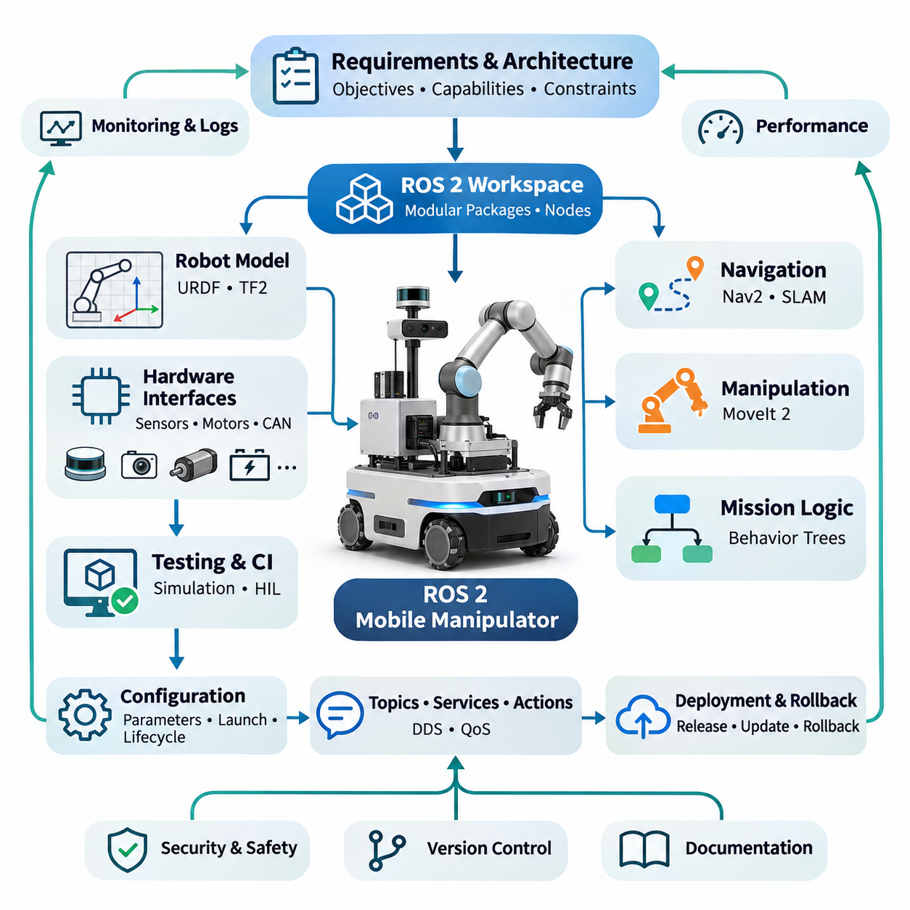
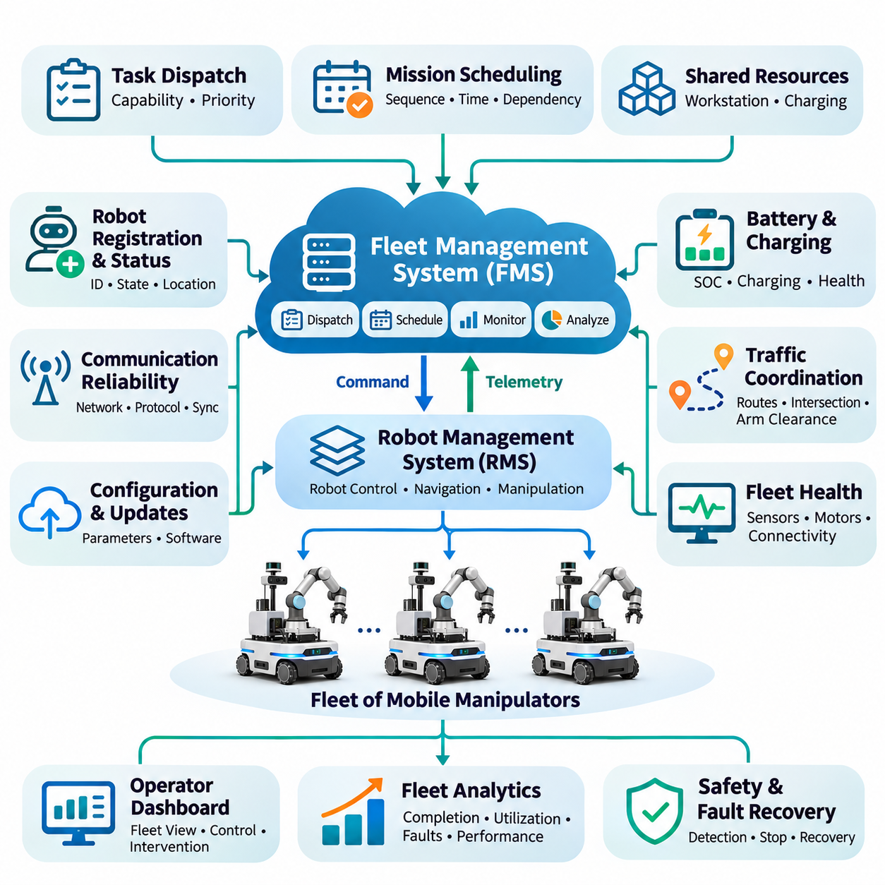
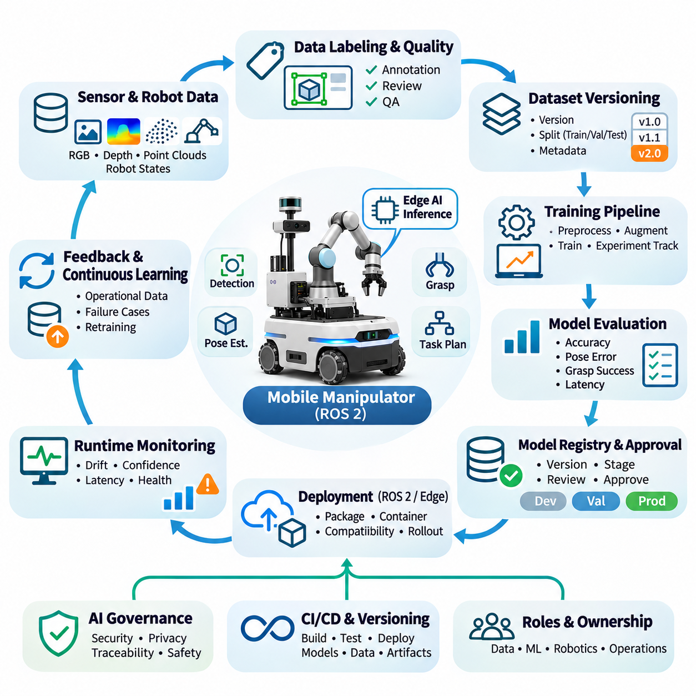
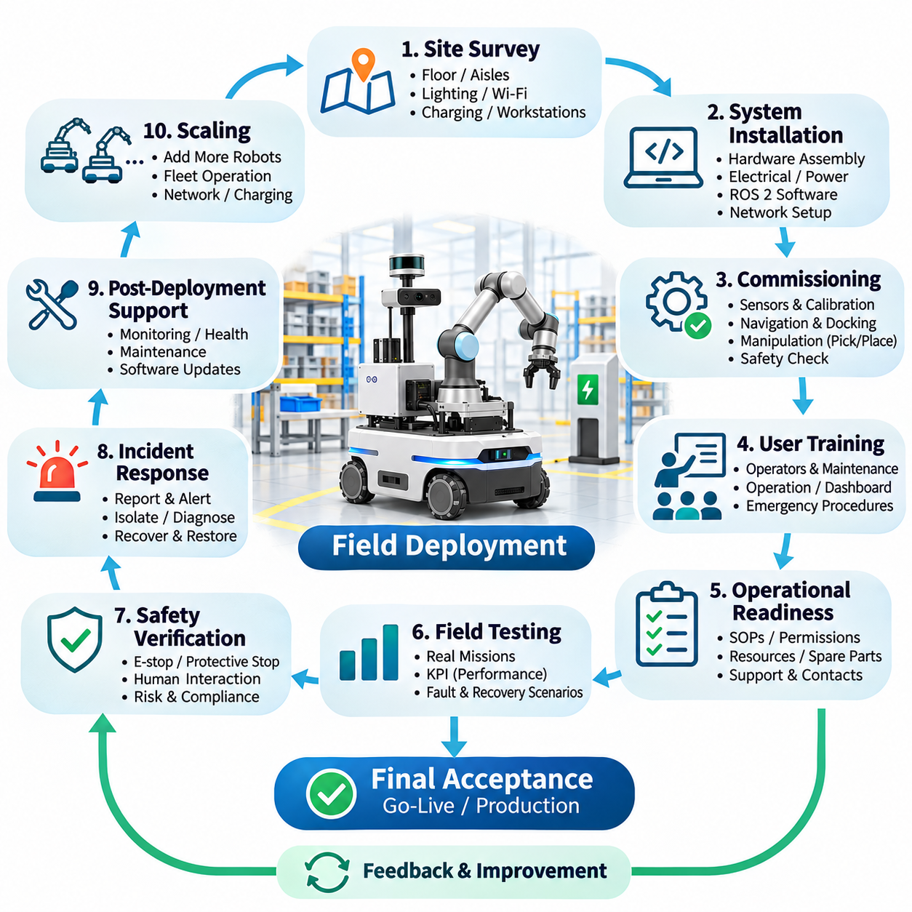
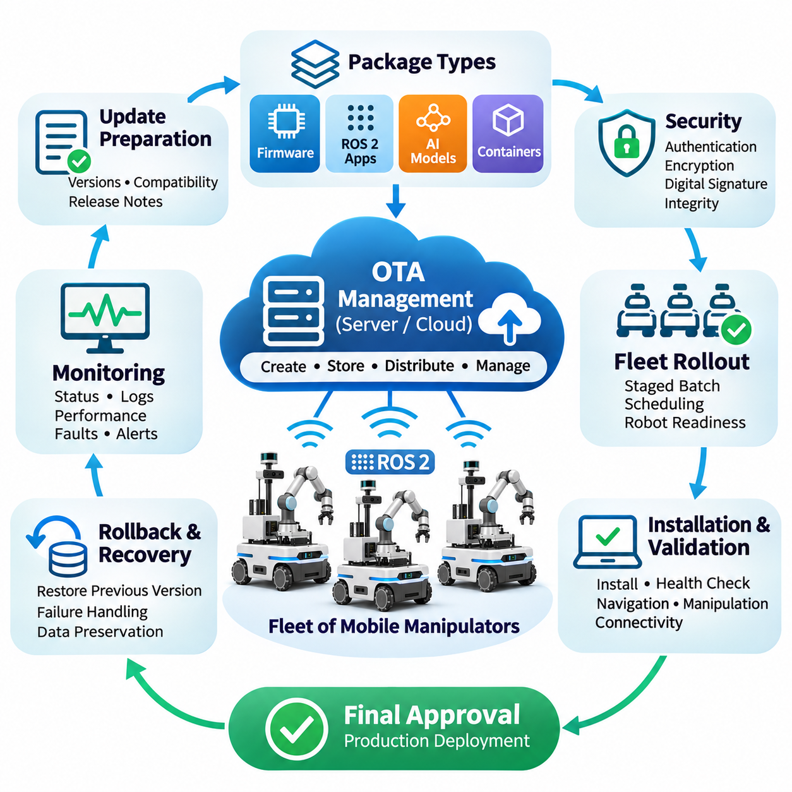
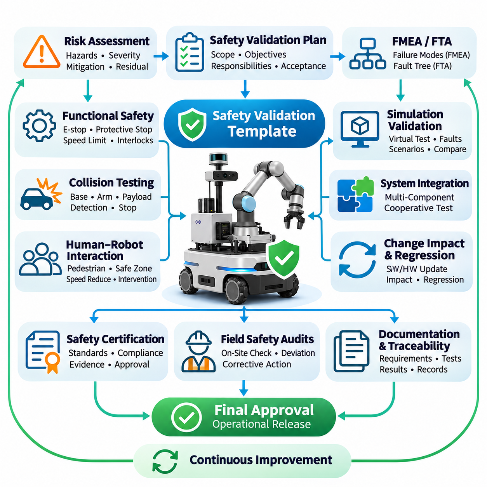
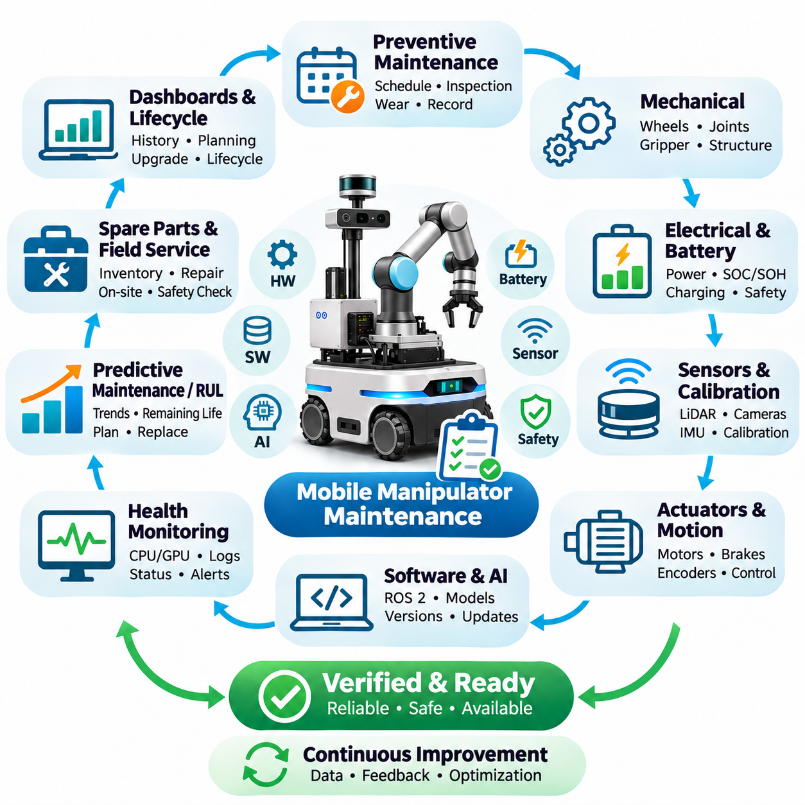

**Volume 04. Mobile Manipulation Software and Operations**

# Chapter 16. Checklists and Templates

## 01 ROS2 Project Template

{width="7.268055555555556in" height="7.268055555555556in"}

A ROS 2 project template provides a standardized framework for planning, developing, integrating, and maintaining the software architecture of a mobile manipulator. It establishes a consistent project structure covering requirements, package organization, node responsibilities, communication interfaces, configuration files, testing procedures, and deployment resources. The template helps engineering teams maintain traceability between system requirements and software implementation while reducing integration complexity across different development stages.

The project definition should begin with a clear description of the robot platform, operational environment, and intended applications. A mobile manipulator typically combines an autonomous mobile robot (AMR), a robotic arm, an end effector, perception sensors, and an onboard computing system. The project specification should identify the capabilities and constraints of each subsystem, including navigation accuracy, manipulation payload, workspace dimensions, positioning repeatability, communication requirements, and expected operating conditions.

The requirements section should translate operational objectives into measurable software and system requirements. Navigation, localization, motion planning, manipulation, perception, task execution, and safety functions should have clearly defined acceptance criteria. Requirements should distinguish mandatory capabilities from optional features and identify dependencies between software components and hardware interfaces. Each requirement should have a unique identifier so that implementation progress, test results, and unresolved issues can be tracked throughout the project lifecycle.

The ROS 2 workspace should follow a modular package structure that separates hardware interfaces, robot descriptions, control functions, perception, navigation, manipulation, and application-level logic. Packages should have clearly defined responsibilities and dependencies to prevent unnecessary coupling. Shared interfaces should be implemented through reusable message, service, and action definitions. Consistent naming conventions and package documentation improve maintainability and make it easier for multiple developers to contribute to the same software system.

The robot description package should contain the URDF or Xacro models, joint definitions, link relationships, collision geometry, sensor frames, and coordinate transformations required by the software stack. The model should accurately represent the physical relationship between the mobile base, manipulator, end effector, and sensors. TF2 frame conventions should be established early, including map, odom, base_link, arm_base_link, tool0, and sensor frames where applicable. Model consistency should be verified before integrating navigation and manipulation components.

The hardware interface package should define how ROS 2 communicates with motors, encoders, battery systems, safety controllers, LiDAR sensors, cameras, and other physical devices. Hardware communication may use CAN, CANopen, EtherCAT, Ethernet, USB, or serial interfaces depending on the platform. Device drivers should expose standardized ROS 2 topics, services, and actions while handling communication failures, invalid measurements, connection timeouts, and device initialization. Hardware abstraction allows higher-level software to operate without depending directly on vendor-specific implementation details.

The navigation package should integrate localization, mapping, path planning, obstacle detection, and base motion control. Nav2 can provide the primary navigation framework, while SLAM and localization components support environmental mapping and robot positioning. The project configuration should define costmaps, coordinate frames, planner and controller plugins, recovery behaviors, and navigation parameters. For mobile manipulators, navigation accuracy must also consider the positioning requirements of subsequent manipulation tasks, because reaching a navigation goal does not necessarily guarantee a suitable arm workspace.

The manipulation package should define the robotic arm model, kinematic configuration, motion planning interfaces, trajectory execution, and end-effector control. MoveIt 2 can provide robot state management, inverse kinematics, collision checking, planning pipelines, and trajectory generation. The package should also specify how manipulation tasks interact with the mobile base. Where base repositioning is necessary, the system should coordinate navigation and arm motion rather than treating them as completely independent operations.

The application package should implement mission-level behavior by coordinating navigation, manipulation, perception, and recovery functions. Behavior Trees or another structured task execution framework can represent workflows such as approaching a workstation, identifying an object, planning a grasp, executing a pick operation, transporting the object, and placing it at the destination. Each task should define its preconditions, expected results, timeout behavior, and failure recovery strategy. This structure improves operational transparency and supports the reuse of common behaviors across different applications.

The ROS 2 communication architecture should document topic names, message types, service interfaces, action definitions, Quality of Service (QoS) settings, and expected communication frequencies. Developers should identify which interfaces require reliable delivery, which can tolerate message loss, and which require low-latency communication. DDS configuration, network topology, domain identifiers, and discovery behavior should also be documented, particularly when multiple robots or distributed computing devices operate within the same environment.

The configuration management section should maintain separate parameter files for different robot models, environments, and deployment configurations. Navigation parameters, controller settings, sensor calibration values, planning constraints, and safety-related configuration should be version controlled. Environment-specific settings should not be embedded unnecessarily in application source code. Launch files should provide a consistent method for starting individual subsystems or the complete robot application, while lifecycle management should support controlled initialization, activation, deactivation, and shutdown.

The development environment should define supported operating systems, ROS 2 distributions, compiler versions, programming languages, and required dependencies. Docker containers or other reproducible build environments can reduce differences between developer workstations and deployment computers. Dependency versions should be documented, and automated build processes should verify that packages compile successfully after source changes. Continuous Integration (CI) pipelines can execute compilation, static analysis, unit tests, and interface validation before changes are merged into the main development branch.

Software testing should be organized across multiple levels. Unit tests should validate individual functions and components, while integration tests should verify communication and coordination between ROS 2 packages. Simulation-based testing should evaluate navigation, manipulation, collision avoidance, and task execution before hardware deployment. Hardware-in-the-loop testing can subsequently verify interactions with physical controllers and sensors. Acceptance tests should confirm that the complete robot satisfies the operational requirements defined at the beginning of the project.

Performance evaluation should include navigation accuracy, manipulation repeatability, task completion rate, execution time, communication latency, CPU and GPU utilization, memory consumption, and system availability. Measurements should be collected under representative operating conditions rather than relying exclusively on isolated demonstrations. For mobile manipulation, evaluation should consider the complete mission cycle because delays or positioning errors in one subsystem can affect the performance of the entire operation.

Logging and monitoring should be incorporated into the project architecture from the beginning. ROS 2 logs, diagnostic messages, rosbag recordings, system resource measurements, and application events should provide sufficient information to reproduce and investigate failures. Each important operation should generate identifiable execution records, including task initiation, navigation completion, manipulation results, error conditions, and recovery actions. Consistent timestamps and synchronized sensor data are particularly important when investigating problems involving multiple distributed components.

Version control should cover source code, robot descriptions, configuration files, launch files, interface definitions, test scripts, and documentation. Branching and code review procedures should ensure that software changes are traceable and reproducible. Release versions should identify the corresponding source revision, dependency versions, configuration set, and deployment package. Changes to message definitions or hardware interfaces should be reviewed carefully because they may affect multiple dependent packages and deployed robot systems.

Deployment preparation should verify that all required packages, drivers, parameters, network settings, and hardware dependencies are available on the target computer. The installation procedure should include system startup configuration, service management, device permissions, and automatic recovery behavior where appropriate. Deployment records should identify the robot hardware revision, software release, calibration status, and operational configuration. A tested rollback procedure should be available when a software update causes unexpected behavior.

Security and safety requirements should be treated as essential parts of the ROS 2 project rather than optional additions. Access permissions, network segmentation, authenticated communication, and secure software distribution should be considered according to the operational environment. Safety-related functions such as emergency stopping, protective stopping, speed limitation, and collision monitoring should use appropriately designed and validated mechanisms. Ordinary ROS 2 application logic should not be assumed to replace independent safety-rated hardware or certified safety controllers.

The final project documentation should provide a complete record of architecture decisions, package responsibilities, interface specifications, configuration procedures, testing evidence, known limitations, and maintenance requirements. Developers and operators should be able to understand how the system is assembled, how individual components interact, and how failures can be diagnosed. The documentation should evolve together with the software so that it remains consistent with the deployed implementation.

A completed ROS 2 project template should therefore serve as both a development reference and an engineering control document. It connects requirements, software architecture, hardware integration, testing, deployment, and maintenance within a unified workflow. By adopting consistent structures and verification procedures, engineering teams can develop mobile manipulation systems that are easier to extend, reproduce, troubleshoot, and operate reliably across different industrial environments.

## 02 Fleet Management Checklist

{width="7.268055555555556in" height="7.268055555555556in"}

Fleet management for mobile manipulators requires a systematic approach to coordinating multiple robots, allocating operational resources, scheduling missions, and maintaining reliable fleet performance. A fleet management checklist provides a structured method for verifying that all essential components are correctly configured before deployment and during daily operations. It should cover fleet architecture, task dispatching, mission scheduling, resource allocation, battery management, traffic coordination, health monitoring, operator interfaces, and performance analytics.

The fleet architecture should define how individual mobile manipulators communicate with the central Fleet Management System (FMS) and Robot Management System (RMS). The checklist should verify robot registration, unique identification, network connectivity, communication protocols, and system integration. Each robot should report its operational state, location, battery level, task progress, and fault conditions. The architecture should also support the addition or removal of robots without requiring major changes to the existing fleet infrastructure.

The RMS and FMS configuration should establish clear responsibilities between robot-level execution and fleet-level coordination. The RMS should manage robot-specific capabilities, navigation status, manipulation functions, and local execution processes. The FMS should coordinate task distribution, mission priorities, shared resources, and overall operational status. Interface compatibility, communication reliability, synchronization, and failure handling should be verified to ensure that both management layers operate consistently.

Task dispatching should be evaluated to confirm that missions are assigned according to robot availability, capabilities, location, workload, and operational priority. The checklist should verify task acceptance, execution acknowledgment, status reporting, cancellation, reassignment, and completion notifications. Mobile manipulators may have different arm configurations, payload capacities, end effectors, and perception capabilities. Therefore, task allocation should consider functional compatibility rather than relying exclusively on geographic proximity or robot availability.

Mission scheduling should ensure that multiple tasks can be executed efficiently without creating unnecessary delays or operational conflicts. The checklist should verify mission priorities, execution sequences, time constraints, dependencies, and resource requirements. Scheduling logic should account for navigation time, manipulation duration, workstation availability, and charging requirements. When operational conditions change, the fleet manager should be able to update schedules and redistribute tasks while preserving mission consistency and execution traceability.

Resource allocation should consider the shared physical and computational resources required by fleet operations. These resources may include charging stations, workstations, loading areas, manipulation zones, communication networks, and shared equipment. The checklist should verify resource availability, reservation mechanisms, access permissions, and conflict prevention. For mobile manipulators, resource allocation should also consider the spatial requirements of the robotic arm, ensuring that multiple robots do not simultaneously occupy incompatible manipulation workspaces.

Battery management should verify that each robot maintains sufficient energy for its assigned missions and expected return or charging operations. The fleet system should monitor battery state of charge (SOC), estimated remaining operating time, charging status, and battery health. Charging decisions should consider mission priority, remaining energy, charging station availability, and expected workload. The checklist should also verify low-battery warnings, automatic charging requests, charging completion detection, and safe recovery when battery conditions become critical.

Traffic management should ensure safe and efficient movement of multiple robots within shared operational environments. The checklist should verify map consistency, route planning, obstacle detection, intersection management, priority rules, and collision avoidance. The fleet system should identify potential conflicts involving narrow passages, shared corridors, docking stations, and work areas. For mobile manipulators, traffic coordination should additionally account for the robot\'s physical dimensions, arm configuration, carried objects, and expanded occupied space during manipulation.

Fleet health monitoring should provide continuous visibility into the operational condition of every robot. The checklist should verify monitoring of localization quality, navigation status, motor conditions, controller errors, sensor availability, communication quality, battery health, and computing resource utilization. Abnormal conditions should generate identifiable diagnostic events and appropriate warnings. The system should distinguish between temporary communication interruptions, recoverable software failures, hardware faults, and conditions requiring immediate human intervention.

Operator dashboards should present fleet information in a clear and actionable format. The checklist should verify that operators can identify individual robots, inspect their current locations, review mission progress, monitor battery conditions, and recognize active faults. Important operational information should be accessible without navigating through excessive interface layers. The dashboard should also provide appropriate controls for mission assignment, task cancellation, robot suspension, manual intervention, and recovery procedures according to operator permissions.

Fleet analytics should collect operational data to evaluate productivity, resource utilization, and system reliability. Relevant indicators include mission completion rate, task execution time, robot utilization, idle time, charging frequency, navigation efficiency, manipulation success rate, and fault frequency. The checklist should verify that collected data is accurate, timestamped, consistently structured, and available for historical analysis. Analytics should help identify recurring bottlenecks and support evidence-based decisions concerning fleet expansion, scheduling optimization, and operational improvements.

Communication reliability should be validated across all robots and fleet management components. The checklist should verify wireless coverage, network latency, packet loss, communication recovery, and synchronization of operational information. The system should define appropriate behavior when a robot temporarily loses communication with the FMS. Local safety functions and essential robot-level controls should remain operational even when centralized fleet connectivity becomes unavailable. Communication recovery should restore consistent fleet status without generating duplicate or conflicting missions.

Operational safety should be integrated into fleet management procedures. The checklist should verify emergency stop handling, protective stop conditions, restricted areas, speed limitations, human presence detection, and safe recovery procedures. Robots operating in shared workspaces should follow coordinated movement and access rules. Manipulation activities should also be considered when evaluating shared workspace safety, because an extended robotic arm or transported object may create additional collision hazards beyond the mobile base footprint.

Fault management and recovery procedures should define how the fleet responds to unexpected operational events. The checklist should verify fault classification, alarm generation, task interruption, robot isolation, recovery authorization, and mission reassignment. When a robot becomes unavailable, the FMS should determine whether its unfinished tasks can be transferred to another compatible robot. Recovery procedures should preserve mission history and prevent unsafe automatic restarts or repeated execution of partially completed manipulation operations.

Fleet configuration and software maintenance should be managed through controlled versioning and validation procedures. Robot configurations, navigation parameters, communication settings, task definitions, and software versions should be recorded consistently. The checklist should verify configuration compatibility between individual robots and the central management system. Software updates and configuration changes should be tested before fleet-wide deployment, with appropriate rollback procedures available to restore a previously validated operational state.

The final fleet management review should confirm that all operational requirements have been verified under representative working conditions. Testing should include normal mission execution, simultaneous robot operation, resource contention, communication interruptions, low-battery situations, navigation failures, and recovery scenarios. Acceptance criteria should be defined for fleet throughput, task completion reliability, resource utilization, and operational availability. Test results, unresolved issues, and corrective actions should be documented before approving production deployment.

A completed fleet management checklist should serve as a continuous operational control document rather than a one-time commissioning record. It should be reviewed whenever robot configurations, software versions, operational workflows, or facility conditions change. Regular reviews help ensure that fleet management remains consistent with actual operating requirements. By maintaining systematic verification across RMS, FMS, task dispatching, scheduling, resource allocation, battery management, traffic coordination, and analytics, organizations can improve the reliability, scalability, and productivity of mobile manipulator fleets.

## 03 MLOps Template

{width="7.268055555555556in" height="7.268055555555556in"}

An MLOps (Machine Learning Operations) template provides a standardized framework for managing the complete lifecycle of artificial intelligence models used in mobile manipulation systems. It connects data collection, data preparation, model training, evaluation, deployment, monitoring, and continuous improvement within a reproducible engineering workflow. The template should define responsibilities, technical interfaces, version management procedures, and operational requirements so that machine learning models can be developed and maintained consistently across different robots and deployment environments.

The MLOps architecture should reflect the characteristics of mobile manipulation systems, where AI models interact with physical sensors, robotic controllers, navigation systems, and manipulation software. Perception, object detection, pose estimation, grasp recognition, scene understanding, and task planning may require different models and execution environments. The template should identify model dependencies, computational requirements, inference interfaces, and performance constraints. It should also establish how AI components communicate with ROS 2 nodes and other robot subsystems.

Data collection should provide a systematic process for acquiring representative sensor and operational data from real robots and simulation environments. The collected data may include RGB images, depth images, point clouds, camera parameters, robot poses, joint states, force measurements, and task execution records. Each data sample should contain relevant timestamps, sensor configurations, environmental conditions, and robot identification information. Data collection procedures should also consider privacy, safety, storage capacity, and synchronization across distributed sensors.

Data labeling should establish consistent annotation standards for training and evaluating machine learning models. Depending on the application, annotations may include object classes, bounding boxes, segmentation masks, keypoints, six-dimensional poses, grasp locations, and manipulation outcomes. Labeling guidelines should define class definitions, annotation accuracy requirements, quality inspection procedures, and methods for resolving ambiguous samples. Automated annotation and human review can be combined to improve efficiency while maintaining dataset consistency and reliability.

Dataset versioning should ensure that every training experiment can be reproduced using an identifiable and traceable dataset. Each dataset version should record its source, collection conditions, annotation revision, preprocessing procedures, and applicable quality checks. Training, validation, and test datasets should be separated carefully to prevent data leakage and unrealistic performance estimates. Changes to datasets should be documented so that model performance differences can be associated with specific modifications in data composition or annotation quality.

Model training pipelines should automate the major stages of machine learning development, including data preparation, preprocessing, augmentation, model configuration, training, validation, and evaluation. Each experiment should record the model architecture, hyperparameters, software dependencies, hardware configuration, random seeds, and training duration. Automated pipelines improve reproducibility and reduce manual errors. For robotic applications, training procedures should also consider real-time inference requirements, environmental variation, and the computational limitations of onboard edge devices.

The model registry should provide a centralized mechanism for managing trained models and their associated metadata. Each registered model should include its version, architecture, training dataset, evaluation results, intended application, and deployment requirements. Model lifecycle states may include development, validation, approved, production, deprecated, and archived. Promotion between these states should follow defined review and acceptance procedures. The registry should make it possible to identify exactly which model version is running on each robot.

Deployment pipelines should provide controlled procedures for delivering trained models to robot computers, edge devices, and centralized computing infrastructure. Deployment methods may include containerized applications, model packages, inference engines, and hardware-specific optimization formats. The pipeline should verify model compatibility, software dependencies, memory requirements, inference latency, and runtime stability before production activation. For mobile manipulators, deployment should also verify integration with ROS 2 interfaces and the relevant perception or manipulation components.

Model monitoring should evaluate AI performance continuously after deployment. Monitoring indicators may include inference latency, throughput, prediction confidence, detection accuracy, false positive rates, model availability, and computational resource utilization. Operational monitoring should also identify changes in environmental conditions, sensor characteristics, and input data distributions that may reduce model reliability. When performance degradation is detected, the system should generate diagnostic records and initiate an appropriate investigation or recovery procedure.

Continuous learning should establish a controlled feedback process between deployed robots and model development environments. Operational data, failure cases, operator corrections, and difficult manipulation scenarios can be collected for subsequent analysis and retraining. Newly trained models should not automatically replace production models without validation. Each update should pass dataset quality checks, model evaluation, compatibility testing, and deployment approval. This process enables the system to improve over time while maintaining predictable operational behavior.

AI governance should define the policies and responsibilities required to manage machine learning systems throughout their lifecycle. It should address data ownership, access permissions, privacy protection, model traceability, evaluation evidence, software security, and change management. Model decisions should be documented sufficiently to support technical review and operational accountability. For safety-critical robotic functions, AI model outputs should be evaluated within the complete system safety architecture, and unvalidated model behavior should not replace independent safety mechanisms.

The MLOps template should also establish clear responsibilities between AI engineers, robotics software developers, data engineers, system integrators, and operational teams. Data collection, annotation, model development, deployment, and monitoring should have defined ownership and approval procedures. Integration with source control, automated testing, experiment tracking, artifact storage, and CI/CD pipelines should be documented. This organizational structure helps prevent disconnected development activities and improves collaboration across multidisciplinary engineering teams.

Performance evaluation should consider both conventional machine learning metrics and complete robotic task outcomes. Object detection accuracy, segmentation quality, pose estimation error, grasp success rate, and inference latency provide important technical indicators. However, these metrics should also be connected to operational measurements such as task completion rate, manipulation cycle time, recovery frequency, and system availability. A model with high benchmark accuracy may still perform poorly in real environments if its predictions are unstable or unsuitable for downstream robot control.

The final MLOps review should verify that datasets, training experiments, model versions, deployment packages, and monitoring procedures are properly documented and traceable. Representative validation should cover simulation environments, laboratory experiments, and actual operational conditions. The review should confirm that model rollback, failure investigation, retraining, and release approval procedures are available. Acceptance criteria should be established before production deployment to ensure that AI models satisfy both computational requirements and practical robotic performance expectations.

A completed MLOps template should serve as a continuous engineering framework rather than a document used only during initial model development. It should evolve with changes in robot hardware, sensor configurations, operational environments, AI architectures, and software infrastructure. By connecting data engineering, model development, deployment automation, runtime monitoring, continuous learning, and AI governance, organizations can establish a reproducible and scalable AI lifecycle. This approach supports reliable model operation and sustainable improvement across industrial mobile manipulation systems.

## 04 Field Deployment Checklist

{width="7.268055555555556in" height="7.268055555555556in"}

A field deployment checklist provides a structured framework for preparing, installing, commissioning, and operating mobile manipulators in real-world environments. It ensures that hardware, software, communication infrastructure, safety systems, and operational procedures are ready before production activities begin. The checklist should cover site surveys, system installation, commissioning, user training, operational readiness, field testing, incident response, post-deployment support, and deployment scaling. Each activity should have defined responsibilities, verification criteria, and documented completion records.

Site surveys should establish whether the target facility can support the intended mobile manipulation operations. The assessment should examine floor conditions, workspace dimensions, aisle widths, slopes, obstacles, lighting, network coverage, charging locations, and workstation accessibility. Particular attention should be given to areas where mobile navigation and robotic arm manipulation occur together. Environmental constraints, human traffic patterns, restricted zones, and emergency access routes should be documented before finalizing the deployment configuration.

The site survey should also verify that the physical environment is compatible with the robot\'s navigation and manipulation requirements. Map coverage, localization references, docking locations, workstation positions, and obstacle characteristics should be evaluated. The engineering team should identify potential interference from reflective surfaces, transparent objects, changing lighting conditions, and moving equipment. Any environmental modifications required for reliable operation should be agreed upon with the facility operator before installation begins.

System installation should verify that all mechanical, electrical, and computing components are correctly assembled and connected. The mobile base, robotic arm, end effector, sensors, battery system, onboard computer, and safety devices should be inspected against the approved configuration. Mechanical fastening, cable routing, grounding, power distribution, connector protection, and emergency stop accessibility should be checked. Installation records should identify hardware revisions, component serial numbers, calibration information, and any deviations from the approved design.

Software installation should confirm that the required operating system, ROS 2 distribution, device drivers, application packages, navigation stack, manipulation framework, and configuration files are correctly deployed. Network settings, IP addresses, communication interfaces, time synchronization, and security permissions should be verified. The installed software versions should match the validated release configuration. The deployment team should also confirm that system startup, service management, logging, and diagnostic functions operate correctly after a complete restart.

Commissioning should establish that the installed robot performs its basic functions safely and consistently. Initial verification should include power-up procedures, sensor initialization, motor operation, encoder feedback, battery monitoring, emergency stopping, and communication with the central management system. Mechanical alignment and sensor calibration should be checked before autonomous operation. Any abnormal vibration, unexpected movement, communication failure, or inconsistent sensor measurement should be investigated and resolved before proceeding to integrated functional testing.

Navigation commissioning should verify localization accuracy, map consistency, path planning, obstacle avoidance, docking performance, and recovery behaviors. The robot should be tested across representative routes, including narrow passages, intersections, workstation approaches, and charging areas. Navigation parameters should be adjusted according to the actual facility conditions. The commissioning process should also evaluate whether the robot can reach manipulation positions with sufficient positional accuracy and suitable orientation for the intended tasks.

Manipulation commissioning should verify robotic arm motion, joint limits, inverse kinematics, trajectory execution, end-effector operation, and collision checking. The team should evaluate representative pick-and-place operations and confirm that the robot can perform tasks without interfering with the mobile base, surrounding equipment, or human work areas. When manipulation requires precise base positioning, the complete navigation-to-manipulation sequence should be validated. Task execution should include appropriate failure detection and recovery procedures.

User training should prepare operators, supervisors, and maintenance personnel to work with the deployed mobile manipulation system. Training should explain normal operating procedures, mission assignment, robot status indicators, dashboard functions, emergency stop operation, and basic troubleshooting. Operators should understand the limitations of autonomous behavior and recognize situations requiring human intervention. Maintenance personnel should receive additional training covering calibration, component inspection, software diagnostics, battery handling, and approved service procedures.

Operational readiness should confirm that the facility, personnel, infrastructure, and management procedures are prepared for routine operation. The checklist should verify operator assignments, access permissions, charging schedules, network availability, spare parts, maintenance resources, and emergency contacts. Standard operating procedures should define startup, shutdown, mission execution, manual intervention, fault recovery, and incident reporting. Responsibilities between the robot supplier, system integrator, facility operator, and maintenance organization should be clearly established.

Field testing should evaluate system performance under representative production conditions rather than relying exclusively on laboratory demonstrations. Test scenarios should include normal missions, variable workloads, different object configurations, human interaction, changing environmental conditions, and simultaneous operation with other equipment. Relevant performance indicators include task completion rate, cycle time, navigation accuracy, manipulation success rate, system availability, and recovery frequency. Test results should be compared against predefined acceptance criteria and documented for formal deployment approval.

Field testing should also include exceptional operating conditions and failure scenarios. Communication interruptions, sensor degradation, localization loss, blocked pathways, unexpected obstacles, manipulation failures, and low-battery conditions should be evaluated. The system should demonstrate appropriate fault detection, safe stopping, operator notification, and recovery behavior. Testing should confirm that a failed subsystem does not create unsafe conditions for the robot, nearby personnel, or surrounding equipment.

Safety verification should confirm that all protective mechanisms function correctly in the actual deployment environment. Emergency stops, protective stops, speed restrictions, collision monitoring, safety scanners, and restricted operating zones should be tested according to the approved safety requirements. Human-robot interaction should be evaluated at workstations, shared passages, and manipulation areas. Safety validation should include documented test results, identified hazards, corrective actions, and approval by the responsible safety personnel.

Incident response procedures should define how personnel identify, report, investigate, and resolve unexpected events during field operation. The checklist should establish escalation paths, emergency contacts, robot isolation procedures, evidence collection, and authorization requirements for returning a robot to service. Relevant logs, sensor recordings, system diagnostics, and mission histories should be preserved for investigation. Incidents should be classified according to operational impact and safety implications, with corrective actions tracked until closure.

Post-deployment support should maintain system reliability after the initial installation and commissioning activities have been completed. Support procedures should define response times, remote diagnostics, software maintenance, spare parts availability, preventive maintenance, and escalation responsibilities. Operational feedback should be collected from operators and maintenance personnel to identify recurring problems and improvement opportunities. Deployment records should remain synchronized with actual hardware configurations, software versions, calibration states, and maintenance histories.

Deployment performance should be reviewed periodically to determine whether the system continues to satisfy operational requirements. Monitoring should include robot utilization, mission completion, navigation performance, manipulation accuracy, charging efficiency, fault frequency, and maintenance costs. Changes in facility layouts, workflows, equipment, or operating schedules should trigger an assessment of deployment compatibility. Configuration changes should be validated before being introduced into production to avoid unexpected effects on previously verified functions.

Scaling deployments should ensure that additional robots, workstations, and operating areas can be integrated without compromising existing operations. The deployment team should evaluate fleet management capacity, wireless network coverage, charging infrastructure, traffic coordination, shared workspace availability, and maintenance resources. Standardized installation procedures, reusable configuration packages, and consistent acceptance tests should be maintained across sites. Lessons learned from initial deployments should be incorporated into subsequent implementations to reduce integration time and operational risks.

The final deployment review should confirm that all required installation, commissioning, safety, training, and field testing activities have been completed. Outstanding issues should be classified according to severity, operational impact, and required corrective actions. Acceptance documentation should include test reports, software versions, hardware configurations, calibration records, training records, operating procedures, and support agreements. Formal approval should be obtained from the responsible stakeholders before the system enters routine production operation.

A completed field deployment checklist should serve as a continuous reference throughout the operational lifecycle of a mobile manipulator. It should be updated whenever the facility, robot configuration, software, operating procedures, or safety requirements change. Regular reviews help maintain consistency between the validated system and its actual field configuration. By applying systematic verification across site surveys, installation, commissioning, training, operational readiness, field testing, incident response, and post-deployment support, organizations can achieve reliable and repeatable mobile manipulation deployments across different industrial environments.

## 05 OTA Deployment Checklist

{width="7.268055555555556in" height="7.268055555555556in"}

An Over-the-Air (OTA) deployment checklist provides a standardized framework for preparing, distributing, validating, and managing software updates across mobile manipulators and robotic fleets. It ensures that firmware, application software, AI models, and containerized services can be updated without unnecessary operational interruptions. The checklist should cover OTA architecture, update preparation, firmware updates, application updates, AI model updates, container-based deployment, rollback strategies, security, fleet-wide distribution, update validation, and operational best practices.

The OTA architecture should define how update packages are created, stored, distributed, installed, and monitored across the robotic system. The architecture should identify the responsibilities of the central management server, robot onboard computers, edge devices, and individual hardware controllers. Communication interfaces, update protocols, package repositories, and deployment authorization mechanisms should be documented. The architecture should also support different robot configurations and software versions while maintaining compatibility across the fleet.

Update preparation should establish a controlled process for identifying the software components that require modification. The engineering team should document the current software version, target version, hardware compatibility, dependency requirements, and expected operational impact. Release notes should describe modifications, resolved defects, known limitations, and configuration changes. Before distribution, update packages should be verified for completeness, integrity, compatibility, and successful installation in a representative development or test environment.

Firmware updates should cover the embedded software responsible for controlling motors, sensors, battery systems, communication interfaces, and other hardware components. The checklist should verify firmware compatibility, device identification, version tracking, installation procedures, and communication stability. Particular attention should be given to motor controllers, steering systems, safety devices, and battery management systems. Firmware updates should be performed under controlled conditions, with sufficient power availability and recovery mechanisms to prevent devices from becoming unusable during interrupted installations.

Application updates should manage changes to the software responsible for navigation, manipulation, perception, task execution, and fleet communication. The checklist should verify application package dependencies, ROS 2 compatibility, configuration migration, launch procedures, and interface consistency. Changes to topics, services, actions, or message definitions should be evaluated for their impact on other software components. Application updates should be tested with representative robot configurations before deployment to ensure that existing operational functions remain available.

AI model updates should establish a controlled procedure for replacing or modifying machine learning models used in perception and manipulation. The checklist should verify model versions, training dataset references, evaluation results, inference engine compatibility, and hardware resource requirements. Updated models should be evaluated for detection accuracy, pose estimation performance, inference latency, and operational reliability. The deployment process should preserve the ability to restore a previously validated model when an update produces unexpected predictions or degraded robotic task performance.

Container-based updates should provide a consistent method for distributing software environments and application dependencies. The checklist should verify container images, image versions, registry access, runtime compatibility, resource allocation, and persistent data management. Container images should be built from controlled software dependencies and identified using immutable version references or digests. Deployment procedures should also consider container startup order, inter-container communication, storage migration, and service health checks to ensure that updated applications operate correctly.

Rollback strategies should define how the robotic system can return to a previously validated software configuration when an update fails. The checklist should verify the availability of previous firmware, application packages, AI models, container images, and configuration files. Recovery procedures should identify which components can be rolled back independently and which require coordinated restoration. The system should detect unsuccessful installations, preserve relevant diagnostic information, and prevent partially updated configurations from entering normal production operation.

OTA security should protect the update infrastructure, distribution channels, packages, and robot devices against unauthorized access and malicious modification. The checklist should verify authentication, authorization, encrypted communication, digital signatures, package integrity checks, and secure key management. Update servers and robot endpoints should follow appropriate access control policies. Security logs should record package creation, approval, distribution, installation, and verification events. Security mechanisms should remain effective throughout the complete update lifecycle.

Fleet-wide deployment should provide a controlled method for distributing updates across multiple robots without disrupting ongoing operations. The checklist should verify robot grouping, deployment scheduling, network capacity, update priorities, and installation status reporting. Updates may be distributed in controlled batches, beginning with a limited number of representative robots before expanding to the remaining fleet. This approach allows engineering teams to identify compatibility problems and unexpected failures before they affect a large number of operational robots.

Update scheduling should consider mission execution, charging availability, production requirements, and robot operational status. The fleet management system should identify robots that are available for maintenance and prevent updates from interrupting critical tasks. For mobile manipulators, update timing should also consider the coordination between navigation, manipulation, and external equipment. The checklist should verify that robots can safely complete or suspend their current missions before entering the update process.

Update validation should confirm that every deployed software component has been installed correctly and operates according to its expected specifications. Validation should include package integrity, version confirmation, application startup, sensor communication, navigation functions, manipulation execution, and fleet connectivity. Automated health checks should identify missing dependencies, configuration errors, abnormal resource utilization, and unexpected service failures. Validation results should be recorded against the corresponding robot identifier and software release.

Post-update testing should evaluate the complete robotic workflow rather than checking software installation alone. Representative scenarios should include autonomous navigation, docking, object detection, grasp planning, pick-and-place execution, task recovery, and communication with fleet management services. Performance measurements should be compared with the baseline established before deployment. Any regression in task completion rate, response time, positioning accuracy, or system availability should trigger further investigation before the updated robot returns to normal operation.

Operational monitoring should provide continuous visibility into update progress and the condition of deployed robots. The monitoring system should track installation status, update duration, failure frequency, software versions, system health, and communication availability. Operators should receive clear notifications when updates are completed, delayed, or unsuccessful. Centralized records should make it possible to identify robots running outdated software and determine whether additional maintenance or corrective action is required.

Operational best practices should establish consistent procedures for release approval, maintenance windows, deployment communication, incident handling, and software lifecycle management. Updates should be documented, tested, authorized, and distributed according to defined release policies. Critical production environments should use staged deployment and verified rollback procedures. Lessons learned from previous updates should be incorporated into subsequent releases to improve installation reliability and reduce operational risks.

The final OTA deployment review should confirm that all required preparation, security, compatibility, installation, validation, and recovery activities have been completed. The review should verify that each robot is running the intended software configuration and that no unresolved update failures remain. Release records should include package versions, digital verification results, installation timestamps, validation reports, and rollback information. Formal approval should be obtained before the updated fleet is considered fully operational.

A completed OTA deployment checklist should serve as a continuous software lifecycle management reference rather than a document used only during individual updates. It should be revised whenever firmware architectures, application dependencies, AI models, container environments, security policies, or fleet configurations change. By applying systematic verification across update preparation, firmware and application deployment, AI model management, security, rollback, fleet-wide distribution, and post-update validation, organizations can maintain reliable, secure, and scalable software operations across mobile manipulator fleets.

## 06 Safety Validation Template

{width="7.268055555555556in" height="7.268055555555556in"}

A safety validation template provides a standardized framework for verifying that mobile manipulators operate safely throughout development, integration, commissioning, and production deployment. It establishes consistent procedures for identifying hazards, defining safety requirements, conducting functional tests, evaluating human-robot interaction, and documenting validation evidence. The template should connect risk assessment, safety architecture, hardware protection, software behavior, and operational procedures so that safety performance can be evaluated systematically across different robots and deployment environments.

The safety validation plan should define the scope, objectives, responsibilities, and acceptance criteria for each validation activity. It should identify the robot configuration, operating environment, intended applications, payload conditions, and expected human interactions. The validation scope should cover the mobile base, robotic arm, end effector, sensors, controllers, communication systems, and fleet management interfaces. Each test should have a defined procedure, expected result, responsible person, and documented verification outcome.

Functional safety testing should verify that safety-related functions operate correctly under normal conditions and foreseeable fault conditions. The checklist should include emergency stops, protective stops, speed limitations, safety interlocks, restart prevention, and controlled recovery procedures. Tests should evaluate the response of the complete robotic system rather than individual components alone. Safety functions should be assessed against their specified performance requirements, and independent safety mechanisms should remain effective even when ordinary application software fails.

Collision testing should evaluate the robot\'s ability to detect, prevent, and respond appropriately to potential collisions. Validation should cover mobile base movement, robotic arm trajectories, end-effector operation, transported objects, and interactions with surrounding equipment. Tests should consider different approach directions, movement speeds, payload configurations, and obstacle positions. Collision detection and stopping behavior should be measured under representative operating conditions, with particular attention to situations where the mobile base and robotic arm operate simultaneously.

Human-robot interaction validation should examine how the robot behaves when people share its workspace. The checklist should consider pedestrian detection, approach behavior, speed reduction, protective stopping, restricted areas, and operator intervention. Testing should include different human positions, movement directions, visibility conditions, and workstation configurations. The validation process should also examine whether operators can understand robot intentions, recognize abnormal behavior, and access emergency controls without unnecessary difficulty.

Simulation-based validation should provide a controlled environment for evaluating safety-related scenarios before physical deployment. The simulation model should represent robot geometry, joint limits, collision properties, sensor characteristics, environmental obstacles, and relevant human movements. Test scenarios should include blocked pathways, unexpected obstacles, positioning errors, abnormal trajectories, and communication interruptions. Simulation results should be documented and compared with physical test results to identify modeling limitations and establish confidence in the validation process.

Risk assessment should systematically identify hazards associated with robot operation, maintenance, and interaction with surrounding personnel. The assessment should consider mechanical hazards, crushing and trapping points, unexpected movements, electrical risks, battery hazards, dropped objects, and failures of perception or control systems. Each identified hazard should be evaluated according to its potential severity, exposure conditions, and possibility of avoidance. Risk reduction measures should be documented, and residual risks should be reviewed before operational approval.

Failure Mode and Effects Analysis (FMEA) and Fault Tree Analysis (FTA) should support the systematic investigation of potential system failures. FMEA should identify possible failure modes in mechanical components, sensors, actuators, controllers, communication interfaces, and software functions. Their effects, causes, detection methods, and mitigation measures should be recorded. FTA should examine how combinations of component failures or abnormal conditions could lead to hazardous system behavior. The results should guide test priorities and identify additional safety measures.

Safety certification should verify that the robot and its safety-related components satisfy the applicable regulatory and technical requirements. The checklist should identify relevant machinery safety standards, functional safety requirements, electrical safety requirements, and industrial robot safety provisions according to the intended application and jurisdiction. Evidence should include component certificates, system architecture documentation, risk assessments, test reports, and technical records. Certification claims should be based on appropriate assessments rather than assumptions about individual component specifications.

Field safety audits should evaluate whether validated safety functions remain effective in actual operating environments. Audits should examine robot movement, manipulation activities, operator behavior, restricted zones, emergency access, safety signage, and maintenance practices. Changes in facility layouts, workflows, robot configurations, or operating conditions should trigger additional safety reviews. Observed deviations and unsafe conditions should be documented with assigned corrective actions, responsible personnel, and verification deadlines.

Safety documentation should provide traceable evidence of the complete validation process. Records should include safety requirements, hazard identification, risk assessments, test procedures, measurement results, software and hardware versions, calibration information, and approval decisions. Each validation result should be associated with a specific robot configuration and test environment. Failed tests, corrective actions, retest results, and unresolved limitations should remain documented so that engineering teams can understand the safety status of each system release.

Safety validation should also address interactions between individual robotic subsystems. Navigation, manipulation, perception, motion planning, and fleet management may each operate correctly in isolation but produce unsafe behavior when integrated. The validation process should therefore examine coordinated system behavior, including base movement during arm operation, simultaneous robot activities, shared workspace access, and recovery after communication failures. System-level testing should confirm that safety requirements remain effective across subsystem boundaries.

Software and configuration changes should be subject to controlled safety impact assessments. Updates to navigation parameters, motion planning algorithms, perception models, controller firmware, and ROS 2 applications may influence previously validated behavior. The engineering team should identify affected safety functions and determine whether additional verification or regression testing is necessary. Previously approved validation evidence should not automatically be considered applicable when significant hardware, software, or operational changes are introduced.

The final safety validation review should confirm that all required tests have been completed and that the acceptance criteria have been satisfied. Unresolved hazards, failed test cases, deviations, and corrective actions should be reviewed by the responsible engineering and safety personnel. The final records should identify the validated robot configuration, applicable standards, test evidence, residual risks, and operational restrictions. Formal approval should be obtained before the system is authorized for its intended production environment.

A completed safety validation template should serve as a continuous engineering and operational reference rather than a one-time certification document. It should be updated whenever robot hardware, software, sensors, operating environments, or intended applications change. By integrating functional safety testing, collision evaluation, human-robot interaction, simulation, risk assessment, FMEA, FTA, certification, and field audits, organizations can establish a consistent safety assurance process. This approach supports reliable operation, traceable engineering decisions, and continuous safety improvement throughout the lifecycle of mobile manipulation systems.

## 07 Maintenance Checklist

{width="7.268055555555556in" height="7.268055555555556in"}

A maintenance checklist provides a standardized framework for ensuring the reliability, availability, and long-term performance of mobile manipulators throughout their operational lifecycle. It establishes consistent procedures for inspecting hardware, maintaining software, monitoring system health, identifying potential failures, and managing maintenance activities. The checklist should cover mechanical components, electrical systems, sensors, actuators, batteries, computing devices, communication interfaces, and safety equipment. Regular maintenance helps prevent unexpected downtime, reduce repair costs, and maintain consistent robotic performance.

Preventive maintenance should establish scheduled inspection and servicing procedures based on operating hours, mission frequency, environmental conditions, and manufacturer recommendations. The checklist should define inspection intervals for the mobile base, robotic arm, wheels, bearings, transmission components, cables, connectors, and structural fasteners. Mechanical wear, unusual vibration, excessive temperature, and abnormal noise should be identified before they develop into significant failures. Maintenance records should include inspection dates, findings, corrective actions, and the responsible technicians.

Mechanical maintenance should focus on the structural integrity and motion performance of the mobile manipulator. The mobile base should be inspected for wheel wear, steering alignment, suspension condition, chassis deformation, and fastening integrity. The robotic arm should be checked for joint backlash, bearing condition, transmission wear, cable routing, and mechanical interference. End effectors and grippers should be inspected for gripping force consistency, mechanical damage, tool alignment, and secure attachment. Measurements should be compared with established reference values to identify progressive deterioration.

Electrical maintenance should verify the condition and reliability of power distribution and electrical control systems. The checklist should include battery connections, power cables, circuit protection devices, grounding, connectors, motor drivers, and control cabinets. Electrical terminals should be inspected for looseness, corrosion, overheating, and insulation damage. Voltage levels, current consumption, and power supply stability should be measured under representative operating conditions. Any abnormal electrical behavior should be investigated before the robot returns to normal operation.

Sensor maintenance should ensure that perception and localization systems continue to provide accurate and reliable measurements. LiDAR sensors, RGB cameras, depth cameras, IMUs, encoders, force-torque sensors, and safety scanners should be inspected for physical damage, contamination, mounting stability, and communication errors. Sensor calibration should be performed according to defined procedures and verification intervals. Changes in sensor alignment or measurement accuracy may directly affect navigation, object recognition, pose estimation, and manipulation performance.

Actuator and motion control maintenance should verify that motors, motor drivers, joint controllers, steering mechanisms, and braking systems operate within their specified performance limits. The checklist should examine motor temperature, current consumption, encoder feedback, torque response, and abnormal movement. Robotic arm joints should be tested across representative motion ranges, while mobile base steering and driving functions should be evaluated under appropriate operating conditions. Control parameters should be reviewed after component replacement or mechanical adjustment to maintain consistent motion behavior.

Battery maintenance should focus on energy capacity, charging performance, electrical safety, and battery lifecycle management. The checklist should monitor state of charge (SOC), state of health (SOH), voltage balance, temperature, charging cycles, and abnormal discharge behavior. Battery management systems should be checked for accurate measurement and protective functions. Charging connectors, cables, and thermal management components should also be inspected. Batteries showing swelling, overheating, abnormal voltage variation, or other signs of deterioration should be handled according to approved safety procedures.

Software maintenance should ensure that the robot\'s operating system, ROS 2 environment, navigation stack, manipulation framework, device drivers, and application software remain stable and compatible. The checklist should verify software versions, configuration integrity, system logs, storage capacity, and service availability. Updates should follow controlled release and validation procedures rather than being introduced directly into production systems. Previous validated versions and configuration backups should be maintained to support recovery when software changes cause unexpected operational problems.

AI model and perception maintenance should evaluate whether deployed machine learning models continue to perform reliably under changing operating conditions. Monitoring should include object detection accuracy, classification consistency, pose estimation errors, inference latency, and computational resource utilization. Changes in lighting, object appearance, sensor characteristics, or environmental conditions may cause performance degradation. New datasets and model versions should be evaluated before deployment, and previously validated models should remain available for rollback when necessary.

System health monitoring should provide continuous visibility into the condition of hardware and software components. Diagnostic information should include CPU and GPU utilization, memory consumption, communication latency, sensor availability, motor temperatures, battery status, and controller error codes. ROS 2 diagnostics, system logs, and operational telemetry should be collected in a consistent format. Monitoring thresholds should be defined for important parameters so that abnormal conditions can be detected before they result in operational interruptions or hardware damage.

Remaining Useful Life (RUL) estimation should support maintenance planning by predicting how much operational life remains in critical components. Historical operating data, temperature measurements, vibration patterns, current consumption, maintenance records, and component usage should be analyzed to identify deterioration trends. RUL estimates can help prioritize inspections and replacement activities for motors, bearings, batteries, and other components subject to progressive wear. Predictions should be treated as decision-support information and verified through physical inspections and appropriate engineering assessments.

Spare parts management should ensure that essential replacement components are available when maintenance or unexpected repairs are required. The checklist should identify critical components, minimum inventory levels, supplier information, procurement lead times, compatibility requirements, and storage conditions. Spare parts should be classified according to operational importance and replacement frequency. Particular attention should be given to motors, sensors, batteries, communication devices, cables, connectors, and end-effector components whose unavailability may significantly increase robot downtime.

Service procedures should define standardized methods for diagnosing, repairing, replacing, and testing robot components. Each procedure should specify required tools, safety precautions, technical references, replacement criteria, and post-maintenance verification steps. Maintenance personnel should follow appropriate power isolation and lockout procedures before working on electrical or mechanical systems. Component replacements should be recorded with part identifiers, serial numbers, software compatibility information, and service dates to maintain complete maintenance traceability.

Field service operations should establish how maintenance activities are performed at customer facilities and remote deployment sites. The checklist should define service request procedures, response priorities, diagnostic information requirements, technician responsibilities, and escalation processes. Remote diagnostics may support software troubleshooting and operational analysis, while physical inspections may be required for mechanical, electrical, and sensor-related problems. Service activities should minimize production disruption and ensure that the robot is returned to operation only after the required functional and safety checks have been completed.

Maintenance dashboards should provide an integrated view of equipment condition, service history, maintenance schedules, and unresolved technical issues. Operators and maintenance managers should be able to identify upcoming inspections, overdue maintenance activities, active warnings, recurring failures, and component replacement requirements. The dashboard should integrate information from robot diagnostics, fleet management systems, and maintenance records. Historical trends should support the identification of recurring problems and help organizations optimize maintenance intervals and resource allocation.

Lifecycle management should coordinate maintenance planning, component replacement, software evolution, and eventual equipment retirement. The checklist should track operating hours, accumulated mission cycles, component age, repair history, warranty status, and long-term support availability. Maintenance strategies should evolve according to actual equipment performance rather than relying exclusively on fixed schedules. Decisions concerning refurbishment, hardware upgrades, software modernization, and replacement should consider operational reliability, maintenance costs, spare parts availability, and expected remaining service life.

A completed maintenance checklist should serve as a continuous operational management reference rather than a document used only during scheduled inspections. It should be updated whenever hardware configurations, software versions, operating environments, or maintenance procedures change. Maintenance findings should contribute to engineering improvements and future reliability planning. By integrating preventive maintenance, predictive maintenance, health monitoring, remaining useful life estimation, spare parts management, service operations, and lifecycle management, organizations can improve equipment availability, reduce unexpected failures, and maintain reliable mobile manipulation operations over the long term.
