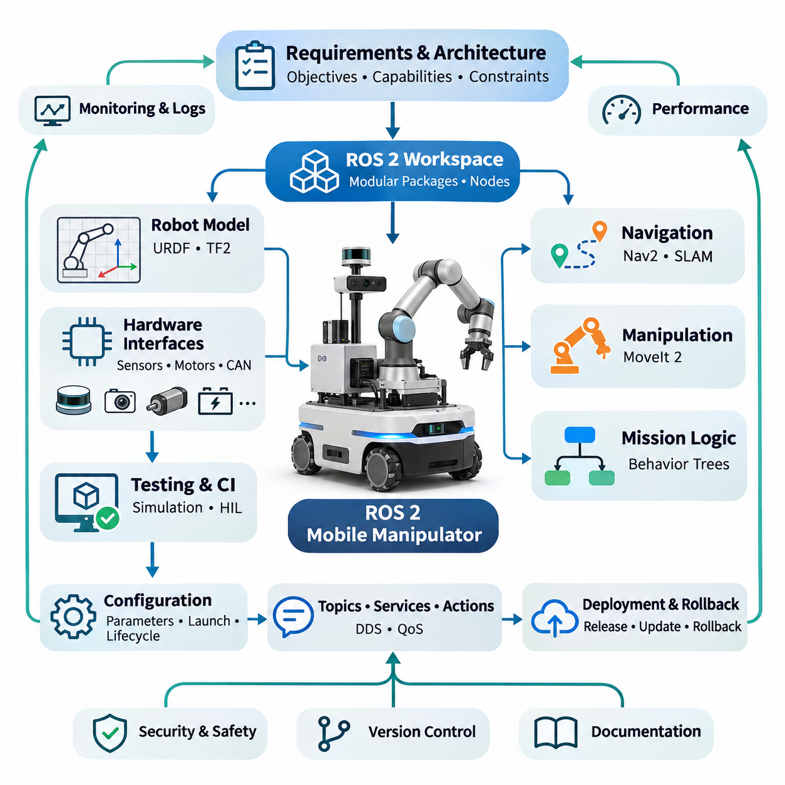
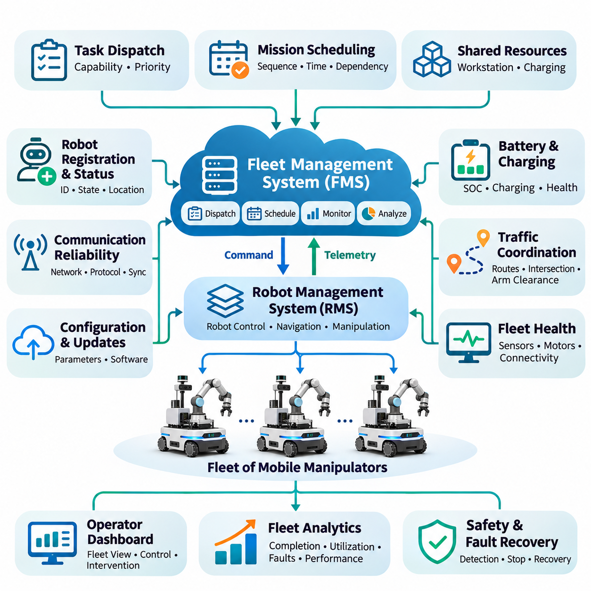
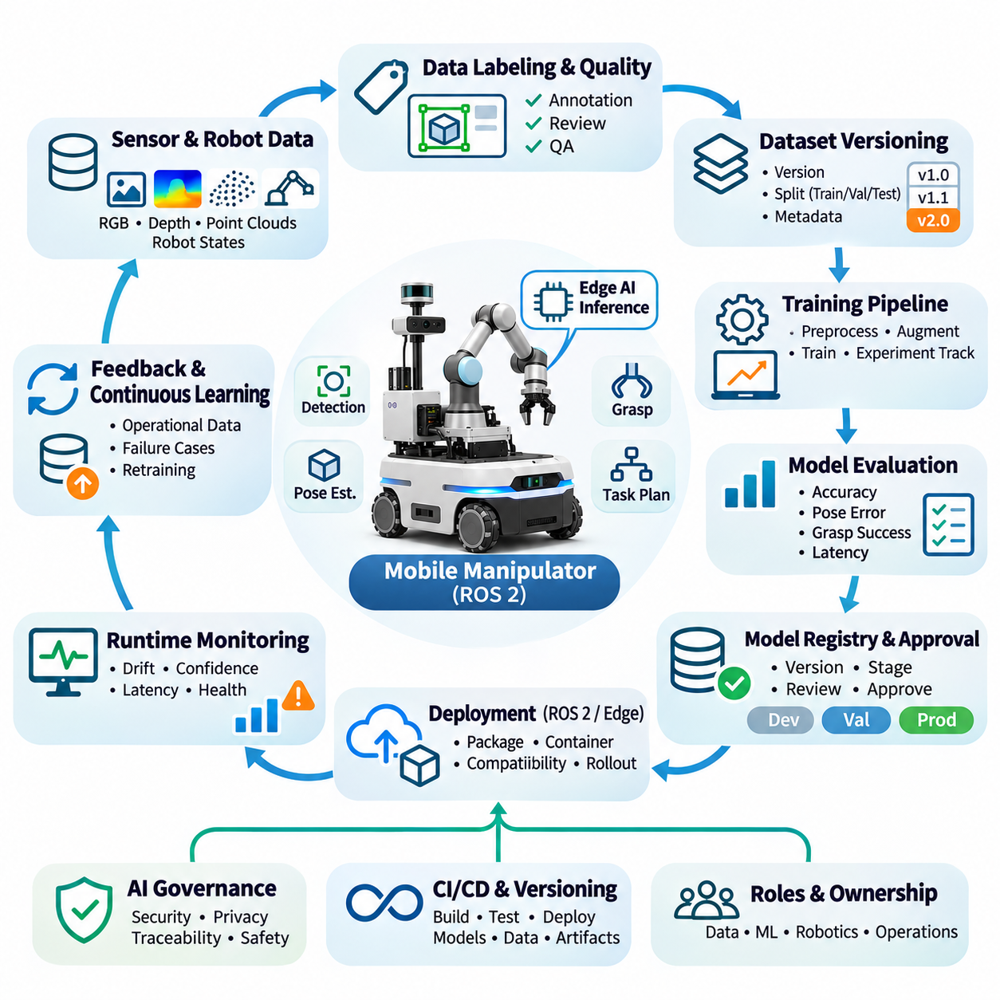
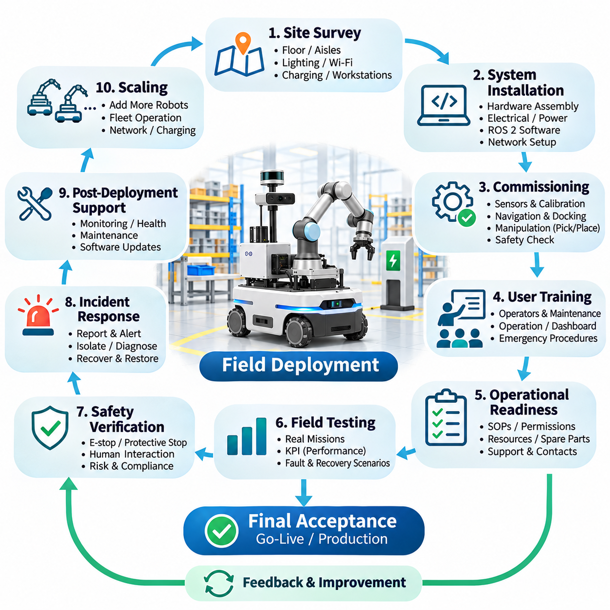
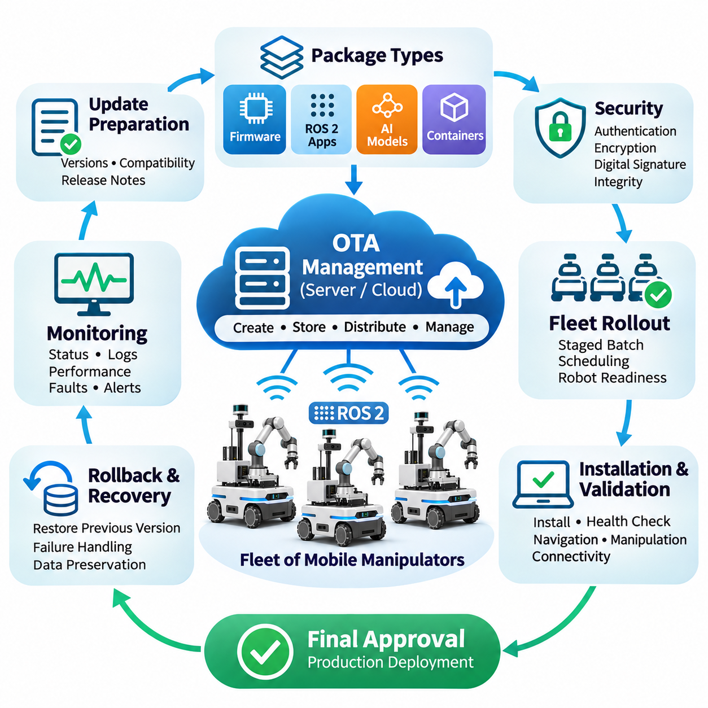
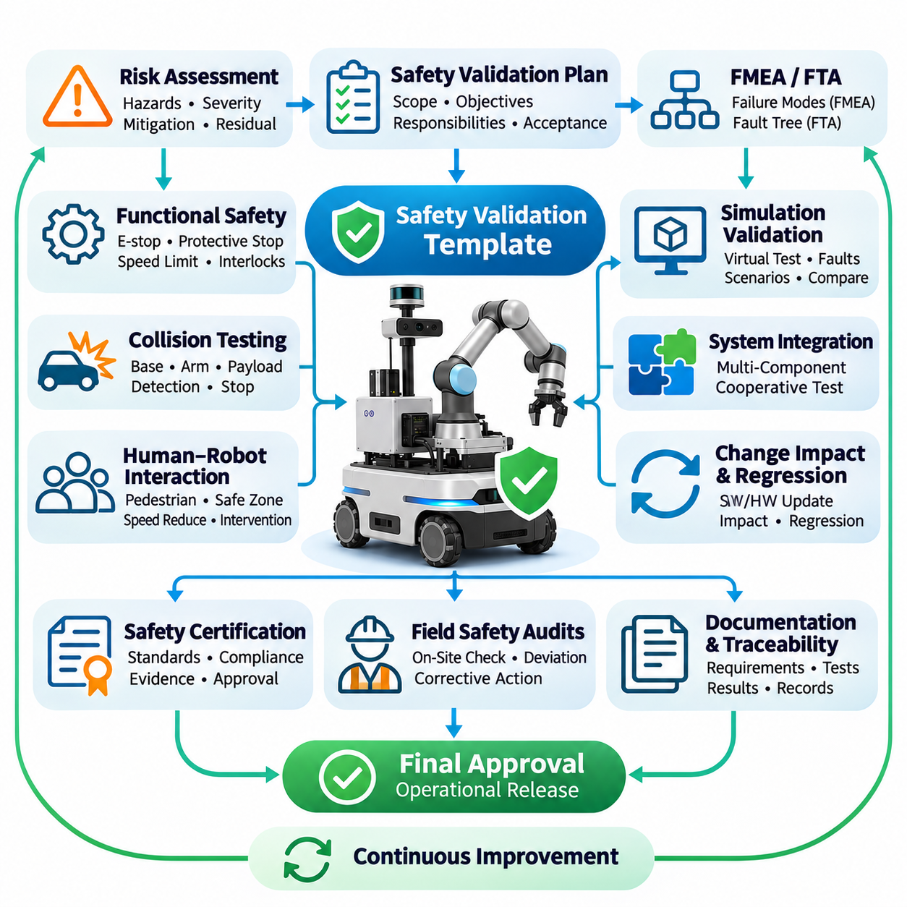
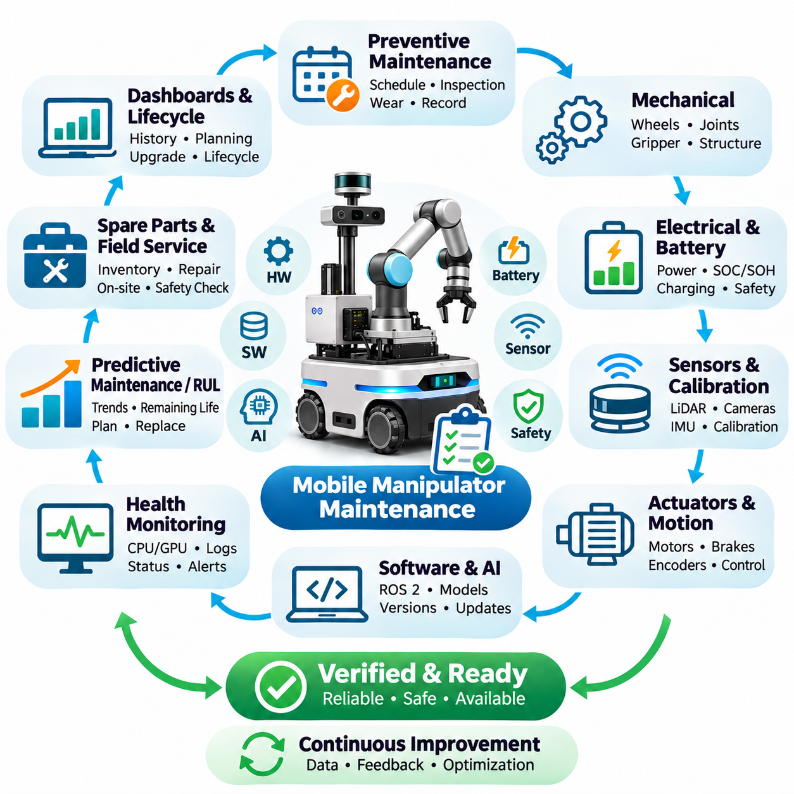

# Chapter 16. Checklists and Templates

## 01 ROS2 Project Template

{width="7.268055555555556in" height="7.268055555555556in"}

ROS 2 프로젝트 템플릿(ROS 2 Project Template)은 이동형 매니퓰레이터(Mobile Manipulator)의 소프트웨어 아키텍처를 계획하고, 개발하며, 통합하고 유지보수하기 위한 표준화된 프레임워크를 제공한다. 이 템플릿은 요구사항, 패키지 구성, 노드별 책임, 통신 인터페이스, 설정 파일, 테스트 절차 및 배포 리소스를 포함하는 일관된 프로젝트 구조를 정의한다. 이를 통해 엔지니어링 팀은 시스템 요구사항과 소프트웨어 구현 간의 추적성을 유지하고, 개발 단계별 통합 복잡성을 줄일 수 있다.

프로젝트 정의는 로봇 플랫폼, 운영 환경 및 목표 애플리케이션에 대한 명확한 설명에서 시작해야 한다. 이동형 매니퓰레이터는 일반적으로 자율이동로봇(Autonomous Mobile Robot, AMR), 로봇 팔(Robot Arm), 말단장치(End Effector), 인지 센서(Perception Sensors) 및 온보드 컴퓨팅 시스템(Onboard Computing System)을 결합한다. 프로젝트 사양에는 각 하위 시스템의 기능과 제약조건을 명시해야 하며, 여기에는 내비게이션 정확도, 매니퓰레이터 가반하중, 작업공간 크기, 위치 반복정밀도, 통신 요구사항 및 예상 운용 조건이 포함된다.

요구사항(Requirements) 섹션에서는 운영 목표를 측정 가능한 소프트웨어 및 시스템 요구사항으로 변환해야 한다. 내비게이션, 위치추정, 모션 플래닝, 매니퓰레이션, 인지, 태스크 실행 및 안전 기능에는 명확한 합격 기준(Acceptance Criteria)이 정의되어야 한다. 요구사항은 필수 기능과 선택 기능을 구분하고, 소프트웨어 구성요소와 하드웨어 인터페이스 사이의 종속성을 식별해야 한다. 각 요구사항에는 고유 식별자(Unique Identifier)를 부여하여 프로젝트 전체 수명주기 동안 구현 진행 상황, 테스트 결과 및 미해결 문제를 추적할 수 있어야 한다.

ROS 2 워크스페이스(Workspace)는 하드웨어 인터페이스, 로봇 설명, 제어 기능, 인지, 내비게이션, 매니퓰레이션 및 애플리케이션 수준의 로직을 분리하는 모듈형 패키지 구조를 따라야 한다. 각 패키지는 명확한 책임과 종속성을 가져야 하며, 불필요한 결합을 방지해야 한다. 공통 인터페이스는 재사용 가능한 메시지(Message), 서비스(Service) 및 액션(Action) 정의를 통해 구현해야 한다. 일관된 명명 규칙과 패키지 문서는 유지보수성을 향상시키고, 여러 개발자가 동일한 소프트웨어 시스템에 효율적으로 참여할 수 있도록 지원한다.

로봇 설명(Robot Description) 패키지에는 소프트웨어 스택에 필요한 URDF 또는 Xacro 모델, 조인트 정의, 링크 관계, 충돌 형상, 센서 프레임 및 좌표 변환 정보가 포함되어야 한다. 모델은 이동형 베이스, 매니퓰레이터, 말단장치 및 센서 사이의 물리적 관계를 정확하게 표현해야 한다. TF2 프레임 규칙은 프로젝트 초기 단계에서 확립해야 하며, 해당 플랫폼에 따라 map, odom, base_link, arm_base_link, tool0 및 센서 프레임 등을 포함할 수 있다. 내비게이션 및 매니퓰레이션 구성요소를 통합하기 전에 모델의 일관성을 검증해야 한다.

하드웨어 인터페이스(Hardware Interface) 패키지는 ROS 2가 모터, 엔코더, 배터리 시스템, 안전 제어기, LiDAR 센서, 카메라 및 기타 물리적 장치와 통신하는 방법을 정의해야 한다. 하드웨어 통신에는 플랫폼에 따라 CAN, CANopen, EtherCAT, Ethernet, USB 또는 직렬 인터페이스(Serial Interface)를 사용할 수 있다. 하드웨어 드라이버는 표준화된 ROS 2 토픽(Topics), 서비스(Services) 및 액션(Actions)을 제공하는 동시에 통신 장애, 유효하지 않은 측정값, 연결 시간 초과 및 장치 초기화 문제를 처리해야 한다. 하드웨어 추상화(Hardware Abstraction)를 적용하면 상위 수준의 소프트웨어가 제조업체별 구현 방식에 직접 의존하지 않고도 동작할 수 있다.

내비게이션(Navigation) 패키지는 위치추정(Localization), 맵 생성(Mapping), 경로 계획(Path Planning), 장애물 감지(Obstacle Detection) 및 베이스 모션 제어(Base Motion Control)를 통합해야 한다. Nav2는 기본 내비게이션 프레임워크로 사용할 수 있으며, SLAM 및 위치추정 구성요소는 환경 지도 생성과 로봇 위치 결정 기능을 지원한다. 프로젝트 설정에는 코스트맵(Costmap), 좌표 프레임, 플래너 및 컨트롤러 플러그인, 복구 동작(Recovery Behaviors)과 내비게이션 파라미터가 정의되어야 한다. 이동형 매니퓰레이터에서는 내비게이션 정확도가 이후 매니퓰레이션 작업의 요구사항도 고려해야 한다. 내비게이션 목표 지점에 도달했다고 해서 반드시 적절한 로봇 팔 작업공간까지 확보되는 것은 아니기 때문이다.

매니퓰레이션(Manipulation) 패키지는 로봇 팔 모델, 운동학 설정, 모션 플래닝 인터페이스, 궤적 실행 및 말단장치 제어를 정의해야 한다. MoveIt 2는 로봇 상태 관리, 역기구학(Inverse Kinematics), 충돌 검사(Collision Checking), 플래닝 파이프라인(Planning Pipeline) 및 궤적 생성을 제공할 수 있다. 또한 이 패키지는 매니퓰레이션 태스크가 이동형 베이스와 상호작용하는 방법을 명시해야 한다. 베이스의 위치 재조정이 필요한 경우 시스템은 내비게이션과 로봇 팔 동작을 완전히 독립적인 기능으로 취급하지 않고 서로 협조하도록 구성해야 한다.

애플리케이션(Application) 패키지는 내비게이션, 매니퓰레이션, 인지 및 복구 기능을 조정하여 미션 수준의 동작을 구현해야 한다. 행동 트리(Behavior Tree) 또는 기타 구조화된 태스크 실행 프레임워크를 사용하면 작업 스테이션 접근, 객체 식별, 파지 계획, 픽 작업 실행, 객체 운반 및 목적지 배치와 같은 작업 흐름을 표현할 수 있다. 각 태스크에는 사전 조건, 예상 결과, 시간 초과 동작 및 실패 복구 전략이 정의되어야 한다. 이러한 구조는 운영상의 투명성을 향상시키고 서로 다른 애플리케이션에서 공통 동작을 재사용할 수 있도록 지원한다.

ROS 2 통신 아키텍처(Communication Architecture)에는 토픽 이름, 메시지 유형, 서비스 인터페이스, 액션 정의, QoS(Quality of Service) 설정 및 예상 통신 주기를 문서화해야 한다. 개발자는 어떤 인터페이스에 신뢰성 있는 데이터 전달이 필요한지, 어떤 인터페이스가 메시지 손실을 허용할 수 있는지, 어떤 인터페이스가 낮은 지연시간을 요구하는지 식별해야 한다. 특히 여러 로봇이나 분산 컴퓨팅 장치가 동일한 환경에서 동작하는 경우 DDS 설정, 네트워크 토폴로지(Network Topology), 도메인 식별자(Domain ID) 및 디스커버리 동작(Discovery Behavior)도 문서화해야 한다.

설정 관리(Configuration Management) 섹션에서는 서로 다른 로봇 모델, 환경 및 배포 구성에 대한 별도의 파라미터 파일을 유지해야 한다. 내비게이션 파라미터, 제어기 설정, 센서 보정값, 플래닝 제약조건 및 안전 관련 설정은 버전 관리되어야 한다. 환경별 설정값을 애플리케이션 소스 코드에 불필요하게 직접 포함해서는 안 된다. 런치 파일(Launch Files)은 개별 하위 시스템이나 전체 로봇 애플리케이션을 일관된 방식으로 실행할 수 있도록 구성해야 하며, 라이프사이클 관리(Lifecycle Management)는 초기화, 활성화, 비활성화 및 종료를 제어할 수 있도록 지원해야 한다.

개발 환경(Development Environment)에는 지원 운영체제, ROS 2 배포판, 컴파일러 버전, 프로그래밍 언어 및 필수 의존성을 정의해야 한다. Docker 컨테이너 또는 기타 재현 가능한 빌드 환경을 활용하면 개발자 워크스테이션과 실제 배포 컴퓨터 사이의 환경 차이를 줄일 수 있다. 의존성 버전은 문서화해야 하며, 자동화된 빌드 프로세스를 통해 소스 코드 변경 이후에도 패키지가 정상적으로 컴파일되는지 검증해야 한다. 지속적 통합(Continuous Integration, CI) 파이프라인은 변경사항이 메인 개발 브랜치에 병합되기 전에 컴파일, 정적 분석(Static Analysis), 단위 테스트 및 인터페이스 검증을 수행할 수 있다.

소프트웨어 테스트(Software Testing)는 여러 수준으로 구성해야 한다. 단위 테스트(Unit Test)는 개별 함수와 구성요소를 검증하고, 통합 테스트(Integration Test)는 ROS 2 패키지 사이의 통신 및 협조 동작을 검증해야 한다. 시뮬레이션 기반 테스트(Simulation-Based Testing)는 실제 하드웨어에 배포하기 전에 내비게이션, 매니퓰레이션, 충돌 회피 및 태스크 실행을 평가해야 한다. 하드웨어 인 더 루프(Hardware-in-the-Loop, HIL) 테스트는 이후 물리적 제어기 및 센서와의 상호작용을 검증할 수 있다. 인수 테스트(Acceptance Test)는 전체 로봇 시스템이 프로젝트 초기 단계에서 정의한 운영 요구사항을 충족하는지 확인해야 한다.

성능 평가(Performance Evaluation)에는 내비게이션 정확도, 매니퓰레이션 반복정밀도, 태스크 완료율, 실행시간, 통신 지연시간, CPU 및 GPU 사용률, 메모리 소비량과 시스템 가용성이 포함되어야 한다. 측정은 개별적인 시연에만 의존하지 않고 실제 운영 환경을 대표하는 조건에서 수행해야 한다. 이동형 매니퓰레이션에서는 전체 미션 수행 주기를 고려하여 평가해야 한다. 하나의 하위 시스템에서 발생한 지연이나 위치 오차가 전체 작업의 성능에 영향을 줄 수 있기 때문이다.

로깅 및 모니터링(Logging and Monitoring)은 프로젝트 아키텍처의 초기 단계부터 통합해야 한다. ROS 2 로그, 진단 메시지(Diagnostic Messages), rosbag 기록, 시스템 자원 측정값 및 애플리케이션 이벤트는 장애를 재현하고 조사하는 데 필요한 충분한 정보를 제공해야 한다. 각 주요 작업은 태스크 시작, 내비게이션 완료, 매니퓰레이션 결과, 오류 상태 및 복구 동작을 포함하는 식별 가능한 실행 기록을 생성해야 한다. 여러 분산 구성요소가 관련된 문제를 조사할 때는 일관된 타임스탬프와 동기화된 센서 데이터가 특히 중요하다.

버전 관리(Version Control)는 소스 코드, 로봇 설명, 설정 파일, 런치 파일, 인터페이스 정의, 테스트 스크립트 및 문서를 포함해야 한다. 브랜치 관리와 코드 리뷰 절차를 통해 소프트웨어 변경사항의 추적성과 재현성을 확보해야 한다. 릴리스 버전(Release Version)에는 해당 소스 코드 리비전, 의존성 버전, 설정 세트 및 배포 패키지를 명시해야 한다. 메시지 정의나 하드웨어 인터페이스의 변경은 여러 종속 패키지와 이미 배포된 로봇 시스템에 영향을 줄 수 있으므로 신중하게 검토해야 한다.

배포 준비(Deployment Preparation) 단계에서는 대상 컴퓨터에 필요한 모든 패키지, 드라이버, 파라미터, 네트워크 설정 및 하드웨어 의존성이 준비되어 있는지 확인해야 한다. 설치 절차에는 시스템 시작 설정, 서비스 관리, 장치 권한 및 적절한 자동 복구 동작이 포함되어야 한다. 배포 기록에는 로봇 하드웨어 리비전, 소프트웨어 릴리스, 보정 상태 및 운영 설정을 명시해야 한다. 소프트웨어 업데이트로 예상하지 못한 동작이 발생하는 경우를 대비하여 검증된 롤백 절차(Rollback Procedure)를 마련해야 한다.

보안 및 안전(Security and Safety) 요구사항은 ROS 2 프로젝트의 선택적 추가 기능이 아니라 필수 구성요소로 취급해야 한다. 운영 환경에 따라 접근 권한, 네트워크 분리(Network Segmentation), 인증 통신 및 안전한 소프트웨어 배포를 고려해야 한다. 비상 정지(Emergency Stop), 보호 정지(Protective Stop), 속도 제한(Speed Limitation) 및 충돌 모니터링(Collision Monitoring)과 같은 안전 관련 기능은 적절하게 설계되고 검증된 메커니즘을 사용해야 한다. 일반적인 ROS 2 애플리케이션 로직이 독립적인 안전 등급 하드웨어나 인증된 안전 제어기를 대체할 수 있다고 가정해서는 안 된다.

최종 프로젝트 문서(Final Project Documentation)에는 아키텍처 설계 결정, 패키지별 책임, 인터페이스 사양, 설정 절차, 테스트 증거, 알려진 제한사항 및 유지보수 요구사항을 완전하게 기록해야 한다. 개발자와 운영자는 시스템이 어떻게 구성되는지, 개별 구성요소가 어떻게 상호작용하는지, 장애를 어떻게 진단할 수 있는지 이해할 수 있어야 한다. 문서는 실제 소프트웨어와 함께 지속적으로 갱신하여 배포된 구현 내용과 일치하도록 유지해야 한다.

완성된 ROS 2 프로젝트 템플릿은 개발 참조 문서이자 엔지니어링 관리 문서로 기능해야 한다. 이는 요구사항, 소프트웨어 아키텍처, 하드웨어 통합, 테스트, 배포 및 유지보수를 하나의 통합된 작업 흐름으로 연결한다. 일관된 구조와 검증 절차를 채택함으로써 엔지니어링 팀은 다양한 산업 환경에서 확장, 재현, 문제 해결 및 안정적인 운영이 용이한 이동형 매니퓰레이션 시스템을 개발할 수 있다.

## 02 Fleet Management Checklist

{width="7.268055555555556in" height="7.268055555555556in"}

이동형 매니퓰레이터(Mobile Manipulator)의 플릿 관리(Fleet Management)는 여러 로봇을 체계적으로 조정하고, 운영 자원을 할당하며, 미션을 스케줄링하고, 전체 플릿의 성능을 안정적으로 유지하기 위한 접근 방식이 필요하다. 플릿 관리 체크리스트(Fleet Management Checklist)는 배포 전과 일상적인 운영 과정에서 모든 필수 구성요소가 올바르게 설정되었는지 확인하기 위한 구조화된 방법을 제공한다. 여기에는 플릿 아키텍처, 태스크 디스패칭, 미션 스케줄링, 자원 할당, 배터리 관리, 교통 조정, 상태 모니터링, 운영자 인터페이스 및 성능 분석이 포함되어야 한다.

플릿 아키텍처(Fleet Architecture)는 개별 이동형 매니퓰레이터가 중앙 플릿 관리 시스템(Fleet Management System, FMS) 및 로봇 관리 시스템(Robot Management System, RMS)과 어떻게 통신하는지 정의해야 한다. 체크리스트에서는 로봇 등록, 고유 식별자, 네트워크 연결, 통신 프로토콜 및 시스템 통합을 검증해야 한다. 각 로봇은 자신의 운영 상태, 위치, 배터리 수준, 태스크 진행 상황 및 오류 상태를 보고해야 한다. 또한 기존 플릿 인프라를 대폭 변경하지 않고도 로봇을 추가하거나 제거할 수 있도록 아키텍처를 구성해야 한다.

RMS와 FMS 설정은 로봇 수준의 작업 실행과 플릿 수준의 운영 조정 사이에 명확한 책임을 정의해야 한다. RMS는 로봇별 기능, 내비게이션 상태, 매니퓰레이션 기능 및 로컬 실행 프로세스를 관리해야 한다. FMS는 태스크 배포, 미션 우선순위, 공유 자원 및 전체 운영 상태를 조정해야 한다. 두 관리 계층이 일관되게 작동하도록 인터페이스 호환성, 통신 신뢰성, 동기화 및 장애 처리 기능을 검증해야 한다.

태스크 디스패칭(Task Dispatching)은 로봇의 가용성, 기능, 위치, 작업 부하 및 운영 우선순위에 따라 미션이 적절하게 할당되는지 평가해야 한다. 체크리스트에서는 태스크 수락, 실행 확인, 상태 보고, 취소, 재할당 및 완료 알림 기능을 검증해야 한다. 이동형 매니퓰레이터는 로봇 팔 구성, 가반하중, 말단장치 및 인지 기능이 서로 다를 수 있다. 따라서 태스크 할당은 단순히 지리적 근접성이나 로봇의 가용성에만 의존하지 않고 기능적 호환성도 고려해야 한다.

미션 스케줄링(Mission Scheduling)은 여러 태스크를 불필요한 지연이나 운영상 충돌 없이 효율적으로 실행할 수 있도록 해야 한다. 체크리스트에서는 미션 우선순위, 실행 순서, 시간 제약조건, 작업 간 종속성 및 자원 요구사항을 검증해야 한다. 스케줄링 로직은 내비게이션 시간, 매니퓰레이션 소요 시간, 작업 스테이션 가용성 및 충전 요구사항을 고려해야 한다. 운영 조건이 변경되면 플릿 관리자는 미션의 일관성과 실행 추적성을 유지하면서 스케줄을 갱신하고 태스크를 재분배할 수 있어야 한다.

자원 할당(Resource Allocation)은 플릿 운영에 필요한 공유 물리적 자원과 컴퓨팅 자원을 고려해야 한다. 이러한 자원에는 충전 스테이션, 작업 스테이션, 적재 구역, 매니퓰레이션 구역, 통신 네트워크 및 공유 장비가 포함될 수 있다. 체크리스트에서는 자원 가용성, 예약 메커니즘, 접근 권한 및 충돌 방지 기능을 검증해야 한다. 이동형 매니퓰레이터의 경우 로봇 팔의 공간적 요구사항도 자원 할당에 반영해야 하며, 여러 로봇이 서로 양립할 수 없는 매니퓰레이션 작업공간을 동시에 점유하지 않도록 해야 한다.

배터리 관리(Battery Management)는 각 로봇이 할당된 미션과 예상 복귀 또는 충전 작업을 수행하기에 충분한 에너지를 유지하는지 검증해야 한다. 플릿 시스템은 배터리 충전 상태(State of Charge, SOC), 예상 잔여 운용 시간, 충전 상태 및 배터리 건전성을 모니터링해야 한다. 충전 의사결정에서는 미션 우선순위, 잔여 에너지, 충전 스테이션 가용성 및 예상 작업 부하를 고려해야 한다. 또한 체크리스트에서는 저전압 경고, 자동 충전 요청, 충전 완료 감지 및 배터리 상태가 임계 수준에 도달했을 때의 안전한 복구 기능을 검증해야 한다.

교통 관리(Traffic Management)는 공유 운영 환경에서 여러 로봇이 안전하고 효율적으로 이동하도록 해야 한다. 체크리스트에서는 지도 일관성, 경로 계획, 장애물 감지, 교차 구역 관리, 우선순위 규칙 및 충돌 회피 기능을 검증해야 한다. 플릿 시스템은 좁은 통로, 공유 복도, 도킹 스테이션 및 작업 구역에서 발생할 수 있는 잠재적인 충돌을 식별해야 한다. 이동형 매니퓰레이터의 경우 로봇의 물리적 크기, 로봇 팔 구성, 운반 중인 객체 및 매니퓰레이션 작업 중 확장되는 점유 공간도 추가적으로 고려해야 한다.

플릿 상태 모니터링(Fleet Health Monitoring)은 모든 로봇의 운영 상태를 지속적으로 파악할 수 있도록 해야 한다. 체크리스트에서는 위치추정 품질, 내비게이션 상태, 모터 상태, 제어기 오류, 센서 가용성, 통신 품질, 배터리 건전성 및 컴퓨팅 자원 사용률을 모니터링하는지 검증해야 한다. 비정상적인 상태는 식별 가능한 진단 이벤트와 적절한 경고를 발생시켜야 한다. 시스템은 일시적인 통신 중단, 복구 가능한 소프트웨어 장애, 하드웨어 고장 및 즉각적인 사람의 개입이 필요한 상황을 구분해야 한다.

운영자 대시보드(Operator Dashboards)는 플릿 정보를 명확하고 실행 가능한 형태로 제공해야 한다. 체크리스트에서는 운영자가 개별 로봇을 식별하고, 현재 위치를 확인하며, 미션 진행 상황을 검토하고, 배터리 상태를 모니터링하며, 활성화된 오류를 인식할 수 있는지 검증해야 한다. 중요한 운영 정보는 지나치게 많은 인터페이스 단계를 거치지 않고도 접근할 수 있어야 한다. 또한 대시보드는 운영자 권한에 따라 미션 할당, 태스크 취소, 로봇 일시 정지, 수동 개입 및 복구 절차를 수행할 수 있는 적절한 제어 기능을 제공해야 한다.

플릿 분석(Fleet Analytics)은 생산성, 자원 활용률 및 시스템 신뢰성을 평가하기 위한 운영 데이터를 수집해야 한다. 주요 지표에는 미션 완료율, 태스크 실행 시간, 로봇 가동률, 유휴 시간, 충전 빈도, 내비게이션 효율, 매니퓰레이션 성공률 및 오류 발생 빈도가 포함된다. 체크리스트에서는 수집된 데이터가 정확하고 타임스탬프가 기록되어 있으며, 일관된 구조로 관리되고, 과거 데이터 분석에 활용될 수 있는지 검증해야 한다. 분석 결과는 반복적으로 발생하는 병목 현상을 식별하고 플릿 확장, 스케줄링 최적화 및 운영 개선에 관한 근거 기반 의사결정을 지원해야 한다.

통신 신뢰성(Communication Reliability)은 모든 로봇과 플릿 관리 구성요소 사이에서 검증되어야 한다. 체크리스트에서는 무선 네트워크 커버리지, 네트워크 지연시간, 패킷 손실, 통신 복구 및 운영 정보의 동기화를 확인해야 한다. 로봇이 일시적으로 FMS와의 통신을 상실했을 때의 동작 방식도 정의해야 한다. 중앙 플릿 연결이 불가능한 상황에서도 로컬 안전 기능과 필수적인 로봇 수준의 제어 기능은 계속 작동해야 한다. 통신이 복구되면 중복되거나 상충하는 미션을 생성하지 않으면서 일관된 플릿 상태를 복원해야 한다.

운영 안전(Operational Safety)은 플릿 관리 절차에 통합되어야 한다. 체크리스트에서는 비상 정지 처리, 보호 정지 조건, 제한 구역, 속도 제한, 사람의 존재 감지 및 안전한 복구 절차를 검증해야 한다. 공유 작업공간에서 운용되는 로봇은 조정된 이동 및 접근 규칙을 준수해야 한다. 매니퓰레이션 작업 역시 공유 작업공간의 안전성을 평가할 때 고려해야 한다. 확장된 로봇 팔이나 운반 중인 객체가 이동형 베이스의 점유 영역을 넘어 추가적인 충돌 위험을 발생시킬 수 있기 때문이다.

장애 관리 및 복구(Fault Management and Recovery) 절차는 예상하지 못한 운영 이벤트에 플릿이 어떻게 대응하는지 정의해야 한다. 체크리스트에서는 장애 분류, 경보 생성, 태스크 중단, 로봇 격리, 복구 승인 및 미션 재할당 기능을 검증해야 한다. 로봇을 사용할 수 없게 되면 FMS는 해당 로봇이 완료하지 못한 태스크를 다른 호환 가능한 로봇에 이전할 수 있는지 판단해야 한다. 복구 절차는 미션 이력을 보존하고, 안전하지 않은 자동 재시작이나 부분적으로 완료된 매니퓰레이션 작업의 반복 실행을 방지해야 한다.

플릿 설정 및 소프트웨어 유지보수(Fleet Configuration and Software Maintenance)는 통제된 버전 관리와 검증 절차를 통해 수행해야 한다. 로봇 설정, 내비게이션 파라미터, 통신 설정, 태스크 정의 및 소프트웨어 버전을 일관되게 기록해야 한다. 체크리스트에서는 개별 로봇과 중앙 관리 시스템 사이의 설정 호환성을 검증해야 한다. 소프트웨어 업데이트와 설정 변경은 전체 플릿에 배포하기 전에 테스트해야 하며, 이전에 검증된 운영 상태로 복원할 수 있도록 적절한 롤백 절차(Rollback Procedure)를 마련해야 한다.

최종 플릿 관리 검토(Final Fleet Management Review)에서는 대표적인 실제 작업 조건에서 모든 운영 요구사항이 검증되었는지 확인해야 한다. 테스트에는 정상적인 미션 실행, 다중 로봇 동시 운용, 자원 경합, 통신 중단, 배터리 부족 상황, 내비게이션 장애 및 복구 시나리오가 포함되어야 한다. 플릿 처리량, 태스크 완료 신뢰성, 자원 활용률 및 운영 가용성에 대한 인수 기준(Acceptance Criteria)을 정의해야 한다. 실제 운영 배포를 승인하기 전에 테스트 결과, 미해결 문제 및 시정 조치(Corrective Actions)를 문서화해야 한다.

완성된 플릿 관리 체크리스트(Fleet Management Checklist)는 일회성 시운전 기록이 아니라 지속적인 운영 관리 문서로 활용되어야 한다. 로봇 구성, 소프트웨어 버전, 운영 작업 흐름 또는 시설 조건이 변경될 때마다 검토해야 한다. 정기적인 검토를 통해 플릿 관리 체계가 실제 운영 요구사항과 일치하도록 유지할 수 있다. RMS, FMS, 태스크 디스패칭, 스케줄링, 자원 할당, 배터리 관리, 교통 조정 및 분석 전반에 걸쳐 체계적인 검증을 수행하면 조직은 이동형 매니퓰레이터 플릿의 신뢰성, 확장성 및 생산성을 향상시킬 수 있다.

## 03 MLOps Template

{width="7.268055555555556in" height="7.268055555555556in"}

MLOps(머신러닝 운영, Machine Learning Operations) 템플릿은 이동형 매니퓰레이션 시스템(Mobile Manipulation Systems)에 사용되는 인공지능(AI) 모델의 전체 수명주기를 관리하기 위한 표준화된 프레임워크를 제공한다. 이는 데이터 수집, 데이터 준비, 모델 학습, 평가, 배포, 모니터링 및 지속적인 개선을 재현 가능한 엔지니어링 작업 흐름으로 연결한다. 템플릿은 서로 다른 로봇과 배포 환경에서 머신러닝 모델을 일관되게 개발하고 유지보수할 수 있도록 책임, 기술적 인터페이스, 버전 관리 절차 및 운영 요구사항을 정의해야 한다.

MLOps 아키텍처는 AI 모델이 물리적 센서, 로봇 제어기, 내비게이션 시스템 및 매니퓰레이션 소프트웨어와 상호작용하는 이동형 매니퓰레이션 시스템의 특성을 반영해야 한다. 인지(Perception), 객체 검출(Object Detection), 자세 추정(Pose Estimation), 파지 인식(Grasp Recognition), 장면 이해(Scene Understanding) 및 태스크 계획(Task Planning)에는 서로 다른 모델과 실행 환경이 필요할 수 있다. 템플릿은 모델 종속성, 컴퓨팅 요구사항, 추론 인터페이스 및 성능 제약조건을 식별해야 한다. 또한 AI 구성요소가 ROS 2 노드 및 다른 로봇 하위 시스템과 어떻게 통신하는지도 정의해야 한다.

데이터 수집(Data Collection)은 실제 로봇과 시뮬레이션 환경에서 대표성 있는 센서 및 운영 데이터를 확보하기 위한 체계적인 프로세스를 제공해야 한다. 수집 데이터에는 RGB 이미지, 깊이 이미지(Depth Images), 포인트 클라우드(Point Clouds), 카메라 파라미터, 로봇 자세, 관절 상태(Joint States), 힘 측정값 및 태스크 실행 기록이 포함될 수 있다. 각 데이터 샘플에는 관련 타임스탬프, 센서 설정, 환경 조건 및 로봇 식별 정보가 포함되어야 한다. 데이터 수집 절차에서는 개인정보 보호, 안전, 저장 용량 및 분산 센서 간 동기화도 고려해야 한다.

데이터 라벨링(Data Labeling)은 머신러닝 모델의 학습 및 평가를 위한 일관된 어노테이션 표준을 수립해야 한다. 애플리케이션에 따라 어노테이션에는 객체 클래스, 바운딩 박스(Bounding Boxes), 세그멘테이션 마스크(Segmentation Masks), 키포인트(Keypoints), 6차원 자세(6D Pose), 파지 위치 및 매니퓰레이션 결과가 포함될 수 있다. 라벨링 지침은 클래스 정의, 어노테이션 정확도 요구사항, 품질 검사 절차 및 모호한 샘플을 처리하는 방법을 규정해야 한다. 자동 어노테이션과 사람의 검토를 결합하면 데이터셋의 일관성과 신뢰성을 유지하면서 작업 효율성을 향상시킬 수 있다.

데이터셋 버전 관리(Dataset Versioning)는 식별 및 추적이 가능한 데이터셋을 사용하여 모든 학습 실험을 재현할 수 있도록 해야 한다. 각 데이터셋 버전에는 데이터 출처, 수집 조건, 어노테이션 수정 이력, 전처리 절차 및 관련 품질 검사 결과를 기록해야 한다. 학습, 검증 및 테스트 데이터셋은 데이터 누출(Data Leakage)과 비현실적인 성능 평가를 방지할 수 있도록 신중하게 분리해야 한다. 데이터셋 변경사항을 문서화하면 데이터 구성이나 어노테이션 품질의 특정 변경이 모델 성능 차이에 어떤 영향을 미쳤는지 분석할 수 있다.

모델 학습 파이프라인(Model Training Pipelines)은 데이터 준비, 전처리, 데이터 증강, 모델 설정, 학습, 검증 및 평가를 포함하는 머신러닝 개발의 주요 단계를 자동화해야 한다. 각 실험에는 모델 아키텍처, 하이퍼파라미터, 소프트웨어 종속성, 하드웨어 구성, 난수 시드(Random Seeds) 및 학습 시간을 기록해야 한다. 자동화된 파이프라인은 재현성을 향상시키고 수작업으로 인한 오류를 줄여준다. 로봇 애플리케이션에서는 실시간 추론 요구사항, 환경 변화 및 온보드 엣지 장치의 컴퓨팅 제약조건도 학습 절차에 반영해야 한다.

모델 레지스트리(Model Registry)는 학습된 모델과 관련 메타데이터를 중앙에서 관리하기 위한 메커니즘을 제공해야 한다. 등록된 각 모델에는 버전, 아키텍처, 학습 데이터셋, 평가 결과, 적용 목적 및 배포 요구사항이 포함되어야 한다. 모델 수명주기 상태에는 개발(Development), 검증(Validation), 승인(Approved), 운영(Production), 사용 중단(Deprecated) 및 보관(Archived) 등이 포함될 수 있다. 이러한 상태 간 전환은 정의된 검토 및 승인 절차를 따라야 한다. 레지스트리를 통해 각 로봇에서 정확히 어떤 모델 버전이 실행되고 있는지 식별할 수 있어야 한다.

배포 파이프라인(Deployment Pipelines)은 학습된 모델을 로봇 컴퓨터, 엣지 장치 및 중앙 컴퓨팅 인프라에 전달하기 위한 통제된 절차를 제공해야 한다. 배포 방식에는 컨테이너 기반 애플리케이션, 모델 패키지, 추론 엔진 및 하드웨어별 최적화 형식이 포함될 수 있다. 파이프라인은 운영 환경에 모델을 활성화하기 전에 모델 호환성, 소프트웨어 종속성, 메모리 요구량, 추론 지연시간 및 런타임 안정성을 검증해야 한다. 이동형 매니퓰레이터의 경우 ROS 2 인터페이스 및 관련 인지 또는 매니퓰레이션 구성요소와의 통합도 검증해야 한다.

모델 모니터링(Model Monitoring)은 배포 이후 AI 성능을 지속적으로 평가해야 한다. 모니터링 지표에는 추론 지연시간, 처리량, 예측 신뢰도, 검출 정확도, 거짓 양성률(False Positive Rate), 모델 가용성 및 컴퓨팅 자원 사용률이 포함될 수 있다. 운영 모니터링은 모델 신뢰성을 저하시킬 수 있는 환경 조건, 센서 특성 및 입력 데이터 분포의 변화도 식별해야 한다. 성능 저하가 감지되면 시스템은 진단 기록을 생성하고 적절한 조사 또는 복구 절차를 시작해야 한다.

지속적 학습(Continuous Learning)은 배포된 로봇과 모델 개발 환경 사이에 통제된 피드백 프로세스를 구축해야 한다. 실제 운영 데이터, 실패 사례, 운영자 수정 사항 및 어려운 매니퓰레이션 시나리오는 후속 분석과 재학습을 위해 수집할 수 있다. 새롭게 학습된 모델은 검증 없이 자동으로 운영 모델을 대체해서는 안 된다. 각 업데이트는 데이터셋 품질 검사, 모델 평가, 호환성 테스트 및 배포 승인을 통과해야 한다. 이러한 프로세스를 통해 예측 가능한 운영 동작을 유지하면서 시스템을 지속적으로 개선할 수 있다.

AI 거버넌스(AI Governance)는 머신러닝 시스템의 전체 수명주기를 관리하는 데 필요한 정책과 책임을 정의해야 한다. 여기에는 데이터 소유권, 접근 권한, 개인정보 보호, 모델 추적성, 평가 증거, 소프트웨어 보안 및 변경 관리가 포함되어야 한다. 기술적 검토와 운영상 책임성을 지원할 수 있도록 모델의 의사결정 과정을 충분히 문서화해야 한다. 안전에 중요한 로봇 기능의 경우 AI 모델 출력은 전체 시스템 안전 아키텍처 내에서 평가해야 하며, 검증되지 않은 모델 동작이 독립적인 안전 메커니즘을 대체해서는 안 된다.

MLOps 템플릿은 AI 엔지니어, 로봇 소프트웨어 개발자, 데이터 엔지니어, 시스템 통합 담당자 및 운영팀 사이의 명확한 책임도 정의해야 한다. 데이터 수집, 어노테이션, 모델 개발, 배포 및 모니터링에는 명확한 담당자와 승인 절차가 지정되어야 한다. 소스 코드 관리, 자동화 테스트, 실험 추적, 산출물 저장 및 CI/CD(Continuous Integration and Continuous Delivery) 파이프라인과의 통합도 문서화해야 한다. 이러한 조직적 구조는 서로 분리된 개발 활동을 방지하고 여러 분야의 엔지니어링 팀 간 협업을 향상시킨다.

성능 평가는 일반적인 머신러닝 지표와 전체 로봇 태스크의 결과를 모두 고려해야 한다. 객체 검출 정확도, 세그멘테이션 품질, 자세 추정 오차, 파지 성공률 및 추론 지연시간은 중요한 기술적 지표를 제공한다. 그러나 이러한 지표는 태스크 완료율, 매니퓰레이션 사이클 시간, 복구 빈도 및 시스템 가용성과 같은 운영 측정값에도 연결되어야 한다. 벤치마크 정확도가 높은 모델이라도 예측이 불안정하거나 후속 로봇 제어에 적합하지 않으면 실제 환경에서 성능이 저하될 수 있다.

최종 MLOps 검토(Final MLOps Review)에서는 데이터셋, 학습 실험, 모델 버전, 배포 패키지 및 모니터링 절차가 적절하게 문서화되고 추적 가능한지 검증해야 한다. 대표성 있는 검증은 시뮬레이션 환경, 실험실 테스트 및 실제 운영 조건을 모두 포함해야 한다. 검토 과정에서는 모델 롤백, 장애 조사, 재학습 및 릴리스 승인 절차가 준비되어 있는지 확인해야 한다. AI 모델이 컴퓨팅 요구사항과 실제 로봇 성능 요구사항을 모두 충족하도록 운영 배포 전에 인수 기준(Acceptance Criteria)을 수립해야 한다.

완성된 MLOps 템플릿은 초기 모델 개발 단계에서만 사용하는 문서가 아니라 지속적인 엔지니어링 프레임워크로 기능해야 한다. 로봇 하드웨어, 센서 구성, 운영 환경, AI 아키텍처 및 소프트웨어 인프라의 변경에 따라 지속적으로 발전해야 한다. 데이터 엔지니어링, 모델 개발, 배포 자동화, 런타임 모니터링, 지속적 학습 및 AI 거버넌스를 연결함으로써 조직은 재현 가능하고 확장 가능한 AI 수명주기를 구축할 수 있다. 이러한 접근 방식은 산업용 이동형 매니퓰레이션 시스템 전반에서 신뢰할 수 있는 모델 운영과 지속 가능한 성능 개선을 지원한다.

## 04 Field Deployment Checklist

{width="7.268055555555556in" height="7.268055555555556in"}

현장 배포 체크리스트(Field Deployment Checklist)는 실제 운영 환경에서 이동형 매니퓰레이터(Mobile Manipulator)를 준비하고, 설치하며, 시운전하고 운영하기 위한 체계적인 프레임워크를 제공한다. 이를 통해 생산 활동을 시작하기 전에 하드웨어, 소프트웨어, 통신 인프라, 안전 시스템 및 운영 절차가 준비되었는지 확인할 수 있다. 체크리스트에는 현장 조사, 시스템 설치, 시운전, 사용자 교육, 운영 준비 상태, 현장 테스트, 사고 대응, 배포 후 지원 및 배포 확장이 포함되어야 한다. 각 활동에는 명확한 책임, 검증 기준 및 문서화된 완료 기록이 마련되어야 한다.

현장 조사(Site Survey)는 대상 시설이 계획된 이동형 매니퓰레이션 작업을 지원할 수 있는지 확인해야 한다. 평가 항목에는 바닥 상태, 작업공간 크기, 통로 폭, 경사도, 장애물, 조명, 네트워크 커버리지, 충전 위치 및 작업 스테이션 접근성이 포함되어야 한다. 이동형 내비게이션과 로봇 팔 매니퓰레이션이 동시에 이루어지는 구역에는 특히 주의를 기울여야 한다. 환경적 제약조건, 사람의 이동 패턴, 제한 구역 및 비상 접근 경로는 최종 배포 구성을 확정하기 전에 문서화해야 한다.

현장 조사에서는 실제 환경이 로봇의 내비게이션 및 매니퓰레이션 요구사항과 호환되는지도 검증해야 한다. 지도 커버리지, 위치추정 기준점, 도킹 위치, 작업 스테이션 위치 및 장애물 특성을 평가해야 한다. 엔지니어링 팀은 반사 표면, 투명 물체, 조명 조건의 변화 및 이동 장비로 인해 발생할 수 있는 잠재적 간섭 요인을 식별해야 한다. 안정적인 운영을 위해 필요한 환경 변경 사항은 설치를 시작하기 전에 시설 운영자와 협의하여 확정해야 한다.

시스템 설치(System Installation)에서는 모든 기계적, 전기적 및 컴퓨팅 구성요소가 올바르게 조립되고 연결되었는지 확인해야 한다. 이동형 베이스, 로봇 팔, 말단장치, 센서, 배터리 시스템, 온보드 컴퓨터 및 안전 장치를 승인된 구성과 대조하여 검사해야 한다. 기계적 체결 상태, 케이블 배선, 접지, 전력 분배, 커넥터 보호 및 비상 정지 장치의 접근성을 점검해야 한다. 설치 기록에는 하드웨어 리비전, 구성요소 일련번호, 보정 정보 및 승인된 설계와 다른 사항을 명시해야 한다.

소프트웨어 설치(Software Installation)에서는 필요한 운영체제, ROS 2 배포판, 장치 드라이버, 애플리케이션 패키지, 내비게이션 스택, 매니퓰레이션 프레임워크 및 설정 파일이 올바르게 배포되었는지 확인해야 한다. 네트워크 설정, IP 주소, 통신 인터페이스, 시간 동기화 및 보안 권한을 검증해야 한다. 설치된 소프트웨어 버전은 검증된 릴리스 구성과 일치해야 한다. 또한 전체 시스템을 재시작한 이후에도 시스템 시작, 서비스 관리, 로깅 및 진단 기능이 정상적으로 작동하는지 확인해야 한다.

시운전(Commissioning)은 설치된 로봇이 기본 기능을 안전하고 일관되게 수행하는지 확인하는 과정이다. 초기 검증에는 전원 공급 및 시작 절차, 센서 초기화, 모터 동작, 엔코더 피드백, 배터리 모니터링, 비상 정지 및 중앙 관리 시스템과의 통신이 포함되어야 한다. 자율 운용을 시작하기 전에 기계적 정렬 상태와 센서 보정 상태를 확인해야 한다. 비정상적인 진동, 예상하지 못한 움직임, 통신 장애 또는 일관되지 않은 센서 측정값이 발견되면 통합 기능 테스트를 진행하기 전에 원인을 조사하고 해결해야 한다.

내비게이션 시운전(Navigation Commissioning)에서는 위치추정 정확도, 지도 일관성, 경로 계획, 장애물 회피, 도킹 성능 및 복구 동작을 검증해야 한다. 로봇은 좁은 통로, 교차 구역, 작업 스테이션 접근 구역 및 충전 구역을 포함하는 대표적인 경로에서 테스트해야 한다. 실제 시설 환경에 적합하도록 내비게이션 파라미터를 조정해야 한다. 또한 로봇이 의도된 작업을 수행하기에 충분한 위치 정확도와 적절한 방향을 확보하면서 매니퓰레이션 위치에 도달할 수 있는지도 평가해야 한다.

매니퓰레이션 시운전(Manipulation Commissioning)에서는 로봇 팔의 움직임, 관절 제한, 역기구학(Inverse Kinematics), 궤적 실행, 말단장치 작동 및 충돌 검사를 검증해야 한다. 팀은 대표적인 픽 앤 플레이스(Pick-and-Place) 작업을 평가하고, 로봇이 이동형 베이스, 주변 장비 또는 작업자 구역과 간섭하지 않으면서 작업을 수행할 수 있는지 확인해야 한다. 정밀한 베이스 위치 설정이 필요한 매니퓰레이션 작업의 경우 내비게이션부터 매니퓰레이션까지 이어지는 전체 순서를 검증해야 한다. 태스크 실행에는 적절한 실패 감지 및 복구 절차도 포함되어야 한다.

사용자 교육(User Training)은 운영자, 관리자 및 유지보수 담당자가 배포된 이동형 매니퓰레이션 시스템을 사용할 수 있도록 준비하는 과정이다. 교육에서는 정상 운영 절차, 미션 할당, 로봇 상태 표시기, 대시보드 기능, 비상 정지 작동 및 기본적인 문제 해결 방법을 설명해야 한다. 운영자는 자율 동작의 한계를 이해하고 사람의 개입이 필요한 상황을 인식할 수 있어야 한다. 유지보수 담당자에게는 보정, 구성요소 검사, 소프트웨어 진단, 배터리 취급 및 승인된 서비스 절차에 관한 추가 교육을 제공해야 한다.

운영 준비 상태(Operational Readiness)는 시설, 인력, 인프라 및 관리 절차가 일상적인 운영을 수행할 수 있도록 준비되었는지 확인해야 한다. 체크리스트에서는 운영자 배정, 접근 권한, 충전 일정, 네트워크 가용성, 예비 부품, 유지보수 자원 및 비상 연락처를 검증해야 한다. 표준 운영 절차(Standard Operating Procedures)는 시스템 시작, 종료, 미션 실행, 수동 개입, 장애 복구 및 사고 보고를 정의해야 한다. 로봇 공급업체, 시스템 통합업체, 시설 운영자 및 유지보수 조직 간의 책임도 명확하게 설정해야 한다.

현장 테스트(Field Testing)는 실험실 시연에만 의존하지 않고 실제 생산 환경을 대표하는 조건에서 시스템 성능을 평가해야 한다. 테스트 시나리오에는 정상적인 미션, 다양한 작업 부하, 서로 다른 객체 구성, 사람과의 상호작용, 변화하는 환경 조건 및 다른 장비와의 동시 운용이 포함되어야 한다. 주요 성능 지표에는 태스크 완료율, 사이클 시간, 내비게이션 정확도, 매니퓰레이션 성공률, 시스템 가용성 및 복구 빈도가 포함된다. 테스트 결과는 사전에 정의된 인수 기준(Acceptance Criteria)과 비교하고 공식적인 배포 승인을 위해 문서화해야 한다.

현장 테스트에는 예외적인 운영 조건과 장애 시나리오도 포함되어야 한다. 통신 중단, 센서 성능 저하, 위치추정 상실, 경로 차단, 예상하지 못한 장애물, 매니퓰레이션 실패 및 배터리 부족 상황을 평가해야 한다. 시스템은 적절한 장애 감지, 안전 정지, 운영자 알림 및 복구 동작을 수행해야 한다. 하나의 하위 시스템에 장애가 발생하더라도 로봇, 주변 작업자 또는 인접 장비에 위험한 상황이 발생하지 않는지 검증해야 한다.

안전 검증(Safety Verification)은 모든 보호 메커니즘이 실제 배포 환경에서 올바르게 작동하는지 확인해야 한다. 비상 정지, 보호 정지, 속도 제한, 충돌 모니터링, 안전 스캐너 및 제한된 작업 구역을 승인된 안전 요구사항에 따라 테스트해야 한다. 작업 스테이션, 공유 통로 및 매니퓰레이션 구역에서의 인간-로봇 상호작용(Human-Robot Interaction, HRI)도 평가해야 한다. 안전 검증에는 문서화된 테스트 결과, 식별된 위험요소, 시정 조치 및 담당 안전 관리자의 승인이 포함되어야 한다.

사고 대응(Incident Response) 절차는 현장 운영 중 예상하지 못한 사건을 담당자가 어떻게 식별하고, 보고하며, 조사하고, 해결하는지 정의해야 한다. 체크리스트에서는 보고 및 에스컬레이션 경로, 비상 연락처, 로봇 격리 절차, 증거 수집 및 로봇의 운영 복귀를 위한 승인 요구사항을 설정해야 한다. 조사에 필요한 로그, 센서 기록, 시스템 진단 정보 및 미션 이력을 보존해야 한다. 사고는 운영상 영향과 안전상 중요도에 따라 분류하고, 시정 조치가 완료될 때까지 추적 관리해야 한다.

배포 후 지원(Post-Deployment Support)은 초기 설치 및 시운전이 완료된 이후에도 시스템의 신뢰성을 유지해야 한다. 지원 절차에는 대응 시간, 원격 진단, 소프트웨어 유지보수, 예비 부품 가용성, 예방 정비 및 문제 에스컬레이션 책임을 정의해야 한다. 운영자와 유지보수 담당자로부터 운영 피드백을 수집하여 반복적으로 발생하는 문제와 개선 기회를 식별해야 한다. 배포 기록은 실제 하드웨어 구성, 소프트웨어 버전, 보정 상태 및 유지보수 이력과 지속적으로 일치하도록 관리해야 한다.

배포 성능(Deployment Performance)은 시스템이 운영 요구사항을 지속적으로 충족하는지 확인하기 위해 주기적으로 검토해야 한다. 모니터링 항목에는 로봇 가동률, 미션 완료율, 내비게이션 성능, 매니퓰레이션 정확도, 충전 효율, 장애 발생 빈도 및 유지보수 비용이 포함되어야 한다. 시설 레이아웃, 작업 흐름, 장비 또는 운영 일정이 변경되면 배포 환경과의 호환성을 평가해야 한다. 기존에 검증된 기능에 예상하지 못한 영향을 주지 않도록 설정 변경은 실제 생산 환경에 적용하기 전에 검증해야 한다.

배포 확장(Scaling Deployments)은 기존 운영을 저해하지 않으면서 추가 로봇, 작업 스테이션 및 운영 구역을 통합할 수 있도록 해야 한다. 배포팀은 플릿 관리 용량, 무선 네트워크 커버리지, 충전 인프라, 교통 조정, 공유 작업공간 가용성 및 유지보수 자원을 평가해야 한다. 표준화된 설치 절차, 재사용 가능한 설정 패키지 및 일관된 인수 테스트를 모든 현장에 적용해야 한다. 초기 배포에서 얻은 교훈을 후속 구현에 반영하여 통합 시간과 운영 위험을 줄여야 한다.

최종 배포 검토(Final Deployment Review)에서는 필수적인 설치, 시운전, 안전 검증, 교육 및 현장 테스트 활동이 모두 완료되었는지 확인해야 한다. 미해결 문제는 심각도, 운영상 영향 및 필요한 시정 조치에 따라 분류해야 한다. 인수 문서에는 테스트 보고서, 소프트웨어 버전, 하드웨어 구성, 보정 기록, 교육 기록, 운영 절차 및 지원 계약이 포함되어야 한다. 시스템을 일상적인 생산 운영에 투입하기 전에 관련 이해관계자로부터 공식 승인을 받아야 한다.

완성된 현장 배포 체크리스트(Field Deployment Checklist)는 이동형 매니퓰레이터의 운영 수명주기 전체에 걸쳐 활용되는 지속적인 참조 문서로 기능해야 한다. 시설, 로봇 구성, 소프트웨어, 운영 절차 또는 안전 요구사항이 변경될 때마다 갱신해야 한다. 정기적인 검토를 통해 검증된 시스템과 실제 현장 구성 사이의 일관성을 유지할 수 있다. 현장 조사, 설치, 시운전, 교육, 운영 준비, 현장 테스트, 사고 대응 및 배포 후 지원 전반에 체계적인 검증을 적용하면 조직은 다양한 산업 환경에서 신뢰성과 반복성을 갖춘 이동형 매니퓰레이션 시스템을 성공적으로 배포할 수 있다.

## 05 OTA Deployment Checklist

{width="7.268055555555556in" height="7.268055555555556in"}

OTA(무선 업데이트, Over-the-Air) 배포 체크리스트(OTA Deployment Checklist)는 이동형 매니퓰레이터(Mobile Manipulator)와 로봇 플릿(Robotic Fleet) 전반에 걸쳐 소프트웨어 업데이트를 준비하고, 배포하며, 검증하고 관리하기 위한 표준화된 프레임워크를 제공한다. 이를 통해 펌웨어, 애플리케이션 소프트웨어, AI 모델 및 컨테이너화된 서비스를 불필요한 운영 중단 없이 업데이트할 수 있다. 체크리스트에는 OTA 아키텍처, 업데이트 준비, 펌웨어 업데이트, 애플리케이션 업데이트, AI 모델 업데이트, 컨테이너 기반 배포, 롤백 전략, 보안, 플릿 전체 배포, 업데이트 검증 및 운영 모범 사례가 포함되어야 한다.

OTA 아키텍처(OTA Architecture)는 로봇 시스템 전반에서 업데이트 패키지가 생성되고, 저장되며, 배포되고, 설치 및 모니터링되는 방식을 정의해야 한다. 아키텍처는 중앙 관리 서버, 로봇 온보드 컴퓨터, 엣지 장치 및 개별 하드웨어 제어기의 역할과 책임을 식별해야 한다. 통신 인터페이스, 업데이트 프로토콜, 패키지 저장소 및 배포 승인 메커니즘을 문서화해야 한다. 또한 플릿 전체의 호환성을 유지하면서 서로 다른 로봇 구성과 소프트웨어 버전을 지원할 수 있어야 한다.

업데이트 준비(Update Preparation)는 수정이 필요한 소프트웨어 구성요소를 식별하기 위한 통제된 프로세스를 수립해야 한다. 엔지니어링 팀은 현재 소프트웨어 버전, 목표 버전, 하드웨어 호환성, 종속성 요구사항 및 예상 운영 영향을 문서화해야 한다. 릴리스 노트(Release Notes)에는 수정 사항, 해결된 결함, 알려진 제한사항 및 설정 변경 사항을 설명해야 한다. 배포하기 전에 업데이트 패키지의 완전성, 무결성, 호환성 및 대표적인 개발 또는 테스트 환경에서의 설치 성공 여부를 검증해야 한다.

펌웨어 업데이트(Firmware Updates)는 모터, 센서, 배터리 시스템, 통신 인터페이스 및 기타 하드웨어 구성요소를 제어하는 임베디드 소프트웨어를 대상으로 해야 한다. 체크리스트에서는 펌웨어 호환성, 장치 식별, 버전 추적, 설치 절차 및 통신 안정성을 검증해야 한다. 특히 모터 제어기, 조향 시스템, 안전 장치 및 배터리 관리 시스템에 각별한 주의를 기울여야 한다. 펌웨어 업데이트는 통제된 조건에서 수행해야 하며, 충분한 전력 공급과 복구 메커니즘을 확보하여 설치가 중단되더라도 장치를 사용할 수 없는 상태로 만들지 않도록 해야 한다.

애플리케이션 업데이트(Application Updates)는 내비게이션, 매니퓰레이션, 인지, 태스크 실행 및 플릿 통신을 담당하는 소프트웨어의 변경 사항을 관리해야 한다. 체크리스트에서는 애플리케이션 패키지 종속성, ROS 2 호환성, 설정 마이그레이션, 실행 절차 및 인터페이스 일관성을 검증해야 한다. 토픽, 서비스, 액션 또는 메시지 정의의 변경은 다른 소프트웨어 구성요소에 미치는 영향을 평가해야 한다. 기존 운영 기능이 계속 유지되는지 확인하기 위해 실제 로봇 구성을 대표하는 환경에서 애플리케이션 업데이트를 테스트한 후 배포해야 한다.

AI 모델 업데이트(AI Model Updates)는 인지 및 매니퓰레이션에 사용되는 머신러닝 모델을 교체하거나 수정하기 위한 통제된 절차를 수립해야 한다. 체크리스트에서는 모델 버전, 학습 데이터셋 참조 정보, 평가 결과, 추론 엔진 호환성 및 하드웨어 자원 요구사항을 검증해야 한다. 업데이트된 모델은 검출 정확도, 자세 추정 성능, 추론 지연시간 및 운영 신뢰성 측면에서 평가해야 한다. 업데이트로 인해 예상하지 못한 예측 결과나 로봇 태스크 성능 저하가 발생하면 이전에 검증된 모델을 복원할 수 있는 기능을 유지해야 한다.

컨테이너 기반 업데이트(Container-Based Updates)는 소프트웨어 실행 환경과 애플리케이션 종속성을 일관된 방식으로 배포할 수 있어야 한다. 체크리스트에서는 컨테이너 이미지, 이미지 버전, 레지스트리 접근, 런타임 호환성, 자원 할당 및 영구 데이터 관리 기능을 검증해야 한다. 컨테이너 이미지는 통제된 소프트웨어 종속성을 기반으로 빌드하고, 변경되지 않는 버전 참조 또는 다이제스트(Digest)를 사용하여 식별해야 한다. 업데이트된 애플리케이션이 정상적으로 작동하도록 컨테이너 시작 순서, 컨테이너 간 통신, 저장소 마이그레이션 및 서비스 상태 검사도 고려해야 한다.

롤백 전략(Rollback Strategies)은 업데이트에 실패했을 때 로봇 시스템을 이전에 검증된 소프트웨어 구성으로 복원하는 방법을 정의해야 한다. 체크리스트에서는 이전 펌웨어, 애플리케이션 패키지, AI 모델, 컨테이너 이미지 및 설정 파일의 가용성을 검증해야 한다. 복구 절차에는 어떤 구성요소를 독립적으로 롤백할 수 있는지, 어떤 구성요소는 함께 복원해야 하는지를 명시해야 한다. 시스템은 설치 실패를 감지하고 관련 진단 정보를 보존하며, 부분적으로 업데이트된 구성이 정상적인 생산 운영에 투입되지 않도록 방지해야 한다.

OTA 보안(OTA Security)은 업데이트 인프라, 배포 채널, 패키지 및 로봇 장치를 무단 접근과 악의적인 변조로부터 보호해야 한다. 체크리스트에서는 인증, 권한 부여, 암호화 통신, 디지털 서명, 패키지 무결성 검사 및 보안 키 관리 기능을 검증해야 한다. 업데이트 서버와 로봇 엔드포인트에는 적절한 접근 제어 정책을 적용해야 한다. 보안 로그에는 패키지 생성, 승인, 배포, 설치 및 검증 이벤트가 기록되어야 한다. 보안 메커니즘은 전체 업데이트 수명주기 동안 효과적으로 유지되어야 한다.

플릿 전체 배포(Fleet-Wide Deployment)는 진행 중인 운영을 방해하지 않으면서 여러 로봇에 업데이트를 배포할 수 있는 통제된 방법을 제공해야 한다. 체크리스트에서는 로봇 그룹화, 배포 일정, 네트워크 용량, 업데이트 우선순위 및 설치 상태 보고 기능을 검증해야 한다. 업데이트는 대표적인 소수의 로봇에서 시작하여 나머지 플릿으로 확대하는 단계적 배포 방식으로 진행할 수 있다. 이러한 접근 방식은 많은 로봇에 영향을 주기 전에 엔지니어링 팀이 호환성 문제와 예상하지 못한 장애를 식별할 수 있도록 한다.

업데이트 일정 관리(Update Scheduling)는 미션 실행, 충전 가능 여부, 생산 요구사항 및 로봇 운영 상태를 고려해야 한다. 플릿 관리 시스템은 유지보수가 가능한 로봇을 식별하고, 업데이트가 중요한 작업을 중단시키지 않도록 해야 한다. 이동형 매니퓰레이터의 경우 업데이트 시점은 내비게이션, 매니퓰레이션 및 외부 장비 간의 연계도 고려해야 한다. 체크리스트에서는 업데이트 프로세스에 진입하기 전에 로봇이 현재 미션을 안전하게 완료하거나 일시 중단할 수 있는지 검증해야 한다.

업데이트 검증(Update Validation)은 배포된 모든 소프트웨어 구성요소가 올바르게 설치되었으며 예상된 사양에 따라 작동하는지 확인해야 한다. 검증에는 패키지 무결성, 버전 확인, 애플리케이션 시작, 센서 통신, 내비게이션 기능, 매니퓰레이션 실행 및 플릿 연결 상태가 포함되어야 한다. 자동화된 상태 검사는 누락된 종속성, 설정 오류, 비정상적인 자원 사용률 및 예상하지 못한 서비스 장애를 식별해야 한다. 검증 결과는 해당 로봇 식별자 및 소프트웨어 릴리스와 연결하여 기록해야 한다.

업데이트 후 테스트(Post-Update Testing)는 단순히 소프트웨어 설치 여부만 확인하는 것이 아니라 전체 로봇 작업 흐름을 평가해야 한다. 대표적인 시나리오에는 자율 내비게이션, 도킹, 객체 검출, 파지 계획, 픽 앤 플레이스 실행, 태스크 복구 및 플릿 관리 서비스와의 통신이 포함되어야 한다. 성능 측정값은 배포 이전에 설정한 기준 성능(Baseline)과 비교해야 한다. 태스크 완료율, 응답 시간, 위치 정확도 또는 시스템 가용성에서 성능 저하가 발생하면 업데이트된 로봇을 정상 운영으로 복귀시키기 전에 추가 조사를 수행해야 한다.

운영 모니터링(Operational Monitoring)은 업데이트 진행 상황과 배포된 로봇의 상태를 지속적으로 파악할 수 있도록 해야 한다. 모니터링 시스템은 설치 상태, 업데이트 소요 시간, 실패 빈도, 소프트웨어 버전, 시스템 상태 및 통신 가용성을 추적해야 한다. 운영자는 업데이트가 완료되거나 지연되거나 실패했을 때 명확한 알림을 받아야 한다. 중앙 집중식 기록을 통해 오래된 소프트웨어를 실행하는 로봇을 식별하고 추가 유지보수 또는 시정 조치가 필요한지 판단할 수 있어야 한다.

운영 모범 사례(Operational Best Practices)는 릴리스 승인, 유지보수 시간대, 배포 관련 커뮤니케이션, 사고 처리 및 소프트웨어 수명주기 관리를 위한 일관된 절차를 수립해야 한다. 업데이트는 정의된 릴리스 정책에 따라 문서화하고, 테스트하며, 승인한 후 배포해야 한다. 중요한 생산 환경에서는 단계적 배포와 검증된 롤백 절차를 적용해야 한다. 이전 업데이트에서 얻은 교훈은 후속 릴리스에 반영하여 설치 신뢰성을 향상시키고 운영 위험을 줄여야 한다.

최종 OTA 배포 검토(Final OTA Deployment Review)에서는 업데이트 준비, 보안, 호환성, 설치, 검증 및 복구에 필요한 모든 활동이 완료되었는지 확인해야 한다. 각 로봇이 의도된 소프트웨어 구성을 실행하고 있는지, 해결되지 않은 업데이트 실패가 남아 있지 않은지 검증해야 한다. 릴리스 기록에는 패키지 버전, 디지털 검증 결과, 설치 타임스탬프, 검증 보고서 및 롤백 정보가 포함되어야 한다. 업데이트된 플릿을 완전한 운영 상태로 인정하기 전에 공식적인 승인을 받아야 한다.

완성된 OTA 배포 체크리스트(OTA Deployment Checklist)는 개별 업데이트 과정에서만 사용하는 문서가 아니라 지속적인 소프트웨어 수명주기 관리의 참조 문서로 기능해야 한다. 펌웨어 아키텍처, 애플리케이션 종속성, AI 모델, 컨테이너 환경, 보안 정책 또는 플릿 구성이 변경될 때마다 갱신해야 한다. 업데이트 준비, 펌웨어 및 애플리케이션 배포, AI 모델 관리, 보안, 롤백, 플릿 전체 배포 및 업데이트 후 검증 전반에 체계적인 검증을 적용하면 조직은 이동형 매니퓰레이터 플릿 전체에서 신뢰성 있고 안전하며 확장 가능한 소프트웨어 운영을 유지할 수 있다.

## 06 Safety Validation Template

{width="7.268055555555556in" height="7.268055555555556in"}

안전성 검증 템플릿(Safety Validation Template)은 이동형 매니퓰레이터(Mobile Manipulator)가 개발, 통합, 시운전 및 생산 배포 전반에 걸쳐 안전하게 작동하는지 검증하기 위한 표준화된 프레임워크를 제공한다. 이를 통해 위험요소 식별, 안전 요구사항 정의, 기능 테스트 수행, 인간-로봇 상호작용 평가 및 검증 증거 문서화를 위한 일관된 절차를 수립할 수 있다. 이 템플릿은 위험성 평가, 안전 아키텍처, 하드웨어 보호, 소프트웨어 동작 및 운영 절차를 연결하여 서로 다른 로봇과 배포 환경에서 안전 성능을 체계적으로 평가할 수 있도록 해야 한다.

안전성 검증 계획(Safety Validation Plan)은 각 검증 활동의 범위, 목표, 책임 및 인수 기준을 정의해야 한다. 로봇 구성, 운영 환경, 의도된 애플리케이션, 페이로드 조건 및 예상되는 사람과의 상호작용을 식별해야 한다. 검증 범위에는 이동형 베이스, 로봇 팔, 말단장치, 센서, 제어기, 통신 시스템 및 플릿 관리 인터페이스가 포함되어야 한다. 각 테스트에는 정의된 절차, 예상 결과, 담당자 및 문서화된 검증 결과가 있어야 한다.

기능 안전 테스트(Functional Safety Testing)는 정상 조건과 예측 가능한 고장 조건에서 안전 관련 기능이 올바르게 작동하는지 검증해야 한다. 체크리스트에는 비상 정지, 보호 정지, 속도 제한, 안전 인터록(Safety Interlocks), 재시작 방지 및 제어된 복구 절차가 포함되어야 한다. 테스트는 개별 구성요소만이 아니라 전체 로봇 시스템의 응답을 평가해야 한다. 안전 기능은 명시된 성능 요구사항에 따라 평가해야 하며, 일반 애플리케이션 소프트웨어에 장애가 발생하더라도 독립적인 안전 메커니즘은 계속 유효하게 작동해야 한다.

충돌 테스트(Collision Testing)는 로봇이 잠재적인 충돌을 감지하고 예방하며 적절하게 대응하는 능력을 평가해야 한다. 검증 범위에는 이동형 베이스의 움직임, 로봇 팔의 궤적, 말단장치 작동, 운반 중인 객체 및 주변 장비와의 상호작용이 포함되어야 한다. 테스트에서는 다양한 접근 방향, 이동 속도, 페이로드 구성 및 장애물 위치를 고려해야 한다. 대표적인 운영 조건에서 충돌 감지와 정지 동작을 측정해야 하며, 특히 이동형 베이스와 로봇 팔이 동시에 작동하는 상황에 주의를 기울여야 한다.

인간-로봇 상호작용 검증(Human-Robot Interaction Validation)은 사람과 작업공간을 공유할 때 로봇이 어떻게 동작하는지 평가해야 한다. 체크리스트에서는 보행자 감지, 접근 동작, 속도 감소, 보호 정지, 제한 구역 및 운영자 개입을 고려해야 한다. 테스트에는 다양한 사람의 위치, 이동 방향, 가시성 조건 및 작업 스테이션 구성이 포함되어야 한다. 또한 운영자가 로봇의 동작 의도를 이해하고, 비정상적인 동작을 인식하며, 불필요한 어려움 없이 비상 제어 장치에 접근할 수 있는지도 평가해야 한다.

시뮬레이션 기반 검증(Simulation-Based Validation)은 실제 배포 전에 안전 관련 시나리오를 평가할 수 있는 통제된 환경을 제공해야 한다. 시뮬레이션 모델은 로봇 형상, 관절 제한, 충돌 특성, 센서 특성, 환경 장애물 및 관련된 사람의 움직임을 표현해야 한다. 테스트 시나리오에는 경로 차단, 예상하지 못한 장애물, 위치 설정 오류, 비정상적인 궤적 및 통신 중단이 포함되어야 한다. 시뮬레이션 결과는 문서화하고 실제 물리적 테스트 결과와 비교하여 모델링의 한계를 식별하고 검증 프로세스의 신뢰성을 확보해야 한다.

위험성 평가(Risk Assessment)는 로봇의 운용, 유지보수 및 주변 작업자와의 상호작용에서 발생할 수 있는 위험요소를 체계적으로 식별해야 한다. 평가에서는 기계적 위험, 압착 및 끼임 지점, 예상하지 못한 움직임, 전기적 위험, 배터리 위험, 객체 낙하 및 인지 또는 제어 시스템의 고장을 고려해야 한다. 식별된 각 위험요소는 잠재적 심각도, 노출 조건 및 회피 가능성을 기준으로 평가해야 한다. 위험 저감 조치는 문서화해야 하며, 잔여 위험(Residual Risks)은 운영 승인을 받기 전에 검토해야 한다.

고장 형태 및 영향 분석(Failure Mode and Effects Analysis, FMEA)과 결함 트리 분석(Fault Tree Analysis, FTA)은 잠재적인 시스템 고장을 체계적으로 조사하는 데 활용해야 한다. FMEA는 기계 구성요소, 센서, 액추에이터, 제어기, 통신 인터페이스 및 소프트웨어 기능에서 발생할 수 있는 고장 형태를 식별해야 한다. 각 고장의 영향, 원인, 감지 방법 및 완화 조치를 기록해야 한다. FTA는 구성요소의 고장이나 비정상적인 조건이 어떻게 결합되어 위험한 시스템 동작으로 이어질 수 있는지 분석해야 한다. 분석 결과는 테스트 우선순위를 결정하고 추가적인 안전 조치를 식별하는 데 활용해야 한다.

안전 인증(Safety Certification)은 로봇과 안전 관련 구성요소가 해당 규제 및 기술 요구사항을 충족하는지 검증해야 한다. 체크리스트에서는 의도된 애플리케이션과 적용 관할권에 따라 관련 기계 안전 표준, 기능 안전 요구사항, 전기 안전 요구사항 및 산업용 로봇 안전 규정을 식별해야 한다. 검증 증거에는 구성요소 인증서, 시스템 아키텍처 문서, 위험성 평가서, 테스트 보고서 및 기술 기록이 포함되어야 한다. 인증 관련 주장은 개별 구성요소의 사양에 대한 가정이 아니라 적절한 평가 결과를 근거로 해야 한다.

현장 안전 감사(Field Safety Audits)는 실제 운영 환경에서도 검증된 안전 기능이 지속적으로 유효한지 평가해야 한다. 감사에서는 로봇 이동, 매니퓰레이션 작업, 운영자 행동, 제한 구역, 비상 접근 경로, 안전 표지 및 유지보수 관행을 점검해야 한다. 시설 레이아웃, 작업 흐름, 로봇 구성 또는 운영 조건이 변경되면 추가적인 안전 검토를 수행해야 한다. 관찰된 편차와 안전하지 않은 조건은 담당자 및 검증 기한이 지정된 시정 조치와 함께 문서화해야 한다.

안전 문서화(Safety Documentation)는 전체 검증 프로세스에 대한 추적 가능한 증거를 제공해야 한다. 기록에는 안전 요구사항, 위험요소 식별, 위험성 평가, 테스트 절차, 측정 결과, 소프트웨어 및 하드웨어 버전, 보정 정보 및 승인 결정이 포함되어야 한다. 각 검증 결과는 특정 로봇 구성 및 테스트 환경과 연결되어야 한다. 실패한 테스트, 시정 조치, 재시험 결과 및 해결되지 않은 제한사항도 문서화하여 엔지니어링 팀이 각 시스템 릴리스의 안전 상태를 이해할 수 있도록 해야 한다.

안전성 검증은 개별 로봇 하위 시스템 간의 상호작용도 다루어야 한다. 내비게이션, 매니퓰레이션, 인지, 모션 플래닝 및 플릿 관리는 각각 독립적으로 작동할 때는 문제가 없더라도 통합 과정에서 위험한 동작을 유발할 수 있다. 따라서 검증 프로세스에서는 로봇 팔 작동 중 베이스 이동, 다중 로봇의 동시 작업, 공유 작업공간 접근 및 통신 장애 이후의 복구를 포함하여 시스템의 협조 동작을 평가해야 한다. 시스템 수준 테스트를 통해 하위 시스템 간의 경계에서도 안전 요구사항이 유효하게 유지되는지 확인해야 한다.

소프트웨어 및 설정 변경은 통제된 안전 영향 평가(Safety Impact Assessment)를 거쳐야 한다. 내비게이션 파라미터, 모션 플래닝 알고리즘, 인지 모델, 제어기 펌웨어 및 ROS 2 애플리케이션의 업데이트는 기존에 검증된 동작에 영향을 줄 수 있다. 엔지니어링 팀은 영향을 받는 안전 기능을 식별하고 추가 검증 또는 회귀 테스트(Regression Testing)가 필요한지 판단해야 한다. 중요한 하드웨어, 소프트웨어 또는 운영 환경의 변경이 도입된 경우 기존에 승인된 검증 증거가 자동으로 계속 유효하다고 간주해서는 안 된다.

최종 안전성 검증 검토(Final Safety Validation Review)에서는 모든 필수 테스트가 완료되었으며 인수 기준이 충족되었는지 확인해야 한다. 해결되지 않은 위험요소, 실패한 테스트 사례, 편차 및 시정 조치는 담당 엔지니어링 및 안전 담당자가 검토해야 한다. 최종 기록에는 검증된 로봇 구성, 적용 표준, 테스트 증거, 잔여 위험 및 운영 제한사항을 명시해야 한다. 해당 시스템을 의도된 생산 환경에서 사용할 수 있도록 승인하기 전에 공식적인 승인을 받아야 한다.

완성된 안전성 검증 템플릿(Safety Validation Template)은 일회성 인증 문서가 아니라 지속적인 엔지니어링 및 운영 참조 문서로 활용되어야 한다. 로봇 하드웨어, 소프트웨어, 센서, 운영 환경 또는 의도된 애플리케이션이 변경될 때마다 갱신해야 한다. 기능 안전 테스트, 충돌 평가, 인간-로봇 상호작용, 시뮬레이션, 위험성 평가, FMEA, FTA, 안전 인증 및 현장 감사를 통합함으로써 조직은 일관된 안전 보증 프로세스(Safety Assurance Process)를 구축할 수 있다. 이러한 접근 방식은 이동형 매니퓰레이션 시스템의 전체 수명주기 동안 안정적인 운영, 추적 가능한 엔지니어링 의사결정 및 지속적인 안전성 개선을 지원한다.

## 07 Maintenance Checklist

{width="7.268055555555556in" height="7.268055555555556in"}

유지보수 체크리스트(Maintenance Checklist)는 이동형 매니퓰레이터(Mobile Manipulator)의 운영 수명주기 전반에 걸쳐 신뢰성, 가용성 및 장기적인 성능을 확보하기 위한 표준화된 프레임워크를 제공한다. 이를 통해 하드웨어 검사, 소프트웨어 유지보수, 시스템 상태 모니터링, 잠재적 고장 식별 및 유지보수 활동 관리를 위한 일관된 절차를 수립할 수 있다. 체크리스트에는 기계 구성요소, 전기 시스템, 센서, 액추에이터, 배터리, 컴퓨팅 장치, 통신 인터페이스 및 안전 장비가 포함되어야 한다. 정기적인 유지보수는 예상하지 못한 가동 중단을 방지하고, 수리 비용을 줄이며, 로봇의 일관된 성능을 유지하는 데 도움이 된다.

예방 유지보수(Preventive Maintenance)는 운영 시간, 미션 수행 빈도, 환경 조건 및 제조업체 권장사항을 기반으로 정기적인 검사와 정비 절차를 수립해야 한다. 체크리스트에는 이동형 베이스, 로봇 팔, 바퀴, 베어링, 변속 및 동력 전달 구성요소, 케이블, 커넥터 및 구조적 체결부에 대한 검사 주기를 정의해야 한다. 기계적 마모, 비정상적인 진동, 과도한 온도 및 이상 소음은 심각한 고장으로 발전하기 전에 식별해야 한다. 유지보수 기록에는 검사 날짜, 발견 사항, 시정 조치 및 담당 기술자를 포함해야 한다.

기계적 유지보수(Mechanical Maintenance)는 이동형 매니퓰레이터의 구조적 건전성과 동작 성능에 중점을 두어야 한다. 이동형 베이스는 바퀴 마모, 조향 정렬 상태, 서스펜션 상태, 섀시 변형 및 체결 상태를 검사해야 한다. 로봇 팔은 조인트 백래시, 베어링 상태, 동력 전달부 마모, 케이블 배선 및 기계적 간섭 여부를 점검해야 한다. 말단장치와 그리퍼는 파지력의 일관성, 기계적 손상, 툴 정렬 상태 및 안전한 장착 여부를 검사해야 한다. 점진적인 성능 저하를 식별하기 위해 측정값을 기존 기준값과 비교해야 한다.

전기적 유지보수(Electrical Maintenance)는 전력 분배 및 전기 제어 시스템의 상태와 신뢰성을 검증해야 한다. 체크리스트에는 배터리 연결부, 전원 케이블, 회로 보호 장치, 접지, 커넥터, 모터 드라이버 및 제어 캐비닛이 포함되어야 한다. 전기 단자는 느슨함, 부식, 과열 및 절연 손상 여부를 검사해야 한다. 전압 수준, 전류 소비량 및 전원 공급 안정성은 대표적인 운영 조건에서 측정해야 한다. 비정상적인 전기적 동작이 발견되면 로봇을 정상 운영 상태로 복귀시키기 전에 원인을 조사해야 한다.

센서 유지보수(Sensor Maintenance)는 인지 및 위치추정 시스템이 정확하고 신뢰할 수 있는 측정값을 지속적으로 제공하도록 해야 한다. LiDAR 센서, RGB 카메라, 깊이 카메라, IMU, 엔코더, 힘-토크 센서 및 안전 스캐너는 물리적 손상, 오염, 장착 안정성 및 통신 오류 여부를 검사해야 한다. 센서 보정은 정의된 절차와 검증 주기에 따라 수행해야 한다. 센서 정렬 상태나 측정 정확도의 변화는 내비게이션, 객체 인식, 자세 추정 및 매니퓰레이션 성능에 직접적인 영향을 줄 수 있다.

액추에이터 및 모션 제어 유지보수(Actuator and Motion Control Maintenance)는 모터, 모터 드라이버, 관절 제어기, 조향 메커니즘 및 제동 시스템이 지정된 성능 한계 내에서 작동하는지 검증해야 한다. 체크리스트에서는 모터 온도, 전류 소비량, 엔코더 피드백, 토크 응답 및 비정상적인 움직임을 점검해야 한다. 로봇 팔의 관절은 대표적인 운동 범위 전체에서 테스트해야 하며, 이동형 베이스의 조향 및 주행 기능도 적절한 운영 조건에서 평가해야 한다. 구성요소 교체 또는 기계적 조정 이후에는 일관된 동작 성능을 유지하기 위해 제어 파라미터를 검토해야 한다.

배터리 유지보수(Battery Maintenance)는 에너지 용량, 충전 성능, 전기적 안전 및 배터리 수명주기 관리에 중점을 두어야 한다. 체크리스트에서는 충전 상태(State of Charge, SOC), 건전성(State of Health, SOH), 전압 균형, 온도, 충전 사이클 및 비정상적인 방전 동작을 모니터링해야 한다. 배터리 관리 시스템(Battery Management System)은 정확한 측정과 보호 기능을 제공하는지 점검해야 한다. 충전 커넥터, 케이블 및 열관리 구성요소도 검사해야 한다. 팽창, 과열, 비정상적인 전압 변화 또는 기타 열화 징후가 나타나는 배터리는 승인된 안전 절차에 따라 취급해야 한다.

소프트웨어 유지보수(Software Maintenance)는 로봇의 운영체제, ROS 2 환경, 내비게이션 스택, 매니퓰레이션 프레임워크, 장치 드라이버 및 애플리케이션 소프트웨어가 안정적이고 호환 가능한 상태를 유지하도록 해야 한다. 체크리스트에서는 소프트웨어 버전, 설정 무결성, 시스템 로그, 저장 공간 및 서비스 가용성을 검증해야 한다. 업데이트는 통제된 릴리스 및 검증 절차에 따라 수행해야 하며, 운영 시스템에 직접 적용해서는 안 된다. 소프트웨어 변경으로 예상하지 못한 운영 문제가 발생할 경우 복구할 수 있도록 이전에 검증된 버전과 설정 백업을 유지해야 한다.

AI 모델 및 인지 유지보수(AI Model and Perception Maintenance)는 배포된 머신러닝 모델이 변화하는 운영 조건에서도 안정적으로 성능을 유지하는지 평가해야 한다. 모니터링에는 객체 검출 정확도, 분류 일관성, 자세 추정 오차, 추론 지연시간 및 컴퓨팅 자원 사용률이 포함되어야 한다. 조명, 객체 외관, 센서 특성 또는 환경 조건의 변화는 성능 저하를 유발할 수 있다. 새로운 데이터셋과 모델 버전은 배포 전에 평가해야 하며, 필요한 경우 롤백할 수 있도록 이전에 검증된 모델을 계속 사용할 수 있어야 한다.

시스템 상태 모니터링(System Health Monitoring)은 하드웨어 및 소프트웨어 구성요소의 상태를 지속적으로 파악할 수 있도록 해야 한다. 진단 정보에는 CPU 및 GPU 사용률, 메모리 소비량, 통신 지연시간, 센서 가용성, 모터 온도, 배터리 상태 및 제어기 오류 코드가 포함되어야 한다. ROS 2 진단 정보, 시스템 로그 및 운영 텔레메트리는 일관된 형식으로 수집해야 한다. 중요한 파라미터에는 모니터링 임계값을 정의하여 운영 중단이나 하드웨어 손상이 발생하기 전에 비정상적인 상태를 감지할 수 있어야 한다.

잔여 수명(Remaining Useful Life, RUL) 추정은 핵심 구성요소에 남아 있는 운영 수명을 예측하여 유지보수 계획을 지원해야 한다. 과거 운영 데이터, 온도 측정값, 진동 패턴, 전류 소비량, 유지보수 기록 및 구성요소 사용량을 분석하여 열화 추세를 식별해야 한다. RUL 추정은 점진적인 마모가 발생하는 모터, 베어링, 배터리 및 기타 구성요소의 검사와 교체 우선순위를 결정하는 데 도움이 된다. 예측 결과는 의사결정 지원 정보로 활용해야 하며, 실제 물리적 검사와 적절한 엔지니어링 평가를 통해 검증해야 한다.

예비 부품 관리(Spare Parts Management)는 유지보수나 예상하지 못한 수리가 필요한 경우 필수 교체 부품을 확보할 수 있도록 해야 한다. 체크리스트에서는 핵심 구성요소, 최소 재고 수준, 공급업체 정보, 조달 리드타임, 호환성 요구사항 및 보관 조건을 식별해야 한다. 예비 부품은 운영상 중요도와 교체 빈도에 따라 분류해야 한다. 특히 모터, 센서, 배터리, 통신 장치, 케이블, 커넥터 및 말단장치 구성요소에 각별한 주의를 기울여야 한다. 이러한 부품을 확보하지 못하면 로봇 가동 중단 시간이 크게 증가할 수 있기 때문이다.

서비스 절차(Service Procedures)는 로봇 구성요소의 진단, 수리, 교체 및 테스트를 위한 표준화된 방법을 정의해야 한다. 각 절차에는 필요한 공구, 안전 예방조치, 기술 참조자료, 교체 기준 및 유지보수 이후 검증 단계가 명시되어야 한다. 유지보수 담당자는 전기 또는 기계 시스템을 작업하기 전에 적절한 전원 격리 및 잠금·표시(Lockout/Tagout) 절차를 따라야 한다. 구성요소 교체 시에는 부품 식별자, 일련번호, 소프트웨어 호환성 정보 및 서비스 날짜를 기록하여 완전한 유지보수 추적성을 확보해야 한다.

현장 서비스 운영(Field Service Operations)은 고객 시설과 원격 배포 현장에서 유지보수 활동을 수행하는 방법을 수립해야 한다. 체크리스트에서는 서비스 요청 절차, 대응 우선순위, 진단 정보 요구사항, 기술자 책임 및 문제 에스컬레이션 프로세스를 정의해야 한다. 원격 진단은 소프트웨어 문제 해결과 운영 분석을 지원할 수 있으며, 기계적·전기적·센서 관련 문제에는 물리적 검사가 필요할 수 있다. 서비스 활동은 생산 중단을 최소화해야 하며, 필요한 기능 및 안전 검사를 완료한 이후에만 로봇을 운영 상태로 복귀시켜야 한다.

유지보수 대시보드(Maintenance Dashboards)는 장비 상태, 서비스 이력, 유지보수 일정 및 미해결 기술 문제를 통합적으로 보여주어야 한다. 운영자와 유지보수 관리자는 예정된 검사, 지연된 유지보수 활동, 활성 경고, 반복적인 고장 및 구성요소 교체 요구사항을 식별할 수 있어야 한다. 대시보드는 로봇 진단 정보, 플릿 관리 시스템 및 유지보수 기록을 통합해야 한다. 과거 데이터의 추세는 반복적인 문제를 식별하고 유지보수 주기와 자원 할당을 최적화하는 데 활용해야 한다.

수명주기 관리(Lifecycle Management)는 유지보수 계획, 구성요소 교체, 소프트웨어 발전 및 최종 장비 폐기를 통합적으로 관리해야 한다. 체크리스트에서는 누적 운영 시간, 미션 수행 횟수, 구성요소 사용 기간, 수리 이력, 보증 상태 및 장기 지원 가능 여부를 추적해야 한다. 유지보수 전략은 고정된 일정에만 의존하지 않고 실제 장비 성능에 따라 발전해야 한다. 장비의 재정비, 하드웨어 업그레이드, 소프트웨어 현대화 및 교체에 관한 의사결정에서는 운영 신뢰성, 유지보수 비용, 예비 부품 가용성 및 예상 잔여 수명을 고려해야 한다.

완성된 유지보수 체크리스트(Maintenance Checklist)는 정기 검사 시에만 사용하는 문서가 아니라 지속적인 운영 관리 참조 문서로 기능해야 한다. 하드웨어 구성, 소프트웨어 버전, 운영 환경 또는 유지보수 절차가 변경될 때마다 갱신해야 한다. 유지보수 과정에서 발견된 사항은 엔지니어링 개선과 향후 신뢰성 계획에 반영해야 한다. 예방 유지보수, 예측 유지보수, 상태 모니터링, 잔여 수명 추정, 예비 부품 관리, 서비스 운영 및 수명주기 관리를 통합함으로써 조직은 장비 가용성을 향상시키고, 예상하지 못한 고장을 줄이며, 장기적으로 신뢰할 수 있는 이동형 매니퓰레이션 운영을 유지할 수 있다.
